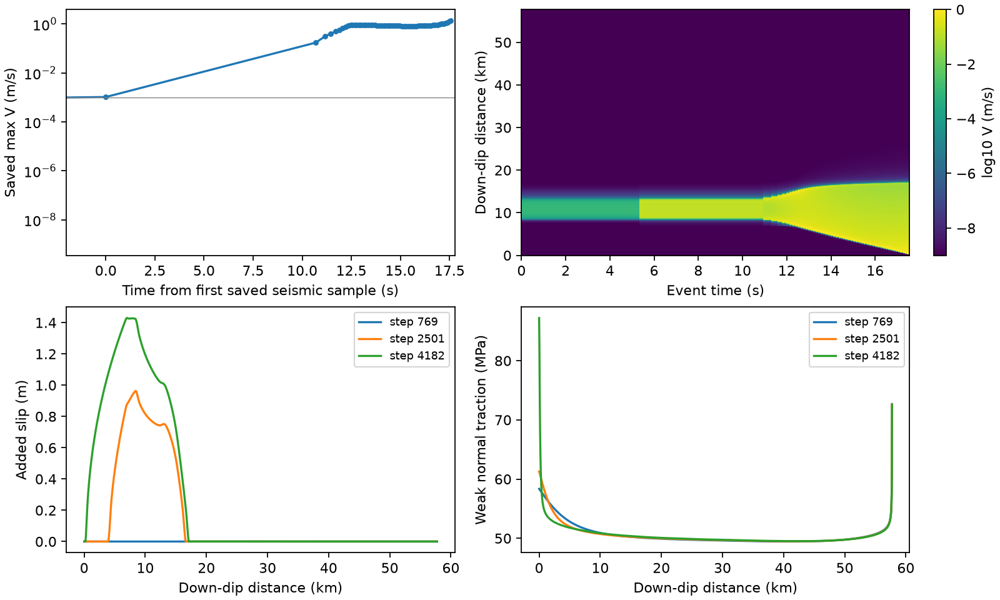

# BP3 review — supplied first-event outputs, 30 October 2026

The new `output_start/` and `output_resumed/` exports establish advancement
through accepted **4237**, not completion of the first event. The latest saved
profile is still accelerating. No new physical trajectory was launched for this
review. This is the production mature-fault formulation, not the newer cohesive
displacement-jump formulation.

## Provenance and available evidence

Review source: `pf-rsf-particle-free`, HEAD
`27178813cebd471b93a7a9308f41215b71b4a20b`, initially no tracked changes. Entry
and retained-binary identities are in
[entry.json](../../../benchmarks/reconstructed_fault/particle_free/evidence/objective_stress/entry.json).
The old BP3 executable has SHA256 `d62541e3fc2a1919…`; it is not asserted to
match HEAD or either remote executable. The cohesive executable is separately
protected, SHA256 `7277eebc663659e6…`.

The supplied exports contain original inputs, logs, 202 spatial profiles and
eight surface VTUs. The resumed stdout identifies job **3616642**, 160 ranks,
deal.II 9.7.0, Trilinos 16.2.1 and p4est 2.8.7. This differs from the local GCC12 /
OpenMPI5 / deal.II9.6.2 stack. Runtime configuration is printed in the log;
`original.prm` alone is not a remote source/binary manifest.

| Segment | Accepted log observations | Latest field export | Stop evidence |
|---|---|---|---|
| `output_start` | 0–815; final t=5172072493.8982706 s | 798 | Step 816 completes mechanics/publication, then the old observer check fails. It is not an accepted output record. |
| `output_resumed` | 816–4237; final t=5172072500.6796865 s | 4182 at 5172072500.6180401 s | Job 3616642 cancelled at the scheduler time limit, 2026-10-21 21:41:16; step 4238 had begun. |

The prior parent job3610007 and diagnostic replay3613912 stopped at the
documented observer-frame failure. The new resumed log starts at816, and its
`guard_uses_matching_frame=1` confirms the repaired observer. The earlier
homogeneous-Maxwell startup repair concerns a different failure at step zero;
neither repair changes constitutive physics or proves event accuracy. Keep
[both](BP3_DG_HOMOGENEOUS_COEFFICIENT_FIX.md)
[repair reports](BP3_DG_WORK_OBSERVER_FIX.md) and their failed evidence.

## Measured behavior and limits

The reduction is reproducible with:

```sh
python3 benchmarks/reconstructed_fault/particle_free/review_bp3_results.py
```

[JSON reduction](../../../benchmarks/reconstructed_fault/particle_free/evidence/objective_stress/bp3-review.json),
[profile history](../../../benchmarks/reconstructed_fault/particle_free/evidence/objective_stress/bp3-profile-history.csv),
[input hashes](../../../benchmarks/reconstructed_fault/particle_free/evidence/objective_stress/bp3-input-manifest.json).
The script reads supplied files and writes only compact new evidence. These are
sampled spatial profiles, not every-step maximum-rate observations.

- Using max V≥1e−3 m/s only as a reported seismic-onset diagnostic, the saved
  samples bracket onset between step769, t=5172072368.423655 s,
  Vmax=8.88198197e−5 m/s, and774, t=5172072483.057341 s,
  Vmax=.00103637749 m/s. The 114.63 s bracket reflects sparse pre-event export;
  an exact onset time cannot be reconstructed from these profiles.
- Largest **saved** rate is **1.37553298 m/s**, at4182, down-dip distance470 m.
  This is also the latest saved profile. No resolved post-peak decay or arrest
  is present. Do not call this the event's final peak or import the small
  cohesive-fixture decay criterion.
- Maximum added slip from the last saved pre-threshold profile through4182 is
  **1.42972732 m**. Maximum total slip over the whole fault is5.18460147 m,
  dominated by long-term/deep creep; it is not coseismic slip.
- At4182, minimum age is .00722202668 s; weak normal traction spans
  **49.5246–87.2168 MPa**, and weak driving shear26.3121–60.5650 MPa. Thus
  normal-traction feedback is substantial. These are work-measure projections,
  with normal filtering for friction; they do not bound raw sided tractions.
- Resumed positive dt spans .00106926097–.00745407 s. Logged nonlinear
  iterations reach index4 (five residual evaluations), with no rejected line
  search candidates. No actual timestep-repeat/cutback trace was found; the
  listed cutback *configuration* is not evidence of a rejection.
- Corrected observer maxima through4237 are6.55851e−7 Pa shear and2.86190e−7 Pa
  raw normal, below the unchanged1e−5 Pa guard. The largest logged DG
  publication error/allowance ratio is .00872612. These check internal
  consistency, not physical accuracy or the global energy balance.



Event-time comparisons and comparisons at matching added slip/front progress
must remain separate. There is one accelerating first-event prefix here;
repeatable earthquake cycles have not been established.

## External benchmark fidelity

The applicable [2021 BP3-QD/FD specification](https://strike.scec.org/cvws/seas/download/SEAS_BP3.pdf)
uses a homogeneous linear-elastic half-space, plane strain, ν=.25, dip30/60/90°,
evolving effective normal traction, aging RSF, and prescribed deep creep. Its
thrust slip is positive; QD radiation damping is G/(2cs). Friction varies with
down-dip distance, with H=15 km, transition3 km, and Wf=40 km. The seismic
reporting threshold is1e−3 m/s. The differently named `SEASBP3.pdf` is an older
antiplane problem and is not the reference for this dipping-fault review.

The supplied input matches the60° thrust sense, G=32038120320 Pa,
radiation4624440 Pa s/m, Dc=.008 m, Vp=1e−9 m/s, V0=1e−6 m/s and nominal RSF
coefficients. Live native geometry/loading and initial-state functions are in
`benchmarks/reconstructed_fault/bp3_native/server/plugin/`.

However, this source solves incompressible mixed mechanics
(`MulticomponentIncompressible` EOS and pressure multiplier), corresponding to
ν→.5 rather than .25. Other differences are finite150×50 km boundaries, diffuse
slip/phase localization (ell20 m), 10 m surface spacing, bulk mesh grading and
quadrature, Helmholtz20 normal filtering, positive-rate/contact restrictions,
and a very long but finite Maxwell time eta/G=3.12128e15 s. The simulated
~5.17207e9 s is small relative to that time, but does not remove the
compressibility or localization differences. Initial bulk tensor stress is a
perturbation about separately prescribed background fault tractions; a complete
bulk prestress tensor is not supplied by those two traction scalars.

Use **BP3-derived incompressible diffuse-fault calculation** until these
deviations are explicitly compared. Preserve `strict_reference_match_passed=false`,
the [resolution report's](PF6_MATURE_RESOLUTION_REPORT.md) spatial/endpoint
temporal failures, and raw sided-traction errors. A new spin law further changes
the infinitesimal-deformation benchmark; it must not replace the legacy control
or be calibrated to erase mismatches.

## Exact remaining data and next decision

The local exports still lack:

1. The accepted-step table, station/growth/event summaries and complete saved
   histories through4237 (particularly max V at4237 and the actual event flag).
2. The last-good checkpoint marker and accepted-state label from job3616642,
   with a manifest of complete160-rank restart payloads; retain those payloads
   remotely. A solve/publication line during4238 does not prove outer acceptance.
3. Resolved `parameters.prm`, actual launch/resume command and scheduler script,
   exact source revision plus dirty patch/archive and core/plugin hashes for
   each segment, plus confirmation of any later job/output after3616642.
4. Raw/filtered/sided normal and shear histories, full work/energy exports,
   restart/publication counts and final accepted spatial fields. The current
   weak profiles alone cannot establish their equality or energy closure.
5. Matched official participant/reference data with declared ν/domain/dip/sense,
   resolution and initialization. No quantitative external accuracy claim is
   possible from the available internal comparisons.

Retrieve these small records before selecting further production evolution.
Within this task the next justified numerical experiment is a bounded
spin-sensitive history-representation comparison, described in
[OBJECTIVE_STRESS_REPORT](OBJECTIVE_STRESS_REPORT.md); neither a long event replay
nor a server job is required to settle that question.
