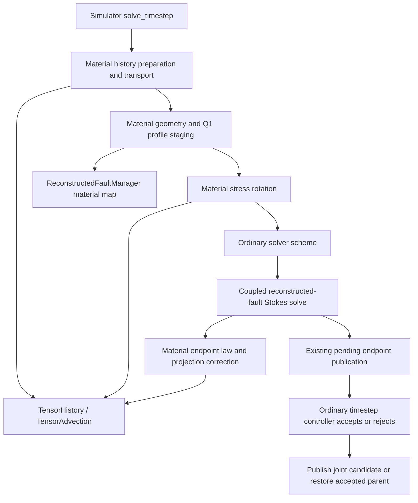

# Direct physical stress: model and code guide

This is the maintained code-level description of the growth-disabled mature
material path. [current_design.md](../current_design.md) and
[specification.tex](../specification.tex) govern its mathematics. Historical
reports are evidence, not alternate current architecture. The ordinary
[`Simulator::solve_timestep`](../../../source/simulator/core.cc) advances the
simulation. There is no separate mature timestep driver or configurable pipeline.

## Configuration and equation

Use a fixed Cartesian 2-D mesh, Q2 velocity/Q1 pressure and phase, one moving
mature curve with fixed material labels, constant G and prescribed positive
Eulerian viscosity eta(x,t). Explicitly select:

```text
subsection Material model
 subsection Phase field fault
  set Fault constitutive mode = mature frictional
  set Stress rotation = Jaumann DG material Lie
  set Bulk history representation = DG trial stress
  set Material stress representation = direct physical stress
 end
end
```

`DG trial stress` is the retained input spelling for the history discretization;
it does not make direct tau an auxiliary trial tensor. Growth must be disabled.
The bounded-profile/accepted-trace variant requires `Association support = full
normal cross-section`. The complete runnable example is generated by
[`run_aspect_architecture.py dc`](../../../benchmarks/reconstructed_fault/particle_free/transported_objective/run_aspect_architecture.py),
which copies the incoming tested arguments and refuses to overwrite output.
The `dl` case changes viscosity to the retained layered fixture. These are short
local controls, not production inputs. Stationary BP3 and cohesive elastic-slip
histories are distinct configurations.

For material spin W = (grad v − grad vᵀ)/2 and full 3-D plane-strain deviator
D₃, the physical law is

\[
 (\partial_t+v\cdot\nabla)\tau-W\tau+\tau W+(G/\eta)\tau
 =2G\{D_3(v)-\mathcal L[V]\},\qquad
 \mathcal L[V]=\chi\,\widetilde V\,\widetilde S.
\]

The stored in-plane components imply tau_zz = −tau_xx−tau_yy. There is no slip-spin
subtraction. Geometry normals follow the material map, not stress rotation.
Auxiliary Z is diagnostic in direct mode; the physical localized slip-rate source
remains in the law. Friction uses incoming age; the accepted surface lifecycle
ages it once.

## Components and normal timestep flow



The small material hooks in `solve_timestep` are explicit and ordered:
`prepare_material_history`, `transport_material_history`,
`stage_material_geometry`, `rotate_material_history`. They precede the existing
mesh/reaction/scheme dispatch. They neither call a global solver nor decide
acceptance. Material `evaluate` remains a constitutive response to assembly.

| Responsibility | Code to read or change |
|---|---|
| Model response, coefficients and localization | [`PhaseFieldFault`](../../../include/aspect/material_model/phase_field_fault.h), [`constitutive.cc`](../../../source/material_model/phase_field_fault/constitutive.cc), [`dg_objective.cc`](../../../source/material_model/phase_field_fault/dg_objective.cc) |
| Physical endpoint stress law | [`Rheology::mature_stress_endpoint`](../../../include/aspect/material_model/phase_field_fault/stress_law.h); [`make_material_reaction`](../../../source/material_model/phase_field_fault/stress_reaction.cc) supplies spatial coefficients/localized forcing |
| Tensor storage, spatial advection and projection | [`TensorHistory` / `TensorAdvection`](../../../include/aspect/material_model/history/tensor_history.h), [`tensor_advection.cc`](../../../source/material_model/history/tensor_advection.cc), [`distributed operator`](../../../source/material_model/history/tensor_advection_distributed.cc), [`tensor_projection.cc`](../../../source/material_model/history/tensor_projection.cc) |
| Material transport and rotation | [`stress_evolution.cc`](../../../source/material_model/phase_field_fault/stress_evolution.cc); uses shared numerical operators with explicit field evaluators |
| Curve/support geometry | [`ReconstructedFaultManager::stage_material_motion`](../../../source/reconstructed_fault/manager.cc); accepts sampled velocity/gradient, carries generic properties without interpreting friction |
| FE label sampling, candidate profile and normalization | [`material_geometry.cc`](../../../source/material_model/phase_field_fault/material_geometry.cc), [`profile_transport.cc`](../../../source/material_model/phase_field_fault/profile_transport.cc) |
| Friction law | [`rheology/fault_friction.cc`](../../../source/material_model/rheology/fault_friction.cc), consumed by the existing surface system |
| Physical stress access | [`physical_history_stress`](../../../source/material_model/phase_field_fault/physical_stress.cc); direct mode returns tau immediately |
| Coupled residual, tangent and projection-consistency iteration | [`solve_reconstructed_fault_stokes`](../../../source/simulator/solver/reconstructed_fault_stokes.cc), [`reconstructed-fault assembler`](../../../source/simulator/assemblers/reconstructed_fault_stokes.cc) |
| Preparation/rollback | [`material_history.cc`](../../../source/material_model/phase_field_fault/material_history.cc), coordinated by ordinary [`core.cc`](../../../source/simulator/core.cc) |
| Checkpoint/transfer boundary | [`dg_accepted.cc`](../../../source/material_model/phase_field_fault/dg_accepted.cc), [`dg_transfer.cc`](../../../source/material_model/phase_field_fault/dg_transfer.cc) |

## Discrete direct update

All transport and spin use the same accepted velocity v⁻, never a Newton trial.
Advection A_h is upwind DGQ2 with SSPRK3, substep count
max(1,ceil(dt*inverse_advection_time/.1)), bounded by 4096. Zero inflow remains
default; accepted-trace inflow freezes accepted coefficients throughout the
substeps. There is no reaction during this transport.

Vertices move by dt*v⁻ at accepted labels. Support widths transform with
(I+dt*grad v⁻)⁻ᵀ; Q1 phase is pulled back with the same velocity. Age and slip
memory follow material labels; relative slip is not their velocity. Staged
profile/geometry is bound before normalization and constitutive observations.
For Q = exp(dt*skw grad v⁻),

\[
 \bar\tau_h=P_h[Q A_h(\tau_h^-)Q^T],\qquad
 \tau_h^+=P_h[\beta\bar\tau_h+2\kappa D_3(v^+)-2\kappa\mathcal L^+[V^+]],
\]

where beta = exp(−G dt/eta), kappa = −eta*expm1(−G dt/eta).
Coefficient sampling and product projection are unchanged. Material tensor
projection receives the numerical history prototype, native cells, profile,
accepted velocity, quadrature order and evaluator explicitly. It never reads a
hidden material parent. The rotation/reaction quadrature is Gauss
max(8, configured bulk-normal order), with the retained local mass inverse and
owned/ghost MPI convention. This is the existing lagged Lie/endpoint update.

The coupled solver freezes the projection defect during an inner solve, then
`refresh_material_reaction` rebuilds it from the same rotated anchor. The defect
is projected physical stress minus the local endpoint law. Assembly adds it to
the physical response, retaining the local Maxwell tangent as the inner
linearization/preconditioner. The outer limit is 24 and relative-change criterion
128*machine epsilon. The final solve reuses the converged private slip guess and
passes the unchanged residual/KKT/publication gates. There is one coupled solver.

## State ownership and publication

| State | Meaning and owner |
|---|---|
| Accepted tau | `FEStrainState::dg_history` points to `TensorHistory` tagged `physical_stress`; `coefficients` owns xx/yy/xy DG values. At attempt entry `DGMaterialTrial::accepted_history` retains the accepted parent. |
| Transported tau | `TransportedHistory::physical_stress`, attempt-only scratch; no accepted mutation. |
| Rotated anchor | Candidate FE state's `objective_anchor`; fixed for all Newton/outer candidates. |
| Candidate geometry/profile | `DGMaterialTrial::candidate_history`, temporarily bound as `fe_strain_state`; binding is not acceptance. The manager has a matching staged clone. |
| Candidate stress | `FEStrainUpdate::dg_history`, computed by `make_material_reaction` from the fixed anchor and current bulk/slip iterate. |
| Derived correction | `DGMaterialReaction` retains the bulk/slip iterate and its reaction candidate for one outer iteration. |
| Derived spatial caches | FE samples, DG point/mass caches, associations and normalization; invalidated/rebuilt at lifecycle boundaries, not independent physical histories. |
| Surface state | Manager stores generic per-label properties; material/friction code assigns age/slip meanings. Cohesive physical elastic slip and formed-side tensors stay separate. |

`MaterialHistoryInputs` is a private read-only view of the accepted parent,
accepted velocity, time and dt. It avoids copying large fields. Tensor coefficients
and FE space belong to `HistoryDiscretization`, not a nested material container;
material state owns their lifetimes and constitutive interpretation.

The existing pending endpoint callback in `solve_timestep` joins candidate
publication to material cleanup. The normal timestep controller decides whether
to invoke it with acceptance or rejection. Acceptance publishes once and releases
the rollback owner. Rejection, recoverable no-candidate failure and escaping
exceptions restore geometry, bulk/profile/history, surface properties, particle
diagnostics and solver bookkeeping. A retry starts again from the accepted parent
at its new dt. Timestep zero uses existing initialization.

Serialization retains schema7 ordering, law/representation/material identities,
profile and surface data. Renaming the active coefficient member does not rename
or convert checkpoint packets. Caches/views/transport scratch are not serialized.
The retained schema6/stationary and cohesive paths retain their meanings.

## Retained separated representation and limits

Separated remains the default. It stores auxiliary T and R in the same numerical
component and reconstructs physical stress T−R−B, B=2 chi Z S. Its isolated
transport/rotation calculations evolve T and U=R+P_h B, then subtract mapped B.
Its endpoint updates Z, T and R consistently; direct tau never subtracts Z.
Both representations share spatial operators, stress access and mechanics. Their
discrete localization/projection errors need not coincide.

Default Q1 remapping and opt-in donor-bounded MacCormack are unchanged. The
transported profile is also the material irreversibility obstacle. Neither method
is a conservative remap. Moving AMR/birth, finite-end stress accuracy, coupled
energy/flux accuracy and independent cohesive tip/energy failures remain open.
This refactor establishes behavioral equivalence, not physical or production
qualification. See [architecture report](ASPECT_ARCHITECTURE_REPORT.md).
