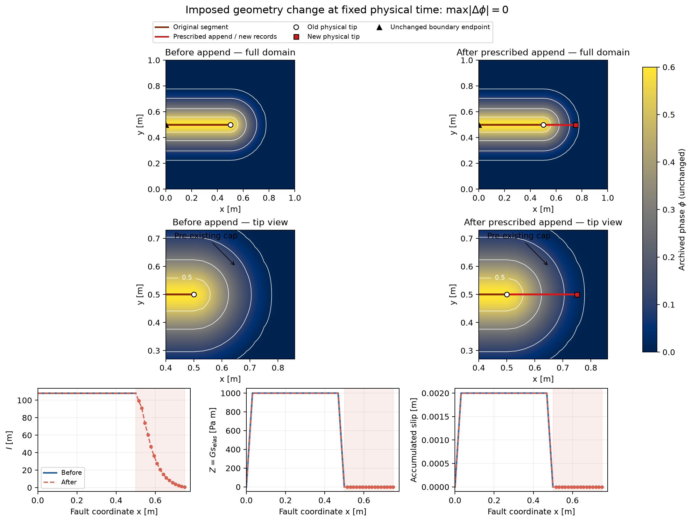
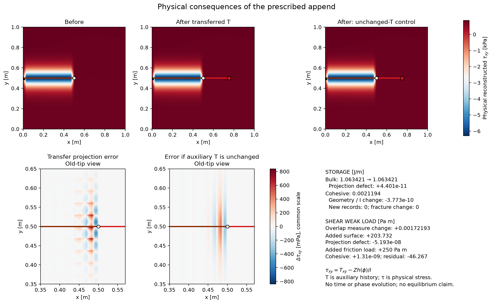

# P3 native frozen-append completion — closed

Accepted and closed within the scope below; finite-tip evolution remains a
separate task. Entry c8e4ae65d5d6750889a11e5a1956efd303e10a37, branch
`pf-rsf-particle-free`. This bounded test connects the previously verified
synthetic map to native owners. It is a prescribed zero-time append, not a
propagation criterion or a mechanically equilibrated evolving trajectory.
The [original report](P3_SYNTHETIC_EXTENSION_REPORT.md), P2 branch/accuracy
findings and `strict_reference_match_passed=false` remain evidence.

The unit square has 32×64 fixed cells and a straight seed from (0,.5) to
(.5,.5) m. Sixteen prescribed surface cells extend it to (.75,.5) m. The
compact phase seed is sampled directly at native Q1 nodes; its rounded cap
already reaches x=.80882 m (Q1 support .8125 m). New surface records lie in
pre-existing damaged material. The x=0 computational boundary has no added
completion wedge. Neither interior tip receives artificial continuation.

At fixed phase/physical obstacle, preserve old material, Z=G s_elas,
accumulated slip and rates; prescribe new Z, elastic/accumulated slip and rate
as zero. The old endpoint is also zero. No general nonzero-tip join or virgin
material birth law is selected. Transfer all nine modes with

`T+ = T- + Pi_DGQ2[2(Z+ chi+ - Z- chi-)S]`, `chi=h(phi)/I`,
`tau=T-2Z chi S`, `h=128 phi(1+phi)/(1-phi)^2`.

T and tau are in Pa, Z in Pa m, I in m. Full plane strain includes
zz=-(xx+yy) and both symmetric xy terms. Normal coefficients are untouched.
The material owns T/Z/I and its accepted phase anchor; the manager owns
q=Z/I, previous I, rate representations and the registered accumulated-slip
fixture property. Preserve Z and recompute q after changing I. Both the
simulator's current/old phase and the material obstacle remain unchanged.

The original loaded Z=1000 sin²(2pi x) case is retained. One preselected more
sensitive case uses a 1000 Pa m plateau with linear two-surface-cell tapers to
zero at both ends. It has the same nonproportional complete-Q2 T and constitutive
parameters. This changes prescribed input history, not the material law.

The native transaction rebuilds geometry-dependent data, publishes prepared
owners once through M5, and uses real Simulator checkpoints. Explicit serial
`no Advection, no Stokes` setup admits only this frozen diagnostic; finite-tip
mechanical and phase advancement remain forbidden. Version 5 checkpoints keep
geometry publications separate from physical publications; versions 1–4 and
defaults are unchanged. [Source audit](SOURCE_AUDIT.md) details ownership, cache
lifetimes, zero-interval observation and normalization corrections.

[Evidence, inputs and replay](../../../benchmarks/reconstructed_fault/particle_free/evidence/p3_native_completion/README.md)
retain the predeclared screens: independent normalization/projection/loads 1e-11;
stress, bulk-energy and weak-load defects <0.5%; exact identity, histories,
phase/obstacle, rejection/retry and restart. All pass, without changing tolerances.

## Two views of the actual native data

The red 0.25-m append was imposed inside the pre-existing diffuse cap. Phase
colors, contours (.01,.1,.3,.5), physical obstacle and spatial scales are identical
before/after. Native I is recalculated; old Z/slip survive and prescribed new
records (red points/shading) have zero histories. This is representation change,
not calculated physical growth or activation of virgin material.

Physical tau_xy is calculated from exported DG coefficients, phase, I and Z;
auxiliary T is not physical stress. The differences distinguish DG projection
remainder from the unchanged-T control. Added-surface loads are separately
accounted, not counted as transfer error. The loaded input is prescribed and
not equilibrated; no physical birth-energy/work law or evolution is tested.
PDF versions accompany both figures. They show the one more sensitive native
control; the original sinusoidal case is retained in the table and raw exports.

## Measured consequences

| Quantity | Original sinusoidal Z | Plateau/taper Z |
|---|---:|---:|
| Full-tensor transfer relative L2 | 2.11049e-7 | 6.43304e-6 |
| Unchanged-T relative L2 | 3.72706e-7 | 1.00077e-5 |
| Localization-weighted relative L2 | 3.10003e-7 | 7.63226e-6 |
| Largest T coefficient correction [Pa] | .0134196 | .501122 |
| Maximum physical cell integral defect [Pa m²] | 1.27e-16 | 1.68e-16 |
| Unchanged-T maximum cell integral defect [Pa m²] | 6.21e-7 | 1.63e-5 |
| Bulk storage defect [J/m] | +3.12e-11 | +4.40e-11 |
| Intended old-overlap cohesive storage change [J/m] | +4.96e-14 | -3.77e-10 |
| Weak-load transfer defect, relative maximum row | 3.11e-8 | 2.40e-6 |
| Intended overlap / added-surface shear [Pa m] | +.00172255 / +203.731741 | +.00172193 / +203.731741 |
| Integrated shear projection defect [Pa m] | -7.07e-10 | -5.19e-8 |

The stronger control meaningfully exercises the correction and restores physical
cell integrals, but the L2 improvement is only 1.56×. It does **not** improve
pointwise maxima: Gauss16 sampled full-tensor differences are .6873 Pa corrected
versus .6287 Pa unchanged-T; the 701² plot grid, using the right-cell trace at
interfaces, sees 1.1873 versus .6288 Pa. These are different sampling sets,
not uniform bounds. The visible cell-scale remainder is retained evidence.
No further history/taper search was performed.

For the plateau case bulk/cohesive/fracture storage initially is
1.06342141060 / .00211940385015 / 9.43534995312 J/m. New zero-Z records add zero
cohesive storage; fracture change is exactly zero. The old-overlap cohesive
change follows integral Z²/(2GI) ds; it is an imposed normalization/geometry
effect, not numerical dissipation. Friction adds exactly +250 Pa m to resistance.
Native integrated shear changes -1683.712176→-1479.978713 Pa m. Cohesive weak
resistance changes +1.31e-9 Pa m; the integrated residual changes -46.266537
Pa m after the added +250 Pa m friction resistance. Changing the
surface weak functional generates loads even while physical stress is almost
preserved; a zero residual/equilibrium claim would be incorrect.

Initial continuum-to-Q1 phase representation error remains .339721%, distinct
from zero phase/obstacle transfer change. Native minimum new I=.813411129 m;
maximum old-node I change=.050608458 m. Independent Gauss16 I agreement is
3.03e-15 relative; nodal-versus-Legendre projection agreement is at worst
2.10e-12 scaled; actual native weak loads agree within 1.98e-14 relative.
Native physical stress at independent Gauss3 points agrees within 7.28e-12 Pa.
The native constitutive m=128.00000000016001 follows the retained rounded Gc;
independent reconstruction uses that exported coefficient, not its rounded label.
The original Gauss8/12 component evidence remains; current native tangential8 /
normal12 results independently agree with Gauss16.

## Native lifecycle and integration corrections

Fresh and separate-process pre/post-append restart pass for both histories.
A zero-support append fails during native normalization and restores all accepted
owners. A fully prepared candidate with an invalid publication precondition is
rejected by M5; retry reproduces its DG candidate exactly. There is one geometry
publication and zero physical-step publications. Duplicate acceptance rejects.
All persistent T/Z/I, surface properties/rates, current/old/old-old solutions,
material phase anchor and particle IDs/coordinates/properties agree byte for
byte across restart and uninterrupted continuation. Reconstructed stresses and
native weak loads also agree. Fixed mesh: 2048 cells, 55296 tensor DoFs,
2145 physical phase vertices, 18432 fixed particles and 768 native constraints.

Three integration issues were diagnosed; their original failing logs are retained:

- Generic bootstrap normalization differed from canonical analytic FE values by
  at most 4.12813e-8 m (8.62568e-9 scaled), exceeding the 1e-12 restore check.
  A new geometry constructs canonical I through the **existing FE operator**,
  just as fresh initialization does. Bootstrap values are retained in CSV.
  Actual restart still recomputes/checks canonical I with its unchanged bound;
  no empirical tolerance multiplier, floor or modified normalization derivative
  is introduced. Independent high-order integration verifies the chosen values.
- Persistent birth rates stay exactly zero, while native friction evaluation
  requires V>=Vmin. Frozen load observation uses a temporary admissible rate
  argument. With the retained mu_s=mu_d=.1, zero damping and zero interval,
  the native rational friction law is identically .1 for every such argument;
  stress, cohesive traction and loads are unchanged. No persistent rate, rate
  bound or positive-interval constitutive rule is changed. This observation
  trick is not a nonzero-rate birth rule and does not qualify nonconstant/RSF
  friction at birth.

- The zero-time restart shortcut originally returned before native timestep
  setup rebuilt current boundary constraints (0 rows versus 768 when fresh).
  The shortcut now calls native `compute_current_constraints()` on resume.
  Final checks compare every constraint row and ledger as well as fields,
  stresses and loads; the pre-correction snapshots/log remain preserved.

Native search/QP maps, FE rays/basis and surface assembly are rebuilt and used
after commit and restart. Canonical surface/coupling/inverse caches are discarded;
Stokes rebuild flags are set. Bulk constraints remain unchanged on this fixed
mesh. No finite-tip Stokes matrix is assembled or solved: mechanical and phase
advancement explicitly reject, including after restart. Native MPI extension
is not qualified; the original component-only two-rank evidence retains its
original scope. The existing native suite also passes (131 cases).

## Boundary of this completion

P3 now has understandable physical output and a qualified **serial, zero-time,
zero-tip-history native ownership/restart path**, not merely a synthetic State
archive. No physical tip or general birth assumption was needed for this
restricted join. General nonzero-tip joins, newly activated material, finite-tip
mechanics/phase growth, RSF, AMR, transport and propagation remain later tasks.
The independent physical-step publication check remains unchanged; this
zero-time transaction does not qualify a subsequent Maxwell/phase step.
Particles still supply fixed diagnostic identity/coverage, the unloaded-start
check and native checkpoint population; they provide no domains, coefficients,
localization or authoritative mechanical history in this experiment.
All 34 protected BP3 identities and the incoming manual AGENTS changes are
unchanged. P2 strict branch/spatial/work limitations remain; no further task
starts automatically.
