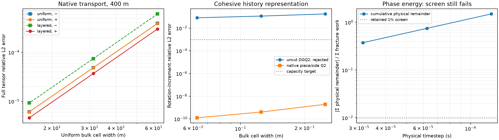

> Current update: the user-selected narrower continuation is recorded in
> [the coupled material report](TRANSPORTED_OBJECTIVE_STAGE_C_COUPLED_REPORT.md)
> and [energy/tip diagnosis](STAGE_C_COHESIVE_DIAGNOSIS.md). Complete mature
> material transport and heterogeneous coupled reaction are now implemented
> with bounded local evidence. Statements below that call those pieces missing
> describe the earlier stage boundary; its measurements/failures are retained.
> The subsequent [bounded-profile comparison](BOUNDED_PROFILE_TRANSPORT_REPORT.md)
> improves that complete mature transaction. Broader Stage C and production
> readiness remain incomplete.

# Stage C native integration and qualification record

Historical first Stage C record, 3 November 2026. At this checkpoint native
reaction/history integration, distributed transport operators and several
lifecycle checks had been verified, but the complete moving transaction had
not yet been connected. That transaction and coupled heterogeneous reaction
were subsequently implemented and locally checked in the coupled report
linked above. This earlier record establishes no production qualification.

The active task is [Stage C](CODEX_TRANSPORTED_OBJECTIVE_TASK.md). The equations
and owners remain in [the specification](TRANSPORTED_OBJECTIVE_SPEC.md) and
[the single formulation map](IMPLEMENTATION_MAPS.md). The executable reduction
is [assess_stage_c.py](../../../benchmarks/reconstructed_fault/particle_free/transported_objective/assess_stage_c.py);
[assessment.json](../../../benchmarks/reconstructed_fault/particle_free/evidence/transported_objective/stage_c/assessment.json)
contains measurements and per-run core/plugin/input hashes and commands.

## Scope and source identity

Work remains in `/home/ein/repository/aspect-pf-rsf-particle-free`, branch
`pf-rsf-particle-free`, HEAD `27178813cebd471b93a7a9308f41215b71b4a20b`, with the
retained dirty spin/observer/manual work plus the Stage C delta. No checkout,
reset, production checkpoint conversion, server submission or long trajectory
was performed. The three-example roadmap is unchanged; no realistic subduction
example is planned.

Before rebuilding, live pre-C controls were copied into
`build-particle-free/transported-objective/stage-c/controls/`. Original protected
controls and all three step748 restart slots remain intact. The rejected uncut
cohesive prototype core was also retained. Binary identity is recorded per run;
neither HEAD nor a filename is treated as proof of a binary's source identity.
The pre-C dirty source and original hashes are retained in
[entry evidence](../../../benchmarks/reconstructed_fault/particle_free/evidence/transported_objective/stage_c/entry.json).

## Mature matched-constant reaction path

`Material model/Phase field fault/Stress rotation = Jaumann DG Lie` selects an
experimental stationary-history reaction control. Default `legacy` and the
earlier particle option retain their meanings. This new selector does not
include bulk material advection or moving geometry. Its admitted configuration
has constant matched G/eta, frozen physical phase/geometry, accepted DG history,
plane strain and at least Gauss8. Restricted fixed-geometry mesh transfer is
supported; initial AMR and unsupported physical combinations remain guarded.

Let P be the common DGQ2 projection, B=2chi Z S, and Q=exp(dt Wminus), with
Wminus from the accepted native velocity gradient. Each attempt constructs

    Tbar = P[Q Tminus Q^T],
    Rbar = P[Q Rminus Q^T + Q Bminus Q^T - Bminus],
    tau_anchor = Tbar - Rbar - Bminus.

The finite B increment is evaluated with cancellation-resistant trigonometric
identities. It is not replaced by rotating R alone. Every native residual/load
and matching observer uses the same anchored physical stress. With
beta=exp(-dt G/eta), kappa=-eta expm1(-dt G/eta), publication is

    Tplus = beta Tbar + 2 kappa D3(vplus),
    Rplus = beta Rbar,
    Zplus = beta Zminus + kappa Vplus.

On the admitted affine Q2 cells, D3 is in DGQ2. Therefore reconstructed
Tplus-Rplus-Bplus equals the point stress actually solved, to measured
floating-point error. Spin is total FE spin; pressure receives no rotation and
no localized-slip spin is subtracted. All norms retain zz=-xx-yy.

R is attached to the accepted T owner. Derived anchors are keyed by parent,
step and actual dt; a rejected attempt cannot become the next parent. Native
ASPECT old-solution storage owns the accepted gradient field. Post-publication
observation uses the published endpoint rather than rotating it again.
Checkpoint schema6 stores T/R, surface scalars, phase/geometry and clocks;
old-to-new conversion is prohibited. Legacy schema4 remains unchanged.

The bulk tangent is the derivative of this explicitly lagged residual. The
represented A*dx and B*dV audit passes, including a nonzero slip probe and an
unchanged frozen load. An inherited diagnostic initially failed near equilibrium:
4.04e-8 residual roundoff was compared against6.44e-12, omitting the large base
A*x operands. The preserved pre-C core fails the same audit. The diagnostic now
uses its existing absolute-row-sum precision estimate for both base and direction.
No nonlinear, linear, contact, KKT or energy acceptance tolerance was relaxed.

## Distributed material-transport operator

`dg_objective_transport.cc` supplies owned-row DGQ2 upwind advection with ghost
reads and SSPRK3. Cartesian hanging faces are integrated as separate patches;
the material derivative includes the divergence correction. Explicit inflow is
required; periodic faces are rejected. Frozen nonnegative spatial relaxation
can be added by physical quadrature samples, and its global maximum enters the
explicit CFL. The existing serial PF4 diagnostic remains available unchanged.

This operator advances one independent tensor. T and R generally have different
inflow/source data, so the API rejects silently transporting an attached R with
T's callbacks. It neither publishes accepted history nor moves the curve,
profile, scalar histories or obstacle. The layered test is a numerical operator
control, not an enabled heterogeneous coupled constitutive configuration.

Uniform translation uses a nonuniform1MPa full tensor with widths180/160m,
c=+/-200m/s and duration2s, including exact inflow. Layered translation is
vertical, with r(y)=.5+.3tanh((y-637.25m)/120m) per second and an independent
log(cosh) characteristic integral. Source/operator Gauss8 and error Gauss10
are distinct. The protocol fixed CFL<=.1, finest relative L2<.005 and pairwise
orders>1.8 before the selected runs.

| Uniform cells | Constant-rate-free translation, minus/plus error | Layered translation, down/up error |
|---|---:|---:|
| 512 | 3.90218e-4 / 3.90086e-4 | 6.07615e-4 / 3.00127e-4 |
| 2048 | 4.88365e-5 / 4.88180e-5 | 7.44882e-5 / 3.70070e-5 |
| 8192 | 6.10717e-6 / 6.10473e-6 | 9.26419e-6 / 4.61362e-6 |

Orders are approximately three. One/two/four-rank translation controls and
separate hanging-mesh controls are retained. The first mesh study used BP3's
graded exterior, so it did not refine the whole pulse and cannot establish a
uniform spatial order. Those results remain; the correction was to the mesh
study, not its tolerance or physical profile.

## Material geometry owner

`ReconstructedFaultManager::stage_material_motion` adds private staging of
current coordinates and normal support widths for existing labels. Label
indices, generic age/slip/memory properties, signed orientation and committed
and prescribed rates remain unchanged. Each changed fault advances its
geometry generation; both staging and publication invalidate spatial caches.
Identity motion retains the original archive. A failed candidate leaves the
live owner untouched; the existing nonthrowing swap supports publication and
rollback. Native archive records persist the moved coordinates and histories.

The caller must supply physical coordinates/support from its chosen motion
law. The operation does not infer node velocity from relative slip, rotate
normals with stress spin, transfer a bulk profile, resample material labels, or
rebuild physical boundary completion. Such unsupported combinations remain
rejected. No transported runtime selector is enabled by this component.
Its tests use a nonuniform three-label curve and histories, translation in both
directions, and finite shear F=[[1,.65],[0,1]]. Independent normals use F^{-T}n;
association coordinates and distances, history identity, archive, rollback and
invalid/nonlinear-trial rejection are checked. Integrated material-step
qualification is still required.
Serial and four-rank runs pass93assertions in3cases per rank; maximum
inverse-transpose normal error is4.49301e-17. These are replicated container
tests, not a distributed bulk/profile transport qualification.

## Cohesive native remainder and lifting

The newer cohesive formulation remains distinct from production BP3. Its
physical tensor is tau=A+H, where A contains independent tensor history and the
complete native-gradient remainder, while H=2G K[b] is analytic lifting memory.
Its Maxwell reaction is backward Euler, with the existing bond/fracture,
pressure and sided-contact conventions.

Independent tests showed a new representation problem: the regular lifting
gradient jumps inside cut cells. Uncut DGQ2 rotation-increment errors are
.175956/.114089/.080873 on16/64/256cells, despite monomial moment errors near
1e-13Pa. All fail the unchanged1e-3 capacity target. More quadrature cannot
represent those jumps. The uncut runtime selector is explicitly rejected.

A piece/side Q2 capacity comparison passes at1.93e-9/4.04e-10/1.26e-10, using
1242/2916/9018 independent tensor coefficients. The implemented cut owner
reproduces these errors against independent Gauss12 component rotation, after
Gauss8 fitting. Weighted fits require full rank; no sliver floor, artificial
regularization or physical damping was introduced. The global DG projection
is retained as a derived compatibility/diagnostic cache; its storage is extra
and is not counted as independent history in those capacity counts.

`Cohesive RSF pilot/Stress rotation = Jaumann cut DGQ2 lagged Lie BE` is the
experimental fixed-geometry reaction control. It projects the complete finite
rotation increment of A+H into cut independent history, retaining the native
vector and its exact projection remainder. W is the accepted smooth velocity
gradient plus the regular analytic lifting gradient; the distributional jump
gradient is excluded. Subsequent BE source/relaxation retains its original
point recurrence. Scalar b is not tensor-rotated or discarded.

Only formed material geometry defines a persistent cut partition. Replaceable
zero-history candidate tails do not become history geometry. Accepted T,
native remainder, cut coefficients/basis bounds/partition snapshot and surface
material identities persist through one transaction and restart. A distinct
law/representation signature rejects the older uncut prototype checkpoint.
Fresh cut-law initialization also explicitly rejects the older checked
prototype trajectory import; matching native cut-law restart is the supported
continuation mechanism. The negative input test fails before reading a file.
Sided observations select both tensor and lifting on the same material side,
including when the interface crosses the interior of a bulk cell.

## Lifecycle and regression measurements

| Check | Measured result | Scope |
|---|---|---|
| Legacy accepted-step output | Byte-identical CSV against preserved pre-C core | Same matched mature fixture, three steps |
| Mature independent full-tensor moments | Maximum1.89e-10Pa, operand scales5.13e5–1.18e6Pa | Three accepted steps; R reaches13.893Pa |
| Mature reject/retry control | T/R coefficients exactly identical | Completed step rejected, actual dt halved; final cadence also respects inherited growth limit |
| Mature2->4rank restart | T error1.33e-8Pa; R error2.20e-13Pa | Five-step endpoint |
| Mature refine/coarsen | Physical T/R error3.84e-9Pa at1.54e6Pa scale; Z/I and publication count unchanged | 650->2600->674cells, plus following physical solve |
| Mature AMR then2->4rank restart | T error4.29e-9Pa; R exact | Same five-step endpoint after transfer |
| Cut cohesive restart2->4ranks | Tensor error6.78e-12Pa; native displacement error5.71e-19m | Partitions, bounds, material keys and vertices exact |
| Cut cohesive reject/retry | Full physical-history records exactly identical | Matching accepted-step cadence, phase and surface state |
| Cut component lifecycle | Exact checkpoint/zero-spin identity/retry; BE point recurrence passes | Three spatial resolutions |
| Old/new law mismatch | Rejected in both mature directions and uncut-to-cut cohesive direction | Mature BP3 identity guard fires first; cohesive configuration guard directly verified |
| Full unit suite | 183170 assertions /152 cases pass | Current native build, including material-motion ownership |

The first AMR check incorrectly required identical final cell IDs. Mesh
smoothing retains eight refined families, giving674 rather than650cells. The
replacement test compares the same physical tensor against original cell
polynomials at common points. Its unchanged2e-11 operand-scaled bound passes.
The earlier normalization-cache exception and exact-mesh expectation are both
retained. Accepted histories are not advanced by mesh transfer.

## Physical screens that still fail

The loaded fresh cohesive fixture uses G=1e6Pa, eta=1e8Pa s, Gc=1J/m2,
peak3000Pa, confinement10000Pa and1700Pa added initial shear. Over.001s it
exercises nonzero slip, damage and complete tensor rotation. It does not create
persistent extension. Numerical BE ledgers close, but independent physical work
is compared against storage/friction/radiation/Maxwell/fracture terms separately.
Rotation-projection energy is measured before reaction, not defined to close
the ledger.

| dt (s), steps | Cumulative fracture increment (J/m) | Cumulative physical remainder (J/m) | Remainder / fracture |
|---|---:|---:|---:|
| 1.25e-4,8 | 2.28882e-4 | 3.42486e-4 | 149.6% |
| 6.25e-5,16 | 2.32841e-4 | 1.74112e-4 | 74.8% |
| 3.125e-5,32 | 2.34706e-4 | 8.78602e-5 | 37.4% |

The physical error decreases at first order and fails the retained1% screen
at every tested dt. This does not explain away or repair the old trajectory's
separate20.8% fracture and spatial failures. Projection-energy totals in the
new fixture are below3.2e-12J/m; improving the lifting representation does not
remove the BE temporal error. No tolerance or physical parameter was tuned to
declare a pass.

A localized Airy-stress fixture prescribes all deviatoric components, with
3500Pa amplitude and.4m width at the seed tip. It fails `Native signed line
search failed`. The same load fails with legacy evolution and at half dt.
This is a numerical admission failure, not evidence of a fundamental spin-law
conflict. No new persistent-extension claim is made and no solver redesign or
load search was substituted for the failed evidence.

## Remaining work at the historical first Stage C checkpoint

At this checkpoint native material motion still needed to connect bulk T/R transport to transported
phase/profile, surface Z/age/slip, curve vertices, association/normalization
maps and accepted-gradient frames in one physical-step transaction. Resampling,
explicit computational-boundary inflow and solution-driven normal motion are
not qualified. Coupled heterogeneous reaction additionally needs its actual
projected residual derivative or a converged declared outer iteration. These
are unfinished implementation requirements, not claimed scientific conflicts.

Deformed cohesive evolution has the separate SPEC §8 design gate: current
arclength energy has power `integral psi_surface div_Gamma u_Gamma ds` and
lifting/native/pressure shape variations. Moving vertices while retaining the
fixed-geometry ledger would violate that selected energy. No reference-length
replacement or unselected compensating force was introduced. Cut tensor
history alone does not solve that coupling.

The next experiment selected at this checkpoint was a matched-constant moving-mature
transaction: transport the full curve/profile/Z/age and tensor state from the
same accepted velocity, with explicit inflow, then compare a nonuniform
translated field across several cells in both directions and force rollback
and restart. Integrate that transaction before enabling a transported selector.
Tip admission needs its independent legacy failure diagnosed before a growth
qualification or any production continuation. The paper's controlled crust and
propagation configurations remain not ready; Stage D/E are not complete.

## Reproduction, preservation and execution notes

Commands are in each retained `command.json`; fixture inputs and logs are under
`build-particle-free/transported-objective/stage-c/runs/`. The runner uses
OMP/deal.II/OpenBLAS threads1 and MPI ranks1/2/4, and now locks native simulations
sequentially. Native/source and checker builds use GCC12.4, deal.II9.6.2 and
OpenMPI5.0.6; the MPI runtime path is set explicitly. Rebuild matching checker
DSOs after class-layout changes. The reducer launches no simulation.

An early two-rank control overlapped a four-worker build, breaching the requested
worker limit; an early transport pair also overlapped. Subsequent native runs
were serialized, and resumed builds/runs respected the four-worker limit. Timing
numbers are preliminary, not scaling evidence. Earlier `/tmp` build/unit logs
did not survive interruption; per-run logs/inputs/results remain, and the final
unit/build evidence is retained in the worktree. Failed/stale-input and stale-
checker attempts are not counted as scientific passes.

Production BP3 remains accepted4237/latest spatial4182, still accelerating;
completion of its first event is not established. The protected native RSF
marker2/step748 at374.58003334330067s was not advanced or converted. Original
server outputs, inherited failed screens and the cleanup loss of39/45 older
native animation frames remain as documented in [CLEANUP_REPORT](CLEANUP_REPORT.md#legacy-animation-data-loss).
