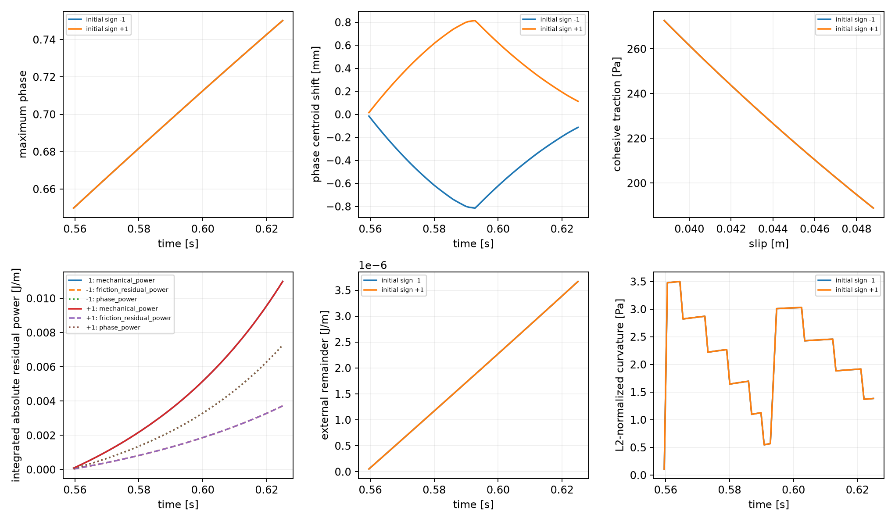
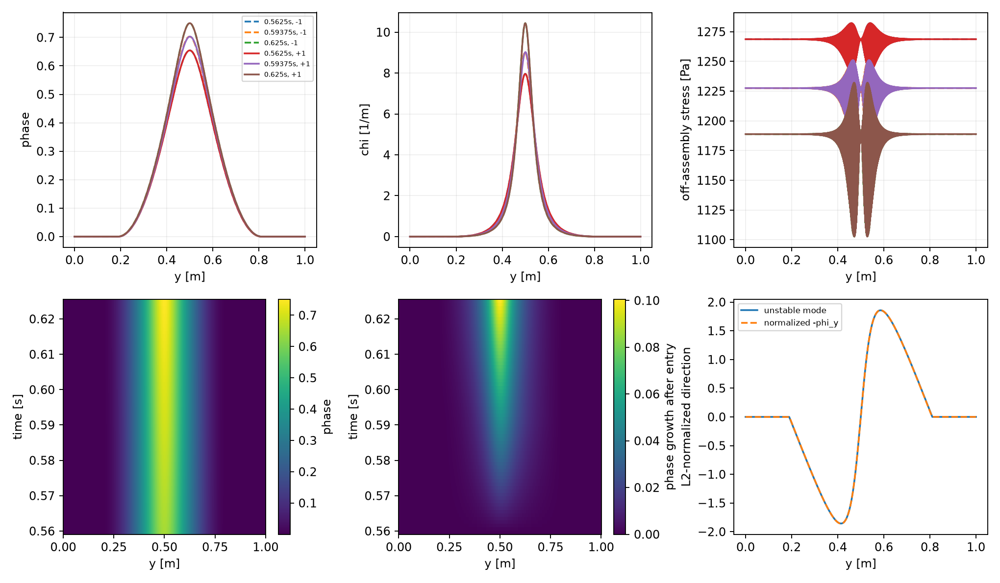
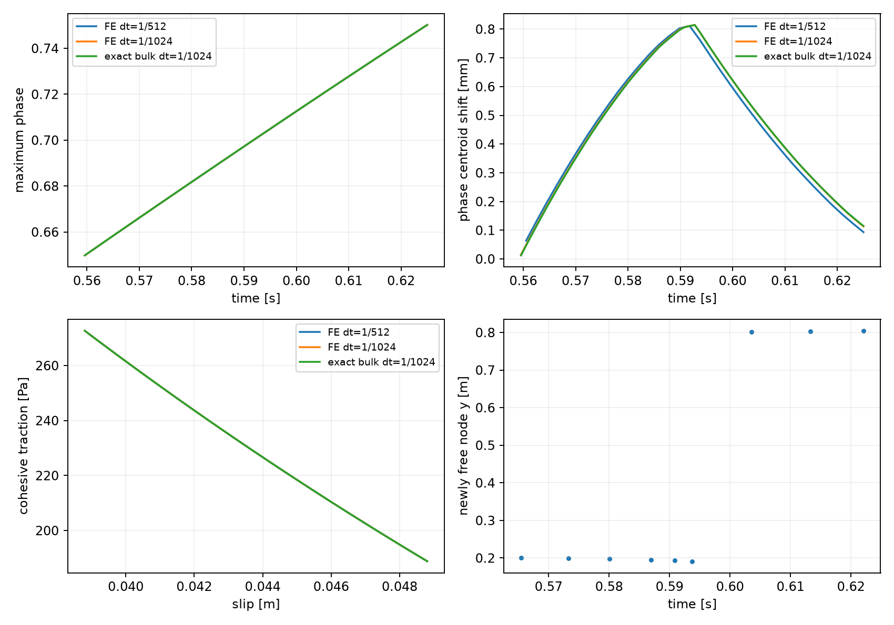

# P2 translation-mode and asymmetric-branch diagnosis

The unstable mode is almost a translation of the prescribed band. Both signs
lead to nearby stable, reflected equilibria, and diagnostic continuations reach
0.625 s. However, the release time and centroid motion depend on normal mesh
resolution and node placement. The exact-bulk control also develops the mode:
Q2 stress approximation is not its sole cause. These results resolve the
previous saddle stop numerically; they do not establish a physical preferred
asymmetry, an admissible finite jump, or P3 readiness. Production is unchanged.

## Fixed model and state

| Item | Setting |
|---|---|
| Domain / fault | Unit square, through-going y=0.5 m fault; fixed full-normal association |
| Spatial operators | Matching 1D reduction of native Q2 velocity/Q1 phase, six bulk points/cell, CPDI fracture; 64 surface segments |
| Normal meshes | 256 and 512 cells, center on a node; 511 cells, center halfway between nodes |
| Particles | Native 3×3/cell; regular three normal samples/cell; no transport or birth |
| G / eta / lambda | 10^6 Pa / 10^8 Pa s / 100 s; G is a dimensional synthetic verification value |
| c / Gc / ell / p / m | 1000 Pa / 26.6666666667 J/m² / 0.15625 m / 1 / 128 |
| Friction / pressure | Fixed mu=0.1, P=10000 Pa; radiation damping zero; no RSF evolution |
| Loading | ux=0.256 t(y−0.5) m/s, uy=0; identical interval-mean boundary loading |
| Conditions | Compatible lateral velocity conditions, natural phase boundaries |
| Initialization | Same nominal-core-0.6 physical seed and native particle H rule; relax independently on each mesh, then R=Z=slip=0 |
| Evolution | Instantaneous total recoverable energy; previous accepted phase is an immutable lower bound; H+ is diagnostic |
| Normalization | Retained consistent representation; exact Q1 transverse antiderivative in this tangentially uniform reduction |
| T / dt | 0.625 s; retained 256-cell dt=1/256,1/512,1/1024; 512-cell dt=1/512,1/1024; placement/exact controls at 1/1024 s |
| Numerical gates | Scaled KKT ≤10^-11, mechanics/contact ≤10^-7 Pa, healing allowance 4.922×10^-12 |

The 511-cell placement control changes spacing by only 0.196%, without moving
the physical seed, fault or boundaries. Each spatial control generates its own
particle sampling, relaxed field and accepted obstacle. Their initial maxima
are .6000571406, .6000152908 and .5999844628 for 256,512,511 cells. Initial
full-field differences from the 512-cell interpolation are reported separately;
subsequent differences cannot be attributed only to velocity-space error.
The exact-bulk control is freshly initialized in its quadrature-strain
representation; no FE or particle checkpoint conversion is performed.

## Meaning of the mode and continuum reduction

[Derivation and admissibility details](P2_asymmetric_branch_equations.md) use the
existing endpoint equations, including every normalization derivative. After
exact bulk mechanical elimination, stress is constant and the potential depends
on phase through I=integral h(phi)dy and fracture energy F. On the slipping set,

    J_red = L(Ge)^2/(2G) − Q^2 L I/[2G(L+I)] − mu P beta Z_a/G + F,
    Q=Ge−mu P, q=Q L/(L+I),
    delta J/delta phi = A(1−2 ell² phi_yy) − q² h'(phi)/(2G).

A localized smooth translation preserves I and F while it remains clear of the
boundaries. The compatible velocity conditions fix displacement difference, not
band position. The fixed previous-phase obstacle still prohibits translation
where it would decrease phase below the old profile. Strict contacts require a
zero critical direction; weak contacts permit only the admissible sign. Equal
boundary values and zero slopes give local first/second neutrality, not a global
translation symmetry for boundary-reaching tails.

The Q1 derivative is piecewise constant, and translated Q1 kinks generally
leave the fixed phase space. Consequently continuum neutrality does not imply a
zero discrete eigenvalue. The measured mode is compared with −phi_y using the
same spatial L2 measure. Curvature solves the consistent-mass generalized
problem A H_scaled v=lambda M_phi v with v^T M_phi v=1. Values below are
physical Pa in this unit-width reduction, not Euclidean nodal eigenvalues.
At each original symmetric failed entry the critical space has no weak contacts, and both small
mode signs are admissible. Refined controls are re-equilibrated before testing.

The regular CPDI fracture samples integrate this Q1 fracture functional exactly
in the uniform reduction. Discrete phase kinks, front/obstacle release and native
initial-H sampling remain distinct from Q2 mechanical approximation; this is not
evidence of a generic CPDI quadrature defect.

## Deterministic minimization and publication

At each failed symmetric entry the six starts are ±.25, ±.5 and ±.8 times the
verified two-sided L2 mode amplitude. Incoming R_a,Z_a, slip and the last
accepted phase bound are identical across all six starts. A projected Newton
minimizer evaluates the exact reduced potential/gradient/Hessian, uses a positive
search metric when curvature is negative, and explicitly escapes a stationary
saddle. The physical Hessian, energy and tolerances are unchanged. Candidates
must satisfy KKT, contact/mechanical balance, bounds and admissible positive
curvature. They are not equality solutions clipped afterward.

Continuation follows each sign separately, publishing once only after the
complete step passes. A previous-increment extrapolation is a solver guess in
the larger controls; it never replaces the immutable bound or accepted history.
An identical-entry repeat differs by <7×10^-10 in phase at the original target.
CSR storage of the existing Q2 derivative accelerates the harness; fixed-trial
potential, gradient, Hessian, R, q and V differences from dense storage are all
exactly zero. No generic projector or production equation changes.

## Release, candidates and mesh dependence

| Fresh control, dt=1/1024 | First saddle (s) | L2 curvature (Pa) | Cosine with −phi_y | Initial stable centroid shift (µm) | J reduction (J/m) |
|---|---:|---:|---:|---:|---:|
| 256 Q2 | .59765625 | −1.034476 | .99987337 | ±14.7554 | 3.61×10^-11 |
| 512 Q2 | .5595703125 | −.527067 | .99997182 | ±15.0098 | 3.52×10^-11 |
| 511 shifted Q2 | .556640625 | −.347150 | .99997398 | ±22.3270 | 1.36×10^-10 |
| 512 exact bulk | .5595703125 | −.527371 | .99997182 | ±12.2905 | 2.36×10^-11 |

These first events occur at different loads and obstacles. A same-time check at
.546875 s gives positive physical curvature .56086/.54176/.79449/.54152 Pa
in the same row order. Initial full-field differences from 512 are 8.98×10^-5
for 256 and8.00×10^-5 for 511, zero for the 512 exact control. This separates
normalization of the eigenproblem from equality of physical states.

The failed256 and512 entries release nodes at y=.19140625/.80859375 m.
With their original incoming states fixed, fractional-step probes bracket the
first admissible saddle as [.5976028442,.5976036787] s for 256 and
[.5594735146,.5594743490] s for 512. Each width is 8.345×10^-7 s. At the upper
ends, release margins are 8.12×10^-10 and5.69×10^-10 in phase; estimated Newton
correction uncertainty is 5.83×10^-12 and1.60×10^-11. Thus the release is resolved
at this bracket, without claiming arbitrarily precise contact timing. The
enlarged critical space changes from 157 to 159 nodes (256) and315 to 317 (512).
The curvature changes sign when the admissible space enlarges; this is not a
smooth zero crossing of an eigenvalue on an unchanged free space.

All **42 original perturbed-start solves** converge to stable candidates with
unchanged equilibrium/admissibility gates. The three amplitudes recover the
same two branches to numerical accuracy. At dt=1/1024, the full-field corrections
from the symmetric endpoint are 5.61×10^-5 /5.18×10^-5 /7.64×10^-5 /4.24×10^-5;
their L2 corrections are 2.99×10^-5 /2.78×10^-5 /4.11×10^-5 /2.28×10^-5.
Corresponding physical endpoint energy reductions are 8.91×10^-9 /5.10×10^-9 /
5.12×10^-9 /4.18×10^-9 J/m, distinct from the much smaller J reductions.
Stable candidate physical curvature is .08762/.11015/.30004/.10985 Pa.
The original line-search arithmetic allowance is 4.55×10^-13 J/m; original J
reductions exceed it by 52–299 times. The L2 starting amplitudes at fraction .5
are 1.17×10^-6 /2.41×10^-6 /9.53×10^-6 /1.96×10^-6; the other starts scale
these by .5 and1.6. No tolerance is increased to obtain these candidates.

Reflection holds for both candidate and continued fields: maximum phase
difference after reflection is 9.27×10^-10, FE-coefficient/strain difference
8.58×10^-11, and surface Z difference 2.86×10^-8 Pa m. FE R coefficients reflect
with odd displacement parity; exact-bulk strain reflects evenly. Physical slip
and traction agree for the two directions. The modes and centroid shifts are
normal to an existing band, not tip growth or propagation.

## Stable continuation and physical fields

Both signs complete every selected control to .625 s. Representative positive
initial-direction endpoints are:

| Control | Max phase | q (Pa) | Slip (m) | Final centroid shift (mm) | Largest continued phase increment |
|---|---:|---:|---:|---:|---:|
| 256, dt=1/256 | .74991375 | 189.048002 | .04880448310 | +.762914 | .00597334 |
| 256, dt=1/512 | .74991377 | 189.047990 | .04880448299 | +.762916 | .00299008 |
| 256, dt=1/1024 | .74991377 | 189.047988 | .04880448298 | +.762917 | .00149589 |
| 512, dt=1/512 | .75019390 | 188.834467 | .04880473001 | +.093414 | .00309935 |
| 512, dt=1/1024 | .75019361 | 188.834462 | .04880473001 | +.113303 | .00155025 |
| 511 shifted, dt=1/1024 | .75012259 | 188.834138 | .04880473034 | effectively zero | .00155310 |
| 512 exact, dt=1/1024 | .75020846 | 188.824662 | .04880474206 | +.114761 | .00155030 |

The 512 centroid peaks at +.81467 mm at .5927734375 s, then moves back; its
localization centroid follows within .15 µm. The 511 path peaks at +.54214 mm
at .5771484375 s and becomes centered around .602 s. Pointwise phase never
decreases: recentering does not imply healing. Boundary phase remains below
2.74×10^-10, so the large boundary-reaching tails of earlier restricted-mode
prototypes are absent here. This remains a uniform prescribed-band reduction.

Common-time comparisons use [.6015625,.625] s and identical slip-rate intervals
Vbar=[delta(b)−delta(a)]/(b−a), not rates from unequal time partitions.

| Temporal comparison | Max full-field difference | Max q difference (Pa) | Max slip difference (m) | Max common-rate difference (m/s) | Stress RMS difference (Pa) |
|---|---:|---:|---:|---:|---:|
| 256 cells: dt256→512 | 1.91×10^-8 | 1.20×10^-5 | 1.04×10^-10 | 8.67×10^-12 | 1.42×10^-5 |
| 256 cells: dt512→1024 | 4.74×10^-9 | 2.99×10^-6 | 7.69×10^-12 | 1.37×10^-11 | 3.53×10^-6 |
| 512 cells: dt512→1024 | 9.92×10^-5 | 5.66×10^-6 | 1.09×10^-11 | 4.39×10^-10 | .00872 |

Denominators denote 1/dt. Phase/q/stress differences on 256 decrease by about4;
the very small rate differences are too close to numerical uncertainty for an
order estimate. The 512 full-field difference is mainly a centroid difference
(maximum25.89 µm), while scalar traction/slip remain nearly unchanged. Only
one halving is measured there; no512 temporal order is claimed.

At the common final time,256 versus512 differs by .002818 maximum phase,
.001400 L2 phase, .21353 Pa traction,2.47×10^-7 m slip and .64961 mm centroid.
The comparable511 placement versus512 differs by .00047188 maximum phase and
.11330 mm centroid, despite only .000323 Pa traction difference. The 512 FE
versus exact-bulk comparison is much smaller:1.60×10^-5 phase,.00980 Pa
traction and1.46 µm centroid. Mesh-dependent front/phase representation controls
position more strongly than Q2 velocity approximation in these tests.

Off-assembly12/24-point checks show remaining stress oscillations. At .625 s,
whole/localization-weighted RMS about the section mean are 41.66/99.96 Pa on 256,
and10.48/25.17 Pa on 512. Independent24-point extrema on 512 are 1098.95–1233.58
Pa around mean1188.84 Pa. Bulk storage is .7067213 J/m;12→24 quadrature changes
it by<1.5×10^-14 J/m. Stress extrema depend on sampling density, so these are
sampled extrema, not rigorous extrema bounds. Exact-bulk control shows that
these oscillations are not the sole source of the translation instability.

The continued total increments halve; the small symmetry-breaking correction
at the identical 256 sampled entry remains roughly 5.6×10^-5. This alone cannot
distinguish an infinitesimal branch opening from a small finite transition at
the exact release. Additional near-bracket probes are retained separately below;
a lower endpoint energy does not prescribe a physical jump rule.

With the same original incoming state and fractional endpoint loading, probes
at 0,5,20 bracket widths above the upper release bound test that ambiguity.
At 20 widths (16.69 µs), stable reflected corrections shrink to 18.24×10^-6
phase /±4.80 µm centroid on 256, and 9.37×10^-6 /±2.72 µm on 512. On 256 at 5
widths they shrink further to 4.96×10^-6 phase /±1.31 µm, with positive curvature
.08714 Pa, but J reduction 2.6–2.9×10^-13 J/m is below the original arithmetic
allowance. Closest probes on both meshes, and the 512 five-width probes, have
one weak contact and unresolved minimum certification under the conservative
enlarged critical-space test. Six such unqualified fields are saved, not
published. Their small equality/KKT defects do not turn them into stable minima.

This load-approach test supports a small opening at front release rather than
a resolved large jump: qualified corrections approach the symmetric field as
the load approaches release. The exact zero-amplitude limit remains inconclusive
at the weak-contact/arithmetic floor. No finite transition or branch preference
is imposed. Near-event J gains at 20 widths are only 1.15–3.90×10^-12 J/m;
the much larger original-entry gains must not be substituted for these.
The first closest-probe run stopped at its stability assertion; the follow-up
records this failure explicitly, then continues only independent fixed-history
probes. A NumPy-bool JSON serialization defect in that new recorder was fixed
without changing any numerical calculation; both original logs remain.

## Energy interpretation

Every diagnostic step uses the same documented continuous path: phase varies
linearly, R and Z use general exponential Maxwell evolution from the single
incoming state, and chi and all normalization derivatives are recomputed. The
path is diagnostic, not assumed mechanically/phase equilibrated between ends.
Energy tables use the fixed 1 m tangential width and are per unit out-of-plane
length (J/m). The underlying normal integral is energy per unit fault area;
the fixed width cancels between Hessian and mass in the physical curvature test.

    W_reaction − Delta E − D_bulk − D_cohesive − D_friction
       = − integral [u_I.f_I + r_f V + g.phidot] dt.

Mechanical, friction and phase residual work retain separate signed totals,
sums of absolute step totals, integrals of absolute power, and maximum step
errors. Profile redistribution, normalization work and fracture expenditure
remain explicit alongside stored energies and physical losses. Frozen-incoming
profile cost is not relabeled as dissipation. The algorithmic potential J and
physical endpoint energy E are both recorded; a small reduction in J alone
does not qualify a finite jump.

For the **same late interval (.59765625,.625] s**, signed residual-work totals
are as follows. The sums of absolute step totals equal their magnitudes in this
interval; independently integrated absolute powers are also retained in JSON.

| Mesh / dt denominator | Mechanical (J/m) | Friction residual (J/m) | Phase residual (J/m) | External remainder (J/m) |
|---|---:|---:|---:|---:|
| 256 /256 | +.0981558 | −.0314479 | −.0667331 | +2.521×10^-5 |
| 256 /512 | +.0245424 | −.00786269 | −.0166860 | +6.304×10^-6 |
| 256 /1024 | +.00613581 | −.00196572 | −.00417167 | +1.576×10^-6 |
| 512 /512 | +.0249383 | −.00796965 | −.0169748 | +6.095×10^-6 |
| 512 /1024 | +.00623544 | −.00199235 | −.00424461 | +1.524×10^-6 |
| 511 /1024 | +.00620801 | −.00199657 | −.00421296 | +1.524×10^-6 |
| 512 exact /1024 | +.00624142 | −.00199351 | −.00424943 | +1.520×10^-6 |

Cancellation is substantial; the small remainder is not a proxy for small
individual defects. Every separate contribution decreases by approximately4
under halving on the common interval. Maximum mechanical/friction/phase step
errors on 256 are .01747/.005369/.01211 J/m at dt=1/256, falling to
.0002812/.00008589/.0001953 at dt=1/1024. The 512 values at dt=1/1024 are
.0002881/.00008753/.0002006 J/m. The full raw trajectory, including branch
entry, is also retained; different first-entry times are not used as a common
energy comparison.

For512 dt=1/1024, late bulk/cohesive/fracture changes are−.040668/−.343557/
+1.226901 J/m. Bulk/cohesive viscous losses are .00039745/.00261267 J/m;
frictional dissipation is 4.312724 J/m. Profile work is−.00421546 J/m,
normalization work−1.22692986 J/m, fracture work+1.22690070 J/m. All are
reported, including the large normalization/fracture cancellation. No
compensating dissipation or phase-driving term is added.

The maximum endpoint scaled KKT is 9.63×10^-12, mechanical residual2.35×10^-8
Pa and contact residual1.04×10^-10 Pa. Maximum identity error is 2.20×10^-13
J/m. Independent16→32 time integration changes selected signed/absolute
residual works by≤4.52×10^-13 J/m. Independent mode-gradient differences resolve
the negative curvature to≤2.97×10^-6 Pa and selected positive margins to
≤4.99×10^-6 Pa, against the smallest accepted margin .08762 Pa. Bounds and
healing checks pass with zero measured negative phase increments. Analytic I is
finite and positive;12/24 independent transverse integration agrees within
2.21×10^-16 relative at the selected evolved states. This uniform surface
constant reproduces exactly under consistent projection; it does not qualify
general along-fault projection accuracy.

## Highest-resolution visualizations

Only512-cell tests have new figures in this task. The overview starts at their
first asymmetric entry, not at t=0. Opposite-sign scalar curves overlap.

## Source changes and reproducibility

| File / function | Purpose |
|---|---|
| asymmetric_branch.py: MeshCoupled, ExactCoupled | Reuse FE equations at selected meshes; add the existing exact-bulk mechanical control with its consistent Schur tangent |
| mass, spectrum, centroid | Physical L2 curvature, derivative comparison, obstacle/contact classification and position diagnostics |
| minimize_phase, search_entry | Deterministic feasible perturbations and constrained descent that can escape negative curvature |
| first_instability, bracket, continuation | Fresh spatial controls, immutable-history event probes and separately retained reflected trajectories |
| exact_ledger | Same-path work/residual decomposition for analytical bulk balance, using boundary stress traces |
| assess_asymmetric_branch.py | Independent derivatives/integration, common-time comparisons, preservation checks and 512-cell-only figures |
| probe_asymmetric_release.py | Fixed-history fractional-load approach to release; retain weak-contact/unresolved trials without physical publication |
| This report / P2_asymmetric_branch_equations.md / handoff pages | Continuum derivation, results, evidence and scope |

There is no production-source or specification.tex equation diff in this task.
The existing dirty working baseline and all old failed trajectories remain.
Baseline: de7beaa65846c7372711f7922abf1c5d9a745ee6, fault-propagation.
Python/NumPy/SciPy versions, source digests and measured costs are in
asymmetric_branch_evidence/assessment/provenance.json and individual summaries.
Commands use OPENBLAS_NUM_THREADS=1 OMP_NUM_THREADS=1 from the repository root:

    python3 benchmarks/reconstructed_fault/propagation/asymmetric_branch.py search --denominator 1024
    python3 benchmarks/reconstructed_fault/propagation/asymmetric_branch.py prefix --cells 512 --denominator 1024
    python3 benchmarks/reconstructed_fault/propagation/asymmetric_branch.py prefix --cells 511 --denominator 1024
    python3 benchmarks/reconstructed_fault/propagation/asymmetric_branch.py prefix --cells 512 --denominator 1024 --exact-bulk
    python3 benchmarks/reconstructed_fault/propagation/asymmetric_branch.py bracket --cells 512 --denominator 1024
    python3 benchmarks/reconstructed_fault/propagation/asymmetric_branch.py continue --cells 512 --denominator 1024 --sign 1
    python3 benchmarks/reconstructed_fault/propagation/assess_asymmetric_branch.py
    python3 benchmarks/reconstructed_fault/propagation/assess_asymmetric_branch.py --check
    python3 benchmarks/reconstructed_fault/propagation/probe_asymmetric_release.py

Search additionally uses denominators 256/512; continuation repeats sign −1 and
the selected mesh/timestep controls. Prepare snapshots once; raw-case directories
reject accidental overwriting. Old short-branch and extension read-only checks
are also rerun. No native build/run, transport, birth, MPI, material search or P3.

Measured per-process costs (local concurrently run jobs, not native costs):512
fresh prefix 15.90 min/213 MiB before sparse-storage acceleration, selected 512
continuation 3.78 min/150 MiB; its dt=1/512 prefix 4.71 min/164 MiB and
continuation 3.96 min/149 MiB. The 511 prefix/continuation cost 17.38/10.36 min;
the exact512 prefix/continuation 5.66/2.72 min. Assessment takes 61.7 s/275 MiB.
Python 3.14.7, NumPy 2.5.2, SciPy 1.18.1, single BLAS/OpenMP threads. Original
source/evidence preservation checks cover 1105 files; old short and extension
checks pass while retaining their historical failed full-interval gate.

The bounded task is complete. Stable diagnostic continuation is now available,
with decreasing late time-path errors. Spatially qualified band position and a
physical branch-selection interpretation remain open. A useful next bounded
question is phase-front/obstacle discretization versus initialization dependence;
no new constraint, kinetic law, native integration, material tuning or P3 is
selected by these results.
