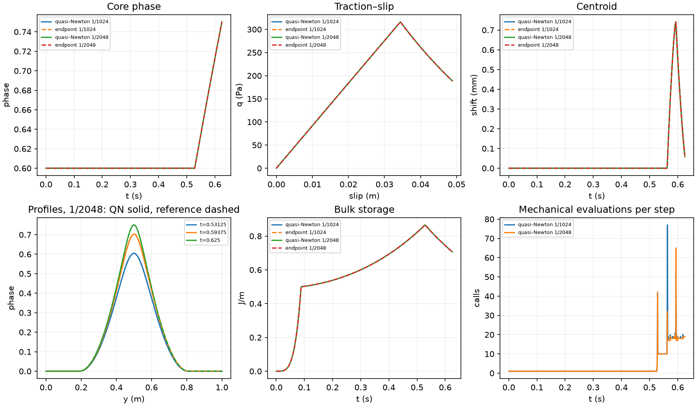
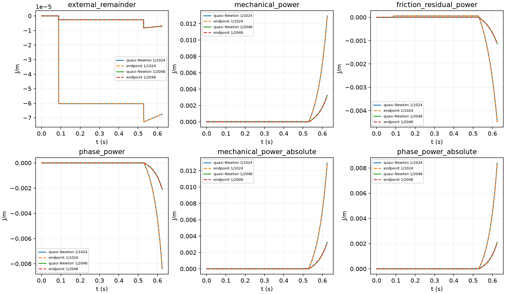

# P2 cheaper endpoint coupling search

The quasi-Newton prototype reproduces the existing stable endpoint solution
at the unchanged physical accuracy in less time: **67.34/136.51 s**, against
retained endpoint timings **279.94/383.92 s**, at dt=1/1024 and1/2048 s.
The largest same-schedule phase difference is3.85e-8/8.14e-9; all seven
field targets pass. A four-corrector staggered baseline does not converge at
growth entries and remains unstable at the known saddle even with tiny KKT.
The one-rank native growth screen was stopped at the user's request after
36min49s:90 completed mechanical trials and last KKT5.24e-8 versus4.20e-13.
No complete state was accepted/published. The prototype gain does **not**
transfer to a demonstrated native gain. Retain the existing Newton reference;
remaining native growth/saddle/rank tests and any full run are deferred.

## Fixed settings and accepted reference

| Quantity | Setting / units |
|---|---|
| Domain / fault | Unit box, horizontal through-going y=.5 m; fixed full-normal association |
| Native / matching prototype mesh |16×512 Q2u/Q1p/Q1phase;512-cell Q2 normal mechanics/Q1phase |
| Integration / surface |Six normal bulk points, existing intersection rule and CPDI fracture;64 Q1 segments, consistent I projection |
| Particles / history |73728 fixed particles,3×3/cell; FE d_R and surface Z authoritative; no transport/birth |
| G / eta / lambda |1e6 Pa (dimensional synthetic verification value),1e8 Pa s,100 s |
| c / Gc / ell / p |1000 Pa /26.6666666667 J/m² /.15625 m /1 |
| Friction / normal pressure |Fixed mu=.1, prescribed P=10000 Pa; radiation/body/background shear zero |
| Initialization |Shared continuum-relaxed prescribed nominal-core-.6 seed; d_R=Z=slip=0; seeded particle H unchanged |
| Loading |Interval mean of ux=.256t(y−.5), uy=0; top/bottom imposed, side uy=0/natural ux; natural phase |
| Time / displacement |T=.625 s; same .05-m top-to-bottom displacement at both dt |
| Phase conditions |Immutable previous physical phase <= phi <1; prototype scaled KKT<=1e-11; native original entry target; unchanged line-energy allowance |

The reference is native_endpoint_evidence/dt-1-1024 and dt-1-2048. Neither
accepted histories nor obstacles are recentered/reflected; no global reflection
is needed for these prototype comparisons. Independent24-point stress sampling
uses retained fixed scales1332.521975 Pa and.887807407 J/m. Final reference slip
and fixed peak rate supply the existing nonzero slip/rate scales.

## Entry screen and cost

All timings below are new one-thread sequential measurements. Construction of
the common initialization/Gram factor is outside the scoped entry timer and
identical between methods. Whole trajectories below include it. Bulk factor
applications often have many RHS: report them separately from calls rather
than treating a dense Hessian assembly as one cheap native solve.

| Entry / search | Seconds | Mechanical evaluations | Reduced Hessians | Bulk factor calls / RHS | Phase linear solves | Accepted stable endpoint |
|---|---:|---:|---:|---:|---:|---|
|early /endpoint|1.175|3|3|9 /1548|2|yes|
|early /staggered-4|0.908|5|1|7 /524|4|no|
|early /quasi-newton|0.457|11|1|13 /536|0|yes|
|saddle /endpoint|3.635|8|9|26 /4642|0|yes|
|saddle /staggered-4|1.272|5|1|7 /524|4|no|
|saddle /quasi-newton|1.076|63|2|67 /1154|0|yes|
|late /endpoint|1.599|4|4|12 /2064|3|yes|
|late /staggered-4|1.757|5|1|7 /524|4|no|
|late /quasi-newton|0.503|22|1|24 /558|0|yes|

Early uses core-4 at.529296875 s; the known saddle is the retained.5654296875-s
entry with dt=1/256 and its exact incoming Ra/Za/obstacle; late is the final
1/1024-s entry. The saddle diagnostic is distinct from fresh first release.
Four staggered correctors leave scaled KKT1.59e-5/5.25e-5 at early/late.
At the saddle KKT3.85e-14 is small, but admissible mass-normalized curvature
is−.4213 Pa: it fails stability. Quasi-Newton escapes once and gives+2.8222 Pa;
early/late have+.18074/+1.38305 Pa. Full-field errors against retained stable
entry solutions are1.71e-10,1.11e-11,2.71e-9. The extra mechanical evaluations
are measured, not hidden behind the smaller outer iteration count.

## Full prototype paths

| dt | Accepted steps | Whole time s | Mechanical evaluations | Bulk calls / RHS | Reduced Hessians | Phase linear solves | Max KKT | Max phase increment |
|---|---:|---:|---:|---:|---:|---:|---:|---:|
|1/1024|640|67.34|2244|2450 /57430|103|0|9.45e-12|0.00157390|
|1/2048|1280|136.51|4226|4634 /113308|204|0|9.35e-12|0.00078728|

Both fresh trajectories reach.625 s, have byte-identical initialization to the
reference and exact same total loading, and pass bounds, zero-healing, positive
normalization(I>=108.64890 m), mechanical/contact and Maxwell-recurrence checks.
No exact Newton polish was needed. Curvature checks dominate the remaining
prototype cost:103/204 actual Hessians are stability checks, not search solves.
Timers for Hessians, mechanics and stability are nested and must not be added.
Retained endpoint whole timings have the same host/thread configuration but
were not rerun; their whole-trajectory action counts were not retained.

| Observable | Same-dt error1024 /2048 | Successive-halving error | Existing target |
|---|---:|---:|---:|
|Full-field phase|3.848e-08 /8.135e-09|5.358e-05|0.001|
|Traction Pa|1.065e-07 /7.025e-08|2.586e-06|1|
|Slip /fixed final slip|2.182e-12 /1.441e-12|2.95e-10|0.001|
|Common-interval rate /fixed peak|6.77e-10 /8.877e-10|7.707e-08|0.005|
|Whole stress RMS /fixed scale|2.228e-09 /3.388e-10|3.448e-06|0.01|
|Localized stress RMS /fixed scale|6.17e-09 /8.692e-10|9.7e-06|0.01|
|Bulk storage /fixed scale|1.577e-10 /9.774e-11|1.493e-08|0.01|

The solved u,V are constant interval rates chosen to balance the endpoint.
Rate comparisons use cumulative slip over identical intervals, not instantaneous
endpoint values. With growth threshold1e-6, full-field onset brackets are[.52734375,
.5283203125]/[.52734375,.52783203125]s; core onset brackets[.5283203125,
.529296875]/[.5283203125,.52880859375]s, matching endpoint. Both trajectories
escape first at.5625 s and follow the same positive-centroid branch. Phase
reaches about.75019 at.625 s, traction188.8343 Pa and slip.04880473 m. This is
widening of a prescribed band, not propagation or a qualification of positional
selection, transport, general spatial accuracy or all native angular modes.

## Separate energy accounting

Use exactly the retained continuous diagnostic path: linear phase over a step,
exact general-beta Maxwell internal states at fixed interval rates, actual
normalization and its derivative. Intermediate residual work is measured, not
converted to compensating dissipation. With M,C,Phi the mechanical, friction
and phase residual works, Wext−DeltaE−D=−M−C−Phi. This identity diagnoses the
chosen reconstructed path; it is not an assertion of exact physical path
closure. Stored bulk/cohesive/fracture, viscous/friction losses and profile
terms remain independently recorded in energy.json.

| Contribution J/m | dt1024: signed /integral absolute /max step | dt2048: signed /integral absolute /max step |
|---|---|---|
|external_remainder|-6.751793e-05 /7.803168e-05 /6.029936e-05|-7.014192e-06 /9.655805e-06 /5.64773e-06|
|mechanical_power|0.01294946 /0.01294957 /0.0002880404|0.003237535 /0.003237562 /3.619295e-05|
|friction_residual_power|-0.004480813 /0.00460152 /8.753179e-05|-0.001132625 /0.001137972 /1.098623e-05|
|phase_power|-0.008401129 /0.008405834 /0.0002005635|-0.002097895 /0.002105486 /2.521358e-05|

Cumulative storage, loss and residual-work differences are below1e-9 J/m;
the separately evaluated incoming-profile-cost difference is4.09e-7/5.80e-8 J/m.
no cancellation conceals the separate absolute contributions. Refinement trends
and limitations are those of the endpoint reference, not an energy-model change.
The incoming-state profile cost remains a separate signed diagnostic(4.28988/
2.14877 J/m cumulatively); it is not inserted as dissipation or a driver.

## Native screen: interrupted, not qualified

The default-off option preserves the existing reduced-Newton branch, true
energy/KKT acceptance and saddle checks. The prototype's sparse base inverse
is used for quasi-Newton; the existing balanced translation inverse remains
in the Newton branch. No tangential uniformity, centering or physical operator
approximation is imposed. The native test uses retained core-6 at.53125 s,
including the complete-step publication path. This is a scoped retained-entry
diagnostic, not fresh evolution from0 to.53125 s; it does not qualify the
coarse-prefix cumulative energy that generated its incoming fixture.

| Native screen | Result / cost |
|---|---|
| Configuration |16×512,1rank,1thread, package0 physical core0; original targets and inputs plus explicit QN flag |
| Observed elapsed to last output |2208.99s(36min49s); interrupted on user instruction |
| Last completed search iteration |16(zero-based):17 accepted search updates;90 completed mechanical trials, with further in-flight work |
| Last scaled KKT /original target |5.23654e-8 /4.19520e-13; about1.25e5 times target |
| Logged inner linear solves /iterations |169 /5802; includes completed work in the unfinished solve |
| Actual tangent actions |0 before interruption; no final stationarity/curvature check reached |
| Physical publication /fields |No complete state accepted or published; no final field or storage-equivalence result |
| Original Newton cost on same entry |664.10s accepted-entry time /716.93s whole process on1rank;717.18s accepted entry on4ranks (retained prior evidence) |
| New4rank growth and1/4rank saddle |Not run, following the user's stop-and-report instruction |

The true-energy search updates are not physical accepted timesteps. The
residual initially falls then improves slowly while many trials are rejected.
There is no basis to declare an arithmetic-floor stall or to relax acceptance.
The measured native cost is already greater than the accepted reference, so
this option is **not recommended for a full native trajectory** on these data.
The2208.99-s observation includes initialization;716.93s is the corresponding
complete-process reference. No exclusive growing-entry timer was emitted at
interruption. Native stability would use the existing resolved translation
probe rather than an exhaustive angular spectrum; it was never reached here.
A concrete future numerical diagnosis would compare the native search-set
conditioning and actual directional energy/gradient agreement before expanding
its preconditioner or launching more long tests. Governing equations need not
be changed on this evidence.

The launcher was interrupted; its separately spawned MPI child was then
explicitly terminated and both PIDs verified absent. The initial sandbox launch
failed before ASPECT because OpenMPI could not discover an available interface;
that2.11-s launch is retained separately and is not numerical evidence. The
local run uses executable3257574451ef and observer8d0060654edb; exact hashes,
inputs and command are archived in native/*-start.json. Interrupted counters
and stop status are in native/*-interrupted.json; no final timing/peak-memory
summary was emitted, so detailed exclusive timing and growing-step memory are
unavailable. No remaining benchmark process or full trajectory is left running.

The MPI runner now handles driver interruption by stopping its child session
and archiving the outcome. A real isolated-process regression verifies this
cleanup without executing ASPECT or MPI. Release build and original compatibility
checks pass:21,105 assertions in54cases; git diff --check passes. All retained
reference data and prior MPI evidence are preserved.

## Changed files and purposes

| Kind / file | Function / purpose |
|---|---|
|Production include/aspect/phase_field.h|SolverParameters: default-false search flag |
|Production source/simulator/phase_field.cc|declare_parameters, parse_parameters: document/read Endpoint quasi-Newton search; no physical parameter |
|Production source/simulator/solver/reconstructed_fault_endpoint_phase.cc|solve_reconstructed_fault_endpoint_phase: free-set inverse-BFGS search, clear secants on escape, preserve actual-energy/KKT/curvature and once-publication; count inverse calls/updates |
|Benchmark cheaper_coupling.py|Measured operator calls, immutable retained entries, sparse-metric search, four-corrector control, fresh full paths |
|Benchmark assess_cheaper_coupling.py|Unaligned common-time/interval targets, recurrence, separate energy comparison and charts |
|Benchmark run_cheaper_coupling_native.py|Reuse existing MPI runner with explicit QN inputs, one/four-rank tags and cap; preserve failed launch evidence |
|Benchmark run_native_mpi.py /check_native_mpi_cancellation.py|Handle interrupted driver without orphaning its child; verify process cleanup and outcome archival (no ASPECT/MPI numerical run) |
|Documentation AGENTS/current_design/specification/STATUS/PLAN/CURRENT_STATUS/README/report|Record current authorized scope, numerical algorithm, gates and evidence separately from physics |

No CMake, material, projector, normalization operator, physical bounds or
history-publication law changes. Incoming MPI/manual source edits and earlier
failed trajectories remain preserved. Native equivalence/branch/cost gates remain incomplete; the existing Newton
reference remains recommended. No further test is authorized by this report.

## Algorithm details

For each phase x, solve mechanics anew from immutable incoming d_R^a,Z_a,
forming J(x)=E(x,d_R^b(x),Z_b(x))+(kappa/G)mu P V(x). The exact gradient
is the existing fixed-endpoint phase gradient, including the normalization
adjoint. The admissible set remains phi_a <= x < 1.

The quasi-Newton search uses limited-memory inverse BFGS (30 secant pairs).
On the current free search set, apply the SPD sparse inverse
B_0=(K_F/A+diag(mass))^{-1}, then the usual two-loop recursion with
s=x_{k+1}-x_k and y=g_{k+1}-g_k. Restrict stored pairs to the current
set and use only positive s^T y > 1e-12 ||s|| ||y||. The mass shift and
secant approximation are search metrics; they change neither J nor its Hessian.
Restrict B_0 again when the set changes. Project trial directions to the
original physical obstacle and perform the unchanged true-J Armijo search
with its original arithmetic allowance. A small-defect existing exact Newton
polish is permitted and counted separately.

At every stationary candidate, evaluate the actual reduced tangent on the
admissible critical space. Resolved negative curvature triggers the same
bounded positive-orientation diagnostic departure as the endpoint reference,
clears search memory, and restarts from the same incoming histories. KKT
alone never accepts a saddle. The native algorithm, if the trajectory gate
passes, retains its existing analytic/finite-difference curvature verification
and full velocity/pressure/slip/tangential degrees of freedom.

Four ordinary staggered correctors provide a bounded baseline: hold the
current scratch endpoint mechanical state while minimizing phase, then
reconstruct the next endpoint from d_R^a,Z_a again. Never evolve from a
trial endpoint or advance the physical obstacle. All physical publication
occurs once, only after complete endpoint acceptance.
