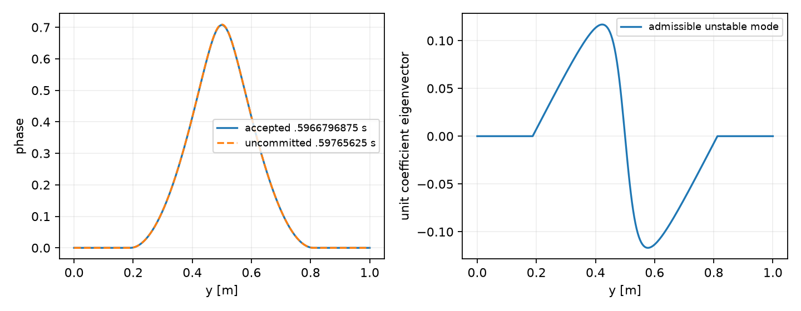
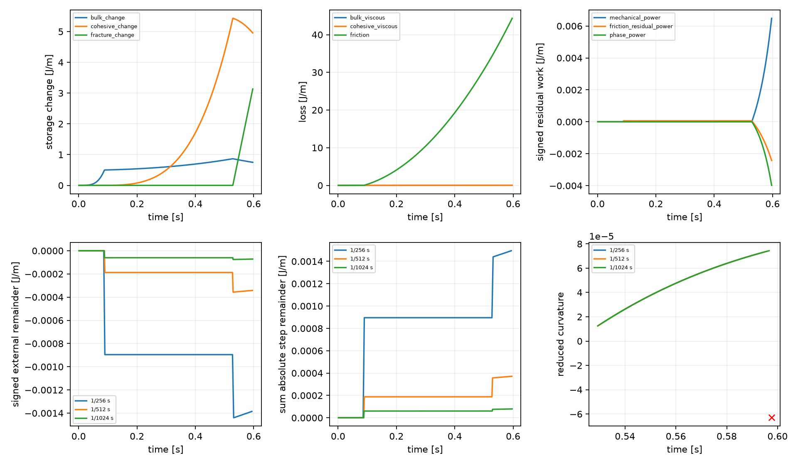

# P2 coupled-branch continuation: stability blocks the requested endpoint

**The stable branch could not be continued to 0.625 s with the existing
algorithm.** All three timestep paths reach a converged but unstable symmetric
trial at **0.59765625 s**. It is retained without publication. Before that point,
phase, traction, slip and stress agree closely under refinement, and the separate
energy-error contributions decrease. The new limitation is an independently
resolved admissible antisymmetric mode of the mechanically reduced phase
problem, rather than an inaccurate root or an inconsistent incoming state.
Existence and selection of another stable branch remain unresolved. Production,
physical settings and tolerances are unchanged; no native adoption or P3 follows.

## Settings and continuation

| Item | Retained value |
|---|---|
| Geometry | Unit square; fixed through-going fault at y=0.5 m; full normal association |
| Spatial operators | Matching 1D reduction of native 16×256 Q2 velocity/Q1 pressure/Q1 phase; six normal bulk points/cell, CPDI fracture, 64 fault segments |
| Particles / normalization | Native 3×3/cell, frozen positions and histories; consistent normalization with analytic transverse reference in this uniform reduction |
| G / eta / lambda | 10^6 Pa / 10^8 Pa s / 100 s; G remains a dimensional synthetic verification value |
| c / Gc / ell / p / m | 1000 Pa / 26.6666666667 J/m² / 0.15625 m / 1 / 128 |
| Friction / pressure | Fixed mu=0.1, prescribed P=10000 Pa; zero radiation damping; no RSF evolution |
| Loading / boundaries | ux=0.256 t(y−0.5) m/s, uy=0; interval-mean loading, compatible lateral conditions, natural phase conditions |
| Initial state / bounds | Identical unloaded relaxed nominal-core-0.6 seed, zero FE R and surface Z at t=0; immutable previous-accepted phase lower bound |
| Requested interval / dt | 0–0.625 s; dt=1/256, 1/512, 1/1024 s |
| Numerical gates | Scaled phase KKT 10^-11; mechanical/contact residual 10^-7 Pa; healing allowance 4.922×10^-12 |

Each path resumes **its own accepted 0.5625-s state** from the previous fresh-start
family. The combined evidence preserves that entire prefix exactly, including
phase, FE R, Z, velocities, slip and energy rows. This is continuation in the same
prototype representation, without checkpoint conversion or history reinitialization.
All iterations recompute mechanical trials from immutable incoming R,Z and bound;
only a successful complete stable step publishes once.

The equations and continuous diagnostic energy path are unchanged from
[the derivation](P2_coupled_branch_equations.md). In particular, phase KKT uses
the partial derivative of E(phi,R_b,Z_b) at fixed endpoint internal variables,
while stability uses the exact mechanically reduced Schur tangent of the
algorithmic potential J. General exponential Maxwell relaxation is retained.
There is **no specification.tex equation diff** in this task.

## Physical comparison and the stopping point

| dt | Added accepted steps | Last accepted time (s) | Failed trial time (s) | Trial max phase / increment | Reduced minimum |
|---:|---:|---:|---:|---:|---:|
| 1/256 | 8 | .59375 | .59765625 | .70892250 / .00597089 | −6.3111886×10^-5 |
| 1/512 | 17 | .595703125 | .59765625 | .70892252 / .00298234 | −6.3111877×10^-5 |
| 1/1024 | 35 | .5966796875 | .59765625 | .70892252 / .00149038 | −6.3111875×10^-5 |

Comparisons use **the common accepted interval ending at .59375 s**, never the
different last-accepted times. At that time the finest core phase is .70295163,
traction 227.667285 Pa, slip .0438912628 m, and applied displacement difference
.045125 m. Phase remains centered at y=.5; normal-boundary phase stays
9.27×10^-11. From .5625 to .59375, phase and localization half-maximum widths
change .241061→.234751 m and .102670→.088808 m respectively: these widths use
each profile's own increasing peak and do not measure fixed-contour tail advance.
The released phase region nevertheless expands. This is a fixed prescribed-band
normal reduction, not a propagation or general 2D localization test.

| Successive halves | Max full-field phase difference | Max q difference (Pa) | Max slip difference (m) | Whole / localized stress RMS difference (Pa) | Common-interval rate difference (m/s) |
|---|---:|---:|---:|---:|---:|
| 256→512 | 1.54×10^-8 | 1.36×10^-5 | 1.04×10^-10 | 2.10×10^-4 / 2.10×10^-4 | 2.59×10^-8 |
| 512→1024 | 3.84×10^-9 | 3.41×10^-6 | 7.67×10^-12 | 5.36×10^-5 / 5.36×10^-5 | 2.59×10^-9 |

These maxima include the original onset interval. In the added common interval,
whole/localized stress differences are 1.30×10^-5/1.57×10^-5 Pa and
3.27×10^-6/3.93×10^-6 Pa. Slip rates are interval averages, compared using
[delta(b)−delta(a)]/(b−a) over identical intervals. Their late differences are
below 6×10^-14 m/s, so no rate convergence order is inferred there. Largest
accepted phase increments remain .00628155/.00314620/.00157354. No persistent
finite phase jump has been demonstrated before the stability stop.

[Late histories](../../../benchmarks/reconstructed_fault/propagation/coupled_branch_extension_evidence/assessment/tail.png),
[phase/chi/stress profiles at common times](../../../benchmarks/reconstructed_fault/propagation/coupled_branch_extension_evidence/assessment/tail-profiles.png),
[common-interval rates](../../../benchmarks/reconstructed_fault/propagation/coupled_branch_extension_evidence/assessment/common-rate.png).

## Stability diagnosis

All incoming states satisfy coupled phase/mechanical/contact conditions with
their proper previous bounds. The failed trials satisfy phase KKT to
6.46×10^-14, mechanical residual to 8.92×10^-9 Pa, and contact residual to
2.23×10^-11 Pa; bounds and complementarity pass. They are stationary saddles.
The reduced tangent has one negative eigenvalue and next eigenvalue .0201320;
the fixed-mechanical-history tangent is positive (.0403675). Thus a frozen-history
curvature check would miss this instability.

Two outer nodes, y=.19140625 and .80859375 m, leave their previous bounds.
The free set has 159 nodes, with no weak lower contacts. The unstable eigenvector
is antisymmetric to 3.26×10^-12 and has peak magnitude near y=.421875/.578125 m.
It shifts the band normally; either sign is admissible for sufficiently small
perturbations. The two-sided admissible amplitude is at least 3.734×10^-5.
Independent gradient differences at amplitudes 10^-5, 2×10^-5 and 3×10^-5
resolve the negative curvature with uncertainty ≤5.0×10^-11. Both signs at
3×10^-5 decrease J, with scaled changes about −2.9×10^-14, consistent with
the quadratic prediction. Identical-entry solves reproduce all three trials
exactly. The eigenvalue is given in the existing E/64-Pa scaling and Euclidean
nodal coefficient norm, not as a mesh-independent physical modulus.

This establishes loss of admissible stability of the **computed symmetric
discrete branch**, not absence of all coupled equilibria or a continuum
instability. The near-front active-set change and possible asymmetric branch
require diagnosis before selecting a continuation rule. No phase noise,
symmetry restriction, kinetics, artificial loss or new branch-selection rule
has been introduced to bypass the existing gate.

## Separate energy errors

All work, storage and losses use the same linear-phase/exact-Maxwell diagnostic
path and spatial measures. Intermediate equation residuals are measured explicitly:

    Wext − ΔE − Db − Dc − Df = −∫(u_I·f_I + r_f V + g·phidot)dt.

External work uses boundary reactions. Bulk-rate and affine-lifting integrals
remain in the evidence separately. The table covers the **same added accepted
interval .5625–.59375 s**, with energies in J/m.

| dt | External remainder signed / sum absolute steps / max step | Mechanical residual work | Friction residual work | Phase residual work |
|---:|---:|---:|---:|---:|
| 1/256 | +2.76938×10^-5 / 2.76938×10^-5 / 3.49853×10^-6 | +.0595046 | −.0219542 | −.0375781 |
| 1/512 | +6.92485×10^-6 / 6.92485×10^-6 / 4.37854×10^-7 | +.0148779 | −.00548896 | −.00939587 |
| 1/1024 | +1.73130×10^-6 / 1.73130×10^-6 / 5.47626×10^-8 | +.00371959 | −.00137227 | −.00234905 |

Each residual power keeps one sign on this late interval; its integral of absolute
power equals the magnitude shown. Cancellation makes the external remainder
much smaller than the three individual errors. Each cumulative contribution
decreases by about four per halving; max step errors decrease by about eight.
The full **common 0–.59375-s** external remainders are
−.00138513/−.000342654/−.0000720304 J/m; sums of absolute steps are
.00149497/.000370963/.0000791079. Onset remains important to those totals.

At 1/1024 the late bulk/cohesive/fracture storage changes are −.0510835 /
−.274713 / +1.427647 J/m; bulk/cohesive viscous losses .000486903/.003208404,
friction 4.665687. Bulk profile work is −.00220046 and cohesive normalization
work −1.4277955 J/m. Both remain part of the energy derivative; neither is
omitted or relabeled as dissipation. Boundary work is 5.7712346 J/m and bulk-rate
work 5.7749542; their difference is precisely the mechanical residual work.
The affine lifting differs from reaction work by ~1.5×10^-12 J/m for this
special symmetric path, without establishing a general equivalence.

The uncommitted failed-entry path is reported separately: external remainders
3.51233×10^-6/4.39483×10^-7/5.48918×10^-8 J/m also decrease. Signed frozen
incoming-state profile costs are +.833841/+.213885/+.0541615 J/m. These costs
are distinct from instability and from viscous dissipation. No D_relax is added
to the continuous-path ledger; all older split-path D_relax evidence is preserved.

[Full signed, absolute and maximum ledgers](../../../benchmarks/reconstructed_fault/propagation/coupled_branch_extension_evidence/assessment/tables.json).

## Changes, checks and decision

| Changed file / functions | Purpose |
|---|---|
| benchmarks/.../extend_coupled_branch.py: prepare/trajectory | Resume same-partition accepted state; preserve prefix, trial isolation, one publication and every-step reduced stability |
| Same: late_verification/diagnose_failed | Independent tangent, admissible energy perturbations, incoming checks, identical-entry repeats and 16/32-point path uncertainty |
| Same: assess/compare/late_plots/check | Compare common accepted times/rates; separate failed entries and residual ledgers; check Maxwell recurrence, bounds, normalization and preservation |
| This report; STATUS/PLAN/CURRENT_STATUS/current_design, benchmark READMEs, AGENTS.md | Record the completed bounded attempt, measured stability blocker and next question |

**No production-source changes.** Accepted KKT/force/contact maxima are
9.62×10^-14 / 9.80×10^-9 Pa / 7.42×10^-11 Pa. Independent normalization
integration and its derivative pass to <10^-11 relative; analytic reference and
consistent representation remain unchanged. Selected time quadrature uncertainty
is ≤4.78×10^-13 J/m. Newton-correction uncertainty is ≤3.50×10^-11 phase.
Energy chain-rule closure, recurrence, immutable anchors, bounds/healing and
1060-file preservation checks pass. These numerical passes do not remove the
stability failure. Added run costs are 28.00/43.52/59.06 s, peak RSS
104.7/106.5/115.0 MiB, with overlapping one-thread jobs.

Baseline remains de7beaa65846c7372711f7922abf1c5d9a745ee6, fault-propagation;
Python 3.14.7, NumPy 2.5.2, SciPy 1.18.1. Evidence and commands:
[provenance.json](../../../benchmarks/reconstructed_fault/propagation/coupled_branch_extension_evidence/provenance.json).
Read-only check:
`OPENBLAS_NUM_THREADS=1 OMP_NUM_THREADS=1 python3 benchmarks/reconstructed_fault/propagation/extend_coupled_branch.py check`.

The bounded attempt is complete, with the requested .625-s endpoint **not
qualified or reached**. The next concrete question is stable asymmetric
continuation at the newly released front, including whether this is discrete
pinning. A justified branch-selection/transition decision is needed before
physical continuation. Native integration, material optimization and P3 remain
deferred.
