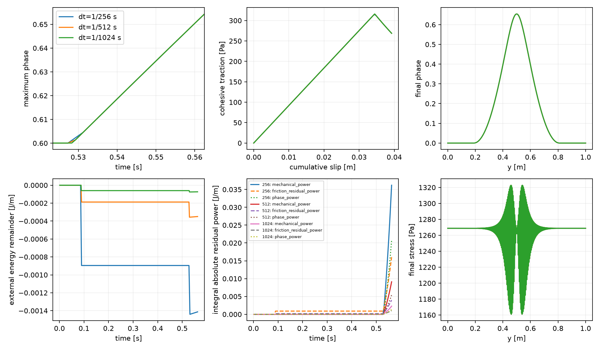

# P2 consistent-endpoint onset branch and continuous energy audit

**A stable, smoothly growing coupled branch exists over the tested short
interval.** Fresh unloaded trajectories at all three partitions complete to 0.5625 s,
covering onset and a short growing interval. Core phase grows from 0.60005714 to 0.65436713;
the largest increment halves with dt. Coupled endpoint residuals pass, admissible
reduced curvature is positive, and intermediate residual work decreases. The
previous saved replay entered with a substantial phase defect: its large catch-up
correction does not demonstrate an instability of this properly loaded branch.
Production is unchanged. The later fast-tail interval, full 0.625-s trajectory,
native transfer and P3 remain unqualified.

## Settings and initialization

| Quantity | Setting and units |
|---|---|
| Domain / fault | Unit square; fixed through-going y=0.5 m, full normal association |
| Spatial model | Matching discrete 1D reduction of 16×256 native Q2/Q1; Q1 phase, six bulk Gauss points/cell, 64 fault segments |
| Particles / normalization | Native 3×3/cell (768 normal samples), frozen; consistent I, analytic transverse integral for this tangentially uniform field |
| G, eta, lambda | 10^6 Pa, 10^8 Pa s, 100 s; G is a dimensional synthetic verification value |
| c, Gc, ell, p, m | 1000 Pa, 26.6666666667 J/m², 0.15625 m, 1, 128 |
| Friction / pressure | Fixed mu=0.1; prescribed P=10000 Pa; zero radiation damping, no RSF evolution |
| Loading / boundaries | ux=0.256 t(y−0.5) m/s, uy=0; interval means; compatible lateral uy=0/natural ux; native phase natural conditions |
| Accepted state | FE coefficients R, surface Z, phase, cumulative slip; seeded H is not the total-energy phase driver |
| Seed / evolution bounds | Native nominal-core-0.6 seeded-H relaxation; originally unloaded R=Z=0; evolution phi_a<=phi<=1 |
| Interval / dt | Fresh 0–0.5625 s; 1/256, 1/512, 1/1024 s (144/288/576 steps) |
| Numerical gates | Unchanged scaled phase KKT 10^-11; absolute prototype bulk/contact check 10^-7 Pa; healing allowance 4.922×10^-12 |

The **last unchanged-seed checkpoint**, .5263671875 s, passes mechanics/contact
but fails phase KKT (7.08×10^-8 versus 10^-11). The required fallback is therefore
fresh unloaded initialization: R=Z=slip=0, zero bulk/phase defects, positive stick
gap 1000 Pa. All three runs start with identical relaxed phase and particle H.
No artificial startup growth occurs. Earlier .5234375-s consistent-checkpoint
runs remain separate controls in coupled_branch_evidence, with archived source.

## Precise replay classification

For the historical last saved 1/1024 entry at 0.625 s:

| Finding | Measurement | Interpretation |
|---|---:|---|
| Incoming endpoint bulk / contact | 8.85×10^-9 / 2.75×10^-11 Pa | Mechanical/contact conditions pass |
| Incoming phase KKT | 0.00518968 | Already violates coupled phase condition |
| Corrected endpoint bulk / contact / phase | 8.73×10^-9 Pa / 3.09×10^-11 Pa / 4.31×10^-13 | Numerical coupled conditions pass on independent reevaluation |
| Signed incoming-state profile cost | +159.949129 J/m | Frozen incoming-R,Z energy comparison; **not dissipation** |
| Phase increment | 0.0529164 | Large catch-up from inconsistent incoming state |
| Reduced tangent at sequential / corrected trial | −0.00928293 / +0.08587886 | First point is nonstationary; corrected constrained equilibrium locally stable |
| Original jump-path ledger residual | +160.073279 J/m | Preserved historical signed-release ledger |
| Continuous-path external remainder | +0.125178411 J/m | Different, explicitly documented path; still not an equilibrated transition |

Continuous replay mechanical/contact/phase residual works are **+4.64797730,
−0.03391190, −4.73924381 J/m**, with absolute integrals equal to their magnitudes.
Cancellation hides large intermediate defects (472.5 Pa / 251.5 Pa / .593).
The residual-inclusive identity closes to 3.1×10^-14 J/m; this is not an equilibrium
or physical energy-balance pass. Original failures remain byte-identical.

## Equations and common energy path

| Item | Native / earlier sequential calculation | New diagnostic prototype |
|---|---|---|
| Phase condition | Bound KKT of E(phi,R_a,Z_a) | Bound KKT of E(phi,R_b,Z_b), derivative at fixed endpoint R_b,Z_b |
| Mechanics | Endpoint after incoming-history phase solve | Same endpoint force/contact equations, eliminated at every phase trial |
| Tangent | Fixed-history phase tangent | Mechanically reduced Schur tangent on the admissible critical cone |
| History | Accepted once at terminal publication | Same incoming anchor for every trial; complete step committed once |
| Energy path | Instantaneous phase change then fixed-profile Maxwell path | Continuous linear phase interpolation with simultaneous exact Maxwell R(s),Z(s) |

The complete derivation is in [P2_coupled_branch_equations.md](P2_coupled_branch_equations.md).
It includes the -Z chidot stress term, the consistent projection's adjoint and
all normalization derivatives. With f=D^T W tau and r_f=mu P+q−chi^T W tau:

    Edot = Wext_dot - Db_dot - Dc_dot - Df_dot
           + u_I^T f_I + r_f V + g^T phidot.

Work uses FE boundary reactions; bulk-rate/lifting work remain separate. The
path has zero Maxwell rate residuals, but measured intermediate equilibrium
residuals. No D_relax or compensating loss is inserted; frozen profile cost is
a separate comparison.

## Physical and energy errors

These are unshifted common-time comparisons. Stress uses independent 12-point
samples; energy and coupled equations retain the selected six-point rule. Rates
are **interval averages**: compare cumulative-slip differences over identical
intervals, never the different last-interval rates as endpoint velocities.

| dt (s) | Max phase increment | Max phase difference to next half | Max q difference (Pa) | Whole / localized stress RMS difference (Pa) | Max common-interval V difference (m/s) |
|---:|---:|---:|---:|---:|---:|
| 1/256 | .00628155 | 1.54×10^-8 | 1.36×10^-5 | 2.10×10^-4 / 2.10×10^-4 | 2.59×10^-8 |
| 1/512 | .00314620 | 3.84×10^-9 | 3.41×10^-6 | 5.36×10^-5 / 5.36×10^-5 | 2.59×10^-9 |
| 1/1024 | .00157354 | Not independently referenced | — | — | — |

Common-time slip errors are 1.04×10^-10 / 7.67×10^-12 m; bulk-storage errors
1.98×10^-7 / 5.30×10^-8 J/m. Final q=268.75229 Pa, slip=.039225576 m.
Finest full-field/core onset brackets are [.52734375,.5283203125] /
[.5283203125,.529296875] s (fixed 10^-5 seed-relative threshold). Small errors
reduce near second order; this does not establish a general scheme order.
Newton-correction uncertainty is <=7.89×10^-11; an identical-entry repeat is exact.

All energies below are per unit out-of-plane length (J/m). Parentheses give
the sum of absolute step remainders. Residual-work columns give integrals of
absolute power, including within-step sign changes.

| dt | External remainder, whole interval | Smooth remainder after .53125 s | Mechanical residual work | Friction residual work | Phase residual work |
|---:|---:|---:|---:|---:|---:|
| 1/256 | −1.41×10^-3 (1.47×10^-3) | +2.72×10^-5 | .0361944 | .0160356 | .0205373 |
| 1/512 | −3.50×10^-4 (3.64×10^-4) | +6.81×10^-6 | .00911093 | .00397862 | .00543942 |
| 1/1024 | −7.38×10^-5 (7.74×10^-5) | +1.70×10^-6 | .00228966 | .00101034 | .00132647 |

Smooth residual-work magnitudes decrease by about four per halving. Maximum
intermediate bulk/contact/phase defects decrease
2.936→.747→.188 Pa / 5.581→1.411→.355 Pa / .003365→.000860→.000217.
The largest smooth remainders are 3.42×10^-6 / 4.28×10^-7 / 5.36×10^-8 J/m.
Initial stick-to-slip crossing and damage onset dominate whole-interval errors;
they have no established smooth order. Largest full-interval step errors are
8.96×10^-4 / 1.88×10^-4 / 6.03×10^-5 J/m. The .5234375–.5625 damage-window
remainders separately are −5.17×10^-4 / −1.62×10^-4 / −1.35×10^-5 J/m.
At 1/1024 signed mechanical/contact/phase residual works are +.00228944 /
−.000889524 / −.00132616 J/m. Full signed/absolute/maximum ledgers:
[tables.json](../../../benchmarks/reconstructed_fault/propagation/coupled_branch_fresh_evidence/assessment/tables.json).

At 1/1024, full-trajectory bulk/cohesive/fracture storage changes are +.804993 /
+5.261553 / +1.571749 J/m; bulk/cohesive viscous losses .006309 / .014724 J/m
and friction 39.225576 J/m. Within the damage window the respective storage
changes are −.053303 / +.035643 / +1.571749 J/m. The cohesive normalization derivative contributes −1.571791 J/m,
balancing most fracture growth; it is **not** an omitted dissipation. Continuous
bulk-profile power integrates to −.001284 J/m. Summed *frozen incoming-state*
profile costs decrease 2.82456→1.43491→.724677 J/m, illustrating why that
alternative split must not be conflated with the continuous energy path.

[Phase, localization and stress profiles at onset and later times](../../../benchmarks/reconstructed_fault/propagation/coupled_branch_fresh_evidence/assessment/profiles.png).

## Stability, checks and source changes

Sampled admissible reduced curvature is positive (minimum 1.25×10^-5, no weak
contacts), independently resolved to <=7.75×10^-11. Endpoint phase/bulk/contact
defects <=6.13×10^-14 / 9.71×10^-9 Pa / 4.89×10^-11 Pa; bounds, healing,
recurrence and publication pass. Time quadrature 16→32 changes selected terms
<=4.73×10^-13 J/m; independent I integration agrees to 1.96×10^-16 relative.
Constant tangential normalization does not qualify general surface representation.

| New benchmark file / functions | Purpose |
|---|---|
| coupled_branch.py: Coupled.incoming/evaluate/solve/hessian | Immutable accepted anchors; consistent endpoint reduced solve; cached Gram factorization with unchanged algebra |
| coupled_branch.py: prepare/replay/stability/trajectory | Verify common starting state, precisely classify old replay, test admissible reduced curvature and publish complete steps once |
| coupled_branch.py: path_ledger | One continuous phase/Maxwell path for reactions, work, losses and separate residual powers |
| assess_coupled_branch.py: verify/main/plots | Common-time fields/rates, derivative/time-quadrature uncertainty, uncancelled ledgers and plots |
| check_coupled_branch.py: arithmetic/check | Independent energy derivative, normalization, correction/repeat estimates and preservation regression |

**Production, physical equations, parameters and tolerances unchanged.** Cached
mechanics matches the existing function within 1.77×10^-13 m/s (velocity),
1.39×10^-9 Pa m (Z). Costs: 39.48/64.65/87.58 s, peak RSS 105/112/113 MiB
(fine runs overlap). Baseline de7beaa65846c7372711f7922abf1c5d9a745ee6,
fault-propagation; Python 3.14.7, NumPy 2.5.2, SciPy 1.18.1, one BLAS thread.
1020 production/old-evidence checksums pass. Commands and provenance:
[provenance.json](../../../benchmarks/reconstructed_fault/propagation/coupled_branch_fresh_evidence/provenance.json).
Read-only regression: `OPENBLAS_NUM_THREADS=1 OMP_NUM_THREADS=1 python3 benchmarks/reconstructed_fault/propagation/check_coupled_branch.py`.
No native build/run, MPI, transport, RSF or P3 test. The next question is the later
fast-tail interval; this short result requires neither kinetics nor added loss.
