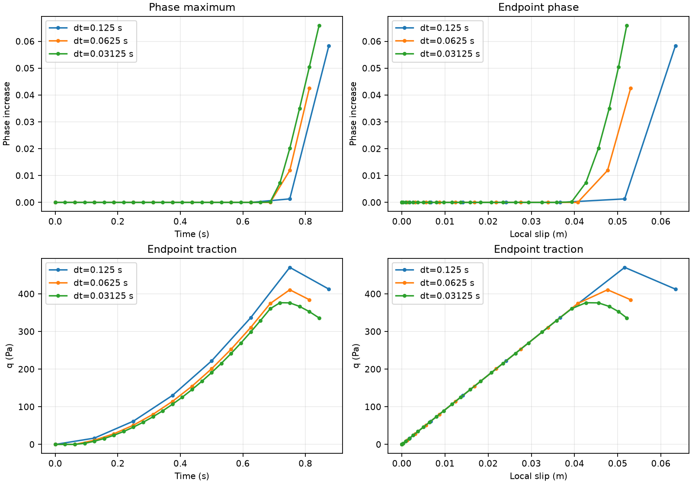
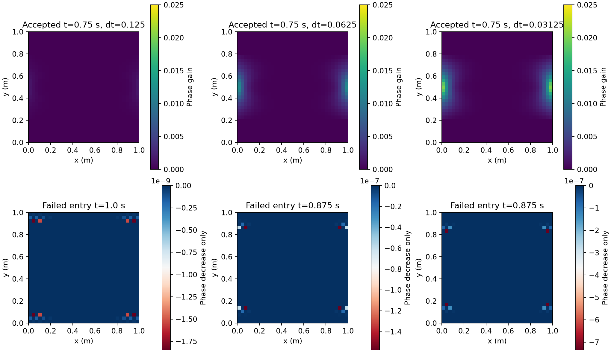
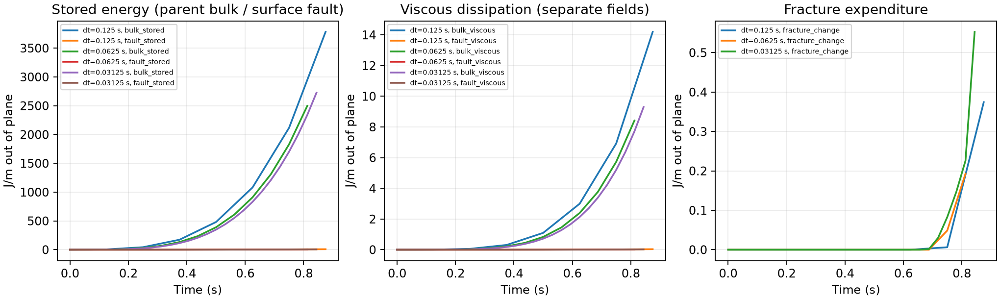

# P2 coupling repair — 2026-10-07

The reference material remains G=1 MPa, c=1 kPa, eta=100 MPa s,
Gc=26.6666666667 J/m², ell=0.15625 m and p=1. The nominal-core-0.6 seeded
fault is relaxed, then initialized unloaded: q=Z=bulk stress=0. Recoverable
peak H is unchanged. Surface-history loss and the bulk/surface work-operator
mismatch are repaired behind explicit optional settings.

The corrected fixed-phase comparison improves under timestep refinement.
With one common stronger ramp, damage grows at the side endpoints over several
accepted cycles, but **every evolving trajectory stops on resolved phase healing**.
No qualified damage-feedback baseline, material optimization, stress-scaling
claim or P3 follows. This conclusion is separate from the numerical pass counts.

[Actual specification.tex diff](../../../benchmarks/reconstructed_fault/propagation/coupling_evidence/specification.diff)
(relative to the incoming recoverable-energy stage), [derivation](P2_coupling_derivation.md),
[full numerical tables](../../../benchmarks/reconstructed_fault/propagation/coupling_evidence/evolving.json),
[failed-entry diagnosis](../../../benchmarks/reconstructed_fault/propagation/coupling_evidence/failed-entries.json).
Previous failed trajectories and all 981 incoming pinned artifacts are retained
and hash-verified in `build-propagation-integration/coupling-baseline`.

## Actual model and loading

| Quantity | Value / restriction |
|---|---|
| Domain, sharp fault | [0,1]² m; (0,0.5)–(1,0.5) m, fixed endpoints |
| Bulk / surface discretization | 32×32 squares; Q2 velocity, Q1 phase; 0.1 m surface spacing, 11 nodes |
| Particles | 3×3 parents/cell, 9,216; frozen positions, no transport/birth qualification |
| Association | Fixed full normal cross-section, width 0.50000000000001588 m |
| Material, both constituents | G=1e6 Pa, c=1000 Pa, eta=1e8 Pa s, Gc=26.6666666667 J/m², p=1 |
| Viscosity bounds | 1e6–1e10 Pa s; zero thermal exponent |
| Calibration | c0=8/3, Hc=0.5 Pa, m=128.00000000016, Gc/(c0 ell)=64.00000000008 Pa |
| Temperature, composition, density | 293 K; 0.5/0.5 identical constituents; 3300 kg/m³; gravity zero |
| Friction | Existing rate-dependent law, both friction coefficients 0.1; prescribed compression 10000 Pa; friction resistance 1000 Pa |
| Rate regularization | Characteristic velocity 2e-6 m/s; Vmin=1e-20 m/s |
| Radiation damping | Zero, unchanged from the revised historical fixture |
| Phase initial state | Native nominal core 0.6/H initialization; relaxed maximum 0.6035488376736221 |
| Mechanical initial state | q=Z=elastic cohesive slip=bulk Maxwell stress=0; current/previous I initialized together (108.5313919283 m) |
| Boundaries | All four: vx=a t(y−0.5), vy=0; natural zero-flux phase; no fixed temperature or composition boundary indicators |
| Other fields / gauge | Temperature is static at 293 K; chemical composition is frozen with particles; dynamic pressure uses the existing surface normalization; prescribed friction pressure is 10000 Pa |
| Integration | 0–1 s, dt=0.125/0.0625/0.03125 s; incoming H → phase → mechanics → terminal committed H |
| Normalization | Existing consistent I projection, unchanged; no floor or phase cap |

The original fixed-phase comparison uses a=0.016 s⁻² (final imposed relative
boundary displacement 0.008 m). After its checks passed, **one fixed-phase pilot**
at a=0.256 s⁻², dt=0.0625 s crossed Y/H0=1 between 0.5625 s (0.893) and
0.625 s (1.347). This one ramp was selected for all three evolving trajectories:
final intended displacement 0.128 m. No material parameter, per-timestep load,
H law, bound or healing tolerance was tuned. The increase is explicitly a new
comparison, not a rerun of the old high-load/preloaded case. It is large enough
to expose the next admissibility failure; it is not a recommended material baseline.

## Continuum, discrete equations and legacy paths

| Item | Continuum equation | Selected implementation | Legacy / remaining approximation |
|---|---|---|---|
| Cohesive state | Z=I q; Zdot=G V−G Z/eta | Q1 Z; Z_i,new=beta Z_i,old+kappa V_i; store q_i=Z_i/I_i | Default projects particle traction samples, smoothing nonconstant histories |
| Point traction | q=Z/I | Interpolate **nodal I_i q_i products**, then divide by interpolated I | It is a rational Z_h/I_h field, not Q1 interpolation of q; this is an explicit discrete representation change |
| Slip strain | v=chi V+C; chi=h/I | C=beta Z_old/kappa (h/I−h_old/I_old), same native law in bulk, surface and publication | Uniform G and temperature-independent uniform eta required for Q1 closure; variable coefficients are rejected |
| Bulk stress | tau=beta tau_old+2 kappa_bulk[eps(u)−v S] | Existing Stokes-QP bulk source and B retained, using repaired material history | Incoming stress still transfers from particles to FE; terminal particles use their own incoming stress |
| Surface shear | Work adjoint of V→chi V S | sum JxW chi N_i (tau:S+background shear); G is its derivative | Default particle-volume surface measure is not this adjoint |
| Surface resistance | integral N_i(q+mu P+damping V) ds | Three-point Gauss ds; same R/K quadrature; ordinary ds mass | Prescribed pressure, single straight 2-D fault only; mature-only alternative keeps its guard and its own measure |
| Surface tangent | −dR/dV | Bulk term 2 kappa_bulk chi² N_iN_j S:S plus ds term N_iN_j(kappa/I+P mu'+damping) | Native B/G/K and both residual blocks checked by actions/finite differences |
| Phase driving | Hnew=max(Hold,q²/(2Gg²)) | Accepted point q=Z_h/I_h; sequential consumption at next step | No viscous accumulation or previous-phase lower bound; peak H does not ensure phase irreversibility |
| Energy derivative | delta[Z²/(2GI)] at fixed Z/G | Retained continuum driver with CPDI phase operator | Consistent I projection has an adjoint term in the exact discrete derivative; quantified separately |
| Time integration | Continuous work balance | Exact Maxwell time integrals for frozen per-step rates, using the same bulk QPs/fields on both sides | Mechanics enforces endpoint equilibrium; integrated work and particle/FE transfer do not become exact by adjointness alone |

The new settings are `Cohesive history representation = surface elastic slip`
and `Fault mechanical work measure = bulk conjugate`. Defaults remain
`particle projection` and `particle volume`. Both selections have restart
provenance markers. No generic projector or shared normalization matrix changed.
No outer phase/mechanics iteration was introduced.

## Step 1: surface history

13 nonconstant fields (all 11 nodal basis fields, a linear field, and an
oscillatory field) exercise the native surface candidate and commit path at all
three partitions. At eta=1e8 and 1e30 Pa s, 1,456 step checks give maximum nodal
error 2.274e-12 Pa and pointwise error 2.160e-12 Pa against exp(−Gt/eta)q0.
The elastic-limit decay differs from unity below floating-point resolution.
The declared absolute tolerance is 1e-10 Pa. All diagnostic writes are restored.
This qualifies arbitrary representable Z histories for the selected uniform
coefficients, including nonconstant q on this fixed-I fixture; it does not claim
Q1 q closure for arbitrary nonconstant I.

Repeating the a=0.016 fixed-phase trajectories with only this repair eliminates
publication error (<=1.137e-13 Pa) but leaves the work defect: native B/G adjoint
relative discrepancy 0.98059, final stress-transfer discrepancy about 18%, and
large negative bulk/slip exchange. Thus traction repair alone did not fix coupling.
The generic particle projector is unchanged; its old nonidentity evidence remains.

## Step 2: mechanical work pair

| dt (s), a=0.016 | Endpoint q at 1 s (Pa) | Endpoint slip (m) | Cumulative integrated exchange defect (J/m) | Final stress-transfer relative L2 |
|---:|---:|---:|---:|---:|
| 0.125 | 45.7908238 | 0.0049844290 | −0.0116052 | 0.063677 |
| 0.0625 | 43.2573141 | 0.0047080547 | +0.00262283 | 0.061446 |
| 0.03125 | 42.1263812 | 0.0045846905 | +0.00233980 | 0.059332 |

The successive endpoint-q differences shrink from 2.534 to 1.131 Pa; slip
changes shrink from 2.764e-4 to 1.234e-4 m. The native operator adjoint error is
<=5.342e-15. Endpoint exchange agrees to roundoff at fixed phase. The integrated
exchange defect is reported separately and is not strictly monotone in dt.
The particle/FE stress difference is measured at the **same Stokes QPs** between
native accepted stress from incoming FE history and the configured interpolation
of newly committed particles. It is not relabeled as traction-publication loss.
These are distinct representations, and this diagnostic is not a spatial error bound.

Across evolving accepted steps, K/G/B finite-difference relative errors are
<=3.03e-11 (test limit 1e-7), and B/G adjoint error <=6.284e-15 (limit 1e-11).
Traction publication error is <=2.274e-13 Pa. The bulk Maxwell energy identity
is verified with exact time-integrated stress on the same QPs; the residual is
roundoff relative to its work scale. It is not an independent boundary-work audit.

A four-step serial/two-rank fixed-phase check gives max differences q=1.412e-13 Pa,
I=7.105e-14 m, V=1.973e-16 m/s, integrated H=4.547e-12 Pa m², and phase maximum
exactly equal. The native 622-assertion cohesive suite passes. All 99 historical
preloaded/default trajectory CSVs reproduce byte-for-byte. The zero-load control
has exactly zero H and phase growth. P1 assembly/normalization are unchanged;
its retained evidence is reused, not counted as a fresh broad test matrix.

## Evolving results and the stop

| dt (s), a=0.256 | Last accepted time | Accepted maximum phase gain | Failed entry time | Failed phase maximum | Largest phase decrease |
|---:|---:|---:|---:|---:|---:|
| 0.125 | 0.875 | 0.0583710 | 1.0 | 0.731612 | 1.84801e-9 |
| 0.0625 | 0.8125 | 0.0424898 | 0.875 | 0.678959 | 1.57665e-7 |
| 0.03125 | 0.84375 | 0.0659292 | 0.875 | 0.685107 | 7.35745e-7 |

Different last-accepted times are **not** a convergence comparison. At common
physical time 0.75 s, phase maxima are 0.6048632, 0.6154558, 0.6236566;
committed integrated H gains are 195.798, 103.926, 79.9412 Pa m². After explicitly
aligning the phase consuming history committed through 0.75 s, phase maxima are
0.6619199, 0.6460386, 0.6385529 at t=0.875/0.8125/0.78125 respectively. Their
successive differences shrink from 0.0158812 to 0.0074857. This is improving
feedback with the expected lag, not a completed refinement qualification.
Common local-slip comparisons at center and both endpoints are in the linked JSON.

Damage maxima occur at x=0 or 1, y=0.5. The failed decreases occur in very small
tails: (0.03125,0.0625), (0.9375,0.125), (0.96875,0.15625) m respectively.
There are no off-band H increases in accepted records. Diffuse off-band phase
changes remain small (maximum about 4.25e-4 on the coarse accepted path).
CPDI particle phase and pointwise Q1 phase agree to roundoff in this fixed regular
particle layout. Endpoint loading and transverse tail discretization remain
spatial questions; they are not explained away by history-time scaling.

The healing allowance stays **4.922e-12**. At each failed entry, native KKT
norm is <=7.92e-16, the Jacobian correction infinity norm is <=1.06e-16,
and two identical-H repeats change the field by exactly zero. All three full
replays reproduce prior accepted and failed CSV fields exactly. These corrections
are uncertainty estimates, supported by repeats, not rigorous error bounds.
They cannot obscure decreases 7–10 orders larger. The native Jacobians have
1,560–1,624 positive off-diagonal entries: a monotone discrete comparison
principle cannot be assumed. This is supporting diagnosis, not proof that a
specific stencil modification would fix it. The histories remain untouched by
the scratch repeats. No mechanical update is performed on a failed entry.

Bounds remain satisfied and no saturation occurs. Successful accepted solves
have KKT<=1.98e-13, mechanical residual below the existing 1e-8 limit, and no
resolved accepted-step healing. However, convergence and bounds do not override
the failed irreversibility check. No previous-phase lower bound was silently added.




## Normalization and energy limits

Direct analytic transverse integrals and independent Q16/Q32 integration agree
to <8e-16 relative on the accepted fields. Consistent I remains positive and
finite. Its **spatial representation** error in h/I is initially 8.833e-10,
but reaches 1.874%, 1.496%, 2.110% at the respective last accepted states,
including side boundaries. This is not 1e-8 spatial accuracy. Finiteness and
positivity are established; a tightly resolved normalization is not.

The selected directional projected-energy derivative discrepancy is
0.00290%, 0.00258%, 0.00460% on those states (about 0.0071–0.0073% on the fixed
phase controls). It is a separate directional measure, not a uniform bound.
The derivative check holds Q1 Z fixed and uses q=Z_h/I_h consistently.

Changing profiles are explicitly included in C. The diagnostic separates
integral tau:S chi V dt from integral tau:S C dt and records the fixed-Z
fault-energy jump. On the coarse last accepted step, these profile quantities
are −14.482 J/m of bulk work, −0.37835 J/m of fault-energy jump, and a small
nonzero integral C=6.64e-5 m²/s from the discrete normalization/quadrature.
They are not discarded because the continuum integral C is zero. A nonuniform
transverse stress weights C differently. The repaired adjoint establishes slip
work exchange; it does not establish a complete energetic closure for profile
redistribution with the retained reduced-energy phase driver.

The online ds diagnostic uses independent Q8. `match_coupling_work.py` replays
those frozen full-precision surface records with the **actual assembly Q3 rule**,
using the same Maxwell time integration. Its matched endpoint balance is <=3.91e-13 W/m
on every accepted step (test limit 1e-9 W/m) (see `matched-work.json` and per-run CSVs).
Q8-minus-Q3 differences are retained as a separate quadrature comparator; neither
physical history nor the incoming raw diagnostics are modified by this replay.
The bulk stress-transfer error, endpoint time integration, phase-history lag,
normalization representation and phase-energy derivative are retained separately.
No total boundary-energy qualification is claimed. Stored bulk/fault energy,
viscous dissipation, friction and fracture expenditure are separate CSV columns:



## Changed functions and artifacts in this task

| Production file / function | Purpose |
|---|---|
| `phase_field_fault.h` | Declare surface-history/work selections, candidate and resistance APIs |
| `phase_field_fault.cc::declare_parameters`, `parse_parameters` | Explicit settings/defaults and admission restrictions |
| `constitutive.cc::evaluate_reconstructed_fault_localization` | Reconstruct committed Q1 Z from nodal products; consistent point q in both residual blocks |
| `constitutive.cc::compute_surface_cohesive_candidates` | Native nodal Maxwell update without particle projection |
| `constitutive.cc::evaluate_cohesive_surface_resistance` | Reuse the existing material law for ds resistance and its derivative |
| `history.cc::initialize` | Uniform-coefficient validation and restart representation markers |
| `history.cc::compute_history_candidates` | Surface-owned candidate; identical accepted point q for H; terminal publication machinery retained |
| `surface_system.cc::assemble_surface_system` | Dispatch the separate cohesive work option; mature-only guard unchanged |
| `surface_system_bulk_work.cc::assemble_bulk_work_system` | Actual old/current phase sampling; conjugate shear residual/G/K plus ds resistance/K/mass with correct replicated MPI addition |

No phase equation, H law, bulk strain mapping, generic projector, mechanical
loading implementation or terminal history rotation was changed. The shared
localization repair reaches both bulk and surface residuals; B's existing chi
mapping already is the required bulk operator and was verified rather than
rewritten. Friction dissipation remains separate from recoverable H.

Test/diagnostic changes: `phase_field_fault_test_access.h` adds narrow native
accessors; `coupling_local.cc`, `coupling_feedback.cc`, `coupling_consistency.cc`
implement history, work/derivative/healing and distributed observations;
`coupled_feedback.cc` honors frozen H and point Z/I; `recoverable_feedback.cc`
uses the selected point representation in energy/Y diagnostics. CMake adds the
two diagnostic plugins. `run_coupling.py`, `run_coupling_consistency.py`,
`analyze_coupling.py`, `finish_coupling_analysis.py`, `match_coupling_work.py` retain inputs, runs, comparisons
and plots. Old evidence is not regenerated. Governing docs, PLAN, STATUS, benchmark
index and cumulative source inventory are updated separately.

## Reproduction and remaining decision

Build: GCC12.4.0, deal.II9.6.2, OpenMPI5.0.6, Trilinos14.2/Epetra, Release/unity,
existing `fault-propagation` worktree at de7beaa65846c7372711f7922abf1c5d9a745ee6
plus preserved incoming work. Exact executable/plugin/input hashes, commands,
logs and stage diffs are in `coupling_evidence/manifest.json`. No commit or push.

```sh
cmake --build build-propagation-integration --target aspect -j3
cmake --build build-propagation-integration/plugin --target coupling_feedback coupling_consistency -j2
# Fresh labels are required; these examples describe the retained runs.
python3 benchmarks/reconstructed_fault/propagation/run_coupling.py coupling_local --mode local
python3 benchmarks/reconstructed_fault/propagation/run_coupling.py coupling_work_dt125 --mode fixed --dt .125 --work
python3 benchmarks/reconstructed_fault/propagation/run_coupling.py coupling_pilot_a256 --mode fixed --dt .0625 --work --amplitude .256
python3 benchmarks/reconstructed_fault/propagation/run_coupling.py coupling_evolving_dt125 --dt .125 --work --amplitude .256
# Identical .0625 and .03125 paths use the same amplitude and material.
python3 benchmarks/reconstructed_fault/propagation/finish_coupling_analysis.py
python3 benchmarks/reconstructed_fault/propagation/match_coupling_work.py
build-propagation-integration/aspect --test '[phase_field_fault_cohesive]'
```

Build, Python syntax and `git diff --check` pass.
The first two distributed fixture launches had input-registration/setup defects,
fixed without physical changes; MPI then required the permitted outside-sandbox
run because sandbox startup had no network interface. These are not scientific
failures or counted successful tests.

The bounded task stops on a scientific admissibility decision: **resolved tail
healing persists at fixed H even after the two coupling defects are repaired**.
A next task should separate spatial-discretization/comparison-principle error
from the intended material irreversibility requirement before selecting a remedy.
Do not infer an authorization for an added lower bound or a different H law.
The accepted comparison trends improve, but do not qualify a gradual-damage
material. Stress scaling remains conditional and unrun. Physical rejected-step
rollback, coupled restart, transported/birth histories, evolving distributed
operation, tighter normalization accuracy and full evolving-profile energetic
closure remain unqualified. No P3 or propagation was attempted.
