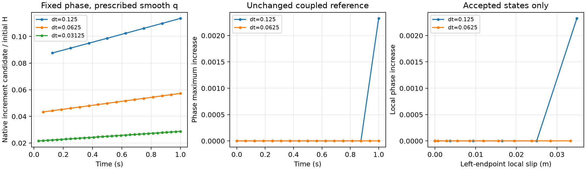

# P2 history semantics and timestep diagnosis

**H currently stores a maximum of single-step work-potential derivatives, not a
maximum of an instantaneous energy and not accumulated work.** The derivation,
authoritative specification and implementation agree on that discrete formula.
For smooth traction at fixed partial damage its candidate is O(dt). Comparing
that increment with a finite initialized H therefore loses feedback under time
refinement. This is a formulation inconsistency with timestep-independent damage
feedback, not an implementation transcription error.

**No production correction is uniquely determined by the documents.** A maximum
of recoverable energy and a history including viscous cohesive work have different
physical consequences. Neither replacing the candidate by a rate nor accumulating
it into its stored maximum is justified. The native tests and unchanged reference
reruns below confirm the problem. The material search is paused; feedback
refinement still fails, stress scaling is deferred until a physical definition is
selected, and no gradual-damage material or P3 is qualified.

## Reference parameters and restrictions

| Quantity | Actual reference value |
|---|---|
| Domain / fault | [0,1]² m; fixed segment (0,0.5)–(1,0.5) m |
| Mesh / surface / particles | 32×32 squares; Q1 phase, Q2 velocity; 0.1 m Q1 surface spacing; 3×3 fixed parents per cell (9,216) |
| Associations | Fixed full normal cross-section, width 0.50000000000001588 m; no runtime admission |
| G / c / eta, both constituents | 1e6 Pa / 1000 Pa / 1e8 Pa s |
| Viscosity limits | 1e6–1e10 Pa s |
| Gc / ell / p / nominal core | 26.6666666667 J/m² / 0.15625 m / 1 / 0.6 |
| AT1 calibration | c0=8/3; Hc=c²/(2G)=0.5 Pa; E=Gc/(c0 ell)=64.00000000008 Pa; m=128.00000000016 |
| Pressure / damping / gravity | Prescribed friction pressure 10000 Pa; radiation damping 0; gravity 0 |
| Friction | Stateless rate dependent; reference=dynamic mu=0.1; characteristic V=2e-6 m/s; minimum V=1e-20 m/s |
| Initial state | Native rounded phase and particle H; phase relaxed at that H; then native q and current/previous I_h; initial Maxwell stress zero |
| Boundary data | All four sides vx=0.016 t(y−0.5), vy=0, t in seconds; natural zero-flux phase; surface pressure normalization |
| Physical runs | 0–1 s; dt=0.125 and 0.0625 s; native initialization interval 1 s |
| Normalization / solver | Consistent I_h; optional box phase solver enabled; no previous-phase lower bound |
| Frozen data | Geometry, mesh, particle positions, temperature 293 K and equal constituent fractions; existing frozen-RK2 diagnostic suppresses transport only |

Velocity, pressure, stress, cohesive q, slip rate, H, phase and normalization evolve
through native mechanics. The sequential cycle remains incoming H → phase →
mechanics → committed H. No outer iteration, endpoint/BC change, material sweep,
transport/birth or general support-admission qualification was introduced.

## Derivation and actual ownership

The historical governing derivation is [pf_rsf.tex](../pf_rsf.tex), equations
`eq:I phi`, `eq:H`, `eq:H+`, `eq:H small-step` and `eq:H cr` (lines 261–337).
It calls the functional a **one-step increment**. At fixed crack strain rate v,
its phase-dependent potential density is approximated by

    P_k = dt/h_k [ (kappa_k/2) v² + beta_k h_old q_old v ],
    h = 1/g − 1, beta = exp(−G dt/eta), kappa = eta(1−beta).

Differentiating with respect to current phi while holding v and old h*q fixed,
and factoring out g'(phi), yields

    C_k = dt/(1−g_k)² [ (kappa_k/2) v² + beta_k h_old q_old v ].

Eliminating v with h_k q_k = kappa_k v + beta_k h_old q_old gives exactly

    C_k = dt/(2 kappa_k) [ (q_k/g_k)²
                         − (beta_k h_old q_old/(1−g_k))² ].

The subsequent replacement by H_k=max(H_old,C_k) is stated in both the derivation
and [specification.tex](../specification.tex), Stage-J history feedback, and
[current_design.md](../current_design.md), §25. The documents do not define an
additional accumulated-work state. This historical derivation is not independent
physical validation; it establishes what the code is implementing.

| Source function | Meaning and lifecycle (audited, unchanged) |
|---|---|
| `PhaseFieldFault::get_critical_crack_driving_forces` (`phase_field_fault.cc`) | Hc=c²/(2G); native material calibration |
| `Particle::Property::CrackDrivingForce::initialize_one_particle_property` (`crack_driving_force.cc`) | Starts all particle H at the mixture Hc |
| `ReconstructedFaultManager::initialize_crack_driving_force` (`manager.cc`) | Inside the native prescribed-profile activation region, initializes H from the stationary profile; no integration over elapsed time |
| `PhaseFieldHandler::stationary_crack_driving_force` (`simulator/phase_field.cc`) | Returns E a(phi_hat)/(h(phi_hat) g(phi)²); phi_hat is prescribed geometry data |
| `PhaseFieldFault::evaluate_initial_cohesive_particle_values` (`history.cc`) | After phase relaxation, evaluates q_p=g(phi_p) sqrt(2G H_p); it does **not** use dt, eta or beta |
| `initialize_cohesive_state_from_initial_fields` (`history.cc`) | Consistently projects q_p to the fault and commits q and previous I_h together; H is retained |
| `compute_maxwell_coefficients`, `compute_cohesive_response` (`constitutive.cc`) | Pure coefficient/response evaluation, including q=(kappa V+beta I_old q_old)/I_current; no persistent history writes |
| `compute_crack_driving_force_candidate` (`constitutive.cc`) | Pure finite-step candidate above, evaluated with accepted projected traction and previous FE phase/history |
| `commit_reconstructed_fault_mechanical_history`, `compute_history_candidates`, `publish_history_candidates` (`history.cc`) | Timestep zero returns without evolving H/stress/q. Later accepted mechanics builds/validates candidates, takes max(H_old,C), then publishes particle H/stress and surface histories terminally. Newton/line-search trials do not publish H. |

**One-second initialization clarification:** the fixture's `Initial time step=1`
is used by initial mechanical Maxwell response evaluations (beta=0.9900498337491681,
kappa=995016.6250831947 Pa s). It is not a one-second work accumulation into H,
and it does not enter q_p's initializer. The earlier material report's phrase
“cohesive initialization uses its existing 1 s initialization interval” was too
broad; the distinction above is the actual source behavior.

The native q projection also matters for any proposed replacement. At the fixed
left probe (0.0052083333,0.4947916667), initial H=29167.9925878 Pa and relaxed
phi=0.598177945596. Raw initial q_p=318.2714216 Pa, whereas projected q=567.7690811
Pa. Reinterpreting that projected q immediately as q²/(2Gg²) gives 92822.8139734 Pa,
**3.18235 times retained H**. Thus an instantaneous-state replacement cannot be
claimed to preserve the existing initialized equilibrium merely because the
unprojected initializer has an elastic-energy form. This is a separate
initialization/projection consequence, not an endpoint-loading explanation.

### Separate intact branch

For **associated** points with g=1 and h_old=0, the candidate function returns
C=dt q²/(2 kappa), approaching q²/(2G) as dt→0. Nonzero h_old at g=1 is rejected
as healing. This branch is consistent with the derivation's *virgin nucleation*
assumption, not a continuous limit of a preloaded, partially damaged history:
at fixed partial phi→0 with h_old=(1−g)/g and q_old nonzero, the subtraction
beta² q_old² survives. The two limits are different. Native tests record both.

Geometrically **unassociated** particles are a separate case: this commit path
leaves H unchanged and advances bulk Maxwell stress. Generic particle H starts
at Hc. It does not invoke the associated intact candidate or establish a general
bulk nucleation rule. All parents in the present cross-section are associated;
this limitation does not explain their dt dependence.

## What a correction would have to mean

For fixed 0<phi<1 and smooth q(t), the implemented candidate reduces to

    C_k = dt/(2 kappa g²) (q_k² − beta² q_old²)
        = dt/g² [ q q_dot/G + q²/eta ] + O(dt²).

Define Y=q²/(2Gg²). In the elastic limit C_k=Y_k−Y_old exactly. A maximum of these
increments converges toward the initialized H as dt shrinks, even when Y grows
substantially. Changing endpoint quadrature in the one-step potential cannot
remove this O(dt) structure.

Two physically different replacements need review:

| Definition | Proposed meaning, not implemented | Consequences |
|---|---|---|
| Recoverable-energy driving | H=max(H0, max Y(t)); derive Y at the chosen frozen internal variables, with fixed-phi limit q²/(2Gg²) | Partition-independent elastic peak; unloading/Maxwell relaxation do not increase the maximum; constant q gives no new damage from viscous creep alone; elastic closed cycles below the prior peak do not ratchet |
| Driving including signed cohesive work | At fixed phi, a separate state W(t)=Y(t)+integral_0^t q²/(eta g²) ds, then a separately defined peak history | Zero-input relaxation preserves W; constant-q creep adds work; finite-viscosity closed cycles add dissipation and can drive further damage; elastic closed cycles give zero net W change |

The second expression is derived here only for **fixed phi**. Its extension to
evolving phi requires an explicit stored-energy/dissipation definition, treatment
of old internal variables and initialization, and potentially additional committed
particle state. Adding increments directly to a *maximum* loses the signed state:
if unloading is prevented from lowering that maximum, reloading double-counts
energy. Clipping negative increments produces artificial elastic-cycle damage.
Dividing C by dt produces Pa/s and compares a power-like quantity with a Pa
fracture-energy density; a compensating time scale would be a new model parameter.

The smallest scientific decision is whether viscous cohesive dissipation should
contribute to the phase driver, or whether damage is driven by the peak recoverable
state. The state definition must also specify its initialized relation to the
projected q and retained prescribed H. The existing documents choose neither
replacement unambiguously. Per the user's conditional instruction, no arbitrary
production law or initialization change is made.

## Native fixed-phase experiment

[history_driving.cc](../../../benchmarks/reconstructed_fault/propagation/history_driving.cc)
uses native degradation, Maxwell coefficients, cohesive relaxation and candidate
functions. It runs once at timestep zero; it writes diagnostics only. Fixed phi=0.6,
G=1e6 Pa, reference g=0.0013003901170334873, h≈768, q0=600 Pa and
H0=q0²/(2Gg²)=106444.980000266 Pa isolate history semantics from all geometry,
endpoint, phase-solver and projection effects. Test H0 is a local analytic state,
not a replacement for any particle's initialized H.

Each path is sampled at dt=0.125, 0.0625 and 0.03125 s with eta=1e8 Pa s, then
eta=1e22 Pa s for the elastic limit:

- Loading q=600+200t Pa, 0–1 s: Y grows by 77.7778%; current maximum H never grows.
- Zero-input relaxation q=600 exp(−Gt/eta) Pa, 0–1 s: the native V=0 cohesive
  response reproduces q; C is zero within roundoff and H stays fixed. Y decreases;
  Y plus dissipated work stays constant.
- Unloading/reloading q=600−200 sin²(pi t) Pa, 0–2 s: two smooth cycles below the
  initial peak. Signed elastic increments sum to zero; their positive parts do not.
- Constant-traction hold q=600 Pa, 0–1 s: sustaining q requires creep input;
  distinguish this from zero-input Maxwell relaxation.

The prescribed unloading path is a pure candidate-function diagnostic; its
inferred signed strain input is not asserted to be an admissible nonnegative-slip
solution of the full fault solver. No coupled histories follow that path.

| Measurement (normalized by test H0) | dt=0.125 | dt=0.0625 | dt=0.03125 |
|---|---:|---:|---:|
| Maximum C, reference-viscosity loading | 0.113612 | 0.0572914 | 0.0287672 |
| Final stored H/H0, all paths | 1 | 1 | 1 |
| Signed sum C, reference-viscosity loading | 0.804688 | 0.804935 | 0.805060 |
| Error of H0+sum C versus analytic signed work, divided by H0 | 4.96738e-4 | 2.49994e-4 | 1.25404e-4 |
| Signed sum C, two reference-viscosity cycles | 0.0283156 | 0.0283245 | 0.0283289 |
| Positive sum C, two elastic cycles | 1.11111111 | 1.11111111 | 1.11111111 |

Signed-work limits are 0.805185185 H0 for the loading increment, 0.028333333 H0
for two finite-viscosity cycles and 0.02 H0 for the constant-q hold. These are
analytic comparisons, not selected production updates. Elastic signed-cycle sums
are below 6e-15 H0. Accumulating positive increments would raise H to 2.11111 H0
on an elastic path whose maximum traction never exceeds its initial value.

All **560 native path evaluations** pass the independent finite-difference
one-step potential derivative check (tolerance 2e-7 relative to max(1 Pa,|C|)),
elastic increment identity (1e-12 H0), and native zero-input relaxation
(|q_error|<1e-12 q0, |C|<1e-9 H0). Existing cohesive unit tests also pass:
**622 assertions in 7 cases**. Passing these tests validates the diagnosis and
implementation equivalence, not physical timestep qualification.

## Unchanged coupled reference reruns

Fresh runs `history_reference_repeat` and `history_reference_repeat_half` use the
original reference material, loading, BCs, consistent I_h and all numerical gates.
No H prescription or history reuse occurs. Their **99 and 187 diagnostic CSVs
respectively are byte-identical** to the retained material-study trajectories,
including entry/accepted fields, normalization and particle-history observations.

| Outcome | dt=0.125 s | dt=0.0625 s |
|---|---:|---:|
| Accepted physical steps | 8 | 16 |
| Initial phase maximum | 0.6035488376736221 | same |
| Final phase-max increase | 0.002326043753 | 0 |
| Integral(H_final−H0), Pa m² | 36.2013853116 | 9.942158751e-7 |
| Maximum KKT residual | 7.373e-16 | 6.723e-16 |
| Maximum mechanical relative residual | 4.370e-9 | 6.040e-9 |
| Measured healing | 0 | 0 |
| Worst accepted normalized-source error | 0.1562521% | 8.83287e-8% |

Bounds [0,1], KKT<=1e-11, healing allowance 4.922e-12, mechanics<=1e-8 and
all-parent native publication checks remain unchanged. Direct normalization and
endpoint accuracy evidence is reused for byte-identical fields; positivity alone
is not the accuracy criterion. Current/previous I_h and trial-history checks pass.
No new failed-entry field arose; old high-load and refinement failures are retained.

At common t=0.875 s, coarse near-endpoint candidate/H0=1.0808911 while fine is
0.5442968; at t=1 s, 1.4439044 versus 0.6850995. Their final q values differ only
slightly. Fine late history is consumed one step later, but even its final committed
cumulative H gain is only 2.74635e-8 of coarse. Accounting for the one-step lag
therefore does not resolve the discrepancy.

At common left local slip 0.03329437192 m (linear interpolation of accepted samples),
coarse phase=0.60550100935 and fine=0.60354883767; nearby parent H is 40413.78865
versus 29167.99259 Pa, while q is 857.0244 versus 863.9644 Pa. At common center
slip 0.004830801146 m the phase difference is only 1.03965e-6 and both probe H values
remain at H0. The right endpoint agrees with the left to numerical precision.
This retains endpoint loading as a spatial effect, separate from the native
history inconsistency. Tables at all common times and paired local slips are in
[summary.json](../../../benchmarks/reconstructed_fault/propagation/history_evidence/summary.json).



## Stress scaling: conditional, not executed

The user conditions this test on established history consistency. That gate fails;
no scaled trajectory was run or claimed as qualified. For the eventual factor
30000 test, reinitialize all histories and use the same geometry/loading/time:

| Stress-dimensional input | Reference | Scaled |
|---|---:|---:|
| G (Pa) | 1e6 | 3e10 |
| c (Pa) | 1000 | 3e7 |
| Gc (J/m²) | 26.6666666667 | 800000.000001 |
| eta (Pa s) | 1e8 | 3e12 |
| eta bounds (Pa s) | 1e6–1e10 | 3e10–3e14 |
| Prescribed pressure (Pa) | 10000 | 3e8 |
| Initial stress / radiation damping | 0 / 0 | 0 / 0 |
| Derived Hc / E (Pa) | 0.5 / ~64 | 15000 / ~1.92e6 |

m, eta/G, phase, geometry, friction coefficients and time scales stay invariant;
q, stress, pressure and H should scale by 30000. Compare dimensional residuals
and absolute errors after dividing by the same stress scale, retaining the original
relative criteria. A successful scaling check alone would not repair dt consistency.

## Changes, provenance and commands

No production source function, numerical default, governing equation or executable
changed in this task. Exact changed/added diagnostic functions:

- `tests/phase_field_fault_test_access.h::maxwell_coefficients`: read-only wrapper
  of the existing private native coefficient function; no physical state/interface change.
- `history_driving.cc::HistoryDriving::execute`: fixed-phase native path experiment,
  independent potential differentiation, elastic/relaxation checks and CSV output.
- `analyze_history.py`: analytic work comparisons, unchanged coupled rerun equality,
  retained numerical gates, common-time/slip tables and compact plots.
- Benchmark `CMakeLists.txt`: builds the new diagnostic plugin. `history_driving.prm`
  runs it at initial time only, alongside the existing initialization observer.
- This report, PLAN, STATUS, design/specification diagnostic notes, benchmark links,
  source inventory and additive AGENTS selection record the unresolved model decision.
  Existing scientific laws in the authoritative documents are retained.

Worktree/branch: `/home/ein/repository/aspect-fault-propagation`, `fault-propagation`;
HEAD `de7beaa65846c7372711f7922abf1c5d9a745ee6` plus preserved incoming work. GCC12.4.0,
deal.II9.6.2, OpenMPI5.0.6, Trilinos14.2/Epetra, Release. Unchanged core SHA256:
`65cccc0bbe3d54dd35eb2f02630ee776c7641d78e6b882c740f3725d3c74537a`.
All 755 previously pinned artifacts were copied and verified in
`build-propagation-integration/history-baseline` before edits. The original failed
refinement and high-load results are not overwritten. No commit/push.

```sh
cmake -S benchmarks/reconstructed_fault/propagation -B build-propagation-integration/plugin \
  -DAspect_DIR=/home/ein/repository/aspect-fault-propagation/build-propagation-integration \
  -DCMAKE_CXX_COMPILER=/opt/gcc/12.4.0/bin/g++ -DCMAKE_BUILD_TYPE=Release
cmake --build build-propagation-integration/plugin --target history_driving -j2
# ASPECT_SOURCE_DIR points to this worktree; OMP/DEAL_II/OPENBLAS threads=1.
# Existing ASPECT_DIAGNOSTIC_FREEZE_PARTICLE_ADVECTION=1 is used for these controls.
build-propagation-integration/aspect build-propagation-integration/history-native-v2.prm
build-propagation-integration/aspect --test '[phase_field_fault_cohesive]'
python3 benchmarks/reconstructed_fault/propagation/run_material.py history_reference_repeat --case reference --amplitude .016 --dt .125
python3 benchmarks/reconstructed_fault/propagation/run_material.py history_reference_repeat_half --case reference --amplitude .016 --dt .0625
python3 benchmarks/reconstructed_fault/propagation/analyze_history.py
```

The first diagnostic PRM omitted the required `particles` postprocessor and aborted
before initialization; its log is retained. Adding that existing postprocessor
fixed the harness configuration, with no scientific/tolerance change. Final native
run took about 4 s; reruns 38.9/67.9 s with overlap. No new MPI, coupled restart,
physical rejected-step rollback or transported/birth tests were run. Those remain
P2 requirements after history semantics and feedback refinement are resolved.
