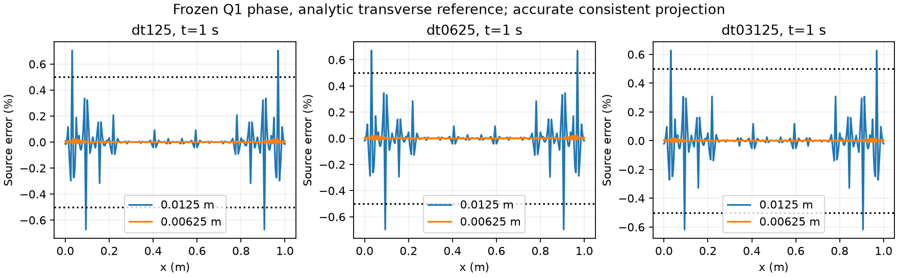

# P2 implementation checkpoint for review (2026-10-08)

The current synthetic model produces endpoint-dominated damage over several
accepted feedback cycles. Direct irreversibility is successfully verified for
this fixed-mesh fixture. Temporal agreement improves, but the coupled baseline
is not yet qualified: its retained .1 m normalization is under-resolved and the
evolving-profile total-energy interpretation is unresolved. The new .00625 m
consistent representation passes the provisional source-error target on **six
frozen accepted fields only**. No production code, model option, phase law,
coupled timestep or material parameter changes in this task. Stop for review;
P3 remains deferred.

Read the short [formulation comparison](P2_formulation_comparison.md) alongside
this checkpoint. The total-energy phase condition is **proposed, not adopted**.

## Current model settings

| Quantity | Current value / units / restriction |
|---|---|
| Domain and geometry | [0,1]² m; one fixed sharp fault (0,.5)–(1,.5) m; no tip motion, branching or nucleation |
| Bulk discretization | Fixed 32×32 mesh; Q1 phase, 1089 nodes; Q2 velocity |
| Surface discretization | Retained coupled runs: .1 m, 11 Q1 nodes, Q3 per segment. New frozen comparisons: .0125 and .00625 m, 81 and 161 nodes; no coupled resolution change |
| Particles and associations | 3×3/cell, 9216 particles; frozen positions, no birth; fixed full-normal-domain association width .50000000000001588 m; sharp endpoints unchanged |
| Phase parameters, both constituents | \(\mathcal G_c=26.6666666667\) J/m²; \(\ell=.15625\) m; AT1 \(c_0=8/3\); Lorentz \(p=1\), \(m=128.00000000016\) |
| Elasticity and strength | \(G=10^6\) Pa, \(c=1000\) Pa; \(H_c=c^2/(2G)=.5\) Pa; \(\mathcal G_c/(c_0\ell)=64.00000000008\) Pa |
| Viscosity | \(\eta=10^8\) Pa s; bounds \(10^6\)–\(10^{10}\) Pa s; \(\lambda=\eta/G=100\) s |
| Friction | Stateless rate-dependent law; reference and dynamic \(\mu=.1\); characteristic velocity \(2\times10^{-6}\) m/s, minimum velocity \(10^{-20}\) m/s. Evolving RSF state is not tested |
| Pressure and damping | Prescribed compressive normal pressure \(\sigma_n=10000\) Pa; radiation damping \(\eta^{\rm dpr}=0\) Pa s/m |
| Other bulk data | Static T=293 K; density 3300 kg/m³; gravity zero; frozen equal .5/.5 chemical fractions |
| Initialization | Native nominal-core-.6 profile and seeded particle H; box relaxation gives phase maximum .60354883767362211; then unloaded cohesive traction, elastic slip and bulk Maxwell stress zero; current/previous consistent normalization initialized together, initially about 108.5313919283 m. Never regenerate H from relaxed phase |
| Boundary conditions | All four sides \(u_x=.256t(y-.5)\), \(u_y=0\), in m/s; ramp coefficient .256 s⁻². Natural zero phase flux; no temperature/composition boundary driving |
| Time and imposed displacement | t=0–1 s; retained dt=.125/.0625/.03125 s; final relative boundary displacement .128 m |
| Evolving fields and coupling | Phase, velocity/pressure, surface slip rate, cohesive elastic-slip history, bulk stress and particle peak H. Sequential incoming H → phase → mechanics → new H; one-step lag, no outer iteration |
| Selected phase/norm options | Bound solver with immutable accepted-phase lower bound for physical evolution; initial relaxation [0,1]; consistent \(I^h\). No phase cap, floor, limiter or damage viscosity |
| Selected history/work options | Recoverable peak H; unloaded initialization; surface elastic-slip history; bulk-conjugate work. Restrictions isolate fixed-geometry coupling from transport, replenishment and support admission |
| Numerical criteria | Phase KKT diagnostic <=1e-11; healing allowance 4.922e-12 (observed zero); CPDI bound allowance 3e-14; mechanical relative residual <=1e-8 with abort on failure; phase linear/nonlinear solver tolerances 2e-7/1e-12; frozen source-error target <.5% |

**G=10⁶ Pa remains a dimensional synthetic verification value.** These inputs
test a controlled constitutive/coupling model; they are not calibrated rock or
earthquake parameters. Stress scaling by 30,000 has not been qualified. Low G
does not make the equations dimensionless.

The earlier subcritical a=.004/.008 controls had insufficient feedback; a=.016
produced weak late growth in the old preloaded/incremental-history fixture and
lost feedback under refinement. The unloaded recoverable fixture at a=.016
did not provide the required evolving comparison. A common a=.256 ramp was then
selected through the documented mechanical pilot to obtain earlier damage.
Radiation damping was removed in the earlier material-fixture preparation and
remains zero throughout these current paths. Those loading/initialization/model
changes are historical, not adjustments made for this normalization assessment.

## Physical results and qualification

Retained fresh irreversible runs all reach the same t=1 s, with 8/16/32 accepted
steps and 3/6/13 phase-changing cycles. Their phase maxima are
.73161164/.74093566/.74621788; the largest single-step increments decrease
.087746/.044715/.023799. Growth concentrates near the fault's side endpoints.
Final center phase is .698028/.722477/.739027. No off-original-band H increase
was observed; diffuse tails evolve without new sharp geometry.

At common physical time, maximum full-field phase differences shrink
.024804→.017212 and center/endpoint traction differences 52.862→25.630 Pa.
At common local slip, phase differences .0649→.03599 and traction differences
134.7→60.35 Pa remain appreciable. Lag-aware comparisons are separately retained
in the [irreversibility report](P2_irreversibility_report.md); they do not replace
comparison at common physical times. Tail-only failed-entry replay corrections
are <=7.36e-7 over the field and <=1.52e-10 in the fault core. Earlier accepted
traction/slip changes from enforcing irreversibility are at numerical precision.
This establishes direct irreversibility, not timestep independence.

The retained .1 m surface has about 6.4% maximum normalized-source error. Native
zero-strain Maxwell stress tests isolate no additional repeated-transfer drift
(<=1.59e-12 Pa), while nonconstant stress FE representation error reaches 5.24%.
Those are different spatial errors. Profile work is -94.51/-127.09/-151.79 J/m,
compared with fracture expenditure 2.814/3.348/3.624 J/m and cohesive profile
storage jumps -3.508/-3.704/-3.794 J/m. It is accounted in the matched bulk
mechanical identity, but is not canceled by fault/fracture energy. The overall
mechanical-plus-fracture path gap is -97.888/-130.061/-153.799 J/m before transfer
state changes. The proposed bulk phase-energy variation explains a missing
term if total recoverable energy is chosen as the potential; no correction is
implemented. See [accuracy/energy report](P2_accuracy_energy_report.md).

Original equality-only bound failures, exact-saturation normalization failures,
preloaded startup, incremental/max-H feedback loss and box-only healing remain
failed historical evidence. Numerical pass counts do not revise these conclusions.

## Completed inexpensive normalization assessment

Only the same accepted Q1 fields are read: first resolved onset at t=.75/.6875/
.625 s and strong states at t=1 s for the three paths. No H, traction, stress,
phase or physical history is advanced. The direct reference analytically
integrates \(h=m\phi(1+\phi)/(1-\phi)^2\) on every transverse Q1 cell. All fields
remain strictly below one, so these integrals are finite. The previous analytic
reference's independent transverse quadrature checks remain unchanged.

For each spacing, compare native Q3 consistent projection with a split-Q32 RHS
(split at bulk and surface knots); split Q48 bounds residual integration
uncertainty. Source error is \(|I^h_{\rm direct}/I_h^h-1|\), also the relative
error of \(h/I_h^h\) wherever h is nonzero. Maxima include endpoints, all knots
and optimized interior intervals. Here accurate-RHS errors isolate spatial
representation; Q3-vs-accurate differences are reported separately.

| Retained dt (s) / state | .0125 m spatial error (%) | .00625 m spatial error (%) | .00625 worst interior x (m) | .00625 endpoint error, absolute (%) |
|---|---:|---:|---:|---:|
| .125 onset | .00703002 | .000004974 | .025 (and symmetric side) | .000004652 |
| .125 strong | .703427 | .0250722 | .0375 / .9625 | .00722251 |
| .0625 onset | .000002640 | <1e-9 | .025 | <1e-9 |
| .0625 strong | .697159 | .0220286 | .0375 / .9625 | .00582546 |
| .03125 onset | <1e-6 | <1e-9 | roundoff-level, no meaningful unique maximum | <1e-9 |
| .03125 strong | .626633 | .0183779 | .0375 / .9625 | .00444919 |

At .0125 m, native Q3 strong-field errors .65555/.65307/.58440% also fail;
the allowed .00625 repeat is therefore necessary. At .00625 m, native Q3 and
accurate-RHS maxima agree to the shown precision and **all six pass .5%**.
The worst absolute endpoint error at .0125 is .02618% native / .02075% accurate;
good endpoint values do not excuse its larger interior errors.

The maximum relative nodal Q3-vs-split-Q32 integration difference is
4.94481e-4 at .0125, versus 1.75970e-11 at .00625. Split-Q32/Q48 uncertainty
is <=3.45e-15. Constant reproduction error is <=2.00e-15 and quadrature-defined
integral conservation error <=1.40e-16. All projected nodal denominators are
positive. These distinguish integration precision, conservation and positivity
from the measured representation error; no tolerance was loosened.

.00625 m divides the bulk .03125 m knot spacing into five surface intervals;
.0125 m leaves alternating bulk knots inside surface elements. Knot alignment
helps explain the particularly large improvement. This is not a generic
asymptotic convergence claim, nor does it predict new coupled fields. No smaller
spacing is needed for this bounded frozen-field target. Production resolution
and normalization type stay unchanged.



[Numerical records](../../../benchmarks/reconstructed_fault/propagation/review_checkpoint_evidence/normalization.json)
include signed endpoint errors, locations, input hashes and both projections;
[PDF plot](../../../benchmarks/reconstructed_fault/propagation/review_checkpoint_evidence/normalization.pdf).

## Accumulated production changes since the frozen implementation

Baseline is **de7beaa65846c7372711f7922abf1c5d9a745ee6**, branch
`fault-propagation`. The actual working diff contains 13 production files,
702 insertions/26 deletions; all were incoming and remain unchanged in this
task. [Exact production diff](../../../benchmarks/reconstructed_fault/propagation/review_checkpoint_evidence/production-since-frozen.diff).
Paths below are relative to repository root. Headers declare the listed APIs,
options and test access; they do not introduce separate physical state owners.

| File / function | Problem and resulting behavior | New setting / retained default; evidence |
|---|---|---|
| `source/simulator/phase_field.cc`: parameter declaration/parsing, `initialize_phase_guess`, `constrain_phase_newton_system`, `solve_bound_constrained_phase`, `evolve_phase_field`; `include/aspect/phase_field.h` | Rounded fresh guess is relaxed at native initialized H; CPDI projected Newton enforces box/KKT and optional immutable last-accepted lower bound. Starts from actual accepted `old_solution` after native rotation, publishes only convergence. Assembly energy diagnostics reuse explicit trial state | `Use bound constraints=false`, `Enforce phase irreversibility=false` by default; explicitly true here. P1 reference/repeat/scratch poisoning/exception restoration/MPI and P2 failed-entry replay/no-publication checks. The CPDI operator is retained |
| `source/simulator/solver_schemes.cc`: `solve_single_advection_no_stokes`, `solve_single_advection_single_stokes`, `solve_single_advection_iterated_newton_stokes` | Publish accepted phase to only the phase block of `current_linearization_point`; initialize dependent phase data in the phase-only path. Preserve predictor and history rotation, never replace older histories with new phase | Selected bound path only; P1 accepted-state, native phase restart and serial/two-rank checks |
| `source/material_model/phase_field_fault/history.cc`: `prepare_reconstructed_fault_phase_state`, `initialize_cohesive_state_from_initial_fields` | Cohesive data and current/previous normalization are constructed after accepting relaxed phase and selecting associations. Preserves initialized particle H | No replacement H law for this initialization ordering; P1 normalization/hold/restart checks |
| `source/reconstructed_fault/manager.cc`: `declare_parameters`, `parse_parameters`, `reconstruct_initial_faults`; `include/aspect/reconstructed_fault/manager.h` | Fixed through-going association width derives from actual normal domain extent before dependent data; caches and saved manager widths use it. Covers active particles and mechanical quadrature without moving sharp endpoints | `Association support=stationary profile` default; `full normal cross-section` selected here. P1 omitted-source, native restart and serial/two-rank checks; not general admission |
| `source/simulator/solver/reconstructed_fault_stokes.cc`: `solve_reconstructed_fault_condensed_system`, local `pressure_assembly_scale`, `internal::fault_pressure_compatibility_bound` | Includes actual Newton correction in arithmetic scale when base velocity/RHS vanish; removes false residual rejection, keeps genuine compatibility guard and tolerances | No new physical parameter; targeted pressure regression and retained Stage-I suite (20,141 assertions / 15 cases) |
| `source/material_model/phase_field_fault/normalization.cc`: `project_normalization_integrals_to_fault` | Optional I-only row-sum projection preserves positive transverse data; shared projection operators/matrices are not changed | `I h projection=consistent` retained default and current choice; optional `row sum lumped` tested for positivity/conservation, not selected in this comparison |
| `source/material_model/phase_field_fault/constitutive.cc`: `compute_recoverable_phase_driving_force`; `history.cc`: `compute_history_candidates` | Explicit model revision: accepted instantaneous recoverable Y replaces a step-work candidate when selected, and terminal max history avoids increment-size feedback loss. No dt division or accumulation of viscous work | `Phase driving history=incremental work` default; `recoverable energy` selected. Native traction paths at three partitions, reduced energy derivative, intact branch and terminal-publication checks; full discrete energy remains unqualified |
| `history.cc`: `evaluate_initial_cohesive_particle_values` | Optional unloaded cohesive initialization keeps seeded H and accepted relaxed phase while q and elastic slip start at zero. Bulk stress is zero from fixture IC, not a production stress reset | `Initial cohesive state=seeded energy` default; `unloaded` selected; Y0<=H0 and no artificial-growth zero-load control |
| `constitutive.cc`: `evaluate_reconstructed_fault_localization`, `compute_surface_cohesive_candidates`; `history.cc`: `compute_history_candidates` | Preserves nodal surface elastic-slip history through Maxwell update, interpolating nodal Iq before dividing by current I; eliminates surface→particle→surface smoothing in selected history path. Includes changing-profile correction C; generic particle projector retained | `Cohesive history representation=particle projection` default; `surface elastic slip` selected; arbitrary nonconstant elastic and finite-viscosity history tests, loaded fixed-phase comparisons. Homogeneous coefficient guards retained |
| `source/reconstructed_fault/surface_system.cc`: `assemble_surface_system`; `surface_system_bulk_work.cc`: `assemble_bulk_work_system`; `constitutive.cc`: `evaluate_cohesive_surface_resistance` | Stokes-QP slip-strain map and its adjoint supply bulk shear work; surface ds supplies cohesive/friction resistance. Both residual blocks and matching tangents use the selected map. Mature-only and fixed-straight-case guards remain | `Fault mechanical work measure=particle volume` default; `bulk conjugate` selected; endpoint adjoint/tangent/fixed-phase/serial-two-rank checks. Time-integrated profile energy is a separate issue |
| `history.cc`: `initialize` and resume validation; `source/material_model/phase_field_fault.cc`: `declare_parameters`, `parse_parameters`; `include/aspect/material_model/phase_field_fault.h` | Declares selected flags/APIs; persists representation/model provenance in surface properties, validates incompatible restarts and uses existing cache invalidation | Defaults above retained; historical/default compatibility checks pass. Metadata handling is implemented, but complete restart of the latest evolving coupled options is not qualified |

Detailed evidence is linked from [P1 integration](P1_integration_report.md),
[recoverable-energy revision](P2_recoverable_report.md),
[coupling repair](P2_coupling_report.md), [irreversibility](P2_irreversibility_report.md)
and [accuracy/energy assessment](P2_accuracy_energy_report.md). Those reports
distinguish scientific revisions (recoverable history and direct admissibility)
from numerical publication/work corrections. Generic particle projection, bulk
Maxwell law, friction law, time extrapolation and history rotation remain intact.

**Benchmark/diagnostic changes:** fresh material/loading fixtures, native observers,
local-function probes, frozen particle controls, failed-entry replays, compact
CSV/plots and evidence checkers are separate from production. This task adds
only `review_normalization.py`, `check_review_checkpoint.py` and
`review_checkpoint_evidence/`; it does not rebuild or run the native coupled
solver. **Documentation changes:** this checkpoint, the formulation comparison,
current status/roadmap/index links and additive task instructions. The incoming
manual notation edits in `pf_rsf.tex` and the prior energy derivation are preserved.

## Preservation, reproduction and decision

Before editing, 183 current artifacts were copied and hashed under
`build-propagation-integration/review-checkpoint-baseline/`, with incoming git
status/diff. The prior accuracy checker already differed in one documentation
hash (`P2_accuracy_energy_derivation.md`); its incoming notation edits are retained.
All prior production/test/binary/physical evidence hashes matched. Old manifests
are not rewritten to obscure that documentation difference.

Commands from repository root:

```sh
OPENBLAS_NUM_THREADS=1 python3 benchmarks/reconstructed_fault/propagation/review_normalization.py
python3 -m py_compile benchmarks/reconstructed_fault/propagation/review_normalization.py benchmarks/reconstructed_fault/propagation/check_review_checkpoint.py
python3 benchmarks/reconstructed_fault/propagation/check_review_checkpoint.py
git diff --check
```

The runner refuses to overwrite this evidence. The checker verifies retained
inputs, independent numerical criteria, production/binary preservation and
manifest hashes; it and Python syntax checks pass. Whitespace and local links
introduced by this task pass. Full-worktree `git diff --check` still reports 12
pre-existing trailing-whitespace lines in the unchanged incoming `pf_rsf.tex`;
a whole-document link scan also finds 15 pre-existing historical links in
`CURRENT_STATUS.md`. Both match the preserved baseline and are outside this task.
[Verification record](../../../benchmarks/reconstructed_fault/propagation/review_checkpoint_evidence/verification.json).
No new core build, mechanical trajectory, transport/MPI campaign
or restart test is necessary for a read-only frozen-field computation. Reuse of
older checks is limited to unchanged implementations; it is not a new coupled
qualification. [Manifest](../../../benchmarks/reconstructed_fault/propagation/review_checkpoint_evidence/manifest.json).

Review must select whether to retain a phenomenological reduced-fault driver or
derive/adopt a total-energy phase law with explicit internal-variable and history
ownership. The frozen spatial target now passes; evolving-profile energetics and
stress representation still limit the coupled conclusion. Further coupled time
refinement, material optimization, stress scaling and P3 are deferred. Physical
rejected-step rollback, coupled restart, transported/birth histories, evolving
MPI and general support admission remain unqualified. Preserve this baseline
and stop here for the user's review.
