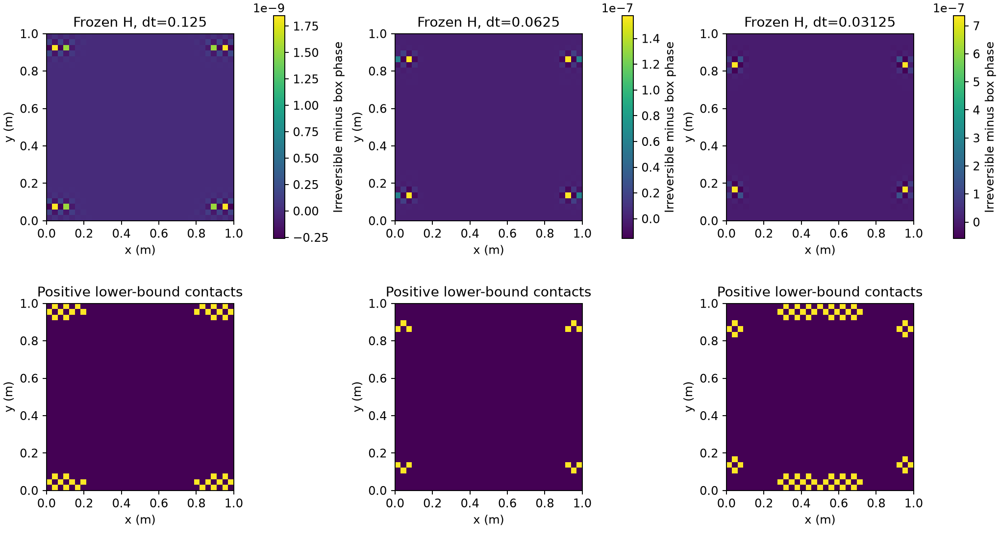
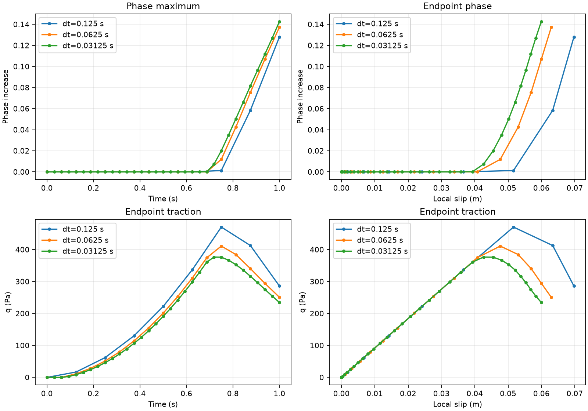
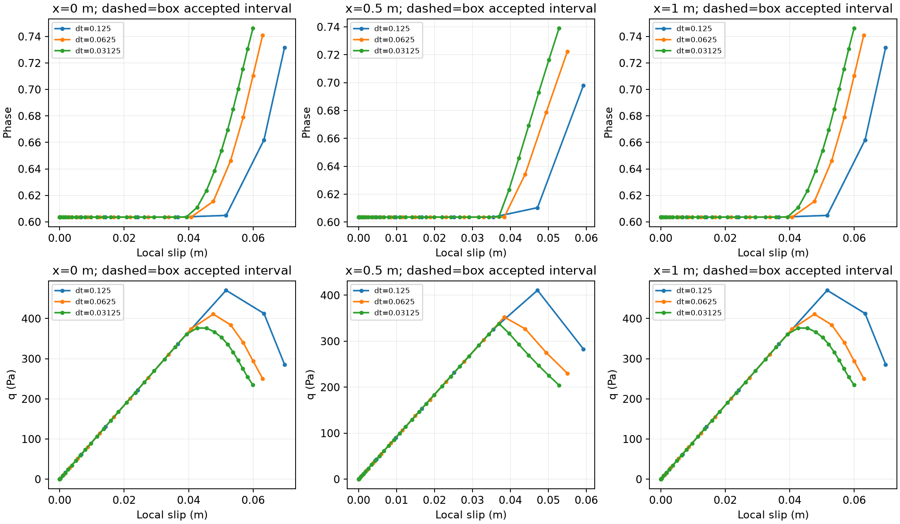
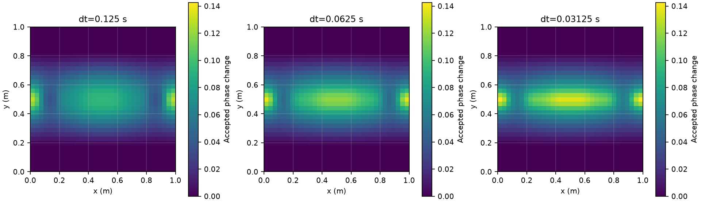
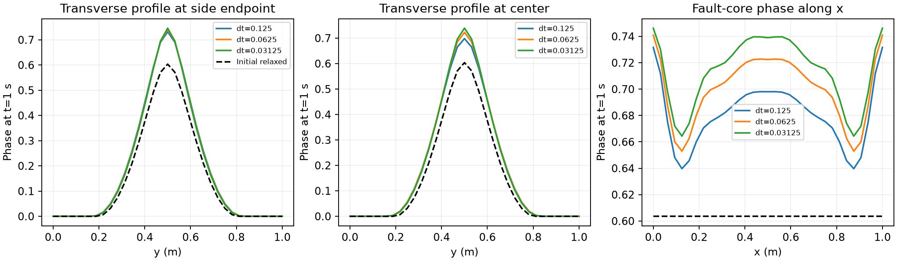
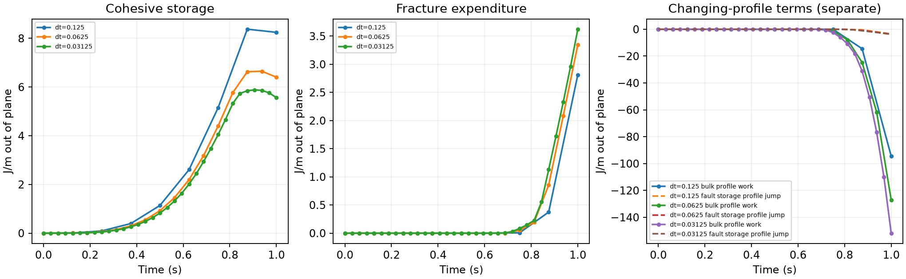

# Direct P2 phase irreversibility — 2026-10-07

Physical evolution now uses the last accepted phase as a fixed nodal lower bound.
Initialization still relaxes on [0,1]. The recoverable-energy driver, unloaded
initialization, surface elastic-slip history and bulk-conjugate work measure are
retained. This changes the phase admissible set explicitly; it does not adjust a
numerical tolerance.

**All three fresh trajectories complete through t=1 s without phase decrease.**
Refinement improves agreement: at this common time the full-field phase difference
shrinks from 0.02480 to 0.01721 and the largest center/endpoint traction difference
from 52.86 to 25.63 Pa. Differences remain material, particularly at common local
slip. The constraint primarily stops small tail decreases: frozen-entry core
changes are at most 1.52e-10, and the previously accepted traction–slip response
is unchanged to numerical precision. This supplies the requested usable temporal
comparison, **not a timestep-independent, spatially converged or energetically
qualified damage-feedback baseline**. Normalized-source representation errors
reach 6.2–6.4%, and changing-profile work is substantial.

[Actual specification.tex diff](../../../benchmarks/reconstructed_fault/propagation/irreversibility_evidence/specification.diff),
[production diff](../../../benchmarks/reconstructed_fault/propagation/irreversibility_evidence/production-revision.diff),
[frozen replays](../../../benchmarks/reconstructed_fault/propagation/irreversibility_evidence/replays.json),
[complete trajectories](../../../benchmarks/reconstructed_fault/propagation/irreversibility_evidence/comparison.json),
[common time/slip and lag tables](../../../benchmarks/reconstructed_fault/propagation/irreversibility_evidence/refinement.json).
Original failed box-only trajectories and their failed qualification remain intact.
All 3,154 incoming pinned artifacts were verified and copied to
`build-propagation-integration/irreversibility-baseline/` before modification.

## Actual model and initialization

| Quantity | Retained value |
|---|---|
| Domain / sharp fault | [0,1]² m; (0,0.5)–(1,0.5) m, fixed through-going geometry |
| Bulk / surface discretization | 32×32 squares, Q1 phase (1,089 nodes), Q2 velocity; fault spacing 0.1 m, 11 nodes |
| Particles / association | 3×3 per cell, 9,216 fixed positions; native fixed full-cross-section width 0.50000000000001588 m |
| G / c | 1e6 Pa / 1000 Pa, both constituents |
| eta / bounds | 1e8 Pa s / [1e6,1e10] Pa s; temperature exponent zero |
| Gc / ell / p | 26.6666666667 J/m² / 0.15625 m / 1 |
| AT1/Lorentz calibration | c0=8/3; Hc=c²/(2G)=0.5 Pa; m=128.00000000016; Gc/(c0 ell)=64.00000000008 Pa |
| Friction / normal pressure | Stateless native rate-dependent law, reference=dynamic coefficient 0.1; prescribed adiabatic compressive pressure 10000 Pa |
| Rates / radiation | characteristic 2e-6 m/s, minimum 1e-20 m/s; radiation damping zero |
| Temperature / fractions / gravity | Static 293 K; frozen 0.5/0.5 constituents; density 3300 kg/m³; gravity zero |
| Velocity boundary conditions | All four sides: vx=0.256 t (y−0.5) m/s, vy=0; a=0.256 s⁻² |
| Other boundary conditions | Natural zero phase flux; dynamic pressure surface normalization; no fixed-temperature/composition indicators |
| Time | t=0–1 s; dt=0.125, 0.0625, 0.03125 s; final imposed relative displacement 0.128 m |

Every run generates native nominal-core-0.6 phase/H, relaxes the phase at that H,
then initializes cohesive q, Z=I_h q, elastic cohesive slip Z/G and bulk Maxwell
stress to zero. Current and previous I_h are initialized consistently at the
accepted phase. H is not regenerated. The relaxed maximum is
0.60354883767362211; initial I_h is approximately 108.5313919283 m. Initial nodal
phase CSVs reproduce the retained fixture byte for byte. The zero-loading hold
has no H or phase growth, with Y0=0≤H0 everywhere.

Phase, mechanics, surface traction/slip and committed H evolve. Mesh, geometry,
particle positions, fractions, temperature, association region and material
parameters stay fixed. Frozen RK2 transport isolates feedback from transport and
birth effects; it does not qualify transported or replenished histories. There
is no tip extension, geometry admission, event tuning or material search.

## Admissible set, state ownership and implementation

For the existing CPDI discrete energy E_h(phi;H), physical steps solve its
variational inequality on K_n={phi_i: phi_last_accepted,i≤phi_i≤1}.
Initial relaxation retains K_0=[0,1]. With r=−dE_h/dphi, free entries require r=0,
lower contacts r≤0 and upper contacts r≥0. The lower multiplier is mu=−r≥0;
mu(phi−lower)=0. A coincident lower/upper bound admits no increment.

`advance_time` in `source/simulator/helper_functions.cc` rotates the completed
`solution` into `old_solution` before the next solve. The actual generic predictor
uses `sadd(1+dt/old_dt, -dt/old_dt, old_old_solution)`. It supplies neither the
phase initial guess nor the lower bound. `evolve_phase_field` copies the actual
old accepted phase into the trial, then creates a **const per-solve snapshot**.
The snapshot stays fixed through contact decisions, Newton solves, projected
line searches, energy and KKT tests. H also remains fixed. Successful convergence
publishes the phase; existing callers refresh only the phase block of
`current_linearization_point`. Neither old FE history is overwritten.

The existing symmetric active-increment elimination imports contact flags for
all off-rank columns. Positive residuals release lower contacts; projection is
part of Newton globalization, not clipping a solved equality field. The failed
public-solve probe verifies that nonconvergence publishes no phase. Native
`continue with next timestep` accepts failed iterates and is therefore rejected
with this option. The fixture uses `abort program`. Physical rejected-step
particle/surface rollback and coupled restart remain separate, unqualified P2
requirements; this task creates no extra committed history variable.

| Contract | Implemented discrete choice / remaining approximation |
|---|---|
| Direct physical irreversibility | Accepted-node lower bound; on this fixed Q1 mesh, point values and positive CPDI averages inherit monotonicity |
| Phase energy and driver | Existing CPDI energy/linear solver; H_new=max(H_old,Y_accepted), Y=q²/(2Gg²); no viscous-work accumulation |
| Sequential cycle | Incoming committed H → phase → mechanics → new committed H; one-step phase/history lag, no outer iteration |
| Cohesive history | Authoritative Q1 Z; point q=Z/I_h; native Maxwell update and terminal publication |
| Mechanical exchange | Native Stokes-QP conjugate B/G and surface Q3 resistance; evolving-profile correction retained |
| Normalization | Existing consistent I_h projection; measured spatial representation error remains |
| Legacy options | New selector defaults false; equality, box-only and mature frozen paths retained |

## Same-H failed-entry replays

The original paths are reproduced deterministically up to their failed phase
entries. At each entry, box phase and old accepted phase match the original full
fields exactly; 90, 156 and 310 retained CSVs also reproduce byte for byte.
The irreversible scratch solve starts from the accepted phase at precisely the
same incoming particle H, material, domains, assembly and tolerances. Mechanics
never advances at the replay entry. Particle H, accepted phase histories, q and
previous I_h are checked unchanged. Native scratch normalization is restored
on both ordinary and intentionally exceptional paths.

| dt (s) / entry time (s) | Original decrease = full-field correction infinity norm | Fault-core correction infinity norm | Lower contacts (positive lower) | KKT/free residual max | Fracture difference (J/m) |
|---|---:|---:|---:|---:|---:|
| 0.125 / 1 | 1.84800829e-9 | 1.11022e-16 | 66 (36) | 6.65266e-16 | 7.65166e-10 |
| 0.0625 / 0.875 | 1.57664550e-7 | 4.47042e-12 | 174 (12) | 6.23633e-16 | 4.72847e-8 |
| 0.03125 / 0.875 | 7.35745374e-7 | 1.51602e-10 | 146 (58) | 6.73529e-16 | 2.12258e-7 |

All lower-contact residuals have the required sign; their largest values are
−1.31e-11, −1.63e-11 and −1.04e-11. The complementarity-product maxima are
4.96e-17, 1.78e-17 and 1.19e-17. Identical-H repeats change nothing. The original
failed equality/contact evidence and Jacobian-correction uncertainty diagnosis
are preserved; the physical lower bound is not justified by reclassifying those
resolved decreases as numerical noise.

Relative changes to I_h are at most 4.51e-11, 3.94e-9 and 2.47e-8. The largest
pointwise h/I_h changes relative to the old source maximum are 1.40e-10,
1.61e-8 and 6.66e-8. The fine absolute source change is 5.86e-7 m⁻¹. Full-field
RMS differences are 1.50e-10, 1.04e-8 and 4.64e-8. Native fracture values before
and after each solve, I_h and direct/source comparisons are in the replay CSVs.
Positive-lower contact coordinates are in the JSON; all contacts and raw
residuals are in `irreversibility-replay.csv` in each native output directory.



## Complete physical trajectories and refinement

| dt (s) | Accepted cycles / phase-changing cycles | Final phi maximum | Final center phase | Largest nodal increment per step | Integral committed H gain (J/m) |
|---|---:|---:|---:|---:|---:|
| 0.125 | 8 / 3 | 0.7316116394 | 0.6980277113 | 0.08774616 | 4621.811968 |
| 0.0625 | 16 / 6 | 0.7409356550 | 0.7224770101 | 0.04471502 | 3960.501865 |
| 0.03125 | 32 / 13 | 0.7462178833 | 0.7390266490 | 0.02379854 | 3738.376738 |

Growth begins near the side endpoints, then extends across the band toward its
center. Symmetric endpoints have the phase maximum (the fine field's reported
right endpoint differs from the left only by roundoff). No off-band particle H
increases occur. Maximum off-band phase at the final time is 0.0029884, 0.0027441
and 0.0021878. These small diffuse tails are distinct from bulk nucleation.
Cumulative feedback remains finite under refinement; the historical
single-step-candidate/max-H loss is not reproduced by this selected state driver.

At t=1, coarse→medium and medium→fine differences are respectively:

| Measure at common physical time | dt→dt/2 | dt/2→dt/4 |
|---|---:|---:|
| Full-field phase infinity norm | 0.02480377 | 0.01721240 |
| Phase maximum difference | 0.00932402 | 0.00528223 |
| q difference, largest among center/endpoints (Pa) | 52.8622 | 25.6304 |
| Local slip difference, largest among center/endpoints (m) | 0.00679336 | 0.00299803 |
| Integral H-gain difference (J/m) | 661.3101 | 222.1251 |

Endpoint q at t=1 is 285.869, 250.660 and 234.431 Pa; endpoint slip is 0.0697396,
0.0629462 and 0.0599482 m. Center q is 283.000, 230.138 and 204.507 Pa, with slip
0.0592480, 0.0550323 and 0.0528135 m. Agreement improves, but the fine/medium
center phase difference of 0.01655 is appreciable. Peak-only comparison understates
profile differences.

At the common endpoint slip 0.0599482 m, phase differences shrink
0.0649185→0.0359858 and q differences 134.719→60.353 Pa. At common center slip
0.0528135 m, phase differences shrink 0.0537425→0.0339022 and q differences
102.910→43.569 Pa. These comparisons use piecewise-linear interpolation of the
accepted records over their overlapping slip ranges, not extra physical solves.
They show substantial remaining temporal sensitivity, not negligible error.

Separately, aligning the time through which H has been consumed accounts for
the scheme's explicit lag. For H committed through t=0.875, phase is sampled at
1, 0.9375 and 0.90625 s. Full-field differences shrink 0.0245154→0.0123913;
maximum differences shrink 0.0211093→0.0102522. Those different phase times are
**lag interpretation only**, not common-time convergence evidence. All actual
common-time tables cover 0–1 s and all trajectories finish at the same time.
The H newly committed at t=1 has not yet been consumed by phase.

At the near-endpoint particle, final incoming H/H0 is 3.76449, 4.24261 and
4.50757, while newly committed H/H0 is 5.89546, 5.32385 and 5.11231. The incoming
−H g'(phi)/(Gc/(c0 ell)) is 7.64797, 8.14129 and 8.36368; the newly committed
values are 11.97727, 10.21612 and 9.48577. This records the lag and finite driving
feedback directly; it does not equate the last candidate with consumed history.






## Size of the constraint effect

Through the original accepted intervals (ending at 0.875, 0.8125 and 0.84375 s),
the largest field differences are approximately 1.27e-14, 1.55e-15 and 5.40e-14.
Fault-core differences are ≤1.89e-14, traction relative differences ≤1.41e-13
and slip differences ≤2.82e-15 m. The same-H failed-entry comparison then isolates
only the small tail corrections shown above. It provides no evidence of a material
change in core damage or traction–slip response from the constraint itself.
Beyond those old accepted intervals there is no admissible old trajectory to
compare; new completed states must not be portrayed as an old box-only continuation.

The lower bound makes direct irreversibility explicit even though its effect is
small in this fixture. It is a model change with potentially different effects
in other loading histories, not a universal argument that healing was harmless.

## Numerical checks and remaining accuracy/energy questions

The nonlinear relative tolerance remains 1e-12, linear relative tolerance 2e-7,
100 Newton iterations and 35 line-search attempts. Actual absolute KKT targets
are roundoff-dominated: 3.78228e-13–4.40780e-13. Observational gates remain
KKT≤1e-11, nodal [0,1], CPDI bounds allowance 3e-14, healing allowance 4.922e-12,
mechanical relative residual≤1e-8, and publication allowance
128 epsilon max(1, expected H). Maximum observed KKT is 1.97911e-13 and mechanical
relative residual 4.36944e-9. All physical steps have zero measured healing;
final CPDI ranges are approximately [8e-12,0.7353]. Publication errors satisfy the
unchanged scale-aware allowance. Solver convergence, phase growth and direct
admissibility are separate observed outcomes.

I_h remains finite and positive throughout. Direct transverse integration of
the fixed Q1 fields is checked analytically and against Q16/Q32 (differences
≤6.67e-16 relative). The **representation** error in integrated h/I_h at t=1 is
6.3555%, 6.4033% and 6.2074%; worst samples are at x=0.1/0.9 m. Endpoint errors
are +0.0189%, −0.6787% and −1.3002%. Initial error is 8.83e-10. Accurate transverse
quadrature does not establish accurate surface projection. Temporal refinement
does not remove this fixed-spacing spatial error. No normalization operator,
spacing, phase cap or floor was changed; normalization accuracy remains unresolved.

The separate directional full-discrete energy derivative discrepancy is
0.003924%, 0.006149% and 0.009569% at the final accepted states. The projected
energy finite difference agrees with its own discrete derivative; agreement
with the continuum/local driver is a different question. The current constraint
does not repair that distinction.

All quantities below are J/m out of plane; profile work and storage jumps are
signed, recorded separately, and are not absorbed into fracture expenditure.

| dt (s) | Cohesive stored energy at 1 s | Fracture expenditure | Cumulative bulk profile-redistribution work | Cohesive storage jump from changing I_h | Matched-Q3 integrated exchange defect |
|---|---:|---:|---:|---:|---:|
| 0.125 | 8.24626 | 2.81406 | −94.51012 | −3.50841 | −4.07223 |
| 0.0625 | 6.40605 | 3.34815 | −127.08813 | −3.70358 | −3.32802 |
| 0.03125 | 5.56629 | 3.62371 | −151.78518 | −3.79385 | −2.18394 |

Parent-particle bulk storage at 1 s is 6365.565, 5758.924 and 5518.612 J/m;
bulk viscous dissipation is 26.7415, 23.2444 and 21.7605 J/m; cohesive viscous
dissipation 0.04954, 0.04188 and 0.03868 J/m; friction expenditure 55.0862,
51.2761 and 49.2409 J/m. These separate fields are not a closed global boundary-work
budget. The signed sum of FE-to-particle stored-energy differences is 22.3840,
59.9567 and 126.9818 J/m, with relative stress-transfer errors up to 7.3%.
Repeated transfer and the increasing number of steps must be considered explicitly.

Native B/G work-adjoint error is ≤1.76e-14 and matched-Q3 endpoint exchange error
≤8.11e-13 W/m. Those identities do not remove the nonzero time-integrated exchange
or the large profile-redistribution work. The latter does not vanish or converge
visibly over these three paths; it requires a separate energetic interpretation.
The data preserve this result rather than asserting complete energetic consistency.



## Changed functions, evidence and scope

Production changes are confined to `include/aspect/phase_field.h` and
`source/simulator/phase_field.cc`, relative to the verified incoming stage:

| Function/data | Purpose |
|---|---|
| `SolverParameters` | Add optional `enforce_irreversibility=false`; private bound-solver signatures accept an explicit const lower-bound field |
| `PhaseFieldHandler::declare_parameters` / `parse_parameters` | Expose `Solver parameters/Phase field solver parameters/Enforce phase irreversibility`; require box constraints and reject continuation after nonconvergence |
| `constrain_phase_newton_system` | Detect lower contacts at supplied accepted values; reuse distributed symmetric elimination and sign-based release |
| `solve_bound_constrained_phase` | Validate lower/upper feasibility, test contact KKT, and project each Newton line-search trial against the same supplied bound |
| `evolve_phase_field` | Snapshot accepted phase once for physical evolution; initialization stays box-only; publish only after success |

All 11 other incoming modified production headers/sources match their preserved
hashes. No H, constitutive, normalization, bulk/fault work or generic projection
operator was changed in this task. `tests/phase_field_test_access.h` forwards the
optional lower bound. Benchmark `irreversibility_feedback.cc` adds frozen-H
replays, public failure and restoration probes; `coupled_feedback.cc` observes
the correct lower-contact KKT. CMake adds the replay plugin. The runner and four
analysis scripts generate fresh records, common-time/slip comparisons, native-Q3
work replay and plots. Documentation updates record the explicit admissible-set
revision and current qualification level; the cumulative source inventory retains
production, diagnostic and documentation categories.

Diagnostic/configuration files and purposes:

| File in `benchmarks/reconstructed_fault/propagation/` | Purpose |
|---|---|
| `CMakeLists.txt`, `irreversibility_feedback.cc` | Build frozen-H replay/publication/restoration observer |
| `coupled_feedback.cc` | Observe lower-bound KKT using accepted old phase |
| `run_irreversibility.py` | Fresh physical/replay/zero inputs, fixed budgets and executable/input hashes |
| `run_irreversibility_compat.py` | Small mature default/enabled compatibility reproduction |
| `analyze_irreversibility.py` | Completion gates, normalization/direct integration and projected-energy comparison |
| `analyze_irreversibility_replays.py` | Exact old-field comparison, active coordinates, full/core/source differences |
| `finish_irreversibility_analysis.py` | Common-time/slip and separate lag analysis, profile work and measured allowances |
| `match_irreversibility_work.py` | Frozen-record native-Q3 work audit; retain Q8 comparator |
| `check_irreversibility_evidence.py`, `finalize_irreversibility_evidence.py` | Preservation/result verification, source inventory and immutable hashes |
| `IRREVERSIBILITY.md`, `README.md`, `MATERIAL_STUDY.md` | Reproduction commands and current scientific overview |

`tests/phase_field_test_access.h` changes only diagnostic forwarding. Governing
`specification.tex`/`current_design.md` record the new admissible set. This report,
PLAN, STATUS, CURRENT_STATUS, SOURCE_CHANGES, source_change_inventory, root
AGENTS and the benchmark index record results/scope while retaining earlier text.
Evidence CSV/JSON/plots/diffs are generated diagnostics, not production code.

GCC 12.4.0, Release unity build, deal.II 9.6.2, OpenMPI 5.0.6, Trilinos 14.2,
Epetra and Voro++ 0.4.6 are retained in this worktree, branch `fault-propagation`,
HEAD `de7beaa65846c7372711f7922abf1c5d9a745ee6` plus preserved incoming work.
The final executable is pinned as `build-propagation-integration/irreversibility-final-aspect`:
SHA256 `44fd12df9313033820771066d1c754f95ab8fa1c9ad8739b17f56c6f86e810dd`.
The final three replays and all three loaded trajectories use this identical build.
The earlier harness exception-message defect was fixed and affected replays rerun;
all attempts remain recorded. The final native cohesive unit suite passes
622 assertions in seven cases. Mature frozen initialization reproduces both
historical CSVs byte for byte with default and explicitly enabled selectors
(four comparisons total). Invalid equality/irreversibility and failed-step
continuation configurations reject with the intended messages.

Commands (fresh labels; runner refuses to overwrite):

```sh
cmake --build build-propagation-integration --target aspect -j3
cmake --build build-propagation-integration/plugin --target irreversibility_feedback -j2
python3 benchmarks/reconstructed_fault/propagation/run_irreversibility.py \
  irreversibility_replay_guard_dt125 --replay --dt .125 --work --amplitude .256
python3 benchmarks/reconstructed_fault/propagation/run_irreversibility.py \
  irreversibility_dt125 --dt .125 --work --amplitude .256
# The corresponding fresh 0625 and 03125 labels use those timesteps.
python3 benchmarks/reconstructed_fault/propagation/analyze_irreversibility_replays.py
python3 benchmarks/reconstructed_fault/propagation/analyze_irreversibility.py \
  irreversibility_dt125 irreversibility_dt0625 irreversibility_dt03125 --name comparison
python3 benchmarks/reconstructed_fault/propagation/finish_irreversibility_analysis.py
python3 benchmarks/reconstructed_fault/propagation/match_irreversibility_work.py
build-propagation-integration/aspect --test '[phase_field_fault_cohesive]'
```

The bounded task is complete. Three common-end-time runs and the same-H replays
support correct direct irreversibility and improving temporal feedback agreement.
Residual temporal sensitivity, normalization spatial accuracy, changing-profile
energetics, particle/FE stress transfer, physical rejected-step rollback, coupled
restart and transported/birth histories remain P2 requirements. This new selector
has not received a new distributed/restart campaign; previous fixed-phase MPI
and P1 restart evidence remain historical and are not relabeled as new qualification.
No stress-scaling claim, material optimization or P3 follows this result.
