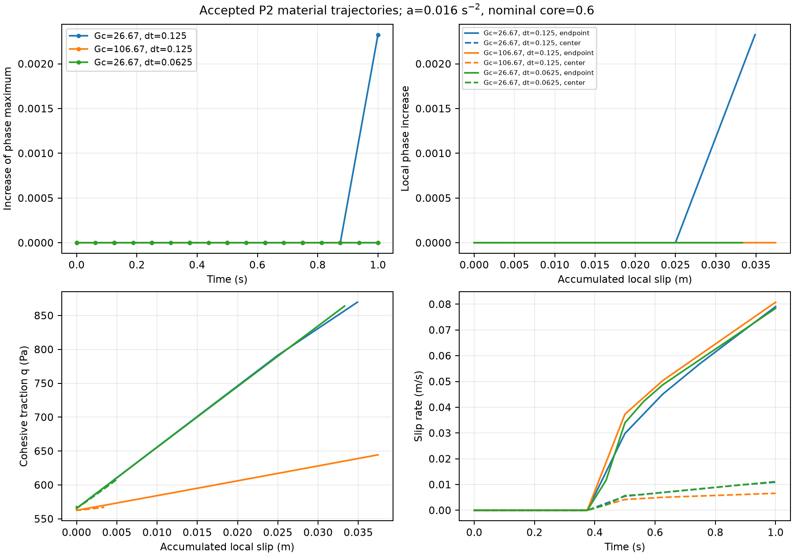
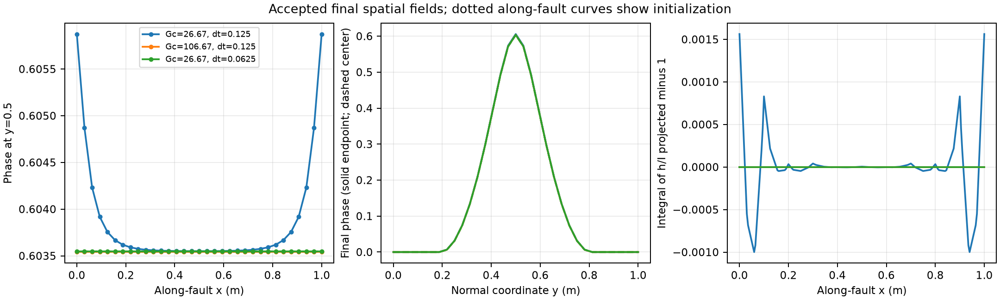

# P2 material study: lower initial damage and fracture-energy comparison

The model uses a fresh nominal core phase of **0.6**, G=1e6 Pa, c=1000 Pa,
eta=1e8 Pa s, ell=0.15625 m and Lorentz p=1. Only Gc changes between the
reference (26.6666666667 J/m²) and primary (106.6666666667 J/m²) materials.
The selected common loading is vx=0.016 t(y−0.5), vy=0 on all boundaries,
0–1 s, initially dt=0.125 s. Consistent I_h projection and zero radiation damping
are fixed. Every run has its own native profile/H, relaxed phase and initialized
cohesive/normalization data. There are no production-source changes in this task.

**No tested parameter set qualifies as gradual, timestep-robust damage feedback.**
The reference evolves late and weakly; the primary remains inactive. Halving dt
nearly eliminates reference H feedback and eliminates consumed phase evolution
over the interval. Increasing Gc suppresses onset here, but a slower post-onset
damage-versus-slip response is **not demonstrated**. For the next diagnostic,
retain the reference Gc, core 0.6 and a=0.016; do not recommend the primary as a
qualified gradual-damage model or expand the parameter search before resolving
the candidate/max-history increment dependence. No law is changed here.

## Actual setup and initialization

| Setting | Value |
|---|---|
| Box / fixed sharp fault | [0,1]² m / (0,0.5) to (1,0.5) m |
| Bulk / fault discretization | Fixed 32×32 squares, Q1 phase/Q2 velocity; Q1 fault spacing 0.1 m |
| Particles / association | 3×3 per cell, 9,216 fixed parents; full normal width 0.50000000000001588 m |
| Constituent fractions / temperature / density | 0.5/0.5, identical mechanical parameters; static 293 K; 3300 kg/m³ |
| G / cohesion / viscosity | 1e6 Pa / 1000 Pa / 1e8 Pa s, viscosity bounds 1e6–1e10 Pa s |
| Phase | AT1, c0=8/3, ell=0.15625 m, p=1; box solver [0,1], no previous-phase bound |
| Friction | Stateless rate-dependent branch, reference=dynamic mu=0.1; characteristic rate 2e-6 m/s, minimum 1e-20 m/s; no RSF state |
| Pressure / gravity / damping | Adiabatic friction pressure 10000 Pa; surface pressure normalization; gravity zero; radiation damping zero |
| Boundary conditions | All four velocity boundaries as above; natural zero-normal-flux phase; no applied traction boundary; temperature static and compositions on fixed particles |
| History cycle | Incoming H -> phase -> mechanics -> newly committed H; no outer iteration |

The existing frozen-RK2 diagnostic disables only particle-position advection,
not constitutive time. Geometry, associations, mesh, temperature and fractions
are fixed. Velocity, pressure, Maxwell stress, q, V, H, phase and normalization
evolve natively. No particle birth/replenishment, transported-history, general
support-admission or propagating-tip qualification follows from these controls.
Initial particle stress is zero; native cohesive initialization uses its existing
1 s initialization interval. See the [benchmark overview](../../../benchmarks/reconstructed_fault/propagation/MATERIAL_STUDY.md)
for all inputs and reproduction commands.

Source audit: `get_critical_crack_driving_forces` computes Hc=c²/(2G).
`PhaseFieldHandler::parse_parameters` calibrates m=Gc*a'(0)/(c0*ell*Hc), with
AT1 a'(0)=1. `initialize_phase_guess` reads the prescribed core at each geometry
point; the manager's native H initializer uses that material's stationary profile.
The production path contains no substituted 0.8 core or fixed 64 Pa coefficient.
Two old observer-only 0.8 profile reads were changed to read the prescribed core.
The new observer gets E and g'(0) from the native phase operator, independently
checking E=Gc/(c0*ell), m=−g'(0), and c0=8/3 for **both** constituents.

| Case | Native m | Native E (Pa) | Hc (Pa) | Gc/c (m) | Relaxed phi maximum | Initial q (Pa) / I_h (m) |
|---|---:|---:|---:|---:|---:|---|
| Reference | 128.00000000016001 | 64.000000000080007 | 0.5 | 0.0266666666667 | 0.60354883767362211 | 567.7690811 / 108.5313919 |
| Primary | 512.00000000016007 | 256.00000000008004 | 0.5 | 0.1066666666667 | 0.60354044447726174 | 564.7143007 / 434.0387362 |

The small deviations from integer m reflect the requested decimal Gc inputs.
The optional Gc=266.6666666667, expected m approximately 1280, was **not run**:
the primary was inactive, not excessively abrupt. All reference initial phase
snapshots are byte-identical across loading amplitudes and timesteps. Native H
is retained during relaxation, not reconstructed from relaxed phi. The runtime
observer verifies H/stress/q/previous-I_h nonpublication during trials, native
candidate/max-H publication after acceptance, and committed previous I_h equal
to current I_h. Its initial H snapshot is taken before phase consumption.

## Loading selection and accepted outcomes

The reference amplitude search was limited to the requested 0.004, 0.008 and
0.016 s^-2. Each run completed 1 s without violating bounds, healing, KKT,
normalization positivity or mechanical convergence. The first two were inactive;
0.016 was therefore selected for both Gc cases. Its imposed displacement at 1 s
is a*t²/2=0.008 m. No further amplitude, duration, damping or material adjustment
was introduced to achieve the suggested 0.01–0.05 phase increase.

| Run | Accepted physical steps | Increase of phase maximum | Largest nodal phase increment | Integral of H−H0 at 1 s |
|---|---:|---:|---:|---:|
| Reference, a=0.004, dt=0.125 | 8 | 0 | 0 | 0 |
| Reference, a=0.008, dt=0.125 | 8 | 0 | 0 | 0 |
| Reference, a=0.016, dt=0.125 | 8 | 0.00232604375 | 0.00232590258 | 36.20138531 Pa m² |
| Primary, same a/dt | 8 | 0 | 0 | 0 |
| Reference, a=0.016, dt=0.0625 | 16 | 0 | 0 | 9.94215875e-7 Pa m² |

The H integral is useful for comparing timesteps **within one material**, not as
a damage-severity measure across Gc. The coarse reference first commits a tiny H
increase at 0.75 s, then changes phase at 0.875 and 1 s. At 0.875 the largest
nodal increment is 1.9144e-5; the phase maximum itself rises only 1.4117e-7.
Most observed peak-phase growth occurs on the final step. This is resolved but
does not establish gradual growth over several comparable feedback cycles.

The final maximum is 0.60587488142659662 at (0,0.5); the opposite endpoint agrees
to about 2e-16. The fault-center increase is only 1.3790e-6. The homogeneous
initial maximum lies along the fault, so a reported initial maximum at x=0 is
one representative maximizer, not evidence of initial endpoint concentration.
No new geometry or off-original-band H activation occurs.



The plots use accepted complete steps only. Solid local curves are at x=0;
dashed curves are at x=0.5. The opposite endpoint is symmetric. Data also retain
x=0.1 and 0.9. Slip is the accumulated accepted sum of V*dt, not imposed box
shear displacement; these differ, especially near prescribed side boundaries.

At the same imposed displacement of 0.008 m:

| Location / quantity | Reference dt=0.125 | Primary dt=0.125 | Reference dt=0.0625 |
|---|---:|---:|---:|
| Endpoint phase increase | 0.00232604 | 0 | 0 |
| Endpoint q (Pa) | 869.6307 | 644.4165 | 863.9644 |
| Endpoint V (m/s) | 0.0790840 | 0.0807818 | 0.0784111 |
| Endpoint accumulated slip (m) | 0.0348834 | 0.0374396 | 0.0332944 |
| Center phase increase | 1.3790e-6 | 0 | 0 |
| Center q (Pa) | 609.7074 | 567.0559 | 606.6837 |
| Center accumulated slip (m) | 0.00516752 | 0.00342979 | 0.00483080 |

At common endpoint slip 0.0348834 m, time-series interpolation gives reference
phase gain 0.00232604 and q=869.63 Pa, versus primary gain zero and q=638.80 Pa.
At common center slip 0.00342979 m, the reference gain is only 1.91e-9 and the
primary gain is zero. These comparisons use the overlapping sampled slip range;
they do not extrapolate a primary damage branch. Its post-onset dphi/dslip is
unmeasured, so zero growth cannot be relabeled as a flatter post-onset response.
The reference's final endpoint secant is about 0.2353 m^-1, based on one interval,
which is insufficient to establish a characteristic damage-versus-slip width.

## Driving normalization and timestep diagnosis

At the nearest endpoint parent (x=0.00520833, y=0.49479167), reference initial H
is 29167.99 Pa and primary initial H is 465771.80 Pa. This much larger primary H
is part of its recalibrated initialization, not greater damage. The appropriate
native phase-driving ratio −H*g'(phi_CPDI)/E is nearly identical initially:
4.3631822 reference and 4.3634738 primary. Ratios above one are balanced in the
phase equation by its gradient contribution; this ratio is not a local bound.

At 1 s the reference ratio using incoming H is 4.6555177, and using newly
committed H is 6.2190562. The latter has **not** yet been consumed by phase.
The primary and refined reference remain at their initial ratios at this parent.
Per-case H−H0, incoming/new H and normalized driving at three fixed parents are
retained, alongside global diagnostics. Absolute H maxima across Gc are not
used to infer damage severity.

The sequential lag is explicit: reference phase at t=1 consumes H committed at
0.875, whereas refined phase at t=1 consumes H at 0.9375. The refined run's four
small H increases at t=1 remain unconsumed. Nevertheless this is not explained
by shifting the phase curve by one step: cumulative H growth itself is reduced
by a factor of about **3.64e7**, and refined incoming H is unchanged at all
prior times. At t=0.875 the coarse cumulative H increase is 4.36937634 Pa m²;
the fine value is still zero. Final endpoint q differs by only 0.65%, while
endpoint accumulated slip differs by 4.56%.

The native source supplies a concrete explanation. In a partially damaged region
with unchanged phase, 0<g<1, previous_h=(1−g)/g, beta=exp(−G*dt/eta), and
eta_ve=eta*(1−beta). The implemented candidate reduces exactly to

\[
C=\frac{dt}{2\eta_{ve}g^2}\left(q_k^2-\beta^2 q_{k-1}^2\right),\qquad
H_k=\max(H_{k-1},C).
\]

For smooth q and fixed g, C is O(dt):

\[
C=\frac{dt}{g^2}\left(\frac{q\dot q}{G}+\frac{q^2}{\eta}\right)+O(dt^2).
\]

It is an incremental candidate compared with a nonzero committed maximum;
smaller increments can fall below H0 even when the cumulative mechanical path
is similar. This derivation concerns the partially damaged branch, not the
separate exactly-intact g=1 branch. Native trial and publication rules were not
altered to test it.

The endpoint-parent data exhibit this cutoff directly. At t=0.875,
C/H0 is 1.080891 coarse versus 0.544297 fine; at t=1 it is 1.443904 versus
0.685099. The nearby projected q at t=1 is 854.08 versus 848.48 Pa. The coarse
candidate crosses the stored-history threshold; the fine candidate does not.
An independent replay from recorded q/phase reproduces the parent update; the
native observer independently checks all parents using the production function.

Thus this bounded result supports the previously identified **candidate/max-H
loss of feedback at small increments**, beyond ordinary phase/history time lag.
It does not establish a replacement H law or a universal convergence theorem.
No compensating factor, extra iteration, limiter or additional timestep was used.
A scientific review of the driving-history meaning is needed before claiming
material-controlled gradual evolution.

Endpoint forcing dominates: the prescribed linear velocity profile on the side
faces produces high endpoint q/slip, while interior q and phase response are
much smaller. The spatial plot makes this visible. CPDI and pointwise Q1 phase
at the fixed parents agree to at most 3.33e-16 throughout this study, so their
value mismatch does not explain the observed loss. This agreement is specific
to these regular fixed particle domains; it does not settle sampled-H accuracy
on transported, deformed or newly born domains.

## Normalization and numerical qualification



All accepted nodal maxima are below 0.606. Q1 convexity therefore bounds the
whole finite-element field strictly below one, making native h and both
transverse/surface integrals finite on this compact domain. This is an
integrability argument, not a conclusion from finite Gauss samples.

Direct transverse integrals use the captured Q1 field and each case's **runtime
m**. On each bulk interval, with u=1−phi and p=1,
h=m(2/u²−3/u+1) is integrated analytically. Independent Q16/Q32 Gauss integration
on the same bulk intervals, including both endpoints, agrees within 6.67e-16
relative. The analytic/native g comparison is also checked. These diagnostics
never change current or committed I_h.

| State | Max relative I_h representation error | Max error in normal integral of h/I_projected | Relative L1 I_h error |
|---|---:|---:|---:|
| Reference initialization / inactive paths | 8.83e-10 | 8.83e-10 | 8.83e-10 |
| Primary initialization and final | 1.253e-9 | 1.253e-9 | 1.253e-9 |
| Most damaged accepted reference, t=1 | **0.15601%** | **0.15625%** | **0.01711%** |

The largest source error occurs at the side endpoints. Normalization remains
positive, finite and resolved at roughly the 0.2% source-error level in this
bounded comparison, unlike the old high-load fields. It is not accurate to
1e-8 merely because that is the native quadrature tolerance, and this is not a
surface-mesh convergence study or a bound on coupled phase error. The measured
normalization error cannot be used to qualify the failed feedback refinement.

All five runs pass the existing explicit nodal bounds, CPDI allowance 3e-14,
KKT allowance 1e-11, healing allowance 4.922e-12, and mechanical tolerance 1e-8.
Measured healing is zero; maximum KKT residual is 2.713e-15, maximum mechanical
residual 6.040e-9. The configured phase relative tolerance remains 1e-12, linear
2e-7, 100 Newton iterations and 35 backtracks. Native candidate publication uses
the retained 128*epsilon*max(1,|expected H|) check. Offline replay allowance is
1e-10 relative, solely for independently reconstructed probe values; it does not
replace the native check. No numerical tolerance was relaxed.

These five runs contain 48 accepted physical steps plus five initial states;
there are **no failed-entry fields in this new study**. Entry snapshots remain
separately labeled from accepted snapshots. All prior high-load failures,
including exact endpoint saturation, poor normalization representation and fine
healing, retain their failed qualification status. No successful low-load run
retroactively qualifies those cases.

## Files, evidence and scope remaining

Benchmark/configuration changes only:

- `straight_core06.txt` and `material_feedback.prm`: nominal core 0.6 and a fresh
  consistent-normalization material fixture, inheriting the fixed P2 controls.
- `coupled_feedback.cc`: protected observer reuse and geometry-derived core
  reads replacing two diagnostic 0.8 constants; no production physics changed.
- `material_feedback.cc`: runtime native calibration, pre-mechanical admissibility
  guards and retained entry fields, local slip/history/driving probes, CPDI
  comparison and direct normalization diagnostics.
- `CMakeLists.txt`, `run_material.py`: the new observer target and restricted,
  fresh-run driver with input/binary hashes and a 180 s timeout.
- `analyze_material.py`: explicit numerical checks, calibrated integration and
  candidate replay, common-slip/time comparisons, PNG/PDF plots and JSON summary.
- `MATERIAL_STUDY.md`, this report, PLAN/STATUS, design/scope notes and source-change
  overview: actual setup, outcomes, limits and next decision.

**Production C++ and the core executable are unchanged.** The existing GCC
12.4.0 Release build uses deal.II 9.6.2, OpenMPI 5.0.6, Trilinos 14.2/Epetra and
Voro. Runs took 24.5, 26.1, 27.7, 36.5 and 54.6 s (about 169 s total), with
peak RSS below 266 MiB. All prior 282 pinned normalization artifacts were
preserved and verified before edits. The [new evidence manifest](../../../benchmarks/reconstructed_fault/propagation/material_evidence/manifest.json)
records source/build identities and per-run commands; [summary JSON](../../../benchmarks/reconstructed_fault/propagation/material_evidence/summary.json)
contains detailed numerical comparisons. Plots are also available as PDFs.

Exact bounded execution (all labels are retained and refuse overwrite):

```sh
python3 benchmarks/reconstructed_fault/propagation/run_material.py material_reference_a004 --case reference --amplitude 0.004
python3 benchmarks/reconstructed_fault/propagation/run_material.py material_reference_a008 --case reference --amplitude 0.008
python3 benchmarks/reconstructed_fault/propagation/run_material.py material_reference_a016 --case reference --amplitude 0.016
python3 benchmarks/reconstructed_fault/propagation/run_material.py material_primary_a016 --case primary --amplitude 0.016
python3 benchmarks/reconstructed_fault/propagation/run_material.py material_reference_a016_half --case reference --amplitude 0.016 --dt 0.0625
python3 benchmarks/reconstructed_fault/propagation/analyze_material.py
```

The analysis exits successfully only after its numerical assertions pass;
`gradual_feedback_qualified=false` and `timestep_feedback_acceptable=false` remain
explicit in its JSON output. Successful execution is not a scientific pass.

The material change's post-onset benefit is **unestablished**; timestep sensitivity
is **unacceptable for damage feedback**; normalization is **finite and accurate
to the measured level above**. The recommended next task is scientific diagnosis
of the candidate/max-history law, using the reference fixture, before more
parameter tuning. Physical rejected-step rollback, coupled restart and
transported/birth histories remain P2 requirements. No new MPI qualification,
3D run, P3 work or fault propagation was undertaken.
