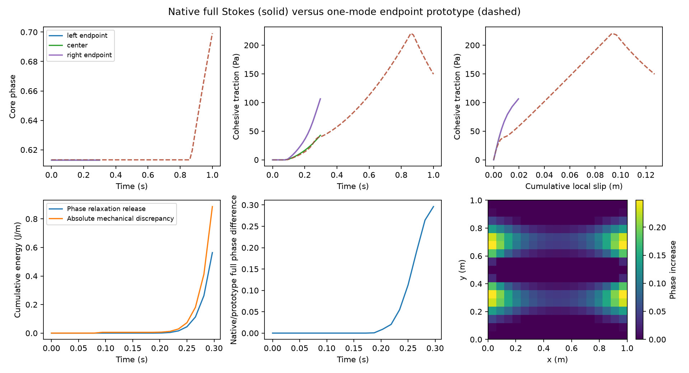

# Restricted native P2: accepted FE strain

The new optional model holds the bulk internal state in the velocity FE space,
uses unloaded initialization and the full discrete recoverable-energy phase
functional. Material and loading are unchanged. Nonuniform Maxwell/ownership
checks pass. The native loaded path accepts 19 steps to **0.296875 s**, then fails
its phase solve at 0.3125 s; it does **not** complete the requested 1 s interval.
Damage widens the seed, most strongly near side endpoints; its core maximum
remains 0.6131766970. This is a restricted implementation checkpoint, **not a
qualified damage-feedback baseline or P3 readiness**.

The authoritative variable is **\(\boldsymbol R=\boldsymbol E^{tot}-\boldsymbol
E^{in}=\operatorname{symgrad}d_R\)**. The accepted vector \(d_R\) has units m and
uses the native Q2 velocity basis. It is an equivalent internal-strain encoding,
not total displacement and not projected particle stress. The particle path and
all defaults remain available and unchanged.

## Model and restrictions

| Quantity | Value and units |
|---|---|
| Domain/fault | Unit 1 m × 1 m box; horizontal x=0…1 m, y=0.5 m; fixed geometry |
| Bulk FE / mesh | Q2 velocity, Q1 pressure and phase; uniform 16×16 cells; 289 phase coefficients |
| Fault FE / spacing | Q1; 64 segments, 0.015625 m |
| Particles | Regular 3×3 per cell, 2304; frozen positions; no birth/deletion |
| Association | Fixed full normal cross-section, transverse half-width 0.5 m |
| G / eta / lambda | 10^6 Pa / 10^8 Pa s / 100 s, identical in both constituents |
| Gc / ell / c | 26.6666666667 J/m² / 0.15625 m / 1000 Pa |
| Phase convention | AT1, c0=8/3, Lorentz p=1, m=128.00000000016, Hc=0.5 Pa |
| Friction / pressure | mu=0.1; prescribed normal pressure 10000 Pa; no RSF state evolution |
| Radiation damping | 0 Pa s/m |
| Temperature / gravity | 293 K; zero temperature dependence of viscosity; zero gravity |
| Initialization | Nominal core 0.6; native prescribed H/profile and initial relaxation; accepted R=Z=tau=0 |
| Boundary loading | ux=a t(y−0.5), uy=0 on all four sides, a=0.256 s^-2; phase natural boundary conditions |
| Time | Requested T=1 s, dt=0.015625 s; interval-mean imposed rate evaluated at t−dt/2 |
| Normalization / history | Consistent I; surface elastic slip Z; bulk-conjugate work; direct phase irreversibility |

G remains a **dimensional synthetic verification value**, not a calibrated rock
modulus. No material search, changed phase cap, damping, H limiter or added damage
kinetics was used.

`Material model / Phase field fault / Bulk history representation` accepts
`particle stress` (existing default) or `accepted FE strain`. The latter requires
fresh serial 2-D runs with uniform Cartesian Box cells, one unit horizontal fault,
homogeneous identical G/eta/Gc/c, common unclipped viscosity, fixed mesh/geometry,
full associations, AT1/p=1, consistent I, surface Z, bulk-conjugate work, bounded
irreversible phase and unloaded initialization. No external stress override,
RSF state, transport, replenishment or repartitioning is accepted. Runtime checks
compare mesh vertices/DoFs, geometry and particle IDs/positions to the initial
state. Initial scope intentionally excludes hanging/periodic/constrained phase
DoFs. No native FE-state restart is implemented. Resume is rejected; an archived
property-registry marker also prevents loading this option's checkpoint through
the particle path. Existing particle checkpoints are never implicitly converted.

The named existing particle-advection-freeze control is used explicitly by the
runner. It removes transport/birth effects from this verification; the result
does not qualify those effects.

## One accepted state and exact Maxwell update

Write \(\chi=h(\phi)/I_h\), \(h=1/g-1\), and let \(\mathcal S\) be the existing
symmetric shear tensor. At accepted state a,

\[
 \tau^a=2G R^a-2Z^a\chi^a\mathcal S.
\]

During phase trials hold **accepted** d_R, Z and particle H fixed. Reconstruct
\(\tau(\phi)=2G R^a-2Z^a\chi(\phi)\mathcal S\) from the explicit trial phase;
current predictors and older phase/velocity blocks are not reference states.
The immutable accepted phase in this same owner supplies the starting field and
physical lower bound. Initial relaxation retains the native seeded-H [0,1]
procedure; afterward the unloaded seed is prescribed pre-existing damage protected
by the bound, not claimed to be an unconstrained total-energy equilibrium.

After instantaneous profile redistribution,

\[
 \tau^*=\tau^a-2Z^a(\chi^{new}-\chi^a)\mathcal S,\quad
 \beta=e^{-G\Delta t/\eta},\quad\kappa=\eta(1-\beta),
\]
\[
 \tau^{new}=\beta\tau^*+2\kappa(\varepsilon-\chi^{new}V\mathcal S),\qquad
 Z^{new}=\beta Z^a+\kappa V.
\]

Substitution gives **exactly**

\[
 R^{new}=\beta R^a+(\kappa/G)\varepsilon,\qquad
 d_R^{new}=\beta d_R^a+(\kappa/G)u^{new}.
\]

Symmetric FE differentiation is linear, so this holds at every evaluation point,
not just a quadrature average. No surface→particle→surface operation and no
particle-stress→FE projection appears. Matching G and eta is essential: sharing
lambda alone does not justify the cancellation. General exponential relaxation
is retained, including dt/lambda=1 and 4 in the local probes.

The phase functional is the actual sum of bulk tau:tau/(4G), surface
Z²/(2G I), and native CPDI fracture energy on their specified measures. For the
consistent projection I=P b with P=M^-1 N^T Ws, its residual includes
(D b)^T P^T times the normalization force. The Hessian includes the cross terms
and the second derivative of b. Exact analytic Q1 normal-ray integrals of h
are used for this restricted option; positive finite quadrature samples do not
replace the integrability check. For endpoint phase values L,R and u=1−L,v=1−R,
z=(v−u)/u, a ray of length l has integral
m l[2/(uv)−3 log1p(z)/(u z)+1], with its continuous z=0 limit.
The existing consistent surface projection and its mass matrix are retained;
other projectors are untouched. Surface-Q1 intersections split the bulk quadrature
in x; Q3 is used on each subinterval and in y (9216 bulk samples here).

At terminal mechanical acceptance, prepare and validate the complete FE update,
cohesive histories and diagnostic peak H, then publish derived particle stress
samples and swap the staged FE owner. All residuals, linearizations and energies
read the same accepted reference. Generic simulator history rotation remains
unchanged; old_solution and old_old_solution are not synchronized by overwriting.
Failed phase/mechanical trials do not publish this owner. This is not qualification
of full simulator rejected-step rollback, coupled restart or transport.
The selected full-energy model retains recoverable H+ as a **diagnostic**, not
as a second phase driver.

## Verification and the retained stop

| Check | Result | Meaning |
|---|---:|---|
| Fresh zero-load hold | Exact phase retention and D_relax=0 | No artificial startup phase growth |
| Nonuniform Q2 velocity/nonconstant surface slip | Relative stress error <=2.43e-14 | Native staged update reproduces Maxwell; dt/lambda=.00125,1,4 |
| Accepted FE nodal recurrence | Error exactly 0 in 2178 saved velocity coefficients per accepted step | No unacknowledged transfer/projection |
| Native QP Maxwell check | Error <4e-10 Pa through accepted interval | Same owner supplies history and accepted stress |
| Full energy gradient / Hessian | Best refined relative errors <=7.08e-11 / 6.29e-11 on loaded probe | Includes normalization adjoint and second derivative |
| Predictor/older-state poisoning | Identical complete residual/Jacobian and energy/derivatives | Explicit phase trial and accepted anchor control evaluations |
| Normal/exception probe restoration | Particle and surface properties, FE owner and clocks unchanged | Probes do not accumulate history |
| Accepted bounds / healing | 0<=phi<1; no healing | Immutable accepted-phase admissible set respected |
| Accepted phase KKT | <=1.17e-13 | Passes actual logged per-entry targets |
| Accepted mechanical relative residuals | Bulk <=1.19e-14, fault <=8.39e-15 | Endpoint nonlinear solves converge on accepted interval |
| Consistent I, initialization/onset/latest accepted | Max source error 0.02763%, worst at endpoint | Below provisional 0.5% for these frozen fields only |
| Projection conservation / constant reproduction | <=1.41e-16 relative / 1.34e-15 absolute | Separate quadrature-defined checks |
| Guards | Heterogeneous material, resume and actual transport rejected | Restricted scope enforced |
| Mature particle/default regression | Both pinned physical CSVs byte-identical | Existing frozen behavior retained |

[Saved-state assessment](../../../benchmarks/reconstructed_fault/propagation/native_fe_evidence/assessment.json)
and [actual specification diff](../../../benchmarks/reconstructed_fault/propagation/native_fe_evidence/specification.diff).
The phase linear relative tolerance is 2e-7; phase nonlinear relative tolerance
is 1e-12, with 100 nonlinear iterations and 35 line-search trials. Mechanical
nonlinear relative tolerance is 1e-8 (30 iterations). The independent healing
allowance remains 4.922e-12; bounds are checked explicitly. No numerical
allowance is increased because the trajectory failed.

The comparison plot shows only accepted native states; the failed entry is not
an additional accepted loading point.

The first native attempt stopped at t=.25 because its FE/native publication
roundoff check used net stress after cancellation. The same 128-epsilon factor
now scales the actual pre-cancellation endpoint/forcing terms. The fresh publication-fix repeat
preserves all initial/accepted phase and surface files through the old stop
byte-for-byte. Later search/contact updates differ by at most 1.67e-16 in phase
and 4.55e-12 in the surface CSV values over that interval.
This changes the uncertainty estimate, not the Maxwell equation or a physical
accuracy tolerance.

Subsequent runs consistently reach 19 steps, then stop on the t=.3125 phase entry.
The entry KKT is .769628; the exact-functional KKT stalls at
**1.2076450950e-12**, above its **1.1256351786e-12** arithmetic target.
The requested nonlinear relative tolerance remains 1e-12; the target is its
initial-defect product or the existing 8-epsilon positive assembly scale,
whichever is larger. The line-search limit and KKT target were not relaxed to
obtain a pass. The nonlinear Hessian has nonpositive free curvature; a positive
Gauss–Newton search metric, projected-gradient safeguard and proper primal-dual
contact lift act on the same residual/energy. An extended-precision force-sum
repeat still fails (1.6319168e-12); that unsuccessful source change is removed,
its failed evidence retained. The last committed FE/phase/surface state remains
step 19. This is an unresolved near-roundoff nonlinear convergence issue;
there is no saturation or proven physical jump at this stop, and no unconditional
qualification based on its small residual.

## Physical comparison and separate energy discrepancies

A new endpoint prototype comparator uses the **identical fresh native relaxed
Q1 seed**, R=Z=0, material, loading interval and bulk/surface intersection samples.
The seed maximum differs from the older retained prototype's interpolated seed;
that older evidence is preserved rather than silently replaced.
The comparator completes to 1 s. Native comparisons use only identical times
through 0.296875 s. They are not a time-refinement test.

| Through t=.296875 s | Native full Stokes |
|---|---:|
| Maximum phase / largest step increase | .6131766970 / .0821669732 |
| Largest gain from initial seed | .2479838246 at (1,.3125) m |
| Traction: left / center / right | 106.3247066 / 42.72812585 / 106.3247066 Pa |
| Cumulative slip: left / center / right | .01953662990 / .004830476292 / .01953662990 m |
| Bulk / cohesive storage | 32.37218 / .1168510 J/m |
| Fracture expenditure | 1.698221552 J/m |
| Phase relaxation release, signed and absolute | .563840860 J/m |
| Mechanical work error, signed / accumulated absolute | .875124092 / .886127514 J/m |
| Viscous loss: bulk / cohesive | .0431093813 / .0001017838 J/m |
| Frictional loss | 5.059701021 J/m |
| Bulk / cohesive instantaneous profile change | −2.250368866 / −.011693546 J/m |

Phase response first appears at publication t=.1875 s, consuming the previous
accepted mechanical state at t=.171875 s; imposed shear displacements are
.0045 and .00378125 m respectively. The center remains largely protected while
tails widen nearer the side constraints. Normal boundaries remain essentially
undamaged through this accepted interval. The old prototype's late-time boundary
damage is not a native result.

At the common t=.296875 s endpoint the energy comparison is:

| Cumulative quantity (J/m) | Native | Same-seed one-mode comparator |
|---|---:|---:|
| Phase relaxation release | .563841 | 3.593487 |
| Absolute mechanical work discrepancy | .886128 | 4.639727 |
| Fracture expenditure | 1.698222 | 8.132501 |

These separate energies correspond to different spatial responses; they are
not a temporal convergence ratio. At the same accepted endpoint, full
phase/native-prototype difference is .29613,
selected local traction difference 66.09 Pa and local cumulative-slip difference
.0103065 m. At t=.25, sampled shear stress differs by 8732.32 Pa maximum /
3846.76 Pa RMS; native normal-stress RMS is 2877.97 Pa. These are substantial.
The native mechanical space is the full incompressible Q2/Q1 Stokes system;
the prototype has one free sinusoidal shear mode. Native ux is prescribed affine
on the **side boundaries**, whereas the prototype's free mode is nonzero there.
Consequently this is a comparison between declared spatial models and side
boundary restrictions, not exact reproduction of a one-mode reference. The
comparison does not identify these differences as an FE-history defect.



Velocities and V are the interval-constant rates selected by **endpoint balance**,
used as interval averages for displacement/slip deposition and exact Maxwell
integration. They are not a reconstruction of continuous endpoint velocities.
The imposed smooth ramp uses its interval mean on every step. Instantaneous
profile redistribution precedes general fixed-profile Maxwell evolution;
Q12 temporal integration independently evaluates viscous and ordinary work terms.
The phase release is the decrease in total energy during relaxation after fracture
expenditure; the mechanical work discrepancy compares imposed work with storage,
fracture, losses and that release. Their absolute cumulative magnitudes are kept
separate so cancellation cannot conceal error. Profile redistribution work is
retained explicitly; it is not hidden in H or discarded. Endpoint equilibrium
alone does not establish exact integrated work closure. No native refinement claim
is possible from this incomplete single timestep path.

Remaining spatial approximations are CPDI fracture/initial H sampling, Q1 phase,
Q2/Q1 Stokes, finite surface projection, and spatial quadrature of nonlinear
stress/profile terms. Analytic transverse integrals eliminate normal-ray
quadrature uncertainty for the current Q1 fields; they do not establish surface
or bulk spatial convergence. The measured normalization target qualifies only
these retained states. Full native time convergence, phase-stall diagnosis,
localization, energetic accuracy, physical rollback, coupled restart, evolving
MPI, transported/birth histories and general support admission remain P2 work.
No stress scaling, material optimization or P3 was undertaken.

## Changes, provenance and reproduction

| Production file / function | Purpose |
|---|---|
| phase_field_fault.h; PhaseFieldFault FE state API | Own one accepted FE state and a private staged update; expose supplied-trial energy and quadrature |
| phase_field_fault.cc; declare_parameters / parse_parameters | Default-off representation and explicit restrictions; existing defaults retained |
| **new** phase_field_fault/fe_strain.cc; prepare_fe_strain_history / validate_fe_strain_restrictions | Fresh unloaded owner, fixed geometry/particle checks, analytic normal-ray/projection cache |
| fe_strain.cc; evaluate_fe_phase_energy | Bulk/cohesive energy, consistent projection adjoint, full Hessian and search metric |
| fe_strain.cc; retained_history_stress / evaluate_fe_strain_stress | Same accepted anchor at arbitrary native evaluation points, cache cleared on commit |
| fe_strain.cc; prepare/publish_fe_strain_commit | Exact FE recurrence; validate staged Z/particle samples before terminal swap |
| history.cc; initialize / prepare_reconstructed_fault_phase_state / prepare_reconstructed_fault_mechanical_solve / commit_reconstructed_fault_mechanical_history / sample_accepted_history / compute_history_candidates | Lifecycle integration, checkpoint marker/rejection, accepted-phase reads and derived particle publication |
| normalization.cc; compute_normalization_integrals | Current I from explicit phase using the selected representation; previous I committed natively |
| manager.cc; rebuild_stokes_qp_projection_cache | Actual intersection points and associations; no runtime support admission |
| phase_field.cc; assemble_phase_field_system / constrain_phase_newton_system / solve_bound_constrained_phase / evolve_phase_field | Full energy residual/tangent, immutable owner-bound, dense nonlocal phase couplings and constrained descent |
| assembly.cc; assemble_stokes_preconditioner / assemble_stokes_system | Selected quadrature; other blocks preserved |
| assemblers/reconstructed_fault_stokes.cc; evaluate_bulk_point_responses / linearize_B / evaluate_slip_dependent_bulk_residual / apply_B_reference / execute | Accepted FE reference and matching B/residual assembly |
| surface_system_bulk_work.cc; assemble_bulk_work_system | Same selected history and quadrature for conjugate work and tangent |
| solver/reconstructed_fault_stokes.cc; solve_reconstructed_fault_condensed_system | Matching residual/linearization quadrature and numerical scale diagnostics |

The generic particle projector and constitutive Maxwell law are unchanged. The
normalization kernel is a restricted numerical representation change; adopting
full bulk/cohesive phase energy and authoritative FE ownership implements the
explicitly approved model/discretization revision. Search-metric/contact fixes
are numerical changes to solve that same functional, not new physical regularizers.

Benchmark additions are native_fe.prm, native_fe_strain.cc (read-only observer
and stage-only probes), run_native_fe.py, native_fe_prototype.py,
assess_native_fe.py and evidence/check tooling; benchmark CMake registers the
plugin. tests/phase_field_fault_test_access.h exposes only stage-only test access.
Documentation updates AGENTS/current_design/specification, this report,
STATUS/PLAN/CURRENT_STATUS and benchmark README. Incoming changes in pf_rsf.tex
and unrelated source are preserved. The task-only diff and inventory distinguish
these changes from the extensive previous uncommitted P1/P2 work.

Worktree/branch remain /home/ein/repository/aspect-fault-propagation,
fault-propagation, HEAD de7beaa65846c7372711f7922abf1c5d9a745ee6. Compiler GCC12.4,
Release unity build, deal.II9.6.2, Trilinos14.2. Final core SHA256:
`a202b05044e9f33eba2324223b32b1383dbcced2b8301f4570d11c7f3e18beaa`.
Build12 after removing the unsuccessful precision experiment is byte-identical
to the saved build10 that produced endpoint64-pdas. Core builds include 2-D/3-D;
runtime verification here is serial 2-D only. Final artifact identities and input
hashes are in native_fe_evidence/manifest.json.

Commands (local, no cluster):

```sh
cmake --build build-propagation-integration -j2
cmake --build build-propagation-integration/plugin --target native_fe_strain -j2
python3 benchmarks/reconstructed_fault/propagation/run_native_fe.py zero-final
python3 benchmarks/reconstructed_fault/propagation/run_native_fe.py endpoint64-pdas
# The loaded command exits 1 at the recorded phase entry; do not overwrite its evidence.
MPLCONFIGDIR=/tmp/propagation-matplotlib OPENBLAS_NUM_THREADS=1 \
  python3 benchmarks/reconstructed_fault/propagation/assess_native_fe.py
python3 benchmarks/reconstructed_fault/propagation/check_native_fe.py
```

The incoming 411-file snapshot is immutable and hash-checked. Missing tracked
sources are reconstructed from HEAD plus the preserved incoming.diff, giving a
complete task-only tracked diff; the 411 hashes alone were not a comprehensive
production/binary snapshot. Historical failed physical evidence is preserved.
One mature regression accidentally reused its old output path; the three pinned
files were restored from the preceding accuracy-energy snapshot and verified.
Other unpinned statistics/logs in that old output may have been regenerated;
no claim of byte-preserving every untracked output is made. All later runs use
new task-owned output paths. A passing saved-state checker validates only its
stated representation/evidence checks; it does not change the failed coupled
qualification. Stop in P2 with this concrete limitation.
