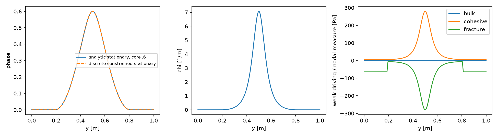
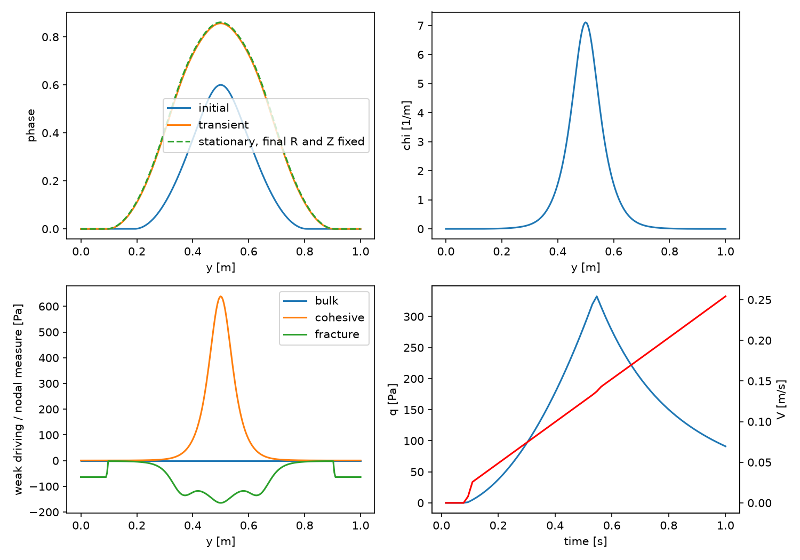
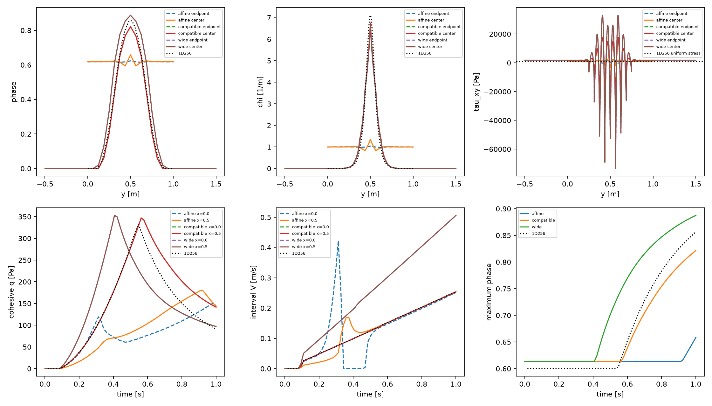

# P2 native localization and numerical diagnosis (2026-10-09)

The existing total-energy model, unloaded seed, accepted FE strain, direct
irreversibility and endpoint mechanics are retained. The native stall is repaired
without changing its convergence target: a small exact free-set Newton polish
resolves the remaining defect. All three native controls finish to 1 s without
healing. Affine side velocities produce nearly full-height damage; sides that
admit a one-dimensional shear solution retain a localized band. The latter
reproduces the corresponding coarse Q2 reference, but its stress and phase
response are not spatially resolved. **P3 is not ready.** The failed affine entry
also has two genuine negative free-curvature modes; a KKT pass is not a minimum
or stability qualification. No new physical phase law, kinetics, cap or loading
amplitude is introduced.

## Model and restrictions

| Quantity | Setting | Units / meaning |
|---|---|---|
| Domain / sharp fault | x in [0,1]; y in [0,1] or [-.5,1.5]; fault from (0,.5) to (1,.5) | m; fixed through-going geometry |
| Native mesh | 16x16 or 16x32; Q2 velocity / Q1 pressure / Q1 phase | dx=dy=.0625 m in both domains |
| Fault spacing | .015625 | m; 64 Q1 segments |
| Particles | Regular 3x3 per cell; 2304 or 4608 | Frozen positions; no transport or birth |
| Association | Entire actual normal cross-section, from initialization | Half-width .5 or 1 m plus boundary roundoff allowance; no runtime growth |
| G / eta / lambda | 1e6 / 1e8 / 100 | Pa / Pa s / s; identical constituents |
| Viscosity bounds | 1e6--1e10 | Pa s; reference eta is not clipped |
| Gc / cohesion / ell | 26.6666666667 / 1000 / .15625 | J/m2 / Pa / m |
| AT1 / Lorentz | c0=8/3, p=1, Hc=.5, m=128.00000000016 | Hc in Pa; m=Gc/(c0 ell Hc) |
| Friction | Rate-dependent interface with equal reference/dynamic mu=.1; no state variable | Constant coefficient; background pressure 10000 Pa; existing deviatoric normal-stress correction retained |
| Radiation damping / gravity | 0 / 0 | Pa s/m / m/s2 |
| Temperature | Static 293; zero thermal viscosity exponent | K |
| Seed | Native nominal core .6, native initialized particle H, initial box relaxation | Native relaxed maximum .613176697049462; then R=Z=bulk stress=0 |
| Physical admissible set | phi >= immutable last accepted phi; phi <=1 | Initial relaxation still uses [0,1] |
| Normalization | Existing consistent projection and analytic Q1 normal integrals | Unchanged initial/current/previous representation |
| Loading | ux=.256 t (y-.5), uy=0; exact interval mean used in each step | a=.256 s^-2; dt=.015625 s, T=1 s |
| Evolving / fixed | Phase, velocity, pressure, R, Z, slip and diagnostic H+ evolve; geometry, mesh, particle positions, material and background pressure fixed | Restricted P2 control |

G=1e6 Pa remains a **dimensional synthetic verification value**. These are not
calibrated earthquake material parameters. Native mechanics uses the accepted
FE encoding R=symgrad d_R, with beta=exp(-G dt/eta), kappa=eta(1-beta),
d_R_new=beta d_R_old+(kappa/G)u. All trials hold its accepted reference fixed.
The selected recoverable maximum H+ law is unchanged; H+ is diagnostic in the
current total-energy phase functional. Native seeded-H relaxation prescribes
pre-existing damage protected by its accepted lower bound.

The original control prescribes both velocity components on all four sides.
The compatible control prescribes uy=0 on vertical sides, freeing ux there;
only top/bottom prescribe both components. Natural normal traction determines
Stokes pressure, so pressure normalization is disabled in those controls.
The prescribed background pressure used by friction remains 10000 Pa. Simply
retaining the old pressure normalization failed startup force balance; that
failed attempt is preserved. Phase boundary conditions remain the native
homogeneous natural conditions; no periodic phase constraints are added.

The height-2 test retains ell, actual cell sizes and the physical local shear-rate
function. Its boundary velocity difference and total imposed displacement are
therefore twice those of height 1 (final displacement .256 versus .128 m).
Its response includes this genuine change of bulk compliance/loading distance;
it is not solely a test of a reflected boundary artifact. Sharp endpoints and
native full-cross-section association policy are retained.

## Stall: arithmetic, conditioning and the numerical repair

The original failed entry was reproduced deterministically at t=.3125 without
publishing its trial histories. The exact failed iterate and tangent are saved
in `runs/output-localization-stall/phase-stall-20*.csv` under the build directory.
The independent audit reconstructs R from saved nonuniform Q2 coefficients,
uses the same fixed Z, exact normal antiderivative, a separately solved tridiagonal
consistent mass system and regular CPDI fracture measure. Its extended arithmetic
has a 63-bit mantissa. [Audit](../../../benchmarks/reconstructed_fault/propagation/localization_evidence/stall-assessment.json).

| Check | Measurement |
|---|---|
| Native KKT / unchanged target | 1.207645095036014e-12 / 1.1256351785606174e-12 |
| Independent extended KKT | 1.2085683745010484e-12 |
| Reordered double--extended difference | 3.23e-15 maximum |
| Native--extended difference | 1.39e-14 overall; 1.79e-15 on free rows |
| One-input-ULP tangent bound | 2.01e-14 overall; 9.31e-15 on free rows |
| Exact free set | 214 nodes; one-ULP perturbations change no contacts |
| Tangent conditioning | Singular-value condition 796.41; two negative eigenvalues; minimum -.0757724 |
| Remaining corrections | Positive-search maximum 1.70e-12; exact Newton maximum 1.40e-11 |

The measured arithmetic differences do **not** justify increasing the target.
The exact correction applied offline reduces the extended residual to about
3.8e-15. Near a root, the production solver now tries an exact free-set correction
using deal.II dense algebra when the relative defect and correction are below
sqrt(machine epsilon), with active nodes already on their bounds. It must reduce
the same KKT defect and change energy by at most 32 epsilon times max(1,|E|).
This is a search safeguard, not a new convergence tolerance or physical bound.
The ordinary constrained CG/AMG and positive search metric remain in place.

In the fresh native run the polish occurs before the eventual stall, at a
correction of 1.14991e-8: KKT=5.77316e-15, energy change=1.27898e-13, independently
scaled energy allowance=3.43504e-13. The original target is retained. Phase
relative tolerance is 1e-12; its existing 8 epsilon L2 positive-assembly allowance
is fixed at entry. Linear tolerance remains 2e-7, with 100 nonlinear iterations
and 35 line-search attempts. Mechanical nonlinear tolerance remains 1e-8.
No tolerance is adjusted to produce these completed runs.

**Separate stability evidence:** both signs of a feasible 1e-4 perturbation
along the lowest free eigenvector reduce the independently evaluated energy by
about 3.788e-10 J/m, agreeing with the quadratic prediction. The mode principally
redistributes damage between the normal boundaries. The original affine trial
is therefore not a local minimum relative to its incoming accepted lower bound.
The numerical repair qualifies its stationary residual, not energy-minimum
selection. No negative-curvature branch-selection rule is silently added.

## Genuine one-dimensional reference

`localization_1d.py` retains Q1 phase and the native regular-particle fracture
measure. It compares a rich Q2 ux(y) space with direct one-dimensional bulk
balance. In the latter, accepted R is sampled from the continuous representation
r(y)=[T+Z chi(y)]/G, r=2Rxy. Its velocity derivative is determined pointwise by
Maxwell endpoint balance; there is no surface-to-particle smoothing or FE stress
projection. The accepted reference function remains fixed during phase trials.
Q2 interpolation error is separately measured, rather than built into the
continuum reference.

With A=Gc/(c0 ell), the functional per unit sharp-fault length is

\[
 \bar E[\phi;r^a,Z^a]=\int\frac{(G r^a-Z^a\chi)^2}{2G}\,dy
 +\frac{(Z^a)^2}{2G I}+A\int(\phi+\ell^2\phi_y^2)\,dy,
 \qquad I=\int h(\phi)\,dy,\quad\chi=h/I.
\]

The consistent surface projection reproduces this constant-in-x I exactly.
For a phase variation, dI=int h' dphi dy. The three strong interior derivatives,
with the accepted r^a,Z^a fixed, are

\[
 f_B=-\frac{Z\tau h'}{GI}+\frac{h'}{GI^2}\int Z\tau h\,dy,\qquad
 f_\Gamma=-\frac{Z^2h'}{2GI^2},\qquad
 f_F=A(1-2\ell^2\phi_{yy}).
\]

At uniform stress tau=T, f_B cancels exactly. A compact stationary profile has

\[
 \ell^2\phi_y^2=\phi-\frac{q^2}{2GA}h(\phi),\qquad
 \frac{q^2}{2GA}=\frac{\widehat\phi}{h(\widehat\phi)}.
\]

This is the actual native `PhaseFieldProfile` construction. For core .6,
q=316.227766 Pa and T=q+1000 Pa. Constant-profile Maxwell steady sliding has
V=Z/eta and ux_y=(T+Z chi)/eta, retaining the general exponential beta. This is
a separately named **loaded stationary control**, not an assertion that the
unloaded seeded band is an unconstrained equilibrium.

The direct bulk endpoint solve also retains C_Q=sum w chi rather than assuming
sampled C_Q=1. With tau0=G r^a-Z^a chi_new and its quadrature mean,

\[
 V=\max\left(0,\frac{C_Q(\beta\overline\tau_0+\kappa\dot\gamma)
 -\beta Z^a/I-\mu P}{\kappa(C_Q^2/L_y+1/I)}\right),\quad
 T=\beta\overline\tau_0+\kappa(\dot\gamma-C_QV/L_y),\quad
 u_{x,y}=\frac{T-\beta\tau_0}{\kappa}+\chi V.
\]

These equations admit a nonpolynomial transverse velocity with uniform endpoint
stress. The stationary phase comparison freezes the final accepted R,Z and solves
again under the accepted obstacle; it does not commit that trial or advance
mechanics. Its extra phase change .00927954 also illustrates the existing
one-step split lag. V throughout this report is the constant **interval slip
rate selected by endpoint balance**, not a continuous instantaneous-rate history.

| Reference check | Result |
|---|---|
| Unloaded seeded hold | Stable obstacle; no startup growth |
| Energy derivative / Hessian | Best finite-difference relative errors <=8.1e-11 in the stationary controls |
| Analytic stationary profile, 128 ->256 cells | Constrained field difference 6.03e-7 ->1.53e-7; KKT <=2.94e-15 |
| Stationary Maxwell maintenance | Stress error <=3.87e-11 Pa; q error <=1.71e-13 Pa; V error <=1.44e-16 m/s |
| Stationary work accounting | Absolute remainder <=3.85e-15 J/m |
| Frozen bulk quadrature, Q6 vs Q12 | Relative energy <=1.12e-16; normalized force difference <=3.12e-13 |
| Loaded rich 128/256, same times | Full-profile difference .00036218; q .05895 Pa; V 2.00e-6 m/s; slip 5.90e-8 m |

Each reference mesh generates and relaxes its own native nominal-core-.6 seed;
the 256-cell relaxed maximum is .60005714, compared with the coarse native
.61317670. This initialization difference is a measured spatial approximation,
not a reused or rescaled history. The matching 16-cell control isolates the
native equations; fine-reference comparisons include phase-grid accuracy.

The loaded rich reference has onset .546875 s on both fine grids; final
phi_max=.8564473, q=91.0402 Pa, V=.2542037 m/s and slip=.1268982 m. All physical
steps retain the existing prototype KKT criterion 1e-11 after normalization by A,
without healing or saturation. Its phase FWHM is .38675 m; chi FWHM is .11825 m
and its 95% localization width is .28336 m. R and Z remain fixed during each
phase solve; the phase response consumes the preceding accepted mechanical state.





Driving panels use the final accepted mechanical R,Z anchor, so the phase has
not yet consumed that new anchor; the frozen-anchor stationary solve shows its
additional split response. The panels show -delta E/delta phi, split into bulk, cohesive and fracture
weak terms divided by the corresponding nodal measure (Pa). They are not a
pointwise classical second derivative of a Q1 field. Active obstacle nodes may
have nonzero equality residuals with the correct KKT sign.

## Native boundaries, domain size and spatial error

All three final cases use the same final executable/compiler and pass their
existing phase, mechanical, bounds, history-publication and normalization checks.
Accepted FE coefficient recurrence error is zero. No healing is measured. The
original failed trajectories and all intermediate diagnostic failures remain
preserved. [Saved-field assessment](../../../benchmarks/reconstructed_fault/propagation/localization_evidence/assessment.json).

| Case at 1 s | Onset (s) | phi max | phi / chi FWHM (m), center | q center (Pa) | V center (m/s) | Center slip (m) |
|---|---:|---:|---:|---:|---:|---:|
| Affine sides, height 1 | .1875 | .658357 | 1 / 1 | 143.129 | .254483 | .126801 |
| Compatible sides, height 1 | .390625 | .821444 | .38795 / .13305 | 141.576 | .253648 | .126461 |
| Compatible sides, height 2 | .296875 | .887432 | .44950 / .13670 | 97.168 | .506270 | .252318 |
| Rich 1D reference, height 1 | .546875 | .856447 | .38675 / .11825 | 91.040 | .254204 | .126898 |

Widths use half of each local profile's maximum, not a damage-admission mask;
sampling uncertainty is approximately one profile spacing (.00005 m for height 1).
The native affine normal boundaries reach phi=.61845 at center and .61790 at
fault endpoints. Compatible normal-boundary values remain zero to roundoff.
Compatible phase variation along x is <=7.9e-15 (height 1) and <=2.5e-14 (height 2);
there is no physically distinguished along-fault peak location in those controls.
The affine center/end response differs. Endpoint traction, rates, widths and
full profiles are retained in the linked JSON/CSV files and plotted below.

The boundary-condition change gives a maximum full-field difference .61910 at
the common final time/load (1 s). The height change gives .17626 on the common normal
cross-section at 1 s. Onset uses the first accepted increase >1e-5; its driving
mechanical state is one timestep older. It is not compared with a different
last-accepted physical time.

The compatible native run reproduces the **same coarse Q1-phase/Q2-velocity/Q3
integration reference** to 8.72e-9 in phase, 1.30e-5 Pa in traction and 2.22e-11 m
in slip at common times. Its initialization differs from the high-accuracy native
profile integration in the independent Python reference by only 7.49e-9. This
checks the native path and isolates its remaining spatial approximation.

Against the rich 256-cell reference, the maximum common-time full-profile
error is .04642, traction error 51.83 Pa, rate error .00254944 m/s and slip error
.00043762 m. The native stress profile oscillates by tens of kPa about a mean
traction of order 1 kPa, especially in height 2. Even refined Q2 interpolation
retains a measurable pointwise stress error; the directly solved rich reference
has uniform endpoint stress. Keeping coarse phase/sampling but enriching ux(y)
shifts onset from .390625 to .515625 and final phase from .82144 to .86116.
Velocity representation is therefore a principal error source, with phase-grid
and initialization accuracy remaining separate.



The retained consistent normalization source error at final states is .0002798%
for affine sides and <=2.3e-13% in the x-invariant compatible controls. This is
representation error against independent analytic transverse integrals, not a
quadrature tolerance claim. Fine-reference bulk Q6/Q12 differences are measured
separately. Positivity or an accurate I does not remove the velocity-space stress
error or prove accurate sampled coupling.

| Separate energy quantities over 0--1 s | D_relax | Sum absolute mechanical discrepancy | Fracture expenditure |
|---|---:|---:|---:|
| Native affine | 17.97134 | 21.66402 | 24.94983 |
| Native compatible, height 1 | 3.14662 | 3.37059 | 12.51314 |
| Native compatible, height 2 | 11.03323 | 11.83832 | 18.83237 |
| Rich 1D, 256 cells | .712460 | 3.256084 | 14.01634 |

Units are J/m per unit out-of-plane length, for the fixed 1 m tangential fault.
D_relax includes the full phase-stage decrease, after fracture expenditure;
it is kept separate from endpoint mechanical work error. The height-2 bulk stored
energy is 95.4261 J/m at 1 s; the height-1 compatible value is much smaller but
still strongly affected by underresolved stress. No new native timestep
refinement is inferred from these fixed-dt spatial/boundary tests. The extra
fine height-2 reference stops at its t=1 entry with KKT1.17076e-11 >1e-11; its
.984375 accepted state and failure are preserved. That path is not qualified.

## Transfer audit and small bypasses

| Transfer/evaluation | Selected FE-state role | What is retained / bypassed |
|---|---|---|
| Particle domains/CPDI -> phase fracture | Authoritative | Retained; actual regular-particle measure used in reference |
| Particle H -> phase assembly | Authoritative during native initial relaxation; diagnostic thereafter | H is read directly from properties; not a generic FE H projection in this fixture |
| Particle chemical fractions -> bulk/surface data | Used by native material interfaces and initialization | Retained even though selected G/eta/Gc/c are identical; no generic projector change |
| Particle stress -> mapped composition FE fields | Diagnostic in this option; authoritative in legacy option | Generic mapping retained; redundant reads into physical old-stress arguments bypassed at three consumers |
| Surface q/Z history -> mechanical update | Authoritative accepted surface state | Existing direct surface history retained; no particle smoothing |
| Phase -> consistent I and normalization adjoint | Authoritative | Retained unchanged; cannot replace with a generic point sample |
| FE accepted R/phi -> bulk QPs and particles | Authoritative stress at equation QPs; particles are derived publication samples | Direct FE evaluation and accepted-anchor cache; samples never project back to R |
| Geometry -> particle/QP association | Authoritative fixed eligibility | Existing full-cross-section policy and fixed-geometry caches retained |

The three bypasses are in Stokes frozen history, bulk-conjugate surface assembly
and terminal history candidates. They remove reads whose values were immediately
replaced by the FE owner. Diagnostic particle/interpolator comparisons remain.
The first eight compatible phase/surface files are byte-identical before/after
the bypass (16 files); the final affine repeat is byte-identical across all 65
phase/surface/encoding states (195 files). Mature default CSV regressions remain
byte-identical. Removing the generic mapping itself would change diagnostic
outputs or legacy ownership and is outside this task.

Two arithmetic checks were corrected separately from these bypasses. The native
publication allowance now measures absolute coefficient--basis-gradient products
before differentiation cancellation, retaining its 128-epsilon multiplier. The
nonuniform benchmark probe measures pre-cancellation operands with its existing
256-epsilon multiplier, while also reporting net stress scale. Its original
near-threshold false failure and an intermediate marker-reading defect are
preserved as diagnostic attempts. No state, physical equation or admissibility
criterion was altered by those corrections.

## Changed functions, evidence and limits

| Production file / function | Purpose |
|---|---|
| `source/simulator/phase_field.cc`, `solve_bound_constrained_phase` | Exact tiny free-set polish at unchanged KKT target; exceptional trial/tangent dump; accepted lower bound remains immutable |
| `source/material_model/phase_field_fault/fe_strain.cc`, `mechanical_quadrature`, `prepare_fe_strain_history` | Derive uniform grid counts and normal coverage from actual Box origin/extents; permit the selected centered normal-domain test; retain unit tangential width/fixed geometry |
| Same file, `evaluate_fe_strain_stress` | Correct arithmetic scale using absolute FE coefficient/basis-gradient products; identical returned stress/update |
| `source/simulator/assemblers/reconstructed_fault_stokes.cc`, `ReconstructedFaultStokes::execute` | Bypass unused projected old stress only in selected FE option |
| `source/reconstructed_fault/surface_system_bulk_work.cc`, `assemble_bulk_work_system` | Same bypass at physical bulk-conjugate surface equation |
| `source/material_model/phase_field_fault/history.cc`, `compute_history_candidates` | Same bypass at accepted-step candidate evaluation; publication order unchanged |

Benchmark changes: `native_fe_strain.cc::local_probe` fixes only diagnostic
arithmetic scaling. New `localization_1d.py`, reference/continuum check scripts,
`diagnose_phase_stall.py` and `assess_localization.py` own this bounded evidence.
They do not prescribe mechanical H or change production equations. Fixtures,
plots, failed states and compact records are in `localization_evidence`.
[Actual task-only specification diff](../../../benchmarks/reconstructed_fault/propagation/localization_evidence/specification.diff).
A source/task diff is recorded there separately from the extensive incoming work.

Existing worktree/branch/HEAD are unchanged: `fault-propagation`,
`de7beaa65846c7372711f7922abf1c5d9a745ee6`. The incoming source/executable snapshot
is `build-propagation-integration/localization-baseline`; original failed native
and prototype trajectories remain untouched. Build provenance: GCC12.4,
Release/Unity, deal.II9.6.2, Trilinos14.2; final executable/plugin/source hashes
are in `localization_evidence/native-build.json`. No compiler setting changed.

Commands use the existing build and plugin targets:

```sh
cmake --build build-propagation-integration -j2
cmake --build build-propagation-integration/plugin --target native_fe_strain -j2
ASPECT_SOURCE_DIR=$PWD ASPECT_DIAGNOSTIC_FREEZE_PARTICLE_ADVECTION=1 \
 OMP_NUM_THREADS=1 OPENBLAS_NUM_THREADS=1 build-propagation-integration/aspect \
 benchmarks/reconstructed_fault/propagation/localization_evidence/compatible-operator-check-native.prm
OPENBLAS_NUM_THREADS=1 MPLCONFIGDIR=/tmp/localization-mpl python3 \
 benchmarks/reconstructed_fault/propagation/localization_1d.py --cells 256 --exact-bulk --final 1
python3 benchmarks/reconstructed_fault/propagation/check_localization.py
```

The final read-only checker verifies 18 incoming snapshots, 514 unchanged
historical manifest artifacts, the final build/source identity and 2027 new
manifest entries. It independently rechecks all saved native bounds, monotonic
phase histories, unchanged KKT targets and exact FE recurrence; the affine,
transfer-bypass and mature comparisons check 195, 16 and 2 byte-identical files.
Independent reference/continuum controls and Python syntax checks pass. The
task's tracked diff passes whitespace checks; the full worktree check still
reports only pre-existing manual `pf_rsf.tex` whitespace, which is untouched.
No broad test, native timestep/MPI/transport/restart campaign was performed.

The affine and wide final fixtures use `affine-final-executable-native.prm` and
`wide-operator-check-native.prm`. Build/run/check logs are `localization-*.log`
in the build directory; each attempt uses a distinct output directory under
`runs/`. Do not overwrite preserved evidence when repeating.

**Decision:** the numerical stall and redundant history reads are resolved.
Compatible sides establish a native path matching the corresponding coarse
one-dimensional discretization and retaining a band. Native velocity-space
accuracy and phase-branch stability remain principal barriers, alongside the
already separate split/work and evolving-profile energetic questions. This is
not native spatial/time convergence, a qualified minimum-selection algorithm,
transported history, rejected-step rollback, coupled restart, MPI evolution,
material optimization or fault propagation. Stop here; no P3 is selected.
