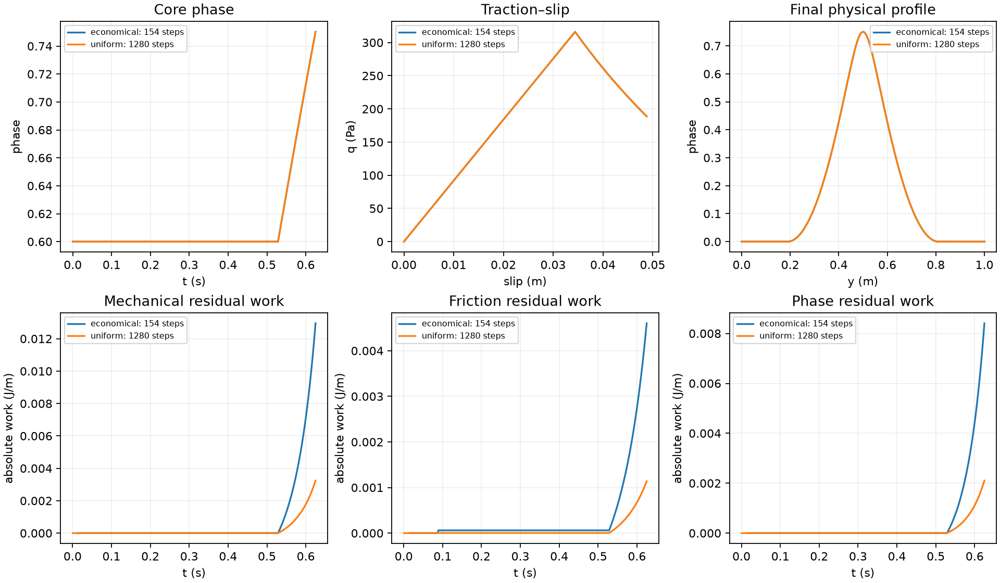
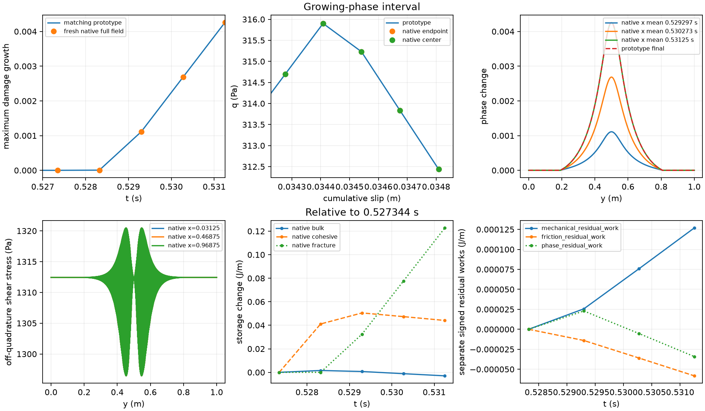

# Native endpoint tangent and onset follow-up

The fresh native test completes **0–.53125 s in 54 min 18 s**, within its
one-hour budget, and accepts three core-growth steps. Peak phase rises from
.600001937763 to .604261677123. All seven unaligned field targets pass against
the matching prototype, with zero healing and unchanged publication/KKT checks.
A forced complete-step exception restores accepted state and bookkeeping exactly;
the native driver successfully retries. The 154-step economical prototype also
completes .625 s and passes its separate field and residual-work gates.

This resolves the missing bounded native onset test. It does not qualify the
original coarse prefix energetically, full native evolution to .625 s,
native saddle escape, transported histories, restart or P3. Growing native
steps still take about 15–16 minutes each. Keep the option experimental and
default off; the economical schedule is prototype evidence only.

Governing energy, constitutive laws, immutable incoming histories,
physical phase obstacle, normalization, mesh and tolerances are unchanged.
The native linearized action replaces repeated nonlinear mechanical perturbation
solves; finite differences remain an independent diagnostic comparator.

For a phase direction d, evaluate the analytic ray derivative and its consistent
projection: dI=P Di[d]. At bulk points,

    dchi = h' B d/I - h T dI/I²,
    dtau_partial = -2 Z dchi S.

The phase partial forcing in ASPECT's mechanical Newton convention is

    rhs_u = Eᵀ Wb (2 Z dchi S), rhs_p = 0,
    rhs_Gamma = Tᵀ Wb dchi (tau:S - 2 Z chi S:S)
                + Nᵀ Ws Z dI_s/I_s².

Solve the current native A/B/G/K system on its sticking/prescribed free set for
(du,dp,dV), with homogeneous perturbation boundary conditions. Retain every
velocity and pressure degree of freedom and every free surface rate. Then

    dR = kappa/G E du, dZ = kappa dV,
    dtau = 2 kappa D3(E du) - 2(dZ chi + Z dchi) S.

Differentiate the explicit endpoint phase gradient, including both terms
DIᵀ dt + (D DI[d])ᵀ t. The second term uses analytic ray second derivatives
and the same projection adjoint Pᵀ. Add the exact native CPDI fracture action.
No reduced dense Hessian, surface/particle transfer, constitutive history update,
or change to the physical Hessian is introduced. Only homogeneous bulk operators
may be reused within a physical timestep; phase-dependent B/G/K are refreshed
at each new trial, and a tangent view is invalid after another trial. The
existing exact sparse B/G representations retain their integration, physical
pressure/constraint handling and remote-point averaging; the G normal-filter
guard remains in force.

The fixed-state comparisons, cost diagnosis, complete-step recovery and economical
prototype schedule results are reported below. The final native onset run
completes .53125 s. Its first accepted core growth is at .529296875 s;
full-field tail growth precedes this at .5283203125 s.

The economical-schedule diagnostic fixes its windows using the existing uniform
reference: first slip near .0889 s, phase onset near .5273 s. It initially uses
1/64 s in smooth frozen-profile intervals, 1/1024 s on [.078125,.09375]
and [.5234375,.625], and 1/128 s on [.5,.5234375]. The reference is the complete
matching 512-cell FE 1/2048-s trajectory. All original field/storage targets and
separate signed/absolute mechanical, friction and phase residual works are
assessed; a field pass alone is not an energy pass.

## Economical schedule: measured prototype result

The 154-step schedule completes .625 s from the identical initialization. Against
the uniform 1/2048-s FE reference its worst differences are: phase 5.363e-5,
traction .000270 Pa, slip 9.23e-8 of final reference slip, common-interval rate
2.55e-5 of fixed peak, whole/local stress 3.46e-6/9.71e-6 of the fixed stress
scale, and bulk storage 4.53e-6 of the fixed storage scale. All seven original
field targets pass. This is an unaligned comparison.

Separate absolute residual-work integrals are .01294952 mechanical, .004601505
friction, and .008405800 phase J/m. Each is below the explicit provisional schedule
gate of 1.05 times the corresponding uniform 1/1024 result (.01359705, .004831596,
.008826127 J/m). These gates qualify economy relative to that verified reference,
not exact energy closure; the uniform 1/2048 residual works are smaller.
The former 15.3446-J/m coarse contact error is absent. Evidence:
`native_tangent_evidence/economical-1-comparison.json`, fields and separate ledger.
No second schedule level is needed to resolve a failing gate.

The run costs 149.03 s /155.6 MiB peak RSS. Final external work is 58.54379 J/m;
bulk/cohesive/fracture storage changes are .706721 /4.598794 /4.405423 J/m.
Bulk/cohesive viscous losses are .007255 /.020936 J/m, friction 48.80473 J/m.
Signed mechanical/friction/phase residual works are +.01294942 /−.00448080 /
−.00840107 J/m. Absolute integrals are reported above so their cancellation
cannot conceal the separate errors. The external remainder is −6.75e−5 J/m.
Largest phase increment .00157390; maximum KKT 9.34e−12 at its original 1e−11
prototype tolerance. Initialization is numerically identical to the uniform run.
The ledger also retains bulk profile work −.00836279 J/m, normalization work
−4.40546105 J/m and fracture work +4.40542276 J/m. The signed incoming-state
profile cost (+4.289862 J/m cumulatively) is a separate diagnostic, not an
added dissipation. These finite exchanges are not forced to vanish or hidden
inside viscous losses.



The orange plotted reference has 1280 steps (1/2048 s); its residual works are
smaller. The explicit provisional residual-work gate uses the verified 640-step
1/1024 result. The field gate uses the finer reference, without alignment or
onset shifts. This distinction is intentional and limits the schedule's claim.

The matching schedule releases 100 normal nodes in the preceding tail step,
then evolves 315 normal nodes at each of the three core-growth entries. These
counts use accepted increments above 1e−13 for diagnostics only; the physical
lower bound and solver tolerances are unchanged. A nonmonotone Newton residual
is retained as numerical behavior, rather than declared a stall or attributed
uniquely to active-set changes. The original true KKT remains the acceptance test.

## Inner accuracy diagnosis

The first native operator test is retained as a failed numerical diagnostic:
`operators-linearized`. At the growing fixed state, default Stokes relative
accuracy 1e-7 versus a diagnostic 1e-10 repeat changed a native nodal elastic
action by 1.35532494e-6 J/m (action scale .107801355 J/m). Thus default inner
accuracy cannot be assumed smaller than the finite-difference uncertainty.
The unloaded action reproduces zero exactly. The failed check stopped before
any physical trajectory or history change.

The correction is linear residual refinement, not a physical tolerance change.
After the first coupled linear solve, form its fresh uncondensed bulk and free
contact residuals, solve the corresponding correction on the **same** Jacobian,
contact set and accepted anchor, and add it to (du,dp,dV). Measure the change
in the resulting physical elastic phase-gradient action. Repeat until that
change is at most the configured phase linear tolerance (2e-7) times its norm.
Each individual Stokes solve retains its configured relative tolerance (1e-7).
At most four correction solves are allowed; unresolved action accuracy fails
rather than relaxing the outer KKT. This is an a posteriori action uncertainty
estimate, subsequently checked with the independent tighter-inner and finite-
difference/prototype comparators.

## Conditioning and compatibility

On the matching 1D free-phase subspace, the generalized spectrum against the
actual fracture-plus-lumped-mass search metric has condition number 5504.57 at
the retained growing state and 1974.02 at the asymmetric state (315 and 314
free normal nodes). This is not a full native/tangential spectrum. It explains
why a mechanical residual tolerance alone is not an action-error bound. No
arithmetic-floor/stall inference or physical stopping-tolerance relaxation is
made. Existing fault compatibility regressions pass 21,105 assertions in 54
cases on the final executable as well as the earlier analytic/refined builds.

Action comparisons use nodal energy derivatives in J/m per unit out-of-plane
thickness. Dividing both action and uncertainty by A=64.00000000008 Pa gives
the production phase scaling (m²); this does not change their relative ratios.
Mechanical weak residuals are in N/m. The native phase KKT remains at its
original physical entry target. Pointwise stress/traction errors use Pa.

The final onset recovery control selects physical step three (.5283203125 s),
after two accepted steps with nonzero R/Z and distinct phase histories. It invokes
the complete native `solve_timestep` (including predictor/advection setup),
forces an exception after coupled convergence and before the first publication,
checks exact restoration, then lets the normal driver retry that same step.
The private injection hook is empty by default and only attached through the
explicit benchmark parameter. The test cannot qualify transported/birth or
postpublication rollback outside this restricted fixed fixture.

The first late core-entry recovery run (`onset-cached-B-recovery`) reaches
constrained phase KKT 1.76e−15 in production scaling, with positive sampled
translation L2 Rayleigh quotient .20353 Pa, before the forced exception. It aborts
on the recovery test's numeric equality of complete surface-property vectors.
That equality is invalid for the registry's unused signaling-NaN provenance
slots: an unchanged NaN compares unequal. The failure is retained; the core
trial is not an accepted physical state.

The observer now compares every surface and particle property **byte for byte**
and emits named per-component diagnostics. This introduces no numerical
allowance and does not mask nonfinite changes. The repeat confirms zero changed
surface bytes, including 325 unchanged sentinel components, and exact restoration
of all solution/old/older phase fields, accepted d_R, q/I/V, particle properties
and positions, clock/iteration/pressure bookkeeping and statistics. Thus the
original assertion did not demonstrate a surface-history mutation. No surface
history law or generic projector is changed to address this test defect.
The final controlled failure uses the cheaper resolved tail-evolution step:
its incoming phase differs from the older baseline by 3.7243e−7, well above
the 4.922e−12 healing allowance, and R/Z are nonzero. The native driver then
retries the same physical step. Successful retry is independently repeated in the final sparse-B/G build;
subsequent accepted core growth is assessed separately below.

The first residual-refined growing action takes 91.91 s (93 Krylov iterations;
three linear solves), whereas the tighter-inner comparator takes 82.84 s (85
iterations; two solves). Their physical nodal action difference is now only
3.47e-12 J/m, below the 7.83e-9/1.23e-8 J/m finite-difference errors. The
collapsed exact-prototype action difference is 1.10e-10 in phase scaling.
The initial default inner error is resolved, but this cost is still excessive.
The next measured numerical change uses the existing serial sparse direct
solver to factor the homogeneous velocity A block once per physical step, as
a preconditioner inside the unchanged coupled FGMRES solve. It replaces only
the expensive repeated AMG-preconditioned velocity CG in this default-off serial
option. Pressure and all velocity/slip modes remain active, and the original
full-system fresh residual criteria remain authoritative. Rebuild on each new
step/operator; preserve legacy AMG/GMG paths. No dense phase Hessian is added.
Detailed exclusive action time/call profiling is enabled for these tangents.

The first fresh onset cost pilot is deliberately stopped after 861.19 s,
having accepted through .5283203125 s. Its uncommitted core entry remains
preserved. Seventeen completed actions charge 372.32 /479.76 s to B and
64.94 s to G, with 1517 applications of each map. No KKT/bound/history failure
or physical stall is inferred. This concrete cost evidence motivates enabling
the **existing** sparse B assembly automatically under the already explicit
restricted endpoint option. It uses identical FE gradients, quadrature,
association weights and homogeneous test-row constraints, and rebuilds on
every new linearization. Legacy defaults and existing diagnostic controls are
unchanged. No new hidden environment switch, transfer, physical operator or
Hessian approximation is introduced. Fixed-state operators are rechecked before
the final fresh onset/recovery run.

## Velocity-preconditioner comparison

The intermediate `operators-velocity-factor` run completes in 248.04 s (238.90 s user
CPU, 1363.3 MiB peak RSS), compared with 822.28 s /1303.0 MiB before the sparse
velocity preconditioner. The growing normal action falls from 91.91 to 14.79 s;
the asymmetric normal action takes 12.75 s. Full native pressure, velocity and
surface slip spaces are retained. The tangential reduced actions are nonzero
(maximum nodal magnitudes 4.476 and 9.508 J/m in growing/asymmetric states).

| Check, all three retained states | Maximum error | Scale / interpretation |
|---|---:|---|
| Default versus 1e−10 inner repeat | 5.45e−12 J/m | Native nodal elastic action, ≤.1303 J/m |
| Normal reduced action versus central differences | 2.47e−8 J/m | Same physical native action; eps=1e−5 and 5e−6 |
| Collapsed full action versus matching prototype | 1.83e−10 m² | Division by the same A; exact CPDI fracture included |
| Mixed normal/tangential symmetry | 4.75e−10 J/m | Work pair scale 95.93 J/m |
| Tangential fixed-endpoint derivative versus differences | 7.13e−7 J/m | Scale 231.99 J/m; halved perturbation reduces truncation error |

The prototype Hessian uses analytic constitutive derivatives and independently
evaluated 24-point normalization second derivatives. Normal central differences
use the retained matching-prototype mechanical perturbation solutions evaluated
through native energy/gradient operators; they are not three fresh nonlinear
native mechanical finite-difference replays. The full native tangential Schur
action is checked through fresh uncondensed residuals, inner accuracy and mixed
symmetry; its independent tangential finite difference fixes the endpoint fields.
The fresh evolution below is a separate test of the actual native nonlinear path.

In the growing normal action, two linear solves /37 Krylov iterations give an
action norm 3.84970 J/m and last correction 4.52e−10 J/m, versus configured
action target 7.70e−7 J/m. The tighter-inner result differs by 2.58e−12 J/m.
The physical weak bulk residual is 1.10e−8 N/m and free contact residual
2.14e−11 N/m. A weak residual alone is not equated to phase-action uncertainty.
The originally failed 1.36e−6-J/m inner-repeat diagnostic remains preserved.

For the nine intermediate velocity-factor actions, exclusive profiling charges 99.02 s to B, 17.67 s
to G, and only a small fraction to velocity inversion; see the exact component
totals in `operator-final-cost.json`. Native timers record two bulk matrix
assemblies (3.72 s), twelve RHS assemblies (20.6 s), 26 condensed solves (143 s),
three tangent setups (8.04 s), and nine actions (130 s). These nested timers must
not be added together. The factor construction takes approximately .20 s per
step and adds approximately 60 MiB peak memory. The remaining cost is principally
bulk–fault coupling application and repeated nonlinear trial assembly, not
evidence of a physical solver stall. Compatibility on the final executable
passes 21,105 assertions /54 cases with its existing expectations.

## Final fixed-state operator evidence

The next intermediate executable also caches the existing exact sparse B map.
Its `operators-cached-B` control passes in 135.96 s /1398.2 MiB peak RSS.
Nine full actions take 30.28 s total; growing/asymmetric normal actions take
3.24 /3.08 s, and tangential actions 7.21 /7.13 s. Across 403 applications,
sparse B costs .345 s and G 17.40 s. The remaining cost is G application,
mechanical residual assembly and nonlinear trial evaluation. The following measured-cost step adds the existing exact sparse G
representation; no G coefficients or generic particle transfer are changed.

All original operator gates pass. Inner-repeat error is 6.35e−12 J/m, normal
FD error 2.47e−8 J/m, matching-prototype full-action error 1.83e−10 m² and
mixed symmetry error 2.33e−10 J/m. The tangential fixed-endpoint FD comparator
is unchanged. The final executable passes the same 21,105 compatibility
assertions /54 cases. The earlier failed diagnostic and stopped cost pilot
remain separate from these passes.

## Measured cost progression

| Fixed-state operator run | Wall time (s) | Peak RSS (MiB) | Nine action total (s) |
|---|---:|---:|---:|
| Residual-refined analytic action | 822.28 | 1303.0 | 556.36 |
| Sparse homogeneous velocity preconditioner | 248.04 | 1363.3 | 129.57 |
| Same preconditioner, existing exact sparse B | 135.96 | 1398.2 | 30.28 |
| Existing exact sparse B/G, concurrent cost control | 271.38 | 1617.3 | 28.55 |
| Final exact sparse B/G and obstacle-aware search, run alone | 134.62 | 1605.4 | 14.34 |

The retained per-action records give the component timings. The sparse-B cost
profile records 17 inner linear calls for nine tangent actions. Its 403 sparse B and G
applications take .345 and 17.40 s respectively. Actual energy/gradient assembly,
mechanical solve and tangent setup timers are nested; their times cannot be
summed as separate wall-time contributions. Growing native phase iterations and
line searches are recorded separately from these fixed-state tests below.

The subsequent `operators-cached-B-G` check also passes all three retained
states. It costs 271.38 s wall /132.53 s user CPU /1617.3 MiB, while sharing
CPU with the earlier sparse-B-only onset run. Its wall time cannot be compared
directly with the preceding single-run wall measurements. Nine actions take
28.55 s wall; 403 sparse G applications take 2.23 s, with zero reference G
applications. Inner-repeat error is 6.70e−12 J/m, normal FD 2.47e−8 J/m,
full prototype action 1.83e−10 m² and mixed symmetry 1.03e−10 J/m.
The exact representation retains the normal-filter guard, constitutive pressure
mode, remote-point averaging, homogeneous constraints and physical scaling.
It rebuilds at every changed surface linearization, independently of B.
No replacement of G by Bᵀ or mature-only physics alternative is made.

The final `operators-linearized-obstacle` check runs alone in 134.62 s
(129.21 s user CPU; 1605.4 MiB peak RSS), using the same executable as the
fresh onset test. Its nine full native actions total 14.344 s and 17 inner
linear calls. Inner-repeat, normal FD, exact prototype and mixed-symmetry
errors are respectively 6.70e−12 J/m, 2.46e−8 J/m, 1.82e−10 m² and
1.02e−10 J/m. The tangential fixed-endpoint FD error is 7.12e−7 J/m at a
231.99-J/m scale. These are action checks with the scopes stated above, not
three full tangential nonlinear finite-difference replays.
Its native timers record two bulk matrix assemblies (4.26 s), twelve RHS
assemblies (21.7 s), 26 condensed solves (11.1 s), three tangent setups
(17.2 s), 29 tangent pullbacks (5.34 s) and 86 phase-energy evaluations
(17.8 s). The 60.6-s diagnostic postprocessor includes independent operator
comparators; these nested times are not additive. Evidence:
`operator-obstacle-final-checks.json` and `operator-obstacle-final-cost.json`.

The sparse-B-only fresh control is deliberately stopped after 2523.46 s
(2239.09 s user CPU /1430.2 MiB peak RSS),
retaining accepted core growth through .529296875 s and its incomplete next
entry. This is a cost control, not a physical/KKT failure. It proves recovery
and matching accepted core growth, but not .53125-s completion. The subsequent
`onset-cached-B-G-recovery` cost control uses the same requested schedule and
initial state, after the new operator gate. Its measured numerical search cost
motivates the bounded correction documented below.

## Fresh native onset and recovery

The forced complete-step exception at .5283203125 s restores all accepted
fields and bookkeeping exactly. All 520 recorded surface components retain
identical bytes, including 325 unchanged NaN sentinel slots. The normal driver
then retries and publishes the same physical step successfully. Retained
`complete-step-recovery-verified.json` records the final checked scope; postpublication physical
rejection, transport, birth and restart remain outside this verification.

The final fresh `onset-linearized-obstacle-recovery` run completes .53125 s.
Three accepted core increments are .001111292, .001574664 and .001573783;
peak phase is .604261677123 at y=.5 m. First core growth above the fixed
1e−6 diagnostic threshold is bracketed by [.5283203125,.529296875] s.
Minimum accepted nodal phase is 1.54e−10, maximum .604262 and maximum
decrease exactly zero. The published physical KKT maximum is 4.85e−13 J/m,
against unchanged entry targets 2.44e−11–2.68e−11 J/m. Maximum accepted FE
recurrence error is 1.74e−18 m. The true original CPDI residual is independently
checked at publication; no post-solve clipping or acceptance relaxation occurs.

| Maximum native/prototype difference, 0–.53125 s | Measured | Original target |
|---|---:|---:|
| Full-field phase, unaligned | 2.17e−10 | .001 |
| Cohesive traction | 9.96e−5 Pa | 1 Pa |
| Cumulative slip | 1.09e−8 m | 4.88e−5 m (0.1% final reference slip) |
| Common-interval slip rate | 3.96e−7 m/s | 8.06e−4 m/s (0.5% fixed peak) |
| Whole-section / localized stress RMS | .01231 / .006797 Pa | 13.325 Pa each (1% fixed scale) |
| Bulk storage | 1.39e−5 J/m | .008878 J/m (1% fixed scale) |

The largest traction, slip, stress and storage errors occur in the coarse first
mechanical step, not in the failed-step retry. At the final time those errors
are respectively 3.18e−8 Pa, 2.88e−11 m, 1.65e−7 /3.96e−8 Pa and
3.94e−11 J/m. Off-assembly stress uses twelve normal points per cell in three
tangential sections and the positive 3D embedded invariant of the full stress
difference. Tangential phase variation is 8.61e−12; traction variation 2.65e−9 Pa,
slip variation 4.20e−13 m, and the sum of maximum normal stress components
is below 4.72e−7 Pa. These native modes are measured, not suppressed.
The largest centroid difference is 6.55e−11 m; no reflection or recentering is
used. Current/prototype normalization differs by at most 1.07e−10 relatively.

Sampled admissible translation curvatures at the three core states are
.05948 /.06757 /.07576 J/m, with independent native mechanical finite-difference
uncertainties below 9.00e−7 J/m. Corresponding spatial-L2 Rayleigh quotients
are .20353 /.23128 /.25939 Pa. These are selected-direction checks at the
proper incoming anchor, not a full critical-cone spectrum or native saddle-escape
qualification. The earlier failed/uncommitted entries remain unchanged.

At the final center, cohesive traction is 312.4361 Pa, cumulative slip
.03480895 m and the last-interval slip rate .1372917 m/s. Traction decreases
over the three accepted core-growth steps while slip increases; the rate is an
interval average, not an instantaneous endpoint measurement. The phase change
is centered on the prescribed band, with negligible tangential variation.
This is resolved growth of a fixed pre-existing band, not propagation or
qualification of a gradual-damage material.



Evidence: `onset-qualification.json`, `onset-obstacle-final-cost.json`, and
`native_endpoint_evidence/onset-linearized-obstacle-recovery-comparison.json`.
The original coarse .5-s prefix retains its 15.3446-J/m contact-path energy
limitation. Native path diagnostics cover only the recorded growing steps;
no prefix energy closure or complete .625-s native qualification is inferred.

### Fine-window energy comparison

On [.52734375,.53125] s, all four fine growing steps use the same reconstructed
path and audited spatial/time measures in native and matching prototype.
Bulk/cohesive/fracture storage changes are −.002974815 /+.044101039 /
+.122737287 J/m. Boundary-reaction work is .695830449 J/m; bulk/cohesive
viscous and frictional losses are .0000675105 /.000423467 /.531510387 J/m.
Bulk-profile work is −.0000682515 J/m and normalization-profile work
−.122703175 J/m. These terms remain separate from fracture expenditure and
the prototype's signed incoming-profile cost (+.0381811 J/m); no compensating
dissipation is introduced.

| Residual work on the fine window (J/m) | Signed sum | Integral of absolute power | Largest absolute step integral |
|---|---:|---:|---:|
| Mechanical imbalance | +1.26820e−4 | 1.26839e−4 | 5.10084e−5 |
| Friction-law residual | −5.82540e−5 | 5.82732e−5 | 2.22611e−5 |
| Phase residual | −3.41393e−5 | 8.00231e−5 | 2.88001e−5 |

The native external remainder is +3.44268e−5 J/m under its
storage−boundary-work+loss convention; the prototype uses the opposite sign.
The sum of absolute step remainders is 3.46379e−5 J/m and the largest is
3.45234e−5 J/m. Separate native/prototype work and storage-change totals differ
by less than 5.4e−10 J/m. The final-step eight-versus-sixteen-point time
quadrature check changes every listed work by at most 1.44e−13 J/m; this is
integration uncertainty at that selected step, not a full trajectory error bar.
The discrete identity remainder is below 2.95e−13 J/m per step. Exact identity
closure does not erase the independently reported equation-residual works.

### Native cost and remaining bottleneck

Wall time is 3257.95 s, user CPU 3158.65 s and peak RSS **1719.9 MiB**.
The run includes the forced complete-step convergence/failure and successful
retry. Independently observed entry-to-commit times (1-s observation uncertainty)
are 24.0, 114.1, 255.1 (including the failure), 960.1, 929.7 and 911.5 s.
Core steps need four phase updates plus one stationary check, seven line-search
trials and 214 /214 /217 reduced actions. Original KKT acceptance remains fixed.

There are 656 tangent actions (2077.85 s), 1660 tangent inner linear calls,
and 61,465 tangent Krylov/preconditioner applications, including the forced
failed attempt. Exclusive tangent profiling charges 873.66 s to the coupled
preconditioner, 194.63 s to sparse G, 55.46 s to sparse B, 160.53 s to A,
191.05 s to vector work and 602.34 s to other solver overhead. These are
nested within action time and must not be added again to wall time.
The late correction takes roughly 130 CG iterations at the original configured
relative accuracy; no arithmetic-stall claim or tolerance relaxation follows.

Native timers record eight bulk matrix assemblies (16.1 s), 267 RHS assemblies
(406 s), 1731 condensed solves (1630 s), 2316 tangent pullbacks (449 s),
184 phase-energy evaluations (38.8 s), 18 tangent setups (69.6 s), 74
normalization evaluations (20.6 s) and 114 logged mechanical Newton iterations.
These include private trials and recovery; the timers overlap. The exact B/G
maps resolve their earlier repeated-application bottleneck, while strict reduced
linear solves now dominate. A full 640-step native campaign is not justified
by this cost, and none is launched.

## Layerwise search diagnosis and numerical correction

The retained sparse-B/G trajectory exposes a cost issue, rather than an
arithmetic stall or failed physical criterion. An isolated shadow of its normal
projected Newton search reproduces 19 iterations at .5302734375 and .53125 s.
After the overshoot is clipped, the search admits only two normal nodes per
iteration (283→285→…→315 free nodes). It eventually reaches the correct KKT
root; its field error is at most 1.10e−10. This explains the native trace's
slowly declining residual without relaxing its physical acceptance.

Generalize the existing positive-metric obstacle predictor to every iterate:

    s_hat = argmin_{s >= lower - x} g^T s + .5 s^T P s.

Its proposed active set selects a true Newton problem. Put d_A=lower_A−x_A,
then solve H_FF d_F=−g_F−H_FA d_A with the actual reduced action. The active-
column term uses the same mechanical and normalization derivatives. P remains
a search metric; it does not replace H or the actual energy. Keep the projected
actual-energy line search and the metric direction as a descent fallback.
The configured relative linear tolerance applies to this free Newton RHS.
The physical lower bound, upper bound and original outer KKT do not change.

This shadow correction needs 2 iterations for the tail entry and 4 for each
core entry. All four incoming states remain immutable. KKT≤4.12e−14 in the
matching prototype scaling, bounds pass, and field differences from the retained
solutions are at most 7.65e−11. No physical history is published in this replay.
Evidence: `active-search-shadow.json`, `active-search-obstacle-shadow.json` and
`check_native_endpoint_active_search.py`. No arithmetic-floor or kinetic fix
is inferred from this search diagnosis.

The corresponding native sparse-B/G cost control is deliberately stopped after
2261.43 s (2185.78 s user CPU /1675.7 MiB), preserving accepted core growth and
its uncommitted next entry. The final search-corrected operator run costs
134.62 s /1605.4 MiB, with nine actions in 14.344 s and 17 inner linear calls.
All fixed-state gates and 21,105 compatibility assertions /54 cases pass.
The fresh `onset-linearized-obstacle-recovery` completes the requested schedule
under its 3600-s budget. Its final operator, acceptance and recovery evidence is
reported above, separately from these preserved cost controls.

## Fixed verification settings

| Quantity | Value / units |
|---|---|
| Domain / sharp fault | [0,1]² m; y=.5 m, endpoints x=0,1 m |
| Association | Fixed full normal cross-section, half-width .50000000000001588 m |
| Mesh / fields | 16×512 cells; Q2 velocity, Q1 pressure and phase |
| Integration / particles | Six normal bulk points, intersection surface panels; native CPDI fracture; 3×3 fixed particles per cell (73728 total) |
| Surface | 64 Q1 segments; consistent normalization, analytic transverse reference |
| G / eta / lambda | 1e6 Pa / 1e8 Pa s / 100 s; homogeneous constituents |
| Viscosity bounds | 1e6–1e10 Pa s |
| c / Gc / ell / p | 1000 Pa / 26.6666666667 J/m² / .15625 m / 1 |
| m / Hc / A | 128.00000000016 / .5 Pa / 64.00000000008 Pa |
| Friction / pressure / radiation | Coulomb .1 / prescribed 10000 Pa / zero |
| Initialization | Shared relaxed nominal-core-.6 seed; relaxed peak .600001937763; fresh zero FE d_R, Z, slip and bulk stress |
| Loading | Interval mean of ux=.256 t(y−.5) m/s; top/bottom uy=0; sides uy=0, natural ux |
| Phase admissibility / boundary | Immutable accepted-phase lower bound, upper bound 1; natural phase boundary |
| Tolerances | Phase nonlinear 1e−12, linear 2e−7; mechanical nonlinear 1e−8, linear 1e−7; phase max 100 iterations, 35 line searches |
| Onset schedule | .5, .52734375, .5283203125, .529296875, .5302734375, .53125 s |

G remains a dimensional synthetic verification value. Fixed particles, mesh,
geometry and prescribed friction pressure isolate restricted coupling; they
do not qualify transported histories, replenishment, general support admission,
RSF evolution or propagation. H+ remains diagnostic. No seeded history is
regenerated from phase, and the lower bound protects prescribed pre-existing
damage. The timestep schedule intentionally reproduces the original onset test;
its coarse-prefix energy defect is retained separately.

## Source changes in this follow-up

| Production file / function | Purpose and resulting behavior |
|---|---|
| phase_field_fault.h; fe_strain.cc, evaluate_fe_endpoint_action | Analytic local phase and normalization first/second derivatives and projection adjoint; native phase forcing and full endpoint action at explicit fixed states |
| reconstructed_fault_condensed_system.h/.cc, build_condensed_rhs and recover_slip_rate_increment overloads | Reuse existing condensation for arbitrary tangent forcing; old residual overloads retain their behavior |
| simulator.h; reconstructed_fault_stokes.cc, make_reconstructed_fault_endpoint_tangent | Current full velocity/pressure/contact linearization, immutable endpoint anchor, fixed contact set, residual-based action correction |
| reconstructed_fault_stokes.cc, solve_reconstructed_fault_stokes / condensed solve | Sparse homogeneous velocity factor reused as preconditioner within one restricted serial physical step; B/G/K refresh on changed phase; legacy paths unchanged |
| assemblers/reconstructed_fault_stokes.cc, linearize_B | Reuse the existing exact sparse B representation in the selected endpoint option after measured repeated-application cost; same integration and constraints, fresh at every linearization |
| reconstructed_fault_endpoint_phase.cc, solve_reconstructed_fault_endpoint_phase | Analytic reduced action in projected Newton; all-iterate positive-metric obstacle prediction with exact active-column forcing avoids layerwise admission; FD diagnostics, true energy/KKT, immutable histories and trial invalidation retained; cost counts and private precommit injection |
| surface_system.cc, prepare_surface_linearization | Store the existing exact G assembly under the selected endpoint option, retaining its normal-filter guard, point averaging, pressure convention and fresh trial coefficients |
| core.cc, solve_timestep | Restricted endpoint exception restores outer solution, linearization and bookkeeping, invalidates derived operators and refreshes normalization |
| linear_performance.h, FaultLinearProfile | Explicit tangent profiling of exclusive component times/calls; existing opt-in behavior retained elsewhere |

The private failure hook has an empty production default. The benchmark observer
alone attaches it through its explicit `Force complete step failure and retry`
parameter. No new material/phase parameter or acceptance tolerance is introduced.
The pre-existing explicit-B/G diagnostic switches retain their behavior; the
already selected endpoint option activates the exact caches without a new setting.
`tests/phase_field_test_access.h` exposes fixed-state actions and scoped failure
injection to that observer. `native_endpoint_verification.cc` adds the three-state
linearized-action, tangential, tighter-inner and complete-step recovery checks.
`run_native_endpoint.py` records the optional failure test and fresh run provenance.
The economical schedule, assessment/plot scripts, conditioning and cost scripts
are diagnostic code only. The specification and native-FE derivation document
the numerical algorithm; governing equations are unchanged.

| Test / diagnostic changes | Purpose |
|---|---|
| native_endpoint_verification.cc; tests/phase_field_test_access.h | Fixed-state native actions, tangential directions, tighter-inner repeats, complete-step exception injection and byte-exact restoration checks |
| run_native_endpoint.py | Unique fresh-run provenance, optional complete-step recovery test, wall budget, CPU time and peak RSS |
| native_endpoint.py | Explicit prototype schedules with unchanged fresh initialization and physical loading |
| check_native_endpoint.py | Separate final operator reports; distinguish diagnostic tangential values from measured error bars |
| assess_native_endpoint_run.py | Unaligned common-time fields, common-interval rates, full embedded stress, actual publication targets, separate prototype/native work channels and charts |
| native_economical_schedule.py; assess_native_economical_schedule.py; plot_native_economical_schedule.py | Fresh 154-step schedule, independent field and separate residual-work gates, compact plots |
| check_native_tangent_conditioning.py | Generalized normal-space conditioning against the actual positive search metric |
| assess_native_tangent_cost.py | Action/assembly/solve counts and nested costs; independently observed physical-step entry-to-commit times |
| check_native_endpoint_active_search.py | Immutable fixed-entry shadow separating layerwise admission cost from the physical KKT root; old/new search comparison |
| specification.tex; phase_field_native_fe_derivation.tex | Analytic normalization pullback, inner refinement, exact caches and obstacle-aware numerical search equations |
| current_design.md; CURRENT_STATUS.md; propagation STATUS/PLAN and benchmark README | Current qualification, historical failures, measured cost and remaining scope; no new stage authorization |

## Verification commands and provenance

Run from the existing fault-propagation worktree/branch, HEAD
`de7beaa65846c7372711f7922abf1c5d9a745ee6`. GCC12.4, deal.II9.6.2,
Trilinos14.2 and p4est2.8.7; one rank/thread. The final executable and observer
hashes are recorded separately from each parameter-file hash in the native
runner's start/run JSON. Shared initial phase and seeded-H hashes are recorded;
no checkpoint conversion or reused physical history is involved.

```sh
cmake --build build-propagation-integration --target aspect -j6
cmake --build build-propagation-integration/plugin --target native_endpoint_verification -j2
build-propagation-integration/aspect-release --test '*Fault*,*fault*,Stage-I*'
OPENBLAS_NUM_THREADS=1 OMP_NUM_THREADS=1 python3 benchmarks/reconstructed_fault/propagation/run_native_endpoint.py operators --tag linearized-obstacle --max-wall-seconds 900
OPENBLAS_NUM_THREADS=1 OMP_NUM_THREADS=1 python3 benchmarks/reconstructed_fault/propagation/run_native_endpoint.py onset --tag linearized-obstacle-recovery --max-wall-seconds 3600 --force-complete-failure --failure-step 3
OPENBLAS_NUM_THREADS=1 python3 benchmarks/reconstructed_fault/propagation/check_native_endpoint.py --operators build-propagation-integration/runs/output-native-endpoint-operators-linearized-obstacle --report benchmarks/reconstructed_fault/propagation/native_tangent_evidence/operator-obstacle-final-checks.json
```

The build, diagnostic failure, successful operator comparisons, conditioning,
compatibility and schedule evidence are retained under `native_tangent_evidence`.
Native input/log/provenance and accepted CSVs retain unique tags under the existing
`native_endpoint_evidence` / `build-propagation-integration/runs` paths.
The native-FE derivation compiles successfully (two passes). The specification's
standalone PDF build encounters the pre-existing undefined `\si` macro at line184,
before the new action description; this unrelated documentation dependency is
not modified. Targeted changed-source whitespace checks pass. Incoming manual
`pf_rsf.tex` edits are preserved; its pre-existing whitespace warnings are separate.
The derivation's retained notation lines75/77/79 also have trailing whitespace;
the appended numerical algorithm passes the targeted check. The recorded
`specification-current.diff` is cumulative against the Git baseline and includes
earlier authorized formulation work; it is not presented as this stage alone.
The historical SHA256 manifest checks 1315 entries with zero missing files or
changed scientific evidence (`historical-preservation-final.json`). The 18
task-entry source/benchmark/TeX changes are listed separately in
`changed-since-task-entry.json`; the tables above include new diagnostic and
documentation files outside that entry manifest.
