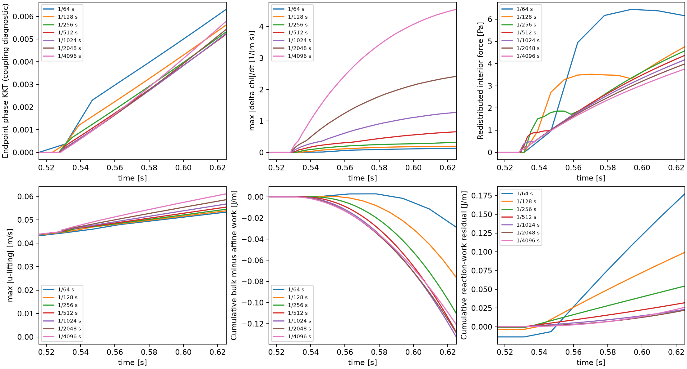
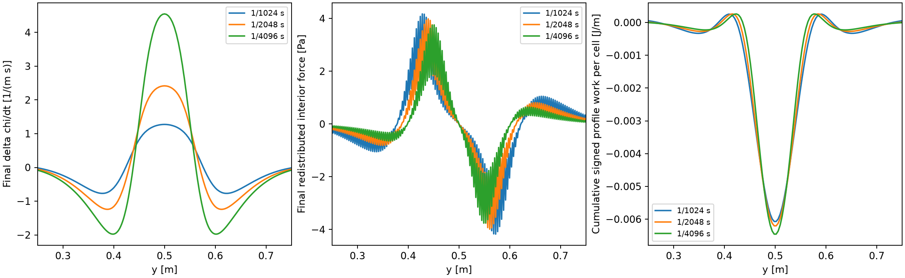
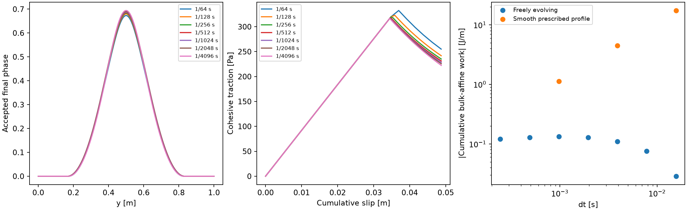

# P2 evolving-profile temporal consistency diagnosis

**Do not select a native timestep yet.** The freely evolving endpoint family
through 1/4096 s does not remove its completed-state phase lag or demonstrate
ordinary convergence of profile redistribution work. The last halving changes
full phase by 0.00564886 and traction by 3.40121 Pa, exceeding the retained targets;
last observed orders are negative for these quantities. The original fixed-history
phase solves remain converged and admissible. The smooth prescribed-profile
control does show ordinary first-order reduction of work difference; it directs
attention to phase–mechanics coupling rather than the frozen-profile Maxwell law.

The consistent-endpoint saved-entry prototype removes the phase lag at unchanged
tolerance, but changes phase by 0.05212 and produces an incoming-state profile
energy cost of **159.949 J/m**. That cost is incompatible with the selected
zero-duration, fixed-history phase relaxation followed by Maxwell evolution.
No accepted trajectory is replaced, no history is advanced twice, and no
compensating dissipation is added. Native adoption is blocked by this concrete
energy-path/transition question, not by a failed incoming phase solver.

## Settings and what was held fixed

| Quantity | Actual setting |
|---|---|
| Geometry and mesh | Unit-height/unit-width compatible Box, through-going fault y=0.5 m; 16×256 Q2 velocity/Q1 pressure/Q1 phase, 64 fault segments |
| Integrations and particles | Six shared normal bulk points/cell; existing consistent normalization/adjoint; CPDI fracture, 3×3 native particles/cell (768 normal samples in 1D); frozen positions |
| Material | G=10⁶ Pa, eta=10⁸ Pa s, lambda=100 s; c=1000 Pa, Gc=26.6666666667 J/m², ell=0.15625 m, p=1, m=128 |
| Friction/loading | Existing fixed coefficient 0.1, prescribed pressure 10000 Pa, no radiation damping or RSF evolution; amplitude 0.256 s⁻² |
| Boundaries | Compatible side uy=0 and natural tangential condition; top/bottom interval-mean ux=0.256(t_a+t_b)(y−0.5)/2, uy=0 |
| Initial state | Identical fresh native-H relaxed seed (nominal core 0.6; relaxed maximum 0.600057140568867), zero accepted FE history, Z and slip |
| Admissible phase | Original previous-physical-timestep phase is immutable lower bound; upper bound 1; no new cap, floor, limiter or kinetics |
| Algorithm/tolerances | Existing incoming-history phase→endpoint mechanics→publication; general exponential beta; normalized prototype phase KKT 10⁻¹¹, existing force/contact checks |
| Time interval | T=0.625 s, identical continuous load and exact interval means; imposed top-to-bottom displacement 0.05 m at every partition |

G=10⁶ Pa is a dimensional synthetic verification value. New freely evolving trajectories
are only the two permitted prototype refinements (1280/2560 steps). Existing
64–1024 trajectories are reused without advancing their histories. The native
34.4-minute baseline, production sources/binaries and historical failures remain
unchanged. This concerns a widening pre-existing band; it is not P3 or propagation.

## Completed-state phase condition: a coupling diagnostic

For every accepted step, evaluate the same full discrete energy gradient twice
at the accepted new phase, with the **original incoming phase** as the bound:

\[
 g_a=\partial_\phi E(\phi_b,R_a,Z_a)/A,\qquad
 g_b=\partial_\phi E(\phi_b,R_b,Z_b)/A.
\]

A is the retained 64-Pa fracture scale. At lower contacts project to min(g,0);
else retain g. No equality residual is demanded at a valid lower contact.
These are evaluations only: no new phase solve, mechanical update, H publication
or change to either accepted history. The incoming defect verifies the actual
solved problem; the endpoint defect measures lack of simultaneous consistency.
It is **not a failure of the existing fixed-history solver**.

| dt (s) | Max phase increment | Max endpoint projected defect | Max \|Delta chi\|/dt (m⁻¹ s⁻¹) | Redistributed interior force (Pa) | Max relative velocity (m/s) | Max absolute nodal work pairing (W/m) |
|---|---:|---:|---:|---:|---:|---:|
| 1/64 | 0.0170487 | 0.006312445 | 0.13043 | 6.4441 | 0.053306 | 31.497 |
| 1/128 | 0.008617452 | 0.005625118 | 0.19647 | 4.7603 | 0.053861 | 23.732 |
| 1/256 | 0.004346378 | 0.00531932 | 0.32099 | 4.5774 | 0.054514 | 18.439 |
| 1/512 | 0.00218721 | 0.005213217 | 0.65673 | 4.3706 | 0.05544 | 15.293 |
| 1/1024 | 0.001096939 | 0.005245866 | 1.2743 | 4.1732 | 0.056758 | 13.133 |
| 1/2048 | 0.0005495946 | 0.005428545 | 2.4168 | 3.9851 | 0.0586 | 11.332 |
| 1/4096 | 0.0002752922 | 0.005786635 | 4.5484 | 3.7562 | 0.0611 | 9.7924 |

Actual incoming defects stay below 10⁻¹¹, and endpoint mechanics/contact conditions
pass. Endpoint projected gradients and their mass-scaled Pa values are retained
with spatial locations. The largest defect is at the fault core, not an omitted
boundary contact. The endpoint defect does not decrease in the fine tested family.
The endpoint defect reaches 0.00578664 at 1/4096, while the profile rate maximum
rises to 4.54838 m⁻¹ s⁻¹. This is evidence over these partitions, not proof of a
nonzero dt→0 limit.
Halving the maximum phase increment therefore does not establish coupling accuracy.

## Resolve the exact work identity and its spatial contribution

With shared D,W, define

\[
 f_*=D_I^TW\tau_*,\quad
 \tau_*=GDR_a-Z_a\chi_b,\quad
 v=u-u_{lift},\quad
 c=\lambda-\frac{\beta\Delta t}{1-\beta}.
\]
\[
 W_{bulk}-W_{affine}=c\,v^Tf_*,\qquad
 v^Tf_* =v^Tf_a-Z_a\sum_q w_q\Delta\chi_q(Dv)_q.
\]

The second equation exposes the signed quadrature-region contributions; the old
interior force f_a is at numerical equilibrium. Record max and RMS Delta chi/dt,
force, relative interior velocity, signed and absolute pairings, and their maxima's
locations separately. The twelve-point time integration and exact general-beta
identity agree within 1.82×10⁻¹² J/m per step. This checks the difference of the
integrals, not their status as external work.

The largest step work contribution is at t=0.625000000 s; profile-rate peak y=0.499868 m, force peak y=0.548828 m, and largest quadrature work y=0.501487 m. Steps after .6s contribute 44.17% of absolute step work difference. The region |y−.5|<.1m contains 92.29% of accumulated absolute spatial work.

The scalar history covers every step. Selected vector snapshots preserve the
worst endpoint residual, profile rate, force and pairing, plus the final state.
Accumulated signed/absolute quadrature-region work locates contributions without
cancelling opposite signs. Interior nodal forces and relative velocity do not
show the expected reduction that would make the cumulative work difference
ordinarily first order. These measurements do not assume Delta chi/dt diverges
mathematically; the observed trend is sufficient to withhold qualification.





## Smooth prescribed profile control

Every control uses the identical nodal function

\[
 \phi(y,t)=\phi_0(y)+0.08 S(s)\exp[-((y-0.5)/0.15)^2],\quad
 s=\mathrm{clip}((t-0.5)/0.125,0,1),\quad S=10s^3-15s^4+6s^5.
\]

It is monotone, C2 at the activation times, and bounded. Recompute I and chi
normally and solve the unchanged mechanics from the accepted state. This removes
phase-solving/contact activation effects. It prescribes phase throughout the
domain, including its small Gaussian boundary tail; it does not claim to solve
the physical phase PDE/Neumann boundary problem. The total maximum increase 0.08
is comparable to the original freely evolving core increase, with no load or
material change. Its signed profile energy change is an imposed-control energy
exchange, not a claim of positive physical relaxation dissipation.

| dt (s) | Max \|Delta chi\|/dt | Redistributed force (Pa) | Cumulative bulk-affine work (J/m) | Absolute reaction-work residual (J/m) |
|---|---:|---:|---:|---:|
| 1/64 | 13.1522 | 570.135 | -17.38956 | 5.537554 |
| 1/256 | 13.349 | 147.55 | -4.463076 | 1.463044 |
| 1/1024 | 13.367 | 37.1071 | -1.12211 | 0.3698348 |

A fourfold smaller dt reduces force and work difference about fourfold while
profile rate remains bounded. Mean mechanical velocities remain bounded.
Reaction-work error also decreases. Thus the mechanical path handles a prescribed
smoothly evolving profile with ordinary convergence; it does not explain the
freely evolving family's persistent lag and slower/error-plateau behavior by itself.
This control qualifies only those restricted mechanical operations.

## Which work is external loading?

Let F(t)=D^TW tau(t) be the **unconstrained** FE stress residual, partitioned into
boundary B and interior I. For zero body force and the compatible shear fixture,
the physical discrete boundary reactions are F_B(t), with sign chosen as applied
force on the body. Then

\[
 W_{reaction}=\int u_B^TF_B(t)\,dt,
\]
\[
 W_{bulk}=W_{reaction}+\int u_I^TF_I(t)\,dt,\quad
 W_{lift}=W_{reaction}+\int u_{lift,I}^TF_I(t)\,dt.
\]

Every quantity uses the same fields, six spatial points and twelve time points.
Boundary-reaction work is independent of the lifting's interior extension. The
original affine lifting agrees with reactions to cumulative arithmetic accuracy
in the freely evolving fixture, as separately measured; this special agreement
cannot be assumed in general. Its uniform derivative tests the normalized
cross-section integral, while profile changes are confined away from the boundary.
In the Gaussian control their difference is small but nonzero (2.32×10⁻⁶ J/m at
1/1024), consistent with its small boundary tail.

Adding a zero-boundary interior velocity 0.256 t_mid sin(2 pi y) changes lifting
work; the symmetric sin(pi y) extension largely cancels by symmetry. At 1/1024,
original affine/reaction work are 58.8410090835/58.8410090837 J/m, while the
asymmetric lifting gives 58.8829479936 J/m. The extra 0.04194 J/m is **not external
loading**. Both lifting measures, bulk-rate work and reactions remain reported.
Independent analytic time integration and off-quadrature boundary stress traces
are checked in reaction-trace-verification.json; no generic stress projector feeds
this FE history path.

Let Delta E include bulk/cohesive/fracture storage and D include only their
viscous losses and friction. Retain the existing ledger
W−(Delta E+D_relax+D) for each work definition; the reaction ledger identifies
the external-work remainder of the selected two-stage path with its separately
recorded phase release. D_relax is not silently called viscous dissipation.
Below work entries are signed cumulative / absolute sum / max absolute step;
release entries are signed / absolute cumulative, in J/m.

| dt (s) | D_relax | Bulk-affine work difference | Reaction-work remainder |
|---|---:|---:|---:|
| 1/64 | 0.1799112 / 0.1799112 | -0.02872256 / 0.03442987 / 0.01720526 | 0.1773116 / 0.2043558 / 0.03937591 |
| 1/128 | 0.09878702 / 0.09878702 | -0.07622031 / 0.07747805 / 0.0167158 | 0.09927378 / 0.106062 / 0.009706891 |
| 1/256 | 0.05410352 / 0.05410352 | -0.11033 / 0.1106928 / 0.01058913 | 0.0543442 / 0.05613551 / 0.002428418 |
| 1/512 | 0.03177769 / 0.03177769 | -0.1280746 / 0.1282074 / 0.005628403 | 0.03208073 / 0.03245621 / 0.0007841938 |
| 1/1024 | 0.02296972 / 0.02296972 | -0.1325301 / 0.1325929 / 0.002737729 | 0.02313624 / 0.02325684 / 0.0003695088 |
| 1/2048 | 0.0219925 / 0.0219925 | -0.1286573 / 0.1286858 / 0.001278698 | 0.02213849 / 0.02214381 / 0.0002178214 |
| 1/4096 | 0.02588427 / 0.02588427 | -0.120912 / 0.1209279 / 0.0005867192 | 0.02598072 / 0.02598324 / 0.0001394227 |

The original bulk-rate and affine ledgers are retained in the corresponding
energy.json files, not replaced by this reaction audit. An intermediate interior
force paired with the actual interior velocity accounts for their difference
from physical external work. No balancing loss or body force is inserted.
Reaction remainders and phase release are not shown to vanish: cumulative release
increases from 0.0219925 at 1/2048 to 0.0258843 J/m at 1/4096, and the latter
absolute reaction remainder is 0.0259832 J/m. These are measured discrepancies,
not demonstrated limiting dissipation.

## Physical field comparison and reference uncertainty

The primary comparison uses the same discrete 16×256 model, with the finest
1/4096 path as an **unqualified numerical comparator**. It never uses the old
exact-bulk 1/64 solution as a temporal reference. Stress is independently sampled
at 24 normal points/cell. Fixed stress/storage scales remain 1332.52197478 Pa and
0.887807406634 J/m. The common-interval peak rate of the new finest comparator
is 0.158854885806 m/s and is fixed across this comparison. Slip rates use forty
identical 1/64-s intervals from cumulative
slip, not differently averaged returned rates. No onset alignment is performed;
full-field/core threshold stays 10⁻⁵ above the identical initial field.

| dt (s) | Full phase difference | Traction (Pa) | Slip | Common-interval rate | Whole / localized stress | Bulk storage |
|---|---:|---:|---:|---:|---:|---:|
| 1/64 | 0.0222902 | 35.5741 | 0.07294% | 1.1906% | 2.6697% / 2.6699% | 5.2678% |
| 1/128 | 0.0152526 | 19.5086 | 0.04003% | 0.4638% | 1.4768% / 1.5079% | 2.7027% |
| 1/256 | 0.0124989 | 12.8562 | 0.02638% | 0.2428% | 0.9823% / 1.0253% | 1.7749% |
| 1/512 | 0.0121224 | 9.0371 | 0.01854% | 0.1605% | 0.6995% / 0.7523% | 1.2448% |
| 1/1024 | 0.0097467 | 6.2114 | 0.01274% | 0.0699% | 0.4883% / 0.5447% | 0.8539% |
| 1/2048 | 0.0056489 | 3.4012 | 0.00698% | 0.0241% | 0.2721% / 0.3174% | 0.4667% |
| 1/4096 | 0.0000000 | 0.0000 | 0.00000% | 0.0000% | 0.0000% / 0.0000% | 0.0000% |

The finest row's zero self-error cannot qualify it. The original 0.001 phase,
1-Pa traction, 0.1% slip, 0.5% rate and 1% stress/storage targets remain fixed.
Successive-halving differences, observed orders, onset/displacement brackets,
full profiles, stresses, cohesive storage and fracture expenditure are retained
in comparison.json and the accepted per-step evidence. Their trends do not remove
the coupling/energy-path blocker, so no practical native timestep is selected.



## Consistent endpoint replay: numerical correction, energetic blocker

The equations and accounting were written **before implementation** in
[P2_profile_temporal_candidate.md](P2_profile_temporal_candidate.md).
For fixed mu P, trial endpoint histories recomputed from the one immutable
incoming state give the reduced algorithmic potential

\[
 J(\phi,u,V)=E(\phi,\beta R_a+(\kappa/G)u,\beta Z_a+\kappa V)
              +(\kappa/G)\mu P V.
\]

Its stationary conditions are endpoint bulk equilibrium, friction complementarity
and the fixed-endpoint-state phase KKT condition. J is not physical integrated
work. Partial J_phi includes the exact normalization adjoint. Mechanically
eliminating u,V gives the exact Schur-complement phase Hessian; the fixed-history
Hessian alone is insufficient. This is a within-step consistent solve, not a
new physical H update. Every mechanics call resets R,Z,slip to the original accepted
values; the physical phase lower bound stays unchanged, including line searches.

One retained final 1/1024 entry is replayed. No accepted history is published.
The independent energy-domain finite-difference check gives energy-gradient error
below 9×10⁻¹² and reduced-Hessian directional error below 4.1×10⁻¹⁰ at epsilon
10⁻⁴. The first derivative probe incorrectly touched nearly-zero tail nodes
outside [0,1]; its invalid values are retained but are not verification evidence.
The corrected support-restricted energy-domain probe is recorded separately.

| Replay result | Measurement | Interpretation |
|---|---:|---|
| Endpoint phase KKT | 0.00524587 → 8.9066×10⁻¹⁴ | Consistent endpoint conditions numerically solved at original 10⁻¹¹ target |
| Mechanical/contact | Force 5.253×10⁻¹⁰ Pa, friction defect −1.762×10⁻¹¹ Pa | Same incoming state, one Maxwell advance, unchanged mechanics |
| Phase | Max 0.739741; increment from physical lower bound 0.0529164 | Finite replay transition; not a demonstrated dt→0 physical jump |
| Traction/slip | q=180.141 Pa, interval V=0.210156 m/s | Material and load unchanged; response materially differs from sequential entry |
| Reduced curvature | Before −0.00928293; after minimum free 0.0858789 | Nonconvex reduced tangent at a nonstationary sequential state; not a global/critical-cone stability proof |
| Incoming profile energy cost | +159.949 J/m | Violates the selected zero-duration fixed-history relaxation interpretation |
| Profile decomposition | Bulk +160.069, cohesive −1.20995, fracture +1.08960 J/m | Signed changes explicitly retained; no missing term hidden |
| Path work | Bulk −162.380; affine about +0.188090 J/m | Huge interior disequilibrium work during the reconstructed endpoint-selected path |
| External-work ledger | Affine/reaction remainder about +160.073 J/m | Endpoint stationarity alone does not qualify the ordered energy path |

This saved entry comes from the lagged sequential trajectory. The large catch-up
correction does not demonstrate a finite physical jump on a freshly initialized
consistent trajectory. Its literal split-path energy cost still blocks adoption.

The negative signed profile release is an energy **cost**, not a dissipation to
clip, rename or compensate. At a zero-duration fixed-history phase stage there
is no boundary displacement work and no viscous/frictional work to fund it.
The replay solves the coupled endpoint equations but fails energetic admissibility
under the current literal split path. A local minimum of the endpoint potential
is not sufficient grounds to adopt that step physically.

## Stopping decision and concrete next formulation question

**Stop before a new native run.** Coupling consistency is needed, but simply
iterating phase/mechanics to the endpoint does not repair the energy path.
The smallest review question is how mechanical equilibration occurs during
profile redistribution and how a finite phase transition is selected/accounted
for. Keep the governing energy and friction/viscosity intact while deriving that
path; do not add a damping term just to hide the remainder.

For smooth evolution the existing state reconstruction gives, in this shear
reduction,

\[
 \dot\tau=G(Du-\chi V)-\tau/\lambda-Z\dot\chi.
\]

A mechanically equilibrated path must satisfy bulk and slip conditions along
that changing-profile path, not only at its endpoint. An alternative instantaneous
elastic equilibration would keep viscous internal variables fixed while allowing
bulk displacement and elastic cohesive slip to adjust; it changes the phase-stage
mechanical state and its energy/work, so the current fixed-R_a,Z_a jump and
subsequent recurrence cannot simply be reused without deriving those changes.
A justified rate-independent transition rule may also be needed if a finite
transition persists. This report does not select one or prove its limiting jump.
Those are explicit formulation/time-path decisions for review, not routine
solver-tolerance changes. No new phase law, kinetics, native option or P3 is adopted.

## Changes, cost and reproducibility

Only new benchmark diagnostics/prototype scripts and documentation are added;
production source, prior benchmark scripts, generic projectors, specifications,
compiled core/plugin and every retained accepted/failed trajectory are unchanged.

| New file / function | Purpose |
|---|---|
| profile_temporal_diagnosis.py / step, audit | Fixed-state KKT comparison, profile/force/velocity pairing and true FE reaction work |
| run_profile_temporal.py / extended, smooth | Reuse complete old endpoint step for two finer levels; one fixed C2 prescribed profile control |
| assess_profile_temporal.py / main | Matching physical times, fixed-interval rates, field errors and spatial/time contribution accounting |
| profile_endpoint_replay.py / Endpoint | Derived consistent-endpoint reduced functional/Schur tangent; immutable-history saved-entry replay |
| verify_profile_endpoint.py / main | Independent admissible energy/Hessian derivative check and retained invalid-probe disclosure |
| profile_temporal_plots.py / main | Compact coupling/scaling, spatial and physical/control plots |
| check_profile_temporal.py / main, reaction_trace | Read-only numerical/preservation checks and independent boundary-work evaluation |
| write_profile_temporal_report.py / main | Reproducible measured tables and additive checkpoint updates |
| Candidate/report and STATUS/PLAN/current_design/CURRENT_STATUS/README/AGENTS additions | Proposed versus implemented equations and explicit stopped scope |

| Fresh evolving dt (s) | Steps | Wall (s) | CPU (s) | Peak RSS (MiB) |
|---|---:|---:|---:|---:|
| 1/2048 | 1280 | 839.79 | 306.27 | 112.96 |
| 1/4096 | 2560 | 1155.40 | 598.23 | 125.59 |

Concurrent wall time includes CPU contention. Prototype saved-entry replay costs
40.58 s wall and 44 inner evaluations. Python syntax and task whitespace checks pass; incoming
pf_rsf.tex trailing-whitespace evidence remains untouched. Independent boundary
stress traces and FE reactions differ cumulatively by only 4.72×10⁻¹² J/m at
1/4096; analytic and quadrature time-work evaluations differ by at most
9.3×10⁻¹⁴ J/m per step there. No new native cost is claimed. Baseline
is de7beaa65846c7372711f7922abf1c5d9a745ee6/fault-propagation, GCC12.4 Release
Unity/deal.II9.6.2/Trilinos14.2/p4est2.8.7. Baseline hashes, current manifests,
pre-edit documentation and per-run resource records are in profile_temporal_evidence/.
The old core/plugin hashes remain d07e7cdf…22241d and 68dcb8f3…cca0e0b;
full hashes are pinned in baseline.json. No commit/push or checkpoint conversion.

Executed from repository root with OPENBLAS_NUM_THREADS=1 OMP_NUM_THREADS=1:

```sh
# Fixed-state diagnosis: repeat for each denominator 64..4096 in the dyadic family.
python3 benchmarks/reconstructed_fault/propagation/profile_temporal_diagnosis.py --denominator 1024
# Only these two new freely evolving levels.
python3 benchmarks/reconstructed_fault/propagation/run_profile_temporal.py --denominator 2048
python3 benchmarks/reconstructed_fault/propagation/run_profile_temporal.py --denominator 4096
# Smooth controls: repeat for 64,256,1024.
python3 benchmarks/reconstructed_fault/propagation/run_profile_temporal.py --denominator 64 --smooth
python3 benchmarks/reconstructed_fault/propagation/profile_endpoint_replay.py --denominator 1024
python3 benchmarks/reconstructed_fault/propagation/verify_profile_endpoint.py
python3 benchmarks/reconstructed_fault/propagation/assess_profile_temporal.py
MPLCONFIGDIR=/tmp/normal-resolution-mpl python3 benchmarks/reconstructed_fault/propagation/profile_temporal_plots.py
python3 benchmarks/reconstructed_fault/propagation/write_profile_temporal_report.py
python3 benchmarks/reconstructed_fault/propagation/check_profile_temporal.py
```

Fresh output writers refuse existing trajectory/replay directories. The original
replay directory retains its earlier inadmissible finite-difference probe;
verify_profile_endpoint.py records the corrected check without replacing it.
[Verification](../../../benchmarks/reconstructed_fault/propagation/profile_temporal_evidence/verification.json)
and [comparison](../../../benchmarks/reconstructed_fault/propagation/profile_temporal_evidence/comparison.json)
separate numerical passes from the failed native/energetic gate. Full Stokes
resolution, coupled restart/rollback, transport/birth, MPI and P3 remain outside
this task. Spatial and normalization evidence is retained without a new campaign.
