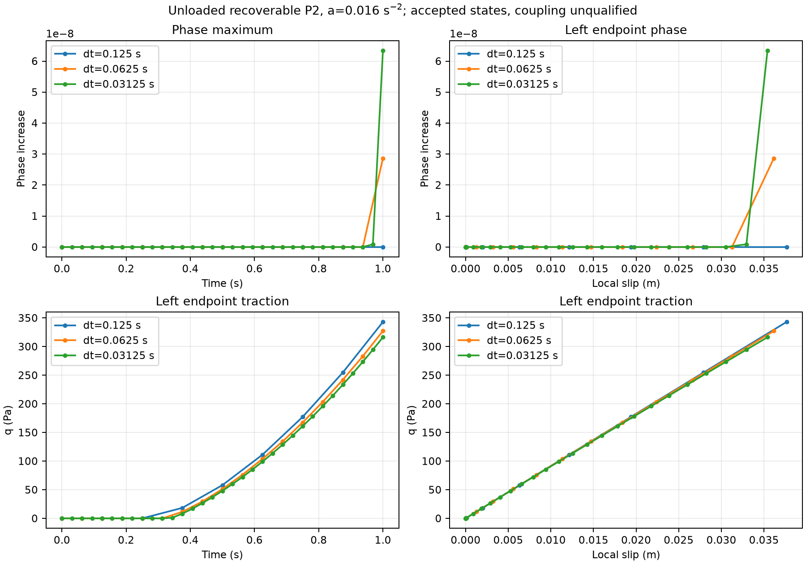
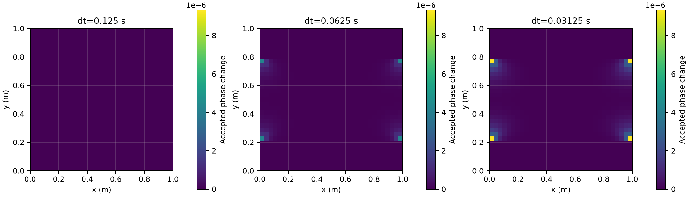
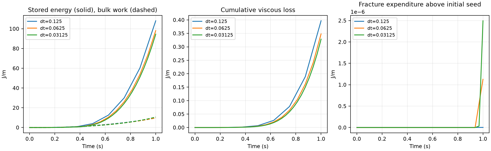

# P2 recoverable-energy revision: local success, coupled qualification blocked

The new case retains G=1e6 Pa, c=1000 Pa, Gc=26.6666666667 J/m²,
eta=1e8 Pa s, ell=0.15625 m, p=1 and the relaxed nominal-core-0.6 seed.
**It starts unloaded: cohesive q, elastic cohesive slip and bulk Maxwell stress
are zero; prescribed particle H and relaxed phase are retained.** The boundary
ramp is unchanged, vx=0.016 t(y−0.5), vy=0 over 0–1 s. Consistent normalization,
fixed full-cross-section associations and frozen particle positions are retained.

The selected peak-recoverable-energy law passes the local and zero-load tests.
In the coupled runs, **only the two finer timesteps produce tiny, late phase
increases**, largest at the side boundaries in the transverse flanks of the band.
No resolved healing or off-band H activation occurs. Traction versus physical time
moves closer under refinement, but phase feedback does not establish convergence.
A native traction-transfer test and energy accounting expose additional existing
coupling problems. **This is not a qualified evolving-damage baseline.** No larger
loading pilot, material optimization, stress-scaling claim or P3 was undertaken.

## Settings and initialization

| Setting | Value |
|---|---|
| Domain / fixed fault | [0,1]² m; (0,0.5)–(1,0.5) m |
| Bulk / surface / particles | Fixed 32×32 squares, Q1 phase/Q2 velocity; 0.1 m surface Q1 spacing; 3×3 particles/cell, 9,216 parents |
| Association | Fixed full normal cross-section, half-width 0.50000000000001588 m |
| G / cohesion / viscosity, both constituents | 1e6 Pa / 1000 Pa / 1e8 Pa s |
| Viscosity bounds | 1e6–1e10 Pa s |
| Gc / ell / p | 26.6666666667 J/m² / 0.15625 m / 1 |
| AT1 calibration | c0=8/3; Hc=0.5 Pa; m=128.00000000016001; E=64.00000000008001 Pa |
| Nominal / accepted initial core maximum | 0.6 / 0.6035488376736221 |
| Initial q / Z / bulk stress | 0 Pa / 0 Pa m / 0 Pa |
| Initial I_h | Approximately 108.5313919283 m, current and committed previous equal |
| Friction / pressure | Stateless rate dependent, mu_ref=mu_dynamic=0.1; Vc=2e-6 m/s; Vmin=1e-20 m/s; prescribed friction pressure 10000 Pa |
| Gravity / radiation damping | 0 / 0 |
| Fractions / temperature / density | 0.5/0.5 identical constituents; static 293 K; 3300 kg/m³ |
| Boundary conditions | vx=0.016 t(y−0.5), vy=0 on all sides; natural zero-normal-flux phase; surface pressure normalization |
| Time | 0–1 s, dt=0.125, 0.0625, 0.03125 s; artificial initial mechanical interval 1 s |
| Phase / normalization | Box [0,1] solver enabled, no previous-phase lower bound; consistent I_h |
| New settings | `Phase driving history = recoverable energy`; `Initial cohesive state = unloaded` |

Every run is fresh. Native prescribed H is created first, phase is relaxed at that
H, then the native cohesive initialization commits zero q and current/previous
normalization together. Z=I_h q and elastic slip Z/G are derived from existing
surface state; no duplicate history variable is introduced. Bulk stress is zero
through the existing initial-composition input. H is not regenerated or reset.
All five new local/zero/coupled initial phase CSVs are byte-identical to the retained
reference initialization. The observer checks Y0=0<=H0 and zero stress/q at every
associated parent. Neither phase nor H advances through the artificial 1 s interval.

The zero-load control runs two real 0.125 s steps: phase and H remain exactly
unchanged. The existing slip-rate lower bound produces q<=2.301e-17 Pa and
Y<=1.525e-34 Pa, far below seeded H. No startup growth is hidden by a tolerance.

Geometry, mesh, associations, particle positions, temperature and fractions remain
fixed. Native mechanics advances velocity, pressure, stress, q, V and H; phase
consumes incoming H in the next sequential cycle. There is no outer iteration,
transport/birth qualification, support admission or endpoint growth.

## Governing revision and its limits

The derivation was recorded **before implementation** in
[P2_recoverable_derivation.md](P2_recoverable_derivation.md), then incorporated in
both authoritative governing documents. For the reduced surface law,

    Z = I_h q,        Z_dot = G V − (G/eta) Z,
    elastic cohesive slip = Z/G,
    Psi_Gamma = Z²/(2G I_h).

At fixed elastic internal slip and G,

    delta Psi_Gamma = −q²/(2G) delta I_h
                    = integral g'(phi) [q²/(2G g(phi)²)] delta phi dz,

because h=1/g−1 and I_h=integral h dz. Therefore the **continuum reduced-fault**
coefficient is Y=q²/(2Gg²), including evolving phase and normalization. Holding q
fixed instead would give the wrong sign. At g=1 the coefficient is q²/(2G), with
no previous-traction subtraction. At g=0 the finite-normalization model remains
undefined; no cap, floor or residual stiffness is added.

The continuous reduced cohesive energy balance is

    Psi_dot = q V − I_h q²/eta − q² I_h_dot/(2G).

Viscous loss I_h q²/eta and friction mu sigma_n V are separate nonnegative
expenditures. They are not accumulated into the new phase driver. Bulk Maxwell
storage and dissipation are tau:tau/(4G) and tau:tau/(2eta). These local identities
do not prove that the existing discrete bulk/surface exchange is work-consistent.
The derivation's material/profile assumptions are qualified here only for the
selected identical-constituent straight-fault fixture.

The new optional history branch computes **H_new=max(H_old,Y_accepted)** using
the same surface modulus and degradation as the accepted cohesive response, the
accepted phase sample and the accepted projected traction. Candidate construction,
validation and terminal publication retain their previous ordering. Newton and
line-search evaluations do not modify history. Old and older FE histories are
not synchronized or overwritten. The incremental-work implementation remains
available as the unchanged default for historical reproduction.

Two discrete qualifications are essential:

1. With consistent I_h=P I(phi), the exact derivative of the discrete surface
   energy contains P* acting on q²/(2G), rather than pointwise q²/(2G). Independent
   frozen-field differentiation at fixed Z confirms that expression. At final
   loaded states, its difference from the continuum driver for the tested smooth
   Q1 perturbation is **0.0631%, 0.0656%, 0.0658%**. This is a measured directional
   discrepancy, not an error bound over all perturbations. The phase operator was
   not silently replaced by a new discrete adjoint assembly.
2. The existing traction publication and mechanical work exchange introduce much
   larger discrepancies, described below. Thus Y is confirmed for the reduced
   constitutive energy, but the complete production coupling is **not established
   as a discretization of that energy**. H monotonicity is not proof of phase
   irreversibility or global energy balance.

## Local verification

The native-function test fixes phi=0.6 and uses q0=600 Pa,
H0=q0²/(2Gg²). At reference eta=1e8 Pa s and elastic-limit eta=1e22 Pa s,
it samples dt=0.125, 0.0625 and 0.03125 s:

| Prescribed traction path | Final H/H0 at all six partitions/material limits |
|---|---:|
| 600→800 Pa smooth monotone loading, 0–1 s | 1.777777777777778 |
| Zero-input Maxwell relaxation | 1 |
| Two smooth unloading/reloading cycles below the initial peak | 1 |
| Constant traction 600 Pa | 1 |

All **560 native path evaluations** pass the expected peak-history criterion
(1e-13 H0). Native V=0 relaxation agrees to 1e-12 q0. The intact value is checked
against q²/(2G). Forty-two independent nonuniform, evolving-phase states verify
the energy derivative at fixed Z and the cohesive energy balance: maximum reported
derivative discrepancy 1.799e-11, balance discrepancy 2.122e-11 in the test's units.
Assertions allow 1e-7 for normalized derivative error and 1e-8 times max(1,qV)
for the balance, without tuning against coupled results.

The existing cohesive suite passes **622 assertions in seven cases**, including
mature and historical incremental behavior. The rebuilt default preloaded reference
run reproduces **all 99 old diagnostic CSVs byte-for-byte**. This separates the
explicit model revision from a numerical regression or changed default.

## Three coupled trajectories

| Accepted outcome at t=1 s | dt=0.125 | dt=0.0625 | dt=0.03125 |
|---|---:|---:|---:|
| Accepted physical steps | 8 | 16 | 32 |
| Phase-changing steps | none | 16 | 31, 32 |
| Increase of global phase maximum | 0 | 2.86463e-8 | 6.34079e-8 |
| Maximum nodal increase | 0 | 4.21140e-6 | 9.32168e-6 |
| Largest single-step phase increment | 0 | 4.21140e-6 | 9.19345e-6 |
| Integral(H−H0), Pa m² | 2.51635079 | 2.50611732e-4 | 2.92777782e-5 |
| Maximum accepted Y, Pa | 30535.18094 | 27742.85749 | 25906.85131 |
| Maximum pointwise Y/H0 | 1.579287 | 1.435353 | 1.340913 |
| Left endpoint q, Pa | 343.05142 | 327.21592 | 316.23255 |
| Left endpoint cumulative slip, m | 0.03765196 | 0.03615486 | 0.03540915 |
| Center q, Pa | 51.51083 | 48.20197 | 46.60956 |
| Center cumulative slip, m | 0.00559375 | 0.00522484 | 0.00503541 |

All three paths reach seeded H somewhere, so the conditional “never crosses
threshold” loading pilot is not needed. The response is insufficient for a gradual
feedback claim, and increasing load would obscure the newly measured exchange
problem. The amplitude stayed 0.016 throughout; no timestep-specific tuning occurred.

The coarse final H gain has not yet been consumed by phase: the cycle is
H_in→phi→mechanics→H_new. The finer paths consume small tail-H changes before
1 s. This one-step lag explains why final phase alone cannot compare terminal
histories; the table and JSON compare both incoming/committed H and Y. The enormous
spread in final H and the native transfer mechanism below remain after acknowledging
that lag. Endpoint q differences at common time shrink from 15.84 to 10.98 Pa,
but phase differences do not show a convergence trend, and there are only one/two
late evolving cycles.

At common left-endpoint slip 0.03540915152 m, q is 322.7136, 320.5281 and
316.2325 Pa; phase is 0.60354883767, 0.60354886196 and 0.60354890108. The nearby
parent H values are 30220.5683, 29167.9926 and 29167.9926 Pa. These are linearly
interpolated accepted samples, not extra simulated states. Center and right-endpoint
comparisons, all common physical times, q, V, Y and H are in
[summary.json](../../../benchmarks/reconstructed_fault/propagation/recoverable_evidence/summary.json).

The largest changes occur at x=0 or 1 and y≈0.21875/0.78125 m, on transverse
flanks inside the initial diffuse support. Core-maximum changes are much smaller.
No H increases occur outside the original profile support. Endpoint loading
therefore remains a spatial feature, separate from the isolated history-transfer
and work-measure diagnoses. No saturation occurs.





## Numerical gates and normalization

All 56 loaded physical steps and two zero-load steps complete. Phase bounds hold,
measured healing is zero, worst KKT=1.724e-13 and worst mechanical relative
residual=7.723e-9. Existing checks remain KKT<=1e-11, healing allowance 4.922e-12,
mechanics<=1e-8, strict nodal [0,1] and CPDI allowance 3e-14. All-parent native
candidate/publication checks retain 128 epsilon times max(1,|expected H|).
Trial-state, current/previous I_h and fixed-position checks pass. No tolerance is
relaxed to label the model qualified.

Normalization is finite globally (phase max<0.604), positive and accurate for these
fields. At initialization and the most damaged accepted state, direct analytic
transverse integrals including endpoints agree with independent Q16/Q32 integration
to <=5.56e-16 relative. Final maximum error in the normalized source integral is
8.833e-10, 5.718e-8 and 1.277e-7 respectively. This is measured representation
accuracy, separate from the quadrature tolerance and energy-derivative projection
error. No failed-entry field arose in these runs; all prior failed-entry and
failed-refinement evidence remains preserved.

## Remaining traction-history inconsistency

The surface law requires Z_new=beta Z_old+kappa V. However, accepted traction is
sampled at particle centers and sent through the existing particle-domain scalar
projection. Its mass matrix integrates Q1 basis products over particle domains,
while its RHS treats each parent sample as constant over that domain. Mapping a
Q1 field to parent values and back is consequently **not the identity**.

A read-only native test builds the complete 11×11 transfer matrix R with the actual
particles and projection. Constants reproduce within 1.810e-14; maximum entrywise
|R−identity|=0.00334502. Even the linear x profile differs by 0.000317503 m. The
smallest eigenvalue is 0.994330248, with all eigenvalues approximately in (0,1].
Repeated application gives a nonphysical smoothing rate −log(lambda)/dt:

| dt, s | Fastest measured transfer-mode decay rate, 1/s |
|---|---:|
| 0.125 | 0.0454871 |
| 0.0625 | 0.0909742 |
| 0.03125 | 0.1819484 |

With fixed phase, the observed update is exactly

    q_new = R [ beta q_old + kappa V/I_h ],

rather than the unprojected constitutive recurrence. R predicts all fixed-phase
published traction samples to <=3.20e-14 relative. On the tiny evolving fields,
interpolating the rational constitutive response at nodes before R leaves only
<=2.87e-7 relative discrepancy. This is a new, independently isolated source of
time-partition dependence; it is not the old O(dt) H candidate or phase/history lag.
No generic projection matrix, q history meaning or publication algorithm was
silently changed in this task.

## Separate energy measures and mechanical exchange

Energies below are J/m of out-of-plane thickness. Bulk storage uses committed
particle tau:tau/(4G) and native domain volumes. Fault storage integrates
I_h q²/(2G) along the fault. Fracture expenditure uses the native CPDI AT1 density
E[phi+ell²|grad phi|²], with initial fracture energy 14.6261809623 J/m subtracted.
For each mechanical interval, viscous losses integrate the analytic Maxwell
transient between the recorded incoming and accepted stresses; the surface
transient uses Z_old, V and the current I_h. The phase-only surface energy jump
holds Z fixed when I_h changes. Friction uses the actual constant mu=0.1 and
prescribed pressure; radiation damping is zero.

| Energy/accounting quantity at t=1 s | dt=0.125 | dt=0.0625 | dt=0.03125 |
|---|---:|---:|---:|
| Bulk stored | 107.542265 | 97.643687 | 94.069452 |
| Fault stored | 0.566819 | 0.507983 | 0.474793 |
| Bulk viscous loss | 0.394759 | 0.346138 | 0.326741 |
| Fault viscous loss | 0.002055 | 0.001783 | 0.001643 |
| Friction expenditure | 7.932703 | 7.439482 | 7.194103 |
| Fracture increase | 0 | 1.12691e-6 | 2.49470e-6 |
| Integrated bulk stress/total-strain-rate work | 9.620320 | 9.696378 | 10.610092 |
| Reduced-fault balance defect | −0.004568 | −0.007160 | −0.012317 |
| Combined internal-work accounting defect | −106.818282 | −96.242696 | −91.456641 |

The reduced-fault defect is Psi_final+D_visc−W_cohesive−phase_jump; it grows under
refinement, consistently with repeated traction reprojection. The combined defect
is bulk work minus stored energies, viscous/frictional expenditures, accounting
for the measured phase jump. It is 91.7%, 90.8%, 89.6% of the summed stored/loss
scale. Tiny fracture changes cannot explain it.

**Measurement limit:** bulk work here is integral tau:epsilon_dot dt using native
committed-particle Maxwell histories and sampled accepted velocity gradients. It
is not an independent boundary-traction-work integral. These figures are an
internal constitutive/exchange audit, not a claimed exact global discrete energy
balance. Transfer between working FE stress and particle history also remains in
that discrepancy and needs an explicit common-measure audit.

Source establishes a concrete work-measure mismatch: default surface assembly
(`surface_system_particle.cc::assemble_particle_system`) weights residuals by
particle-domain volume times N_i, while bulk slip work contains chi=h/I_h. Thus
surface balance does not enforce the localized shear work required to cancel the
bulk slip source. The existing work-measure alternative is explicitly guarded for
**frozen mature** faults in `enable_bulk_work_measure`; it is not qualified for this
evolving cohesive model. Evolving-profile history redistribution adds another
bulk-work term when traction varies across a transverse profile, although the
large coarse defect here already occurs with completely fixed phase.

This evidence prevents a mechanical-energy qualification. It does not justify
silently widening the mature-only work-measure algorithm or changing shared
projection/history semantics as part of the H formula. The next scientific scope
must address those operations before another loading search.



## Changed functions and compatibility

This task makes an **explicit governing-model revision**, not a numerical patch
that pretends the old incremental potential meant instantaneous energy. Production
changes relative to the preserved history-diagnosis state are:

| File / function | Purpose |
|---|---|
| `include/aspect/material_model/phase_field_fault.h` | Declare the pure recoverable driver and the two optional selections; no new transported physical state |
| `source/material_model/phase_field_fault.cc::declare_parameters`, `parse_parameters` | Add `Phase driving history` (default `incremental work`) and `Initial cohesive state` (default `seeded energy`); validate their reconstructed-cohesive scope |
| `source/material_model/phase_field_fault/constitutive.cc::compute_recoverable_phase_driving_force` | Return q²/(2Gg²), including g=1; reject invalid/nonfinite inputs and g=0 |
| `history.cc::compute_history_candidates` | Select the new Y using accepted projected q, accepted phase and surface G; retain max-H and terminal publication |
| `history.cc::evaluate_initial_cohesive_particle_values` | For explicit unloaded selection return zero associated-parent q; native normalization initialization/commit remains in charge |
| `history.cc::initialize` and its resume callback | Optional property-registry provenance markers reject changing the history law or initialization identity on restart; default registry layout stays unchanged |

No generic projector, constitutive Maxwell law, friction law, phase equation,
mechanical operator or normal support policy changed. The new mode's native
coupled restart/MPI behavior has not been run; marker handling follows existing
registry infrastructure, but is not claimed as coupled-restart qualification.

Diagnostic/configuration changes:

- `tests/phase_field_fault_test_access.h`: pure energy, selected-mode and native
  surface-modulus accessors; existing production functions remain private.
- `coupled_feedback.cc::execute`: publication check selects the actual configured
  H law; legacy checks remain active under the default.
- `material_feedback.cc`: protected observer access for reuse, without changed
  diagnostics or numerical criteria.
- `recoverable_feedback.cc::execute`: unloaded-state assertions, Y/threshold,
  CPDI fracture energy and separate stored/work/loss accounting.
- `recoverable_local.cc::execute`: 560 local paths and 42 evolving-phase identities.
- `recoverable_projection.cc::execute`: read-only native Q1 transfer matrix.
- `recoverable.prm`, `run_recoverable.py`, `analyze_recoverable.py`, CMake targets:
  fresh fixtures, bounded runs, explicit checks, comparisons and exported plots.
- Governing design/specification, this report/derivation, PLAN, STATUS, benchmark
  overview, additive AGENTS scope and source inventory record the revision and limits.

## Provenance, commands and remaining gate

Existing worktree/branch: `/home/ein/repository/aspect-fault-propagation`,
`fault-propagation`; HEAD `de7beaa65846c7372711f7922abf1c5d9a745ee6` plus preserved
incoming work. GCC12.4.0, deal.II9.6.2, OpenMPI5.0.6, Trilinos14.2/Epetra,
Release/unity. New executable SHA256:
`e17833bed2efebd3277e7368240a5cb759fc8033be1d0a5d0677921c0a55ec67`.
The old executable, 419 pinned history-package artifacts and earlier snapshots
remain preserved in `build-propagation-integration/recoverable-baseline` and its
predecessors. No old trajectory/manifest was overwritten; no commit or push.

```sh
cmake --build build-propagation-integration --target aspect -j3
cmake --build build-propagation-integration/plugin --target recoverable_feedback -j2
python3 benchmarks/reconstructed_fault/propagation/run_recoverable.py recoverable_local --mode local
python3 benchmarks/reconstructed_fault/propagation/run_recoverable.py recoverable_zero --mode zero
python3 benchmarks/reconstructed_fault/propagation/run_recoverable.py recoverable_dt125 --dt .125
python3 benchmarks/reconstructed_fault/propagation/run_recoverable.py recoverable_dt0625 --dt .0625
python3 benchmarks/reconstructed_fault/propagation/run_recoverable.py recoverable_dt03125 --dt .03125
cmake --build build-propagation-integration/plugin --target recoverable_projection -j2
# Native initialization-only projection PRM and environment are retained in evidence.
python3 benchmarks/reconstructed_fault/propagation/analyze_recoverable.py
build-propagation-integration/aspect --test '[phase_field_fault_cohesive]'
```

The standard source-dir/thread/frozen-particle environment is set by the runner;
inputs, logs, hashes and the small projection PRM are pinned in
`recoverable_evidence/manifest.json`. Coupled run wall times were 82.7, 146.5 and
208.5 s with overlap, all within the 240 s limit; local/zero controls took 5.6/7.9 s.
Build, Python syntax and `git diff --check` pass. Default compatibility was checked
with `run_material.py recoverable_legacy_check --case reference --amplitude .016 --dt .125`.

**Stage result:** local recoverable history and unloaded initialization are verified;
full coupled energetic consistency and feedback refinement are not. The conditional
factor-30000 stress-scaling check therefore remains unrun. Physical rejected-step
rollback, coupled restart, distributed revised-law operation and transported/birth
histories remain later P2 checks. The next focused scope is energy-consistent
cohesive-traction publication and bulk/fault work exchange, including the evolving
normalization/profile term. No parameter optimization or P3 follows from these runs.
