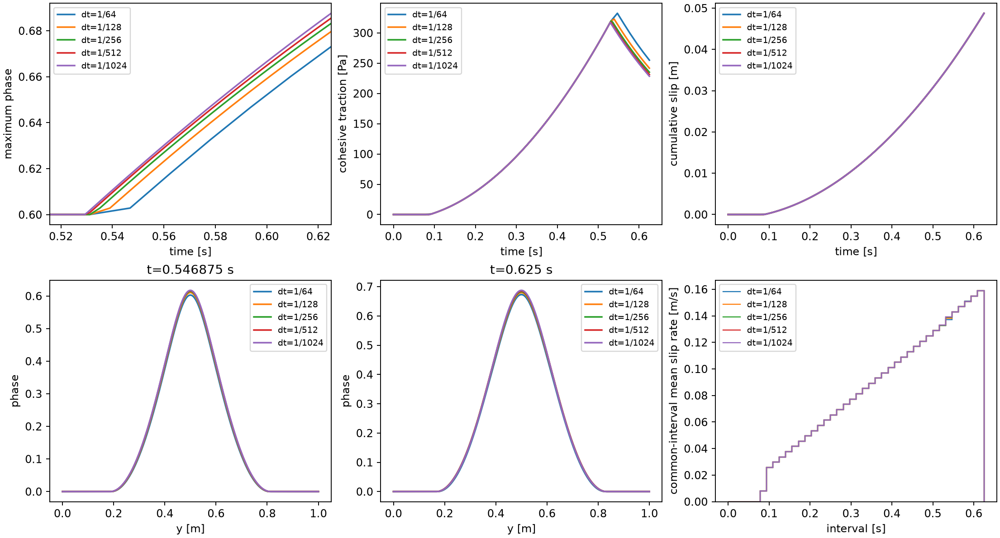
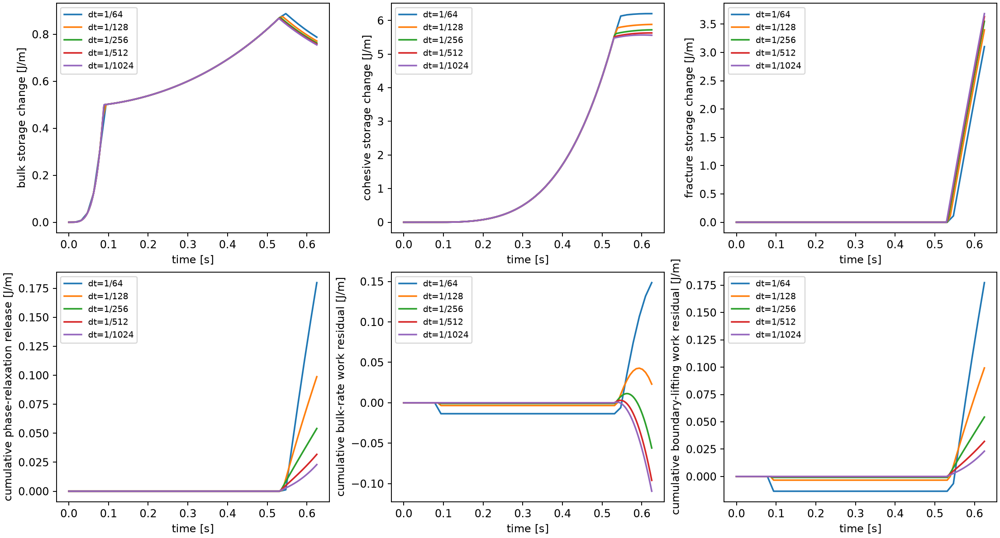
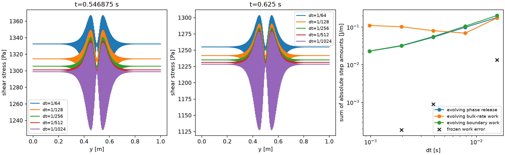

# P2 timestep assessment: fixed 16×256 Q2/Q1 fixture

No timestep is qualified by the proposed temporal targets. The bounded prototype
family completes through **dt=1/1024 s**, but the last halving still changes the
full phase by **0.00241105** and cohesive traction by **2.82566 Pa**, exceeding
0.001 and 1 Pa. Final slip changes by only **0.005799%** and common-interval slip
rate by **0.09062%** of the fixed peak. The finest trajectory is an unresolved
numerical comparator, not a qualified reference. A native timestep was therefore
not selected or launched. The existing native 1/64-s result remains preserved.

Individual phase increments nearly halve. Accumulated phase-relaxation release
and boundary-lifting work discrepancies decrease, but their zero limits are
unresolved. Cumulative bulk-rate work error fails to decrease during damage
growth; an independent work identity isolates its evolving-profile contribution.
These results do not yet support the next physical benchmark or P3. They justify
retaining the spatial choice while reviewing temporal/profile accuracy separately.
No formulation, RSF, loading, material, bound, or tolerance was changed. Numerical
checks pass; the temporal-accuracy and energy conclusions remain separate.

## Actual settings and initialization

| Quantity | Setting and units |
|---|---|
| Domain / fault | Unit square, horizontal through-going fault at y=0.5 m; fixed full-normal association |
| Discretization | Native 16×256 cells; Q2 velocity/Q1 pressure/Q1 phase; 64 surface segments; six shared normal bulk points per cell |
| Particle distribution | Native 3×3 per cell; matching 1D row uses 768 normal samples and CPDI fracture integration; positions frozen |
| Elastic / viscous | G=10⁶ Pa; eta=10⁸ Pa s; common lambda=100 s; general beta=exp(−dt/lambda) |
| Fracture / cohesion | Gc=26.6666666667 J/m², c=1000 Pa, ell=0.15625 m, p=1, m=128, Hc=0.5 Pa |
| Friction / pressure | Existing fixed friction coefficient 0.1; prescribed normal pressure 10000 Pa; background stress and radiation damping zero; no RSF evolution |
| Normalization | Existing consistent projection with its adjoint; direct transverse analytic integral; uniform tangential control reproduces it |
| Initial state | Native seeded-H relaxation on [0,1], nominal core 0.6; then unloaded accepted FE history and surface elastic slip Z=0 |
| Physical phase bounds | Immutable incoming accepted phase ≤ trial phase ≤ 1; initial seeded H is not assumed an unconstrained total-energy equilibrium |
| Phase solve | Existing prototype normalized KKT target 10⁻¹¹ (fracture scale 64 Pa); no change to native relative phase 10⁻¹², linear 2×10⁻⁷, mechanical 10⁻⁸ settings |
| Boundary conditions | Ramp amplitude 0.256 s⁻²; top/bottom ux=0.256(t_previous+t_current)(y−0.5)/2, uy=0; compatible sides uy=0, natural tangential condition |
| Time / imposed displacement | Fresh dt=1/64,1/128,1/256,1/512,1/1024 s; T=0.625 s; every partition imposes exactly 0.05 m top-to-bottom displacement |
| Step / ownership | Phase at fixed incoming FE coefficients and Z; endpoint mechanics; terminal accepted-state publication; H+ remains diagnostic |

G=10⁶ Pa remains a dimensional synthetic verification value. This is a fixed,
pre-existing band in a restricted compatible shear test, not propagation.

All five prototype initial phase arrays and initialized particle H arrays are
numerically identical (array equality), as are the zero FE coefficient history,
Z and cumulative slip. Initial maximum phase is 0.600057140568867. The retained
native initial phase differs by 1.293×10⁻⁸, as documented in the spatial study;
there is no new native initialization claim. Runs start fresh, without checkpoint
conversion. Phase trials do not advance the incoming mechanical state. The
incoming accepted phase snapshot is read-only during each solve.

## Physical histories and accuracy gate

Errors below are maxima at all candidate accepted times shared with the
1/1024-s path; the successive-halving analysis also uses the forty fixed common
times. Stress is independently evaluated at 24 normal points per cell.
Whole-section and localization-weighted RMS use a retained fixed stress scale
1332.52197478 Pa. Bulk-storage errors use a fixed 0.887807406634 J/m scale.
Neither scale is divided by small startup values. Slip uses finest final slip;
rate uses forty identical 1/64-s intervals and the fixed reference peak
0.158790924416 m/s. Reported rates are **interval averages** obtained from
[delta(b)−delta(a)]/(b−a), not instantaneous endpoint velocities.

| dt (s) | Steps | Full phase error | Traction error (Pa) | Slip error | Common-rate error | Whole / localized stress error | Bulk-storage error |
|---|---:|---:|---:|---:|---:|---:|---:|
| 1/64 | 40 | 0.016617 | 33.593 | 0.06889% | 1.1811% | 2.521% / 2.521% | 4.978% |
| 1/128 | 80 | 0.009034 | 15.748 | 0.03230% | 0.4541% | 1.182% / 1.182% | 2.332% |
| 1/256 | 160 | 0.004997 | 6.803 | 0.01395% | 0.1730% | 0.511% / 0.511% | 1.007% |
| 1/512 | 320 | 0.002411 | 2.826 | 0.00580% | 0.0906% | 0.214% / 0.218% | 0.391% |
| 1/1024 | 640 | 0.000000 | 0.000 | 0.00000% | 0.0000% | 0.000% / 0.000% | 0.000% |

The finest row's zero errors are self-comparisons and cannot qualify it.
Targets are 0.001 phase, 1 Pa traction, 0.1% slip, 0.5% rate, 1% stress and
1% storage. Even the raw 1/512-versus-1/1024 comparison fails phase/traction.
Fine-reference uncertainty remains unresolved: the last phase difference is
0.00241105 and the traction difference is 2.82566 Pa. A conditional
Richardson estimate for traction is about 5.04 Pa, but its asymptotic assumptions
are not established. It is an uncertainty diagnostic, not a rigorous bound.

| dt (s) | Final phase maximum | Final traction (Pa) | Final cumulative slip (m) | Largest accepted phase increment |
|---|---:|---:|---:|---:|
| 1/64 | 0.67310928 | 255.059 | 0.048738459 | 0.0170487 |
| 1/128 | 0.67968755 | 241.800 | 0.048751730 | 0.0086175 |
| 1/256 | 0.68321846 | 235.148 | 0.048758389 | 0.0043464 |
| 1/512 | 0.68551663 | 231.329 | 0.048762212 | 0.0021872 |
| 1/1024 | 0.68762211 | 228.503 | 0.048765039 | 0.0010969 |

The full-field error is larger than the difference of core maxima; full profiles
are compared, including tails. All paths grow above the unloaded protected seed.
No trajectory is shifted to align onset or account for the one-step history lag.
Both first full-field and first core growth use 10⁻⁵ above their own identical
initial phase; their accepted-time brackets coincide in this fixture:

| dt (s) | Full-field and core onset bracket (s) |
|---|---|
| 1/64 | [0.531250000, 0.546875000] |
| 1/128 | [0.531250000, 0.539062500] |
| 1/256 | [0.531250000, 0.535156250] |
| 1/512 | [0.529296875, 0.531250000] |
| 1/1024 | [0.529296875, 0.530273438] |

Imposed displacement is 0.128 t² m; displacement brackets are retained in
comparison.json. Phase consumes the incoming history, so these brackets include
the algorithm's lag. A last-accepted time from one run is never compared to a
different physical time from another.

At the forty common times, successive full-phase differences are
0.00869547, 0.00441620, 0.00266434, 0.00241105; traction differences are
18.0379, 8.90294, 4.40937, 2.82566 Pa. The last three trajectories give observed
orders 0.144 for phase, 0.642 for traction, 0.641 for slip, 0.074 for common-rate,
0.628/0.605 for whole/local stress, and 0.728 for bulk storage. Before damage,
traction/stress/storage approach order two. Onset and late response have lower,
variable orders (late phase 0.144 and late rate −0.836). Event-grid cancellation
makes some tiny window-rate estimates meaningless. Exact Maxwell endpoints and
the predictor do not establish second-order coupled accuracy.



## Separate energy results and controlled diagnosis

Use the same six-point bulk measure and twelve-point time integration of the
exact general-beta Maxwell path in every run. Let E be bulk+cohesive+fracture
storage, and D be bulk viscosity+cohesive viscosity+friction. The unchanged audited
step residual is W−(Delta E+D_relax+D), evaluated separately for actual bulk-rate
work and affine boundary-lifting work. D_relax is the energy decrease during the
fixed-history phase update, kept separate from viscous loss. It is not forced to
vanish. The following entries are **signed cumulative / sum of absolute steps /
maximum absolute step**, in J/m; cancellation cannot certify accuracy.

| dt (s) | D_relax | Bulk-rate work residual | Boundary-lifting work residual |
|---|---:|---:|---:|
| 1/64 | 0.179911 / 0.179911 / 0.0377818 | 0.148589 / 0.175633 / 0.0415956 | 0.177312 / 0.204356 / 0.0393759 |
| 1/128 | 0.098787 / 0.098787 / 0.00951143 | 0.0230535 / 0.0693706 / 0.0100687 | 0.0992738 / 0.106062 / 0.00970689 |
| 1/256 | 0.0541035 / 0.0541035 / 0.00240081 | -0.0559858 / 0.0805926 / 0.00831962 | 0.0543442 / 0.0561355 / 0.00242842 |
| 1/512 | 0.0317777 / 0.0317777 / 0.000774958 | -0.0959938 / 0.102415 / 0.00484421 | 0.0320807 / 0.0324562 / 0.000784194 |
| 1/1024 | 0.0229697 / 0.0229697 / 0.000366444 | -0.109394 / 0.111051 / 0.00236822 | 0.0231362 / 0.0232568 / 0.000369509 |

Phase increments decrease from 0.0170487 to 0.00109694, almost a factor two per
halving. This family does not resolve a persistent finite jump. Accumulated
D_relax decreases from 0.179911 to 0.0229697 J/m, with slowing reduction; neither
a nonzero limiting release nor a zero limit is demonstrated. Boundary-lifting
absolute work error similarly decreases to 0.0232568 J/m. Bulk-rate absolute
error increases from 0.0693706 at 1/128 to 0.111051 J/m at 1/1024, while its signed
error approaches −0.109394 J/m. Shrinking individual discrepancies do not remove
that cumulative error.

At 1/1024, bulk/cohesive/fracture storage changes are
0.754733 / 5.56033 / 3.68575 J/m; viscous bulk/cohesive losses are
0.00730105 / 0.0217444 J/m; frictional loss is 48.7650 J/m. The initial fracture
storage is 14.5809335759 J/m. Instantaneous profile redistribution changes bulk
storage by +0.0100638 and cohesive storage by −3.71878 J/m cumulatively. These
profile terms are already part of the phase-step storage difference and release;
they are reported separately, not added again. Per-step histories and signed,
absolute and maximum totals for every storage/loss/work term are retained.



In fresh **frozen-phase** controls at 1/64,1/256,1/512, absolute bulk-rate work
errors are 0.0135221, 0.000895657, 0.000187744 J/m. Boundary-lifting errors match;
D_relax and phase increments are zero up to arithmetic. The remaining frozen
error is concentrated at frictional onset and decreases. This excludes a purely
fixed-profile Maxwell error as the explanation for the evolving discrepancy.

The work difference can be derived without changing the scheme. In this 1D
reduction, let D map FE coefficients to shear gradients, W be the shared positive
quadrature weights, R_a and Z_a the incoming accepted coefficients, and chi the
normalized profile. After the phase change,

\[
 \tau_* = G D R_a-Z_a\chi_{new},\qquad
 f_* =D^TW\tau_* = f_a-Z_aD^TW(\chi_{new}-\chi_a).
\]

The accepted old interior force f_a is at numerical equilibrium. Endpoint
mechanics sets the new interior force to zero, but at intermediate time s,

\[
 f(s)=\frac{\exp(-s/\lambda)-\beta}{1-\beta}f_* ,\qquad
 W_{bulk}-W_{bc}
 =\left[\lambda-\frac{\beta\Delta t}{1-\beta}\right]
 (u-u_{lift})^T f_* .
\]

Here u is the interval mechanical velocity; the lifting has the same boundary
values, so their difference vanishes at the boundaries. These are the existing
Maxwell path and endpoint equation, with no small-dt assumption. The identity
reproduces measured step work differences within 1.79×10⁻¹² J/m. Old interior
forces are at most 1.14×10⁻⁸ Pa; redistributed forces remain 4.17 Pa on the finest
path. The cumulative difference W_bulk−W_bc becomes −0.132530 J/m. It is an
intermediate equilibrium/profile effect on the same fields and measures, not a
particle projection loss or inconsistent postprocessing. This diagnosis does
not introduce a compensating energy/phase term or change either work definition.
Whether its eventual limit is zero remains unresolved with this temporal family.



## Numerical checks, spatial separation and native gate

All evolving paths complete without violating bounds or the accepted-phase lower
bound. Existing KKT tolerances and endpoint force/contact checks pass. Scratch
mechanical replay at forty common times reproduces retained FE coefficients and
Z exactly; the coefficient Maxwell recurrence has zero measured error. The phase
update leaves accepted reference history unchanged. Analytic normalization stays
positive and agrees with independent 24-point integrals within 6.0×10⁻¹⁵.

At 0.5,0.546875,0.625 s, derivative/curvature checks use the corresponding incoming
history, never the endpoint predictor. Six/24/48-point bulk energy differences
are at most 3.76×10⁻¹⁴ J/m, gradient differences 4.56×10⁻¹⁴ and relative Hessian
differences 2.37×10⁻¹⁵. At 0.5 there are no free nodes; at onset/final the sampled
free minimum curvature stays positive (finest 0.04479/0.04112 in the normalized
1D functional). This is not a full critical-cone or coupled stability proof.

A separately labeled exact-bulk comparison at the **same finest dt** gives
full phase difference 2.36×10⁻⁶, traction 0.001973 Pa, slip 6.79×10⁻⁹ m and
bulk storage 0.000125243 J/m. Spatial error is small beside the temporal errors
here. The old exact-bulk 1/64 result is retained separately and was never used
as the fine temporal reference. Prior native stress/storage spatial errors and
stress oscillations remain documented in the normal-resolution report.

No candidate meets the accuracy gate with adequately resolved reference
uncertainty. Therefore **no new native confirmation is run**; it would not
establish a justified practical timestep. Existing native 1/64-s checks remain
valid for that configuration only: accepted-state publication, no healing,
recurrence/residual and selected incoming curvature. They are not new native
temporal-order evidence.

## Measured cost, changes and reproducibility

The reused native baseline costs 2063.04 s (34.4 min), peak 2041916 KiB (1.95 GiB),
including diagnostics. New prototype costs below include diagnostics; wall times
for the concurrent runs include CPU contention. CPU times are per-process, and
RSS is peak process memory. A simple uncalibrated native step-count extrapolation
would be about 4.6 h at 1/512 or 9.2 h at 1/1024. These are estimates, not measured
native runs, and no qualifying timestep is selected from them.

| Prototype dt (s) | Wall (s) | CPU (s) | Peak RSS (MiB) |
|---|---:|---:|---:|
| 1/128 | 62.60 | 20.74 | 102.18 |
| 1/256 | 100.27 | 39.43 | 102.52 |
| 1/512 | 137.00 | 75.91 | 105.11 |
| 1/1024 | 279.60 | 150.68 | 105.49 |

| File / function | Purpose and resulting behavior | Production change? |
|---|---|---|
| localization_1d.py / Reference.initialize | Retain copies of actual initialized particle locations/H for equality checks; solver algebra unchanged | No |
| time_resolution.py / case, baseline_energy, energy | Fresh bounded family and frozen controls; reconstruct both audited work measures on retained fields | No |
| assess_time_resolution.py / difference, onset, main | Nested common times, identical rate intervals, fixed scales, onset brackets, orders and conditional reference uncertainty | No |
| audit_time_resolution.py / audit, exact | Fixed-history replay, derivative/curvature/quadrature checks, exact work identity and separate spatial comparator | No |
| plot_time_resolution.py / main | Compact physical/energy/profile plots | No |
| check_time_resolution.py / main | Independent evidence and preservation assertions, explicitly failed accuracy gate | No |
| This report, STATUS/PLAN, CURRENT_STATUS, current_design, benchmark README and additive AGENTS block | Current bounded outcome and restrictions, retaining historical reports | Documentation only |

There are **no production-source, specification, mathematical-model or compiled
binary changes in this task**. The pre-task source/build hashes and previous
normal-resolution manifest are retained in time_resolution_evidence/baseline.json
and incoming-normal-manifest.json. A task-only benchmark diff and current manifest
record changes independently of the incoming dirty worktree. All earlier failed
trajectories, Q3/three-point evidence and native checkpoints remain intact.
Baseline: de7beaa65846c7372711f7922abf1c5d9a745ee6, fault-propagation; GCC 12.4
Release Unity, deal.II 9.6.2, Trilinos 14.2, p4est 2.8.7. Retained executable SHA
is d07e7cdfe08032890c4011d0f7885d94c90d0c6db23f7ad206f80b80ab22241d;
plugin SHA is 68dcb8f3723b8786f5c6635c9f5d377034ca2d150ac99204df4e3d132cca0e0b.

Commands (repository root; fresh-run commands refuse existing outputs):

```sh
OPENBLAS_NUM_THREADS=1 OMP_NUM_THREADS=1 python3 benchmarks/reconstructed_fault/propagation/time_resolution.py --baseline
# Fresh evolving cases: repeat once for each denominator 128,256,512,1024.
OPENBLAS_NUM_THREADS=1 OMP_NUM_THREADS=1 python3 benchmarks/reconstructed_fault/propagation/time_resolution.py --denominator 128
# Frozen controls: repeat for 64,256,512.
OPENBLAS_NUM_THREADS=1 OMP_NUM_THREADS=1 python3 benchmarks/reconstructed_fault/propagation/time_resolution.py --denominator 64 --frozen
OPENBLAS_NUM_THREADS=1 OMP_NUM_THREADS=1 python3 benchmarks/reconstructed_fault/propagation/audit_time_resolution.py --exact
OPENBLAS_NUM_THREADS=1 OMP_NUM_THREADS=1 python3 benchmarks/reconstructed_fault/propagation/audit_time_resolution.py
OPENBLAS_NUM_THREADS=1 OMP_NUM_THREADS=1 python3 benchmarks/reconstructed_fault/propagation/assess_time_resolution.py
MPLCONFIGDIR=/tmp/normal-resolution-mpl OPENBLAS_NUM_THREADS=1 python3 benchmarks/reconstructed_fault/propagation/plot_time_resolution.py
OPENBLAS_NUM_THREADS=1 OMP_NUM_THREADS=1 python3 benchmarks/reconstructed_fault/propagation/check_time_resolution.py
```

Read-only evidence: [comparison](../../../benchmarks/reconstructed_fault/propagation/time_resolution_evidence/comparison.json),
[audit](../../../benchmarks/reconstructed_fault/propagation/time_resolution_evidence/audit.json),
[verification](../../../benchmarks/reconstructed_fault/propagation/time_resolution_evidence/verification.json).
Python syntax checks pass. Repository-wide git diff --check still reports twelve
pre-existing trailing-whitespace lines in pf_rsf.tex; its pre-task hash is
unchanged. The edited tracked checkpoint files pass their whitespace check.

The current step does not qualify evolving-profile energetic consistency,
transport/replenishment, MPI/restart/physical rollback, general localization,
RSF evolution or P3. Further refinement beyond the authorized optional 1/1024
or a scheme/formulation revision requires a separate selected task.
