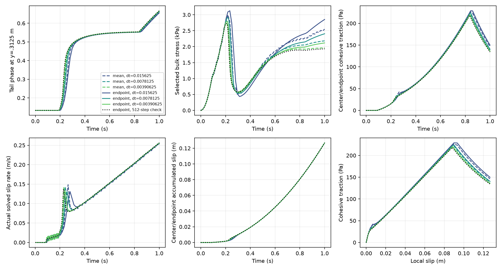
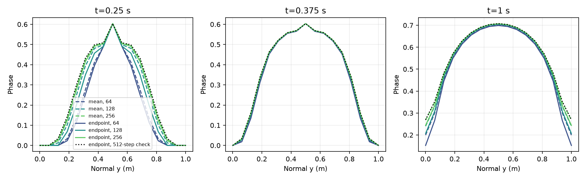
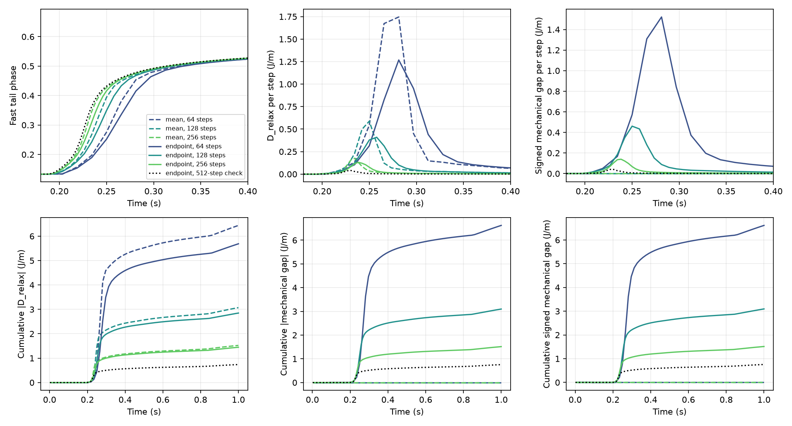

# Evolving endpoint/mean comparison (2026-10-08)

The three missing endpoint trajectories completed to 1 s, using the unchanged
total-energy phase residual, unloaded constrained seed, corrected intersection
quadrature and common loading. Damage grows first in the tails, then in the core.
Endpoint balance removes the mean scheme's endpoint force imbalance and modestly
reduces phase-relaxation release. Its independent mechanical work discrepancy
decreases approximately linearly with timestep. **Endpoint is the preferred
implementation direction; mean remains a diagnostic comparator.** This supersedes
the earlier selection based on frozen endpoint runs versus evolving mean runs.

A single additional endpoint refinement at .001953125 s addresses the concrete
fast-tail/work uncertainty. Absolute mechanical error falls to .755608 J/m,
.467% of boundary work and **3.14% of fracture expenditure**, independently of
.738156 J/m phase release. Endpoint histories and both discrepancies decrease;
this supports entering optional native integration, **not qualification of a
resolved timestep**. The final endpoint pair still differs by .05533 in full
phase and 1320 Pa in stress during rapid growth. Mean256 happens to lie closer to
endpoint512 than endpoint256, so a uniform evolving-field accuracy advantage
for endpoint is not claimed. Its endpoint-equilibrium advantage is decisive.

Native entry was advanced through a source/state/operator audit. It exposes a
**discrete energetic-state decision before implementation**: the prototype
retains quadrature stress, while the specified native algorithm publishes
particle stress and consumes its mapped FE representation. Their profile-update
operators do not commute. An exact FE internal-strain encoding is available for
this homogeneous unloaded fixture; it avoids that transfer, but makes the FE
internal variable the authoritative mechanical history. The equations and
ownership alternatives are below. Production remains unchanged at this native
discretization/ownership decision, rather than
silently adopting new bulk-history ownership or adding a representation-energy
loss to the selected model. No numerical tolerance is relaxed and no new accuracy
tolerance invented. No persistent finite-jump plateau is established. No P3.

## Identical model and initialization

| Setting | Value / units |
|---|---|
| Domain / geometry | Unit 1 m x 1 m box; straight fixed fault at y=.5 m, x in [0,1] m; full normal cross-section association |
| Phase / mechanics space | 16 x 16 Q1 phase mesh, 289 phase nodes; one free incompressible velocity mode ux=U sin(2 pi y), uy=0, plus prescribed affine shear |
| Surface | 64 Q1 intervals, spacing .015625 m, 65 slip/internal-variable nodes |
| Bulk measure | Q3 on bulk/surface intersection partition, 9216 samples; same measure in energy and both mechanical blocks |
| Surface / fracture measure | Q3 physical arclength; 2304 fixed rectangular CPDI parent domains for fracture |
| G, eta, lambda | 1e6 Pa, 1e8 Pa s, 100 s; dimensional synthetic verification values |
| Gc, ell, c0, m, p | 26.6666666667 J/m², .15625 m, 8/3, 128.00000000016, 1 |
| Cohesion calibration / friction | c=1000 Pa, Hc=.5 Pa; constant mu=.1, prescribed pressure=10000 Pa; radiation damping=0 |
| Phase initial condition | Retained relaxed nominal-core-.6 native profile sampled on this grid; actual maximum .6035488376736221 |
| Mechanical initial condition | Bulk stress, Z=G elastic slip, accumulated slip, total/inelastic strain all zero; zero-input constrained hold unchanged |
| Kinematic loading | a=.256 s^-2, vx=a t (y-.5) plus free U sin(2 pi y), vy=0, 0<=t<=1 s; free mode vanishes at normal boundaries; accumulated shear Gamma=.128 t² (dimensionless), relative boundary displacement (1 m) Gamma; other velocity modes excluded |
| Phase boundary / constraints | Natural phase boundary conditions; immutable last-accepted phase <= trial phase <1; exact singular normalization rejected |
| Phase energy / H | Actual discrete bulk+cohesive+AT1 fracture energy, full consistent-I projection adjoint; recoverable peak H diagnostic only |
| Maxwell / rates | Exact beta=exp(-dt/100), no small-ratio model; profile redistributed instantaneously before fixed-profile evolution |
| Frozen restrictions | Geometry, mesh, material, particle domains/positions, pressure, stateless friction; no transport, birth, RSF-state evolution or geometry change |

Initial profile SHA256 is
`dfda253ebad8c42dce964676d88837473d99966e69d2f86d31e38f269ab983db`.
All seven configurations have identical physical inputs, phase mesh and spatial
integration. The three mean runs are reused byte-for-byte. New endpoint labels
are `aligned_evolving_endpoint64`, `128`, `256`, and the focused reference `512` under
`benchmarks/reconstructed_fault/propagation/total_energy_time_evidence/`.
Every accepted full field is retained, not just maxima.

The imposed smooth affine velocity is represented by its exact interval mean,
a(ta+tb)/2, preserving imposed displacement at all common times. **Mean-selected
V and U are interval rates obtained from exact mean forces. Endpoint-selected
V and U are endpoint-force approximations, held constant over their intervals.**
Both deposit actual slip dt V. Plotted V is the actual solved surface rate,
not q-derived velocity, an extrapolated predictor or a difference between
unmatched publication times. Refinement tables distinguish last-in-interval
rate samples from common-interval accumulated-slip increments divided by duration.

## Accepted physical histories

| Scheme / dt (s) | Final core phi | Final q (Pa) | Final slip (m) | Maximum accepted phase increment | Final phi at both normal boundaries |
|---|---:|---:|---:|---:|---:|
| mean / .015625 | .70036594 | 146.12120 | .12682067 | .10517397 | .19932414 |
| endpoint / .015625 | .69901565 | 149.78999 | .12682695 | .08378801 | .15221368 |
| mean / .0078125 | .70485026 | 138.93352 | .12684377 | .06603325 | .24009319 |
| endpoint / .0078125 | .70481753 | 140.46345 | .12683987 | .05510929 | .20636753 |
| mean / .00390625 | .70664887 | 135.53781 | .12684844 | .03971556 | .26774279 |
| endpoint / .00390625 | .70704713 | 136.22388 | .12684577 | .03376987 | .24365716 |
| endpoint / .001953125 | .70773764 | 134.21815 | .12684862 | .01988305 | .26949519 |

Center and side-endpoint q/slip histories coincide to roundoff by along-fault
symmetry (q differences <=3.1e-10 Pa); this does not qualify endpoint behavior
for nonuniform faults. The final maximum is on the fault core; x is a numerical
tie along the straight band. Largest increments occur near y=.3125 and .6875 m,
not at an advancing sharp tip. The requested 256-step endpoint increment occurs
at publication t=.234375 s, anchored at .23046875 s and Gamma=.006798828125 m.
The focused 512-step reference's maximum occurs at publication .228515625 s,
anchored at .2265625 s and Gamma=.0065703125 m, at the same transverse node.

For both schemes, the first phase change >1e-6 consumes the same anchor at
t=.1875 s, Gamma=.0045 m. Publication occurs at .203125/.1953125/.19140625 s
for the three partitions, with Gamma=.00528125/.0048828125/.004689453125 m.
The difference is the declared one-step phase lag, not a different physical
onset threshold. The first-crossing diagnostic brackets onset at coarse incoming
loads; it is not a continuous bifurcation-load measurement.
The focused 512-step reference resolves a slightly earlier incoming crossing:
t=.185546875 s, Gamma=.00440673828125 m, published at .1875 s/Gamma=.0045 m.
This narrows the bracket and does not change the prescribed physical loading.

| Common-time refinement pair | Max full-field phi difference | Final full-field phi difference | Max bulk stress difference (Pa) | Max cumulative slip difference (m) | Max q difference (Pa) | Max q difference at common local slip (Pa) |
|---|---:|---:|---:|---:|---:|---:|
| mean64/128 | .118373 | .040769 | 4402.15 | .00124846 | 11.8571 | 11.8905 |
| endpoint64/128 | .110335 | .054154 | 3525.45 | .00139896 | 14.3229 | 14.2685 |
| mean128/256 | .078704 | .027650 | 1857.32 | .00071830 | 5.99985 | 5.97984 |
| endpoint128/256 | .078649 | .037290 | 2127.97 | .00090946 | 7.18524 | 7.15880 |
| endpoint256/512 | .055329 | .025838 | 1319.73 | .00057125 | 3.71065 | 3.69595 |

The requested endpoint128/256 maximum phase difference is at t=.2421875 s,
y=.3125 m; the stress difference is at t=.25 s, y=.31954385 m. The focused
endpoint256/512 maximum phase difference is at t=.23046875 s, y=.3125 m;
its stress/slip maxima occur at t=.234375 s (stress y=.36795615 m).
These are fast-growth interval errors, not final core errors. At t=1 the
requested endpoint pair differs by 471.39 Pa in full stress and .00223 in core
maxima; the focused finest pair differs by 279.33 Pa and .000691 in core maxima.
Endpoint mechanics is not uniformly more accurate than mean mechanics in the
evolving test: its finest-pair stress, final tail phase and q/slip differences
are larger. The frozen-phase advantage cannot be assumed here.
The additional reference strengthens this caution: mean256/endpoint512 differs
by .024012 in full phase, 760.16 Pa in full stress, .00005291 m in slip and
2.26154 Pa in q; final differences are .001773 phase, 37.43 Pa stress and
.000000176 m slip. Leading splitting/time errors can cancel between schemes;
endpoint512 is a sensitivity reference, **not an assumed exact solution**.

For endpoint128/256, the maximum difference between last-in-interval rate
samples is .05124797 m/s, versus .04206628 m/s comparing **actual common-interval
average rates**. The final sample difference is .00047736 m/s. Mean128/256
values are .05361494/.03998269/.00090571 m/s respectively. These compare
different discretizations of the same physical path with their meanings stated;
the mean samples are not presented as exact endpoint velocities.
Equal incoming-anchor comparisons separately give phi differences .052437
(endpoint) and .043481 (mean) on the requested 128/256 pair. They diagnose splitting lag
and do not replace common-time comparisons.
Endpoint256/512 gives .04410564 m/s between last-rate samples, .03829512 m/s
between common-interval average rates, and .00023746 m/s at the final sample.
The full-field phase difference peaks at t=.23046875 s, y=.3125 m; the stress
and slip differences peak at t=.234375 s. Large event-rate differences persist
despite small final cumulative-slip differences.

At the finest requested dt (.00390625 s), mean versus endpoint differs by .036618 in full phase,
1098.03 Pa in full bulk stress, .00057746 m in slip and 2.31918 Pa in q at common
times (1.44843 Pa at common local slip). Their final core/slip similarity alone
would conceal the tail and stress uncertainty.





## Two independent energy discrepancies

Use the same fields and spatial/time measures in both schemes. For instantaneous
phase relaxation at fixed accepted R and elastic cohesive slip,
`D_relax=-(J_bulk+J_cohesive+Delta F)`. Exact fixed-profile Maxwell storage and
viscous integrals retain their independently checked identities. Define

\[
 E_{\rm mech}=W_{\rm boundary}-\Delta(E_b+E_c+F)-D_b-D_c-D_f-D_{\rm relax}
              =E_{\rm exchange}-W_U.
\]

Here W_U is internal virtual work on the unloaded free mode, **not external
loading**. Using total bulk-rate work as boundary input would incorrectly hide
it. Endpoint balance makes end forces zero, while integrated exchange and
free-mode work need not vanish. D_relax and E_mech are never combined into one
error or interpreted as one constitutive loss.

| Scheme / dt | Sum D_relax (J/m) | Largest D_relax (J/m) | Signed sum E_mech (J/m) | Sum abs(E_mech) (J/m) | Delta F (J/m) |
|---|---:|---:|---:|---:|---:|
| mean / .015625 | 6.441231 | 1.74591 | ~0 | 3.70e-12 | 23.400188 |
| endpoint / .015625 | 5.688336 | 1.26799 | 6.612483 | 6.622732 | 23.318511 |
| mean / .0078125 | 3.070148 | .58858 | ~0 | 6.07e-12 | 23.777041 |
| endpoint / .0078125 | 2.848536 | .409413 | 3.095082 | 3.097654 | 23.737200 |
| mean / .00390625 | 1.521572 | .176331 | ~0 | 8.33e-12 | 23.971056 |
| endpoint / .00390625 | 1.446481 | .131352 | 1.512806 | 1.513485 | 23.943392 |
| endpoint / .001953125 | .738156 | .040002 | .755466 | .755608 | 24.053426 |

Sum abs(D_relax) equals its signed sum for all seven paths. Endpoint reduces
cumulative phase release by 11.69%, 7.22%, 4.94% relative to mean as dt is reduced;
it does not eliminate phase release. Endpoint absolute work ratios upon halving
are .468 and .489, consistent with first-order convergence over these partitions.
The release ratios are .501 and .508. Neither establishes an asymptotic limit.
No substantial finite release plateau is demonstrated.
The additional endpoint ratios are .499 for absolute mechanical discrepancy
and .510 for release. Peak release falls to .040002 J/m; maximum increment
.019883 is at t=.228515625 s/y=.3125 m and the maximum release rate is
20.48105 J/(m s). Refinement decreases the candidate's finite-drop slack without
adding kinetics, a limiter or a new phase driver.

On the finest requested endpoint path (256 steps), cumulative |exchange|=3.648855 J/m and
|free-mode work|=2.135369 J/m. Their difference is the independently recorded
mechanical discrepancy; cumulative magnitudes, not just signed totals, are kept
in the assessment. Boundary work is 163.394947 J/m; storage changes are
.932831 J/m bulk and 8.611646 J/m cohesive, viscous losses .038915/.063108 J/m,
friction 126.845767 J/m. The ledger closes with D_relax **and** E_mech retained.
The focused 512-step reference gives boundary work 161.869916 J/m, bulk/cohesive
storage changes .889591/8.485027 J/m, fracture 24.053426 J/m,
bulk/cohesive viscous losses .037023/.062611 J/m, friction 126.848616 J/m,
phase release .738156 J/m and signed mechanical error .755466 J/m.
Its absolute exchange and free-mode work are 1.873392/1.117784 J/m.

The fast interval .18<=publication time<=.4 s accounts for endpoint
D_relax=4.55331/2.26970/1.13119 J/m and absolute mechanical errors
5.44035/2.50594/1.19418 J/m. Thus 78.9% of the finest mechanical discrepancy and
78.2% of its phase release come from fast tail growth. This directly measures
the evolving-phase error rather than importing the much smaller frozen work
error. The finest peak release rate is a diagnostic event rate, not a new physical
damage viscosity.
The reference's same-window release/work magnitudes are .564641/.580946 J/m,
76.5%/76.9% of their cumulative totals. Most uncertainty still concerns fast
tail growth rather than the late core response.

The separate correction for work against the original smooth loading evaluated
on each numerical Maxwell stress path is .006033/.001492/.000371 J/m on endpoint
paths. It gives smooth-loading ledger gaps 6.618516/3.096574/1.513178 J/m.
It is much smaller than the mechanical discrepancy and is not used to cancel it.
It diagnoses the within-step constant-rate approximation, not an independently
solved exact smooth mechanical trajectory.
The reference smooth-loading correction is .000092615 J/m, giving ledger error
.755558 J/m. It remains distinct from phase release and mechanical balance.



## Numerical gates, scheme decision and native entry

All seven saved trajectories pass the **unchanged** numerical checks: scaled
phase KKT <=1e-11; weak mechanical selected-force tolerance <1e-9 Pa m;
phase/time quadrature checks <1e-9 J/m; separate storage/Maxwell identities
<1e-8 J/m; endpoint reconstruction <1e-10 Pa; total-minus-inelastic strain
reconstruction <1e-12. Phase Newton/free-set and line-search settings are
unchanged. Maximum endpoint phase KKT is 9.2491e-12; no healing, singular
normalization, failed physical entry or new failed trajectory occurs.

Endpoint weak bulk forces are <=9.94e-11 Pa m and weak slip conditions
<=8.53e-14 Pa m. For mean paths, endpoint bulk imbalance is
1481.93/755.73/326.28 Pa m and mass-normalized endpoint slip-condition error is
1315.30/732.22/404.65 Pa. These are not mean-solver failures; they are physical
endpoint imbalance. Conversely endpoint paths have nonzero **mean** forces.
Selected stick/slip complementarity is checked, not equality at stick nodes.

Normalization stays finite and positive: minimum nodal I=103.071975 m, initial
and final along-fault source representation error <=8.9e-16. Along-fault
constant reproduction follows symmetry; it does not validate nonuniform
normalization or transverse quadrature. The retained transverse Q3 normalization
integration error is separate (~3.07e-6 initially).

**Decision:** retain endpoint as the preferred next native time scheme, with mean
as a diagnostic. Exact integrated work closure is insufficient to select mean
despite its endpoint imbalance. However, the present evolving data do not show
substantially better full-field temporal accuracy for endpoint. The focused
reference confirms decreasing errors and puts its mechanical error below .5%
of boundary work, while still 3.14% of fracture expenditure. This is measured
scale information, **not a newly imposed pass tolerance**. It supports entering
bounded optional native work, with temporal accuracy still unqualified. Native
entry encounters the distinct discrete-state/energy conflict below; no additional
planning approval is requested and no unreviewed ownership change is implemented.

The native-entry source audit records a governing integration issue, **not a
new diagnosis of a generic-projector defect**. The prototype retains authoritative
quadrature stress. Production mechanics consumes mapped FE particle history in
the current working vector (`assemble_bulk_work_system`); terminal publication
uses parent particle stress (`compute_history_candidates` /
`publish_history_candidates`), as specified by the existing frozen-history
contract. Native normalization evaluation reads published `get_solution()` and
does not yet supply a trial-state projection adjoint. Native CPDI phase sparsity
and assembly contain the local H g(phi) potential, whereas the total-energy
normalization derivative is nonlocal. An optional native implementation must
address these contracts explicitly, rather than changing H, reading an older
FE stress vector, mutating published normalization during line search, or
substituting a local Y for the projection adjoint.

In particular, denote native particle-to-FE evaluation by Pi. In general
`Pi[Z_p Delta chi_p] != Z_Q Delta chi_Q`. Projection of a particle profile
redistribution is not the prototype QP redistribution. Keeping particle
publication would require an explicitly measured representation-change energy
`T_FE=E_b(Pi tau_p_new)-E_b(tau_Q_new)` and a consistent definition of the next
accepted anchor, or a derivation using particle variables and the transfer
adjoint throughout. No commutator magnitude is claimed from the frozen control.
The previously measured 5.23575% FE stress representation error / negligible
repeated-transfer drift remains separate evidence, not a quantified evolving
transfer error. No authoritative history ownership is silently changed here.

### Concrete native state/energy decision

The repository specification and source agree on the existing algorithm. The
conflict is between **literally importing the candidate's QP-owned accepted
state** and that native history contract, not an allegation of a new source bug.
See [the specification's frozen-history/transfer contract](../specification.tex),
the algorithm's accepted-state section, and the source functions above.
[AGENTS.md](../../../AGENTS.md) requires treating the specification as authoritative
for "scientific algorithms, architecture, ownership, and MPI design" and says
"If the specification conflicts with the current implementation, stop and report
the conflict instead of silently choosing a new design." We stop before creating
such an ownership conflict or treating two stress representations as one state.

For fixed geometry, fixed particle positions and the fixture's linear cell-average
transfer, let Pi map parent stress components to their **actual** constrained FE
values at Stokes QPs. At uniform G/eta, define the parent reconstruction

\[
 R_p^a=\tau_p^a/(2G)+(Z_p^a/G)\chi_p^a\mathcal S_p,
 \qquad \tau_p^*(\phi)=\tau_p^a-2Z_p^a\Delta\chi_p\mathcal S_p.
\]

Holding physical parent internal variables fixed would give

\[
 \tau_Q^*(\phi)=\Pi\tau_p^a-2\Pi[Z_p^a\Delta\chi_p\mathcal S_p],
\]

whereas the current Stokes/profile law and prototype give

\[
 \tau_Q^{*,\rm point}(\phi)=\Pi\tau_p^a-2Z_Q^a\Delta\chi_Q\mathcal S_Q.
\]

The nonlinear h and finite-dimensional cell-average/FE transfer make these
different even with constant representable Z. Native projected endpoints also
contain `Pi[epsilon_p-chi_p V_p S_p]`, whereas the selected Stokes law uses
`epsilon_Q-chi_Q V_Q S_Q`. Zero-input fixed-phase uniform-beta relaxation commutes
with Pi and therefore cannot qualify these changing-profile/driven identities.
No time refinement removes an operator mismatch at fixed spatial discretization.

If retaining parent variables and defining bulk storage on projected stresses,
the **actual** energy is

\[
 E_b(\phi)=\sum_Q w_Q\frac{(\Pi\tau_p^*(\phi)):
                                      (\Pi\tau_p^*(\phi))}{4G},
 \qquad
 v_p=-\frac{Z_p^a}{G}\mathcal S_p:
                              [\Pi^T W_b\tau_Q^*(\phi)]_p.
\]

Let B_p evaluate trial phase at the parent constitutive points, T_p interpolate
projected normalization there, A differentiate direct normal integrals and P
be the unchanged consistent normalization projection. Its residual is

\[
 R_\phi=F_h'+B_p^T\operatorname{diag}(h'_p/I_p)v_p
 +A^TP^T\left[-T_p^T\operatorname{diag}(h_p/I_p^2)v_p
                 -N^TW_s\frac{Z_s^2}{2G I_s^2}\right].
\]

This includes **both transfer and normalization adjoints**. The bulk mechanical
profile/history residual and its linearization must use the matching projected
operator as well; changing only phase leaves a different discrete mechanics.
It is not the existing pointwise QP residual with an H substitution.

The projected-energy alternative is **not automatically a viable full Stokes
discretization**. Actual retained native input/log records show 1024 cells,
Q2 velocity (8450 DoFs), 1089 pressure DoFs and cell-average stress interpolation.
One cell mean per stress component bounds Pi's tensor image rank by 3072.
Even fixing every boundary velocity DoF leaves 7938 velocity unknowns;
all pressure equations can remove at most 1089 dimensions, leaving at least 6849
divergence-free variations. A mechanical Hessian derived only from
`||Pi delta tau_p||_W²` has rank <=3072 and therefore **at least 3777 uncontrolled
velocity directions**, with delta V=0 and fixed phase. Subsequent shared-DoF
averaging/constraints cannot restore rank. These are analytical bounds for the
**proposed projected-energy mechanical operator**, not observed failures or
eigenvalue measurements of the current native solver. The current standard
Stokes strain operator does not have this asserted defect. The one-mode prototype
cannot expose it.

[Source/configuration/rank audit](../../../benchmarks/reconstructed_fault/propagation/total_energy_endpoint_evidence/native-entry-rank-audit.json).
This concrete obstruction rules out mechanically importing the displayed
projected-energy pullback without a different energetic representation or a
justified stable discretization. No compensating stiffness or viscosity is added.
One particle-owned alternative is parent-volume bulk storage
`sum_p V_p tau_p:tau_p/(4G)`, with its own common particle strain/slip adjoints;
that would change the selected Stokes-QP work measure and must be derived as a
separate native discretization, not equated with the verified QP candidate.

The obstruction above applies to **one naive projected-stress energy**, not to
every possible native implementation. In particular, the homogeneous unloaded
fixture admits a third route without a transfer-energy reset. With identical
uniform bulk/fault G and eta, fixed geometry and no rotation or transport, define

\[
 \boldsymbol R=\boldsymbol\tau/(2G)+(Z/G)\chi\mathcal S.
\]

Instantaneous profile redistribution leaves R fixed. Using the actual native
Maxwell coefficients in both bulk and surface endpoints gives

\[
 \boldsymbol R^{\rm new}
 =\beta\boldsymbol R^a+(\kappa/G)\boldsymbol\varepsilon.
\]

Thus, from unloaded R0=0 and native FE velocities, an FE vector d_R can encode
R exactly as symgrad d_R:

\[
 d_R^{\rm new}=\beta d_R^a+(\kappa/G)u^{\rm accepted},\qquad
 \boldsymbol\tau(x)=2G\left[\operatorname{symgrad}d_R(x)
                         -(Z(x)/G)\chi(x)\mathcal S\right].
\]

This is a relaxed-strain state, not accumulated total displacement. The
cancellation uses **equal bulk/fault coefficients**, not dt/lambda <<1; it
is invalid for arbitrary heterogeneous coefficients or transported/rotated
history. Prototype engineering-shear R obeys this recurrence to <=1.39e-16 on all
seven saved paths; [source/algebra audit](../../../benchmarks/reconstructed_fault/propagation/total_energy_endpoint_evidence/native-entry-state-audit.json)
records the measured errors. This is not a native FE or checkpoint test: the
prototype's sinusoidal free mode is not literally a native Q2 field.

The existing explicit `benchmark_retained_stress` callback supplies incoming
stress to both mechanical blocks and the parent terminal updater. Its header
contract says **plugin-owned, default off, not serialized**. It could isolate
stress transfer in a fresh restricted verification, provided d_R advances only
after successful terminal publication and the immutable anchor is retained
during phase/mechanical trials. Parent stresses would then be consistent samples
of the same state, but their subsequent projection would not be the authoritative
history consumed by mechanics. Installing this as an optional material model
also requires ownership/checkpoint/rollback rules for accepted d_R; using the
benchmark hook does not establish them.

The proposed **FE-state native step**, not yet implemented, is concrete:

1. Validate the uniform-coefficient, fixed single-fault restrictions. Initialize
   d_R=0 and Z=0 with the retained relaxed seed as the protected phase baseline;
   construct current/previous normalization consistently from that baseline.
2. Capture immutable accepted d_R, Z and phase. For every explicit phase trial,
   evaluate tau=2G(symgrad d_R-(Z/G)chi S), the consistent normalization and its
   adjoint. Use the actual CPDI fracture functional. H+ remains diagnostic;
   neither mapped particle stress nor extrapolated phase supplies the anchor.
3. Minimize this full energy with the immutable accepted-phase lower bound.
   Implement the nonlocal residual and tangent/search operator explicitly;
   adding a local Y to the current H g(phi) operator is not equivalent.
4. Publish only a converged phase, then compute its dependent normalization.
   Use a common bulk/surface intersection measure for the endpoint Stokes/slip
   residual blocks and their derivatives; retain exact Maxwell work diagnostics
   and the mean-balance comparator.
5. After mechanical convergence, atomically publish Z_new, d_R_new and their
   derived parent stresses and diagnostic H. Newton/line-search evaluations
   cannot advance these variables. Refresh downstream phase consumers without
   rewriting ASPECT's older solution vectors or its history rotation.
6. A failed physical step must retain the accepted d_R anchor. Specify an archive
   for the new state or explicitly reject restart for an initial fresh-only
   verification; the unarchived callback must never masquerade as restart support.

This proposal retains the selected recoverable energy, inelastic strain and
general exponential relaxation. Its new item is discrete state ownership,
not an H law, kinetic regularization, phase cap or compensating energy term.

The concrete native choices are:

| Native path | Consequence |
|---|---|
| Retain parent-owned physical state and select a consistent energetic measure | Preserve terminal particle publication. A projected-stress energy requires Pi/P adjoints but has the rank obstruction above; parent-volume energy requires matching particle strain/slip adjoints and changes the selected Stokes-QP work measure. Neither is a scalar-driver substitution. |
| Retain the candidate's authoritative QP state and existing pointwise mechanical pair | Introduce accepted QP/internal-strain ownership, publication and checkpoint/mesh lifecycle. Particle stress becomes a separate representation; it cannot silently remain a second authoritative mechanical history. |
| For this uniform unloaded fixture, retain authoritative FE d_R and the existing pointwise mechanical pair | Exact R update above avoids particle-to-FE smoothing and the rank obstruction. A default-off accepted-state owner and consistent publication are required; the existing unarchived benchmark callback supports only a restricted fresh-run diagnostic. Heterogeneous/transported/restart operation is not qualified. |

Merely reconstructing R_Q from newly mapped parent stress after each publication
adds a numerical state reset beyond the prescribed viscous/inelastic evolution.
Its T_FE may have either sign; calling it D_relax or a new phase driver would
alter the selected physics. An explicitly accounted representation-reset
approximation is another reviewable model decision, not an automatic integration
fix. No such loss/driver or history-ownership change is inserted in this task.
For the homogeneous verification case, FE d_R is the recommended native-state
proposal. It preserves the candidate's pointwise constitutive endpoints and
avoids changing the generic projector. It has not been implemented or assigned
accepted-state ownership in the authoritative specification. The retained
particle/mapped-FE history contract and this proposed independent FE history
are distinct discrete models. Under the repository's instruction to report
architecture/ownership conflicts before changing them, native installation
stops at this concrete state decision. The existing specification, section
"Stage G" (around line 1907), says: "The explicitly mapped stress compositional
fields in the current working FE vector represent the frozen particle history."
The proposed FE d_R option would deliberately replace that contract for this
fixture. This is not another planning gate or a
claim that native integration is mathematically impossible. No source/specification
conflict in the existing implementation is alleged. The endpoint comparison is
complete; the conditional native implementation is **not complete**.

## Qualification limits and changes

This is a **widening prescribed band in a restricted mechanical space**. The
retained mean finest profile reaches .26774279 at both normal boundaries; the
new endpoint requested finest profile reaches .24365716, and the focused finer
reference reaches .26949519. The boundary damage differs under refinement.
The normal boundaries are appreciably damaged in both. Only one free bulk
velocity mode is available. Full Stokes resolution, spatial convergence,
localization and boundary-size checks remain necessary. This is not fault
propagation, bulk nucleation, tip extension or P3 readiness. Earlier deliberately
unstable preload cases and failed native paths retain their status unchanged.

| Changed file / functions | Purpose |
|---|---|
| `assess_total_energy_endpoint.py`: `rates_comparison`, `field_locations`, `native_rank_audit`, `state_update_errors`, `native_state_audit`, `main`, `save` | Common-time/full-field/slip/rate/energy comparisons, source/config rank audit, uniform R recurrence check and compact plots; reads saved histories without advancing them; reuses existing independent numerical checks |
| `check_total_energy_endpoint.py`: `main` | Seven saved-field numerical gates, actual slip deposits, identical fixture checks, reproduction of comparison metrics and incoming artifact preservation |
| This report; STATUS, PLAN, CURRENT_STATUS, current_design, benchmark README, algorithm note, AGENTS | Current selection, evidence, native-entry limits and restricted-band interpretation; earlier reports remain historical |

**Production source functions changed: none.** Prototype energy, phase solver,
mechanical update and runner functions also remain unchanged; only the two
assessment/check scripts and documentation are new/updated. No native build or
native coupled trajectory is reported. Existing production defaults/options,
material inputs, loading, accepted histories and installed paths are preserved.

HEAD `de7beaa65846c7372711f7922abf1c5d9a745ee6`, branch `fault-propagation`,
existing worktree. 378 incoming artifacts were copied/hash-pinned under
`build-propagation-integration/total-energy-endpoint-baseline`. The preceding
32-path checker passed **before** this task's permitted documentation changes.
Its manifests and physical evidence are not rewritten. The new manifest pins
new evidence and lists allowed documentation changes; mean fields, old failures,
all incoming production source and executable are unchanged.

```sh
# Repeat for 64, 128, 256; focused uncertainty repeat 512. Use fresh labels.
OPENBLAS_NUM_THREADS=1 python3 benchmarks/reconstructed_fault/propagation/total_energy_time_comparison.py --label aligned_evolving_endpoint256 --steps 256 --scheme endpoint --evolve --aligned-bulk-quadrature
OPENBLAS_NUM_THREADS=1 MPLCONFIGDIR=/tmp/total-energy-matplotlib python3 benchmarks/reconstructed_fault/propagation/assess_total_energy_endpoint.py
OPENBLAS_NUM_THREADS=1 MPLCONFIGDIR=/tmp/total-energy-matplotlib python3 benchmarks/reconstructed_fault/propagation/check_total_energy_endpoint.py
```

[Machine-readable assessment](../../../benchmarks/reconstructed_fault/propagation/total_energy_endpoint_evidence/assessment.json),
[manifest](../../../benchmarks/reconstructed_fault/propagation/total_energy_endpoint_evidence/manifest.json).
The new checker validates actual saved fields/forces and ledgers, not merely
expected output. Numerical verification and physical accuracy conclusions are
separate.
