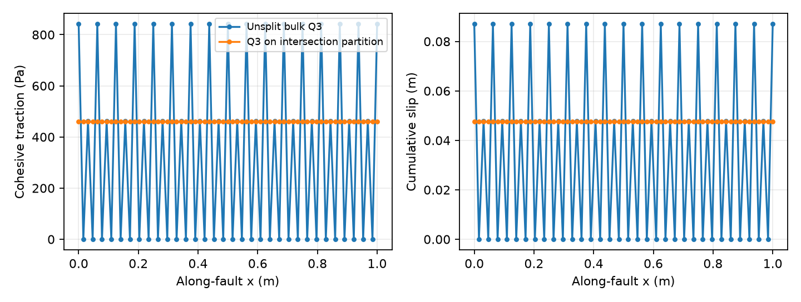
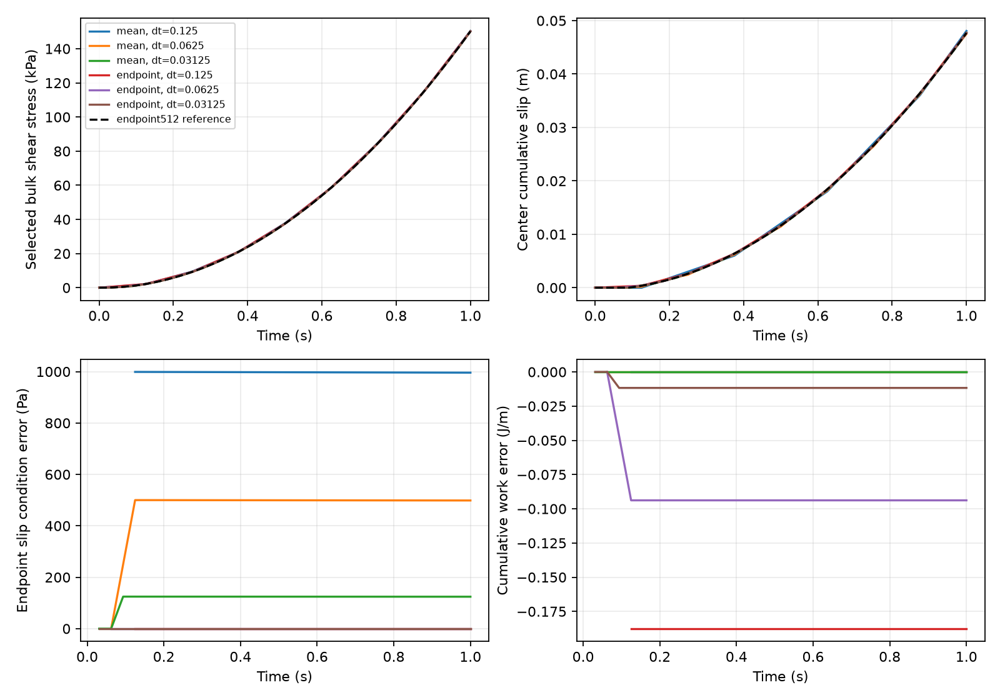
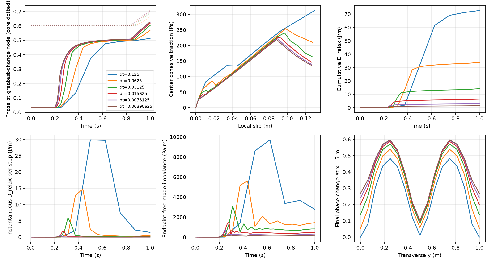
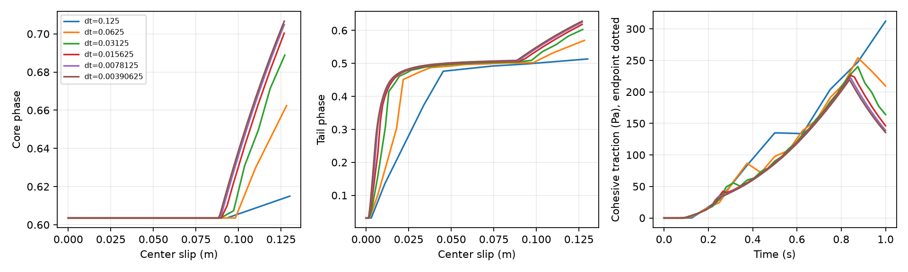

# Total-energy candidate: loaded time comparison (2026-10-08)

The reference material is unchanged: G=1e6 Pa, eta=1e8 Pa s,
Gc=26.6666666667 J/m², ell=.15625 m, m=128 and constant friction resistance
1000 Pa. An unloaded, prescribed pre-existing band is stable under its accepted-
phase constraint. The common smooth ramp produces substantial transverse tail
growth followed by core growth from .60354884 to .70664887. Corrected surface
sampling gives uniform along-fault traction/slip, including the side endpoints.

Refinement decreases phase increments, instantaneous and cumulative relaxation
release, mechanical endpoint discrepancies and full-field differences. There is
no observed nonzero plateau establishing a persistent phase jump. This supports
**the mean-integrated mechanical scheme as the total-energy implementation
candidate**, without adding damage kinetics or a limiter. It does **not** establish
a sufficiently accurate native coupled baseline: onset remains rapidly varying,
the finest comparison still has resolved field differences, and mean balance is
not endpoint equilibrium. Proceed toward a bounded optional native P2 integration
of this candidate, with the ownership and accuracy gates below; **production is
unchanged in this task**. No material optimization or P3 follows.

## Model, initialization and restrictions

| Quantity | Setting and units |
|---|---|
| Domain / sharp fault | [0,1]² m; straight fault y=.5 m, x in [0,1]; fixed full normal cross-section |
| Phase | 16×16 Q1, 289 DoFs; natural boundary conditions; physical lower bound is immutable last accepted phi; upper bound 1 |
| Fracture integration | Fixed 3×3 regular rectangular particle domains per phase cell; CPDI rectangular specialization; no transport/birth |
| Surface | 65 Q1 nodes, spacing .015625 m; Q3 ds; unchanged consistent I projection and analytic transverse integration |
| Corrected bulk integration | Q3 on the intersection of bulk cells and surface x intervals; 9216 samples; transverse Q3 unchanged |
| Original diagnostic integration | Unsplit bulk-cell Q3, 2304 samples; retained as undersampling evidence |
| G / eta / lambda | 1e6 Pa / 1e8 Pa s / 100 s; G is a dimensional **synthetic verification** value |
| Gc / ell / c0 / p | 26.6666666667 J/m² / .15625 m / 8/3 / 1 |
| Calibration | c=1000 Pa, Hc=.5 Pa, m=Gc/(c0 ell Hc)=128.00000000016; no parameter sweep |
| Localization | h=m phi(1+phi)/(1-phi)²; chi=h/I; no floor or phase cap |
| Friction / pressure / radiation | Constant mu=.1, P=10000 Pa; positive-slip branch with sticking complementarity; radiation zero |
| Loading | u_x=a t(y-.5)+U sin(2 pi y), u_y=0; a=.256 s^-2; 0–1 s; U is solved, not prescribed |
| Time partitions | dt=.125/.0625/.03125 s; .015625/.0078125/.00390625 s resolve onset and reference sensitivity; frozen reference .001953125 s |
| Initial mechanics | tau=Z=s^e=slip=total strain=inelastic strain=0; free-mode force zero, all surface nodes stick |
| Initial phase | Retained native relaxed nominal-core-.6 profile sampled at prototype nodes; maximum .6035488376736221; fixed prescribed damage lower bound |
| History | Instantaneous total recoverable energy drives phase; peak Y is diagnostic only; old seeded H is not an additional driver |

Only one free incompressible bulk velocity mode and the full surface slip system
are solved. Both matching cross blocks are retained. Mechanical admissibility and
balance refer to **this reduced bulk space**, not all Stokes test functions.
Pressure is prescribed; normal pressure does no work in this pure-shear control.
Reverse slip, evolving RSF state, particle/FE stress transfer, transport,
replenishment, MPI, geometry changes and propagation are excluded.

The unloaded seed has zero obstacle KKT and zero startup growth/work. Its positive
unconstrained fracture gradient is not an unconstrained equilibrium. Every run
starts fresh from that same seed/internal state. The native seed file and prior
preloaded failures remain unchanged. Prototype coarsening changes initial I to
103.0719753 m; it does not inherit a native spatial-accuracy qualification.

## What the two mechanical schemes solve

[The complete algorithm](P2_total_energy_algorithm.md) fixes accepted total minus
inelastic strain and Z/G during phase trials, differentiates the actual discrete
bulk/fault/fracture energy including the normalization adjoint, then evolves
Maxwell mechanics at the new fixed profile. Those equations and internal variables
are unchanged. beta=exp(-dt/lambda) is retained exactly, with general kernels.

Write m_b=2 pi cos(2 pi y_b), gamma=a(t_a+t_b)/2, v_b=T V and v_s=N V.
For either scheme use

\[
 \tau_\theta=\theta\tau^*+k_\theta(\gamma+mU-\chi v_b),\qquad
 Z_\theta=\theta NZ^a+k_\theta v_s,
\]
\[
 R_U=\sum_b w_bm_b\tau_{\theta,b}=0,\quad
 f=T^TW_b\chi\tau_\theta-N^TW_s(Z_\theta/I_s+\mu P),
 \quad V\ge0,\ f\le0,\ V_i f_i=0.
\]

Endpoint balance uses (theta,k)=(beta,kappa). Mean balance uses
(theta,k)=(r,eta_bar), with r=lambda(1-beta)/dt and eta_bar=eta(1-r).
The active-set quadratic solve enforces sticking and slip directly. Small
coupled linear refinements remove condensation/cancellation error on the actual
forces; no phase/mechanics outer iteration or physical-history accumulation is
introduced. Both endpoint and mean residuals are measured regardless of the
selected scheme. Pointwise endpoint conditions are not called passed merely
because the mean equations converge.

The boundary path is smooth; its **exact interval-mean rate** supplies each
discrete step, so imposed displacement is identical at every common time.
Gamma=.5 a t² is engineering shear strain; top-minus-bottom displacement is
Gamma times the 1 m height. Rates and stresses inside a step are the declared
fixed-rate approximation. Reference work differences assess its temporal
accuracy. A separate diagnostic evaluates work against a t on that numerical
stress path; it exposes the within-step kinematic approximation, not a new
physical dissipation or a change to the model.

For zero applied force on U, its internal work W_U is **not** external input.
The independently reconstructed work error is

\[
 e_W=W_{\rm boundary}-\Delta(E_b+E_c+F)-D_b-D_c-D_f-D_{\rm relax}
     =W_{\rm slip}-W_q-D_f-W_U,
\]
\[
 W_U=\Delta t\,U\sum_b w_bm_b\bar\tau_b,\qquad
 D_{\rm relax}=-(J_b+J_c+\Delta F).
\]

All ordinary work/losses use exact Maxwell time means/integrals on the same
spatial measures. Phase release is finite-drop energy-inequality slack, separately
retained. It is not added to H or disguised as viscous dissipation.

## Sampling defect isolated before interpreting traction–slip

Unsplit bulk Q3 supplies only 48 distinct x samples for 65 surface DoFs. Its
surface evaluation rank is 48. Under an exactly uniform along-fault control,
the normalized nodal load ranges .500896–1.777778 of the constant expected value:
**77.7778% maximum error**. Alternating nodes then stick; frozen reference traction
ranges 0–841.48 Pa and local slip 0–.087019 m. Center/end sampling alone hides it.

Integrating on the bulk/surface intersection partition retains Q3, material,
mesh, profile, normalization and physical equations. Evaluation rank becomes 65;
constant-load error falls to 7.78e-15. Corrected frozen traction/slip become
uniform. This is a **prototype mechanical integration correction**, not a change
to the generic particle projector or the I projection. Both coupled blocks and
bulk energy use the corrected measure. The original temporal family is preserved;
all affected comparisons were repeated. Transverse Q3 initially integrates chi
to .999996932 in both controls; this separate normal integration error is retained.



## Phase frozen: common-path mechanical comparison

| Scheme / dt (s) | Max stress error (Pa) | Max slip error (m) | Endpoint slip-condition error (Pa) | Integrated work error (J/m) |
|---|---:|---:|---:|---:|
| endpoint / 0.125 | 3.90958 | 1.33443e-08 | 1.00044e-11 | -0.187597 |
| endpoint / 0.0625 | 0.976679 | 1.3418e-08 | 7.95808e-12 | -0.0938377 |
| endpoint / 0.03125 | 0.243454 | 1.26192e-09 | 3.11502e-11 | -0.0117035 |
| mean / 0.125 | 1940.79 | 0.000375258 | 998.744 | -5.68978e-11 |
| mean / 0.0625 | 971.621 | 0.00018782 | 500.054 | 5.68366e-11 |
| mean / 0.03125 | 242.146 | 4.68065e-05 | 124.626 | -1.65092e-10 |

Stress/slip errors use the complete fields at identical physical times against
the corrected endpoint 512-step reference. Endpoint256 versus endpoint512 changes
the stress by 0.00286416 Pa and slip by 3.8283e-11 m; reference sensitivity
is small relative to the reported coarse errors. Mean512 versus this reference
still has 22.3875 Pa stress error. Endpoint balance is more accurate
for this monotone frozen control; mean balance closes its integrated work ledger
but has contact-related endpoint oscillations. Its endpoint condition error
decreases under refinement, with load/contact alignment affecting individual ratios.

All paths begin sticking and subsequently slide. Corrected uniformity makes
center/end/interior traction–slip identical within roundoff. The selected scheme's
KKT/contact signs pass at the original tolerances; the other scheme's residual
is explicitly an error diagnostic. Free-bulk force is essentially zero for both
frozen schemes because the fixed-profile zero-force constraint is preserved from
the initial state. The solved U is nonzero during slip; the bulk mode is genuinely
coupled despite this preserved invariant.

The frozen reference ends at tau_xy=-118338.4 to 150235.8 Pa over bulk samples,
uniform q=461.13053 Pa and cumulative slip=.047685918 m. Integrated boundary work
differences against the reference are retained separately from ledger defects in
the assessment JSON. The deliberately limited bulk mode permits a nonuniform
stress profile; these ranges do not establish pointwise/full-Stokes balance.



## Phase evolving: same load, common times and slips

| dt (s) | Final core phi | Largest phase increment | Largest release (J/m) | Total release (J/m) | Fracture expenditure (J/m) | Final q (Pa) / slip (m) |
|---|---:|---:|---:|---:|---:|---:|
| 0.125 | 0.61499090 | 0.238646 | 29.8792 | 72.6768 | 16.9538 | 312.186 / 0.13011487 |
| 0.0625 | 0.66237308 | 0.207242 | 14.7429 | 33.9434 | 20.6524 | 209.421 / 0.12820119 |
| 0.03125 | 0.68887887 | 0.153725 | 5.92882 | 14.2294 | 22.5502 | 164.068 / 0.12716346 |
| 0.015625 | 0.70036594 | 0.105174 | 1.74591 | 6.44123 | 23.4002 | 146.121 / 0.12682067 |
| 0.0078125 | 0.70485026 | 0.0660332 | 0.588581 | 3.07015 | 23.777 | 138.934 / 0.12684377 |
| 0.00390625 | 0.70664887 | 0.0397156 | 0.176331 | 1.52157 | 23.9711 | 135.538 / 0.12684844 |

Onset means maximum full-field change above the seed exceeds 1e-6. The finest
entry consumes the state at t=.1875 s, Gamma=.0045, and publishes at .19140625 s,
Gamma=.004689453125. This is the explicit one-step split lag. Coarse entries
consume later/inaccurately integrated incoming states; raw common-time comparisons
are primary. Equal-anchor-load comparisons are reported separately, not substituted
for them or used to compare different last-accepted times.

Incoming onset Gamma is .008 at dt=.125 and .0045 in all five finer corrected
partitions. Core growth starts later, at published t=.83984375 s on the finest
path (incoming Gamma=.0894453125). Tail evolution has already undergone many
accepted cycles; this is not a last-step-only feedback test.

| dt (s) | Common-time full phi error | Final full phi error | Common-time stress error (Pa) | q error at common slip (Pa) | Raw / equal-anchor phi error |
|---|---:|---:|---:|---:|---:|
| 0.125 | 0.327238 | 0.269627 | 24930.5 | 170.908 | 0.327238 / 0.168422 |
| 0.0625 | 0.311747 | 0.214353 | 18033.3 | 75.6092 | 0.311747 / 0.198449 |
| 0.03125 | 0.25044 | 0.129934 | 8558.57 | 44.2695 | 0.25044 / 0.148937 |
| 0.015625 | 0.156555 | 0.0684187 | 4960.42 | 17.6352 | 0.156555 / 0.101009 |
| 0.0078125 | 0.0787037 | 0.0276496 | 1857.32 | 5.97984 | 0.0787037 / 0.0434805 |
| 0.00390625 | 0 | 0 | 0 | 0 | 0 / 0 |

The finest 128/256 pair still differs by 0.0787037 in the full phase field at
common times, 0.0276496 at the final time, and 5.97984 Pa in
traction at common local slip. Core maxima differ by .001799. These are measurable
remaining errors, principally around fast tail-growth onset; maxima alone would
understate them. Endpoint/center histories agree across the entire corrected
surface. At the finest partition, the greatest phase increment is at t=0.230469 s (incoming t=0.226562 s, Gamma=0.0065703125), y=0.3125 m; x is a symmetry tie;
the final core maximum is tied along x to numerical precision, not a unique tip.
Significant diffuse damage extends toward the normal boundaries. This is evolution
of the prescribed single-fault profile over its full association cross-section,
not qualification of bulk nucleation, tip propagation or general support admission.

At both normal boundaries the finest final phase is .26774279; projected I rises
to 932.84805 m. This substantial off-core response is retained explicitly.
Constant-in-x normalization representation error is <=roundoff for these symmetric
fields; neither this nor positive I qualifies general spatial accuracy.





| Finest-path energy / loss | Cumulative value (J/m) |
|---|---:|
| Boundary work | 161.9004748 |
| Bulk storage change | 0.8907906831 |
| Cohesive storage change | 8.568441833 |
| Fracture expenditure | 23.971056 |
| Bulk viscous loss | 0.03739790411 |
| Cohesive viscous loss | 0.06277661887 |
| Frictional loss | 126.8484396 |
| Phase-relaxation release | 1.521572095 |
| Mechanical ledger error | -8.288269763e-13 |

At the finest step cumulative D_relax is still 6.35% of fracture expenditure.
Its last two refinement ratios are approximately one half; largest instantaneous
release falls .58858 to .17633 J/m. Thus a nonzero release limit is not demonstrated,
but neither is vanishing release proved by finite tests. Peak endpoint bulk-force
imbalance falls 1481.93→755.73→326.28 Pa m. Mean balance closes to its original
criterion; **endpoint imbalance remains substantial** and is not an equilibrium
pass. The deliberately unstable preload controls retain first-step release
5.24085/5.85812 J/m; they do not establish a jump on this properly loaded path.

Maximum release divided by step duration is 45.1406 J/(m s) on the finest path,
reported as a diagnostic event rate rather than a new constitutive dissipation.
The independently checked scaled phase KKT maximum is 8.319e-12, phase-path
integration error <=8.74e-13 J/m and temporal quadrature error <=5.37e-13 J/m
across both completed temporal families.

## Verification, changes and implementation decision

Numerical criteria are unchanged: phase projected-gradient/FRACTURE_SCALE <=1e-11
(FRACTURE_SCALE=64.00000000008 J/m; weak force <=6.4e-10 J/m), contact proximity
2e-12 phase, mechanical weak force <1e-9 Pa m, finite-step identities <1e-8 J/m,
independent phase/time integration differences <1e-9 J/m, endpoint algebra <1e-10
Pa, accepted strain reconstruction <1e-12. Phase L-BFGS uses gtol=2e-13,
ftol=2e-16. Its free Newton refinement limit increases 8→16; the residual tolerance
does not change. No post-equality clipping is used.

Independent saved-field checks rebuild phase gradients/KKT, Maxwell endpoints,
both mechanical forces, strain reconstruction, fracture/storage and work ledgers.
New aligned derivative/adjoint tests pass at unloaded and evolved states; H
poisoning leaves the energy/gradient unchanged. All completed evolving paths
have zero healing, positive finite I and phi<1. Original preload physical fields
and histories reproduce exactly; stronger compensated force diagnostics differ
only in arithmetic/reporting. Failed force-roundoff and insufficient-Newton
entries are preserved, then retried fresh after the numerical repairs.

**Selection:** carry the averaged-balance candidate toward an optional native P2
implementation, preserving exact general Maxwell kernels, the projection adjoint,
surface Z, committed inelastic strain and the accepted-phase bound. Use a common
integration partition for energy and both coupled operators; do not repeat the
undersampling defect. Establish accepted-state ownership before implementing the
phase residual, and retain endpoint/contact accuracy diagnostics alongside the
integrated ledger. No physical damage kinetics/transition rule is justified by
a demonstrated persistent jump here. If native full-space tests exhibit one,
review it explicitly rather than importing a limiter.

This decision is separate from pass counts: the current runs show a convergence
trend, not a qualified native timestep or spatially converged/full-Stokes model.
Native stress transfer, restart/rollback, transported/birth histories, distributed
evolution, nonlinear/general friction and full spatial accuracy remain outside
this prototype. Production's existing peak-H law and all options are preserved.

| Changed file / functions | Purpose |
|---|---|
| total_energy_step.py: phase_solve | More Newton refinements at unchanged KKT tolerance; no physical-law change |
| total_energy_step.py: step | Frozen control, correct selected bulk-force check, exact zero phase-path shortcut, coupled force roundoff refinement, actual force/contact/work diagnostics |
| total_energy_time_comparison.py: make_energy, initial_state, run | Explicit intersection-quadrature control; fresh unloaded seed; common ramp/partitions; full accepted fields and failed-state retention |
| assess_total_energy_time.py: compare, checks, main | Independent field/KKT/work checks, raw/anchor/slip comparisons, smooth-load work diagnostic and plots |
| check_total_energy_time.py | Source/evidence preservation, original-control compatibility and saved-field gates |
| This report; algorithm cross-reference; STATUS, PLAN, CURRENT_STATUS, current_design, AGENTS, benchmark README | Current result, scope, decision and reproducibility |
| **Production C++ / specification.tex / pf_rsf.tex** | **No changes in this task** |

HEAD de7beaa65846c7372711f7922abf1c5d9a745ee6, branch fault-propagation.
240 actual incoming artifacts are copied/hash-protected under
build-propagation-integration/total-energy-time-baseline. The
[manifest](../../../benchmarks/reconstructed_fault/propagation/total_energy_time_evidence/manifest.json)
pins final code, documentation, raw fields, diagnostics and runtime. Historical
manifests are not rewritten to mask authorized new source/document changes.

```sh
OPENBLAS_NUM_THREADS=1 python3 benchmarks/reconstructed_fault/propagation/total_energy_time_comparison.py --label aligned_evolving_mean256 --steps 256 --evolve --aligned-bulk-quadrature
OPENBLAS_NUM_THREADS=1 MPLCONFIGDIR=/tmp/total-energy-matplotlib python3 benchmarks/reconstructed_fault/propagation/assess_total_energy_time.py
OPENBLAS_NUM_THREADS=1 MPLCONFIGDIR=/tmp/total-energy-matplotlib python3 benchmarks/reconstructed_fault/propagation/check_total_energy_time.py
```

Runners refuse existing labels. The manifest records the complete command family;
[assessment JSON](../../../benchmarks/reconstructed_fault/propagation/total_energy_time_evidence/assessment.json)
links each completed run's summary, records and compressed fields. No native run,
core rebuild, material sweep, stress-scaling claim or P3 was performed.
