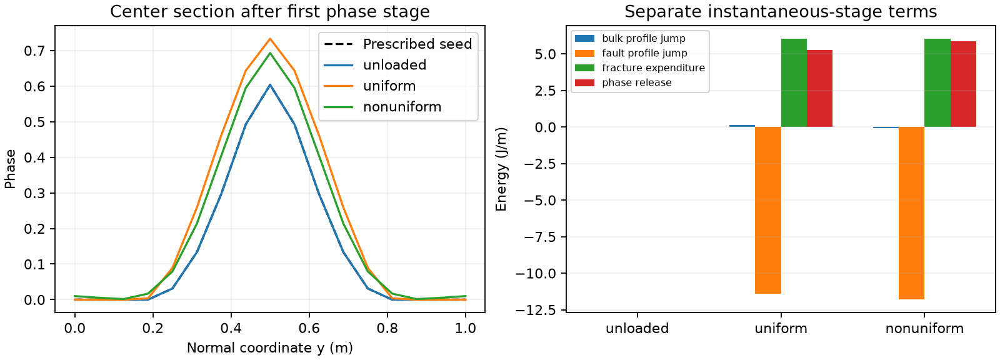

# Total-energy candidate: isolated verification (2026-10-08)

The candidate uses instantaneous bulk-plus-fault recoverable energy, an accepted-
phase lower bound, and exact Maxwell relaxation after instantaneous profile
redistribution. The unloaded prescribed band does not grow. Preloaded diagnostic
controls evolve without healing. The projection-adjoint derivative and finite-
step mechanical work identities pass at small and order-one dt/lambda.

**Two consequences matter more than pass counts.** Exact integrated exchange
requires the chosen time-averaged mechanical balance; retaining endpoint balance
leaves a measurable work defect. Also, finite constrained phase relaxation releases
5.24–5.86 J/m beyond fracture expenditure in the preloaded controls. This is
recorded as discrete relaxation loss, not hidden in viscosity or H. The complete
candidate satisfies an energy inequality with this explicit slack. It does not
establish a conservative physical phase-jump law, a vanishing-slack limit or a
qualified production coupled baseline. No production source/model change or P3.

[Algorithm and equations](P2_total_energy_algorithm.md) specify accepted/trial
state, the exact discrete phase residual, both mechanical blocks, finite-step
energy terms and atomic publication. The chosen algorithm differs from the
implemented peak-H phase driver and endpoint mechanical balance.

## Small model and controls

| Quantity | Prototype setting |
|---|---|
| Domain/fault | [0,1]² m; fixed straight through-going fault at y=.5 m; full normal cross-section |
| Bulk/phase | 16×16 Q1 phase, 289 nodes; Q3 bulk energy samples; regular 3×3 rectangular particle domains/cell for CPDI fracture specialization |
| Surface | .015625 m, 65 Q1 nodes; Q3 arclength mass/RHS; **consistent** normalization, analytic transverse Q1 integral and Jacobian |
| Material | G=1e6 Pa; eta=1e8 Pa s; Gc=26.6666666667 J/m²; ell=.15625 m; c0=8/3; p=1; m=128.00000000016 (reference c=1000 Pa, Hc=.5 Pa calibration) |
| Friction | Constant selected rate-dependent branch mu=.1; prescribed normal pressure 10000 Pa; radiation zero. Positive slip has 1000 Pa resistance; V=0 uses the stated sticking complementarity |
| Pre-existing seed | Sample the retained native relaxed nominal-core-.6 field at prototype nodes; maximum .6035488376736221. Its old prescribed H is **not** a phase source; obstacle stationarity is independently tested |
| Unloaded control | Bulk stress and Z zero, imposed bulk strain rate zero; no force/work input |
| Uniform control | Initial tau_xy=1500 Pa, s^e=.06 m constant along fault |
| Nonuniform control | Initial tau_xy=1500+8000 abs(y-.5) Pa; s^e=.06[1+.2 cos(2 pi x)] m sampled into surface Q1 |
| Prescribed rate in preloaded controls | Engineering bulk shear rate 2e-5 s⁻¹, held fixed per step. Entire bulk rate field is prescribed; surface slip rates are solved, and bulk generalized reactions supply external work |
| Time tests | dt/lambda=.00125, 1, 4 (dt=.125,100,400 s at lambda=100 s), three accepted cycles each; separate eta=1e30 Pa s elastic-limit probe |
| Phase criteria | Immutable lower bound, upper bound 1; KKT max projected gradient divided by characteristic 64.00000000008 J/m <=1e-11; equivalent weak load <=6.4e-10 J/m. Contacts identified within 2e-12 phase; observed healing exactly zero |
| Other criteria | Mechanical KKT <=1e-9 Pa m; energy defects <=1e-8 J/m; derivative relative error <=1e-7 with denominator max(1 J/m, magnitude); phase-path and independent time-quadrature differences <=1e-9 J/m |

Three additional probes free the incompressible shear mode
\(u_x=U\sin(2\pi y),u_y=0\), with zero applied generalized force. The bulk
mode and surface slip are solved together by their symmetric quadratic blocks;
the mode is condensed before the nonnegative slip solve. This tests the free
bulk equation as well as the slip equation, without introducing a full Stokes
mesh solve. Uniform/nonuniform mode amplitudes are -2.4302e-6/-1.0061e-5 m/s.

These are **named isolated controls**, not reruns of the production a=.256 ramp.
G remains a dimensional synthetic verification value. The two preloaded states
are deliberately prescribed internal-state controls, not new physical unloading
fixtures or equilibrated full Stokes solutions. Total strain/displacement starts
at zero; initial inelastic strain is chosen to realize the stated stress and
elastic slip. All subsequent total/inelastic strain increments are stored and
checked against the accepted stress/profile reconstruction.

The 16-cell seed sampling changes initial I from the native 32-cell value to
103.0719753 m. This coarsening and the prototype's surface spacing have **no new
spatial-accuracy qualification**. Energy/derivative checks use exactly their
declared discrete measures. The prior .00625 m frozen-field assessment remains
separate and unchanged. Rectangular CPDI specialization does not qualify general
deformed domains or native assembly/MPI operation.

## Numerical evidence

27 accepted prototype steps cover the three controls/three ratios/three cycles.
There are three elastic probes, three endpoint-balance comparators, and three
free-bulk-mode probes. Nine
injected post-mechanical-trial rejections preserve the immutable accepted state.
These are short algebraic/optimization tests, not physical ASPECT trajectories.

| Check | Measured result | Meaning |
|---|---:|---|
| Full discrete derivative, three directions/control, eps=1e-4/1e-5/1e-6 | Best refined relative error per direction <=2.713e-8 | Includes fracture, changed bulk stress, nonlinear transverse integration, projection and adjoint |
| Projection adjoint identity, nonconstant dual load | 1.777e-13 J/m in the tested contraction | Correct mass inverse and quadrature-weighted adjoint |
| Accepted total-minus-inelastic strain reconstruction | <=2.221e-16 strain | Bulk and cohesive viscous deposits included; same spatial state |
| Phase KKT | <=3.766e-13 scaled; 17–289 lower contacts | Free residual/contact signs verified; lower bound fixed; no healing |
| Mechanical slip KKT | <=2.949e-13 Pa m | Proper nonnegative active-set quadratic solve, with free/slip contacts |
| Phase-path gradient integral versus finite phase-energy jump | <=7.017e-14 J/m | Independent virtual-work verification of finite redistribution, not just endpoint energy subtraction |
| Exact Maxwell loss versus independent Q96 temporal integration | <=1.208e-13 J/m | Includes dt/lambda=1 and 4, plus small-ratio and elastic controls |
| Free incompressible bulk mode plus slip, ratio one | Bulk residual <=2.669e-12 Pa m; zero free-mode work to <=1.770e-15 J/m | Both mechanical blocks and matching off-diagonal operators exercised |
| Integrated ordinary bulk/fault/friction exchange | <=5.441e-15 J/m | Same fields/measures and exact temporal means on both sides |
| Complete ledger with explicit relaxation release | <=9.837e-14 J/m | Energy inequality/accounting passes; does not prove release is negligible |
| Stress endpoint versus old spread-C algebra, identical phase/rates | <=1.365e-12 Pa | General exponential endpoint equivalence; not work equivalence |
| Diagnostic-history poisoning | Identical energy and gradient after +1e15 diagnostic H | Peak history cannot act as a hidden driver |
| Unloaded seed | Phase unchanged, V=stress=Z=work=loss=0 | Independent constrained equilibrium; not an assumption of unconstrained seeded-H equilibrium |

Derivative errors above use the best resolved member of each three-epsilon
sequence; the full sequence, including truncation and cancellation, is retained.
The unloaded seed's unconstrained gradient ranges .014701–.946251 J/m, entirely
positive; it is **not** an unconstrained equilibrium. Its obstacle KKT is zero.
Readonly snapshot/cache checks and rejection of an exactly saturated trial pass
without publishing state; [guard evidence](../../../benchmarks/reconstructed_fault/propagation/total_energy_evidence/coupled_blocks/unloaded-obstacle.json).
Bounds are never obtained by clipping a final equality solution. L-BFGS's first
attempt reached energy roundoff with KKT 9.15e-8 and was rejected. Free-set Newton
on the **same** analytic residual fixes this routine optimization issue without
relaxing KKT. The original attempt and succeeding runs remain available.

## Physical and energetic interpretation

| First instantaneous stage | Unloaded | Uniform preload | Nonuniform preload |
|---|---:|---:|---:|
| Phase maximum | .60354884 | .73323237 | .76431891 |
| Largest nodal increase | 0 | .16495809 | .21219672 |
| Bulk profile storage jump (J/m) | 0 | +.150361 | -.082434 |
| Fault storage jump (J/m) | 0 | -11.417979 | -11.811720 |
| Fracture expenditure (J/m) | 0 | +6.026772 | +6.036037 |
| Discrete relaxation release (J/m) | 0 | +5.240846 | +5.858117 |

The first phase stage is identical across the three dt ratios because its incoming
state is identical and no dt occurs in its energy. Later states are irreversible
but vary with their different loading durations. These paths do **not** share a
physical interval and are not a timestep-convergence or gradual-damage study.
Initial profile redistribution can produce rapid slip under fixed total strain;
the uniform small-ratio first step reaches V=.0037912 m/s, versus 9.0784e-6 m/s
at ratio one. That is a relaxation response of these preloaded controls, not a
qualified earthquake velocity or evidence of resolved production feedback.

The relaxation release is sizeable: about 87%/97% of fracture expenditure in
these deliberately unstable preloaded controls. If the intended physical model
requires equality with only viscous/frictional losses and fracture expenditure,
**that stronger criterion fails by these releases**, despite exact numerical
accounting. Defining it as algorithmic energy loss makes the split well specified
and dissipative; it does not supply a validated physical jump mechanism. A future
physical qualification needs either a negligible-release limit or an explicit
governing interpretation. No phase viscosity, limiter, H correction or additional
phase driver has been inserted to make equality pass.

Uniform transverse stress cancels the **first-order** bulk profile term only
with exact transverse normalization/integration. In the actual Q3 prototype its
directional derivative is .00253328 J/m; a fixed-field Q12 comparator gives
-3.992e-14 J/m. Nonuniform stress instead gives +18.08247 J/m (Q3) and +18.08085
J/m (Q12), a genuine bulk contribution with .001620 J/m integration uncertainty.
Both Q3 derivatives of the defined energy remain correct. Cancellation at the
uniform anchor does not eliminate the quadratic bulk storage change during a
finite phase redistribution. This separates discrete integration accuracy from
the governing energy term.

At dt/lambda=1, the endpoint-balance comparator leaves integrated exchange errors
.118317/.473700 J/m for uniform/nonuniform controls; the chosen mean balance closes
them to roundoff. This is a temporal-operator choice, not a tolerance repair. Final
stress need not satisfy pointwise endpoint equilibrium under mean balance. A
future native comparison must assess that approximation; exact material relaxation
and energy accounting do not establish quasistatic temporal accuracy.



[Summary](../../../benchmarks/reconstructed_fault/propagation/total_energy_evidence/coupled_blocks/summary.json)
retains every work/storage/loss term, exponential coefficient, KKT measure and
diagnostic-history publication. [Phase fields](../../../benchmarks/reconstructed_fault/propagation/total_energy_evidence/coupled_blocks/phase-fields.json)
support independent full-field irreversibility checks;
[PDF plot](../../../benchmarks/reconstructed_fault/propagation/total_energy_evidence/coupled_blocks/phase-and-energy.pdf).

## Changes, reproduction and limit

New benchmark files: `total_energy_step.py` (discrete energy/adjoint, constrained
phase solve, mean mechanical block, exact kernels, state publication and plots)
and `check_total_energy_step.py` (independent saved-field/ledger/preservation gate).
New documentation: this report and the algorithm; existing status/roadmap/design
and benchmark index links are updated. **Production source/header/specification
equations and all selected native options remain unchanged.** No new parameter
or generic projector is integrated. Prior failed physical trajectories remain
failed and preserved.

Baseline remains HEAD de7beaa65846c7372711f7922abf1c5d9a745ee6, branch
fault-propagation. 211 incoming artifacts were copied/hash-verified under
`build-propagation-integration/total-energy-prototype-baseline/`. The native
executable is not used or rebuilt. Python/NumPy/SciPy versions, exact inputs,
source hashes and preservation evidence are in the
[manifest](../../../benchmarks/reconstructed_fault/propagation/total_energy_evidence/manifest.json).

```sh
OPENBLAS_NUM_THREADS=1 python3 benchmarks/reconstructed_fault/propagation/total_energy_step.py --label coupled_blocks
python3 -m py_compile benchmarks/reconstructed_fault/propagation/total_energy_step.py benchmarks/reconstructed_fault/propagation/check_total_energy_step.py
python3 benchmarks/reconstructed_fault/propagation/check_total_energy_step.py
```

The runner refuses to overwrite a label.
Python syntax, independent numerical/preservation and new-document link/whitespace
checks pass. Full-worktree `git diff --check` retains the same 12 incoming
whitespace findings in the unchanged manually edited `pf_rsf.tex`; historical
missing links are unchanged. No cleanup of incoming edits is bundled here.
The selected prototype is complete. Stop here. Not tested: full native coupled residual/Jacobian integration, mean-
balance temporal accuracy, a vanishing phase-release limit, stress-transfer energy,
spatial convergence, production restart/rollback, transport/birth, evolving MPI,
multiple faults or propagation. The initial seeded band is prescribed damage,
not an unconstrained equilibrium assertion. No material optimization or P3.
