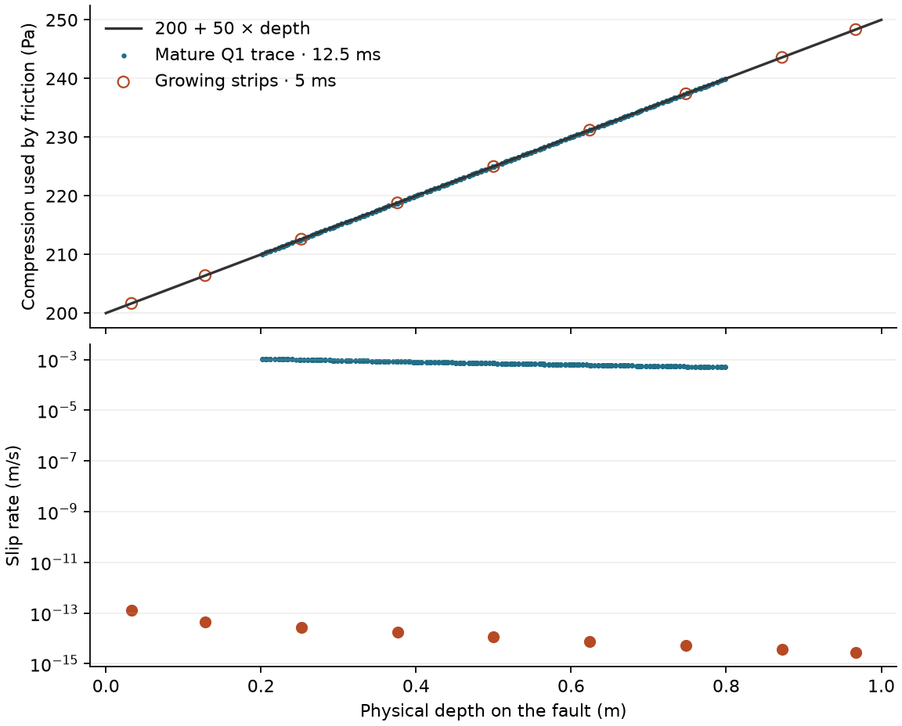

# Phase-field fault implementation in ASPECT 3.1.0

Start with the **field method** and the **material model** in the parameter file. A passive phase field can be measured or transported on its own. The mature model solves rates along an existing curve. The growing model solves phase, mechanics and section resistance in one midpoint problem. The models retain their historical friction defaults and share an optional prescribed adiabatic pressure. The [parameter reference](../../doc/sphinx/parameters/Material_20model.md) gives the material defaults. The [working record](STATUS.md#increment-6b) gives the installed commands, measurements and reference comparisons.

## Run the two poster examples

Start with an ASPECT Release installation containing the examples and plugin SDK. Set
`prefix` to its absolute path. The commands below use the installation from the
[configured-prefix SDK check](results/iposter/installed-review-checks.md). Configure
ASPECT with `-DCMAKE_INSTALL_PREFIX` set to the intended destination and
`-DASPECT_INSTALL_EXAMPLES=ON` before installing.
Both examples write accepted output in a fresh directory. Distances are in metres
and times in seconds.

```sh
prefix=$PWD/build-d-review/install
aspect=$prefix/bin/aspect-release
growing=$prefix/benchmarks/growing_fault
layered=$prefix/benchmarks/layered_moving_fault
export ASPECT_SOURCE_DIR="$prefix"
export OMP_NUM_THREADS=1 DEAL_II_NUM_THREADS=1 OPENBLAS_NUM_THREADS=1
run=$(mktemp -d /tmp/aspect-fault-examples.XXXXXXXX)
mkdir "$run/seed" "$run/layered"
cp "$growing/growing_seed.prm" "$run/seed/"
(cd "$run/seed" && mpirun -np 2 "$aspect" growing_seed.prm)
```

**Change frictional pressure in the growing seed.** In `Adiabatic conditions model /
Function`, edit `set Function constants = p0=200, dp_dz=0`. Using `dp_dz=50`
adds 50 Pa per metre of depth below the top face. The consumed pressure and
signed rate by strip are in `friction-pressure-0001.csv`. At 5 ms strip 0,
at a depth of 0.967005 m, sees 248.350247 Pa and slips at 2.86411e−15 m/s.
With the default constant 200 Pa it slips at 7.34745e−14 m/s. The native
deviatoric stress in Pa is in `output-growing-seed/points-0001-r*.csv`.
Read xx, yy, zz and xy by cell and native quadrature index. Positive normal
stress denotes tension. The work and energy terms are in `balance-0001.csv`
in J/m of out-of-plane thickness. The four-field compatibility input retains
its static companion fields and separate native stress history.

The initial phase and all four walls use the same frame. To change its angle
α counterclockwise from +x or its center, set `xc,yc,tx,ty` in **both**
`Initial composition model / Function` and `Boundary velocity model / Function`.
Use `(tx,ty) = (cos α,sin α)`, set `Growing fault / Seed tangent angle` in degrees
and set `Forward seed tip` to the center plus 0.5 m times that tangent. The
phase tapers forward from the center and across its normal. The walls impose
extension along the seed and simple shear across it. The rates in s⁻¹ are
`extension=0.003, shear=0.020`. Both velocity components rotate with this seed.
The 20° and 30° growing seeds have friction stations inside the 2 × 1 m domain.
At 45° with this center the first strip has no in-box station for adiabatic pressure.

**Change the load across the viscosity transition.** Build the layered
benchmark provider against the same SDK as the executable. Its ordered input
table is installed beside the parameter file. The `ASPECT_SOURCE_DIR` setting
above lets an external run locate that table under the installation prefix.

```sh
cmake -S "$layered" -B "$run/layered-plugin" -DAspect_DIR="$prefix/lib/cmake/Aspect"
cmake --build "$run/layered-plugin" -j 1
cp "$layered/layered.prm" "$run/layered/input.prm"
echo "set Additional shared libraries = $run/layered-plugin/liblayered_moving_fault.release.so" >> "$run/layered/input.prm"
(cd "$run/layered" && "$aspect" input.prm)
```

Set `Postprocess / Layered background / Wall velocity contrast = 1` in
the layered input to halve the default 2 m/s shear loading. Leave
`Translation = 2` to keep the mean wall motion fixed. The plugin's
`layered mature fault` material supplies η(y) = 5.5 + 4.5 tanh(y/0.35) Pa s.
Its `layered background` column supplies the horizontal velocity on the sides
and bottom, the horizontal traction on top, and the incoming stress for
physical transport. The upper and lower ends of the side walls then move at
2.5 and 1.5 m/s. At 12.5 ms the top shear traction falls from 0.06072736 to
0.03036368 Pa. The selected top provider prescribes the accepted column value
recorded in `layered-background.csv`. Follow each material ID in
`material-2-surface-0.csv` at 25 ms. The accepted spatial stress is sampled
in `material-2-rank0.csv` in Pa.

The vertex table gives position, age and persistent background shear by ID.
At fixed phase, changing `Degradation magnitude` scales the excess compliance
and its normal integral by the same factor. The ratio returning slip to Stokes
is invariant. For vertex 9, increasing the magnitude from 50 to 200 changed
the initial raw integral from 11.74481 to 46.97924 m. The largest sampled
normalized weight stayed at 3.40482 m⁻¹.

Generate both high-resolution PNGs and vector PDFs from these runs. The
[poster captions and plotting details](results/iposter/README.md) give the
angle convention, observation windows and measured vertex displacements.

```sh
export MPLBACKEND=Agg
python3 "$growing/plot_seed.py" "$run/seed/output-growing-seed" "$run/figures"
python3 "$layered/plot_layers.py" "$run/layered/output-layered-moving-fault" "$run/figures"
```

## Select the fault calculation

The two inputs below use the built-in `Material model / Model name = phase field fault`. The layered example above uses its benchmark specialization of the mature material.

| Input | Physical choice | Accepted output |
|---|---|---|
| [Mature trace](../../benchmarks/fixed_fault/mature_trace.prm) | `Fault geometry = boundary spanning` and a static phase. A prescribed interior curve can instead use `fixed interior` with static or transported phase, or `advected interior` with transported phase and physical stress. | `mature fault statistics` writes `fault-labels-NNNNN.txt`. Read `fault_tau_xx`, `fault_tau_yy` and `fault_tau_xy` from the named additional visualization outputs. The older `fixed fault statistics` selector produces the same files. |
| [Growing seed](../../benchmarks/growing_fault/growing_seed.prm) | `Compositional field methods = midpoint fault phase` on one `phase field` selects the irreversible AT1 strip solve. The `Growing fault` subsection supplies the seed tip, tangent and cohesion. Set the Maxwell modulus and viscosity under `Phase field fault`. This example takes friction pressure from the ASPECT adiabatic profile. | The built-in `growing fault history` postprocessor writes the accepted native tensors in `points-NNNN-rR.csv`, one strip table per clock, and the physical-step work ledger. |

The simulator uses the resolved field method when it constructs the top-level material. The existing `growing fault` name selects the same strip material and requires the midpoint method. A mature geometry declaration or vertex source conflicts with the midpoint selection. Growing seed and prescribed-compression controls require that selection. For older mature files, `automatic` retains the original inference from the phase role. Each concrete material installs its own acceptance and restart callbacks. A saved interior trace continues on the mature route, and a saved strip history continues on the growing route.

### Change the material response

Edit the shared settings in `Material model / Phase field fault` on either route. This line doubles the growing seed’s shear modulus. With the 50 Pa/m pressure gradient, the accepted shear stress at the first native point increases from 75.9788626 to 151.9540527 Pa at 5 ms. The [measured field and replay](STATUS.md#assignment-a--public-fault-settings-and-accepted-output) use the same seed, velocity and adiabatic profile for both runs.

```text
subsection Material model
  subsection Phase field fault
    set Shear modulus = 2e6
  end
end
```

`Viscosity` is the Maxwell viscosity in Pa s. `Resistance law` and its coefficients are also shared. The public material accepts the historical `Growing fault` spellings and `Simple model / Viscosity`. With the historical material name `growing fault`, an entry under `Simple model` remains independent of growing Maxwell viscosity. Omitting both fault viscosities on that route gives 1e8 Pa s. Multiple values for the same quantity must agree after parsing, including values equal to a default. Leave a setting out to use the active route's default. The default modulus and viscosity are 1e10 Pa and 5e24 Pa s for a mature trace, and 1e6 Pa and 1e8 Pa s for growing strips. Growing startup reports the resolved modulus and viscosity. ASPECT saves the input in `original.prm` for reproduction. The complete parameter listing also includes declarations for inactive models. Trace initialization settings apply to mature mechanics, while the seed tip, fixed strips, cohesion and prescribed strip compression apply to growth. Supplying one of these controls to the other route gives an input error.

`Phase field / Phase composition` names the physical phase read by both fault materials and the surface-energy reporter. Its default is `phase_field`. To call it `damage`, change the composition name in both places. The three mature stress fields remain distinct. Explicit fixed geometry supports the same static DGQ2 phase with either the generic or phase-field role. For moving phase the phase-field role with SSPRK3 selects bounded Bernstein transport.

Set `Fault vertex file = mature_vertices.txt` inside `Material model / Phase field fault`. The [example table](../../benchmarks/fixed_fault/mature_vertices.txt) starts with `id x_m y_m`. IDs are consecutive integers beginning at zero. Positions in metres define an ordered, open curve. The tangent points from each ID to the next. Set `Fit trace to phase = false` to keep those positions for a curved seed. The optional fit requires a straight boundary-spanning seed. Optional named columns `initial_age_s` and `background_shear_Pa` can appear in either order. Comments start with `#`. ASPECT reads the file once on rank zero and distributes it. Relative filenames use the run directory.

The example table is equivalent to these inline entries in the mature material subsection.

```text
set Fault vertices = .5,0; .5,.5; .5,1
set Initial label ages = 10,11,12
set Initial label shear tractions = 3.85,3.80,3.75
```

Supply each vertex quantity once. Without a per-ID value, `Initial age` in seconds and `Background shear traction` in Pa give uniform values. A per-ID shear replaces the scalar and participates in every subsequent balance. A stateless law rejects initial ages. At fixed mature phase the degradation magnitude scales the raw normal integral and local excess compliance together, so the normalized slip weight is invariant.

Set `Resistance law = rate and state` in the public material subsection to select RSF. The default law and its route-specific default coefficients reproduce historical inputs. To add a law, implement `FaultResistance`, declare its inputs with the ordinary ASPECT parameter handler and register its declaration and constructor once. It provides positive-speed traction at fixed incoming state for the mature trace and the signed stage root for the growing strip. Ages in seconds and opaque checkpoint state have separate accessors. The [dashpot plugin](../../benchmarks/growing_fault/linear_resistance.cc) exercises both contracts and has empty constitutive history.

For a mature trace, `Initial slip rate` (m/s) seeds the vertices before the first Stokes solve. RSF uses `Reference speed` in its constitutive law. Omitting the initial rate uses the historical reference-speed input, or its mature default of 1e−6 m/s, including for historical stateless runs. An explicit initial rate makes the two choices independent.

### Prescribe a curved mature fault and its slip sense

The [installed curved example](../../benchmarks/fixed_fault/curved_mature/curved_mature.prm)
extends the homogeneous Maxwell/RSF box. Edit the [ordered vertex file](../../benchmarks/fixed_fault/curved_mature/vertices.txt)
to prescribe both the physical curve and the initial phase ridge, including
the two endpoints on the box. The example selects these settings:

```text
subsection Material model
  subsection Phase field fault
    set Fault geometry = boundary spanning
    set Fault vertex file = $ASPECT_SOURCE_DIR/benchmarks/fixed_fault/curved_mature/vertices.txt
    set Fit trace to phase = false
    set Mature slip sense = opposite tangent
  end
end
subsection Initial composition model
  set List of model names = fault polyline Gaussian
  subsection Fault polyline Gaussian
    set Background phase = 0.03
    set Peak phase = 0.35
    set Gaussian width = 0.15
  end
end
```

During ordinary composition initialization, this model reads the coordinates
from the same `Fault vertex file` parameter. At each physical interpolation
point it sets the named phase to 0.03 + 0.32 exp[−(d/0.15 m)²]. Here d is the
minimum distance to the finite segments, including their ends. The 0.15 m
width describes the initial Gaussian. The separate `Profile half width`
controls mechanical admission, and the fracture functional owns its length
scale. After startup ASPECT holds the DG phase field. The [installed instructions](../../benchmarks/fixed_fault/curved_mature/README.md)
show how to change one vertex in a local copy.

On each segment, let **t** point along increasing ID and let **n** be its
counterclockwise normal. The default `along tangent` gives ε = +1.
`opposite tangent` gives ε = −1. The positive-normal side slides relative to
the negative-normal side in direction ε**t**. Reversing vertex order reverses
both frame vectors and preserves their dyad. The background shear in Pa is
measured in the selected sense. Speed and accumulated distance are positive
in either sense. A positive speed on the right-dipping example therefore
produces up-dip relative motion for the chosen setting.

The box face of each endpoint follows its incident edge. At a corner the
incident edge selects the face with the largest normal component; a tie selects
the lower coordinate axis. Unequal edges and changes of dip are allowed.
A segment admits a point whose perpendicular foot falls between its vertices
and inside its normal support. At an overlap only the closest admitted
segment supplies the weight. A point outside every segment's normal strip
receives zero slip load, even close to a sharp bend. Ray normalization still
integrates the whole in-box normal at each along-segment station. Consequently
there is no global unit-integral claim across overlapping or uncovered fans.
The [figure and independent checks](results/mature-release/README.md) show the
size of this effect in the small box.

Use normal ASPECT checkpointing for a boundary-spanning or interior mature
trace. The material saves the ordered accepted positions, radii, speeds, slip
distances, persistent shear, Maxwell memory and resistance-law state. A
separate physical identity records the input vertices, box, initial support,
fit and motion choices, and slip sense. Identical input coordinates can be
read from a different path. ASPECT restores the bulk FE histories and clock.
The material rebuilds the segment frames when it restores the accepted
positions. After mesh and solution transfer it recomputes the normal
profile on the restored phase. Only a fresh straight seed
runs the fit. Older mature interior checkpoints retain their original
along-tangent convention and law-specific readers. Archives lacking a
prescribed seed identity cannot verify the original vertex coordinates.
Resuming a boundary-spanning trace requires a checkpoint written with its
accepted labels and physical trace identity.

## Use ASPECT's adiabatic pressure for friction

Run `aspect adiabatic_pressure.prm` beside the installed nine-strip input. To change the depth gradient in Pa/m, edit `dp_dz`. To recover the constant 200 Pa experiment, set it to zero.

```text
subsection Material model
  set Friction normal stress = adiabatic pressure
end
subsection Adiabatic conditions model
  set Model name = function
  subsection Function
    set Variable names = depth
    set Function constants = p0=200, dp_dz=50
    set Function expression = 293; p0 + dp_dz*depth; 1
  end
end
```

Positive compression is the complete ASPECT reference pressure at the fault in Pa. Geometry supplies depth in metres. Function, ASCII data and computed hydrostatic profiles use the same lookup. Omit a fault-only scalar when selecting the adiabat. For a computed profile, ASPECT can use `Surface pressure` as its physical surface value. The Stokes pressure has its own datum. At fixed geometry neither a perturbation of that unknown nor a change to normal deviatoric stress enters the adiabatic friction derivative.

* **Mature trace.** The section solver projects each supported Q8 bulk point onto its current segment and samples pressure at the foot. Advection moves that sampling location before solving the next attempt. The default `resolved normal traction` still adds background compression, solved pressure and the negative normal component of deviatoric stress. It requires a traction-anchored pressure. The prescribed closure also supports a closed velocity box with bulk pressure normalization.
* **Growing strips.** Each signed root uses the pressure at the arclength midpoint of the in-box portion of its represented fault. Behind the seed tip the graph follows the seed. Beyond it the graph connects contiguous accepted formed stations using the arriving angle, then continues with its last slope through prospective strips. The box cuts the two end intervals. All nine roots enter the bulk response. An empty intersection or nonpositive pressure at a consumed station gives an input diagnostic. Locations and pressures are fixed for the attempt, including the prospective score, return to the bulk and work ledger. A cutback rebuilds them from the same accepted parent. In `growing fault history`, `friction-pressure-NNNN.csv` gives the actual consumed pressure and accepted rate at each material ID.
* **Restart.** Existing records without adiabatic metadata retain their historical closure. For a function the checkpoint identifies the variables, constants and pressure expression. Equivalent text written differently can require starting a new run. For ASCII data or a static computed profile it checks the pressure table. The accepted sampling points and pressures survive a growing restart even after a front turns. A time-dependent computed surface condition or an arbitrary plugin without a profile identity requires separate checkpoint qualification.



## Change fault compression in the small growing example

Run `aspect prescribed_compression.prm` from a writable copy of the installed `benchmarks/growing_fault` directory, including the matching shared library. The [small input](../../benchmarks/growing_fault/prescribed_compression.prm) includes the frozen nine-strip case on a 2 m by 1 m box and stops at 5 ms. It clears the inherited legacy setting `set Surface pressure = 200`. Edit one line to set the normal compression used to calculate friction.

```text
subsection Material model
  subsection Growing fault
    set Prescribed fault compression = 250  # Pa, positive in compression
  end
end
```

Use 200 Pa to reproduce the original experiment. Both spellings may appear if their values agree. The signed strip resistance, the search over prospective slip planes and the admissible step duration use the prescribed compression. The separate Stokes pressure datum fixes the additive constant in the Q1 pressure field. With the mature default, the normal traction comes from the local stress, pressure and background compression.

### Read stress at an accepted endpoint

* **Growing fault.** Select `growing fault history` in `Postprocess / List of postprocessors`. In the output directory, `points-0001-r0.csv` contains the first accepted physical step on rank zero. Read all rank files for that step using `cell,q` as the key. The spatial deviatoric stresses are `tauxx,tauyy,tauzz,tauxy`, in Pa. The positive sign denotes tension for a normal component and traction along +x on a +y face for xy. The frame time in seconds is in `balance-0001.csv`. The static compositions named `tau_*` in the frozen fixture are independent of these tensors. A successful rewrite of a frame removes obsolete rank shards for that clock. File creation, final writes and closes are checked collectively; the error names the file and writer rank.
* **Mature fault.** Select `visualization` and its `named additional outputs`. Read `fault_tau_xx`, `fault_tau_yy` and `fault_tau_xy` in the endpoint solution file. They are the three accepted in-plane deviatoric DG stresses with the same sign and units. For example, the [homogeneous input](../../benchmarks/fixed_fault/fixed_fault.prm) gives +0.0325 Pa shear at 12.5 ms.
* Keep `Enable elasticity = false` on both routes. The ordinary visualization variable `stress` computes the compression-positive viscous estimate $pI-2\eta\epsilon(u)$ for these incompressible models. The fault outputs above include the material's Maxwell and slip history. Engineering total stress is $\sigma=\tau-pI$ using pressure and deviatoric stress at the same time. Growth solves pressure at the midpoint and publishes deviatoric stress at the endpoint.

## Follow one accepted step

| Input and ordinary caller | State entering the attempt | Trial and publication |
| --- | --- | --- |
| [3-D scalar slabs](../../benchmarks/explicit_dg_transport/slabs.prm), single advection | ASPECT owns the old FE block and old Q2 velocity. The resolved per-field method selects the operation and the field role selects the basis. | The composition switch advances the selected candidate once. Its implicit companion uses the ordinary matrix. ASPECT rotates time levels after acceptance. |
| [Stationary mature fault](../../benchmarks/fixed_fault/stationary.prm), no advection / iterated Stokes | The material owns the replicated ordered trace, its slip, rate and normal integrals, the resistance law's state, and the accepted spatial stress in three static DG fields. | Each Picard assembly solves section balance at the current iterate. The convergence slot tests rates on the returned velocity and pressure. After the repeat decision the material commits the accepted stress, slip and law state together. |
| [Moving mature fault](../../benchmarks/layered_moving_fault/layered.prm), single advection / iterated Stokes | Same material identities and DG history. The accepted velocity transports phase, vertices and optionally the stress parent. Moving vertices require stress transport. | Phase advances once per attempt. Picard binds the candidate trace to this phase and projects the Maxwell response. The returned projection and rates can veto bulk convergence. The converged pair is retained for joint publication. |
| [Growing fault](../../benchmarks/growing_fault/onecut.prm), single advection / iterated Newton Stokes | ASPECT owns the old FE fields. The material owns local native point tensors and signed shear inventory, replicated strip slip, plane, formed flag, rate and resistance, and optional law state by material ID. | Ordinary temperature and companion fields advance. The composition switch defers the single midpoint phase to the coupled solver. A completed attempt stages a candidate. The material installs it and advances law history only on acceptance. |

Both Picard entry points call `solve_stokes_by_picard_iteration()`. Look for `prepare_stokes_picard_iteration` before assembly and `check_stokes_picard_convergence` after the solve. The Newton entry calls `advance_midpoint` for the selected midpoint method. The solve borrows the active growing material and its accepted state. On a repeated step the simulator retries from the same accepted parent at the new duration. After `post_accept_timestep`, endpoint postprocessors can read the new history. [Scheme dispatch](../../source/simulator/solver_schemes.cc) · [Repeat decision and time levels](../../source/simulator/core.cc)

### A phase independent of faults

The simulator parameters own one immutable `SurfaceEnergyModel`. The reporter reads it when enabled. The midpoint assembler obtains the same instance from the simulator parameters with reporting disabled. For phase $d$ in $[0,1]$, the local and gradient densities are $G_c\alpha(d)/(c_0\ell)$ and $G_c\ell|\nabla d|^2/c_0$. The pairs $(\alpha,c_0)$ are $(d,8/3)$ for AT1, $(d^2,2)$ for AT2 and $(2d-d^2,\pi)$ for CZM. The reporter integrates the broken FE gradient over owned cells and sums over MPI. A collective range check admits 64 machine epsilons at the ends, using admitted values as sampled. It reports J/m out of plane in 2-D and J in 3-D. Selecting AT2 or CZM here changes the measured functional. Coupled calibration of their degradation and friction remains open. The growing solver also has DG face contributions to fracture energy. Use its ledger for a discrete work balance. [Configuration owner](../../include/aspect/phase_field/surface_energy_model.h) · [Three laws](../../source/phase_field/crack_geometry.cc) · [Reporter](../../source/postprocess/phase_field_surface_energy.cc) · [Midpoint fracture operator](../../source/phase_field/midpoint_fracture.cc)

Explicit material advection uses the accepted velocity. Its volume action on a test $v$ is $\int_K s(u\cdot\nabla v+v\,\mathrm{div}\,u)$, with outward upwind flux subtracted before the cell mass inverse. Each SSPRK3 substep exchanges current-stage coefficients and samples inflow at $t,t+h,t+h/2$. The interior speed bounds every substep. Bounded phase also enforces the cell mean-loss bound and scales about the mapped mean to enclose the whole polynomial after each stage. Signed tracers and the batched plane-strain stress adapter share the spatial action. [Per-field dispatch and inflow](../../source/simulator/solver/explicit_composition.cc) · [Stage assembly and MPI exchange](../../source/simulator/solver/dg_transport.cc) · [Bernstein enclosure](../../include/aspect/phase_field/bernstein_bounds.h)

### From bulk work to mature label rates and back to Stokes

1. A Q1 material label retains its index when it moves. Adjacent labels orient each segment and its slip frame. A straight boundary-spanning seed may be fitted once to the ridge of the initial FE phase. Interior seeds use their prescribed vertices. On initialization or rebinding, the profile integrates $H=m d(1+d)/(1-d)^2$ along the in-box normals and projects the integrals to the labels. The normalized weight $\chi$ has units of inverse length. A finite association width must cover significant weight. Interior checkpoint records store its evolved radius at each vertex. Zero radii designate full in-box normal rays. A restart must use the saved convention. The mature normalized transfer requires a resolved finite normal integral below the degradation pole at $d=1$. [Trace and fit](../../include/aspect/reconstructed_fault/material_fault_trace.h) · [Ray quadrature and normalization](../../source/reconstructed_fault/phase_profile.cc)
2. At Q8 bulk points, interpolate the trial speed $V=\sum N_jV_j$. The resolved option uses background compression plus dynamic pressure less normal deviatoric stress. The prescribed option evaluates the ASPECT adiabat at the material projection. The signed driving shear is the persistent background shear plus $\varepsilon\,t\cdot\tau n$. At fixed incoming age the force balance is tested with $N_i\chi\,dA$. The negative rate derivative contributes $N_iN_j\chi(\kappa\chi + R')\,dA$, with pointwise Maxwell coefficient $\kappa=\eta[1-\exp(-G\Delta t/\eta)]$. Sum the Q1 bands across MPI and solve for all label speeds. Geometry, bulk iterate and projection defect stay fixed during this section Newton solve. [Section sampling, bands and convergence veto](../../source/reconstructed_fault/stokes_coupling.cc) · [Constitutive response contract](../../include/aspect/material_model/rheology/fault_resistance.h)
3. The kinematic return is $\chi V\varepsilon\,t\otimes n$. The implicit plane-strain deviatoric stress and the material offset form the complete physical stress. The offset includes relaxed memory and $-2\kappa\,\mathrm{sym}(\chi V\varepsilon\,t\otimes n)$. For a boundary-spanning trace, the coupling projects the signed slip stress into cell-local DGQ2 with the same Q8 measure as the section rows. Ordinary Q3 Stokes assembly subtracts the contraction of this load and the relaxed parent stress with the symmetric velocity test gradient. On the supported affine Q2 cells the resulting slip work equals the reverse section work. The physical endpoint retains the pointwise constitutive stress and its existing cut-cell projection at acceptance. For interior mechanics, transport precedes rotation by accepted bulk-minus-slip spin, then relaxation. Picard compares the returned Q8 projected moments with the assembled moments. Accepted DG xx, yy, xy are physical stresses in Pa. [Maxwell coefficient and DG outputs](../../source/material_model/phase_field_fault.cc) · [Weak load](../../source/simulator/assemblers/fault_stress.cc)

### From native points to a growing strip

Fixed strips partition the mesh using the seed direction. A cut cell's chord rule assigns each native point to a material strip. Mechanics and slip transfer use physical area divided by strip arclength. With $h=\Delta t/2$, the plane-strain predictor is $B(\tau_n+2G\,\mathrm{dev}\,\varepsilon(a))$, $B=(1+hG/\eta)^{-1}$, including the out-of-plane deviator. Each whole strip solves $V=V_{free}-M f(V,\theta_h)$ for a **signed** root. Rate, resistance and frictional work use that root. A separate check uses the representable native increments and diagnoses an unresolved transfer sign before advancing history. A state-free law supplies the same resistance/slope contract with empty history. [Strip rules](../../source/reconstructed_fault/material_sections.cc) · [Local response](../../source/material_model/rheology/cohesive_maxwell.cc) · [Material and checkpoints](../../source/material_model/growing_fault.cc)

At the first physical step the forward seed tip must lie in the mesh. The initialized phase must have local support along the incoming seed tangent immediately behind the tip. The phase can taper to zero at the tip or end on an MPI partition face.

For a prescribed wall function, the displacement unknown on a constrained Q2 velocity component is $h v_D(t_n+h)$ in metres, where $h=\Delta t/2$ and $t_n$ is the accepted parent clock. A repeated attempt evaluates the function again with its own $h$. The growth solver supports the ordinary velocity function (including ASPECT's year conversion) and zero velocity.

At the midpoint the solver assembles mechanics, continuity, strip borders and the irreversible Bernstein phase obstacle. The force variation is $f' (\delta V_{free}-f\,\delta M)/(1+M f')$. Only the prospective direction score uses the accepted front's localized kernel. Each angle still uses the full-strip resistance. A changed plane triggers reassembly and a formed plane retains its direction. The final residual, phase KKT check and ledger use the accepted map. Endpoint phase and tensors use twice the stage value less the parent. The midpoint can equilibrate while its extrapolated endpoint still has downhill phase directions. [Coupled solve and return](../../source/simulator/solver/midpoint_fault.cc) · [Prospective direction](../../source/simulator/solver/midpoint_direction.cc) · [Discrete endpoint evidence](results/strip18/intervals.json)

## Choosing a supported configuration

| Choice in the parameter file | Supported scope and boundary conditions |
| --- | --- |
| `Phase field` | The four settings also accept their legacy location `Postprocess / Phase field surface energy`. Explicitly setting both locations requires agreement. Defaults are `Crack geometry = AT1`, `Phase composition = phase_field`, `Fracture energy = 1` J/m² and `Length scale = 1` m. Positive toughness and length are required by consumers. Select `phase field surface energy` in the postprocessor list to report all three columns. AT2 and CZM are qualified for this phase-only functional. |
| `Compositional fields / Compositional field methods` | Default `field` is implicit. Select `explicit DG SSPRK3` independently per signed generic/chemical tracer or bounded `phase field`. The legacy `SSPRK3 fields` list resolves to the same method. Use discontinuous degree two, Q2 velocity, a fixed conforming nonperiodic Cartesian box, and single advection in 2-D or 3-D. Prescribed exterior composition is the boundary function at stage time. Selected rows must be unconstrained and have zero reaction. Splitting, melt, native elasticity and the ordinary composition limiter are excluded. [Mixed example and settings](../../doc/sphinx/user/methods/compositional-fields.md) |
| Mature `Material model / Model name = phase field fault` | Use the three static DGQ2 stress fields `fault_stress_xx`, `fault_stress_yy` and `fault_stress_xy`, plus a fourth DGQ2 composition named by `Phase field / Phase composition` (default `phase_field`). Use plane strain, block AMG, a fixed box with zero initial topography, incompressible continuity, converged or retried Picard steps and elasticity off. For resolved friction set `Pressure normalization = no` and leave a physical normal-traction datum. Closed-fault compression must be positive. The single-lithology Simple model supplies thermal properties and density. |
| `Material model / Phase field fault / Fault geometry` | `boundary spanning` uses static phase. `fixed interior` holds the vertices fixed with static or transported phase. For either explicit geometry, static phase uses nodal DGQ2 with type `generic` or `phase field`. Transported phase requires type `phase field` and method `explicit DG SSPRK3` for bounded Bernstein DGQ2. An interior seed uses ordered material vertices and `Fit trace to phase = false`. `advected interior` requires transported phase and `Advect physical stress = true`. The legacy default `automatic` infers boundary-spanning geometry from type `generic` and advected interior geometry from type `phase field`. |
| Mature trace support and history | `Profile half width = 0` means the full current normal cross-section. A finite interior width deforms with the material. Exterior stress order is xx, yy, xy in Pa, time in seconds. The initialization interval (s) supplies the Maxwell coefficient at clock zero. Per-label ages (s) and initial shear tractions (Pa) follow vertex order. |
| `phase field fault` with `midpoint fault phase` | Use one DGQ2 `phase field` with `midpoint fault phase`, configured AT1 energy and the single-advection / iterated Newton Stokes scheme. Set positive `Material model / Growing fault / Prescribed fault compression` in Pa or select the shared adiabatic profile. Use `Pressure normalization = no`, fully prescribed flux-compatible wall velocity and at most one simple pressure datum. Requires a fixed conforming 2-D Q2/Q1 nonperiodic box, separate velocity and pressure blocks, homogeneous incompressible continuity, zero gravity at native points and elasticity off. Observe only accepted endpoints. The example's static companion compositions are optional storage for the fixture. Point tensors and law state belong to the material. The seed tangent angle is measured counterclockwise from x in degrees. The forward tip is in metres, cohesion in Pa and viscosity in Pa s. |
| `Discretization / Stabilization parameters / Phase discontinuous penalty` | Dimensionless multiplier in the growing phase's symmetric interior penalty. An empty setting inherits the existing temperature `Discontinuous penalty` (default 10). The discrete fracture ledger includes both the flux and squared-jump terms. Use the independent surface-energy reporter for the volume terms alone. The checkpoint stores the effective phase value. |
| `Solver parameters / Stokes solver parameters / Stokes solver type` | Mature mechanics uses ASPECT block AMG. For growth, block AMG and block GMG both provide separate velocity and pressure blocks. The midpoint solver gathers the bordered coupled matrix and factors it with UMFPACK on MPI rank zero. The ordinary direct Stokes layout combines velocity and pressure and is rejected. Startup identifies the effective solver. |
| Retry and restart | A retry reconstructs all trial history from the accepted parent. Boundary-spanning and interior mature runs restore accepted geometry and history, and rebuild the derived profile on the restored FE phase. Growing runs can restore compatible native checkpoints. The growing reader reconstructs native rules after mesh restoration and checks the mesh, parameters and law before observers run. Composition checkpoints compare the basis per named field. Known legacy nodal discretizations can continue as nodal. An ambiguous pre-metadata 2-D phase needs evidence of the saved selection. [Checkpoint reader](../../source/simulator/checkpoint_restart.cc) · [Basis and lifecycle controls](STATUS.md#increment-6a) |

The [material parameters](../../doc/sphinx/parameters/Material_20model.md), [composition choices](../../doc/sphinx/parameters/Compositional_20fields.md) and [postprocessor parameters](../../doc/sphinx/parameters/Postprocess.md) list the exact spellings and defaults. The layered rheology, prescribed-rate specimen and linear resistance control are benchmark plugins. RSF is the default on both production routes.

## Qualification by paper example

| Example | Implemented and exercised | Scientific evidence still required |
| --- | --- | --- |
| 1 · Mature dipping fault | The solved 60° fitted AT1 trace has a corrected 38-label history. A prescribed right-dipping trace now reproduces both signs of the coupled work and thrust-side motion and continues from its own checkpoint. The layered translating seed exercises transported phase, stress, return work and nonuniform RSF. These small SI boxes qualify transfer and time levels. | Elastic BP3-type 30°, 60° and 90° curves, stations along dip, free-surface intersection and slip-induced normal traction. Compare the lower-crustal rheologies at common 60° loading. |
| 2 · Single forward front | Two-rank nine-strip native endpoints and coarse/fine 18-strip schedules qualify the implemented stage law. The strict donor comparison retains four angle failures inherited from the first strip-15 turn. | Timestep-converged **physical front advance** at matched clocks. The 5–10 ms coarse/fine windows give added fracture energies of 5.55047/15.04138 µJ/m with no additional strip forming. [Phase increments](results/strip18/phase-increments.png) · [Direction score and off-peak control](results/strip18/peak.json) |
| 3 · Regional megathrust | A prescribed curved trace retains its contacts, segment frames, slip sense and history on restart. The mature path consumes EOS density in ordinary Stokes assembly. Small-box controls cover resolved normal traction, density isolation and adiabatic compression at the current fault position. | An equilibrated gravity column with the fault evaluator, regional temperature and density, pressure/stress reference, then a gravity-loaded transect and station comparison. The growing solver requires zero gravity. |

For an installed run, build with `ASPECT_INSTALL_EXAMPLES=ON`, then invoke `bash PREFIX/benchmarks/verify_phase_field_fault.sh NEW_DIRECTORY MPIEXEC` outside the checkout. It uses the installed executable, examples, observers and stationary reference. The checkers use Python with NumPy, Matplotlib and a local two-rank Open MPI launcher. The [working record](STATUS.md#increment-6b) gives the scoped build, independent donor comparison and resource protocol. The [verification guide](VERIFICATION.md) specifies the frozen clocks, units, budgets and expected failures.
