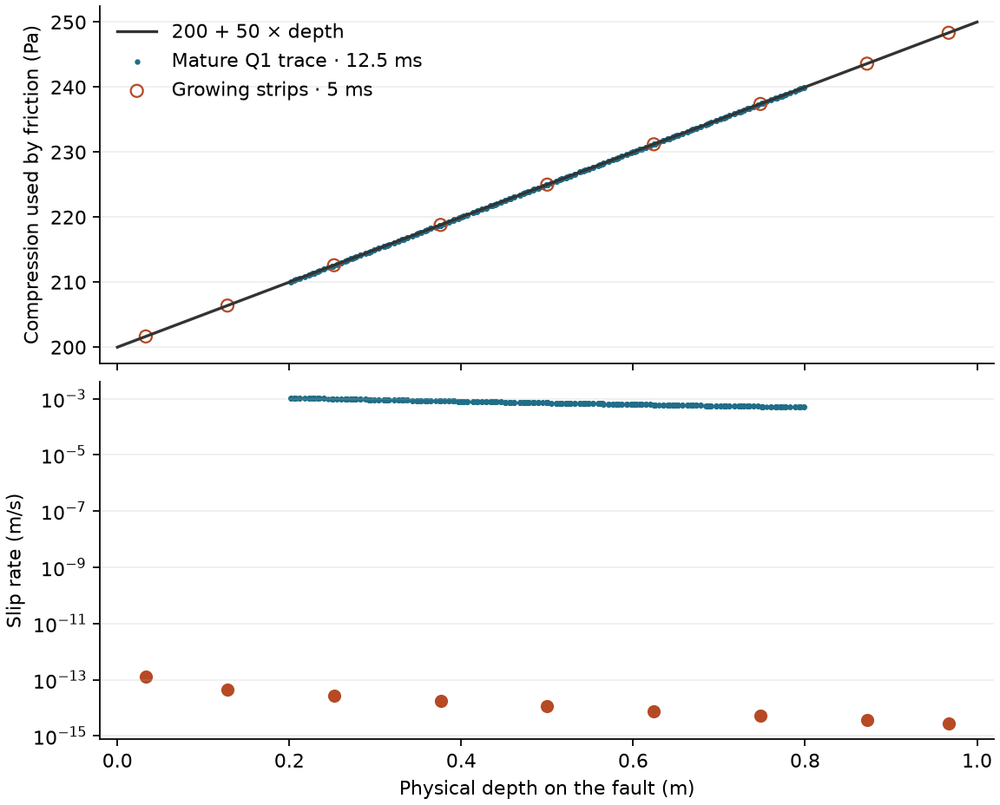
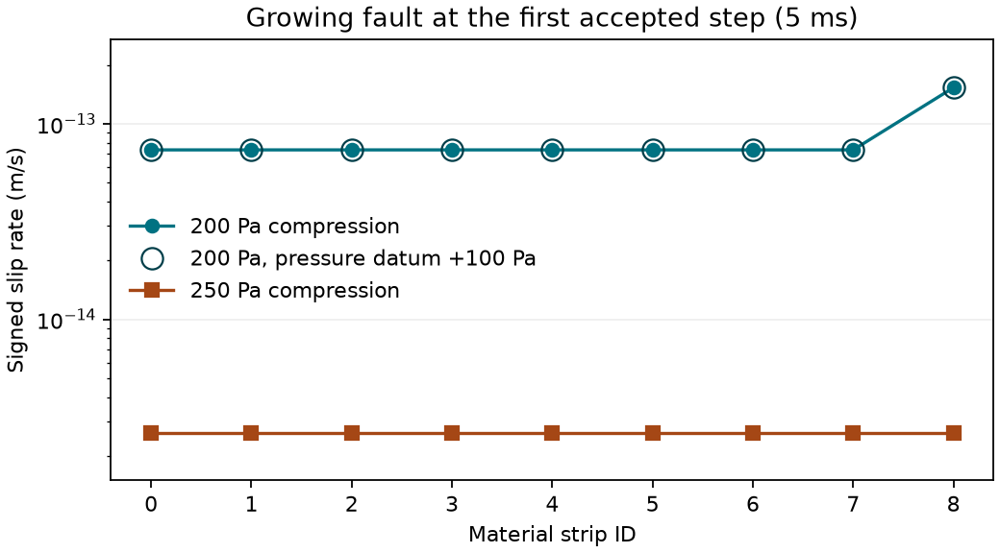
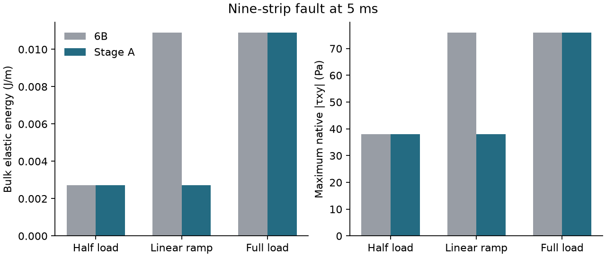
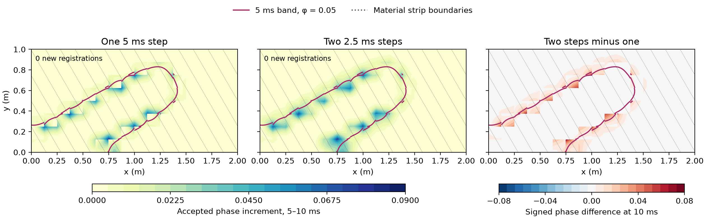
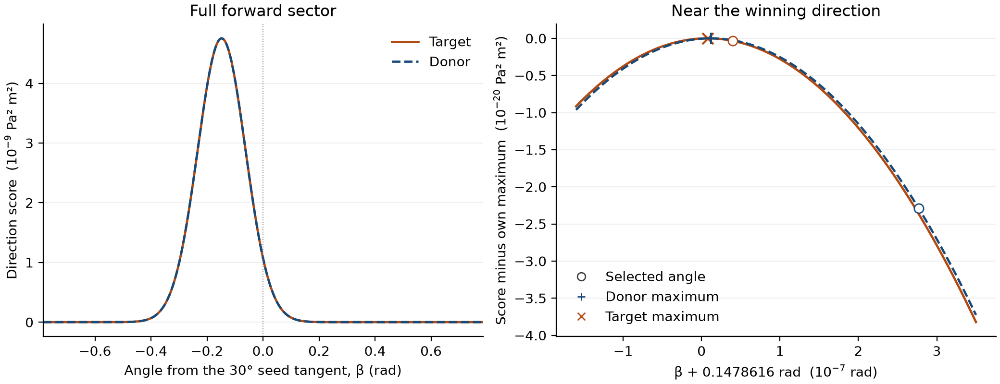
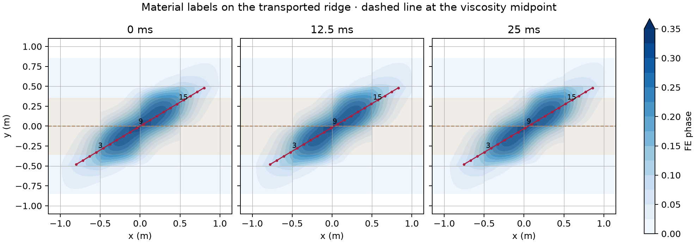

# Phase-field fault working record

## 60° BP3 launcher handoff

The [two-node, 160-rank launcher and replay instructions](results/bp3-preparation/server.md#launcher-and-startup-identity) use the donor at `612b75d35`. The versioned handoff is in `build-bp3-preparation/launcher` with input kit SHA-256 `5cb5e498b789a18fed6451288f8fecd314b3debfd68866c2c6a9c75f9f813d6c`. Both archives passed their checksums. Running `python3 donor_startup.py BP3.o3616642 fault.txt` inside the unpacked kit confirmed both runtime DSOs and all five physical anchors. Removing the restored-BP3 library record and changing one x coordinate by 1 m each failed as expected. The preceding job's stack and repair procedure identify the historical scratch plugin build prefix. The launcher records the selected solver path, both resolved DSOs, build cache and data paths. Stampede3's original ELF hashes and step-4229 restore remain unverified here.

## 60° BP3 server preparation during Assignment D review

The [inventory, figure and branch readiness checks](results/bp3-preparation/README.md) start from `0293a5994`. The next server action is to verify job 3616642's native step-4229 parent in slot 03, preserve it, and repeat steps 4230–4237 on the matching 160-rank stack. The donor installation, merged input, five geometry anchors, original launcher and older incompatible restarts are identified in the [server runbook](results/bp3-preparation/server.md). Its replay compares all eight accepted clocks, durations, physical stress and paired-work diagnostics. The distributed parent and writer ELF files were unavailable locally. The server restore, new physical steps and three-event trajectory are pending.

The [native histories and catalogue tests](results/bp3-preparation/history.md) establish one upward crossing of 10⁻³ m/s at 163.893087 yr. The last saved profile reached 1.375533 m/s, with 1.216773 m additional slip at 5 km. Recovery has yet to be observed. The [wall timer replay](results/bp3-preparation/timing.md) measured 63.16 wall s/interseismic step and 50.22 wall s/rapid-slip step. From step 4229, allowing 4,000 or 8,000 advances per event and repeating the initial loading cost gives 91.63 or 203.23 more wall hours to third onset and 147.43 or 314.84 h through third recovery. Both budgets are conditional on the unmeasured event and recurrence lengths.

One-rank installed Release checks reproduced all three free-32 clocks (largest rate error 1.39e−15 m/s). The boundary-spanning checkpoint, boundary endpoints in fixed-interior mode and two-valued RSF direct effect each produced the expected diagnostic. A middle-rate perturbation on a right-dipping trace returned +0.589018955762738 m on the Stokes RHS and +0.589018955762740 m on the reverse row. Reversing vertex order preserved the sign. The donor thrust requires the negative of that action at the same measure. Exact test and plotting commands are in the linked records. Preparation used one numerical thread per local process. The archived throughput measurements used 160 MPI ranks and one thread per rank.

The two transport archives are in `build-bp3-preparation`. The input kit SHA-256 is `9a2ec183a82a65349aee2d76a1dd8a11ae885a7b9be63d3e37170a01a10e6f09`; the pinned donor source archive SHA-256 is `5734db7d88332eed6e3cf69c170d89f33d9514b9de2cb9f2f84c8c937f76e542`. Both passed `(cd build-bp3-preparation && sha256sum -c server-archives.sha256)`. An independent unpack verified all 13 input files. The source archive contains the pinned Git commit, matching repaired work observer, World Builder, Catch and BP3 plugin sources.

## Assignment D — Installed fault examples

Started at `3617163671e7aadbe52385b6f11de946db4a5283` on `pf-rsf`. The two [public inputs and run instructions](IMPLEMENTATION.md#run-the-two-poster-examples) and [poster figures, captions and plotting commands](results/iposter/README.md) are ready for review. Both runs used the ordinary installed Release executable from fresh directories outside the checkout. The growing seed needs only ASPECT. The moving example uses its benchmark plugin rebuilt against the matching SDK. C2 production source, reference data and comparison tolerances are unchanged. The default layered loading remains 2 m/s. The code for the growing input is in `fc5b6054b`, frame/load checks in `afba3bc5c`, the layered input, provider and checks in `b15cf0040`, and the plotting scripts and rendered figures in `6f63215fa`.

### Growing seed at 5 ms

The one-field AT1 run and corrected four-field constant-compression run used the same 8 × 4 mesh, 5 ms step, 200 Pa compression and two MPI ranks. Each rank owned 2,484 native samples. Keying the returned tensors by cell and quadrature index gave zero difference in xx, yy, zz and xy in Pa. All nine formed flags, angles, arclengths, signed rates, resistances, ages and cumulative slips matched. Every work and energy term matched, with a maximum absolute difference of 0 J/m (bulk energy 0.0108994550203, fracture energy 6.54571263385, external work 0.0108997275253 J/m). Strip 8 gave β = −0.14786810579423598 rad relative to the seed and ds = 0.25074188693430988 m. Both equal the corrected C2 values. The figure draws the new direction from accepted material stations and reconstructs the FE phase from the exported coefficients. This one step measures initiation.

| Strip | Station depth (m) | Default compression (Pa) | Default rate (m/s) | Compression at 50 Pa/m (Pa) | Rate at 50 Pa/m (m/s) |
| --- | ---: | ---: | ---: | ---: | ---: |
| 0 | 0.967004940 | 200 | 7.34744584e−14 | 248.350246981 | 2.86410793e−15 |
| 8 | 0.032995060 | 200 | 1.53013875e−13 | 201.649753019 | 1.32712211e−13 |

The [three-run replay](results/iposter/check-growing.sh) and [growing regression commands](results/iposter/growing-checks.md) cover all nine pressure stations, the affine one-/two-rank and off-peak comparison, restart, cutback, 26 interface cases, 14 material-setting cases and all six native writer controls. After a rank-1 write failure the successful retry matched 4,968 native points and 1,280 FE records at both clocks. The [frame and loading commands](results/iposter/frame-checks.md) include the translated growing seed, 20° dip, field permutation, time-dependent and reversed loading, the vertical mature-trace limit and the fixed laboratory traction. Leaving the wall origin behind when translating the seed by 10,000 m gave x and y velocity errors of 71.60254 and 24.01924 m/s. With the correct origin the errors were 4.26e−15 and 2.46e−15 m/s or less. The strict 60° free-32 reference passed at all three clocks. The 64² donor support check covered 23,984 active points and all 12,880 other samples at both clocks.

### Layered moving fault through 25 ms

With the default loading all 13 accepted bulk, label, background and cell-load files matched the retained pre-D public trajectory byte for byte. Against the frozen donor, the largest principal-run 25 ms differences were 3.90e−11 m in vertex position, 1.19e−9 m/s in rate and 2.40e−9 Pa in deviatoric stress. Principal, zero and reverse translation passed their original comparisons. The public plot follows all 20 IDs. At 25 ms vertex 9 had moved +52.149417 mm in x, 2.149417 mm beyond the shared wall motion. The end vertices differed by 11.065447 mm in horizontal displacement.

- At fixed 2 m/s translation, changing the top-minus-bottom velocity contrast from 2 to 1 m/s changed the wall end speeds from (1, 3) to (1.5, 2.5) m/s. The 12.5 ms top shear traction fell from 0.0607273563419 to 0.0303636781710 Pa. Both agree with independent integration of the reference Maxwell column to 1e−12 Pa.
- Changing the mature degradation magnitude from 50 to 200 at fixed phase changed vertex 9's initial normal compliance integral from 11.7448091151 to 46.9792364606 m. Dividing each of the 20 new integrals by four matched independent cell-split quadrature within 1.42e−14 m. All 1,728 normalized slip weights were unchanged (maximum 3.4048203586 m⁻¹).
- The shipped 20-row file matched the independent historical inline input at all three clocks. Both input forms gave identical histories on each of one and two ranks. In the crossing control ID 9 moved from rank 0 to rank 1 before 12.5 ms. Resuming its serial inline checkpoint on two ranks with file input agreed with the serial clean trajectory through 25 ms (largest checked difference 1.48e−14 across the recorded columns).
- The full layered matrix gave zero clean/retry and zero same-layout restart differences. Two-rank endpoints agreed with serial within 2.46e−14 across the checked columns. The tracked 6A retry replay gave phase completions 0, 1, 1, 2 and nine byte-identical accepted physical files. The earlier 12.5 ms checkpoint at the default contrast reproduced the four 25 ms physical files and accepted clock row byte for byte. Changing its contrast to 1 m/s gave the expected checkpoint-identity diagnostic before publication. Full-ray and finite-width continuation passed and their mismatches were rejected. The phase/xx permutation produced zero difference in the named columns.

### Installation and layered verification commands

The retained external run root is `/tmp/aspect-iposter.UpyGyZ`, accessible from the checkout at `build-assignment-d/runs`. The frame/dip experiments are in `/tmp/aspect-frames-d.dCyqX3vz`. For a fresh replay, run the following from the checkout with a new staging directory and external run root. The prior installation supplies the matching baseline executable, SDK and previously built verification plugins. The top-level CMake examples component installs the benchmark sources and data. Only the layered provider needs recompilation for this assignment.

```sh
W=$PWD
D=$W/build-assignment-d-replay
E=$(mktemp -d /tmp/aspect-iposter.XXXXXX)
mkdir "$D"
cp -a --reflink=auto build-branch-readability/install "$D/install"
I=$D/install
cmake -DCMAKE_INSTALL_PREFIX="$I" -DCMAKE_INSTALL_LOCAL_ONLY=ON \
  -DCMAKE_INSTALL_COMPONENT=examples -P build-6b/release/cmake_install.cmake
export ASPECT_SOURCE_DIR="$I" OMP_NUM_THREADS=1 OPENBLAS_NUM_THREADS=1 DEAL_II_NUM_THREADS=1 MPLBACKEND=Agg
MPI=/opt/openmpi/5.0.6/bin/mpirun
L=$I/benchmarks/layered_moving_fault
A=$I/bin/aspect-release
P=$L/liblayered_moving_fault.release.so
cmake -S "$L" -B "$D/layered-plugin" -DAspect_DIR="$I/lib/cmake/Aspect"
cmake --build "$D/layered-plugin" -j 1
cp "$D/layered-plugin/liblayered_moving_fault.release.so" "$P"

MPIEXEC="$MPI" bash refactoring/phase-field-fault/results/iposter/check-growing.sh "$I" "$E/growing"
mkdir "$E/layered-public"
printf 'include %s/layered.prm\nset Additional shared libraries = %s\n' "$L" "$P" >"$E/layered-public/input.prm"
(cd "$E/layered-public" && "$A" input.prm)
O=$E/layered-public/output-layered-moving-fault
B=$W/build-branch-readability/mature/before/clean/output
for file in "$B"/material-*.csv "$B"/load-*.txt "$B"/background-*.csv "$B"/layered-background.csv; do
  cmp "$file" "$O/$(basename "$file")" || exit 1
done

T=$W/build-branch-readability/tests
python3 -BO "$L/check_review.py" "$A" "$P" "$E/layered-review-final"
python3 -B "$L/run.py" "$A" "$P" "$T/libfixed_fault.release.so" "$E/layered-matrix" --mpiexec "$MPI"
python3 -BO "$L/check.py" "$E/layered-matrix" "$W/build-4c/donor/output" "$E/layered-matrix/comparison.png" \
  --zero "$W/build-4c/donor-zero/output" --reverse "$W/build-4c/donor-reverse/output"
python3 -BO "$L/check_vertex_file.py" "$A" "$P" "$E/layered-vertices" --mpiexec "$MPI"
python3 -BO "$L/check_restart_width.py" "$A" "$P" "$E/layered-width"
python3 -B refactoring/phase-field-fault/replay_6a.py moving-retry "$A" "$T" "$E/layered-6a" --layered-plugin "$P"
bash refactoring/phase-field-fault/results/iposter/replay_layered_checkpoint.sh "$I" \
  build-branch-readability/mature/before/seed/output/restart/01 "$O" "$E/old-layered-replay"

cmake -S tests -B "$D/tests" -DAspect_DIR="$I/lib/cmake/Aspect" -DASPECT_BINARY="$A" \
  -DASPECT_RUN_ALL_TESTS=ON -DASPECT_COMPARE_TEST_RESULTS=ON
ctest --test-dir "$D/tests" --output-on-failure -R '^(layered_moving_fault|layered_fault_traction_step|growing_fault)$'
```

The tracked three-run seed replay reproduced the first comparison log byte for byte. All 25 changed benchmark inputs, sources, data files and scripts matched their installed copies. All three scoped CTests passed against their existing references. The installed executable SHA-256 was `d75d72aec4714266631244fbe621fb2a007388c0c85abc5197e6c26517792edc`. Each numerical rank used one thread. The only three-rank run was the writer failure/cleanup control. Figure sources, measured clocks, PDF/PNG outputs and the plotting commands are in the [figure record](results/iposter/README.md).

**Observed limits.** At 45° the growing graph on this 2 × 1 m mesh has no in-box segment for the first adiabatic pressure station. At 32² the exploratory matched-Q1 case omitted roughly 2e−6 of the normal weight and stopped at the existing support guard, as it did with the pre-D driver. Their inputs and stops are retained. All requested scientific comparisons on the supported cases passed. The four historical strip-15 differences retain their strict audit result. The poster covers a single growing initiation step and 25 ms of mature-trace motion. Timestep-converged sustained front advance, the production BP3 sweep and the regional calculation remain open.


## Branch-wide readability review before Assignment D

The scope is the 315 files changed between ASPECT 3.1.0 (`0d97d2d33`) and the local behavior baseline `1f0f5b413`. That entry commit is the C2 checker repair. Entry had no staged or unstaged project-source changes. The incoming review/assignment files and local skill directory were left in place. The [path ledger](results/readability/coverage.tsv) records 67 edited source/verification paths, 123 inspected paths, 28 inspected inputs, 76 reference/generated paths, 19 historical records, and these two updated working documents. The [replay guide](results/readability/README.md) gives the build, install, comparisons and source-specific recorder commands.

| Review group | Local commits | What to look for |
| --- | --- | --- |
| Phase functional and transport | `5a932b942`, `1de195a4a` | SIPG cell and interior-face rows, bounded and signed coefficient representations, accepted velocity and the halo for each SSPRK stage |
| Mature trace and weak load | `09530abb0`, `c5b1b7906` | Rotated incoming stress, the projected stress that supplies cell work, and the physical response that passes the post-solve veto before acceptance |
| Phase and DG verification | `ed7a6cc53`, `0c8073d6d`, `9497b50e7` | Owned cell/row identities, independent transport actions, nonuniform spin and physical bounds. The final commit restores the entry-mean diagnostic caught by the two-rank negative control |
| Shared simulator | `b375eb207` | Configured material construction, composition method and FE selection, Picard convergence callbacks, basis checks before restoring coefficients |
| Growing material and solver | `b9a786beb`, `2646c0de9` | Native tensor history, signed material resistance, full-strip versus disk moments, solved stage, Newton rows and endpoint publication |
| Integration tests and installed examples | `affa26244` | Signed RHS work, snapshot identities and clocks, comparison budgets, CTest dependencies and measured statistics fields |

Three changes illustrate the scope of the edits.

1. The native Maxwell update used to take seven positional arguments, including an unnamed material parent. Its declaration now identifies the accepted tensor, deviatoric half-step displacement gradient, stage length, slip plane, signed resistance and traction remainder. The tensor retains zz in plane strain. The growing material owns the accepted result.
2. The mature Picard loop used to refer to the rotated parent and the cell projection with little indication of their distinct lifetimes. Read `prepare_parent`, `project_boundary_slip_load` and `project_interior_response` with their field declarations. The weak slip load acts on the ordinary Stokes RHS. For an interior curve the returned velocity and section rates must pass the projected-response veto before the post-accept callback commits physical stress and label history.
3. The section tangent recorder used to depend on the spelling of a long expression inside bulk sampling. It now observes the completed point consumed by the residual and the reduced Newton bands before elimination. The stationary and moving recorders identify different Picard iterations. The growing recorder independently locates the single call that writes candidate fields after both convergence gates.

The shared ASPECT edits stay within branch-owned dispatch and immediate integration code. Material construction previously encoded the field-method test inline in the simulator initializer. Checkpoint compatibility still reads each saved field’s basis before restoring solution coefficients. The generic no-fault route is exercised by the stock matrix test, mixed-field callers by both orderings and the cross-binary checkpoint, and Picard/acceptance by the fixed and moving controls. The branch-owned section, midpoint and DG operators retain their previous ownership. Old and new C++ numeric literals have the same sequence in each edited file; the independent tests below also exercise the order of physical operations and reductions.

### Measured behavior

All physics comparisons used Release, one numerical thread per rank and the same one-/two-rank layouts as their controls. The reference installation was retained separately from the build and SDK under review.

- **Stock and public interface.** The Release unit suite passed 2,580 assertions in 62 cases. The complete parameter XML (1,239,167 bytes) and JSON (1,296,285 bytes) and the fault-off statistics were byte-identical. Their SHA-256 values are respectively `def2de40f4e91d8ba65fa036d8294c26ed774748974273e5f833b4e839206e51`, `020da3732b90f0ba478129fbbfef3380eb62b98bf83bf3966ffbfdf09a4652d2` and `555acc5889386b84ef43a6887adeac084c0a2b0fb26fa609b37e8fdc4b7d07cb`.
- **Phase functional.** All nine serial energy statistics files matched the pre-pass executable byte for byte. In J/m the affine local, gradient and total energies were AT1 (3, 0.1171875, 3.1171875), AT2 (2.333333333333334, 0.15625, 2.489583333333334) and CZM (3.607512043416293, 0.0994718394324345, 3.706983882848727). The two-rank calculation split the cells 8/8 and diagnosed the deliberately invalid phase on one owner.
- **Transport and restart.** Both mixed field orders matched the all-implicit companion and its measured (324, 0) allocation; the all-explicit allocation was (0, 0). The two-rank z-slab receiving integrals differed from the independent phase and tracer predictions by 2.78e−17 and 1.39e−17. Across ranks the maximum coefficient difference was 1.94e−16. The asymmetric check distinguished the swapped face values (error 0.0118875). An actual pre-pass 3-D checkpoint written at 0.02 s continued at 0.03 s with the same coefficients, field names, bases and clock as the direct calculation. The legacy pre-basis nodal reader, opposite-basis rejections, bounded mean and active partition controls also ran. The 4A stress return to Stokes was −0.29364437004440325 Pa m² versus −0.29364437004440386 analytically and −0.3084580370518121 for stale receiving-cell stress. All 39 checked stress/label files matched the retained Q8 control.
- **Mature trace and section.** Free-32 matched every reference label at 0, 12.5 and 25 ms; all 13 physical/check files matched pre-pass bytes. The one-cell paired work was 0.494235968292736 m in both directions. For the inclined trace with a label knot in a cell, the normalized Stokes error fell from 8.19748e−6 to 5.10250e−7 m on 8² to 32² cells; the largest forward/reverse difference was 2.00e−15 m. The four-row CSV and [work-error figure](results/transfer-work/work-error.png) reproduced byte for byte. The installed moving run rejected the 25 ms attempt and reproduced the clean frames, and read the pre-pass 12.5 ms checkpoint to reproduce the four 25 ms physical files. These are comparisons of accepted state.
- **Live tangent observation.** On the first Picard assembly of step 2, 44,730 Q8 points contributed, 22,365 per rank on two ranks. The relative directional error was 1.838e−10. On moving Picard iteration 2 at 25 ms the frozen projection defect was 0.013652606 Pa and the relative error was 1.46e−10 on 2,120 points. Substituting label-interpolated stiffness gave 1.057e−4. Both probes reproduced the archived point samples and bands. Matching ordinary/recorder files were identical for stationary serial, stationary two-rank and moving serial.
- **Growing material.** In cold creep the published signed RSF defect was 1.4211e−14 Pa, the stored native rate defect 2.1583e−27 m/s (1.3511e−24 allowed) and the frictional work +8.45045e−23 J/m. A unit phase was admitted; 1.001 was rejected. The pre-pass growing generation 01 restored on two ranks and all 5, 10 and 15 ms physical CSVs matched the uninterrupted pre-pass run.

- **External SDK laws.** At 5 ms, doubling the public growing shear modulus from 1e6 to 2e6 Pa changed accepted xy stress from 75.978862635792 to 151.954052677598 Pa at viscosity 1e8 Pa s. The separately compiled plugin recovered prescribed impedances of 750 and 1,500 Pa s/m. Conflicting public/legacy law weights were rejected. The state-free forward/reverse test measured at most 1.041e−17 m/s rate error and exercised both the mature and growing contracts.
- **Test infrastructure.** All 14 scoped CTests passed. In the first run, the stock screen-output test reported two sandbox MPI socket messages before the expected output. Its statistics already matched. Rerunning that test with local MPI access regenerated the output and passed the original comparison. The two-rank bounded-phase negative control also caught the inadvertently renamed diagnostic during this pass. The restored text passed on the installed binary. Every original C++ string token, including concatenated parameter help, matches at the end. The stock time-dependent Picard run reproduced all 23 iteration records and the statistics from the independently identified pre-6A writer. Successful completion counts were 5, 1, 1, 1, 1.

- **Direction and accepted growth.** All 23 ordinary nine-strip CSVs matched the pre-pass 0/5/10/15 ms trajectory byte for byte, including accepted fields, native points, strip histories and work. At 5 ms strip 8 remained at −0.14786810579423598 rad and 0.25074188693430988 m. Its signed errors against the independent C1 peak and corresponding length were +8.7264e−10 rad and −3.2593e−11 m. On affine pressure the one-/two-rank angle difference was 6.9636e−9 rad and the arclength difference was 2.6012e−10 m. Both off-peak (+0.23 rad) checks passed. Each comparison mode rejected all six injected angle/length errors and the independent native zz-stress mutation. Continued and unwrapped wall functions agreed in both directions; matching NaNs, a one-sided infinity and a missing velocity component were rejected. The portable archive passed in both modes with their matching outputs.
- **18-strip exception.** The ordinary executable and the returned-row recorder from the final link each ran parent, coarse and half schedules on two ranks. All 54 physical CSVs, 10 row shards (5,760 rows, including the repeated parent) and nine strict-audit files matched their pre-pass counterparts byte for byte. Of 387 comparisons, exactly four exceed budget. Each is strip 15’s angle at the common parent (5 ms), coarse endpoint (10 ms) or fine endpoints (7.5 and 10 ms). Each signed difference remains −2.7244749450927586e−7 rad, 2.37352 times its allowance. The fresh strict audit returned its original exit status 1. The installed figure measured a 10 ms coarse/fine phase-field L² distance of 0.007426652668 m, with the same value from the independent native integration.

The final installed binary has SHA-256 `d75d72aec4714266631244fbe621fb2a007388c0c85abc5197e6c26517792edc`. The complete installed verifier ran outside the checkout in a fresh directory under `/tmp`; all external observers were compiled against the reviewed SDK. In the local build record `build-branch-readability/external-directory` gives that run’s location. The historical C1 captures and C2 score patch retain their original sources and references. Tests here qualify the small Release cases. A full upstream CTest sweep, Debug rebuild, performance study and large earthquake-cycle calculation were outside this assignment.

For independent review, start at `include/aspect/material_model/rheology/cohesive_maxwell.h` for the local physical contract, then `source/simulator/solver/midpoint_fault.cc` for the collective solve and `source/reconstructed_fault/stokes_coupling.cc` for the mature Picard/acceptance path. The replay guide links the regenerated inclined-work figure and gives the command. Assignment D, the public-example redesign, is next after review.

## Assignment C2 review closeout

Starting at `3cb478a30`, the reversal checker now negates the wall function recorded by the forward ASPECT run. The installed Release example and the continued input matched byte for byte on all eight CSVs per direction at 0 and 5 ms. The maximum horizontal and vertical reversal defects were 1.7347e−18 and 1.9516e−18 m/s. The same run with named variables and a nonempty wall constant also matched. Replaying saved fields rejected matching vertical NaNs, a single infinity in the reverse run and missing velocity components. The finite pair passed.

Shifting strip 8 by −3e−8 rad and recomputing arclength passed ordinary comparison. The original corruption probe missed the first angle on this input. With the repair, both corrected and historical modes rejected each of the six geometry errors by clock, quantity and material ID, and each rejected the native zz stress mutation. The [review controls and exact commands](results/direction-c2/README.md#reproduce-the-review-controls) reproduce these checks on one rank with one thread. This verification commit closes C2. The previous strict 18-strip audit retains the four documented strip-15 angle differences.

## Assignment C2 — stable growing-fault direction score

From `bffffca07`, production commit `34fd65a86` uses the signed root's rate and mobility to evaluate the disk's small excess traction in cold creep. The production call path is `select_prospective_planes → score_plane → candidate_onset → friction().solve_strip`. Read `include/aspect/reconstructed_fault/onset_score.h` for the algebra and `source/simulator/solver/midpoint_direction.cc` for the caller. The correction keeps the same pressure, stage age, signed friction equation, search and gain threshold. The second commit contains the six authorized geometry entries, checker and evidence. The [run record and figure](results/direction-c2/README.md) give exact build, simulation, plotting and rejection-test commands. The [18-strip record](results/direction-c2/strip18.md) gives the same-source recorder build and strict audit command.

On two ranks the ordinary nine-strip calculation accepted −0.14786810579423598 rad at 5 ms, +8.7264e−10 rad from the independent C1 peak. The captured width divided by the cosine of that peak predicts 0.25074188696690238 m. The measured arclength was 0.25074188693430988 m, an error of −3.2593e−11 m. Both values held at 10 and 15 ms. Relative to the archived donor this moves strip 8 by +7.66045e−7 rad and −2.86113e−8 m at each clock. Every other native-point, section and energy comparison passed its original tolerance. The installed checker rejects separate angle and arclength corruptions at each clock, and compares the old executable successfully with the historical donor.

The ordinary affine-pressure one-/two-rank differences were 6.9636e−9 rad and 2.6012e−10 m. Both +0.23 rad probes and the signed forward/reverse controls passed. The previous score failed the frozen direct-peak and forward/reverse checks. The corrected Release suite passed 2,580 assertions in 62 cases, including the zero-mobility case. On the frozen nine-strip input, two rejected attempts and continuations from checkpoints 01 and 03 reproduced clean accepted results.

On the 18-strip control all six ordinary/recorder two-rank runs completed. The physical outputs were byte-identical and all 4,608 returned phase rows passed. The strict audit reports the four historical strip-15 angle failures only. The difference from the donor at parent 5 ms, coarse 10 ms, and fine 7.5 and 10 ms is now −2.724475e−7 rad (formerly −2.368944e−7 rad), against 1.147861e−7 rad allowed. Its arclength differs by +5.08763e−9 m, within 1.25471e−8 m. The other 383 comparisons passed. No 18-strip reference was revised. One numerical thread per MPI rank was used throughout. Next action is author review of the production and reference commits.

## Assignment C1 — strip-8 direction selection

The first frozen nine-strip turn was replayed from `1d7799291` against the isolated score in `46b426a3f`. Production, candidate and a 65-decimal pointwise reference used the same accepted state and converged midpoint field. The frozen two-rank case first rejected both strip-7 proposals, then turned strip 8 in grid bin 52. On golden-section comparison 20 the true right-minus-left score is +3.68364e−21 Pa² m². Production returned −2.03537e−20 and discarded the side containing the peak. The candidate returned +3.68375e−21 and retained it.

| Case at 5 ms | Direct peak (rad) | Production − peak (rad) | Candidate − peak (rad) |
|---|---:|---:|---:|
| Frozen, 2 ranks | −0.147868106666875 | −6.9610e−7 | +8.7264e−10 |
| Affine, 1 rank | −0.147885945931339 | −1.4838e−6 | +8.6714e−9 |
| Affine, 2 ranks | −0.147885945935012 | −6.2720e−7 | +1.7115e−9 |

The frozen donor, production and candidate lengths at 5 ms are 0.25074191554565439, 0.25074191296576476 and 0.25074188693430988 m. The solved angles and common reference width reproduce all three. The direct peak gives 0.25074188696690238 m, itself 2.85788e−8 m from the donor, beyond the existing 2.50842e−8 m allowance. Only strip 8's angle and arclength exceed their frozen budgets, repeated at 5, 10 and 15 ms. The ordinary affine rank check reproduced its angle and length failures. The candidate passed it, including its off-peak pressure control. The report includes both strict results, the complete per-column nine-strip audit and the independent replay on both historical and current captures. All ASPECT runs used one numerical thread per rank.

**Decision for C2.** The candidate better locates the physical score maximum on all three fields. Recommend adopting it in a separately reviewed change if the author approves new strip-8 angle and arclength references for the frozen case. The current reference files, tolerances and production selector are preserved. The separate 18-strip result retains its four historical strip-15 exceptions.

The report gives the exact ordinary-run and offline commands. A replay from the packaged turns reproduces all seven peak, search and arclength CSVs. To regenerate the figure from the measured fields and tables:

```bash
E=refactoring/phase-field-fault/results/direction-c1
python3 -B "$E/plot.py" "$E" "$E/strip-8-score.png"
```

```text
refactoring/phase-field-fault/results/direction-c1/README.md
refactoring/phase-field-fault/results/direction-c1/peak-summary.csv
refactoring/phase-field-fault/results/direction-c1/frozen-golden.csv
refactoring/phase-field-fault/results/direction-c1/strip-8-score.png
```

## Mature fault material readability

Starting commit `dbe645bb6`. In `source/material_model/phase_field_fault.cc`, start at `parse_fault_vertex_table`. Its caller distributes the file contents once. The parser assigns positions, optional ages (s) and persistent shear tractions (Pa) in material ID order. The matching header describes the accepted diagnostic state and the trial section used by Stokes. In the coupling, `prepare_iteration` prepares that trial section, and `accept_step` calls `accept_section_rates` after the repeat decision. The effective Maxwell viscosity (Pa s) and dimensionless stress relaxation factor now have distinct names at their callers, including the rate-tangent capture.

The Release parameter XML (1,239,167 bytes, SHA-256 `def2de40f4e91d8ba65fa036d8294c26ed774748974273e5f833b4e839206e51`) matched the retained Q8 installation byte for byte. This includes all 27 entries under the mature model. The strict free-32 check passed. All 38 label rows and the bulk-point exports at 0, 12.5 and 25 ms were byte-identical to the Assignment B outputs. The moving tangent capture checked 2,120 Q8 points at the later Picard iterate. Its relative directional error was 1.46e−10, and substituting label-interpolated stiffness produced 1.057e−4. The Release unit suite passed 2,574 assertions in 61 cases.

The vertex checker compared all 20 material IDs on one and two ranks. File and inline inputs agreed exactly on each rank count at all three clocks. ID 9 crossed from rank 0 to rank 1. The maximum serial/two-rank difference across label and bulk sample columns was 1.96e−14. The serial checkpoint resumed on two ranks within 1.48e−14 (existing budget 1e−8). On the three-label input the pre-edit and rebuilt executables produced identical label tables and accepted xx, yy and xy stress arrays. Reversing the order of the age and shear columns, adding trailing comments and inserting blank lines reproduced the same results. All eight invalid vertex inputs raised their expected diagnostics.

The installed interface and mature-settings checkers completed 26 and 24 cases respectively, including legacy parameter names, initial slip, external resistance laws, restart from a legacy RSF archive and rejection of incompatible settings. The full parameter JSON was also byte-identical (1,296,285 bytes). An initial run with a benchmark library compiled before Assignment B failed in a derived material. Rebuilding the plugin against the installed headers resolved the mismatch. The code and commands below use that matching SDK.

Run from the worktree root with fresh output directories. All simulations used one numerical thread per rank.

```sh
W=$PWD
B=$W/build-6b/release
D=$W/build-readability
I=$D/install
A=$I/bin/aspect-release
export OPENBLAS_NUM_THREADS=1 OMP_NUM_THREADS=1 DEAL_II_NUM_THREADS=1 UCX_LOG_LEVEL=error
mkdir -p "$D"
cmake -S . -B "$B" -DCMAKE_INSTALL_PREFIX="$I" -DASPECT_INSTALL_EXAMPLES=ON
cmake --build "$B" --target aspect -j2
for part in runtime includes examples Unspecified; do
  cmake -DCMAKE_INSTALL_LOCAL_ONLY=ON -DCMAKE_INSTALL_COMPONENT="$part" -P "$B/cmake_install.cmake"
done
(cd benchmarks/fixed_fault && "$W/build-review-b/closeout/install/bin/aspect-release" --output-xml mature_trace.prm) > "$D/baseline-parameters.xml"
(cd benchmarks/fixed_fault && "$A" --output-xml mature_trace.prm) > "$D/final-parameters.xml"
cmp "$D/baseline-parameters.xml" "$D/final-parameters.xml"
(cd "$B/unit_tests" && "$A" --test)

R=$I/benchmarks/fixed_fault/phase_ridge
cmake -S "$R" -B "$D/ridge-plugin" -DAspect_DIR="$I/lib/cmake/Aspect"
cmake --build "$D/ridge-plugin" -j1
ASPECT_SOURCE_DIR=$I python3 -B "$R/run.py" "$A" "$D/ridge-plugin/libphase_ridge.release.so" "$D/final-ridge/free-32" free 32
PYTHONPATH=$R python3 -BO -c 'from pathlib import Path; import sys; from check import check_case; check_case(Path(sys.argv[1]), "free", 32)' "$D/final-ridge"
for step in 0 1 2; do
  for field in labels bulk; do
    cmp "$D/final-ridge/free-32/output/$field-$step-0.txt" "build-review-b/final-free32/output/$field-$step-0.txt"
  done
done

V=$W/refactoring/phase-field-fault/rate_tangent
M=$D/moving-capture
mkdir -p "$M"
(cd "$M" && python3 "$V/capture.py" "$W" --build "$B" --moving)
cp "$I/benchmarks/layered_moving_fault/layered.prm" "$M/input.prm"
printf '\nset Additional shared libraries = %s\nset Output directory = %s\n' "$W/build-review-b/control-plugins/layered/liblayered_moving_fault.release.so" "$M/output" >> "$M/input.prm"
"$M/aspect-review" "$M/input.prm"
python3 -BO "$V/check_moving.py" "$M/output"
```

The input and restart checks use the retained pre-signature RSF writer from C2.

```sh
G=$I/benchmarks/growing_fault
T=$I/benchmarks/fixed_fault
L=$I/benchmarks/layered_moving_fault
M=/opt/openmpi/5.0.6/bin/mpirun
Q8=$PWD/build-review-b/install
P=$PWD/build-review-b/control-plugins/tests/libfixed_fault.release.so
V=$PWD/build-review-a2/test-plugins/libdashpot.release.so
Q=$PWD/build-review-a2/probe/libfault_parameter_probe.release.so
OLD=$PWD/build-interface-c2/qualified-sdk/bin/aspect-release
mkdir -p "$D/replay-baseline"
cp "$Q8"/benchmarks/fixed_fault/{fixed_fault.prm,mature_trace.prm,mature_vertices.txt} "$D/replay-baseline/"
(cd "$D/replay-baseline" && "$Q8/bin/aspect-release" mature_trace.prm > run.log 2>&1)
for item in growing_fault layered_moving_fault; do
  case "$item" in growing_fault) target=growth-plugin ;; layered_moving_fault) target=layered-plugin ;; esac
  cmake -S "$I/benchmarks/$item" -B "$D/$target" -DAspect_DIR="$I/lib/cmake/Aspect"
  cmake --build "$D/$target" --parallel 1
done
python3 "$G/check_interface.py" "$A" "$D/growth-plugin/libgrowing_fault_checks.release.so" "$D/final-interface"
python3 "$L/check_vertex_file.py" "$A" "$D/layered-plugin/liblayered_moving_fault.release.so" "$D/final-vertices" --mpiexec "$M"
PYTHONPATH="$T" python3 - "$D" <<'PY'
from pathlib import Path
import sys
from check_mature_settings import compare_accepted
d = Path(sys.argv[1])
compare_accepted(d/'replay-baseline/output-mature-trace', d/'final-interface/mature/output', range(3))
PY
"$Q8/bin/aspect-release" --output-json benchmarks/fixed_fault/fixed_fault.prm > "$D/replay-baseline/parameters.json"
"$A" --output-json benchmarks/fixed_fault/fixed_fault.prm > "$D/final-parameters.json"
cmp "$D/replay-baseline/parameters.json" "$D/final-parameters.json"
python3 "$T/check_mature_settings.py" "$A" "$P" "$V" "$D/final-mature" --legacy-writer "$OLD"
python3 "$G/check_material_settings.py" "$A" "$D/final-material-settings"
python3 "$G/parameter_compatibility/check.py" "$A" "$Q" "$D/final-compatibility"
TBL=$D/reordered-columns
mkdir "$TBL"
cp "$T/fixed_fault.prm" "$T/mature_trace.prm" "$TBL/"
awk '{print $1, $2, $3, $5, $4, "# optional columns reversed"; print ""}' "$T/mature_vertices.txt" > "$TBL/mature_vertices.txt"
(cd "$TBL" && "$A" mature_trace.prm)
PYTHONPATH="$T" python3 -c 'from pathlib import Path; from sys import argv; from check_mature_settings import compare_accepted; compare_accepted(Path(argv[1]), Path(argv[2]), range(3))' "$D/replay-baseline/output-mature-trace" "$TBL/output-mature-trace"
```

## Assignment B closeout

Assignment B is closed against the reviewed production implementation at `623bb1c57`. The reference for the fitted free-32 case now uses its Q8 slip-load projection. The strict and independent checker modes both passed on the retained ridge outputs, including the archived two-rank and retry frames. A fresh one-rank, one-thread Release calculation also passed the strict free-32 comparison. All six physical columns matched exactly for all 38 labels at each clock (0, 0.0125 and 0.025 s). IDs and clocks were exact. The numerical budget remains 1e−10 absolute plus 1e−8 relative.

| Initialization transect | Wide peak slip shear rate (s⁻¹) | Narrow peak slip shear rate (s⁻¹) | Swapped inputs |
|---|---:|---:|---|
| 32² | 0.0353428118557 | 0.0707618929760 | Strict and independent each rejected 32² |
| 64² | 0.0353419597233 | 0.0706856237115 | Strict and independent each rejected 64² |

Both modes first call `check_shear_concentration` on the upper DG trace at y = 0. It reads the sampled engineering slip shear rate and applies the existing narrow-peak > wide-peak comparison on each grid. The single-cell work driver now checks the normalized reverse actions for the two rate perturbations with an absolute tolerance of 2e−13 m and zero relative tolerance. The unmodified one-cell result matched the archived file byte for byte (both actions 0.49423596829273647 m). Adding 1e−10 m only to the positive-perturbation reverse action raised it to 0.49423596839273654 m. The reviewed driver accepted the mutation. The repaired driver exited 1 at the reverse-action comparison.

**Reference provenance.** The new CSV was exported from the accepted Q8 frames in `build-review-b/final-free32/output`. Those three label files match the reviewed run, the archive in `build-review-b/ridge/free-32/output` and the fresh closeout run byte for byte. Its SHA-256 is `ef46aa6e242685096f55cdd6b397899605a43b2c3e9f9122dd92d1190b9539af`. The historical Q3 CSV retains the bytes recorded at `fb4b6b9b2`, SHA-256 `98a5e5929b43b7877d8ee3c426c50758c3dc874289dd38ec6315f4022206f662`. The archived old trajectory still passes that reference. Checking it against Q8 fails on 266 of 684 physical entries. The [reference guide](VERIFICATION.md#stationary-coupling-repair) identifies both installed tables. The preceding implementation experiment's Q3-to-Q8 shifts and work-error figure are preserved below.

**Deferred performance work.** On a boundary-spanning trace, `solve_rates → sample_bulk` looks up the segment and phase weight at the Q8 points. `project_boundary_slip_load → slip_stress` repeats that geometry search while preparing the slip load on the same cells. The archived one-rank reviewer timing measured 1.51 s for the complete projection over 146 calls (143 Picard preparations plus three attempt entries), 6.9% of 21.7 s. The cost of the search alone and the savings from sharing it remain unmeasured. Future work can measure reuse of the common samples while retaining the prescribed-rate path, updating trial rates and stiffness, and rebuilding on retry. The readability pass is the next assignment.

**Replay.** Run from the worktree root with a fresh closeout destination. The complete ridge checks use the existing reviewed archives. The solver command creates the independent free-32 trajectory. The final export reproduces the approved CSV and plots the measured transects.

```bash
D=$PWD/build-review-b
C=$D/closeout
I=$C/install
R=$I/benchmarks/fixed_fault/phase_ridge
T=$I/benchmarks/fixed_fault/transfer_work
E=$PWD/refactoring/phase-field-fault/results/transfer-work
export OPENBLAS_NUM_THREADS=1 OMP_NUM_THREADS=1 DEAL_II_NUM_THREADS=1
export MPIEXEC=/opt/openmpi/5.0.6/bin/mpirun
mkdir -p "$C"
for part in runtime examples; do
  cmake -DCMAKE_INSTALL_PREFIX="$I" -DCMAKE_INSTALL_LOCAL_ONLY=ON \
    -DCMAKE_INSTALL_COMPONENT="$part" -P build-6b/release/cmake_install.cmake
done
ASPECT_SOURCE_DIR=$D/install python3 -B "$D/install/benchmarks/fixed_fault/phase_ridge/run.py" \
  "$D/install/bin/aspect-release" "$D/control-plugins/phase_ridge/libphase_ridge.release.so" "$C/fresh/free-32" free 32
PYTHONPATH=$R python3 -BO -c 'from pathlib import Path; import sys; from check import check_case; check_case(Path(sys.argv[1]), "free", 32)' "$C/fresh"
bash "$E/controls.sh" strict "$D" "$I"
donor=../aspect/benchmarks/reconstructed_fault/bp5/moment-inclined/native_history_reference/output-native_history_reference
bash "$E/controls.sh" independent "$D" "$I" "$donor" build-3a-repair/donor-cell/output
python3 -BO "$R/check.py" "$D/ridge" --history "$C/export.csv" --plot "$C/transects.png"
cmp "$C/export.csv" "$R/q8-free-32-labels.csv"
git show fb4b6b9b2:refactoring/phase-field-fault/results/3a-repair-free-labels.csv | cmp - "$R/3a-repair-free-labels.csv"
```

For each swapped-grid control the only inputs read are transects linked from the archive. Each invocation must exit 1 with the indicated grid in the shear-concentration diagnostic.

```bash
for swap in 32 64; do
  root=$C/swapped-$swap
  mkdir -p "$root/ridge"
  for grid in 32 64; do
    wide=vertical; narrow=narrow
    if [[ $grid == "$swap" ]]; then wide=narrow; narrow=vertical; fi
    ln -s "$D/ridge/$wide-$grid" "$root/ridge/vertical-$grid"
    ln -s "$D/ridge/$narrow-$grid" "$root/ridge/narrow-$grid"
  done
  bash "$E/controls.sh" strict "$root" "$I"
  bash "$E/controls.sh" independent "$root" "$I" "$donor" build-3a-repair/donor-cell/output
done
```

The positive reverse-action mutation uses the real driver and installed executable. The reader adds κ × 1e−10 to the positive raw row before the driver divides by κ. The clean and historical-mutated invocations exit 0. The repaired-mutated invocation exits 1 with “Uncancelled rate or friction dependence in reverse action”.

```bash
export ASPECT_SOURCE_DIR=$I
A=$I/bin/aspect-release
P=$D/installed-plugin/libtransfer_work.release.so
python3 -BO "$T/run.py" "$A" "$P" "$C/clean-work"
cmp "$C/clean-work/work.json" "$D/final-one-cell/work.json"
mkdir -p "$C/old-driver"
git show 623bb1c57:benchmarks/fixed_fault/transfer_work/run.py > "$C/old-driver/run.py"
for module in "$C/old-driver" "$T"; do
  PYTHONPATH="$module" python3 -BO - "$A" "$P" "$C/mutated-$(basename "$module")" <<'PY'
import run
read_frame = run.read_frame
def shifted(path, ranks):
    cells, rows, integrals = read_frame(path, ranks)
    if path.parent.name == "plus":
        rows[0] += 1e-10 * run.KAPPA
    return cells, rows, integrals
run.read_frame = shifted
run.main()
PY
done
```

## Assignment B — mature boundary-spanning work

The pre-repair experiment is commit `7dea28403` on top of `269cfd8b0cf516a3ccff8cfd67dc591a191b58b1`. It uses the actual repaired-A Release executable and an external test material. The second commit projects the boundary-spanning slip load and contains the post-repair measurements. At that revision the original fitted-fault trajectory was a strict, failing comparison. The commands and expected failures in this entry describe that revision.

**One-cell experiment.** Set an upward straight trace in the unit square with labels at heights 0, 0.5 and 1 m, uniform FE phase 0.35, full normal support, fitting off and zero initial stress. At zero physical duration impose trial rates of 0.005 m/s except at the middle label, where separate runs use 0.004 and 0.006 m/s. Restore the accepted rates before either measurement. This fixes the material geometry, phase, accepted stress, friction age and Maxwell coefficient. A test material uses the ordinary material evaluation and Stokes assembler. Its wrapper isolates that assembler's real local RHS and pairs it with the nodal coefficients of the virtual FE velocity before boundary elimination. The reverse experiment inserts the same affine velocity into the bulk FE vector, calls `sample_bulk`, assembles the middle row with `BulkPoint::add_balance` and subtracts the corresponding zero-velocity row. Both evaluations disable friction in that row and have the same rates and background stress. The prescribed-rate diagnostic bypasses the free scalar resistance solve; the free-ridge and tangent controls below exercise that solve.

With oriented tangent **t** and normal **n**, choose **v** = **t** (**n**·**x**)/s. Then 2 **t**·ε(**v**) **n** = 1/s. The physical slip stress is −2κχV sym(**t**⊗**n**) in Pa and Stokes subtracts its internal virtual work. On the section, the driving shear enters with a positive sign. Divide the centered Stokes power difference (W per metre out of plane) by the rate interval 0.002 m/s, κ = −10 expm1(−0.1) = 0.951625819640 Pa s and the virtual shear rate. On the section side take the corresponding middle-row action per unit rate and divide by the same κ and shear rate. Both normalized quantities have units of metres. Here χ = 1/m and integration of the triangular rate hat on either side of the middle label gives exactly 0.5 m.

| Operator | Stokes RHS (m) | Section row (m) | Absolute paired difference (m) | Absolute errors vs split integral, Stokes / section (m) |
|---|---:|---:|---:|---:|
| Repaired-A executable | 0.5696685170880651 | 0.4942359682927365 | 0.0754325487953286 | 0.0696685170880651 / 0.0057640317072635 |
| Assignment B | 0.4942359682927365 | 0.4942359682927365 | 0 | 0.0057640317072635 / 0.0057640317072635 |

The default equality check fails on the old executable. Its two actions separately agree with the predicted Gauss rules within 3e−13 m. The first differing operation is the cell integration over the interior kink of the middle hat.

**Production path.** At attempt entry `PhaseFieldFault::update → FaultStokesCoupling::prepare_parent` prepares the load for the incoming rates, including prescribed initialization. Picard preparation calls `solve_rates`, which samples the actual bulk strain on Q8 and assembles the Q1 section rows. For a boundary-spanning trace the coupling then mass-projects the signed, pointwise slip stress with those trial rates and that same Q8 rule into the owned cell's DGQ2 basis. The Maxwell coefficient is inside this projection. `PhaseFieldFault::evaluate → stokes_stress_offset → FaultStressLoad::execute` supplies the resulting load on the ordinary assembly points, including RHS-only assembly. For affine Cartesian Q2 velocity, every component of the symmetric test gradient belongs to DGQ2. The product with projected DGQ2 stress is integrated exactly by tensor Gauss(3), so these two discrete actions agree for every local velocity test. The coupling owns both relevant FE spaces and the trial state. No change to upstream Stokes assembly, constraints or quadrature was necessary. After convergence and the timestep repeat decision, `accept_step` projects the **physical** constitutive response with the existing cut-cell rule and commits rates, slip and law history. The projected polynomial can extend beyond the physical support inside a cut cell. Only its tested moments enter the weak load. The load projection is trial scratch. Interior mechanics uses its existing coupled stress projection.

**Refinement.** The inclined DGQ2 phase ridge is exactly represented on each mesh. The middle label at (0.485, 0.47) m lies inside a cell on all three grids. Independent integration in physical normal and tangent coordinates splits at the knot and box-face switches. With the same independently reconstructed Q1 normalization, increasing reference quadrature from 32 to 48 gives 0.5625094965211721 m with a difference of 3.33e−16 m.

| Cells | Original Stokes error (m) | Repaired Stokes error (m) | Section error (m) | Repaired absolute paired difference (m) |
|---|---:|---:|---:|---:|
| 8 × 8 | 1.427e−5 | 8.197e−6 | 8.197e−6 | 1.44e−15 |
| 16 × 16 | 4.108e−6 | 1.362e−6 | 1.362e−6 | 2.00e−15 |
| 32 × 32 | 8.740e−7 | 5.102e−7 | 5.102e−7 | 4.44e−16 |

On the two-rank finest grid the two owners supplied 0.292742780859308 m and 0.269767225911386 m to the Stokes action. All 1,024 owned Stokes contributions matched serial by CellId with zero difference. The global two-rank paired difference was 2.22e−16 m. Figure 1 shows the absolute integration error in metres at each cell size. The repaired and reverse curves coincide at plotting resolution.

```text
refactoring/phase-field-fault/results/transfer-work/work-error.png
refactoring/phase-field-fault/results/transfer-work/README.md
refactoring/phase-field-fault/results/transfer-work/original.csv
refactoring/phase-field-fault/results/transfer-work/repaired.csv
refactoring/phase-field-fault/results/transfer-work/one-cell-original.json
refactoring/phase-field-fault/results/transfer-work/one-cell-repaired.json
```

**Representative source in reading order.**

```text
source/reconstructed_fault/stokes_coupling.cc
source/material_model/phase_field_fault.cc
source/simulator/assemblers/fault_stress.cc
benchmarks/fixed_fault/transfer_work/transfer_work.cc
benchmarks/fixed_fault/transfer_work/refinement.py
```

**Frozen trajectory.** On the corrected 3A free 32² case the geometry, label IDs, FE phase, Q1 normalizer and clocks match the original by identity. The repaired-A run reproduces the frozen rates to 5.13e−16 m/s. With the new load all 38 rates at each clock exceed the original 1e−10 absolute + 1e−8 relative budget. The first change in the coupled solve occurs at initialization, with zero parent DG stress. In ID order the first rate is 0.0531066967154 m/s at ID 0, previously 0.0523372349263 m/s. The largest initial shift is at label 4, where the rate changes from 0.135738292686 to 0.138155428500 m/s. At 12.5 and 25 ms the largest rate changes occur on label 33 (+2.46844e−4 and +2.57488e−4 m/s). At 25 ms its slip changes by +6.30415e−6 m and age by −6.88433e−3 s. The largest accepted stress change at 25 ms is +0.0135088 Pa in xx on cell `0_3:110`, point 3. The original reference, budgets and strict checker are retained. The separate table records all three clocks, including the identities and magnitudes of the largest component shifts.

```text
benchmarks/fixed_fault/phase_ridge/3a-repair-free-labels.csv
refactoring/phase-field-fault/results/transfer-work/free32-shift.csv
```

**Baseline and work replay.** Commands below run from the worktree root in Bash. The probe reads the benchmark inputs shipped by the project. New outputs go to fresh directories. For a clean reproduction, build the first commit in an independent Release prefix as `OLD` and the second as `I`. The first commit contains the fixture and still has the 269cfd8b0 production operator. Repeating the pre-repair inclined sweep with the accepted rates explicitly restored before observation changed the section sums by at most 4e−15 m. The current original.csv records that repeat. The originally measured pre-repair binary in `build-review-a2/install` has SHA-256 `6f40962852cf5a854fcc65c07c349b2dc183e1aefb3736412fb06ad2cd259997`.

```bash
W=$PWD
D=$W/build-review-b
B=$W/build-6b/release
OLD=$W/build-review-a2/install
I=$D/install
T=$W/benchmarks/fixed_fault/transfer_work
E=$W/refactoring/phase-field-fault/results/transfer-work
export MPIEXEC=/opt/openmpi/5.0.6/bin/mpirun
export PATH="$(dirname "$MPIEXEC"):$PATH"
export OPENBLAS_NUM_THREADS=1 DEAL_II_NUM_THREADS=1 OMP_NUM_THREADS=1
mkdir -p "$D"

# Measure before editing production.
cmake -S "$T" -B "$D/probe-old" -DAspect_DIR="$OLD/lib/cmake/Aspect"
cmake --build "$D/probe-old" -j1
P0=$D/probe-old/libtransfer_work.release.so
python3 "$T/run.py" "$OLD/bin/aspect-release" "$P0" "$D/probe-before-fixed-parent" --baseline
python3 -u "$T/refinement.py" run "$OLD/bin/aspect-release" "$P0" "$D/inclined-original-fixed-parent" original

# Rebuild ASPECT, install the public headers, runtime and examples, and compile the probe.
cmake -S . -B "$B" -DCMAKE_INSTALL_PREFIX="$I" -DASPECT_INSTALL_EXAMPLES=ON
cmake --build "$B" --target aspect -j2
for component in runtime includes examples Unspecified; do
  cmake -DCMAKE_INSTALL_LOCAL_ONLY=ON -DCMAKE_INSTALL_COMPONENT="$component" -P "$B/cmake_install.cmake"
done
A=$I/bin/aspect-release
cmake -S "$T" -B "$D/probe-new" -DAspect_DIR="$I/lib/cmake/Aspect"
cmake --build "$D/probe-new" -j1
P=$D/probe-new/libtransfer_work.release.so
python3 "$I/benchmarks/fixed_fault/transfer_work/run.py" "$A" "$P" "$D/probe-after"
python3 -u "$T/refinement.py" run "$A" "$P" "$D/inclined-repaired" repaired
python3 "$T/refinement.py" plot "$E/original.csv" "$E/repaired.csv" "$D/work-error.png"
```

**Numerical controls and resources.** The homogeneous case reproduced the 0.0325 Pa accepted xy stress at all 36 graphical samples at 12.5 ms. All three clocks of the three-label case matched the donor snapshots to 5.69e−14 maximum absolute difference. Clean and forced-retry snapshots matched exactly and the tensile predictor cutback differed from its clean control by at most 1.04e−14. On the fitted prescribed cut cell, the previous Q3 RHS gave −2.4015476910499975 W/m for the nonconstant FE virtual shear. The independent Q8 integral is −2.4015438438455536 W/m. The new local RHS gives −2.4015438438455536 W/m. Applying that same corrected oracle to the old assembler fails. The original rate-tangent recorder and an independently linked recorder for this change both passed on one and two ranks, with static and transported physical stress. At the first Picard assembly of the second physical step the centered difference at relative increment 5e−5 matched the repaired row-19 action to 1.838e−10 relative. Each MPI owner supplied 22,365 active Q8 points. Reversing the sign gives relative error 2 and dropping the outer or inner χ gives 0.421 or 0.143. Uninstrumented and recorded serial static cases have byte-identical accepted bulk and label frames.

The additional distributed storage is nine symmetric 2-D tensors (216 coefficient bytes plus allocation and map metadata) per owned cell with nonzero Q8 slip stress. The Q8 mass projection is local, uses one temporary reference matrix and sample vectors per sweep, and has no MPI communication. The 32² free run required 143 ordinary Stokes assemblies on both executables. Single-rank run.py measured 227,612 KiB peak RSS before and 227,652 KiB after, with wall times 21.697 and 28.389 s. These single runs included other work on the machine. The homogeneous, three-label, localized, retry and MPI budgets have kept their original values.

The free case reduced 22,365 active section points on each rank. The keyed one-/two-rank accepted DG stress differences were at most 4.29e−14 Pa. Retry reproduced all three frames exactly. For the prescribed fitted case, independent cut-cell physical-stress moments had scaled defects of 2.094e−9 and 9.346e−10 on the 32² and 64² grids. Using unsplit Q8 for *accepted history* on the same 64² data would give 0.01894 against the original 0.01 budget. The free 64² case's scaled defects were 1.245e−10 and 3.580e−11 at 12.5 and 25 ms. The matched-Q1 prescribed donor control checked 23,984 active identities and 12,880 outside the active set. Its final common-convention normal-stress error was 4.61e−11 Pa. This is a common-input constitutive comparison. The 4A receiving-cell Stokes action was −0.29364437004440325 Pa m² (independent −0.29364437004440386, old-cell −0.30845803705181207). Its independent face-transfer defect was at most 3.55e−14 Pa m²/s and retry reproduced accepted stresses and labels exactly. The moving layered interior donor, clean/retry, MPI and restart comparisons passed, with zero endpoint difference on retry and restart. The Release unit suite passed 2,574 assertions in 61 tests, and the ordinary affine AT2 CTest passed.

**Control replay.** The original installed free case and the repaired run use SDK plugins compiled with their respective headers. The old executable passes its strict free-32 reference. The new strict comparison exits nonzero on 266 of 684 entries in that same table. The independent group completes the MPI, retry, moment and donor checks at their original tolerances.

```bash
R0=$OLD/benchmarks/fixed_fault/phase_ridge
cmake -S "$R0" -B "$D/old-sdk-ridge" -DAspect_DIR="$OLD/lib/cmake/Aspect"
cmake --build "$D/old-sdk-ridge" -j1
R=$I/benchmarks/fixed_fault/phase_ridge
P0=$D/old-sdk-ridge/libphase_ridge.release.so
ASPECT_SOURCE_DIR=$OLD python3 -B "$R0/run.py" "$OLD/bin/aspect-release" "$P0" "$D/before-ridge/free-32" free 32
(CD_BASE="$D/before-ridge" PYTHONPATH="$R0" python3 -c 'import os; from pathlib import Path; from check import check_case; check_case(Path(os.environ["CD_BASE"]), "free", 32)')
for group in plugins serial ridge retry mpi layered; do
  bash "$E/controls.sh" "$group" "$D" "$I" || exit 1
done
bash "$E/controls.sh" strict "$D" "$I"   # expected to fail at frozen free-32
archive=$W/../aspect/benchmarks/reconstructed_fault/bp5/moment-inclined/native_history_reference/output-native_history_reference
bash "$E/controls.sh" independent "$D" "$I" "$archive" "$W/build-3a-repair/donor-cell/output"
python3 "$E/controls.py" "$D/before-ridge/free-32/output" "$D/ridge/free-32/output" "$R/3a-repair-free-labels.csv" "$D/free32-shift.csv"

mkdir "$D/tangent-new"
(cd "$D/tangent-new" && python3 "$W/refactoring/phase-field-fault/rate_tangent/capture.py" "$W" --build "$B")
rp=$D/control-plugins/phase_ridge/libphase_ridge.release.so
for mode in static advected; do
  extra=()
  if [[ $mode == advected ]]; then extra=(--advect-stress); fi
  for ranks in 1 2; do
    python3 -B "$R/run.py" "$D/tangent-new/aspect-review" "$rp" "$D/tangent-new/$mode-$ranks" free 32 --ranks "$ranks" "${extra[@]}"
  done
  python3 -BO "$W/refactoring/phase-field-fault/rate_tangent/check_row.py" "$D/tangent-new/$mode-1" "$D/tangent-new/$mode-2"
done
cmake -S tests -B "$D/stress-plugins" -DAspect_DIR="$I/lib/cmake/Aspect" -DASPECT_BINARY="$A" \
  -DCMAKE_BUILD_TYPE=Release -DASPECT_RUN_ALL_TESTS=ON -DASPECT_COMPARE_TEST_RESULTS=ON
cmake --build "$D/stress-plugins" --target dg_stress_transport dg_stress_spin_order fixed_fault -j1
python3 -u benchmarks/fixed_fault/check_transport.py "$A" "$D/stress-plugins" "$D/transport-4a" --mpiexec "$MPIEXEC"
(cd "$B/unit_tests" && "$A" --test)
ctest --test-dir "$B" -R '^postprocess/phase_field_surface_energy_at2$' --no-tests=error --output-on-failure
```

For the final installed-source check, a fresh SDK build of the probe ran from outside the checkout. The final one-cell and refinement tables reproduced the reported values exactly and the three free-32 frames matched byte for byte. The local B measurement qualifies the weak transfer on the supported affine 2-D boxes. Approval of the shifted free trajectory and subsequent scientific assignments remain with the author.

```bash
TI=$I/benchmarks/fixed_fault/transfer_work
cmake -S "$TI" -B "$D/installed-plugin" -DAspect_DIR="$I/lib/cmake/Aspect"
cmake --build "$D/installed-plugin" -j1
PI=$D/installed-plugin/libtransfer_work.release.so
(cd /tmp && env -u ASPECT_SOURCE_DIR python3 "$TI/run.py" "$A" "$PI" "$D/final-one-cell")
(cd /tmp && env -u ASPECT_SOURCE_DIR python3 "$TI/refinement.py" run "$A" "$PI" "$D/final-inclined" repaired)
cmp "$D/final-inclined/work.csv" "$D/inclined-repaired/work.csv"
ASPECT_SOURCE_DIR=$I python3 -B "$R/run.py" "$A" "$rp" "$D/final-free32" free 32
for n in 0 1 2; do
  for f in labels bulk; do
    cmp "$D/final-free32/output/$f-$n-0.txt" "$D/ridge/free-32/output/$f-$n-0.txt" || exit 1
  done
done
```

## Assignment A review repairs

The three-commit review starts at `0e6b2233cb98fbe2ce7cca63c2e5f2de39b1eb15`. Commit `447a3f180` repairs parameter resolution and `15d25cef7` repairs the exporter. The third commit, containing this record, pins the signed stress and corrects the configuration table. Assignment B awaits author review.

| Finding in the independent review | Discriminating input and observed result |
|---|---|
| 1 · Historical growing viscosity | At 5 ms, cell `0_0:`, point 0, pre-A gave +75.978862635792 Pa with or without a Simple-only viscosity of 1e6 Pa s. Reviewed A gave +75.978862635792 and +75.791283897615 Pa respectively. The repair restores +75.978862635792 in both cases. Explicit historical growing viscosity 1e6 gave +75.791283897615 with Simple omitted or set to 5e24. Each historical pair matched across the complete native file. Under the public material name, Simple-only 1e6 still selects 1e6. |
| 2 · Noncontiguous shards | With only a genuine point shard named `points-0001-r2.csv` left at 5 ms, reviewed A exited successfully and its reader encountered duplicate `('0_0:',0)`. The repaired serial output contained only the new rank-zero shard and all 4,968 physical IDs matched clean serial exactly. The original contiguous two-to-one overwrite also passed. |
| 3 · Literal SDK parameter names | The public dotted name `Dashpot impedance (Pa.s/m) = 750` previously gave force/rate = 1000, while the legacy path gave 750. Both now give 750 Pa s/m on all nine strips. At strip 8 the test law returned 3.3346184129390892e−8 m/s and 2.5009638097043168e−5 Pa. Both strip files matched byte for byte. |
| 4 · Real declaration context | The SDK law sized its list from the already-declared Dimension. The fault-free affine input ran on pre-A, failed on A's detached handler and ran after repair, measuring AT1 energy 3.1171875 J/m. Known entries attach actions at declaration. Opaque SDK callbacks execute once per route on the real handler. A run loading an extra resistance law takes one transient deal.II XML snapshot per parameter handler to discover literal entry boundaries. The built-in-only path skips that snapshot. |
| 5 · Typed duplicates | Public nested weights `1, 2` and historical `1.0, 2.0` previously conflicted. They now produce the same complete accepted strip table as one spelling alone and force/rate = 1500 Pa s/m. Historical `2, 2` fails before publication and names both full paths. Numeric comparison uses the declared scalar type and list separators. A string, expression or opaque value needs matching text. |
| 6 · MPI failure ordering | Three actual writers owned 1,548, 1,728 and 1,692 points. A two-rank overwrite with rank 1's point filename blocked exited 1 and named that file and rank. The previous exporter deleted all three old rank-2 files on that failure. The repair preserved points, fields and memory files byte for byte. The failed frame remained unreadable at the blocked file. Clearing it and retrying reproduced the clean two-rank points (4,968) and FE records (1,280) at 0 and 5 ms. Other frames survived. Forced close and cleanup failures also reached all ranks. |
| 7 · Effective constants | Rank zero printed one pair from the growing material's Maxwell law. Omitting all shared settings printed 1e6 Pa and 1e8 Pa s. Supplying 2e6 Pa changed the printed modulus and accepted shear to +151.954052677598 Pa. Supplying 1e6 Pa s changed the printed viscosity and accepted shear to +75.791283897615 Pa. The complete parameter listing includes inactive declarations; `original.prm` retains the input. |
| 8 · Signed stress regression | Negating the single material-point shear in every equivalent spelling passed the reviewed checker. The repaired checker separately rejected −75.978862635792 Pa at 1 MPa and −151.954052677598 Pa at 2 MPa. Both positive references pass at the verified clock. The absolute-plus-relative native stress budget is the frozen 5A budget, 1e−6 Pa + 1e−7 times the reference magnitude. |
| 9 · Old selector compatibility | The benchmark plugin now observes its two selector spellings locally. An explicit RSF selection with a legacy dashpot material gave the intended conflict. The legacy selectors still ran both physical dashpot paths. The installed law interface keeps its original RSF default and callback signature. The retained pre-A law library reproduced the freshly built library's strip and native point files, including at 750 Pa s/m, and its mature labels at 25 ms. |
| 10 · Whitespace | A reindented standalone seed reached the first physical endpoint. Reviewed A's settings checker stopped at the subsection lookup before running a control. The repaired checker ran both parameter spellings, both moduli and the conflict controls from the same reindented example and reproduced its original report. |
| 11 · Named phase and basis | The guide now identifies `Phase field / Phase composition`, the two supported static roles under explicit geometry, bounded transported phase and the old automatic inference rule. Static `damage`, with the reporter on or off, retained labels and physical stress at all three clocks. The local, gradient and total energies were 0.15, 0.00375 and 0.15375 J/m at 25 ms. The FE observer saw `FE_DGQBernstein<2>(2)` in all four cells of the advected-interior `damage` run at 12.5 ms. |

**Call path and scope.** The material declaration hook observes the existing Simple viscosity after release plugins have declared it. The fault materials and RSF declare their own inputs. When the active material parses, the resolver checks supplied values before constructing the Maxwell response and resistance law. The ordinary installed executable loads both new and previously compiled SDK laws. The exporter completes and checks each rank's writes and closes, reduces writer failures, then lets rank zero enumerate the directory and remove obsolete files for that step. It broadcasts cleanup failures. This uses one directory scan per successful frame and constant extra space for the scan. A failed write can still leave a partially overwritten frame.

**Compatibility controls.** New RSF and dashpot checkpoints reproduced the clean 25 ms labels and all physical stress arrays and rejected changes to the same law's coefficients. The pre-A archive continued identically with its original settings; that format lacks a parameter signature. With initial rate fixed at 0.01 m/s, changing the RSF reference speed from 0.001 to 0.002 m/s changed the solved rate from 0.167243992706 to 0.188984539709 m/s. The stateless law accepted an inactive zero RSF reference speed. Reversed loading reversed the signed strip rates on two MPI ranks. The largest analytic root error was 2.78e−17 m/s and the maximum force error was 2.85e−14 Pa. The stored strip-8 sign mutation still fails the public comparator and the independent root replay reproduces the retained reference. The separate strip-8 angle investigation and four historical strip-15 angle exceptions keep their existing status. All requested checks ran, including non-root MPI failure and successful retry. The scoped Release unit run passed 2,574 assertions in 61 cases and the affine AT2 CTest passed.

**Review the code** in these files, in declaration, consumer, output and test order.

```text
source/material_model/rheology/fault_resistance.cc
source/material_model/fault_parameters.cc
source/material_model/growing_fault.cc
source/postprocess/growing_fault_history.cc
benchmarks/growing_fault/parameter_compatibility/check.py
benchmarks/growing_fault/check_material_settings.py
```

### Installed reproduction

Use fresh output directories. Pre-A, reviewed A and the repaired binary have SHA-256 `13b77da9c2beda96f4c24441956919579c9d5eb3eb3e933c37c3d22846183901`, `577fc4a59d051c67291745f4c7cd779bb9385e557c150bca19bdd4af820465c8` and `6f40962852cf5a854fcc65c07c349b2dc183e1aefb3736412fb06ad2cd259997` respectively. The local run reused the Release build and installed into its own prefix. Numerical runs used one thread per rank, with up to three ranks and four total workers.

```sh
D=$PWD/build-review-a2
I=$D/install
B=$PWD/build-6b/release
O=$PWD/build-interface-c2/qualified-sdk
PRE=$O/bin/aspect-release
REVIEW=$PWD/build-c2-review-a/install/bin/aspect-release
A=$I/bin/aspect-release
G=$I/benchmarks/growing_fault
T=$I/benchmarks/fixed_fault
F=$PWD/refactoring/phase-field-fault/results/review-a
C=$PWD/refactoring/phase-field-fault/results/interface-c2
M=/opt/openmpi/5.0.6/bin/mpirun
export OMP_NUM_THREADS=1 DEAL_II_NUM_THREADS=1 OPENBLAS_NUM_THREADS=1
cmake -S . -B "$B" -DCMAKE_INSTALL_PREFIX="$I" -DASPECT_INSTALL_EXAMPLES=ON
cmake --build "$B" --target aspect -j2
for c in runtime includes examples Unspecified; do
  cmake -DCMAKE_INSTALL_LOCAL_ONLY=ON -DCMAKE_INSTALL_COMPONENT="$c" -P "$B/cmake_install.cmake"
done
cmake -S "$G" -B "$D/plugin-growth" -DAspect_DIR="$I/lib/cmake/Aspect"
cmake --build "$D/plugin-growth" -j2
cmake -S "$G/parameter_compatibility" -B "$D/probe" -DAspect_DIR="$I/lib/cmake/Aspect"
cmake --build "$D/probe" -j1
P=$D/plugin-growth/libgrowing_fault_checks.release.so
python3 "$G/parameter_compatibility/check.py" "$A" "$D/probe/libfault_parameter_probe.release.so" "$D/review-compat"
python3 "$G/check_interface.py" "$A" "$P" "$D/review-interface"
python3 "$G/check_state_free.py" "$A" "$P" "$D/review-law2" --ranks 2 --mpiexec "$M"
for c in gap retry overwrite close blocked cleanup; do
  python3 "$G/check_history_output.py" "$A" "$D/writer-$c" "$c" --mpiexec "$M"
done
(cd "$B/unit_tests" && "$A" --test)
touch "$B/tests/postprocess/phase_field_surface_energy_at2.x.prm"
ctest --test-dir "$B" -R '^postprocess/phase_field_surface_energy_at2$' --output-on-failure --no-tests=error
```

The first four viscosity measurements used the retained executables with the historical material name and all other settings held fixed. To replay them from the generated historical inputs above, use the following. Run the same two exporter failure checks (`gap`, `retry`) against `$REVIEW` in separate destinations to reproduce the duplicate and the lost shards.

```sh
for version in pre-A reviewed; do
  exe=$PRE
  if [ "$version" = reviewed ]; then exe=$REVIEW; fi
  for edit in growth-1e+08 growth-1e+08-simple; do
    dir=$D/$version-$edit
    mkdir "$dir"
    cp "$D/review-compat/$edit/input.prm" "$dir/"
    (cd "$dir" && "$exe" input.prm > log)
    awk -F, '$1=="0_0:" && $2==0 {print $11}' "$dir/output/points-0001-r0.csv"
  done
done
law=$PWD/build-interface-c2/sdk-plugins/tests/libdashpot.release.so
for name in persistent dashpot-strip public-impedance; do
  dst=$D/review-retained-$name
  mkdir "$dst"
  cp "$D/review-interface/$name/"*.prm "$dst/"
  printf '\nset Additional shared libraries = %s\n' "$law" >> "$dst/input.prm"
  (cd "$dst" && "$A" input.prm >log)
  if [ "$name" = persistent ]; then
    for step in 00000 00001 00002; do
      cmp "$dst/output/fault-labels-$step.txt" "$D/review-interface/$name/output/fault-labels-$step.txt"
    done
  else
    for csv in points-0001-r0.csv sections-0001.csv; do
      cmp "$dst/output/$csv" "$D/review-interface/$name/output/$csv"
    done
  fi
done
```

The separate pre-A SDK probe also ran on pre-A and reviewed A in the fault-free affine case. To reproduce the earlier dotted-name and list failures independently of the missing Dimension, build a scratch copy of the probe against the reviewed SDK with its single Dimension lookup replaced by the literal 2, and use it in the generated `literal-public`, `literal-legacy` and `typed-equal` decks on `$REVIEW`. This changes only the declaration context required by the 2-D test law. All positive repair checks use the unmodified SDK source.

The C2 SDK recipe in `results/interface-c2/sdk.sh` supplies the external test plugin CMake project. The local run used its retained `test-src` to rebuild both test plugins against the new prefix. The intentionally corrupted stress runs execute the real solver, negate the selected native value in both equivalent outputs, then invoke the installed comparator. In the independent strip-8 replay only the sections come from the archive; point files come from the installed run and the archived root inputs feed a separate constitutive calculation.

```sh
cmake -S build-c2-review-a/plugins/test-src -B "$D/test-plugins" \
  -DAspect_DIR="$I/lib/cmake/Aspect" -DSDK="$I" -DTEST_SOURCE="$PWD/tests"
cmake --build "$D/test-plugins" --target fixed_fault dashpot -j1
python3 "$T/check_mature_settings.py" "$A" "$D/test-plugins/libfixed_fault.release.so" \
  "$D/test-plugins/libdashpot.release.so" "$D/review-mature" --legacy-writer "$PRE"
python3 "$G/check_material_settings.py" "$A" "$D/review-settings"
for g in 1 2; do
  python3 "$F/check_stress_sign.py" "$G/check_material_settings.py" "$A" "$D/review-negative-$g" --modulus "$g"
done
mkdir -p "$D/reindent/benchmarks/growing_fault"
ln -s "$T" "$D/reindent/benchmarks/fixed_fault"
cp "$G/check_material_settings.py" "$D/reindent/benchmarks/growing_fault/"
sed 's/^ /  /' "$G/growing_seed.prm" > "$D/reindent/benchmarks/growing_fault/growing_seed.prm"
PYTHONPATH="$G" python3 "$D/reindent/benchmarks/growing_fault/check_material_settings.py" "$A" "$D/review-reindented"
mkdir "$D/capture"
tar -xzf "$C/c1-captures.tar.gz" -C "$D/capture"
cap=$D/capture/build-interface-c2
python3 "$F/check_rate_reversal.py" "$G/check_interface.py" "$D/review-interface/growth/output" \
  "$cap/cap1/output/sections-0001.csv" > "$D/review-rate.txt"
diff -u "$F/rate-after.txt" "$D/review-rate.txt"
python3 "$C/replay.py" "$cap/cap1/output" "$cap/cap2/output" > "$D/review-root.txt"
diff -u "$C/before.txt" "$D/review-root.txt"
python3 "$F/plot_modulus.py" "$D/review-settings/public-1/output" "$D/review-settings/public-2/output" "$D/review-modulus.png"
cmp "$F/public-modulus.png" "$D/review-modulus.png"
```

**Figure.** Accepted native shear stress in Pa at 5 ms at G = 1 and 2 MPa, and their difference at matched physical points. Regeneration from the installed frames reproduced the existing figure byte for byte.

```text
refactoring/phase-field-fault/results/review-a/public-modulus.png
refactoring/phase-field-fault/results/review-a/plot_modulus.py
```

## Assignment A — Public fault settings and accepted output

Ready for independent review on `pf-rsf`. Start `14358d2a56c2542aace26e91adafbc69e1ee71e2`. The separate exporter repair is `60115004e`, phase identity and mature restart are `f831e29d5`, material input resolution is `402cc4a71`, and the signed comparison, mutation and figure are `75b0e27a1e13aa9798fbccf8085acf1cd3aa6c9a`. The last of these is the tested implementation endpoint. The documentation commit immediately after it closes the review range. The [guide](IMPLEMENTATION.md#select-the-fault-calculation) gives the input and accepted output conventions.

### What a change in the input does

| Scientist's edit or negative control | Observed through installed Release ASPECT |
|---|---|
| Original installed growing seed, add public `Shear modulus = 2e6` while inheriting the old 1e6 Pa | Before repair, both runs used 1 MPa. At 5 ms, cell `0_0:`, quadrature point 0, the accepted native `tauxy` was **75.978862635792 Pa** in both. All 4,968 native records were byte-identical, SHA-256 `6105be63f1feb47de7edca35132e040bbbfe8dbf45ef1fd64560f364d9feaa59`. |
| In the new growing seed change only `Material model / Phase field fault / Shear modulus` from 1e6 to 2e6 Pa | Accepted `tauxy` at the same material point rose to **151.95405267759796 Pa**. At each modulus, a clean historical-only input produced byte-identical native points, strips, friction pressures and balance. The two-MPa native file SHA-256 is `9f51f27f614e9cb23ca657011efbf9b2ff44b2074e72b7e30ee9d6c6f1101577`. |
| Supply both public and historical settings | Equal `1e6` and `1000000.0` reproduced the original frame. Public 2e6 and historical 1e6 failed before physical publication. The diagnostic named both `Material model / Phase field fault / Shear modulus` and `Material model / Growing fault / Shear modulus`. Explicit historical defaults of 1e10 and 1e6 also conflicted. Omitting all shared settings reproduced the growing defaults. The same tests cover RSF and Simple viscosity conflicts, and route-specific controls even when explicitly equal to defaults. |
| Select the SDK dashpot via the public law entry | Growing strip 8 at 5 ms, impedance 750 Pa s/m, had signed rate 3.3346184078722063e−8 m/s and resistance 2.5009638059041546e−5 Pa. All strips satisfied the force law. Both routes had empty age history. The independently compiled **pre-repair** law library produced the same files as the rebuilt library. On the mature trace, steady background shear gave 0.190875 and 0.19025 m/s at 12.5 and 25 ms. |
| Rename mature `phase_field` to `damage` and set `Phase field / Phase composition = damage` | Three accepted label tables and all named physical stress arrays matched at 0, 12.5 and 25 ms with the reporter on and off. At 25 ms the local, gradient and total energies were 0.15, 0.00375 and 0.15375 J/m. Selecting a mature stress slot as phase failed. The fault-free affine AT2 control measured 7/3, 5/32 and 239/96 J/m. |
| Give the mature trace an explicit initial rate of 0.01 m/s | The pre-solve observer saw 0.01. With this rate fixed, changing the RSF reference speed from 0.001 to 0.002 m/s changed the 25 ms solved rate from 0.167243992706 to 0.188984539709 m/s. The dashpot accepted the explicit rate with inactive RSF reference speed zero. Older inputs retained their supplied reference speed or the 1e−6 m/s initialization default. |
| Change only the sign of the archived 5 ms strip-8 rate | The reviewed canonical/legacy checker accepted the sign reversal. The repaired **same checker entry point** rejected +1.3271218197676033e−13 to −1.3271218197676033e−13 m/s at ID 8, against 1.3271e−25 m/s. Exact zero compared successfully and changing zero to 1e−25 failed. The independent signed-root replay reproduced the unmodified archive (serial relative root error 7.11e−14) and rejected the reversal. IDs, flags and signed fields have distinct comparisons. |

**Figure.** Accepted native shear stress in Pa at 5 ms for the two moduli, followed by the difference at matched material points. Positions are in metres. The largest paired increase was 76.0209886397 Pa at cell `30_0:`, quadrature point 35.

```text
refactoring/phase-field-fault/results/review-a/public-modulus.png
refactoring/phase-field-fault/results/review-a/plot_modulus.py
```

### Ownership, restart and checked output

* **Settings.** After the release material factory declares all plugins, the fault attaches ordinary deal.II parameter actions. This is the single shared-core hook. The mature and growing declarations identify shared entries, registered external-law coefficients and route-specific entries. The hook must run after the historical Simple viscosity exists. Each handler tracks explicit assignments including default-valued ones. Each active material resolves them before reading its Maxwell and law parameters. ASPECT's adiabatic conditions still supply the compression. Both historical material defaults and the external law declaration/constructor interface remain usable. Observations are small per-handler startup data and require no MPI exchange or per-cell storage.
* **Mature history.** The phase-side model supplies the composition name to both materials and the energy observer. The mature material seeds vertex speed once and the law owns its parameters and optional state. A new independent archive entry stores law name and physical parameter vector alongside the historical label record. Generation 02 resumed exactly through 25 ms for RSF and dashpot. Changing the law, changing RSF slip distance from 0.008 to 0.009 m, or changing dashpot impedance was rejected before publication. A real C2 writer produced the old record. With original inputs its continuation matched exactly. That record has no coefficient signature: changing its unrecorded slip distance was accepted and changed the rate from 0.166779838133 to 0.171854976419 m/s. Such archives require the original physical settings.
* **Other restarts and retries.** File and inline vertices matched exactly on each layout. ID 9 crossed from rank 0 to 1. Maximum difference across serial and two-rank outputs was 1.96e−14, and the one-to-two-rank continuation differed by 1.48e−14 at most. Historical finite/full support archives reproduced their original convention, including evolved radius 2.10264605 m. Changed support or pressure closure was rejected. Growing generations 01 and 03 resumed; the old generation without a stored ledger restored native state and wrote a fresh 15 ms ledger. Both RSF and Maxwell cutbacks recovered their clean 2.5 ms frames.
* **Growing exporter.** Each writing rank checks every stream through close. A collective failure identifies the writer and filename. The reviewed executable returned success for a blocked rank-one points file and a rank-zero ledger directed to `/dev/full`. Both now exit 1 with the corresponding filename and rank. After a genuine two-to-one-rank overwrite, the old reader previously found a duplicate at `16_0:`, point 0. At 0 and 5 ms the shipped reader now matched all 4,968 native points and 1,280 FE records exactly to clean serial output; initial owners held 2,484 points each. Other frames and unrelated files survived. A write failure can leave an incomplete frame on disk.
* **Other controls.** On the constant-pressure specimen, 200 versus 250 Pa changed strip 0 from 7.34744584329e−14 to 2.62134576916e−15 m/s. A +100 Pa Stokes datum change preserved the 200 Pa friction result to 8.4e−28 m/s. All three frozen two-rank nine-strip donor frames passed, final integrated slip 0.000169302306477 m². Cold creep had signed RSF residual 1.42e−14 Pa, a native-rate defect of 2.16e−27 m/s against 1.35e−24 m/s, and positive frictional work 8.45e−23 J/m. Release units passed 2,574 assertions in 61 cases. The scoped affine AT2 CTest passed. Verification used one or two MPI ranks with one numerical thread per rank. No Debug or unrestricted CTest run is claimed. The separate open C1 angle/arclength comparison and the four recorded 5B strip-15 differences retain their original references and tolerances.

Start reading at these files, in input-to-output order.

```text
benchmarks/growing_fault/growing_seed.prm
source/material_model/fault_parameters.cc
source/material_model/phase_field_fault.cc
source/postprocess/growing_fault_history.cc
benchmarks/growing_fault/check_interface.py
```

### Reproduce from the worktree root

The original runs used the retained C2 installation. These commands require an unused destination for each checker. Use an empty directory for `D` on replay. The standard SDK recipe below builds the installed executable and out-of-tree plugins. The measured run reused the configured Release build, installed the same four CMake components and rebuilt the required plugins in the separate prefix.

```sh
D=$PWD/build-c2-review-a
B=$PWD/build-6b/release
I=$D/install
P=$D/plugins
M=/opt/openmpi/5.0.6/bin/mpirun
F=$PWD/refactoring/phase-field-fault/results/review-a
C=$PWD/refactoring/phase-field-fault/results/interface-c2
O=$PWD/build-interface-c2/qualified-sdk
OLD=$O/bin/aspect-release
export OMP_NUM_THREADS=1 DEAL_II_NUM_THREADS=1 OPENBLAS_NUM_THREADS=1
printf '%s  %s\n' 13b77da9c2beda96f4c24441956919579c9d5eb3eb3e933c37c3d22846183901 "$OLD" | sha256sum -c -
for variant in original ignored; do
  mkdir -p "$D/before/$variant"
  cp "$O"/benchmarks/growing_fault/{growing_seed,adiabatic_pressure,onecut}.prm "$D/before/$variant/"
done
cat >> "$D/before/ignored/growing_seed.prm" <<'PRM'
subsection Material model
 subsection Phase field fault
  set Shear modulus = 2e6
 end
end
PRM
for variant in original ignored; do
  (cd "$D/before/$variant" && "$OLD" growing_seed.prm >log)
done
sha256sum "$D"/before/{original,ignored}/output-growing-seed/points-0001-r0.csv

bash "$C/sdk.sh" "$B" "$I" "$P"
A=$I/bin/aspect-release
G=$I/benchmarks/growing_fault
T=$I/benchmarks/fixed_fault
L=$I/benchmarks/layered_moving_fault
growth=$P/growing_fault/libgrowing_fault_checks.release.so
layered=$P/layered_moving_fault/liblayered_moving_fault.release.so
ridge=$P/fixed_fault/phase_ridge/libphase_ridge.release.so
python3 "$G/check_material_settings.py" "$A" "$D/physical-sdk"
python3 "$G/check_interface.py" "$A" "$growth" "$D/sdk-interface"
python3 "$T/check_mature_settings.py" "$A" "$P/tests/libfixed_fault.release.so" \
  "$P/tests/libdashpot.release.so" "$D/mature-sdk" --legacy-writer "$OLD"
python3 "$F/plot_modulus.py" "$D/physical-sdk/public-1/output" "$D/physical-sdk/public-2/output" "$D/public-modulus.png"
cmp "$F/public-modulus.png" "$D/public-modulus.png"
```

The retained SDK law uses an ordinary parameter declaration. This additional run loads that binary unchanged and verifies its accepted response against the rebuilt one.

```sh
solo=$D/old-solo-impedance-qualified
law=$PWD/build-interface-c2/sdk-plugins/tests/libdashpot.release.so
mkdir "$solo"
cp "$D/sdk-interface/public-impedance/input.prm" "$solo/input.prm"
printf '\nset Additional shared libraries = %s\n' "$law" >> "$solo/input.prm"
(cd "$solo" && "$A" input.prm > log)
for file in points-0001-r0.csv sections-0001.csv; do
  cmp "$solo/output/$file" "$D/sdk-interface/public-impedance/output/$file"
done

mkdir -p "$D/checker"
tar -xzf "$C/c1-captures.tar.gz" -C "$D/checker"
cap="$D/checker/build-interface-c2"
points="$D/sdk-interface/growth/output"
frame="$cap/cap1/output/sections-0001.csv"
python3 "$F/check_rate_reversal.py" "$O/benchmarks/growing_fault/check_interface.py" "$points" "$frame" --expect-old-pass > "$D/checker/before.txt"
python3 "$F/check_rate_reversal.py" "$G/check_interface.py" "$points" "$frame" > "$D/checker/after.txt"
diff -u "$F/rate-before.txt" "$D/checker/before.txt"
diff -u "$F/rate-after.txt" "$D/checker/after.txt"
python3 "$C/replay.py" "$cap/cap1/output" "$cap/cap2/output" > "$D/checker/signed-root.txt"
diff -u "$C/before.txt" "$D/checker/signed-root.txt"

for c in blocked close overwrite; do
  python3 "$G/check_history_output.py" "$A" "$D/io-sdk-$c" "$c" --mpiexec "$M"
done
(cd "$B/unit_tests" && "$A" --test)
touch "$B/tests/postprocess/phase_field_surface_energy_at2.x.prm"  # force the physical run behind CTest
ctest --test-dir "$B" -R '^postprocess/phase_field_surface_energy_at2$' --output-on-failure --no-tests=error
python3 "$L/check_vertex_file.py" "$A" "$layered" "$D/vertices-sdk" --mpiexec "$M"
python3 "$L/check_restart_width.py" "$A" "$layered" "$D/legacy-width-sdk" --seeds build-interface-a/old-width
python3 "$T/phase_ridge/check_pressure.py" "$A" "$ridge" "$D/adiabatic-restart-sdk" --lifecycle
python3 "$G/check_adiabatic_pressure.py" "$A" "$growth" "$D/constant-sdk" constant \
  --stage-b build-interface-b/final/compression --pressure-plugin "$P/tests/libpressure_constraint.release.so"
python3 "$G/check_adiabatic_pressure.py" "$A" "$growth" "$D/adiabatic-history-sdk" lifecycle
python3 "$G/check_repairs.py" "$A" "$growth" "$D/native-restart-sdk" lifecycle \
  --legacy-snapshot build-5a-repair/before-checkpoint/restart/03 \
  --repaired-checkpoints build-5a-repair/qualified-lifecycle/clean/output/restart
python3 "$G/check_repairs.py" "$A" "$growth" "$D/cold-sdk" friction
python3 "$G/check_state_free.py" "$A" "$growth" "$D/state-free-sdk"
python3 "$G/check_state_free.py" "$A" "$growth" "$D/state-free-mpi-sdk" --ranks 2 --mpiexec "$M"
python3 "$G/run.py" "$A" "$growth" "$D/nine-sdk" --principal-only --mpiexec "$M"
python3 "$G/compare.py" build-5a-repair/donor-two/output "$D/nine-sdk/principal/output"
```

## Interface C2

Both installed examples use `Model name = phase field fault`. The [mature input](../../benchmarks/fixed_fault/mature_trace.prm) specifies `Fault geometry = boundary spanning` and an [ordered vertex table](../../benchmarks/fixed_fault/mature_vertices.txt). The [growing input](../../benchmarks/growing_fault/growing_seed.prm) gives its single phase field the `midpoint fault phase` method. The [guide](IMPLEMENTATION.md#select-the-fault-calculation) gives the parameter blocks, the equivalent inline mature input, the two pressure closures and the accepted output names. The [assignment](INTERFACE_C2_TASK.md) is ready for architecture review. The C1 cross-rank first-turn comparison remains open under its original tolerance.

### What changed ownership

The local HEAD on arrival was `5cd01f7f8d8011001b635724155861d1aff4422e` on `pf-rsf`. The release-to-C1 diff covered 57 files under `source` and `include`. The local working tree also supplied the two interface assignments and the FE verification skill. The proposed `source/simulator/phase_field.cc` was absent from the actual worktree. Inspection included the installed and benchmark consumers, registrations and instantiations, the component/field dispatch and checkpoint records. The donor remained read-only.

```sh
git status --short --branch
git ls-files --others --exclude-standard
git diff --name-status 0d97d2d3311154ca3f01d801b18f3945dc8b8bad..5cd01f7f8 -- include source
test -e source/simulator/phase_field.cc   # exit 1
```

| Reader's starting point | Owner and reason |
|---|---|
| `source/simulator/core.cc`, Simulator constructor | The release material factory accepts a name. Only the top-level constructor also has the resolved field methods before plugin initialization. For the common name with midpoint phase it asks the same factory for the growing material. All other names use the existing factory path. Only the allocated material installs callbacks. The installed mature, growing, legacy and fault-free cases check this dispatch. |
| `source/simulator/solver_schemes.cc` → `source/simulator/solver/midpoint_fault.cc` | The branch’s existing midpoint dispatch passes the active material to the solver. Previously the caller cast to a single-provider interface and imported its concrete history, geometry and point law. Now the public entry uses forward declarations. The global solver validates the active material and owns each attempt. Plane selection remains a separate implementation sharing that attempt. The material owns accepted native history keyed by (CellId,q), strip history by ID, archive compatibility and post-accept publication. |
| `source/material_model/rheology/fault_resistance.cc` and `rate_and_state_friction.cc` in the same directory | One registry constructs a law on either route. One RSF reader retains the two routes’ historical defaults. Positive-speed traction at fixed age and signed stage-aged resistance keep their distinct contracts. A new law registers once. The standalone dashpot has zero stored state and runs both materials. Legacy test material names are confined to the verification plugin. |
| `source/material_model/rheology/cohesive_maxwell.cc` → `source/phase_field/degradation.cc` | Previously plane selection and the point law each calculated the cohesive fraction. Now the plane search calls the same point-law degradation operation as the response and tangent. The shared phase law also supplies the raw excess compliance used by mature normalization. The crack-density laws, mature tail policy, growth roundoff limit and FE normalization retain their own consumers. |
| `source/reconstructed_fault/material_sections.cc` | Both pressure and front eligibility interpolate the same knots and arriving-segment orientation. Pressure clips the represented interval to the physical box and measures its midpoint. Front selection evaluates the accepted FE phase on the material graph. The bent-graph test places the last material station at (1.75, 1.175) m and its clipped pressure station at (1.5375, 0.9625) m. |
| `source/postprocess/growing_fault_history.cc` and `source/postprocess/mature_fault_statistics.cc` | Built-in postprocessors read accepted material state. Growth writes native deviatoric stresses including zz in Pa, strip tables and the work ledger. The mature reporter writes stable label IDs and rates. Its original selector is an alias. The old benchmark exporter now extends the production reporter only to record operator and lifecycle observations. |
| Shared DG, FE, and install code | The stress adapter and regressions include the generic transport entry directly. Bernstein and DG transport have independent fault-free 2-D/3-D callers. The fault stress assembler contributes an actual Stokes load. The mature coupling retains persistent solver callbacks. None needs the nine-strip fixture. The installed ASPECT package previously included build/source headers in external builds. The build-tree package still points there, while the installed package supplies its own ASPECT and variant-specific World Builder headers. All recorded external compile commands were checked. |

The vertex table uses release ASPECT's read-once-and-distribute utility. Each rank parses the same rows for its replicated material labels. ID order fixes slip sense. Optional age belongs to the selected law. Optional shear replaces uniform background loading on every balance evaluation. Geometry retains the evolved width across a repartitioned restore. The refactor adds no replicated FE vector, native history copy, MPI call in constitutive evaluation, or per-step file read. The accepted graph uses one knot per station. The two-rank affine run retained 112 bytes per native point history and reported peak RSS of 227,900 and 238,748 KiB on its two ranks. Growing mechanics still uses fixed-reference 2-D strips, the mature plane-strain stress adapter still uses three DG fields, and boundary-spanning mature runs still start from initial conditions.

Review commits are `229702810`, `f614a21f1` and `ef37df4a2` for the C1 investigation, `008347958` for the AGENTS baseline and forwarding header, `cc674c852` and `dac70685e` for the SDK, `e75d51747`, `2e701fa43` and `8bd63e6a7` for the shared operators and state owners, `997ce9721` for public dispatch, friction construction and accepted output, and `7dcd303dc` for the parameter files and their crossing and restart regressions.

### C1 first turn at 5 ms

Before moving code, the one- and two-rank runs reproduced the C1 failure on the affine adiabatic profile. The [captured inputs and rows](results/interface-c2/c1-captures.tar.gz), [capture patch](results/interface-c2/capture-c1.patch), [replay](results/interface-c2/replay.py) and [full measurements](results/interface-c2/before.txt) preserve the decision. The post-C2 installed run gave the same two failed quantities.

* The incoming 2,144 FE rows, 4,968 native points and nine strip records compared exactly by physical ID. The first measurable difference is in the returned midpoint fields **before** the plane search. Maximum differences were 8.90e−21 m in displacement, 2.26e−19 in scaled pressure and 2.78e−17 in midpoint phase. The 180 strip-8 native samples then differed by up to 6.76e−14 Pa in predictor stress. Their areas and localization weights matched. In the two-rank run rank one owned all 180 points. The MPI sum equals the sum of the rank partials exactly. In the serial capture, local accumulation differed from the physically ordered sum by up to 3.55e−15 in a traction moment.
* The independent replay solves the signed RSF root and sums the squared point scores at 65-digit precision on the same inputs. It checks the incoming angle, a distinct off-peak angle of +0.23 rad, and both observed maxima. The gap between maxima was 1.00358e−20 Pa² m² at a curvature of −1.10991e−8 Pa² m²/rad². At those two fixed angles the production score varied by 3.53e−20 and 4.12e−20 Pa² m² between layouts. The direct gap is only 24–28% of that variation. The model resolves the turn from zero more strongly than the difference between these two locations near the peak.
* All nine pressure stations and pressures agreed exactly. At strip 8 the consumed pressure was 201.6497530187624 Pa. The signed rates at the respective accepted angles were +1.3271218197676033e−13 and +1.3271219891713773e−13 m/s. Their absolute difference was 1.69403774038e−20 m/s, relative difference 1.27647493686e−7. At each actual angle the independent signed-root relative error was at most 7.11e−14 and resistance differed by at most 2.06e−13 Pa. The inter-layout resistance difference was 3.86101e−7 Pa. Formation and ages agreed. Maximum differences were 9.10e−13 Pa in native stress and 3.47e−14 J/m in fracture energy.
* Production chose −0.14788742977350777 and −0.14788657313582751 rad. The angle difference of 8.5664e−7 exceeds 1.1479e−7 rad. The arclength difference of 3.1999e−8 exceeds 2.5084e−8 m. The checker returns 1. A separately committed candidate (`46b426a3f` on `pf-rsf-c1-score-candidate`; [portable patch](results/interface-c2/stable-score.patch)) uses the resolved creep rate divided by mobility in the centered traction. It passed the original affine comparison (angle difference 6.964e−9 rad, arclength difference 2.602e−10 m) and the off-peak check. It failed the frozen **constant-pressure nine-strip** donor arclength, giving 0.25074188693430988 versus 0.25074191554565439 m, a difference of 2.8611e−8 m against 2.5084e−8 m. The 18-strip recorder also detected changed physical output. [Affine run](results/interface-c2/score2.log) · [Nine-strip failure](results/interface-c2/stable-frozen.txt) · [18-strip result](results/interface-c2/stable-strip18.txt). Production retains the original score. Adopting a different numerical peak evaluation with its changed donor trajectory requires a scientific decision. Neither tolerance nor reference was changed.

### Installed Release qualification

| Check actually run | Measured result |
|---|---|
| Public inputs and output | Fresh installed one-field growing input completed through 5 ms with no additional shared library. The accepted native point file and strip table were byte-identical to the captured C1 output. File-based mature output matched the three inline label tables byte for byte. All three named physical stress arrays also had identical VTU payloads at every clock. The old and new selectors ran through the same active route. Both wrong-route checkpoint directions were rejected with the same FE basis and field names. Incompatible postprocessors were diagnosed. |
| Vertex inputs, transfer and continuation | Bad ID/order, duplicate source or column, missing named header, nonfinite data, nonstraight geometry and age on a stateless law were rejected. Same-layout file/inline labels and native samples matched exactly at all three clocks on one and two ranks. Material ID 9 crossed from owner 0 to owner 1. Serial/MPI maximum difference over exported columns was 1.96e−14 and one-to-two-rank continuation differed by at most 1.48e−14. The finite/full legacy support reader retained evolved radii and diagnosed a changed convention. |
| Law substitution and return to Stokes | The independently built dashpot-only plugin had no material or output registration. Both public routes reproduced the observer-plugin results. Signed reversed strips passed the analytic root, returned tangent, independently summed directional score and empty archive checks. Two physical mature steps with zero initial DG stress and file shear of 3.85 Pa gave the analytic 0.190875 and 0.19025 m/s despite a scalar 17 Pa. For loaded mature RSF the named accepted xy output was 0.0325 Pa at all 36 samples. The first moving RHS action was 0.00470308600006 against fresh/stale slip work 0.00470308490838/0.00464539098427. Clean, retry and restarted accepted frames matched exactly. |
| Legacy RSF and pressure | Repaired growing generations 01 and 03 and the legacy snapshot continued. Duration-triggered friction and Maxwell cuts recovered their clean 2.5 ms endpoints. Cold-creep published RSF residual 1.42e−14 Pa, native-rate reconstruction error 2.16e−27 m/s on a 1.35e−24 budget, positive frictional work 8.45e−23 J/m. Constant adiabatic 200 and 250 Pa reproduced Stage B. A +100 Pa Stokes datum shift retained the friction response. Both mature closures passed the fixed and moving checks. The moving pressure error over 854 active points was at most 2.85e−14 Pa. |
| Independent operators and fault-off controls | Release units passed **2,574 assertions in 61 cases** and the ordinary affine AT2 CTest passed. The fully damaged growth seed reached physical acceptance. Invalid phase was rejected. Increasing mature magnitude from 1 to 4 took the raw normal integral from 1.118343195266272 to 4.473372781065088 m and retained χ = 1 m⁻¹. Near the pole the checked integral was 1534.6965325035212 m. The fitted mature AT1 run passed all 38 IDs at all three clocks. Signed stress face flux errors were at most 3.56e−14 Pa m²/s and the spin-order check passed. In the two-rank fault-free cube the upper integrals were 0.18748774999999998 and −0.062512249999999991. The z partition carried both fields, with serial/MPI coefficient difference at most 1.94e−16. |
| Frozen growing controls | Fresh two-rank nine-strip runs passed all three donor frames, final integrated slip 0.000169302306477 m². Fresh 18-strip preparation, coarse and half-step solves with retained independent returned-row observations reproduced the complete pre-C2 strict 5B report directory byte for byte. Strict exit 1 still reports exactly four strip-15 angle comparisons, each differing by 2.36894412808e−7 rad. During consolidation this guard detected even a multiplication-order change in the energy ledger. Restoring the original operation order inside the shared owner recovered the original report. |

External CMake projects used ASPECT headers from the fresh install, including the growing operator observer, midpoint schedule, ridge and layered materials, DG tracer, pressure probe, mature retry, stress spin and flux plugins, and the standalone resistance law. The full installed example driver also passed from outside the checkout. Its two-rank energy case found the deliberately invalid phase on precisely one owner. Its 18-strip schedules had identical seed and 5 ms parent tables, with 10 ms phase L² separation 0.007426652667963157 m by Gauss(3) and 0.00742665266796313 m by native integration. Coverage is Release, one and two MPI ranks with one numerical thread per rank, at most four workers. Debug and the unrestricted ASPECT CTest suite were outside this focused rerun.

### Reproduction from the worktree root

Use fresh output destinations. The initial runs used the C1 build before any edits. A second replay used the retained C1 installation, its own unmodified checker and its matching plugin. Its CMake banner reports the configure-time Git revision `1294f2f5d`. The binary and plugin hashes below identify that installation. The original checker exits on the first failing angle. The post-C2 checker records the two discrepancies and compares the signed roots. The archive replay uses Python with mpmath and NumPy and runs without a solver executable.

```sh
D=$PWD/build-interface-c2
F=refactoring/phase-field-fault/results/interface-c2
M=/opt/openmpi/5.0.6/bin/mpirun
export DEAL_II_NUM_THREADS=1 OMP_NUM_THREADS=1 OPENBLAS_NUM_THREADS=1
OLD=$(find "$(cat build-interface-c1/install-location)" -type f -path '*/bin/aspect-release')
OG=$(dirname "$(dirname "$OLD")")/benchmarks/growing_fault
sha256sum -c <<CHECKSUM
36309900fd978c5268237315d5ad273542c2a81eb6e35d6a7d54b79693be0587  $OLD
43a3c726e078787db9b21f62b65884b1ec89668e431ce4c75cc5d2734a1153d0  $OG/libgrowing_fault_checks.release.so
CHECKSUM
python3 "$OG/check_adiabatic_pressure.py" "$OLD" "$OG/libgrowing_fault_checks.release.so" "$D/preinstalled1" profile
python3 "$OG/check_adiabatic_pressure.py" "$OLD" "$OG/libgrowing_fault_checks.release.so" "$D/preinstalled2" profile --ranks 2 --mpiexec "$M" --serial "$D/preinstalled1"
S=$(mktemp -d)
tar -xzf "$F/c1-captures.tar.gz" -C "$S"
python3 "$F/replay.py" "$S/build-interface-c2/cap1/output" "$S/build-interface-c2/cap2/output" > "$S/report"
diff -u "$F/before.txt" "$S/report"  # identical
```

The following recipes contain the individual simulator, CMake, oracle and MPI commands. The frozen, pressure and continuation groups use the independent donor/Stage B/old-checkpoint paths named in the recipe. These archives are comparison inputs only. The two public examples can be run directly from any fresh installation with examples enabled.

```sh
B=$PWD/build-6b/release
I=$D/qualified-sdk
P=$D/sdk-plugins
bash "$F/sdk.sh" "$B" "$I" "$P"
for group in public serial mpi moving stress; do
  bash "$F/verify.sh" "$group" "$B" "$I" "$P" "$D/qualification" "$M" || exit 1
done
python3 "$I/benchmarks/layered_moving_fault/check_vertex_file.py" "$I/bin/aspect-release" \
  "$P/layered_moving_fault/liblayered_moving_fault.release.so" "$D/vertices-qualified" --mpiexec "$M"
bash "$F/verify.sh" frozen "$B" "$I" "$P" "$D/qualification" "$M"  # strict 5B exit 1
diff -qr "$D/qualification/strict" build-5b/closeout/final-audit   # exit 0
bash "$F/verify.sh" profile "$B" "$I" "$P" "$D/qualification" "$M"  # C1 exit 1
O=$(mktemp -d)
(cd "$O" && bash "$I/benchmarks/verify_phase_field_fault.sh" "$O/installed-suite-mpi" "$M")
cp -r "$I/benchmarks/growing_fault" "$I/benchmarks/fixed_fault" "$O/"
(cd "$O/growing_fault" && "$I/bin/aspect-release" growing_seed.prm)
(cd "$O/fixed_fault" && "$I/bin/aspect-release" mature_trace.prm)
for f in sections-0001.csv points-0001-r0.csv; do
  cmp "$O/growing_fault/output-growing-seed/$f" "$D/preinstalled1/affine/output/$f"
done
for f in "$O/fixed_fault/output-mature-trace"/fault-labels-*.txt; do
  cmp "$f" "$D/qualification/public/inline/output/${f##*/}"
done
```

## Interface repairs after 6B — C1

Edit `Friction normal stress = adiabatic pressure` under `Material model`, then edit `p0=200, dp_dz=50` in the ordinary ASPECT adiabatic function. The [installed input](../../benchmarks/growing_fault/adiabatic_pressure.prm) stops at 5 ms. The [guide](IMPLEMENTATION.md#use-aspects-adiabatic-pressure-for-friction) shows the whole block, the old spellings and both sampling rules.



**Pressure and slip.** The lower and upper cuts of the 30° seed in the 2 × 1 m box are at along-seed coordinates −1 and +1 m relative to the box centre. Intersect these with each strip, take the midpoint, then calculate depth as 1 m minus its y coordinate. The pressure recorder reads the actual attempt vector used by friction. At 5 ms, the native point histories, FE fields, strip tables and work ledger at constant 200 and 250 Pa each matched the corresponding Stage B output byte for byte. The signed RSF recomputed at the half-step age on the affine profile gave a maximum force error of 2.14e−14 Pa over all nine strips.

| Route and physical time | Depth (m) | Analytic compression (Pa) | Consumed (Pa) | Accepted rate (m/s, one rank) |
|---|---:|---:|---:|---:|
| Growing, strip 0, 5 ms | 0.9670049396 | 248.350246981 | 248.350246981 | 2.86410793411e−15 |
| Growing, strip 4, 5 ms | 0.5000000000 | 225 | 225 | 1.15320747992e−14 |
| Growing, strip 8, 5 ms | 0.0329950604 | 201.649753019 | 201.649753019 | 1.32712181977e−13 |
| Mature, dipping trace, 12.5 ms | 0.7985534509 | 239.927672544 | 239.927672544 | 4.94839987869e−4 |
| Mature, dipping trace, 12.5 ms | 0.2014465491 | 210.072327456 | 210.072327456 | 1.05153304210e−3 |

**Mature coupling.** Picard preparation and its post-solve convergence check both enter `FaultStokesCoupling::solve_rates → sample_bulk → PhaseFieldFault::normal_compression`. The last operation calls `get_adiabatic_conditions().pressure(foot)`. Fixed geometry, bulk iterate, projected stress defect and incoming age stay fixed during the Q1 rate solve. Q8 rows at bulk depths 0.9950362321 and 0.6020706697 m gave the same 239.927672544 Pa at their material projection. Independent projection, RSF and weak Q1 row sums used the actual accepted rates. On the 4 × 4 mesh the fixed trace contributed 430 supported Q8 points on each of two ranks. The one- and two-rank samples agreed by CellId and q. Adding 1 Pa to pressure and, separately, 1 Pa to the normal deviator changed prescribed compression by 0 and 0 Pa. The resolved control changed by +1 and −1 Pa with fixed shear. The new moving case raised the first vertex from y=0.2 to 0.2124999049 m in one interval. Its 854 active samples matched the current trace profile to 2.85e−14 Pa at 12.5 ms. Across the four cases, the independent relative Q1 balance defect was below 1.4e−16. The old homogeneous fixture still returned +0.0325 Pa shear on all 36 sampled points.

Only the *computed-column fault check* used nonzero gravity. Its ordinary Stokes body force and the ASPECT computed adiabat used vertical gravity 0.05 m/s² and mature Simple-model EOS density 1,000 kg/m³ with zero thermal expansivity. The maximum error against 200 Pa + ρgz at the friction evaluator was 8.47e−12 Pa. This is a sliding synthetic column. The growing material supplied unit density and zero gravity. The stock fault-off surface-normalization comparison used its own vertical gravity.

**Growing coupling.** At attempt entry `MidpointSystem` asks `Material::section_pressures` for one compression per strip. `MaterialSections::pressure_stations` clips the accepted graph to the box and strip and takes its arclength midpoint. The material calls `get_adiabatic_conditions().pressure(station)`. All strips need a root, including unformed strips. A seed offset that leaves strip 8 without a segment was rejected by ID. The signed root, its bordered tangent, prospective angle scores, bulk return and frictional work share that section pressure. The physical acceptance hook publishes the measured pressure and station with the history. By 15 ms the turned strip 8 was sampled at (1.864891870, 0.959005753) m, giving 202.049712353 Pa. An independent intersection of the incoming bent graph with the box reproduced this value.

The prospective-plane probe used the actual eligible strips 7 and 8, actual section pressures, two specified point stresses and two angles. The independent checker solved the scalar root by bisection and summed squared traction at the two points. On strip 7 at 0.23 rad the production score was 12.05666872846 Pa² m² and its resistance was 127.9978363621 Pa. Both ranks matched the direct score. This exercises the scoring operation called by the search, with controlled traction moments. The whole installed calculation separately exercises selection on the solved fields. The six midpoint directional differences at relative step 1e−4 passed the existing tangent threshold.

**Datum, cutback and restart.** At constant 200 Pa, all 128 cell-local Q1 pressure entries shifted by +100 Pa within 5.7e−13 Pa. Strip 0 changed from 7.347445843285936e−14 to 7.347445843285852e−14 m/s. Raising friction compression to 250 Pa gave 2.621345769163710e−15 m/s. With damping 1.15 Pa s/m at 5 ms, the shallow/deep admissibility bounds were 1.0082487651 and 1.2417512349 Pa s/m. Both the increasing and reversed pressure profiles cut once to 2.5 ms and matched their clean half-steps. Reversing the gradient makes the first strip admissible at the rejected duration. Fixed negative values gave hard errors naming the position and pressure. Zero at the surface with positive pressure at every consumed station was admitted.

The growing 5 ms checkpoint reproduced the accepted 10 and 15 ms FE, native, strip, pressure and work records. The mature fixed-interior continuation reproduced the complete 25 ms Q8 file byte for byte. Both rejected a changed slope at the same surface pressure and switching to the legacy closure. Growth also rejected the reverse switch. A three-knot ASCII profile continued with the same table and detected a changed pressure column at the same filename. Retained scalar growth checkpoints and finite/full-width mature records passed the existing continuation and mismatch checks. Time-dependent computed surface conditions and arbitrary adiabatic plugins have no qualified checkpoint identity. The default and explicit 100 Pa ordinary inputs gave 0 and 100 Pa respectively at all eight top samples of ASPECT's computed-adiabat visualization. The Stage B empty spelling remains accepted for include overrides. No release parameter declaration or solver flow changed in C1.

**Strict comparisons.** Each rank owned 2,484 native points in the oblique growing run. All nine positions, depths and consumed pressures agreed exactly across rank counts. The eight unturned rates passed a relative 1e−10 comparison. At strip 8 the single/two-rank first-turn angles were −0.1478874297735 and −0.1478865731358 rad. Their difference of 8.5664e−7 exceeds 1.1479e−7 rad. The derived arclength difference of 3.1999e−8 exceeds 2.5084e−8 m. The strict checker reports both failures. The largest signed rate difference was 1.69404e−20 m/s and the force difference was 3.86102e−7 Pa. Formation flags and ages agreed, native stress differences were at most 9.10e−13 Pa, and the fracture ledger differed by 3.47e−14 J/m. Pressure agrees before the direction decision. Cross-layout angle identity remains open on this affine fixture. The earlier near-flat strip-8 investigation applies to the constant fixture. The present check does not independently measure the solved affine peak curvature.

The fresh two-rank frozen nine-strip run passed all donor frames. The fresh 18-strip schedules reproduced the original strict 5B report directory byte for byte, including exit 1 and exactly the four strip-15 angle failures. The returned-row inputs to the 5B audit are retained observations. The new affine comparison has its own result and retains its own red exit. Release unit tests passed 2,571 assertions in 60 cases. The scoped AT2 CTest passed.

**Review boundaries.** The first commit (`11af961e3`) declares the shared pressure choice, profiles and compatibility tests. The second (`a0952d9b4`) implements mature sampling and its tests. The third adds strip sampling and this qualification. The read-only donor reference was `pf-rsf-particle-free` at `abbc9b0c0574c9f4de7a64d9662d539b93599f2b`. Its reconstructed surface and constitutive evaluator distinguish reference pressure from resolved normal traction. C1 uses the complete ASPECT profile and one accepted geometry per attempt. The mature foot and existing Q8 row retain their bulk measures. Growing storage adds one point and one pressure per spatial strip (24 bytes of values per strip per copy on this 2-D build) in the attempt vector and the reported history. No new mesh field, quadrature loop over all ranks, simulator hook, or solver backend was needed. Next review is C1, followed by C2.

### C1 commands

Run from the worktree root with fresh output subdirectories. The local Release build has examples enabled. One numerical thread per rank. The two-rank commands need local MPI socket access.

~~~bash
W=$PWD
B=$W/build-6b/release
D=$W/build-interface-c1
G=benchmarks/growing_fault
R=benchmarks/fixed_fault/phase_ridge
L=benchmarks/layered_moving_fault
A=$B/aspect
P=$B/$G/libgrowing_fault_checks.release.so
Q=$B/$R/libphase_ridge.release.so
M=$B/$G/timestep/libmidpoint_fields.release.so
MPI=/opt/openmpi/5.0.6/bin/mpirun
OLD=$(cat build-interface-b/outside)/tmp/pf-rsf-6b-arSr9jxf/install/bin/aspect-release
export OMP_NUM_THREADS=1 OPENBLAS_NUM_THREADS=1 DEAL_II_NUM_THREADS=1
cmake --build "$B" -j4 --target aspect growing_fault_checks phase_ridge layered_moving_fault midpoint_fields
(cd "$B/unit_tests" && ../aspect --test)
ctest --test-dir "$B" -R phase_field_surface_energy_at2 --output-on-failure
python3 "$R/check_pressure.py" "$A" "$Q" "$D/trace-serial"
python3 "$R/check_pressure.py" "$A" "$Q" "$D/trace-mpi" --ranks 2 --mpiexec "$MPI" --serial "$D/trace-serial"
python3 "$R/check_pressure.py" "$A" "$Q" "$D/trace-restart" --lifecycle
python3 "$G/check_adiabatic_pressure.py" "$A" "$P" "$D/growth1" profile
python3 "$G/check_adiabatic_pressure.py" "$A" "$P" "$D/constant-final" constant --stage-b build-interface-b/final/compression --pressure-plugin build-4c/tests/libpressure_constraint.release.so
python3 "$G/check_adiabatic_pressure.py" "$A" "$P" "$D/history" lifecycle
python3 "$G/check_adiabatic_pressure.py" "$A" "$P" "$D/growth-qualified" profile --ranks 2 --mpiexec "$MPI" --serial "$D/growth1"  # exit 1, strip 8 beta and ds
python3 "$G/check_physical_inputs.py" "$A" "$P" "$D/scalar-legacy" compression --pressure-plugin build-4c/tests/libpressure_constraint.release.so
python3 "$G/check_physical_inputs.py" "$A" "$P" "$D/legacy-restart" restart --old-output build-interface-b/old-nine/principal/output
python3 "$L/check_restart_width.py" "$A" "$B/$L/liblayered_moving_fault.release.so" "$D/legacy-width" --seeds build-interface-a/old-width
python3 benchmarks/fixed_fault/check_stress_output.py "$A" "$D/mature-homogeneous"
bash "$G/check_surface_pressure.sh" "$OLD" "$A" tests/simpler_box.prm "$D/stock-plugin"
F=refactoring/phase-field-fault/results/interface-c1
MPLCONFIGDIR=/tmp/pf-rsf-c1-mpl python3 "$F/plot_pressure.py" "$D/trace-serial/affine/output" "$D/growth1/affine/output" "$F/pressure-depth.png"
~~~

~~~bash
F=$D/frozen
mkdir -p "$F"
python3 "$G/run.py" "$A" "$P" "$F/nine" --principal-only --mpiexec "$MPI"
python3 "$G/compare.py" build-5a-repair/donor-two/output "$F/nine/principal/output"
python3 "$G/timestep/run.py" parent "$F/strip18/parent" "$M" --aspect "$A" --plugin "$P" --launcher "$MPI"
python3 "$G/timestep/run.py" coarse "$F/strip18/coarse" "$M" --aspect "$A" --plugin "$P" --launcher "$MPI" --parent "$F/strip18/parent/output"
python3 "$G/timestep/run.py" half "$F/strip18/half" "$M" --aspect "$A" --plugin "$P" --launcher "$MPI"
for c in parent coarse half; do ln -s "$W/build-5b/donor-$c" "$F/strip18/donor-$c"; done
python3 "$G/timestep/audit.py" "$F/strip18" build-5a-repair/reference "$F/strict" --returned-rows build-5b/rows  # exit 1
diff -qr "$F/strict" build-5b/closeout/final-audit
~~~

Installed test outside the checkout with a fresh staging prefix (actual staging directory `/tmp/pf-rsf-c1-Majezp`).

~~~bash
S=$(mktemp -d /tmp/pf-rsf-c1-XXXXXX)
I=$S$(sed -n 's/^CMAKE_INSTALL_PREFIX:PATH=//p' "$B/CMakeCache.txt")
for component in runtime examples; do
  DESTDIR="$S" cmake -DCMAKE_INSTALL_LOCAL_ONLY=ON -DCMAKE_INSTALL_COMPONENT="$component" -P "$B/cmake_install.cmake"
done
DESTDIR="$S" cmake --install "$B/$G" --component examples
mkdir "$S/example"
cd "$S/example"
cp "$I/$G"/{onecut,adiabatic_pressure,prescribed_compression}.prm .
ln -s "$I/$G/libgrowing_fault_checks.release.so" .
"$I/bin/aspect-release" adiabatic_pressure.prm
cmp output-adiabatic-pressure/friction-pressure-0001.csv "$D/growth1/affine/output/friction-pressure-0001.csv"
"$I/bin/aspect-release" prescribed_compression.prm
cmp output-prescribed-compression/sections-0001.csv "$W/build-interface-b/final/compression/250/output/sections-0001.csv"
cd "$W"
~~~

## Interface repairs after 6B — Stage B

Stage B is ready for review on the Stage A baseline `10d6f7bac`. The [small growing-fault input](../../benchmarks/growing_fault/prescribed_compression.prm) includes the unchanged 8 × 4 nine-strip fixture. The [guide](IMPLEMENTATION.md#change-fault-compression-in-the-small-growing-example) describes the input line, accepted tensor files and effective solvers. Stage C is the next interface assignment after review.

### What the scientist can now do

**Change frictional compression independently of the pressure datum.** Line 9 of the small input sets `Material model / Growing fault / Prescribed fault compression` in Pa. The archived input used the top-level `set Surface pressure = 200`. The small input clears that inherited spelling and sets compression to 250 Pa. In the first accepted step, an independent evaluation of signed RSF at the half-step age matched every published strip resistance to within 1e−10 Pa.

| At 5 ms, one rank | Strip 0 signed rate (m/s) | Strip 0 resistance (Pa) |
| --- | ---: | ---: |
| Prescribed compression 200 Pa | 7.347445843285936e−14 | 49.998750051839593 |
| Prescribed compression 250 Pa | 2.621345769163710e−15 | 49.998750052499005 |
| Compression 200 Pa, Q1 datum shifted +100 Pa | 7.347445843285853e−14 | 49.998750051839572 |

The compression increase slowed strip 0 by a factor of 28.0293. In the gauge control every one of the 128 cell-local pressure coefficients shifted by 100 Pa within 5.69e−13 Pa. The largest gauge-induced rate change on strips 0–7 was 8.33e−28 m/s. At the prospectively turning strip 8 the angle differed by 4.72e−7 rad, the force by 2.11e−7 Pa and the rate by 1.07e−20 m/s on one rank. This is the strip with the previously measured flat score maximum. The gauge test establishes the independence of the friction input and the resolved creep at fixed orientation. With damping 1.1 Pa s/m the stage-duration check accepted 5 ms at 200 Pa and cut 5 ms to 2.5 ms at 250 Pa, as predicted by the stage-age monotonicity bound.



*Signed slip rate in m/s at the first accepted step for all nine strips. The open circles show the measured response to the gauge change at 200 Pa. The squares show the response to raising prescribed compression to 250 Pa.*

**Configure the fracture model independently of reporting.** `Phase field` owns the four settings for toughness, length, law and phase composition. The material calibration, midpoint phase rows, prospective direction search and optional reporter use the one configured `SurfaceEnergyModel`. The canonical and legacy settings and the reporter on/off controls gave byte-identical 5 ms native point tables. A renamed phase field (`damage`) matched the original returned state. Raising toughness from 26.6666666667 to 40 J/m² changed the native response and the accepted discrete fracture energy from 6.545712633853 to 9.818568950768 J/m. Coupled growth diagnosed AT2 and CZM. Independent affine phase-only runs using each spelling gave the following energies in J/m. Two ranks owned eight cells each.

| Law | Local, one rank | Gradient, one rank | Total, one rank | Total, two ranks |
| --- | ---: | ---: | ---: | ---: |
| AT1 | 3.000000000000000 | 0.1171874999999999 | 3.117187500000000 | 3.117187500000000 |
| AT2 | 2.333333333333334 | 0.1562499999999999 | 2.489583333333334 | 2.489583333333333 |
| CZM | 3.607512043416293 | 0.0994718394324345 | 3.706983882848727 | 3.706983882848730 |

**Set a separate DG phase penalty.** The optional `Discretization / Stabilization parameters / Phase discontinuous penalty` inherits the existing temperature penalty by default. On the accepted Bernstein Q2 field the independent check integrates the jump energy once per interior face. With the normal pointing from minus to plus, its integrand is $G_c\ell/c_0\,[9\gamma [d]^2/\Delta x-(\nabla d^-+\nabla d^+)\cdot n\,[d]]$ on this square mesh. The check reconstructs both traces and physical gradients from the coefficients. Gauss(4) is exact for these face products. The solver assembles the two test sides with mapped Gauss(5) and uses the resulting rows in the phase obstacle and energy ledger.

| Effective phase penalty | Net face contribution (J/m) | Volume + face energy (J/m) | Absolute difference from ledger (J/m) |
| ---: | ---: | ---: | ---: |
| 10 | 1.594782677035 | 6.545712633854 | 4.35e−14 |
| 20 | 3.629281366759 | 8.631607494145 | 2.84e−14 |

Changing the temperature setting with the phase penalty held fixed preserved the returned fields. Substituting the other penalty in the independent integral missed the ledger by more than 0.1 J/m at fixed coefficients. For comparison, the volume-only reporter at penalty 10 measured 4.950929956819 J/m.

**Read the accepted physical stress.** The installed `growing fault history` postprocessor reads the accepted material point history by CellId and quadrature index after the simulator accepts a step. At 5 ms on rank zero, cell `0_0:`, point 0, the 200 Pa run gave $\tau_{xy}=+75.978862635150577$ Pa. The CSV also carries xx, yy and zz in the same spatial, tension-positive convention. Across the three loaded endpoints, the largest residual in the independent four-component native Maxwell rate identity was 7.46e−17 /s. Reversing the slip sign gave 0.03613 /s at 15 ms. The installed mature control compared all three named `fault_tau_*` outputs with the accepted DG coefficients at 36 graphical points. At 12.5 ms its shear was +0.0325 Pa and the ordinary compression-positive viscous visualization showed −0.0121783 Pa. The [guide](IMPLEMENTATION.md#read-stress-at-an-accepted-endpoint) gives the paths, component signs and the time-level requirement for total stress.

**Identify the active solver.** Startup reported ASPECT block AMG in the mature run and the MPI-rank-zero bordered UMFPACK solve in both growing runs. Selecting either block AMG or block GMG for the growing layout matched every accepted field, native point, strip and balance column at 5 ms. The direct Stokes layout failed with the separate-block diagnostic. The mature model diagnosed GMG and direct selection. A multigrid operator for the growing equations remains separate work.

### What changed for an existing input

The old 200 and 250 Pa inputs matched their canonical counterparts. Equal spellings are accepted. Conflicting explicit spellings, including a legacy surface pressure of zero and explicit phase values equal to the historical defaults, fail at configuration. Empty entries inherit the other spelling before physical defaults are applied. Ordinary ASPECT continues to use a numeric zero surface pressure by default. The original mature background compression and resolved traction path is unchanged.

The necessary shared ASPECT edits are in `Parameters::declare_parameters` and `parse_parameters` for omission-aware surface pressure and the independent phase penalty, and `load_and_check_critical_parameters` for an old growing checkpoint. The stock reader compared raw surface pressure before the material could compare its checkpoint signature. On the midpoint route with normalization disabled the material now checks the effective compression in its original slot, along with the effective phase penalty and toughness. The wire format is unchanged. A Stage A checkpoint of the accepted 5 ms state (slot 02, next solve at 10 ms) continued under canonical input with temperature penalty 20 and phase penalty 10. At 10 and 15 ms its fields, tensors, strips and ledgers matched the old uninterrupted output byte for byte. Independent changes to compression, toughness and phase penalty each failed at load. A fault-free surface-normalized box matched the old statistics and all 64 printed pressures at default 0 Pa and at explicit 100 Pa. An ordinary 100 Pa checkpoint continued at 100 Pa and rejected a change to 0 Pa.

Fresh frozen two-rank runs used one thread per rank. All nine-strip donor frames passed through 15 ms, ending at 1.69302306477e−4 m² of integrated signed slip. For 18 strips, the common parent and both step schedules reproduced the existing strict audit directory byte for byte. The audit used fresh target trajectories, archived donor trajectories and retained returned-row measurements. It exited 1 with the four documented strip-15 angle comparisons, each 2.36894412808e−7 rad. The original tolerances stand. The affine AT2 CTest and the Release unit suite passed (2,566 assertions in 59 cases). This Stage B qualification used Release.

### Which checks would fail on the old code

Start the source review at `source/material_model/growing_fault.cc` for compression and the checkpoint signature, `source/phase_field/surface_energy_model.cc` for the shared functional, and `source/phase_field/midpoint_fracture.cc` for the face operator. The growing stress exporter is in `benchmarks/growing_fault/growing_fault_checks.cc`. Stage B adds no numerical FE state or replicated history.

The Stage A binary rejected `Prescribed fault compression` as an undeclared entry. It only knew the postprocessing subsection for the functional, always inherited the temperature penalty, and had no observation-only `growing fault history` selection or startup backend diagnostic. The five implementation commits are `711ec07b8` (compression and restart), `0d84a299a` (shared functional), `ac23fd734` (effective phase penalty), `6a873bafc` (accepted history exporter and small input), and `b3a67a9b2` (solver identification). The old binary used for the comparison had SHA-256 `f20056135169791e6e26749bede25f10bf3c966e18b2ebc27156e461bc3da8e4`. Its matching growing-fault plugin had SHA-256 `8e634f5aae975c41c19080fc919d560d6026819f3f83afcd5a3ab83cec8b97e9`. Use that pair or a separate build of the Stage A source. Output destinations below must be fresh.

~~~bash
W=$PWD
B=$W/build-6b/release
D=$W/build-interface-b
F=$D/final
G=benchmarks/growing_fault
P=$B/$G/libgrowing_fault_checks.release.so
M=$B/$G/timestep/libmidpoint_fields.release.so
O=$D/baseline/aspect-release
OP=$D/baseline/$G/libgrowing_fault_checks.release.so
MPI=/opt/openmpi/5.0.6/bin/mpirun
export OMP_NUM_THREADS=1 OPENBLAS_NUM_THREADS=1 DEAL_II_NUM_THREADS=1
mkdir -p "$F"
cmake --build "$B" -j4 --target aspect growing_fault_checks midpoint_fields layered_moving_fault
python3 "$G/run.py" "$O" "$OP" "$D/old-nine" --ranks 1 --principal-only
for group in compression functional faces backend restart; do
  python3 "$G/check_physical_inputs.py" "$B/aspect" "$P" "$F/$group" "$group" \
    --pressure-plugin build-4c/tests/libpressure_constraint.release.so --old-output "$D/old-nine/principal/output"
done
bash "$G/check_surface_pressure.sh" "$O" "$B/aspect" tests/simpler_box.prm "$F/stock"
ctest --test-dir "$B" -R phase_field_surface_energy_at2 --output-on-failure
"$B/aspect" --test
R=refactoring/phase-field-fault/results/interface-stage-b
MPLCONFIGDIR=/tmp/pf-rsf-interface-b-mpl python3 "$R/plot_compression.py" "$F/compression" "$R/compression.png"
~~~

The pressure plugin is the repository's `tests/pressure_constraint.cc` connector. It sets the physical pressure DoF to 100 Pa. The final named-field extension to the functional check also ran in a fresh `$F/functional-named` directory. For the frozen comparisons use the following commands.

~~~bash
python3 "$G/run.py" "$B/aspect" "$P" "$F/nine" --principal-only --mpiexec "$MPI"
python3 "$G/compare.py" build-5a-repair/donor-two/output "$F/nine/principal/output"
python3 "$G/timestep/run.py" parent "$F/strip18/parent" "$M" --aspect "$B/aspect" --plugin "$P" --launcher "$MPI"
python3 "$G/timestep/run.py" coarse "$F/strip18/coarse" "$M" --aspect "$B/aspect" --plugin "$P" --launcher "$MPI" --parent "$F/strip18/parent/output"
python3 "$G/timestep/run.py" half "$F/strip18/half" "$M" --aspect "$B/aspect" --plugin "$P" --launcher "$MPI"
for case in parent coarse half; do ln -s "$W/build-5b/donor-$case" "$F/strip18/donor-$case"; done
rc=0
python3 "$G/timestep/audit.py" "$F/strip18" build-5a-repair/reference "$F/strict" --returned-rows build-5b/rows || rc=$?
test "$rc" = 1 && diff -qr "$F/strict" build-5b/closeout/final-audit
~~~

For the installed run, the existing Release configuration had examples enabled and an absolute plugin installation prefix. Staging both components under a fresh `DESTDIR` kept the previous installation intact.

~~~bash
S=$(mktemp -d /tmp/pf-rsf-interface-b-XXXXXX)
prefix=$(sed -n 's/^CMAKE_INSTALL_PREFIX:PATH=//p' "$B/CMakeCache.txt")
I=$S$prefix
for component in runtime examples; do
  DESTDIR="$S" cmake -DCMAKE_INSTALL_LOCAL_ONLY=ON -DCMAKE_INSTALL_COMPONENT="$component" -P "$B/cmake_install.cmake"
done
DESTDIR="$S" cmake --install "$B/$G" --component examples
cd "$S"
mkdir example
cp "$I/$G/onecut.prm" "$I/$G/prescribed_compression.prm" example/
ln -s "$I/$G/libgrowing_fault_checks.release.so" example/
(cd example && "$I/bin/aspect-release" prescribed_compression.prm)
cmp example/output-prescribed-compression/sections-0001.csv "$F/compression/250/output/sections-0001.csv"
python3 "$I/$G/check_physical_inputs.py" "$I/bin/aspect-release" "$I/$G/libgrowing_fault_checks.release.so" "$S/final-history" history
python3 "$I/benchmarks/fixed_fault/check_stress_output.py" "$I/bin/aspect-release" "$S/final-mature"
python3 "$I/benchmarks/phase_field_surface_energy/check.py" "$I/bin/aspect-release" "$S/final-energy"
python3 "$I/benchmarks/phase_field_surface_energy/check.py" "$I/bin/aspect-release" "$S/final-energy-mpi" --mpi "$MPI"
cd "$W"
~~~

## Interface repairs after 6B — Stage A

**Stage A numerical closeout.**

Reviewed and implemented from `cde1a89fb04c6fbd2c7fb68514cefa1fa94579da`. The retained 6B Release executable prints `282617e22` and has SHA-256 `7008c034b3723e7f5dfebb204fa5211f1cdf1f8d7fd9da0ec28a9f233cca5647`. The two commits have identical production source and headers. The original input files, donor data and tolerance tables supplied all controls. Each reproduction used fresh output directories. The local author instructions and the assignment arrived separately from the numerical patch.

### Wall loading at the attempted midpoint

A scientist can apply a time-dependent velocity function on a growing-fault wall. The existing nine-strip input supplies the spatial load. Multiplying both velocity components by `min(t/.005,1)` in SI units supplies the 5 ms ramp. On the reviewed executable this produced the same native stress and bulk energy as the constant full load.

| First accepted state, 5 ms | Bulk energy (J/m) | Largest native absolute xy shear stress (Pa) |
|---|---:|---:|
| Constant half load | 0.002724863755109 | 37.9894330100 |
| Ramp, reviewed 6B | 0.01089945502034 | 75.9788659625 |
| Ramp, Stage A | 0.002724863755109 | 37.9894330100 |
| Constant full load | 0.01089945502034 | 75.9788659625 |

`Simulator::solve_single_advection_iterated_newton_stokes` dispatches the selected phase to `advance_midpoint`. At each attempt `MidpointSystem` prescribes the Q2 wall displacement $a_D=h v_D(t_n+h)$, $h=\Delta t/2$, using the initial or last accepted physical clock. The endpoint fields and native history go through the existing coupled solve and acceptance hook. The release velocity manager updates its functions at the simulator clock. Its public interface takes only a boundary ID and a point. The shared-core addition in `include/aspect/parameters.h` and `source/simulator/parameters.cc` holds and parses one independent function only for the midpoint phase method, following the explicit-composition inflow precedent. Boundary IDs, component masks and prescribed-value interpolation come from the ordinary manager and deal.II. The solver retains interior velocity constraints and the pressure datum in Pa scaled internally by $G$. A selected plugin without a supported midpoint evaluator fails at parameter parsing.

The independent check computes the affine wall velocity in the material frame at each mapped boundary node. It reconstructs the boundary-only Q2 lift and Q1 pressure in each cell and integrates $\Delta t \sum_q J_q (\tau_{mid}:\epsilon(v_{lift})-p\,\nabla\cdot v_{lift})$, with native midpoint stress from the two accepted endpoint tensors. At 5 ms the old ramp missed displacement by 1.99491e−5 m and work by 0.00544986 J/m. The repaired ramp missed by 4.34e−21 m and 8.67e−19 J/m, with external work 0.002724931881415 J/m. The years input gave the same energy. A 10 ms attempt starting at 5 ms was solved, rejected, cut to 5 ms and repeated at that duration. The clean and retried fields passed the keyed comparisons. Maximum native stress and work differences at the returned endpoint were both zero. ASPECT's endpoint clocks differed by 1.73e−18 s. The checker also rejected an incomplete component mask and the unsupported ASCII wall plugin. The independent pressure control published 100 Pa at DoF 306 and retained the interior actuator's 1.27157e−9 J/m work with stationary walls.



*Bulk elastic energy per metre out of plane and maximum absolute native deviatoric xy stress at 5 ms. Both constant controls retain their values. The ramp reaches the half-load response when the prescribed displacement uses the midpoint velocity.*

Commands from the worktree root. Each driver creates its own parameter files and refuses an existing destination. All scientific runs used one numerical thread per MPI rank. The wall and restart checks used one rank.

~~~bash
export OMP_NUM_THREADS=1 OPENBLAS_NUM_THREADS=1 DEAL_II_NUM_THREADS=1
B=$PWD/build-6b/release
D=$PWD/build-interface-a
OLD=/tmp/pf-rsf-6b-arSr9jxf/install
G=benchmarks/growing_fault
P=$B/$G/libgrowing_fault_checks.release.so
OP=$OLD/$G/libgrowing_fault_checks.release.so
M=$B/$G/timestep/libmidpoint_fields.release.so
L=benchmarks/layered_moving_fault
LP=$B/$L/liblayered_moving_fault.release.so
MPI=/opt/openmpi/5.0.6/bin/mpirun
mkdir -p "$D/final"
cmake --build "$B" -j3 --target aspect growing_fault_checks midpoint_fields layered_moving_fault
python3 "$G/check_wall_clock.py" "$OLD/bin/aspect" "$OP" "$D/before-wall"  # expected exit 1 at ramp
python3 "$G/check_wall_clock.py" "$B/aspect" "$P" "$D/final/wall"
python3 "$G/check_repairs.py" "$B/aspect" "$P" "$D/constraints" constraints --pressure-plugin build-4c/tests/libpressure_constraint.release.so
R=refactoring/phase-field-fault/results/interface-stage-a
MPLCONFIGDIR=/tmp/pf-rsf-stage-a-mpl python3 "$R/plot_wall_clock.py" "$D/before-wall" "$D/final/wall" "$R/wall-clock.png"
~~~

### Physical location of the growing seed

A tapered initial crack may end on a cell or MPI face. Previously the initial formation test used only the tangent coordinate of the tip and positive phase somewhere on the anchor strip. Starting from the nine-strip seed at (1.4330127019, 0.75) m, offsets of +1 and −0.6 m along the normal preserve that tangent coordinate. With stationary walls the outside tip (0.9330127019, 1.6160254038) m formed seven sections in 6B. The inside but detached tip (1.7330127019, 0.2303847577) m formed nine.

Before assigning the first formed flag, `MidpointSystem::freeze_direction_neighborhood` checks membership in the physical mesh and the initialized Bernstein phase on the segment immediately upstream. Its length is the smaller of one phase length and half a strip width. A strip is at most one minimum Cartesian cell altitude wide. Clipping that segment to each owned cell accounts for DG jumps. Three Gauss points integrate the quartic restriction exactly on a cell. A cell face allows 64 double epsilons in unit coordinates. A cell contribution above 64 epsilons in mean phase over the short segment establishes support. Both tests reduce over all ranks, using either incident trace on a shared face.

The new two-rank run diagnosed both displaced tips on **both** owners before physical publication. The original taper reached 5 ms. The separate x = 1 m partition taper was zero at the tip and everywhere on rank one. Rank zero supplied the support. Four sections formed. The old checker failure was acceptance of the two displaced tips.

~~~bash
python3 "$G/check_seed_tip.py" "$OLD/bin/aspect" "$OP" "$D/before-seed"  # expected exit 1
python3 "$G/check_seed_tip.py" "$B/aspect" "$P" "$D/final/seed"
~~~

The frozen nine-strip constant-load case passed every scheduled donor frame through 15 ms. Integrated signed slip ended at 0.000169302306477 m². Fresh two-rank 18-strip calculations reproduced the common 5 ms parent and both 5B schedules. The 32 physical endpoint tables match the retained target tables byte for byte. The strict audit used fresh targets, archived donor trajectories and the retained returned-row observations. It exited 1 with precisely the four documented strip-15 angle comparisons (2.36894413e−7 rad), and its full output directory matched the 5B closeout byte for byte. The original strict tolerances still apply.

~~~bash
F=$D/final
python3 "$G/run.py" "$B/aspect" "$P" "$F/nine" --principal-only --mpiexec "$MPI"
python3 "$G/compare.py" build-5a-repair/donor-two/output "$F/nine/principal/output"
python3 "$G/timestep/run.py" parent "$F/strip18/parent" "$M" --aspect "$B/aspect" --plugin "$P" --launcher "$MPI"
python3 "$G/timestep/run.py" coarse "$F/strip18/coarse" "$M" --aspect "$B/aspect" --plugin "$P" --launcher "$MPI" --parent "$F/strip18/parent/output"
python3 "$G/timestep/run.py" half "$F/strip18/half" "$M" --aspect "$B/aspect" --plugin "$P" --launcher "$MPI"
for case in parent coarse half; do
  ln -s "$PWD/build-5b/donor-$case" "$F/strip18/donor-$case"
done
rc=0
python3 "$G/timestep/audit.py" "$F/strip18" build-5a-repair/reference "$F/strict" --returned-rows build-5b/rows || rc=$?
test "$rc" = 1
diff -qr "$F/strict" build-5b/closeout/final-audit
~~~

### Sampling width in a mature interior checkpoint

An ordinary restart now preserves the normal sampling convention used by the accepted material trace. The existing record has one radius in metres per vertex. Zero means the whole in-box cross-section. Every finite material radius must be strictly positive and finite. `PhaseFieldFault::load` reads into temporary records. `MaterialFaultTrace::replace_material_labels` checks all radii against the configured convention before replacing any label. Compatible records keep each evolved radius and the existing wire format.

In the translated, deforming two-label case the initial 2.1 m radii stretched to 2.102646045632970 and 2.102646045640989 m by 12.5 ms. The reviewed executable accepted a switch to full support, publishing zero widths at 25 ms. The reverse switch failed later, reporting a missing fraction of one in the phase profile. Stage A rejects both at load with the checkpoint support diagnostic. Keeping finite support gave 2.105280614108319 and 2.105280614125659 m at 25 ms. Full rays kept zeros at both labels. For both conventions every exported label and bulk column matched the uninterrupted run exactly, using checkpoints from the reviewed writer and from the new writer.

~~~bash
python3 "$L/check_restart_width.py" "$OLD/bin/aspect" "$OLD/$L/liblayered_moving_fault.release.so" "$D/old-width"  # expected exit 1
python3 "$L/check_restart_width.py" "$B/aspect" "$LP" "$D/final/width" --seeds "$D/old-width"
python3 "$L/check_restart_width.py" "$B/aspect" "$LP" "$D/current-width"
~~~

**Ordinary ASPECT control.** A fault-free 2-D box with time-dependent prescribed velocity reached the full endpoint value on both executables. The statistics files matched byte for byte, including an RMS velocity of 5e−8 m/s at 5 ms. The starting fixture was `tests/simpler_box.prm`. Reproduce from the same shell as above.

~~~bash
mkdir -p "$F/stock"
for version in before after; do
  prm="$F/stock/$version.prm"
  cp tests/simpler_box.prm "$prm"
  cat >> "$prm" <<EOF

set End time = .005
set Maximum time step = .005
set Output directory = $F/stock/$version
subsection Mesh refinement
  set Initial global refinement = 2
end
subsection Gravity model
  subsection Vertical
    set Magnitude = 0
  end
end
subsection Boundary velocity model
  set Zero velocity boundary indicators =
  set Tangential velocity boundary indicators =
  set Prescribed velocity boundary indicators = left:function, right:function, top:function, bottom:function
  subsection Function
    set Variable names = x,y,t
    set Function expression = 1e-5*t;0
  end
end
subsection Postprocess
  set List of postprocessors = velocity statistics
end
EOF
  if test "$version" = before; then exe=$OLD/bin/aspect; else exe=$B/aspect; fi
  "$exe" "$prm" > "$F/stock/$version.log" 2>&1
done
cmp "$F/stock/before/statistics" "$F/stock/after/statistics"
~~~

Coverage is the Release build on the qualified 2-D meshes. The wall and mature restart comparisons used one rank, and the seed and frozen nine- and 18-strip comparisons used two. The seed check establishes local FE support at initialization. The 5B strip-15 angle exception and the requirement for timestep-converged physical front advance retain their original status.

## Increment 6B

**Consolidation is ready for review on the repaired 6A source at `282617e22`.** The [implementation guide](IMPLEMENTATION.md) follows an accepted step from each field method to its physical outputs. It maps the parameter choices to the supported dimensions, pressure datum, phase basis, crack law, retry and checkpoint rules. The three Sphinx parameter sections were regenerated from the installed, plugin-free energy case. The sole new build rule packages the existing coefficient observer with the scalar benchmark. This increment required no production C++ edit.

### Installed verification

A fresh GCC 12.4 Release build used deal.II 9.6.2 and a temporary prefix outside both worktrees. The examples run used the installed binary, input files, shared libraries, Python checkers and corrected 38-label CSV. It started from initial conditions, including generating its own checkpoints. The runner sets `ASPECT_SOURCE_DIR` to the prefix for parameter-file includes. One numerical thread per rank, one or two local MPI ranks. The donor comparisons below were separate reads of frozen data **after** the installed runs.

| Path | Measurement and what it exercises |
| --- | --- |
| Phase only | On two ranks with eight owned cells each, the affine local / gradient / total energies in J/m were AT1 **3 / 0.1171875 / 3.1171875**, AT2 **2.333333333333333 / 0.1562500000000001 / 2.489583333333333**, CZM **3.607512043416295 / 0.09947183943243462 / 3.706983882848730**. The one-rank runs passed the same analytic tolerances. The straight AT1 crack gave 2 J/m and the 3-D extrusion gave 9.3515625 J. A violation confined to one of two owners produced the global sampled range [0.000873239495, 1.038887324] and an error before energy publication. |
| Fixed 60° fault, 32² cells | Against the shipped reference, all 38 material IDs matched at 0, 12.5 and 25 ms. Maximum defects in normalized-profile integral, age, slip and solved speed were 5.69e−14 m, 1.07e−14 s, 9.55e−18 m and 7.08e−16 m/s. The largest fitted contact offset was 0.004598 m. Independent ray projection, history, tangent and work checks passed in the same checker. |
| Moving layered fault, 24 × 8 cells | The first returned Stokes residual was 0.000751667 at tolerance 0.001. The stress projection change of 0.521772 forced the second assembly. Accepted cell work error was 4.23e−15. Permuting the named fields changed the physical columns by zero. The frozen/advected initial weak action was 0.02305764357870983 in both modes. The two physical endpoints passed the independent comparison to the retained donor. Maximum label-speed defects were 1.373e−9 and 1.185e−9 m/s. |
| 3-D passive tracer, bounded phase and implicit companion | The two-rank upper-slab integrals were **0.18748774999999998** and **−0.062512249999999991** for phase and tracer. The stage-weighted transfers across the owned z-face were +0.0037375 and −0.0012625. All 162 coefficients per clock agreed with serial within 1.94e−16. The implicit companion matched the all-implicit run exactly, with a 0.00019024 difference from the explicit tracer. |
| Growing nine-strip fault, 8 × 4 cells | Two ranks passed the returned-state checks, two rejected attempts, early and later checkpoint continuations, and the independent Maxwell, cohesive and SIPG checks. Final native rate defects were 8.76e−17 and 1.041e−17 /s. Discrete fracture energy was 6.54587065429 J/m including 0.559564641945 J/m of face terms. The separate all-frame donor comparison passed through 15 ms with integrated signed slip **1.69302306477e−4 m²**. |
| Growing 18-strip fault, 16 × 8 cells | Both installed schedules reproduced the identical seed and accepted 5 ms parent. The installed plot checker gave a 10 ms coarse/fine phase distance of 0.007426652667963157 m by mapped Gauss(3) and 0.007426652667963130 m at the native points. The regenerated PNG matched the tracked figure byte for byte. Coarse continued from that checkpoint. Fine solved from initial conditions through 7.5 and 10 ms. The strict comparison against retained donor frames exited **1** with exactly four `strip/beta` failures, all inherited from the first strip-15 turn. The 32 physical tables at the four audited physical endpoints matched the retained returned-row runs byte for byte. Including those rows reproduced the final 5B strict report directory byte for byte. At 7.5 ms the residual check found 169 tolerance-resolved downhill rows and maximum endpoint load 0.00171295730 J/m. |

The fresh 18-strip calculations reproduce the 5B timestep sensitivity. They add no evidence of timestep-converged physical front advance. For Example 1 the fitted and layered controls precede the matched multi-dip BP3 series. Example 3 still needs the gravity/pressure reference, equilibrium and regional pilot. The [per-example table](IMPLEMENTATION.md#qualification-by-paper-example) distinguishes these open qualifications. The installed tests exercised prebuilt benchmark observers. External plugin SDK relocation is outside this result. The exported `AspectConfig.cmake` still contains build/source include paths. The executable and five installed observers resolved all shared libraries outside the source and build trees. The scoped installation covered the fault and transport targets. A full examples build, the Debug suite and the stock per-iteration CTest were outside this run. Their [6A record](#increment-6a) and checked-in references remain available.

### Matched cost

Linux Release on an Intel Core Ultra 7 165H, Open MPI core binding, one numerical thread per rank. Each pair used the same initial condition, mesh, accepted clocks, tolerances and stock reporting on both executables. Checkpoints and native CSV observers were off during measurement. Pair 0 warms both executables. The four timed pairs alternate launch order. End-to-end includes MPI/Python startup and teardown. ASPECT time is its last total wall-clock timer. RSS is the median **per rank** of the solver child's kernel-reported lifetime high-water mark in KiB, measured with `wait4`. The baseline binary identities are pinned in the commands below.

| Case and reporting | Executable | Median elapsed (s) | Median ASPECT (s) | Median peak RSS by rank (KiB) | Assemblies or reported midpoint evaluations at successive clocks |
| --- | --- | ---: | ---: | --- | --- |
| Four-cell mature, fixed fault and velocity statistics | Pre-6A | 2.1157 | 0.3310 | 245014 | 28 / 12 / 13 |
| Same, one rank | Installed | 2.1503 | 0.3415 | 245432 | 28 / 12 / 13 |
| Nine strips, composition and velocity statistics | Pre-6A | 3.9508 | 2.115 | 245140 / 221302 | 0 / 5 / 4 / 4 |
| Same, two ranks | Installed | 3.9691 | 2.090 | 225274 / 238326 | 0 / 5 / 4 / 4 |
| Nine strips, velocity statistics alone | Archived research donor | 5.0444 | 3.205 | 253614 / 234048 | 0 / 5 / 4 / 4 |
| Same, two ranks | Installed | 3.9440 | 2.130 | 234898 / 230618 | 0 / 5 / 4 / 4 |

The two pre-6A comparisons had byte-identical statistics and identical nonlinear counts. Elapsed medians changed by +1.6% and +0.5%. In the donor pair the published RMS and maximum velocities matched at the precision of the statistics columns at all four clocks. The installed median elapsed time was 21.8% lower. The algorithms do different work within each Newton iteration. For example, the second timed donor run spent 1.34 s in 822 Stokes inverse calls, while the target took 1.95 s in the entire coupled solve over its three physical steps. The target gathers the sparse correction to rank zero for factorization. These measurements cover small controls through 15 or 25 ms.

<details>
<summary>Four timed pairs per comparison, in launch-pair order</summary>

Elapsed time includes launch. RSS entries within each column follow rank order. Pair 0 was excluded from all medians.

| Comparison | Pair | Baseline elapsed / ASPECT (s) | Installed elapsed / ASPECT (s) | Baseline RSS (KiB) | Installed RSS (KiB) |
| --- | ---: | --- | --- | --- | --- |
| Pre-6A, mature | 1 | 2.032531 / 0.322 | 2.101715 / 0.347 | 245228 | 245140 |
| Pre-6A, mature | 2 | 2.044968 / 0.332 | 2.155937 / 0.36 | 244900 | 245256 |
| Pre-6A, mature | 3 | 2.186439 / 0.33 | 2.163190 / 0.336 | 245020 | 245636 |
| Pre-6A, mature | 4 | 2.277130 / 0.337 | 2.144622 / 0.333 | 245008 | 245608 |
| Pre-6A, growing | 1 | 3.984146 / 2.12 | 3.978511 / 2.08 | 245092 / 221108 | 224484 / 238948 |
| Pre-6A, growing | 2 | 4.044442 / 2.12 | 3.959615 / 2.1 | 225972 / 239912 | 224216 / 237704 |
| Pre-6A, growing | 3 | 3.886065 / 2.09 | 3.892227 / 2.08 | 245188 / 221496 | 226064 / 239912 |
| Pre-6A, growing | 4 | 3.917551 / 2.11 | 4.179945 / 2.19 | 245420 / 220924 | 243188 / 218912 |
| Donor, growing | 1 | 4.996893 / 3.2 | 3.900986 / 2.13 | 254620 / 234024 | 225116 / 239604 |
| Donor, growing | 2 | 5.186060 / 3.22 | 3.941706 / 2.13 | 253200 / 234072 | 226600 / 240240 |
| Donor, growing | 3 | 5.045092 / 3.2 | 3.946375 / 2.13 | 253368 / 233620 | 246064 / 221632 |
| Donor, growing | 4 | 5.043632 / 3.21 | 3.998729 / 2.15 | 253860 / 234324 | 243196 / 217904 |

</details>

The 8 × 4 mesh has 4,968 native points, 2,484 per owner. Each accepted or candidate native record is 112 bytes. One such field costs 278,208 bytes per rank before container overhead. The nine strip records and 639 stage coordinates are replicated. The nine force borders bring the factored system to 648 rows. Checkpoint packing gathers native history on root. On the 192-cell moving mesh each owned DGQ2 planar stress field has 5,184 doubles globally. Two fields used by the projected correction total 82,944 bytes. Explicit transport also holds owned mass-inverted cell/face blocks, a substep parent and current-stage/halo coefficients. These lifetimes and root gathers limit extrapolation of the RSS results. [Earlier allocation inventory](#increment-4c--coupled-layered-moving-fault) · [Native storage and solver](../../source/simulator/solver/midpoint_fault.cc)

### Reproduction

From the worktree root. The actual external directory was `/tmp/pf-rsf-6b-arSr9jxf`. Select a new directory for each replay. The scripts use Linux, Python 3 with NumPy and Matplotlib, and a functioning local Open MPI launcher. The default compiler/link line on this host failed to resolve MPI symbols. The successful configuration below supplies the compiler and MPI library used by the reviewed build. Local MPI launches needed socket access outside the command sandbox.

~~~bash
W=$PWD
S=$(mktemp -d /tmp/pf-rsf-6b-XXXXXXXX)
P=$S/install
C=$W/build-6b/release
MPI=/opt/openmpi/5.0.6/bin/mpirun
export DEAL_II_NUM_THREADS=1 OMP_NUM_THREADS=1 OPENBLAS_NUM_THREADS=1 PYTHONDONTWRITEBYTECODE=1
cmake -S . -B "$C" -DCMAKE_BUILD_TYPE=Release -DDEAL_II_DIR=/opt/dealii/9.6-local \
  -DCMAKE_CXX_COMPILER=/opt/gcc/12.4.0/bin/g++ -DCMAKE_CXX_STANDARD_LIBRARIES=/opt/openmpi/5.0.6/lib/libmpi.so \
  -DASPECT_INSTALL_EXAMPLES=ON -DCMAKE_INSTALL_PREFIX="$P"
cmake --build "$C" -j4 --target aspect phase_ridge layered_moving_fault growing_fault_checks midpoint_fields explicit_dg_compositions
for component in runtime includes data Unspecified examples; do
  cmake -DCMAKE_INSTALL_LOCAL_ONLY=ON -DCMAKE_INSTALL_COMPONENT="$component" -P "$C/cmake_install.cmake"
done
for ex in fixed_fault/phase_ridge layered_moving_fault growing_fault growing_fault/timestep explicit_dg_transport; do
  cmake --install "$C/benchmarks/$ex" --component examples
done
(cd "$S" && bash "$P/benchmarks/verify_phase_field_fault.sh" installed-run "$MPI" >installed-run.log 2>&1)
~~~

The final driver, including figure generation, also passed end to end in a second fresh directory with `(cd "$S" && bash "$P/benchmarks/verify_phase_field_fault.sh" recheck "$MPI" >recheck.log 2>&1)`. Both PNGs matched the retained figure.

The parameter reference was checked against this installation's actual declarations. Run the repository converter in scratch, then compare the three sections ignoring only whitespace formatting. All source links in the implementation guide and the new MyST parameter reference target resolved. The local Python environment lacked Sphinx, so an HTML build was not run.

~~~bash
mkdir -p "$S/docgen/doc/sphinx/parameters"
(cd "$S/docgen" && python3 "$W/contrib/utilities/jsontomarkdown.py" "$S/installed-run/energy/AT1/output/parameters.json")
for name in Compositional_20fields Material_20model Postprocess; do
  diff -BZ "$W/doc/sphinx/parameters/$name.md" "$S/docgen/doc/sphinx/parameters/$name.md"
done
~~~

The next commands compare those fresh results with earlier evidence. The independent nine-strip and moving endpoint checks use the installed checkers. For the 18-strip audit the temporary links pair each fresh target schedule with its original two-rank donor schedule. The returned-row files are retained observations from 5B.

~~~bash
G=$P/benchmarks/growing_fault
D=$S/installed-run
R=$W/build-5a-repair/reference
PYTHONPATH="$P/benchmarks/layered_moving_fault" python3 -B -c \
  'from pathlib import Path; import sys; from check import endpoint; endpoint(*map(Path,sys.argv[1:]))' \
  "$D/moving/principal/output" "$W/build-4c/donor/output" >"$S/moving-donor.log"
python3 -B "$G/compare.py" "$W/build-5a-repair/donor-two/output" "$D/growing/principal/output" >"$S/growing-donor.log"
mkdir "$S/audit-input"
for case in parent coarse half; do
  ln -s "$D/strip18/$case" "$S/audit-input/$case"
  ln -s "$W/build-5b/donor-$case" "$S/audit-input/donor-$case"
done
rc=0
python3 -B "$G/timestep/audit.py" "$S/audit-input" "$R" "$S/strict-with-rows" \
  --returned-rows "$W/build-5b/rows" >"$S/strict-with-rows.log" || rc=$?
test "$rc" = 1
diff -qr "$S/strict-with-rows" "$W/build-5b/closeout/final-audit"
~~~

For measurements the two executables receive identical parameter files in the pre-6A pair. The scientific donor pair uses the archived input and the equivalent installed input, with benchmark observers and checkpoints disabled and the same velocity reporting. Timing environment overrides from other donor experiments should be unset. The driver preserves each input, log, per-rank RSS and the timing CSV with elapsed seconds to six decimal places.

~~~bash
B=$W/build-6a/baseline/aspect-release
T=$R/tip/runtime/aspect-release
printf '%s  %s\n' 8769c98b64923906964379ef78917567eb93edc40da93b9d38765b187184022d "$B" \
  e640fa627141ea98343fee14526c532f005281d336da32aa2d2f3467c5589b10 "$T" | sha256sum -c -
(cd "$S" && python3 -B "$P/benchmarks/measure_fault_cost.py" "$B" "$P/bin/aspect-release" cost-final --mpiexec "$MPI")
(cd "$S" && python3 -B "$P/benchmarks/measure_fault_cost.py" "$T" "$P/bin/aspect-release" donor-cost \
  --donor-input "$R/runs/localized-onecut/input.prm" --mpiexec "$MPI")
~~~

The installed executable in this run had SHA-256 `7008c034b3723e7f5dfebb204fa5211f1cdf1f8d7fd9da0ec28a9f233cca5647`. A local copy of the run logs, both cost CSVs, the phase plot and the final strict report is in `build-6b/evidence`. The next action is review of the guide, installed coverage and cost. Example qualification remains separate.


## Increment 6A

**Closed on pf-rsf after the four review findings.** The baseline is `0d605a75a`. Commit `044470d21` makes `explicit DG SSPRK3` an ordinary compositional field method. Commit `88977cc87` extracts the shared Stokes Picard iteration. For the parsing rule, read the method-list expansion in the first file. For both dispatch decisions, read `assemble_and_solve_composition()`, `solve_stokes_by_picard_iteration()` and its two callers in the second.

~~~text
source/simulator/parameters.cc
source/simulator/solver_schemes.cc
~~~

### Configuration, ownership and upstream edits

| Location | Responsibility and coverage |
| --- | --- |
| ASPECT `Parameters::AdvectionFieldMethod`, declaration and parser | An empty list defaults to `field` and one method broadcasts. After expansion, each legacy `SSPRK3 fields` name promotes `field` or confirms `explicit DG SSPRK3`. Unknown or repeated names and conflicts with `static` or `midpoint fault phase` fail during parsing. Only the resolved enum persists. Method-specific validation uses it even with an empty legacy list. The explicit transport helper retains the separate Cartesian inflow evaluator needed for the RK stage clocks. |
| ASPECT FE declaration, sparsity and checkpoint readers | Introspection selects Bernstein for the phase role with the explicit or midpoint method. Signed tracers retain their nodal basis. The matrix-needs predicate skips explicit rows for both volume and face sparsity. The existing base-element group scan still allocates a pattern in the first member's block if any companion needs it. Stock ordinary assembler registration already selects the implicit method. The legacy basis guard reads the new method. Serialized FE names and checkpoint format are unchanged. Mixed orders, all-explicit, basis swaps, pre-basis and pre-6A restarts exercise these decisions. |
| ASPECT composition switch | `AdvectionField::advection_method(introspection)` drives the same switch for all fields. The explicit case calls `Transport::advance_composition` with accepted field and velocity, writes the candidate, then emits one field completion. After the field loop the ordinary linearization update sees all candidates. The midpoint case defers its phase. The fixture observes setup and completion through existing signals. |
| Mature material and growing provider on pf-rsf | Mature admission reads the resolved phase method and still requires three static physical stress fields. Batched stress uses the material's accepted DG history. A growing phase has exactly one midpoint method, so its old separate boolean exclusion is redundant. The growing caller obtains the material provider and calls `GrowingFault::advance_midpoint` from single advection / iterated Newton Stokes. The two-rank nine-strip control exercises this separate route. |
| ASPECT private Simulator scheme operations and branch signal documentation | The no-advection / iterated Stokes entry calls the shared Picard operation directly. Single advection / iterated Stokes solves temperature and compositions once per attempt first. This extraction keeps the existing loop body, including pre-refinement limits and counters. Each assembly prepares the current coupled response, optionally rebuilds matrix and preconditioner, solves Stokes, and runs configured iteration postprocessing. At bulk convergence the fault tests the returned solution and may require another assembly. The successful loop signals nonlinear completion. The Simulator's post-repeat acceptance hook publishes the staged physical history. Stock postprocessing, the traction-step veto, retry and checkpoint continuation exercise the ordering. |

The SSPRK3 operator, Maxwell response, section residual and accepted-state equations carry over from their qualified increments. All substantive core edits above serve ordinary per-field selection, sparsity or scheme dispatch. The diagnostic reads the public assembler sets and solver signals from a test plugin.

### Measured controls

| Ordinary run | Result |
| --- | --- |
| Mixed 2-D, Release and Debug | At 0, 12.5 and 25 ms the two spellings gave **zero** difference in every keyed coefficient of both fields, with either field first. The maximum implicit/explicit differences at the two physical endpoints were 0.0001600393 and 0.0002158711. Release signed-tracer error against the strong-form oracle was 3.05e−16. The one-/two-rank differences were 1.39e−16 in Release and 1.67e−16 in Debug. Both ranks owned cells and the checker rejected an empty second owner. |
| Setup, matrix and completion | In both orders the implicit field registered one volume, one boundary-face and one interior-face assembler and ran its implicit solve. The explicit field registered zero of each and made zero implicit solves. Six completion signals covered the two fields and three clocks, in order. At each of 0, 12.5 and 25 ms, both mixed orders matched the measured all-implicit diagonal counts (324, 0) in Release and Debug. Broadcast with a redundant legacy name agreed exactly with naming both tracers. Its group used (0, 0), compared with (324, 0) on the saved pre-6A executable. This measures allocated entries. |
| Rejections | Both incompatible legacy methods, a duplicate and an unknown name failed with the requested diagnostics. Canonical explicit selection rejected a nonzero reaction on the tracer before any physical publication. A reacting implicit companion still advanced. The compatibility suite retained its prescribed-DoF rejection, temperature-only prescription, Q2 velocity restriction and implicit Q7 control. |
| Bounded phase and 3-D signed/phase slab | The bounded ridge, divergent/limited phase, stage inflow and retry controls passed. The 3-D upper-slab integrals were 0.18748774999999998 and −0.062512249999999991, absolute errors 2.78e−17 and 1.39e−17. Stage-weighted z-partition transfers were +0.0037375 and −0.0012625. All 162 coefficients per clock agreed between one and two ranks within 1.94e−16. Asymmetric-face and time-dependent inflow controls also passed. |
| Checkpoints | A three-field checkpoint written with the old spelling resumed with the canonical methods and matched the uninterrupted 3-D run exactly. Repeating with the saved **pre-6A executable** as writer gave zero difference. Two-rank resumed vs serial uninterrupted differed by 1.05e−15. The genuine pre-basis 3-D writer's nodal continuation matched exactly, and the legacy-to-Bernstein reader rejected it. In 2-D the driver exercised known and ambiguous legacy metadata, both mismatch directions and a mixed-field basis swap. |
| Fixed fault and transported physical stress | The direct Picard caller matched all homogeneous reference checks. Clean/retried physical history was identical at all three clocks, including all 36 displayed stress samples at the first endpoint. With transported stress the measured Stokes load was −0.29364437004440336 Pa m², analytic −0.29364437004440386, stale receiving-cell prediction −0.3084580370518121. Retried labels and stress matched exactly. |
| Moving layered fault | At tolerance 0.001 the first returned bulk residual was 0.000751667 and the projection changed by 0.521772. The veto forced a second assembly. Published cell work error was 4.23e−15. The two physical endpoints passed the existing donor budgets, with zero clean/retry and clean/restart differences and 2.46e−14 maximum one-/two-rank difference. Using the canonical method and a completion subscriber on the retry, phase signalled once on attempt numbers 0, 1, 1, 2. Nonlinear completion counts were 13, 9, 7, 7. The 25 ms attempt was rejected. All nine accepted bulk, surface and load files matched the clean run byte for byte. These files verify accepted state. The signal counts measure phase and nonlinear-solver completions. |
| Growing fault | The original 6A verification ran the nine-strip Newton case afresh on two ranks. All three accepted frames passed the donor comparison. Final integrated slip was 1.69302306477e−4 m². Independent final native Maxwell and cohesive rate defects were 8.76e−17 and 1.041e−17 per second. |
| Stock feature-off Picard and matrix layout | Five of six scoped Release CTests passed. The stock per-iteration screen comparison still differs from its checked-in reference in the Debug/Release library suffix and near-zero top pressure (final −2.984e−16 Pa here, +1.318e−16 Pa in the reference). Running the same input and solver-history subscriber on the saved and rebuilt executables with identical relative output paths gave byte-identical statistics, nine residuals, nine linear-solver reports and five successful nonlinear notifications with iteration counts 5, 1, 1, 1, 1. The stock matrix-layout CTest passed, and its before/after block counts and statistics agreed exactly. |

The retained 5B strict audit again exited 1 with precisely the four strip-15 angle failures. Its output directory matched the Increment 5 closeout tables byte for byte. This was a replay on the frozen outputs. Example 2 still requires timestep-converged physical front advance. The installed reproduction, resource measurements, final guide and per-example qualification survey belong to 6B. Regional gravity remains a separate qualification.

### Reproduction

From the worktree root, with one numerical thread per MPI rank. The 6A runs used up to two ranks, Release for the full fixture set, and Debug for both mixed field orders, the broadcast, rejection and partition controls. The numerical drivers require fresh destination directories. The following names identify the retained runs.

~~~bash
W=$PWD
D=$W/build-6a
T=$D/tests
B=$W/build-slice/aspect-release
BD=$W/build-slice-debug/aspect-debug
TD=$W/build-4b-repair/tests-debug
S=benchmarks/explicit_dg_transport
F=benchmarks/fixed_fault
M=benchmarks/layered_moving_fault
N=benchmarks/growing_fault
L=$W/build-4c-closeout/plugin/liblayered_moving_fault.release.so
G=$W/build-5a/plugin/libgrowing_fault_checks.release.so
MPI=/opt/openmpi/5.0.6/bin/mpirun
export ASPECT_SOURCE_DIR="$W" DEAL_II_NUM_THREADS=1 OPENBLAS_NUM_THREADS=1 OMP_NUM_THREADS=1 MPLCONFIGDIR="$D/mpl"
cmake --build build-slice --target aspect -j4
cmake --build build-slice-debug --target aspect -j2
cmake -S tests -B "$T" -DAspect_DIR="$W/build-slice" -DASPECT_BINARY="$B" -DCMAKE_BUILD_TYPE=Release -DASPECT_RUN_ALL_TESTS=ON -DASPECT_COMPARE_TEST_RESULTS=ON
cmake --build "$T" --target explicit_dg_compositions fixed_fault dg_stress_transport dg_stress_spin_order growing_fault postprocess_iterations_iterated_Stokes nonlinear_solver_history -j1
cmake --build "$TD" --target explicit_dg_compositions -j1
cmake --build build-4c-closeout/plugin -j1
cmake --build build-5a/plugin -j1
python3 -B "$S/check.py" "$B" "$T" "$D/mixed" --only mixed --mpiexec "$MPI"
python3 -B "$S/check.py" "$BD" "$TD" "$D/debug-mixed" --only mixed --mpiexec "$MPI"
python3 -B "$S/check.py" "$B" "$T" "$D/phase" --only phase --mpiexec "$MPI"
python3 -B "$S/check_3d.py" "$B" "$T" "$D/slab" build-4b/final-capture/aspect-review build-4b-repair/tests-release --mpiexec "$MPI"
python3 -B "$S/check_compatibility.py" "$B" "$T" "$D/compatibility"
python3 -B "$F/check_lifecycle.py" "$B" "$T/libfixed_fault.release.so" "$D/fixed"
python3 -B "$F/check_transport.py" "$B" "$T" "$D/stress" --mpiexec "$MPI"
python3 -B "$M/run.py" "$B" "$L" "$T/libfixed_fault.release.so" "$D/layered" --mpiexec "$MPI"
python3 -B "$M/check.py" "$D/layered" build-4c/donor/output "$D/layered.png" --zero build-4c/donor-zero/output --reverse build-4c/donor-reverse/output
python3 -B "$M/check_review.py" "$B" "$L" "$D/projection"
python3 -B "$N/run.py" "$B" "$G" "$D/growing" --mpiexec "$MPI" --principal-only
python3 -B "$N/compare.py" build-5a-repair/donor-two/output "$D/growing/principal/output"
python3 -B "$N/check_history.py" "$D/growing/principal/output"
ctest --test-dir "$T" --output-on-failure -R '^(fixed_fault|dg_stress_transport|explicit_dg_compositions|growing_fault|matrix_nonzeros_1|postprocess_iterations_iterated_Stokes)$'
python3 -B "$N/timestep/audit.py" build-5b build-5a-repair/reference "$D/strict5b" --returned-rows build-5b/rows
# Expected exit 1. Compare the entire strict report.
diff -qr "$D/strict5b" build-5b/closeout/final-audit
~~~

The standalone CTest configuration initially omitted `ASPECT_BINARY` and its launcher failed before invoking ASPECT. The commands above use the corrected configuration. A first matched statistics comparison also counted the two different absolute visualization paths as a difference. Running both binaries in separate directories with the same relative output setting gave a direct file comparison. The original CTest reference and all physical tolerances are preserved.

### Focused review closeout

The cross-binary and matched Picard replays take the saved pre-6A executable and its corresponding test plugins as **read-only inputs**. The tracked driver checks the required SHA-256 digests before creating a run directory. It requires a different reader binary and a fresh destination outside the baseline. These digests identify the Release artifacts retained for the reviewed `0d605a75a` baseline. A clean checkout needs those artifacts supplied separately for the two historical comparisons.

| Retained artifact | SHA-256 |
| --- | --- |
| Checkpoint writer | `8769c98b64923906964379ef78917567eb93edc40da93b9d38765b187184022d` |
| DG coefficient probe loaded by the writer | `d3f170879cc20b33a1b84f99172ade28a255e1ac5328209b82edf6456ddae12b` |
| Stock Picard material plugin loaded by the writer | `4e483bf9c9bdcd8434139ebdbbeb3041e5f332c33c6f61b7927316b789b1731e` |

The old writer published through 0.02 s with the legacy selection. ASPECT writes the checkpoint after advancing its clock, so slot 03 contains that accepted parent and the next solve time, 0.03 s. The reader resumed from this snapshot and solved only step 3 with the canonical methods. Against a fresh uninterrupted run, all four clocks, both slab IDs, the three field names and their FE bases agreed. The maximum difference across 162 coefficients per clock was **zero**. Damage used quadratic Bernstein, and companion and tracer used nodal DGQ2. Substituting either the current executable or its current DG probe failed the corresponding digest check before the destination existed. Selecting the retained baseline directory as output also failed. All three baseline digests were identical before and after the checks.

Both tracked replay commands reproduced the moving accepted-state and matched stock Picard results in the table above from fresh runs. The stock screen reference and its matched-baseline explanation are preserved.

The all-implicit control supplied the expected counts separately at each clock. Substituting 162 for the measured 324 in the explicit-first run at 25 ms made the checker fail at that clock. The all-explicit group used (0, 0) throughout. In both orders the implicit companion still followed the all-implicit solution, while the signed tracer followed the independent explicit oracle. The guide check removed the fixture’s field-method, DG and mesh-refinement subsections, inserted the documented excerpt, and advanced the two-cell box to 12.5 ms. Both fields matched the original fixture exactly.

The commands below use the variables in the reproduction block above. Run from the worktree root and choose a new output root on replay. The current ASPECT build and test plugins can be built as above. For a fresh build of the layered test plugin, configure with `cmake -S "$M" -B "$Q/layered-plugin" -DAspect_DIR="$W/build-slice" -DCMAKE_BUILD_TYPE=Release`, build that directory and set `L` to its shared library. Each historical input path may point to an independently supplied copy with the recorded digest.

~~~bash
R=refactoring/phase-field-fault/replay_6a.py
A=$W/build-6a/baseline
Q=$W/build-6a-review
mkdir "$Q"
export OMP_NUM_THREADS=1 OPENBLAS_NUM_THREADS=1 DEAL_II_NUM_THREADS=1
python3 -B "$R" restart "$B" "$T" "$Q/verified-restart" --writer "$A/aspect-release" --writer-plugins "$A"
python3 -B "$R" stock-picard "$B" "$T" "$Q/verified-stock" --writer "$A/aspect-release" --writer-plugins "$A"
python3 -B "$R" moving-retry "$B" "$T" "$Q/verified-retry" --layered-plugin "$L"
python3 -B "$R" guide "$B" "$T" "$Q/verified-guide"
python3 -B "$S/check.py" "$B" "$T" "$Q/mixed-release" --only mixed --mpiexec "$MPI"
python3 -B "$S/check.py" "$BD" "$TD" "$Q/mixed-debug" --only mixed --mpiexec "$MPI"
~~~

To reproduce the provenance rejections, each command must exit nonzero with its indicated diagnostic. Both invalid writer/probe runs leave their destinations absent.

~~~bash
set -eu
if python3 -B "$R" restart "$B" "$T" "$Q/wrong-writer" --writer "$B" --writer-plugins "$A" >"$Q/wrong-writer.log" 2>&1; then exit 1; fi
rg 'pre-6A writer SHA-256 mismatch' "$Q/wrong-writer.log"
test ! -e "$Q/wrong-writer"
if python3 -B "$R" restart "$B" "$T" "$Q/wrong-plugin" --writer "$A/aspect-release" --writer-plugins "$T" >"$Q/wrong-plugin.log" 2>&1; then exit 1; fi
rg 'pre-6A plugin SHA-256 mismatch' "$Q/wrong-plugin.log"
test ! -e "$Q/wrong-plugin"
if python3 -B "$R" restart "$B" "$T" "$A" --writer "$A/aspect-release" --writer-plugins "$A" >"$Q/protected-baseline.log" 2>&1; then exit 1; fi
rg 'destination is inside the baseline' "$Q/protected-baseline.log"
~~~

The sparsity negative control changes a single diagonal entry in memory and passes the resulting log to the ordinary checker. The run files and the control counts remain available for inspection.

~~~bash
PYTHONPATH="$S" python3 -B - "$Q/mixed-release" <<'PY'
from pathlib import Path
import sys
from check import check_method_setup, composition_block_counts, read_output, require

root = Path(sys.argv[1])
mixed = read_output(root/'method-first/output', 1)
control = composition_block_counts((root/'default/run.log').read_text(), read_output(root/'default/output', 1))
lines = (root/'method-first/run.log').read_text().splitlines()
clock = mixed[2][0]
count = control[clock][0]
row = max(i for i, line in enumerate(lines) if line.strip() == 'system matrix nnz by block:') + 4
entries = lines[row].split()
require(int(entries[3]) == count, 'unexpected starting count')
entries[3] = str(count // 2)
lines[row] = ' '.join(entries)
try:
    check_method_setup('\n'.join(lines), 'method-first', {'tracer': True, 'companion': False}, mixed, control)
except ValueError as error:
    require(str(error) == f'method-first at {clock}: composition blocks ({count//2}, 0), expected ({count}, 0)', str(error))
    print('Mutation rejected:', error)
else:
    raise ValueError('substituted positive sparsity was accepted')
PY
~~~

## Increment 5 closeout

**Closed with the author's fixture-specific exception for strip 15. Increment 6 consolidation is next.** The original angle tolerance is 1e−7 rad absolute plus 1e−7 relative to the donor angle. The first-turn difference at 5 ms is 2.36894413e−7 rad against a budget of 1.14786132e−7 rad. That formed plane persists through the coarse 10 ms and fine 7.5 and 10 ms endpoints. The strict audit exits **1** and records exactly those four failures under `strip/beta`.

**Off-peak control.** On each captured input, `profile()` tests the incoming direction β = 0 rad against the refined maximum. In the saved report, read `probes.incoming.loss` and `threshold` under both `parent` and `donor-parent`. The off-peak choice loses 3.68126e−9 Pa² m², about 3,010 times the 1.22293e−12 Pa² m² update threshold. Both selected angles lie within that score threshold. The score replay command under “Reproduce the closeout” runs this check. The four original strict results are the `ordinary`, `strip/beta` rows in the comparison table.

~~~text
refactoring/phase-field-fault/results/strip18/peak.py
refactoring/phase-field-fault/results/strip18/peak.json
refactoring/phase-field-fault/results/strip18/review-checks.csv
~~~

The closeout replay regenerated the score report and strict audit tables byte for byte from the retained two-rank outputs. From the worktree root:

~~~bash
C=$(mktemp -d /tmp/pf-rsf-5-closeout.XXXXXXXX)
E=refactoring/phase-field-fault/results/strip18
export OPENBLAS_NUM_THREADS=1 OMP_NUM_THREADS=1 MPLCONFIGDIR="$C/mpl"
python3 -B "$E/peak.py" "$E/moments.csv" "$C/peak" --common-choices "$E/selector-choices.csv"
cmp "$C/peak/peak.json" "$E/peak.json"
python3 -B benchmarks/growing_fault/timestep/audit.py build-5b build-5a-repair/reference "$C/audit" --returned-rows build-5b/rows
# Expected exit 1, four strip/beta failures.
diff -qr "$C/audit" build-5b/closeout/final-audit
~~~

**Example 2 still requires timestep-converged physical front advance.** The accepted 5B result reproduces timestep sensitivity in a window with zero new registrations. The physical example requires a checked initial phase balance, a stated front definition and connected advance beyond the initial diffuse seed, with front positions compared at matched times under timestep and mesh refinement.

## Increment 5B completion · Where does the second timestep change the phase?

Under the same steady loading, how does the accepted phase field change between 5 and 10 ms when the solver takes two 2.5 ms steps instead of one 5 ms step?



**Figure 1.** The first two maps subtract the same accepted 5 ms field from their respective 10 ms endpoints. Magenta traces the parent φ = 0.05 contour. Dotted lines mark the actual boundaries of the material strips. Both schedules change the edges of the diffuse band. The two-step run adds phase along more of the band, including near the lower boundary. Neither schedule registers a new strip. The signed difference uses its own zero-centered scale. Each panel evaluates the physical DG Bernstein polynomial separately in each cell.

| Accepted 5–10 ms window | One 5 ms step | Two 2.5 ms steps |
| --- | ---: | ---: |
| Signed slip increment (m²) | 3.74890104e−5 | 5.80075452e−5 |
| Added fracture energy (μJ/m) | 5.550475 | 15.041375 |
| L² phase increment (m) | 0.0114890942 | 0.0151854967 |
| Physical-work defect (μJ/m) | +3.96008732 | +6.78295736 |
| Cohesive compliance remainder (μJ/m) | +3.96008730 | +6.78231512 |

Both native-sampled endpoint increment peaks are about 0.0798. Integrating the squared difference of the two 10 ms polynomials with mapped tensor Gauss(3), exact through degree five per axis, gives an L² distance of **0.007426652667963157 m**. Independently summing over the 19,944 native physical areas gives 0.007426652667963130 m. The compliance remainder accounts for the work defect up to the signed phase and mechanical residual work. The remaining fine-window difference is +0.00064224 μJ/m, almost entirely from its first half-step. Each interval's defect is positive, so the signed and absolute sums agree. The original interval-by-interval donor comparisons follow this closeout.

### Endpoint diagnosis and the four review repairs

The [completion assignment](INCREMENT_5B_COMPLETION.md) uses the runs at reviewed HEAD `101856a63`. Both original schedules used two MPI ranks with one numerical thread per rank. All 96 physical file hashes and 144 reference manifest entries verified. The changes affect the benchmark checks, figures and reporting. The solver comparison still uses the frozen 5A and 5B tolerances.

| Parent → stage → accepted endpoint (ms) | Stage lower/free/upper | Endpoint strict downhill / projected above 1e−7, donor and target | Max target endpoint load (J/m) | Donor / target iterations |
| --- | --- | ---: | ---: | ---: |
| 0 → 2.5 → 5 | 913/239/0 | 183 / 183 | 0.000756906599 | 4 / 4 |
| 5 → 7.5 → 10 | 947/205/0 | 169 / 169 | 0.003132708796 | 4 / 4 |
| 5 → 6.25 → 7.5 | 947/205/0 | 169 / 169 | 0.001712957298 | 3 / 3 |
| 7.5 → 8.75 → 10 | 966/186/0 | 169 / 169 | 0.003187101972 | 4 / 4 |

1. **Conditional endpoint load and downhill rows.** For each cell and Bernstein test function, the checker evaluates the endpoint AT1/SIPG fracture gradient less the native physical-area integral of the test function times conditional driving in Pa. On the donor side the damaged points supply archived endpoint driving. Intact points use endpoint resolved stress, the retained signed section root and accepted age. The two initial updates from the common parent also supply archived endpoint fracture gradients. On the target side the checker reconstructs the driving from published stress and cohesive strain at fixed endpoint phase. Both masks, the load and the signed residual passed on every one of the 4,608 rows. The largest load and residual differences across all clocks were each 9.75e−11 J/m. At the fine 7.5 ms **accepted endpoint** the donor maximum load was 0.00171295729771443 J/m, target 0.00171295729770142 J/m. Its closest residual to zero was 2.55586e−4 J/m. The strict negatives and the feasible projected rises above the 1e−7 dimensionless tolerance pick the same 169 keys. Reversing the sign at just that endpoint changed 169 to 983 and failed all 1,152 signed rows. Omitting its drive kept 169 but failed 1,044 load rows and 868 residual rows. Both controls left every stage comparison identical.
2. **Incoming material state.** All 18 time-zero rows passed by material ID against the donor's virgin zero angle, initial rate and force, first incoming formation, slip and age, and reference widths. Changing only strip 15's angle to 0.1 rad in both target seeds retained their mutual byte equality and added a time-zero failure against the donor. The strip entered its first direction decision at zero in the measured trajectories.
3. **Selector provenance.** A fresh debugger capture on each indexed executable observed the original reductions on rank zero and every rank-zero store to strip 15's angle. Both made exactly one write, on selector call 1. Its value matched that capture's 5 ms acceptance, the ordinary output and all three continuation frames exactly. The captures regenerated the original moments CSV byte for byte. Changing only the captured target acceptance rejected the provenance check before it could write a moments table.
4. **Solver effort.** Each physical interval now reports the donor count from its solver table and the target count from its nonlinear completion signal. The checker also requires the target balance to match that signal. Substituting 77 for 3 in the first half-step's target balance produced a 74-iteration mismatch while the signal and donor still reported 3. The seed and iteration controls introduced just their respective failures into the complete frame audit.

**Production and diagnostic call path.** The simulator's midpoint solve calls `MidpointSystem::assemble_stage` with the accepted parent and trial stage. It integrates the negative driving term against each Bernstein test on the owning native rule, adds the fracture mass and SIPG stiffness, and tests the stage projection with its incoming box. The final assembly and native-rate guard precede `write_candidate_fields`. The material installs accepted strip and point history on `post_accept_timestep`. The returned-row observations exercise this stage and publication path. The conditional endpoint residual is an independent virtual increment with the published tensors, age and last stage rate held fixed. It explains why the next solve can increase phase under the same loading.

### Strip 15 and the strict angle result



**Figure 2.** Which plane does the 5 ms selector resolve? The direction β is measured in radians counterclockwise from the 30° seed tangent. The full-sector curves overlap at plotting scale. The close-up subtracts each input's own high-precision maximum in Pa² m² before conversion for display. The loss at the donor's selected angle is 2.2881e−20 Pa² m², and at the target's selection it is 3.4204e−22 Pa² m². Both select the same interior peak.

At each trial angle the replay uses the full candidate arclength Δξ/cos β. It solves V + mobility × f(V,θ(h)) = Vfree with the original 10 s age, h = 0.0025 s and signed RSF plus radiation. The two ends of the rate bracket are 0 and Vfree. It checks the signs at those ends and the resulting residual in the original rate equation to 1e−50 m/s throughout the scan. Only the centered direction score uses the disk-weighted moments. At the donor's selected angle on its own inputs the root is +1.52997631985e−13 m/s, resistance +52.19920385955 Pa and arclength 0.125370816806626 m. At +π/4 the root and resistance are both negative. The tiny preparation rates fall below the field comparison's absolute floor. Their sign and magnitude in the selection replay come from this bracketed constitutive calculation.

| First-call moments | Donor executable β (rad) | Target executable β (rad) | Refined maximum β (rad) | Own selection minus maximum (rad) |
| --- | ---: | ---: | ---: | ---: |
| Donor | −0.147861323155402 | −0.147861469456942 | −0.147861588090198 | +2.64935e−7 |
| Target | −0.147861327459134 | −0.147861560049815 | −0.147861592441906 | +3.23921e−8 |

The diagonal comes from ordinary accepted runs. For each off-diagonal entry both ranks of the other original executable received the same 9 raw and 3 centered binary64 moments for strip 15. Both ranks returned the same angle in the first selector call. These debugger probes stopped at the store, before physical publication. The high-precision maximum moves **−4.35171e−9 rad** between inputs. On fixed donor inputs the compiled choices differ by 1.46302e−7 rad, and on fixed target inputs by 2.32591e−7 rad. These measurements include the compiled resistance solve, score arithmetic and search. They establish the spread of the complete selection on identical data. Attribution within the resistance calculation and score evaluation would require additional internal observations.

A scan of 512 intervals over [−π/4,+π/4] refined both interior maxima to a bracket narrower than 1e−22 rad at 65 decimal digits. Rebracketing the winning peak at 85 digits moved it by 1.31e−23 rad. The other resolved local maximum near −0.764 rad scores about 5.45e−16 Pa² m², and the boundaries about 5.38e−16, against 4.75328e−9 at the winner. Staying at the incoming angle loses 3.68126e−9 Pa² m², about 3,010 times the existing update threshold of 1.22293e−12 Pa² m². The off-peak control and the competing peak both fail that score comparison. On identical donor and target moments the high-precision score differences between the two ordinarily accepted angles are +2.26247e−20 and +2.32968e−20 Pa² m² respectively, target angle minus donor angle.

**Scope of the accepted exception.** Both selectors resolve the same physical peak for this fixture. Every formed flag agrees. Across the four endpoints the largest strip-15 discrepancies in arclength, signed rate, slip and resistance are 4.424e−9 m, 9.961e−15 m/s, 3.284e−17 m and 4.379e−7 Pa, respectively. Each passes its original budget. A general equivalence rule would also need a justified score scale, discrimination of wrong peaks and independent geometry bounds. Alternative time integration belongs to a separate assignment.

### Reproduce the closeout

Run from the worktree root. The recorded scratch directory was `build-5b/closeout`. Choose a fresh destination for another replay. The reviewed target and donor run trees, stage rows and archive remain the inputs. The indexed launcher uses two bound MPI ranks with one numerical thread each. The common-input debugger stops both ranks before MPI finalization and checks both keyed decisions, the returned buffer bytes on both ranks and the absence of a physical endpoint. The ordinary captures run through acceptance.

~~~bash
F=benchmarks/growing_fault/timestep
E=refactoring/phase-field-fault/results/strip18
D=build-5b
R=build-5a-repair/reference
C=$D/closeout
export OPENBLAS_NUM_THREADS=1 OMP_NUM_THREADS=1 DEAL_II_NUM_THREADS=1 MPLCONFIGDIR=/tmp/5b-mpl
mkdir -p "$C"
(cd "$D" && sha256sum --quiet -c "../$E/physical-files.sha256")
(cd "$R" && sha256sum --quiet -c SHA256SUMS)
python3 -B "$F/audit.py" "$D" "$R" "$C/final-audit" --returned-rows "$D/rows"
# Expected exit 1. Only strip/beta on strip 15 fails at each of the four physical endpoints.
python3 -B "$E/turn.py" "$C/selector-final" --capture "$D"
cmp "$E/moments.csv" "$C/selector-final/moments.csv"
python3 -B "$E/turn.py" "$C/common-input" --capture "$D" --cross-inputs "$C/selector-final"
cmp "$E/selector-choices.csv" "$C/common-input/choices.csv"
python3 -B "$F/check_closeout.py" "$D" "$R" "$D/rows" "$C/selector-final" "$C/final-audit" "$C/review-controls"
cmp "$E/review-checks.csv" "$C/review-controls/review-checks.csv"
python3 -B benchmarks/growing_fault/compare.py build-5a-repair/donor-two/output "$D/nine/principal/output"
~~~

The measured cross-input replay used the identical buffers in the preceding capture at `build-5b/closeout/selector-live`. The retained two-rank nine-strip control also passed at all three clocks, with final signed slip 1.69302306477e−4 m². The coarse and fine continuations were reanalyzed from their retained accepted outputs.

Regenerate Figure 1 from accepted fields and Figure 2 from the saved moments and common-input selections. Each command writes a PNG and a vector PDF. The second also writes the signed force, arclength, score, bracket endpoint and rate residual for the angle probes.

~~~bash
export OPENBLAS_NUM_THREADS=1 MPLCONFIGDIR=/tmp/5b-mpl
python3 -B benchmarks/growing_fault/timestep/plot_phase.py build-5b build-5b/closeout/final-figures
E=refactoring/phase-field-fault/results/strip18
python3 -B "$E/peak.py" "$E/moments.csv" build-5b/closeout/final-figures --common-choices "$E/selector-choices.csv"
~~~

~~~text
refactoring/phase-field-fault/results/strip18/phase-increments.png
refactoring/phase-field-fault/results/strip18/phase-increments.pdf
refactoring/phase-field-fault/results/strip18/strip15-direction.png
refactoring/phase-field-fault/results/strip18/strip15-direction.pdf
refactoring/phase-field-fault/results/strip18/review-checks.csv
refactoring/phase-field-fault/results/strip18/peak.json
benchmarks/growing_fault/timestep/audit.py
benchmarks/growing_fault/timestep/frames.py
refactoring/phase-field-fault/results/strip18/turn.py
~~~

## Increment 5B · Two 18-strip timestep schedules

**Original strict comparison.** The timestep separation reproduced. The first over-budget operation was prospective plane selection for strip 15 during the common 0–5 ms step. It differed by −2.36894e−7 rad at acceptance. Both continuations preserved the formed plane. All other tested field columns, classifications, admissions and physical reductions passed the original budgets.

Starting HEAD was `2bbeaec54449f7270a91ce4868aad0e4cfb66941`. The [assignment](INCREMENT_5B_TASK.md) used the existing two-rank Release implementation. The benchmark runner, FE observer and independent reducers are in `f7f114a84`. The SHA-256 of the indexed archive was `a82d362c3504be188e9602cf10c93cf51a26544be5e6d4a7677016cc52981c57`. All 144 internal entries passed verification. With Python assertions enabled the timestep, point-audit and closeout reducers reproduced all three expected JSON files byte for byte. The donor core and checker were `e640fa627141ea98343fee14526c532f005281d336da32aa2d2f3467c5589b10` and `977328e5d1a4b80c06e8ac8734caa8bf0b77a98232bf095463b154b64f6f44e8`. The qualified target executable was `8769c98b64923906964379ef78917567eb93edc40da93b9d38765b187184022d` (its configure-time banner still reports `415131be1`), its growing-fault observer `a65c5ebe8438af157225a2c875e792b850a752aa190339ad4e2d3a271e56810f`, and the common mesh-field observer `5d3722031f34b833d96244bd867cce5975913375ddc2045378ef6b5c9753adf9`. Only the benchmark and verification record changed.

### Common parent and branch clocks

The 16 × 8 mesh occupies [0,2] × [0,1] m, with 18 oblique strips and 19,944 native points (9,972 on each owner). Comparing the archived inputs to nine-strip onecut isolates the mesh repetitions and run controls. Both use the same 30° material frame, seed, order-six native rule, steady affine wall velocity, RSF and Maxwell–AT1 material. The supplemental donor replays added a generic FE postprocessor to the indexed cases. Every archived physical CSV matched the replay byte for byte after decompressing native points. This provides the donor's zero-clock seed, FE coefficients by component and local index, native history including zz, and both phase and mechanical stages at their proper clocks.

At zero time, the largest phase-coefficient difference was 1.39e−17 and the largest native-area difference 1.08e−19 m². At 5 ms, target and donor enclose the same damaged band and retain a minimum Bernstein coefficient of −0.00866863. All 18 strips agreed on incoming and accepted formation status, including 16 newly formed planes. The phase check compared all 1,152 obstacle values by CellId and local Bernstein index. Target velocity, pressure and phase coefficients matched donor within 4.80e−12 m/s, 1.38e−7 Pa and 1.41e−12. The parent KKT and mechanical gates passed. Strip 15's angle was the sole failed parent comparison.

The coarse calculation resumed target generation 02. Its checkpoint had already advanced the pending duration to 5 ms. The fine calculation used the stock function timestep model from time zero and requested 2.5 ms after the first physical acceptance. All seven zero-clock and eight 5 ms physical tables (including both ranks' mesh, field and native data) matched the coarse preparation byte for byte. No donor checkpoint was read by the target. The donor continuations both resumed the indexed donor generation 02. Every production attempt completed and published once, with zero repeats. Target completion-ledger pairs were (0,0), (1,0) for preparation, (2,1) for the coarse restart, and (0,0), (1,0), (2,1), (3,2) for the fine run; each pair is (solve step, accepted parent observed before publication).

| Parent → stage → endpoint (ms) | Lower / free / upper, donor and target | Target stage KKT | Target mechanics | New planes | Conditional endpoint downhill rows | Nonlinear iterations, donor / target |
| --- | --- | ---: | ---: | ---: | ---: | ---: |
| 0 → 2.5 → 5 | 913 / 239 / 0 | 6.1951e-09 | 1.4987e-11 | 16 | 183 | 4 / 4 |
| 5 → 7.5 → 10, coarse | 947 / 205 / 0 | 1.4539e-12 | 1.4003e-17 | 0 | 169 | 4 / 4 |
| 5 → 6.25 → 7.5, first half | 947 / 205 / 0 | 6.9682e-09 | 6.5927e-11 | 0 | 169 | 3 / 3 |
| 7.5 → 8.75 → 10, second half | 966 / 186 / 0 | 2.0596e-12 | 3.9052e-17 | 0 | 169 | 4 / 4 |

The coarse 7.5 ms state is an equilibrium **stage** bounded against the 5 ms obstacle. The fine 7.5 ms state is an extrapolated, **accepted endpoint** that supplies the next obstacle. Each of the 947/205/0 classifications matched the corresponding observed donor row. Maximum stage-residual differences were 1.97e−11 J/m (coarse) and 4.56e−12 J/m (first half). The fine 7.5 ms endpoint still has 169 downhill rows. A second equilibrium solve under the same loading can release more phase. The two endpoint increment peaks are 0.07980657222 and 0.07980755852. Their spatial distance is 0.00742665266796313 m versus 0.00742665266795857 m in the donor. Neither schedule formed another plane from 5 to 10 ms.

A scratch Release binary recorded the actual phase rows after both coupled gates and the native-rate guard, immediately before `write_candidate_fields`. Its accepted FE, native, strip and energy tables matched the uninstrumented runs byte for byte. The 4,608 returned rows agreed with independent assembly within 2.87e−14 J/m, including the physical mass, obstacle, stage and classification checks. Captured half-durations were 0.0025 and 0.00125 s, and the Maxwell factors were 0.99997500062498446 and 0.99998750015624804. The largest difference against the reconstructed donor row was 4.18e−11 J/m on the last fine interval.

### Physical reductions

Each entry below is **donor / target / signed target-minus-donor**. Energy and work use μJ per metre out of plane. Full-precision values and budgets are preserved in the [frame audit](results/strip18/frame-comparisons.csv) and [independent reductions](results/strip18/intervals.json). The coarse interval and coarse window are listed separately to expose the common-parent convention.

| Accepted interval or window | Signed section slip (m²) | Spatial L² phase increment (m) | Added fracture energy (μJ/m) |
| --- | --- | --- | --- |
| Preparation 0–5 ms | 7.7924367925e-16 / 7.7923515609e-16 / -8.52e-21 | 0.017941450091 / 0.017941450091 / -2.76e-14 | -0.00021797585958 / -0.00021836932262 / -3.93e-07 |
| Coarse 5–10 ms | 3.7489010408e-05 / 3.7489010408e-05 / -6.61e-18 | 0.01148909425 / 0.01148909425 / -1.53e-16 | 5.5504746648 / 5.5504746452 / -1.95e-08 |
| First half 5–7.5 ms | 5.3077937671e-06 / 5.3077937671e-06 / -8.35e-17 | 0.011488997397 / 0.011488997397 / -1.21e-16 | 0.13478172356 / 0.13478170935 / -1.42e-08 |
| Second half 7.5–10 ms | 5.2699751473e-05 / 5.2699751473e-05 / +9.4e-17 | 0.0074267818907 / 0.0074267818907 / +4.44e-15 | 14.906593731 / 14.90659372 / -1.07e-08 |
| Coarse window 5–10 ms | 3.7489010408e-05 / 3.7489010408e-05 / -6.61e-18 | 0.01148909425 / 0.01148909425 / -1.53e-16 | 5.5504746648 / 5.5504746452 / -1.95e-08 |
| Fine window 5–10 ms | 5.800754524e-05 / 5.800754524e-05 / +1.06e-17 | 0.015185496702 / 0.015185496702 / +4.19e-15 | 15.041375454 / 15.04137543 / -2.49e-08 |

| Accepted interval or window | Physical-work defect (μJ/m) | Cohesive compliance remainder (μJ/m) | Phase residual work (μJ/m) | Mechanical residual work (μJ/m) |
| --- | --- | --- | --- | --- |
| Preparation 0–5 ms | 0.0003885571056 / 0.00038899417922 / +4.37e-07 | 1.8142833748e-12 / 1.8175165091e-12 / +3.23e-15 | -0.00021797017886 / -0.00021837092695 / -4.01e-07 | -0.00017058834033 / -0.00017062483371 / -3.65e-08 |
| Coarse 5–10 ms | 3.9600873008 / 3.9600873203 / +1.95e-08 | 3.9600872988 / 3.9600873018 / +2.94e-09 | -6.0361440423e-09 / -7.1819906362e-09 / -1.15e-09 | -3.1225022568e-10 / -4.8572257327e-11 / +2.64e-10 |
| First half 5–7.5 ms | 0.093895357001 / 0.093895397441 / +4.04e-08 | 0.093253169141 / 0.093253169615 / +4.74e-10 | -8.3072802597e-05 / -8.3079081191e-05 / -6.28e-09 | -0.00055911747281 / -0.00055914569502 / -2.82e-08 |
| Second half 7.5–10 ms | 6.6890619565 / 6.6890619645 / +7.99e-09 | 6.6890619562 / 6.6890619479 / -8.33e-09 | -1.001122968e-08 / -1.273785628e-08 / -2.73e-09 | -1.9775847626e-10 / -3.6776137691e-10 / -1.7e-10 |
| Coarse window 5–10 ms | 3.9600873008 / 3.9600873203 / +1.95e-08 | 3.9600872988 / 3.9600873018 / +2.94e-09 | -6.0361440423e-09 / -7.1819906362e-09 / -1.15e-09 | -3.1225022568e-10 / -4.8572257327e-11 / +2.64e-10 |
| Fine window 5–10 ms | 6.7829573136 / 6.782957362 / +4.84e-08 | 6.7823151253 / 6.7823151175 / -7.85e-09 | -8.3082813826e-05 / -8.3091819047e-05 / -9.01e-09 | -0.00055911767056 / -0.00055914606278 / -2.84e-08 |

Each 5–10 ms interval's physical defect was positive. The sums of absolute defects therefore equal the signed sums: donor/target 3.96008730/3.96008732 μJ/m coarse, 6.78295731/6.78295736 μJ/m fine. The absolute interval compliance remainders likewise sum to 3.96008730/3.96008730 and 6.78231513/6.78231512 μJ/m. The work audit integrates a boundary-only Q2 velocity test against midpoint stress and Q1 pressure, independently differences elastic, cohesive and SIPG fracture storage, and subtracts bulk viscous, cohesive viscous and point friction work. It also checks the point friction term against the signed full-strip transfer and the defect against compliance remainder less phase and mechanical residual work. The [verification guide](VERIFICATION.md#18-strip-midpoint-timestep-comparison) gives the identity mapping, frozen thresholds, weak forms and stage clocks.

### First divergent operation

At the first prospective decision, strip 15 entered with zero angle, zero slip and no formed plane on both sides. The donor selected −0.14786132315540235 rad and the target −0.14786156004981515 rad. The 2.36894413e−7 rad difference exceeds the 1.14786132e−7 rad budget by a factor of 2.064. The arclength difference is +4.42372e−9 m and the signed resistance difference is −1.05405e−7 Pa, both within budget. Both marked this strip formed, then kept their respective angle across every subsequent acceptance. The native rate guard passed on every attempt.

A read-only debugger observation at entry to each original selector captured the two completed MPI reductions for strip 15 before the angle search. The full-strip fraction moment was 8.737953428211681e−8 m² on the donor and 8.737953428211664e−8 m² on the target. Their fraction-weighted predictor sine and cosine terms differed by +1.09e−18 and +9.74e−18 Pa m² (target minus donor). At zero the high-precision centered scores on the two captured inputs were 1.07201650025e−9 and 1.07201560700e−9 Pa² m². At the donor angle they were 4.75328110871e−9 and 4.75327957476e−9. On the same input, changing from the donor to the target angle changes the high-precision score by only +2.26e−20 (donor moments) or +2.33e−20 Pa² m² (target moments). The corresponding-input score shift at the donor angle is 1.53e−15 Pa² m². This localizes the first out-of-budget output to the flat maximum of the prospective direction score. The capture establishes that its operands already differ slightly; it does not isolate a single causal floating-point instruction within the nonlinear solve or angular search.

The debugger replay preserved all 15 target and 11 donor physical tables at initialization and 5 ms byte for byte. The [original moments](results/strip18/moments.csv), [strip 15 histories](results/strip18/strip15.csv), [per-column maxima and worst keys](results/strip18/frame-comparisons.csv) and [96 raw physical file hashes](results/strip18/physical-files.sha256) retain the evidence. The donor replay archive, actual raw fields, both checkpoints and attempt logs remain in their recorded local locations. No scientific tolerance, seed, angle, production operator or reference output was changed.

### Runs and reproduction

Two bound Open MPI 5.0.6 ranks, one numerical thread per rank, sequential target and donor runs. Launch-to-exit time including output was 18.301 s for parent preparation, 18.455 s for the coarse restart and 45.865 s for the fine schedule from zero. Supplemental donor replays took 4.172, 5.575 and 8.633 s. Target peak RSS on rank 0/rank 1 was 299372/241668 KiB at the parent, 325896/249516 KiB coarse, 307964/247984 KiB first half and 307964/248332 KiB second half. Native history used 112 bytes per point. The original two-rank nine-strip control was rerun in 4.007 s and passed the all-frame comparison through 15 ms (integrated slip 1.69302306477e−4 m²).

Run these commands from the worktree root, using a fresh destination. The reference is the verified extraction retained by the 5A repair. The frame command intentionally exits 1 for the failed strip-15 angle. The full audit records every comparison before returning that status.

~~~bash
W=$PWD
D=$W/build-5b
R=$W/build-5a-repair/reference
F=benchmarks/growing_fault/timestep
B=$W/build-slice/aspect-release
P=$W/build-5a/plugin/libgrowing_fault_checks.release.so
M=/opt/openmpi/5.0.6/bin/mpirun
E=$W/refactoring/phase-field-fault/results/strip18
export OMP_NUM_THREADS=1 OPENBLAS_NUM_THREADS=1 DEAL_II_NUM_THREADS=1 PYTHONDONTWRITEBYTECODE=1
mkdir -p "$D"
sha256sum ../aspect-pf-rsf-reference-20261121/reference.tar.gz
(cd "$R" && sha256sum --quiet -c SHA256SUMS &&
 python3 analysis/midpoint_timestep.py runs/localized-oneo1/output runs/localized-oneo2/output runs/strip18-midpoint-half/output > "$D/timestep.json" &&
 python3 analysis/midpoint_audit.py runs > "$D/point-audit.json" &&
 python3 analysis/midpoint_closeout.py runs > "$D/diagnosis.json")
for name in timestep point-audit diagnosis; do cmp "$R/expected/$name.json" "$D/$name.json"; done
cmake -S "$F" -B "$D/plugin" -DAspect_DIR="$W/build-slice" -DCMAKE_BUILD_TYPE=Release
cmake --build "$D/plugin" -j1
O=$D/plugin/libmidpoint_fields.release.so
python3 "$F/run.py" parent "$D/parent" "$O" --aspect "$B" --plugin "$P"
python3 "$F/run.py" parent "$D/donor-parent" "$O" --reference "$R"
for n in 0 1; do python3 "$F/frames.py" "$n" "$D/parent/output" "$R/runs/localized-oneo1/output" "$D/donor-parent/output" "$D/parent-$n.csv"; done
for case in coarse half; do
  python3 "$F/run.py" "$case" "$D/$case" "$O" --aspect "$B" --plugin "$P" --parent "$D/parent/output"
  python3 "$F/run.py" "$case" "$D/donor-$case" "$O" --reference "$R"
done
(cd "$D" && sha256sum --quiet -c "$E/physical-files.sha256")
python3 "$F/audit.py" "$D" "$R" "$D/final"
python3 "$E/capture_rows.py" "$W/build-slice" "$D/row-build"
for case in parent coarse half; do
  python3 "$F/run.py" "$case" "$D/rows/$case" "$O" --aspect "$D/row-build/aspect-rows" --plugin "$P" --parent "$D/rows/parent/output"
done
python3 "$F/audit.py" "$D" "$R" "$D/returned-audit" --returned-rows "$D/rows"
python3 "$E/turn.py" "$D/selector" --capture "$D"
cmp "$E/moments.csv" "$D/selector/moments.csv"
python3 "$E/turn.py" "$E/moments.csv"
python3 benchmarks/growing_fault/run.py "$B" "$P" "$D/nine" --mpiexec "$M" --principal-only
python3 benchmarks/growing_fault/compare.py "$W/build-5a-repair/donor-two/output" "$D/nine/principal/output"
~~~

For the negative control the only edit to a temporary run copy was the first half-step's logged pending duration, changed from 2.5 to 5 ms. The audit failed on interval 5→7.5 ms with a 0.0025 s error, before evaluating the wall or material equations for that interval:

~~~bash
N=$D/wrong-clock
mkdir -p "$N/half"
for n in parent coarse donor-parent donor-coarse donor-half; do ln -s "$D/$n" "$N/$n"; done
ln -s "$D/half/output" "$N/half/output"
sed 's/t=0.0075 seconds, dt=0.0025 seconds/t=0.0075 seconds, dt=0.005 seconds/' "$D/half/log" > "$N/half/log"
python3 "$F/audit.py" "$N" "$R" "$D/final-negative"
~~~

A second negative control added 0.001 to just the fine 7.5 ms phase coefficient at (CellId `0_0:`, component 7, local index 0) in a copied mesh table. Every donor frame, target native sample and 10 ms endpoint stayed intact. Independent evaluation of the modified intermediate FE field disagreed at all 144 native samples of that cell, with maximum phase error 9.6049e−4.

The author accepted this timestep comparison with the strip-15 exception recorded in the Increment 5 closeout. The physical time of propagation remains open for Example 2.

## Ownership cleanup before 5B

**Target trace at `d12c188fd`, recorded before consulting the donor.** On the mature path the material constructs the Q1 trace and binds its borrowed phase profile. The label index identifies geometry, slip/rate, background traction, Maxwell memory and RSF age. The section solver interpolates accepted age before evaluating resistance at the sampled pressure and trial speed. The returned Stokes fields and rates remain a trial until the post-repeat callback updates slip, age and memory and installs the moving trace. Interior checkpoints presently store these quantities in one row per label. A speed-only law currently requires editing geometry initialization and acceptance, sampled balance, material parsing, observers and the checkpoint reader.

On the growing path the material initializes fixed strip quadrature, per-point tensors and shear inventories, and replicated strip records including prospective angles, formed flags, slip/rate and RSF age. The simulator defers the phase, then calls a solver on the concrete material. The stage integrates free rate and mobility over the complete strip. Both the condensed stress tangent and every proposed angle solve against the stage-aged law. Candidate recovery updates strip age over the full step. The post-repeat material callback installs the converged history and ledger. Post-resume reconstruction reads the native checkpoint before pre-solve observers. A speed-only law currently touches the strip record, border assembly, direction scoring, duration guard, serialization and the material-specific dispatch.

### Focused re-review and ownership decision

The focused read-only re-review of `3c58b5d26..8f6f6d038` preceded the code movement. At the final stage the scalar root supplies both signed rate and force. The traction remainder recovers native increments; the separately reduced storage check runs before the candidate FE fields are written. The material reloads its fixed rules and accepted history on `post_resume_load_user_data`. Both duration guards throw the recoverable nonlinear exception. Only a successful non-repeated step signals `post_accept_timestep`. An independent audit on the retained repaired cold output gave a maximum native-rate defect of 2.15825e−27 m/s and signed RSF defect of 1.42109e−14 Pa. The retained clean/cut and early-resume outputs support that reading. No numerical repair was needed. Before rebuilding, the repaired Release/Debug executables and compatible Release observers were copied into `build-ownership/baseline`; the original 5A and 4C outputs and checkpoints remain in their original destinations.

The donor checkout currently points to the ASPECT release. Reading Git objects at the assigned donor commit `abbc9b0c` showed independent committed slip-rate accessors and a material that requests age only when `has_state_variable()` is true. We kept material identity and that optionality. The target uses typed material laws and native DG/strip state; this change adds no runtime property registry, markers, particles, or second timestep driver.

| Owner | Public contract and normal caller |
| --- | --- |
| Mature material vertices | `MaterialFaultTrace` stores position, ordered connectivity, frame, normal support and slip/speed. `PhaseFieldFault` owns the bound section/profile, initial shear and surface Maxwell memory, indexed by stable vertex ID. RSF alone allocates ages. `FaultStokesCoupling::solve_rates` asks the material law for the traction and slope at Q1 coordinate ξ, sampled compression and interpolated trial speed. The weak row uses that result and its own physical area, χ and stiffness. The material publishes at the existing post-accept callback. |
| Fixed growing strips | `MaterialSections` constructs the native rules; `SectionTransfer` integrates rate and mobility using area/current arclength on the cell owner and sums across ranks. Replicated strip records hold formed status, angle, signed slip/rate and returned resistance. Native point tensors and both shear inventories remain keyed by (CellId,q). Prospective strips retain stable indices. `MidpointSystem` asks the selected law to solve once per strip for assembly and again for every proposed angle at its own arclength. |
| Constitutive law | To add a law, implement `FaultResistance` and select it in the material's `make_resistance`. The state-free test uses the empty default history and has no age parameter. `RateStateHistory` owns the RSF ages. The mature sampled response uses interpolated accepted age; the growing signed solve uses age advanced by the half-duration. The full-step commit uses the accepted speed magnitude on every strip, including unformed strips. The Maxwell guard remains in the midpoint solve. The monotonicity and creep-scale guards belong to RSF. |
| Simulator and persistence | After top-level material parsing, the simulator checks that the selected phase field has a compatible Maxwell–AT1 provider. After temperature and companion dispatch, `advance_midpoint` receives simulator services separately from `MidpointMaterial`. The solver returns the FE solution and stages one native candidate. The normal completion signal precedes the repeat decision. To change the acceptance clock, inspect the repeat test in `Simulator::run` and the two owners' `post_accept_timestep` subscriptions. No material starts a global solve. Mature RSF keeps its v1 row format. Growing v2 separates the law identity/state from strip kinematics and keeps the balance record. Its v1 reader unpacks the old interleaved ages and preserves the distinction between an unavailable ledger and zero work. |

The established ASPECT core changes are confined to three call sites. The method parser keeps its dimension, phase-role and FE checks and drops a literal material name; parameter strings alone cannot establish the provider capability. The simulator constructor checks the actual plugin after parsing, before initialization can skip a field. The Newton scheme retains temperature, ordinary compositions, linearization update and completion signaling, and dispatches the selected midpoint field to the simulator-side solver. The ordinary material base and generic assembly interfaces are unchanged. The implicit companion and ordinary explicit DG, Stokes and dilation controls exercise the pre-existing callers. Both linear materials and their archive probes live solely in the benchmark plugin.

The law and typed provider headers give the constitutive contracts. The solver scheme calls the midpoint advance. The simulator run loop signals post-accept through the public simulator signals interface, and the two material subscribers install their returned states. Changing strip quadrature or arclength starts at the last two files. The source-linked verification guide describes both weak forms.

~~~text
include/aspect/material_model/rheology/fault_resistance.h
source/material_model/rheology/rate_and_state_friction.cc
include/aspect/material_model/growing_fault/midpoint_material.h
source/simulator/solver_schemes.cc
source/simulator/solver/midpoint_fault.cc
include/aspect/simulator_signals.h
source/simulator/core.cc
source/material_model/growing_fault.cc
source/reconstructed_fault/stokes_coupling.cc
source/material_model/phase_field_fault.cc
include/aspect/reconstructed_fault/material_sections.h
source/reconstructed_fault/material_sections.cc
~~~

### Operator, identity and lifecycle evidence

| Discriminator | Measured result |
| --- | --- |
| State-free signed strip, one and two ranks | Ordinary parameters select the separately registered linear material with κ=1000 Pa s/m. Setting RSF age, direct effect and damping to zero exercises the law boundary. Reverse loading reverses all nine first-step rates. Independent Q2 gradients, native tensors and whole-strip measures recover Vfree/(1+Mκ) within 2.78e−17 m/s, κV within 2.85e−14 Pa and the rate from stored shear within 4.52e−17 m/s across both ranks/layouts. At 15 ms the returned condensed derivative agrees within 2.28e−13 Pa s/m. Centered differences of the returned assembled tangent give relative errors 3.76e−10 and 4.21e−10 forward/reverse on one rank, 4.76e−10 and 4.82e−10 on two. |
| State-free direction and actual return | Independently differentiating the direct pointwise squared-traction integral at 5 ms gives maxima −0.143407431527 and −0.111426615471 rad on strips 7 and 8. The largest returned angle difference is 6.48e−9 rad. Using only the disk to compute resistance changes those scores by 0.404 and 6.25e−6 Pa² m². The full Maxwell/cohesive residuals, native signed slip, Newton matrix, virtual work, formation decision and accepted FE/strip outputs traverse production code. |
| State-free mature speed and IO | With κ=20 Pa s/m the imposed homogeneous traction gives 0.190875 and 0.19025 m/s at 12.5 and 25 ms. Accumulated slip is 0.0023859375 and 0.0047640625 m, within 2e−12 absolute. Serial and two-rank controls pass. A separate fixed interior seed writes an actual checkpoint. Its decoder finds exactly x, y, width, background traction, speed, slip and Maxwell memory per vertex. The growing decoder finds zero constitutive entries after nine physical strip records. Both still publish kinematic data. |
| Repaired signed RSF | The 5 ms cold strip-0 root is +1.51442146194e−22 m/s with +49.9987500525 Pa. Independent signed RSF defect 1.42109e−14 Pa; maximum native rate defect 2.15825e−27 m/s. All nine dissipate positively, 8.45045e−23 J/m total. Subnormal ±1.25478e−310 m/s and the zero root retain the finite condensed slope 3333.33333 Pa s/m. The unresolved actuator still fails on strip 1: stored +2.12932e−23 against root −1.19035e−24 m/s, budget 4.68671e−21 m/s, before publication. |
| Retry, restart, dispatch | Both automatic 5→2.5 ms cutbacks reproduced clean FE fields, points, strips and balance byte for byte. The nine-strip retry rejected two already solved attempts before publication. Generations 01 and 03 from the repaired executable and from the new writer reached 15 ms; the 10 ms native state and balance seen by the pre-solve observer matched clean. The old checkpoint without a balance retained that distinction until a new acceptance. Completion counts 4/3/3 preceded commits 1/2/3. Top-level simple material with a midpoint phase is rejected at configuration. The ordinary implicit tracer advanced while permuted phase coefficients remained equal. |
| Mature kinetic and Maxwell identity | The moving, reverse, zero translation, fixed/finite support, loading, homogeneous, permutation, MPI, retry and restart controls passed. Material ID 9 crossed from owner 0 to owner 1 during the first 12.5 ms. Its accepted age was 7.76828258436 s, slip 0.00203163227401 m, rate 0.162530581921 m/s and Maxwell memory 0.0200872338756 Pa m. The two replicated label records matched exactly. The ordinary MPI bulk/label comparison had at most 2.46e−14 difference, clean/retried and restart had zero. Resuming the repaired interior checkpoint by itself gave byte-identical 25 ms physical bulk, label and background output. The 38-label fitted control passed all three frozen clocks. At a later projected moving Picard assembly the tangent defect was 1.46e−10 relative on 2,120 Q8 points; replacing point stiffness with interpolated vertex stiffness gave 1.057e−4. |
| Geometry and failure collectives | Translating the nine-strip box by 10,000 m preserved all 4,968 point identities with 9.09e−13 m maximum position defect. The 150 s bounded two-rank Open MPI run rejected gravity present on one owner. Both ranks reached the diagnostic; the launcher exited 1. |
| Frozen nine-strip RSF and matched layouts | The two-rank Release solve passed the frozen archive and all donor frames. Integrated slip at 15 ms was 1.69302306477e−4 m². The returned tangent defect was 4.61979e−10 relative. Deliberately adding 0.001 Pa to the first cell's zz stress failed the comparator. Both Release and Debug reproduced every same-layout field, point, strip and balance CSV from the repaired build byte for byte (23 files per two-rank run and 15 per serial run). All four recomputed donor audits match the repaired audit. Against the frozen donor, Release serial and Debug two-rank still miss the angle and arclength budgets on strip 8; Debug serial still misses its angle budget. The 5 ms angle differences are 1.29327e−6, 1.53118e−6 and 5.76599e−7 rad respectively and persist to 15 ms. |
| Configuration, units and feature-off controls | The provider test rejected the simple material and rejected an otherwise compatible provider configured with AT2 before any midpoint solve. Release passed 2,566 assertions in 59 cases. Debug passed 205 assertions in seven scoped cases; each MPI owner passed 120 in five cases. Eight of ten scoped Release CTests passed. The screen differences for `iterated_advection_and_stokes_DG` and `prescribed_dilation_newton_singleadvection` reproduce the retained 76 and six raw residual lines byte for byte. The statistics diffs for both are empty. Reference screens and tolerances were preserved. |

The matched two-rank Release principal runs took 6.088 s at repaired baseline and 4.181 s after cleanup, with the observer, one numerical thread per rank and the same 8 × 4 mesh. Peak RSS on rank 0/rank 1 was 247,996/219,880 KiB before and 229,972/240,216 KiB after. These are single wall-clock observations. Both report 112 bytes per native history point. Moving a mature trial copies three fewer doubles per vertex (24 bytes), and the growing candidate no longer copies the age double per strip. Only a stateful law allocates the replicated O(number of identities) constitutive vector. Native point history and MPI reductions retain the repaired baseline's copy and reduction counts. Restart serializes the small law vector in addition to the physical strip records.

### Reproduction from the worktree root

The paths below describe the retained build trees and fresh destinations used here. Run from the refactor worktree with the matching plugin ABI and one numerical thread per rank. The before pair was saved at `d12c188fd` ahead of rebuilding. The exact donor and baseline comparison inputs are the retained repair outputs.

~~~bash
W=$PWD
D=$W/build-ownership/final
R=$W/build-5a-repair
F=benchmarks/growing_fault
B=$W/build-slice/aspect-release
BD=$W/build-slice-debug/aspect-debug
P=$W/build-5a/plugin/libgrowing_fault_checks.release.so
PD=$W/build-5a/debug-plugin/libgrowing_fault_checks.debug.so
T=$W/build-4c/tests
M=/opt/openmpi/5.0.6/bin/mpirun
export ASPECT_SOURCE_DIR=$W OMP_NUM_THREADS=1 OPENBLAS_NUM_THREADS=1 DEAL_II_NUM_THREADS=1
cmake --build build-slice --target aspect -j2
cmake --build build-slice-debug --target aspect -j1
cmake --build build-5a/plugin -j2
cmake --build build-5a/debug-plugin -j2
cmake --build build-4c-closeout/plugin -j2
cmake --build build-4c-closeout/fit2/plugin -j1
cmake --build "$T" --target fixed_fault stationary_fault growing_fault -j2
python3 -BO "$F/run.py" build-ownership/baseline/aspect-release build-ownership/baseline/libgrowing_fault_checks.release.so "$D/cost-before" --mpiexec "$M" --principal-only
python3 -BO "$F/run.py" "$B" "$P" "$D/cost-after" --mpiexec "$M" --principal-only
python3 -BO "$F/run.py" "$B" "$P" "$D/canonical" --mpiexec "$M"
Q=$D/canonical/principal/output
python3 -BO "$F/compare.py" "$R/reference/runs/localized-onecut/output" "$Q" --archive
python3 -BO "$F/compare.py" "$R/donor-two/output" "$Q"
python3 -BO "$F/compare.py" "$R/donor-two/output" "$Q" --check-corruption
python3 -BO "$F/check_history.py" "$Q"
python3 -BO "$F/check_state_free.py" "$B" "$P" "$D/provider"
python3 -BO "$F/check_state_free.py" "$B" "$P" "$D/provider-two" --ranks 2 --mpiexec "$M"
for g in friction geometry companion; do python3 -BO "$F/check_repairs.py" "$B" "$P" "$D/$g" "$g"; done
python3 -BO "$F/check_repairs.py" "$B" "$P" "$D/constraints" constraints --pressure-plugin "$T/libpressure_constraint.release.so"
python3 -BO "$F/check_repairs.py" "$B" "$P" "$D/lifecycle" lifecycle --legacy-snapshot "$R/before-checkpoint/restart/03" --repaired-checkpoints "$R/qualified-lifecycle/clean/output/restart"
python3 -BO "$F/check_repairs.py" "$B" "$P" "$D/mpi" mpi --mpiexec "$M"
for g in friction companion; do python3 -BO "$F/check_repairs.py" "$BD" "$PD" "$D/debug-$g" "$g"; done
for n in 1 2; do python3 -BO "$F/run.py" "$BD" "$PD" "$D/debug$n" --ranks "$n" --mpiexec "$M" --principal-only; done
(cd build-slice/unit_tests && ../aspect --test)
(cd build-slice-debug/unit_tests && ../aspect --test 'Cold creep*,Remote shear*,Material sections preserve*,Translated material*,Intact cohesive*,Interior material connectivity*,Mature fault resistance*')
"$M" --map-by core --bind-to core -np 2 "$B" --test 'Cold creep*,Remote shear*,Material sections preserve*,Translated material*,Intact cohesive*'
ctest --test-dir "$T" -R '^(growing_fault|fixed_fault|stationary_fault|layered_moving_fault|layered_fault_traction_step|postprocess/phase_field_surface_energy_at2|explicit_dg_compositions|matrix_nonzeros_1|iterated_advection_and_stokes_DG|prescribed_dilation_newton_singleadvection)$' --output-on-failure
for t in iterated_advection_and_stokes_DG prescribed_dilation_newton_singleadvection; do
  rg -a 'nonlinear residual|Nonlinear residual reduction' "$T/output-$t/log.txt" > "$D/$t-residuals"
done
cmp build-5a/stock-5a-residuals "$D/iterated_advection_and_stokes_DG-residuals"
cmp build-5a/stock-newton-5a-residuals "$D/prescribed_dilation_newton_singleadvection-residuals"
~~~

The matched repaired snapshots for Release two/one and Debug one/two were respectively `final-canonical/principal`, `qualified-lifecycle/clean`, `final-debug1/principal` and `final-debug2/principal` below the repair output root. Reproduce the per-frame byte comparisons and all-column audit with the same cases and keys:

~~~bash
python3 -BO - <<'PY'
import csv, sys
from filecmp import cmp
from pathlib import Path
sys.path.insert(0,'refactoring/phase-field-fault/strip8')
from endpoints import audit
r, d = Path('build-5a-repair'), Path('build-ownership/final')
cases = [('R2','final-canonical/principal','canonical/principal'),('R1','qualified-lifecycle/clean','lifecycle/clean'),('B1','final-debug1/principal','debug1/principal'),('B2','final-debug2/principal','debug2/principal')]
with (d/'layout.csv').open('w') as stream:
    writer = csv.writer(stream)
    writer.writerow('layout step column entries failed max_abs max_tolerance_ratio worst_id ref target'.split())
    for label, before, after in cases:
        output = d/after/'output'
        for p in (r/before/'output').glob('*.csv'):
            if p.name.split('-')[0] in {'fields','points','sections','balance'} and not cmp(p,output/p.name,shallow=False):
                raise ValueError((label,p.name))
        audit(r/'donor-two/output',output,label,writer)
if not cmp(r/'layout-audit.csv',d/'layout.csv',shallow=False): raise ValueError('Changed donor comparison')
PY
~~~

The mature restart copied only the original checkpoint generations into the new run. The fitted and moving tangent checks use the same parameter files and tolerances as the 4C closeout.

~~~bash
L=benchmarks/layered_moving_fault
LP=$W/build-4c-closeout/plugin/liblayered_moving_fault.release.so
V=$W/refactoring/phase-field-fault/rate_tangent
python3 -BO "$L/run.py" "$B" "$LP" "$T/libfixed_fault.release.so" "$D/layered" --mpiexec "$M"
python3 -BO "$L/check.py" "$D/layered" build-4c/donor/output "$D/layered.png" --zero build-4c/donor-zero/output --reverse build-4c/donor-reverse/output
python3 -BO "$L/check_review.py" "$B" "$LP" "$D/mature-review"
mkdir -p "$D/old-mature/output" "$D/bands" "$D/fitted/free-32"
cp -a "$R/layered/seed/output/restart" "$D/old-mature/output/restart"
sed "s|$R/layered/restart/output|$D/old-mature/output|" "$R/layered/restart/input.prm" > "$D/old-mature/input.prm"
"$B" "$D/old-mature/input.prm"
for f in "$D"/old-mature/output/material-2-*.csv "$D"/old-mature/output/background-2.csv; do cmp "$f" "$R/layered/principal/output/${f##*/}"; done
(cd "$D/bands" && python3 "$V/capture.py" "$W" --moving)
cp "$L/layered.prm" "$D/bands/input.prm"
printf '\nset Additional shared libraries = %s\nset Output directory = %s\n' "$LP" "$D/bands/output" >> "$D/bands/input.prm"
"$D/bands/aspect-review" "$D/bands/input.prm"
python3 -BO "$V/check_moving.py" "$D/bands/output"
S=$W/build-4c-closeout/fit2
sed "s|$S/free-32/output|$D/fitted/free-32/output|" "$S/free-32/input.prm" > "$D/fitted/free-32/input.prm"
"$B" "$D/fitted/free-32/input.prm"
cp "$S/free-32/profile.txt" "$D/fitted/free-32/profile.txt"
PYTHONPATH=benchmarks/fixed_fault/phase_ridge python3 -B -c 'from pathlib import Path; import sys; from check import check_case; check_case(Path(sys.argv[1]),"free",32)' "$D/fitted"
~~~

Review the mature change in `11c2ac2fc` and its diagnostic follow-up `f7181ef26`, the growing response in `415131be1` and its transfer placement in `7d44bd2e1`, the simulator dispatch in `6fa3e182e`, and the substitution and admission checks in `160b0eaa5`. The next decision is architecture review of the typed law and midpoint material contracts. The two 18-strip trajectories in 5B remain pending.

## Increment 5A review repairs

The [repair assignment](INCREMENT_5A_REVIEW_REPAIRS.md) was applied to reviewed production commit `3c58b5d26`. Review the signed section response and native publication in `8e7440f57`, Stokes constraints and translated strips in `70520561f`, and checkpoint, solver lifecycle and parameter-file regressions in `f9d8b7a85`. The retained strip-8 archive SHA-256 is `0c7875ccd2451e2864acacb22ef7f9fd7c60cf181158528a69a2a575b0e8d757`. The two-rank Release control qualifies through 5, 10 and 15 ms with the original budgets. Review the binary64 native-history limit in finding 13 before broadening the supported regime.

### Findings and discriminating results

Groups below are arguments to the ordinary parameter-file repair runner. Unless identified as a review observation, numbers in the results column were measured during this repair.

| Finding | Reproducer and regression | Result |
| --- | --- | --- |
| 1. Signed rate, native history and work | `friction`. Change only μ₀ to 0.9 in the physical case. Independently integrate every stored point increment on all nine strips, solve the exact stage-aging formula at the published signed rate, check full-duration slip and age, and sum signed work. | Original executable, strip 0 at 5 ms: −4.15459343e−18 m/s with +49.99875005 Pa. Its independent RSF value was −80.65731441 Pa and total Df was −2.71180e−18 J/m. Repaired Release: +1.51442146e−22 m/s with +49.99875005 Pa on strip 0. Maximum force defect 1.42e−14 Pa at the published rate, 4.28e−5 Pa at the independently reconstructed native rate. Maximum native rate defect 2.16e−27 m/s, largest per-strip roundoff budget 1.35e−24 m/s. Every section dissipated positive work, totaling 8.45045273e−23 J/m. The independently accumulated point/section work defect was −1.65e−27 J/m. Debug also passed, with maximum native force defect 1.24e−4 Pa. The same checker rejects the original publication. |
| 2. Net wall flux | `constraints`, velocity (1e−5 x, 0) and the affine divergence-free control (1e−5 x, −1e−5 y). | The Q1 constant test measured +2.0000000000000086e−5 m²/s in the first case and rejected it before physical publication. The affine control accepted the 5 ms step. |
| 3. Continuity model | `constraints`, stock dilation function 1e−3(x−1) and, separately, reference-density-profile mass conservation. | Both fail with the incompressible/no-dilation diagnostic. The zero-mean function distinguishes omission of a local source from net boundary flux. |
| 4. Gravity | `constraints` uses a layer below y=0.1. `mpi` restricts it to x<0.2 as well. | Native quadrature detected both loads missed by a center-only test. Actual Open MPI run, two ranks × one thread, 150 s timeout: both ranks reported nonzero gravity on **1 of 2** owners. Launcher exited 1 without timing out. Neither run published a physical endpoint. |
| 5. Restart before observation | Canonical `run.py` restarts from generations 01 and 03, with the existing step-1 pre-solve FE operator observer enabled. | Generation 01 executed the observer on the restored mesh and reproduced all three endpoints. Generation 03 reproduced 15 ms. Both used only the selected checkpoint generation in a fresh destination. |
| 5 supplement. Balance availability | `lifecycle` compares the native and balance archives read before step 3 with those saved at uninterrupted publication at 10 ms. Include the original executable's generation 03. | The new native archive (point and strip histories) and the entire balance (prescribed work, energies, dissipations and residuals) were byte-identical for both restored trajectories. The old v1 native archive resumes to 15 ms with its physical history and explicitly unavailable prior balance. Its next accepted balance is available. |
| 6. Fully damaged phase | `friction`, original velocity loading with initial Bernstein phase 1, and an invalid initial mean 1.001. Unit test of the point response and stored energy one spacing above 1 and at 1+1e−8. | Release and Debug accepted the fully damaged step with identical incoming and outgoing phase coefficients. Native evaluation within 128 binary64 epsilons uses the analytic limit. The 1.001 input and the 1+1e−8 point evaluation received diagnostics. |
| 7. Block layout and companion | `constraints` selects the stock direct Stokes solver. `companion` puts phase first and advances an ordinary implicit tracer alongside it. | Combined velocity–pressure layout rejected during material parameter validation. In Release and Debug the phase coefficients matched at initialization, 5 and 10 ms under permutation. The implicit companion's maximum coefficient change was 1.06396e−4. |
| 8. Pressure datum | `constraints` loads the stock pressure-constraint connector. | The solver read 100 Pa at DoF 306, pinned its p/G coordinate and published exactly **100 Pa** there at 5 ms. A single pure pressure datum is supported. More than one pressure constraint or a constraint involving other DoFs is diagnosed. |
| 9. Duration-dependent cutback | `lifecycle`, damping 0.75 Pa s/m, then separately viscosity 1800 Pa s. Compare automatic 5→2.5 ms cutback against a clean half-step. | In each case the solver triggered one cut and published exactly one physical step at 2.5 ms. The FE coefficients, point histories, sections and entire ledger were byte-identical to clean. The distinct solved-step test still rejected two completed trials and matched the uninterrupted endpoints. |
| 10. Iteration output | `constraints` selects velocity statistics and iteration postprocessing. `lifecycle` runs normal accepted output. | The unsupported option is diagnosed at initialization. With normal output, four velocity-statistics records were produced including initialization. |
| 11. Completion notification | `lifecycle`, subscribe to the normal post-nonlinear-solver signal and read the accepted history inside the callback. | Exactly one successful notification per physical solve. Counts 4, 3 and 3 matched the respective ledgers. The subscriber saw accepted steps 0, 1 and 2 respectively, ahead of publication of steps 1, 2 and 3. |
| 12. Locked tangent | Unit case `Cold creep has a finite condensed section tangent`, μ₀=.72, a=.001, b=0, M=.0003. | At zero free rate the regularized root returns zero resistance and the finite strip Jacobian coefficient 3333.33333333 Pa s/m. At zero mobility the unrepresentable uncondensed locked slope is diagnosed. Ordinary creep and the positive-speed zero-mobility case pass. |
| 12 supplement. Nonzero subnormal roots | Same unit case at free rates ±.0008 m/s. Independently invert the asinh law in extended precision. | Rates ±1.25478e−310 m/s, absolute error 6.67e−324 m/s; resistances ±2.6666666667 Pa and condensed slopes 3333.33333333 Pa s/m. These are production scalar coefficients used by the matrix border. The independent assembled-tangent test below exercises the ordinary nine-strip parameters. |
| 13. Prescribed-velocity work | `constraints`, walls at rest, an interior x-velocity of 1e−5 m/s at (1,0.5). Also run with μ₀=.3 to resolve the signed creep mean. | The reviewed μ₀=.6 input now stops before publication: strip 1 stores +2.13e−23 m/s against the −1.19e−24 m/s root, within a 4.69e−21 m/s storage roundoff budget but with the wrong sign. With the same drive and μ₀=.3, measured maximum wall speed and wall work are zero, total prescribed-velocity work is +1.27156928602e−9 J/m, and the work-balance defect is −3.25e−15 J/m. The ledger reports total prescribed-velocity work, including interior reactions. |
| Translation supplement | Production strip constructor on the 30° 8 × 4 mesh with x origin shifted by +10,000 m; `geometry` also translates the seed and loading and runs to 15 ms. | Original executable rejected the translated cell coverage. With the box corner as projection origin, 4,968 point identities and memberships, all nine widths and fixed-angle lengths, and reference weights agree. Maximum normalized cell-area error 1.44e−15 under the original 1e−12 threshold. Maximum physical position error after undoing the translation 9.09e−13 m. Relative stations and formed flags agree through 15 ms. |

### One returned step

The ordinary single-advection iterated-Newton scheme advances temperature and companions and calls the material's midpoint attempt. Its accepted ASPECT fields and native history are held fixed. A volume integral of div(u) checks the constant pressure test before its gauge row is removed. At each native point the trial strain and phase give a free shear rate and a mobility. Integrating with physical area divided by strip arclength produces the collective signed RSF equation V + M f(V,θ(h)) = Vfree, with half-duration h. The implicit coefficient f′/(1+M f′) couples the velocity and phase degrees of freedom on each strip at the same age. At subnormal speed the calculation uses V f′ for the derivative and Newton step.

A cold root can satisfy that equation to floating-point accuracy while rounding its O(50 Pa) resistance loses the much smaller V/M. At final assembly the solver integrates the point rates at the returned force and recovers the lost traction as (Vroot−Vnative)/M on mobile strips. It checks this correction against the forward error of the quadrature sum and scalar root before using it in the point response. Endpoint tensors, signed/absolute native shear increments and the ledger all use that response. Strip slip and full-duration age use the signed scalar root. The native work integral and section work remain independently accumulated.

Before writing the returned FE fields, the solver checks the rate a consumer can recover from the stored native shear increments. Its binary64 storage budget is 32 ε Σ J (|γₙ₊₁|+|γₙ|)/(Δt ds); the sum itself uses extended precision. A discrepancy outside the budget or an error as large as the nonzero root is diagnosed. This is the limit exercised by the interior-drive case. Only after the final mechanical and phase gates and this check pass does the simulator emit solver completion. The existing post-repeat acceptance callback installs the candidate. On restart the material reconstructs native geometry after mesh and DoF restoration, ahead of pre-solve observation.

The only established ASPECT core edit is in the existing midpoint branch of the nonlinear solver scheme. The simulator owns its iteration counter and completion signal. A local constitutive evaluation cannot emit the scheme's completion after the linearization point is updated. The stock solver paths are covered below. All constitutive, geometric, checkpoint and constraint changes are branch code. The two extra native traversals and strip reductions run at returned candidate recovery/verification. Native state remains 112 bytes per point and the correction stores only O(number of strips) extra scalars per rank. The canonical observer measured peak RSS of 247,692 and 219,820 KiB on the two owners, and 5.97 s for the full principal run.

~~~text
source/material_model/growing_fault/section_response.cc
source/simulator/solver/midpoint_fault.cc
include/aspect/material_model/growing_fault.h
source/material_model/growing_fault.cc
source/simulator/solver_schemes.cc
source/reconstructed_fault/material_sections.cc
benchmarks/growing_fault/check_section_publication.py
benchmarks/growing_fault/check_repairs.py
~~~

### Verification commands and scope

The direct frozen archive and all-frame comparisons passed with two Release ranks and one numerical thread each. Signed integrated slip was 9.20718145918e−16, 3.94713921110e−5 and 1.69302306477e−4 m². The first value was previously 9.20703396413e−16 m² because publication used the cancellation-prone point sum. Maximum native stress difference against the donor was 8.18e−8 Pa. The independent Maxwell/cohesive history defects were at most 8.76e−17 / 1.05e−17 s⁻¹. Physical stress work was −72.8466597874761 versus −72.8466597874759 Pa m². The returned 15 ms tangent defect was 4.62e−10 relative. Strip 8 retains −0.147868802764826 rad on two-rank Release. An all-column audit at every clock retains only the known strip-8 angle/arclength failures on Release 1 and Debug 2 and angle alone on Debug 1. All three secondary layouts reproduce their own earlier angles exactly.

The full Release suite passed 2,566 assertions in 59 cases. The five scoped Debug cases passed 184 assertions, and the active two-rank Release unit run passed 120 per rank. The mature 4C runs covered the principal case, changed owner, zero and reversed motion, retry, restart and homogeneous controls. The principal rate differences at its two donor endpoints were 1.373e−9 and 1.185e−9 m/s. Eight of ten scoped Release CTests passed. The two historical stock **screen** differences persist. All 76 and six respective nonlinear residual lines match the retained 5A baseline byte for byte; both statistics comparisons pass. The initial sandboxed stock run also picked up MPI socket warnings in matrix_nonzeros_1. A fresh run with local sockets passed it. The checked-in references and strip-8 evidence retain their original contents.

Run from the worktree root. Each new case uses a fresh destination. These commands show the existing build directories and recorded destinations. The original executable was copied before rebuilding. The generation 03 legacy input used the original nine-strip parameter file with the stated checkpoint settings.

~~~bash
D=build-5a-repair
F=benchmarks/growing_fault
P=build-5a/plugin/libgrowing_fault_checks.release.so
PD=build-5a/debug-plugin/libgrowing_fault_checks.debug.so
B=build-slice/aspect-release
BD=build-slice-debug/aspect-debug
T=build-4c/tests
MPI=/opt/openmpi/5.0.6/bin/mpirun
export OMP_NUM_THREADS=1 OPENBLAS_NUM_THREADS=1 DEAL_II_NUM_THREADS=1
mkdir -p "$D"
# On the reviewed build, before rebuilding
cp --reflink=auto "$B" "$D/aspect-before"
cp "$P" "$D/libbefore.release.so"
{ sed -e 's/^set End time = 0.015$/set End time = .005/' \
      -e 's/Reference friction coefficient = .6$/Reference friction coefficient = .9/' "$F/onecut.prm"
  echo "set Output directory = $PWD/$D/before"
  echo "set Additional shared libraries = $PWD/$P"
  cat <<'PRM'
subsection Postprocess
 set List of postprocessors = growing fault samples
end
PRM
} > "$D/before.prm"
"$D/aspect-before" "$D/before.prm"
python3 -O "$F/check_section_publication.py" "$D/before"    # expected wrong-sign failure
{ cat "$F/onecut.prm"; echo "set Output directory = $PWD/$D/before-checkpoint"; cat <<'PRM'
subsection Checkpointing
 set Steps between checkpoint = 1
 set Number of checkpoints to keep = 4
end
PRM
} > "$D/before-checkpoint.prm"
"$D/aspect-before" "$D/before-checkpoint.prm"

cmake --build build-slice --target aspect -j2
cmake --build build-slice-debug --target aspect -j2
cmake --build build-5a/plugin -j1
cmake --build build-5a/debug-plugin -j1
cmake --build "$T" --target pressure_constraint -j1
tar -xzf ../aspect-pf-rsf-reference-20261121/reference.tar.gz -C "$D"
(cd "$D/reference" && sha256sum --quiet -c SHA256SUMS)
python3 "$D/reference/analysis/replay_midpoint_reference.py" "$PWD/$D/reference" localized-onecut "$PWD/$D/donor-two" --launcher "$MPI"
python3 "$D/reference/analysis/check_midpoint_reference.py" "$D/reference" localized-onecut "$D/donor-two/output"
python3 -O "$F/run.py" "$B" "$P" "$D/final-canonical" --mpiexec "$MPI"
Q="$D/final-canonical/principal/output"
python3 -O "$F/compare.py" "$D/reference/runs/localized-onecut/output" "$Q" --archive
python3 -O "$F/compare.py" "$D/donor-two/output" "$Q"
python3 -O "$F/compare.py" "$D/donor-two/output" "$Q" --check-corruption
python3 -O "$F/check_history.py" "$Q"
python3 -O "$F/check_admission.py" "$B" "$P" "$D/final-admission"
for group in friction geometry companion; do
  python3 -O "$F/check_repairs.py" "$B" "$P" "$D/final-release-$group" "$group"
done
python3 -O "$F/check_repairs.py" "$B" "$P" "$D/constraints-qualified" constraints --pressure-plugin "$T/libpressure_constraint.release.so"
python3 -O "$F/check_repairs.py" "$B" "$P" "$D/qualified-lifecycle" lifecycle --legacy-snapshot "$D/before-checkpoint/restart/03"
python3 -O "$F/check_repairs.py" "$B" "$P" "$D/final-owner" mpi --mpiexec "$MPI"
for group in friction companion; do
  python3 -O "$F/check_repairs.py" "$BD" "$PD" "$D/final-debug-$group" "$group"
done
for n in 1 2; do
  python3 -O "$F/run.py" "$BD" "$PD" "$D/final-debug$n" --ranks "$n" --mpiexec "$MPI" --principal-only
done
(cd build-slice/unit_tests && ../aspect --test)
(cd build-slice-debug/unit_tests && ../aspect --test 'Cold creep*,Translated material*,Material sections preserve*,Remote shear*,Intact cohesive*')
"$MPI" --bind-to core --map-by core -np 2 "$B" --test 'Material sections preserve*,Cold creep*,Translated material*,Remote shear*,Intact cohesive*'
L=benchmarks/layered_moving_fault
python3 "$L/run.py" "$B" build-4c-closeout/plugin/liblayered_moving_fault.release.so "$T/libfixed_fault.release.so" "$D/layered" --mpiexec "$MPI"
python3 -O "$L/check.py" "$D/layered" build-4c/donor/output "$D/layered.png" --zero build-4c/donor-zero/output --reverse build-4c/donor-reverse/output
ctest --test-dir "$T" -R '^(growing_fault|fixed_fault|stationary_fault|layered_moving_fault|layered_fault_traction_step|postprocess/phase_field_surface_energy_at2|explicit_dg_compositions|matrix_nonzeros_1|iterated_advection_and_stokes_DG|prescribed_dilation_newton_singleadvection)$' --output-on-failure
for t in iterated_advection_and_stokes_DG prescribed_dilation_newton_singleadvection; do
  rg -a 'nonlinear residual|Nonlinear residual reduction' "$T/output-$t/log.txt" > "$D/$t-residuals"
done
cmp build-5a/stock-5a-residuals "$D/iterated_advection_and_stokes_DG-residuals"
cmp build-5a/stock-newton-5a-residuals "$D/prescribed_dilation_newton_singleadvection-residuals"
~~~

The next action is focused re-review of 5A. General resistance-law ownership and 5B remain subsequent assignments.

## Increment 5A · single forward front

### Strip 8 orientation investigation at 5 ms

At `3c58b5d26`, the canonical two-rank Release trajectory passes all nine strips and all 4,968 native points at 5, 10 and 15 ms. The cross-layout discrepancy starts at the prospective turn on strip 8. The returned 2.5 ms stage already differs before direction selection. Its seed-frame stress predictors differ by up to 7.04e−10 Pa. Substituting only these predictors on common quadrature samples accounts for the 3.81e−16 Pa² m² difference in absolute score between the two Release stages. Both selectors recover their respective published directions exactly when replayed on their own original MPI-reduced moments.

On identical donor points the selectors agree on all nine raw sums and differ in the three centered moments. Giving them the same twelve ordered moments and the same trial angle isolates a second effect. At the target's reported maximum the scalar solvers receive identical free rate and mobility but return resistances three binary64 spacings apart. This produces a 2.03537e−20 Pa² m² score spread, also measured by direct summation of pointwise tractions. An independent 65-decimal solve and direct sum puts the target maximum only 7.06947e−22 Pa² m² above the donor maximum, **3.47% of that spread**. The gain over the incoming angle is 8.4014e−11 Pa² m². The turn is resolved; the observed ordering of these nearby maxima is sensitive to roundoff.

At each physical endpoint, Release on one rank and Debug on two miss only the angle and derived arclength of strip 8 against the frozen two-rank donor. Debug on one rank misses only the angle. All nine formed flags agree, and all angles retain their first-step values. Across those layouts and the canonical run, slip differs by at most 4.24e−16 m, native stress by 1.80e−6 Pa (7.82% of the combined pointwise budget), and external work by 4.33e−14 J/m. Every other budgeted column passes. Two-rank Release remains the qualified layout. The [capture, paired scores, endpoint audit and reproduction commands](strip8/README.md) retain all six pre-turn stages and 36 common-input replays. The investigation used the existing executables and outputs, one numerical thread per rank, and fresh observer directories. Increment 5B awaits review.

### Original 5A implementation and qualification

Entry was `01575dd15` on pf-rsf. The assignment and local verification skill were the only untracked inputs. The frozen archive and all members passed their SHA-256 checks. The numerical source was reconstructed at c407e612b with the qualified patch followed by the additions. The native two-rank replay passed the original checker with assertions enabled. The closeout text supplied by the archive is `reference/closeout.md`. The seed enters at zero clock without fracture equilibration.

### Ownership at entry

| Operation | Normal caller, inputs and outgoing state |
| --- | --- |
| Material sections | Initialization on a fixed mesh constructs cell-local chord rules and immutable strip IDs from the projected mesh bounds. Every owner stores its own native stress, recoverable strain and shear inventory. Strip age, slip and structural plane are replicated. |
| Constitutive elimination | The coupled residual supplies accepted tensors, stage strain and phase. An MPI sum returns the complete strip mobility and free rate. Its scalar signed RSF solve supplies resistance and its derivative to every contributing point. Neither operation publishes history. |
| Fracture and bounds | The phase module uses the configured surface-energy model and native Bernstein field to assemble the volume gradient, interior jump terms and midpoint obstacle. |
| Coupled solve | The ordinary single-advection Stokes scheme needs an opt-in dispatch because a local material evaluation cannot assemble the phase rows, the pressure constraint or cross-rank force derivatives. Temperature and auxiliary compositions retain their normal dispatch. The configured tip phase requires Bernstein coordinates even though SSPRK3 is off. |
| Acceptance | A returned solution is checked with the final plane map. The material retains the candidate until the simulator's existing post-accept signal. The simulator checkpoints the phase block and the material save/load interface carries native history. |

### Review result

The ordinary two-rank Release run matched the frozen nine-strip control. It starts with the original bounded but unequilibrated seed, then publishes once at 5, 10 and 15 ms. The archived final quadrature frame and three-step ledger pass directly. A replay of the exact donor executable also supplied every intermediate frame. The separate Debug runs completed the three physical steps and the operator checks. The original cross-layout differences are quantified below and traced in the strip 8 investigation above.

| Physical time (ms) | Integrated signed slip (m²) | Mechanics norm | Phase natural-map norm | Signed transfer work defect (J/m) | Wall work less storage change and dissipation (J/m) | Cohesive compliance remainder (J/m) |
| ---: | ---: | ---: | ---: | ---: | ---: | ---: |
| 5 | 9.20703396413e−16 | 7.998e−13 | 1.418e−11 | −6.77e−28 | 1.94019e−11 | 1.63059e−21 |
| 10 | 3.94713921110e−5 | 3.044e−12 | 3.461e−10 | −3.24e−18 | 3.98765e−6 | 3.98755e−6 |
| 15 | 1.69302306477e−4 | 1.235e−16 | 1.324e−12 | −1.73e−17 | 3.76264e−5 | 3.76264e−5 |

At 15 ms, bulk energy is 0.05936788326 J/m, recoverable cohesive energy 0.002274047185 J/m and fracture energy 6.545870654295 J/m. Over that interval wall work is 0.04405813177 J/m. The three losses are 4.662403276e−6 (bulk viscous), 9.224479248e−8 (cohesive viscous) and 0.01873130672 J/m (friction and radiation). The frozen checker compares *added* fracture energy at 10 and 15 ms, 5.86243435e−6 and 1.52158007e−4 J/m. Comparing every native point through 15 ms gave maximum absolute differences of 2.54e−15 in phase, 8.18e−8 Pa in stress and 4.08e−14 in recoverable strain. All nine formed flags agree. The angle of strip 8 is −0.147868802765 rad versus the frozen −0.147868871839 rad. The other angles are zero.

**Independent checks.** A 45° cut of the unit square gives area 1/2 and x moment 1/6. The two squares cover 2 m². Both owners contribute to the middle strip. Perturbing one quadrature point on just one owner changes the resistance returned to the other by 0.28150383 Pa. Signed power with unequal arclengths agrees to the 1e−13 work test. Intact material retains the Maxwell predictor at zero mobility, including zz. The analytic zero-rate and reversed signed roots, the stage-age mobility derivative, and lower/free/upper obstacle signs pass. A remote band has exactly zero direct disk weight but changes the candidate resistance from zero to 160.5028689 Pa and the local squared-traction integral to 1659.794303 Pa² m². At rest, 429 points with phase above 0.05 in a detached band retain unformed strips. Under shear the same band diagnoses unsupported exterior history before the first physical publication.

At a smooth manufactured stage, differences of the assembled residual use relative steps 1e−3, 3e−4 and 1e−4 with incoming history, angle and constraints held fixed. At the smallest step the displacement-to-phase action differs by 2.85e−8 relative and the phase-to-mechanics action by 1.95e−9. Mixed displacement, pressure and phase give 6.36e−11 (mechanics) and 1.22e−11 (phase). For the physical test velocity (x,0), adding back pressure and undoing row scaling gives −72.8466597874761 Pa m² versus −72.8466597874759 integrated independently. Reversing the stress sign gives a 145.69332 Pa m² defect. At the actual returned 15 ms state, an admissible mixed directional difference at 5e−5 differs from the physical tangent by 5.17e−10 relative (budget 2e−5).

An independent observer differentiates the two exported Q2 velocity polynomials, takes the 3-D deviator and recovers slip from signed native history. The maximum defects in the Maxwell and recoverable-strain equations over the three steps were 6.94e−17 and 1.22e−17 s⁻¹. Reversing the slip sign gives 0.03613 s⁻¹ at 15 ms. Exact constant-rate aging, signed/absolute shear and the independent area-to-strip return pass for all three clocks. The most negative incoming Bernstein coefficient is −0.07165469695. Whole-cell subdivision bounds pass at every publication and no coefficient increment is negative beyond roundoff. Q4 integration of the published phase, counting each interior face once, reproduces the Q5 production SIPG energy within 2.7e−14 J/m. Omitting the interior faces changes it by 0.559565 J/m at 15 ms.

**Fixed-plane intermediate.** The second review commit (`9b63d7f5d`) also ran through the ordinary two-rank solve to 15 ms with every angle fixed at zero. Its pre-orientation observer passed the manufactured tangent and stress work tests. At 15 ms its mechanical residual was 1.2355e−16, phase residual 1.3334e−12 and independent Maxwell rate defect 9.46e−17 s⁻¹. For this check the Release compilation database was used to rebuild the affected solver translation unit from the commit, omit direction selection, relink against the unchanged ASPECT objects and build that commit's benchmark plugin. The isolated binary, compile/link script, input and output remain under `$D/standalone-fixed`. The final production parameter file also ran on two ranks through all three steps with the benchmark plugin absent.

**Return, repeat and continuation.** The first step takes three nonlinear corrections and a final plane update/reassembly. The next two steps take three corrections each. The returned residual, tangent and endpoint history come from the final physical assembly. Only the existing simulator acceptance signal promotes the candidate. The ordinary time-step manager rejects the solved 9.55 ms interval from the 5 ms parent, then rejects the 5 ms interval once at unchanged duration. Both rejections preserve every accepted native value and old FE coefficient. The second 5 ms trial reproduces the first trial's FE coefficients exactly. Clean and retried point, strip and FE tables match byte for byte at all common endpoints. Only the simulator's 10 ms clock differs in the ledger, by 1.73e−18 s. A fresh run given only the target's checkpoint generation 03 reproduces all six final CSV files byte for byte. Editing a temporary copy of native zz at the first endpoint by +0.001 Pa makes both normal and optimized Python report cell 0_0:, point 0, step 1. The parent output remains untouched.

**Discrepancies and retained evidence.** In the first canonical comparison the 5 ms native zz value at cell 0_0:, q135 was −1.07841e−9 Pa versus +1.01223515e−6 Pa, outside the 1e−6 Pa absolute budget. The target reached the residual gates along a different Newton trajectory. Restoring the donor's continuity correction and its initial positive fracture-plus-mass search metric resolved the native mismatch. The physical tangent governs Newton polishing and final evaluation. The original outputs and failing comparison are retained under the scratch directories `front1` and `build-5a/frozen1.log`.

Additional comparisons locate build/layout sensitivity at **5 ms, strip 8**, where the donor reports an integrated onset gain of 3.36056e−15. Replaying the unchanged donor on one rank shifts its angle by +1.67024e−6 rad. The one-rank target Release run first misses the frozen two-rank arclength by −4.8303e−8 m (budget 2.5084e−8 m). The two-rank Debug solve first misses it by −5.7189e−8 m. The one-rank Debug solve passes that arclength test and misses the additional angle check by +5.7660e−7 rad (budget 1.1479e−7 rad). Comparing serial donor and serial Release directly leaves an angle difference of −3.7697e−7 rad. These runs establish sensitivity in the weakly driven direction selection. At the original handoff the contributions from the bulk stage, moment reduction and scalar solve were still open. The strip 8 investigation above now separates these effects. Frozen two-rank Release is the qualified layout. The comparisons use the original budgets throughout.

**Cost and regressions.** The 8 × 4 mesh has 4,968 fixed Q6 chord points, 2,484 per owner. Each owner stores 112 bytes per point per native history, with one endpoint candidate at publication. Nine strip histories and vectors of 639 stage coordinates (306 wall/interior velocity, 45 pressure and 288 phase DoFs) are replicated. Each rank assembles sparse rows for its owned cells. Rank zero gathers the entries and factors the 648-row matrix with nine scalar force borders. Checkpoint packing gathers native history on root. The restored archive is transiently available on other ranks. Matrix factors and bulk native point arrays are rank-local during assembly. This direct solver qualifies the small two-dimensional fixed-box case. In the final Release timing the three coupled solves took 1.88 s. Principal, retry and restart including checks took 5.845, 5.198 and 2.858 s. Peak RSS was 249176 and 221420 KiB, including the observer. One thread per rank. Serial Debug took 36.4 s including the checks.

The Release unit suite passed 2,473 assertions in 57 cases. The distributed section, intact and remote-band tests passed 59 assertions on each of two ranks. The new ordinary parameter-file CTest passed. The 4C moving layered principal, zero/reverse translation, crossing MPI, retry and restart comparisons passed. The mature principal rate errors were 1.373e−9 and 1.186e−9 m/s. Other passing scoped CTests were fixed_fault, stationary_fault, layered_moving_fault, layered_fault_traction_step, explicit_dg_compositions, postprocess/phase_field_surface_energy_at2 and matrix_nonzeros_1.

Two stock Release screen comparisons still differ from their checked-in outputs. For iterated_advection_and_stokes_DG all 76 residual lines and the full statistics file match the retained 4C executable byte for byte. Its first tiny Stokes residual is 4.83077e−15 versus the reference 5.21787e−15. For prescribed_dilation_newton_singleadvection all six nonlinear residual lines and all numerical statistics columns match 4C. The screen reference names a Debug plugin and has 7.89667e−13 versus the measured 7.89701e−13. Both statistics CTest comparisons pass. The original reference files are preserved.

### Commands and source handoff

The paths below are relative to the worktree unless absolute. Scratch for this run was `/tmp/pf-rsf-5a.ZICqAr`. Use a fresh scratch directory on replay. The donor input SHA-256 is `225aa17e85f4dbff70bb8906861713e6bf7675f12c56745d45d4f5794fbe8972`. The archived executable SHA-256 is `e640fa627141ea98343fee14526c532f005281d336da32aa2d2f3467c5589b10`. The target parameter-file SHA-256 is `7f54a525fa05d6f250a1a7a05d8127bd3c1d58f6dfd29cc52e5545c6f116e081`.

~~~sh
W=$PWD
D=$(mktemp -d /tmp/pf-rsf-5a.XXXXXX)
R=$D/reference
A=../aspect-pf-rsf-reference-20261121/reference.tar.gz
F=benchmarks/growing_fault
B=build-slice
T=build-4c/tests
P=build-5a/plugin/libgrowing_fault_checks.release.so
PD=build-5a/debug-plugin/libgrowing_fault_checks.debug.so
MPI=/opt/openmpi/5.0.6/bin/mpirun
export ASPECT_SOURCE_DIR=$W DEAL_II_NUM_THREADS=1 OMP_NUM_THREADS=1 OPENBLAS_NUM_THREADS=1
sha256sum "$A"
tar -xzf "$A" -C "$D"
(cd "$R" && sha256sum --quiet -c SHA256SUMS)
mkdir "$D/source"
git -C ../aspect-pf-rsf-particle-free archive c407e612bf7c9aa1a9c0fc60fd623208dfd53b39 | tar -x -C "$D/source"
(cd "$D/source" && patch -p1 < "$R/tip/qualified.patch" && tar -xzf "$R/tip/qualified-additions.tgz")
python3 "$R/analysis/replay_midpoint_reference.py" "$R" localized-onecut "$D/donor-onecut"
python3 "$R/analysis/check_midpoint_reference.py" "$R" localized-onecut "$D/donor-onecut/output"
cmake --build "$B" --target aspect -j2
cmake --build build-slice-debug --target aspect -j2
cmake -S "$F" -B build-5a/plugin -DAspect_DIR="$W/$B" -DCMAKE_BUILD_TYPE=Release
cmake -S "$F" -B build-5a/debug-plugin -DAspect_DIR="$W/build-slice-debug" -DCMAKE_BUILD_TYPE=Debug
cmake --build build-5a/plugin -j1
cmake --build build-5a/debug-plugin -j1
mkdir "$D/uninstrumented"
cp "$F/onecut.prm" "$D/uninstrumented/input.prm"
echo "set Output directory = $D/uninstrumented/output" >> "$D/uninstrumented/input.prm"
"$MPI" --bind-to core --map-by core -np 2 "$B/aspect" "$D/uninstrumented/input.prm" > "$D/uninstrumented/log" 2>&1
python3 -O "$F/run.py" "$B/aspect" "$P" "$D/review" --mpiexec "$MPI"
Q=$D/review/principal/output
python3 -O "$F/compare.py" "$R/runs/localized-onecut/output" "$Q" --archive
python3 -O "$F/compare.py" "$D/donor-onecut/output" "$Q"
python3 -O "$F/check_history.py" "$Q"
python3 -O "$F/check_admission.py" "$B/aspect" "$P" "$D/admission"
python3 "$F/compare.py" "$D/donor-onecut/output" "$Q" --check-corruption
python3 -O "$F/compare.py" "$D/donor-onecut/output" "$Q" --check-corruption
python3 -O "$F/run.py" build-slice-debug/aspect "$PD" "$D/debug" --ranks 1 --principal-only
python3 -O "$F/run.py" build-slice-debug/aspect "$PD" "$D/debug2" --ranks 2 --principal-only --mpiexec "$MPI"
python3 -O "$F/run.py" "$B/aspect" "$P" "$D/release1" --ranks 1 --principal-only
# Each additional comparison below identifies the first mismatch described above.
for name in debug debug2 release1; do python3 -O "$F/compare.py" "$D/donor-onecut/output" "$D/$name/principal/output"; done
(cd "$B/unit_tests" && ../aspect --test)
"$MPI" --bind-to core -np 2 "$B/aspect" --test 'Material sections preserve*,Intact cohesive Maxwell*,Remote shear*'
cmake -S tests -B "$T"
cmake --build "$T" --target growing_fault -j1
ctest --test-dir "$T" -R '^(growing_fault|fixed_fault|stationary_fault|layered_moving_fault|layered_fault_traction_step|postprocess/phase_field_surface_energy_at2|explicit_dg_compositions|matrix_nonzeros_1|iterated_advection_and_stokes_DG|prescribed_dilation_newton_singleadvection)$' --output-on-failure
L=benchmarks/layered_moving_fault
python3 "$L/run.py" "$B/aspect" build-4c-closeout/plugin/liblayered_moving_fault.release.so "$T/libfixed_fault.release.so" "$D/layered" --mpiexec "$MPI"
python3 -O "$L/check.py" "$D/layered" build-4c/donor/output "$D/layered.png" --zero build-4c/donor-zero/output --reverse build-4c/donor-reverse/output
~~~

For the additional one-rank donor comparison the scratch launcher changes only the argument following `-np`. The archived environment, input substitutions, runtime and plugin identities remain those of localized-onecut.

~~~sh
cat > "$D/one-rank-launch" <<'PYTHON'
#!/usr/bin/env python3
import os, sys
args = sys.argv[1:]
args[args.index('-np')+1] = '1'
os.execv('/opt/openmpi/5.0.6/bin/mpirun', ['mpirun', *args])
PYTHON
chmod +x "$D/one-rank-launch"
python3 "$R/analysis/replay_midpoint_reference.py" "$R" localized-onecut "$D/donor-serial" --launcher "$D/one-rank-launch"
python3 -O "$F/compare.py" "$D/donor-serial/output" "$D/release1/principal/output"
~~~

To isolate the stock screen mismatches, replay the generated ordinary inputs from the CTest plugin directory with the retained 4C executable. In the Newton case the visualization filenames contain their respective output-directory prefixes.

~~~sh
OLD=$W/build-4c-closeout/tangent2/bands/aspect-review
for test in iterated_advection_and_stokes_DG prescribed_dilation_newton_singleadvection; do
  cp "$T/$test.x.prm" "$D/$test.prm"
  echo "set Output directory = $D/$test-4c" >> "$D/$test.prm"
  (cd "$T" && "$OLD" "$D/$test.prm") > "$D/$test-4c.log" 2>&1
  rg -a 'nonlinear residual|Nonlinear residual reduction' "$D/$test-4c.log" > "$D/$test-old-residuals"
  rg -a 'nonlinear residual|Nonlinear residual reduction' "$T/output-$test/screen-output" > "$D/$test-new-residuals"
  cmp "$D/$test-old-residuals" "$D/$test-new-residuals"
  sed "s|$D/$test-4c/solution/|output-$test/solution/|g" "$D/$test-4c/statistics" | cmp - "$T/output-$test/statistics"
done
~~~

Read the fixed membership, signed law, assembled stage and direction rule first. The [verification guide](VERIFICATION.md#growing-fault-midpoint-control-5a) describes the equation, core edits and acceptance owner.

~~~text
source/reconstructed_fault/material_sections.cc
source/material_model/growing_fault/section_response.cc
source/simulator/solver/midpoint_fault.cc
source/simulator/solver/midpoint_direction.cc
source/material_model/growing_fault.cc
~~~

The qualified mechanics uses fully prescribed velocity walls, zero gravity, fixed Cartesian Q2/Q1 bulk fields, a feasible Bernstein stage obstacle and the monotone signed RSF regime at prescribed normal compression. The next decision is author review of the single-front control and its sensitivity. Increment 5B remains pending.

## Increment 4C review closeout

The starting commit was `55cf57ece`. The incoming project instructions and the local verification skill were present before the repair. The six findings concern the projected interior section in plane strain, its geometry, and its observer. The earlier two-step results below are retained as measured at that commit.

| Finding | Discriminating result on the repaired Release path |
| --- | --- |
| Returned projection and rates | The nonzero-parent 0.1 Pa traction step passes the first Stokes test at 0.000751667 (tolerance 0.001). The returned projection changes by 0.521772 on the same scale as the former pre-solve test, which measured only 0.000405. The coupled veto forces a second Stokes assembly. The assembled complete cell work then agrees with the published stress contraction to 4.23e−15 Pa m². |
| Material connectivity | Three successive 35° rigid maps retain both vertex identities and their oriented unit segment through 105°. A collapsed edge and a folded trace with nonadjacent intersecting segments raise diagnostics. The boundary-spanning fit retains its seed-tangent ordering check. All 38 fitted reference labels agree at three clocks, with maximum speed difference 5.135e−16 m/s. |
| Full and finite normal support | At y = +0.0125 m, the constant-phase horizontal normal integral divided by the degradation weight is 4 m for both full admission and a 2.1 m radius. A 2 m material radius correctly diagnoses a missing fraction of 0.003125. Adding deformation to the translation changes the 2.1 m radii to 2.10264605 m, agreeing within 2e−12 m with the inverse-transpose map computed independently from the two one-sided FE gradients. The principal input explicitly gives the archived donor's initial material radius, 4.8019603839902745 m. |
| Selection of interior mechanics | With identical nonuniform phase, seed and bulk solution, fixed and advected interior vertices give the identical initial assembled offset work, +0.02305764357870983 Pa m². The fixed vertices stay at their seed through both intervals. With constant phase, static DGQ2 and selected Bernstein transport give the same initial work, +6.713859978375032e−10 Pa m². An advected interior seed with phase transport disabled is diagnosed. |
| Projected section tangent | The third Picard preparation at 25 ms has 2,120 active Q8 points and a 0.013652606 Pa maximum frozen stress defect. At fixed incoming age, geometry, phase, bulk iterate, normal compression and projection defect, the negative centered rate derivative agrees with the reduced Newton bands to 1.46e−10 relative at h = 5e−5 (budget 2e−8). Halving h from 1e−4 gives a Richardson error estimate of 1.46e−10. Substituting label-interpolated stiffness gives 1.057e−4. This is a differential of the section solve inside Picard, with no re-solve of Stokes. |
| Named fields | Exchanging phase and xx, including their types, methods and initial data, reproduces every named Q3 bulk and surface column exactly at 0, 12.5 and 25 ms. |

**Publication.** Once the ordinary Stokes stopping test succeeds, `FaultStokesCoupling::check_convergence` solves rates on the returned velocity/pressure using the assembled projection defect. It compares those rates to the ones used for assembly, then projects the returned solution and its rates. The numerator is the maximum owned DG coefficient tensor-norm change in Pa, globally reduced. The denominator is the larger of 1 Pa and the maximum returned norm. At physical endpoints it also checks the rates with the new defect. A veto leaves another Picard assembly possible. `accept_step` copies the retained DG moments and commits the rates that generated them. It allocates no second bulk candidate for the gate. The old stress coefficients of one cell stay live during comparison. Checking an open trace for self-intersections uses O(n²) pair comparisons per frame rebuild and O(n) replicated vertex/frame storage.

**Selection.** Under Material model / Phase field fault, `Fault geometry = boundary spanning` uses the established stationary section. Both `fixed interior` and `advected interior` use a prescribed interior seed, an eight-panel normal integration and the Q8 projected response. Fixed interior holds vertex positions constant and allows either a static or a transported phase. Advected interior requires bounded phase transport and physical stress transport. The default `automatic` preserves legacy inputs by their existing phase composition role (generic for the boundary-spanning section, phase field for the advected interior seed). Changing the SSPRK3 selection alone cannot change the mechanics. A zero profile width admits the full in-box ray at the current geometry and is reported as zero. A positive width is a material length and follows deformation.

**Regression runs.** The principal donor rate differences were 1.373e−9 and 1.186e−9 m/s at 12.5 and 25 ms. Maximum bulk stress differences were 1.890e−9 and 2.396e−9 Pa. Clean/retry and checkpoint continuation gave zero difference across exported histories. The one/two-rank maximum difference was 2.46e−14 and the separate crossing control retained material history across MPI owners. Zero/reversed translation, the interior strip and homogeneous comparisons all passed their original checks. The unit suite passed 2,376 assertions in 53 cases. No upstream Simulator, solver or assembler edit was needed. Test registration declares the new quick CTest's dependency on the layered plugin and its two included inputs.

**Commands.** From the worktree root, with a Release build, 1 thread per rank and 1 rank except for the explicit MPI comparisons:

```sh
W=$PWD
D=$W/build-4c-closeout
T=$W/build-4c/tests
B=$W/build-slice
A=$B/aspect
F=benchmarks/layered_moving_fault
P=$D/plugin/liblayered_moving_fault.release.so
V=$W/refactoring/phase-field-fault/rate_tangent
MPI=/opt/openmpi/5.0.6/bin/mpirun
export ASPECT_SOURCE_DIR=$W DEAL_II_NUM_THREADS=1 OMP_NUM_THREADS=1 OPENBLAS_NUM_THREADS=1
cmake --build "$B" --target aspect -j2
cmake -S "$F" -B "$D/plugin" -DAspect_DIR="$B" -DCMAKE_BUILD_TYPE=Release
cmake --build "$D/plugin" -j1
cmake -S tests -B "$T"
cmake --build "$T" --target fixed_fault stationary_fault layered_moving_fault -j2
ctest --test-dir "$T" -R '^(layered_fault_traction_step|layered_moving_fault|stationary_fault|fixed_fault)$' --output-on-failure
(cd "$B/unit_tests" && ../aspect --test)
python3 -O "$F/check_review.py" "$A" "$P" "$D/r2"
python3 "$F/run.py" "$A" "$P" "$T/libfixed_fault.release.so" "$D/m1" --mpiexec "$MPI"
python3 -O "$F/check.py" "$D/m1" build-4c/donor/output "$D/m1.png" --zero build-4c/donor-zero/output --reverse build-4c/donor-reverse/output
R=$D/tangent1
mkdir -p "$R/bands" "$R/run"
(cd "$R/bands" && python3 "$V/capture.py" "$W" --moving)
cp "$F/layered.prm" "$R/run/input.prm"
printf '\nset Additional shared libraries = %s\nset Output directory = %s\n' "$P" "$R/run/output" >> "$R/run/input.prm"
"$R/bands/aspect-review" "$R/run/input.prm"
python3 -O "$V/check_moving.py" "$R/run/output"
S=$D/fit1
mkdir -p "$S/free-32"
cmake -S benchmarks/fixed_fault/phase_ridge -B "$S/plugin" -DAspect_DIR="$B" -DCMAKE_BUILD_TYPE=Release
cmake --build "$S/plugin" -j1
sed "s|$W/build-4c/final-tangent/free-32/output|$S/free-32/output|;s|$W/build-4c/final-tangent/ridge/|$S/plugin/|" build-4c/final-tangent/free-32/input.prm > "$S/free-32/input.prm"
"$A" "$S/free-32/input.prm"
cp build-4a/free-32/profile.txt "$S/free-32/profile.txt"
PYTHONPATH=benchmarks/fixed_fault/phase_ridge python3 -c 'from check import check_case; import sys; from pathlib import Path; check_case(Path(sys.argv[1]),"free",32)' "$S"
```

### Trace interface and checks after the rename

The correctness commit is `530c56a85`. Its direct child, **Name and document the ordered material fault trace**, contains the interface rename and its caller updates. The immutable starting point identifies both commits in order:

```sh
git log --reverse --ancestry-path --format='%H %s' 55cf57ece..pf-rsf | head -2
```

The public contract is in `include/aspect/reconstructed_fault/material_fault_trace.h`. The ASPECT particle manager is the nearest release analogue for identity, physical location and clear ownership. Here every rank keeps the same ordered Q1 material vertices. `PhaseFieldFault` owns the accepted trace and the candidate that borrows the simulator's accepted velocity for one collective advection call. Each trace's corresponding `FaultPhaseProfile` borrows that trace. Segment orientation always runs from the first material index to the next. The initial boundary-spanning fit borrows the FE field once and retains no Simulator lifetime dependency. Both `fit_boundary_spanning_seed_to_phase_ridge` and `advect_with_accepted_velocity` rebuild frames within the trace that the material supplied. `FaultStokesCoupling::check_convergence` retains the projected DG stress and section rates. After the repeat decision `accept_step` copies this stress, calls `accept_section_rates`, and publishes the interior trial. The geometry and transfer serve the normal material independently of the benchmark observer.

Before and after renaming, the four scoped Release CTests passed, including the 0.1 Pa traction step. The rotation, collapsed-edge and crossing-edge tests ran in the unit suite. The stationary fit, projected tangent, frozen donor, retry, checkpoint restart and active two-rank case were rerun in fresh directories. Byte comparisons across the two commits matched for 161 moving-case output files (bulk, labels, assembled work and boundary history), 10 fitted-trace output files and all three moving tangent capture files. The stationary lifecycle included the tensile predictor and clean retry with a maximum difference of 1.39e−16. On one rank and one thread the final Release two-step principal case took 4.41 s and reached 249,964 KiB peak RSS including output.

The initial nonuniform fixed/advected fields also matched exactly at every Q3 observation (phase, velocity, velocity gradient and pressure). The Debug review cases passed, with returned projection change 0.521772, final traction-step cell work defect 4.99e−15 Pa m² and zero named-column difference under permutation. The Debug principal case passed both frozen donor endpoints. Final Release executable and layered plugin SHA-256 digests are `6b27e4a9808cde55c20f64c0b2b889ed2e412b48e699aad684d7b0e1f9a6f773` and `81cd756dcd4b270378a190aedf610e4cc83dd4612086f75b592770c77632cb4c`. The corresponding Debug digests are `edf73ce9bdad852b1995f6aa82f11ce76b1f07de132acb9d942c626beabf4cd4` and `60d7fc2c8f7fcab758b1485755c13e65aa132df0db51a370e6695fcd3d0bebb8`.

The Release commands above were repeated with fresh destinations `r3`, `m2`, `tangent2` and `fit2`. The additional lifecycle and Debug commands were:

```sh
python3 benchmarks/fixed_fault/check_lifecycle.py "$A" "$T/libfixed_fault.release.so" "$D/lifecycle2" --case stationary_fault
cmake --build build-slice-debug --target aspect -j1
cmake -S "$F" -B "$D/debug-plugin" -DAspect_DIR="$W/build-slice-debug" -DCMAKE_BUILD_TYPE=Debug
cmake --build "$D/debug-plugin" -j1
python3 -O "$F/check_review.py" build-slice-debug/aspect "$D/debug-plugin/liblayered_moving_fault.debug.so" "$D/debug"
PYTHONPATH="$F" python3 -O -c 'from pathlib import Path; from check import endpoint; endpoint(Path("build-4c-closeout/debug/principal/output"),Path("build-4c/donor/output"))'
```

The supported comparison is a single open, non-self-intersecting plane-strain trace on the fixed box mesh. Three rotations exercise the material geometry update directly. The ordinary coupled trajectories exercise translation, finite deformation, cell/rank crossings, rollback and restart. The moving directional difference measures the fixed-Picard Q1 section row on one rank. The distributed run checks the two-step coupled solution. The original stock near-zero pressure difference and earlier Release reference discrepancies remain recorded with their baselines.

## Increment 4C · coupled layered moving fault

Entry was clean at `8712d8fc2` on `pf-rsf`, apart from the incoming assignment and local skills. The reviewed 3-D baseline comprises `610d6eecc` and `63db4899a`; its six scoped CTests in each configuration, 2359 assertions in 51 unit cases, slab moments and 162-coefficient MPI comparison are recorded below. The seven 4B repair gates remain part of that baseline.

**Pre-edit state trace.** The Simulator owns the accepted phase, velocity and physical DG stress in its old solution. Its ordinary composition dispatcher builds the bounded candidate phase from that parent. The material owns the oriented replicated Q1 labels (age, slip and accepted speed), their geometry and derived normal integrals. At entry its update projects the relaxed objective stress into attempt-local coupling storage; both its endpoint spin and its sectional Newton solve read the same stationary trace. The Picard preparation, pressure-inclusive section balance, negative weak stress load and post-repeat acceptance hooks exist on the iterated-Stokes path. Moving mechanics requires the objective spin to read *accepted* geometry and slip, followed by binding the *candidate* geometry and normal integrals after composition and before the first Picard assembly. The material evaluates viscosity at physical points. The benchmark reference provider owns its accepted boundary column and must stage each candidate from that column. The post-accept signal commits DG stress and surface history before ordinary time rotation. Repetitions must replace the trial geometry, boundary column and candidate phase from the original parent.

The preserved sibling evidence archive SHA-256 is `a82d362c3504be188e9602cf10c93cf51a26544be5e6d4a7677016cc52981c57`. All internal checksums passed. The mature executable and three plugins replayed two 12.5 ms endpoints with largest absolute column difference zero. Donor sources are `3928edaf7e6a59383ef4bf65aeb22f34ff723a4c` with the archived entry patch (`7ce705e8eb18d54624b7ceb16bb9853606f803e5052ac23b0d3592ef2dfcca60`). Donor geometry advects the finite prescribed vertices using the accepted bulk velocity and rebinds normal integrals to native phase. Its initial trace is not a centroid fit. Label indices refer to the original oriented material stations.

### Review of the bounded 4C calculation

Implementation and fixtures are in `70f3d3de0`. The native material phase, transported spatial stress and 20 persistent material labels give two accepted joint endpoints at 12.5 and 25 ms. The ordinary Picard solver uses the configured nonlinear tolerance of 1e−8 and linear tolerance of 1e−9. The mature donor uses coupled Newton with the same input tolerances. Both use 192 square 0.5 m cells, Q2 velocity, Q1 pressure, and no pressure normalization. The equilibrium column imposes velocity on the sides and bottom, and horizontal traction and a zero normal traction datum on the top. Gravity is zero. Coordinates are metres, positive y upward. Translation is +2 m/s.

On [−6,6] × [−2,2] m, the initial ridge is φ = 0.35 [1−(x/1.4)²]₊⁴ [1−((y−0.6x)/0.6)²]₊⁴, where [·]₊ is the positive part. The three spatial stress components start at zero. Phase evolves only by material transport.

**First discrepancy and its discriminator.** The first uncorrected port in `build-4c/principal` gave an initial rate defect of 0.00126293 m/s, despite matching native phase to 5.56e−17 and normal integrals to 1.78e−14 m. At initialization the donor integrates the *point law* at Q8 in both Stokes and the section. The first target used Q3 for its Stokes load. At physical endpoints the donor additionally feeds the defect between the Q8 DG projection and the point law back into both equations. These are distinct time levels. At fixed Q2 Stokes test velocity on this Cartesian mesh, its gradient belongs to DGQ2. Thus testing the Q8 mass projection at native Q3 recovers the donor's Q8 weak stress action. The target can retain ASPECT's ordinary Stokes matrix and cell quadrature. During Picard it adds projected stress minus the frozen iterate's pointwise viscous stress to the implicit viscous block. During a physical section solve it freezes the same projection defect, with the accepted age and current bulk iterate fixed in the rate tangent. The initial section solve uses the direct point law. The comparison below uses this correction. The unrepaired target run and all original references are retained.

**Source order and owners**

1. `Simulator::start_timestep → PhaseFieldFault::update → FaultStokesCoupling::prepare_parent` drops a prior trial and reads the accepted native DG components, old velocity, and old normalized section rate. `Transport::advect_stress` performs one componentwise advance for the attempt. The material rotates this tensor with accepted bulk-minus-slip spin. Owned DG coefficients hold the projected objective parent. At time zero the virtual Maxwell interval is 0.1 s and physical transport, rotation, slip and aging have zero duration.
2. `solve_single_advection_iterated_stokes → assemble_and_solve_composition → Transport::advance_composition` advances the bounded native phase from the same old solution. The first Picard preparation calls `bind_candidate`. The candidate owns a copy of the accepted ordered trace and a fresh profile borrowing that trace. Each old label samples the accepted FE velocity and gradient collectively. Its position advances by Euler and its normal width by dividing by the norm of the inverse-transpose deformation gradient applied to the accepted normal. An inverted map, reversed order or vertex outside the interior fails. Replicated material index follows the vertex across FE owners. The persistent state also carries initial shear, accepted age, cumulative slip, rate and Maxwell slip memory.
3. `FaultPhaseProfile::initialize` reads the candidate phase once, integrating both cell-split normal rays over eight surface panels with three stations per panel. It solves its consistent Q1 mass system. Subsequent iterations reuse this candidate. At each physical point the material uses η(y) = 5.5 + 4.5 tanh(y/0.35) Pa s, β = exp(−GΔt/η) and κ = −η expm1(−GΔt/η), G = 10 Pa. Initial material data were sampled on the prescribed straight seed between (−0.8,−0.48) and (0.8,0.48). Age is 10 + 2 sin(2x) s, background shear is 3.7 + 0.15 cos(3x) Pa, compression is 5 Pa, m = 50, μ₀ = 0.6, a = 0.025, b = 0.015, Dᶜ = 0.008 m, V₀ = 0.001 m/s and radiation damping is 1 Pa s/m.
4. `prepare_iteration → sample_bulk → BulkPoint::add_balance → solve_rates → project_reaction` forms pressure-inclusive Q1 section balance and the trial DG reaction. The fixed-age row uses χ Nᵢ JxW times driving shear minus κχV and RSF resistance. κ is stored with the point used to assemble that row. Both transfers use the same projection and χ. The direct endpoint in Pa is β times the objective parent plus 2κ dev₃ D minus 2κ sym(χV t⊗n). `PhaseFieldFault::evaluate → FaultStressLoad::execute` supplies the negative offset work to Stokes. The convergence hook checks the projected response and the solved rates before accepting.
5. `post_accept_timestep → FaultStokesCoupling::accept_step` projects the complete converged field with the moving donor's Q8 mass rule, writes the three DG fields, advances age and slip, and sets Z⁺ = β(X⁺) Zⁿ + κ(X⁺) V⁺. It publishes the section and profile together. Z, in Pa m, is diagnostic in this direct-stress model. The benchmark's postprocessor publishes the staged boundary column only at accepted output. ASPECT then rotates its solution history. The checkpoint stores material IDs in order and the accepted column through plugin save/load. FE histories use the normal Simulator checkpoint. The first resumed attempt rebuilds the normal integrals from the restored FE field. Stationary verification keeps its fresh-start contract.

| Upstream edit | Need and control for the existing caller |
| --- | --- |
| `source/simulator/solver_schemes.cc` | The single-advection Picard loop duplicated the no-advection loop and skipped coupled preparation and vetoes. Delegate its Stokes portion to the existing coupled-capable Picard routine after ordinary composition. The previous caller is exercised by the stock nonlinear-iteration postprocessing control and the earlier mixed-field tests. |
| `source/simulator/checkpoint_restart.cc` | ASPECT serializes the boundary and postprocess managers, but previously skipped the material plugin's existing save/load methods. Version 2 carries the per-material string map. Earlier archives supply an empty map, which the moving fault diagnoses. Old nodal continuation, reverse basis mismatches and the current 3-D marker guard are exercised separately. |
| `tests/CMakeLists.txt` | The new quick CTest depends on the included benchmark parameter file. Its filter independently checks the crossing label against both frozen speeds and verifies the history increment. |

The geometry, material and coupling changes are to pf-rsf code. There is no new production simulator hook, solver driver, transport plugin or global state for the specimen. The viscosity override and exterior stress function supply physical constitutive and inflow data. The equilibrated boundary column, load observer and benchmark exports live under `benchmarks/layered_moving_fault`. Future phase growth can consume the native field independently of the material surface histories. Three-dimensional scalar transport does not depend on the reconstructed curve.

### Physical comparison

Donor then target values are shown where two values are given. Bulk maxima compare all 1,728 matching physical Q3 points at each time. Q8 volume reconstructions use the nine exported Q3 values in each cell, with independent Cartesian interpolation. Label comparisons cover all 20 IDs. Surface normal and work-adjoint shear diagnostics are Q1 mass solves on the weighted Q8 bulk measure. The maximum physical phase below samples the reconstructed polynomial on a 9×9 grid per cell.

| Observation | 12.5 ms | 25 ms |
| --- | ---: | ---: |
| Phase mass, m² | 0.19430106401371 / 0.19430106401162 | 0.19430131905251 / 0.19430131904967 |
| Target mean and sampled range | 0.004047938834, [0, 0.34197565] | 0.004047944147, [0, 0.33455938] |
| Phase centroid x,y, m | (0.02749917, 0.00030734) | (0.05339109, 0.00067187) |
| Curve length, m; maximum component position defect, m | 1.87053193558; 3.51e−11 | 1.87561819516; 3.89e−11 |
| Maximum segment tangent component defect | 2.84e−10 | 2.99e−10 |
| Admitted Q8 points with χ > 1e−10 m⁻¹; integral of χ over the box, m | 1,396; 1.86146219013 | 1,607; 1.88205524519 |
| I at material ID 9, m | 11.69320643555 / 11.69320643523 | 11.80082645326 / 11.80082645343 |
| Maximum I defect, m; independent Q1 normal projection defect, m | 8.03e−10; 2.84e−14 | 1.22e−9; 2.13e−14 |
| Label 9 age, s | 7.63944415038 / 7.63944414762 | 5.99789742005 / 5.99789740991 |
| Label 9 slip, m; target Z, Pa m | 0.00202992910547; 0.0200561758660 | 0.00398006568919; 0.0388457466775 |
| Maximum age, Z, solved V defects, s / Pa m / m/s | 1.69e−8 / 1.70e−10 / **1.37e−9** | 2.24e−8 / 2.59e−10 / **1.19e−9** |
| Donor/target maximum solved V, m/s | 0.162904354400 / 0.162904353028 | 0.160104328446 / 0.160104328159 |
| Maximum bulk xx, yy, xy defects, Pa | 1.89e−9, 1.77e−9, 9.02e−10 | 2.34e−9, 2.40e−9, 1.43e−9 |
| Maximum vx, vy, pressure defects, m/s, m/s, Pa | 1.90e−9, 1.64e−9, 3.62e−9 | 3.54e−9, 2.84e−9, 8.25e−10 |
| Maximum effective normal and work-shear defects, Pa | 3.16e−10, 1.30e−9 | 2.81e−10, 1.73e−9 |
| Target effective compression range, Pa | 5.04847486–5.05906113 | 5.09453325–5.11363858 |
| Target DG elastic energy, J/m; viscous dissipation, W/m | 0.008827230782, 0.080959498884 | 0.033367293809, 0.306025596739 |
| Integrated slip work, W/m; bulk/section contraction defect, W/m | 0.003781096045; 3.04e−18 | 0.007357734189; 1.73e−18 |
| Assembled signed offset RHS on cell 1_3:300, Pa m² | +0.00470308600006 | −0.0171191554523 |
| Signed complete stress work, donor Q8 / target assembled RHS minus implicit work, Pa m² | −0.0221151944066 / −0.0221151943619 | −0.0429223517968 / −0.0429223518029 |
| Same candidate phase and rates, slip action with new / stale curve and I, Pa m² | 0.004703084908 / 0.004645390984 | 0.004689115751 / 0.004615063880 |
| Layer Maxwell time range at labels, s | 0.15443937–0.94560678 | 0.15443753–0.94567655 |
| Boundary traction, Pa; target Picard solves / donor Newton residual evaluations | 0.0607273563419; 8 / 21 | 0.118065674882; 8 / 20 |

The Q3 weak check isolates the actual fault assembler's local vector before constraint distribution and applies the nodal coefficients of v = (y(1+x), 0.4x). Its independent Q8 check also reconstructs the unprojected constitutive work on the first physical step, whose old stress is zero. The negative stale-geometry differences are 5.77e−5 and 7.41e−5 Pa m². The pressure-inclusive fixed-age residual reconstructed from the published fields is below 1e−8 relative for every row. The absolute bulk stress/velocity/pressure budgets are 1e−8 in their respective SI units, on fields of order 0.1 Pa, 2 m/s and 0.01 Pa. Friction nonlinearity magnifies rate error in age by a factor of order ΘΔt/Dᶜ. The all-label age budget is 2e−7 s, rate budget 1e−8 m/s and cumulative slip budget 3e−10 m. Surface profiles and their derived positions use separate interpolation and quadrature budgets. Matching >1e−10 support keys is exact. Matching a full 17-digit export to a nonlinear solve differs from checking a single field transfer. The independent 16- and 24-point cell-split ray reconstructions agree with the Q1 projection to <5e−12 m. A single-panel Q12 reference missed it by 1.76e−10 m, which is why the independent oracle verifies convergence.



### Controls and coverage

- Material ID 9 crosses x = 0 in the second step at x = +0.01004415406 m. IDs 3 and 15 also cross cell faces. Old FE velocity predicts all new vertices to 3e−13 m. At current y, η, its change across the layer, and the exponential age, Z and slip increments pass independent checks. Both signs and the transition are sampled. The homogeneous moving column agrees with the original constant-viscosity material at all common observations through 12.5 ms, when the exterior parent is exactly zero. The existing homogeneous three-clock fixture passes identically with either material in its constant limit.
- Zero added translation and −2 m/s were separately replayed with the donor executable and boundary plugin. Both time comparisons passed the same physical budgets. At zero added translation the label centroid still moves (+0.00233343,+0.00021086) m in 25 ms under the layered shear flow. The stationary fitted and homogeneous controls separately exercise truly fixed geometry. With reversed translation the label centroid moves (−0.04766894,+0.00021052) m.
- The exact donor uses the full in-box normal rays. Numerical phase tails reach the exterior even on this short window. The separate 1.65 m initial half-width case keeps the **geometric strip** at least 0.10514, 0.10679 and 0.10856 m from all four walls. Maximum excluded ray weight at the two physical endpoints was 3.55e−9 and 6.33e−8 of the full integral, within the unchanged 3A budget. This control preserves finite tips without cropping the principal reference.
- One discarded, fully solved 25 ms first attempt is followed by 12.5 and 25 ms publications. All exported phase, velocity, pressure, DG stresses, transfer values, labels and the complete 512-point boundary column agree exactly with the clean series. The independent restart from the 12.5 ms snapshot also reproduces the second publication exactly. The diagnostic retry counter records the rejected call. Initialization has zero physical duration and publishes no slip or stress.
- On two ranks the principal maximum difference across numerical observations was 2.46e−14. Five phase-carrying partition faces have nonzero normal velocity. The original 20 vertices keep the same supporting rank in this partition. A second, collinear seed places ID 9 at (−1e−5,−6e−6) m and anchors its initial age and shear to its new seed coordinate. That ID crosses from rank 0 to rank 1 during the first step and stays there. Age goes 9.999960 → 7.76828258 → 6.09106077 s, slip goes 0 → 0.00203163227 → 0.00399202109 m, and η goes 5.49992286 → 5.50095159 → 5.50278234 Pa s. Each rank's replicated label list and the owner-keyed native data were independently checked against serial.
- Release replayed the 4A stress-load and spin-order suite, both 4B ridge and mixed-composition suites, 4B compatibility including the vortex, the 3-D slab/asymmetric/limiter/MPI/legacy-checkpoint suite, stationary and homogeneous lifecycles, both rank layouts for stationary and advected rate tangents, the 3B energy suite and ordinary fault-off controls. The 3-D coverage is the dimension-generic component transport used by scalar fields. The physical stress adapter is plane strain. The two old Release reference discrepancies (periodic AMR iteration count and last digit of the composition minimum) retain their original references and before/after evidence. Neither was a 4C acceptance comparison.
- Debug independently passed both donor endpoints. The 3-D reconstructed-fault input failed at material initialization with the plane-strain diagnostic. The layered material rejected harmonic averaging of the viscosity used by Stokes.
- Release passed 2,359 assertions in 51 unit cases. The 4A receiving-cell Stokes load was −0.29364437004440336 Pa m² against −0.29364437004440386 analytically. The 3-D upper-slab phase and tracer moment errors were 2.78e−17 and 1.39e−17. Across 162 scalar coefficients per clock the serial/MPI difference was 1.94e−16. At relative directional step 5e−5 the sectional tangent error was 1.84e−10 for both stationary and transported stress. In the corrected 3A comparison all 38 label positions and normal integrals matched exactly at all three clocks, with a maximum speed difference of 5.135e−16 m/s.
- Eleven of twelve scoped Release CTests passed, including the layered case and the fault-off matrix control. The twelfth, `postprocess_iterations_iterated_Stokes`, disagreed with the stored near-zero “Pressure at top (Pa)” at nine iteration outputs, with a maximum difference of 5.62050407e−16 Pa. Every other column matched. Repeating the identical case with the retained pre-4C executable (SHA-256 `c7125298542e731ca69d24f4620da17cd18e0ac9a6dcaf48a03c3a286317ab50`) produced byte-identical complete statistics. Both files have SHA-256 `3b88ff19b6b379a4ff81affb0eceb2a0e682285405f1d5626e4941127a2997af`. The stored reference still has SHA-256 `c267dc12b9ba41816d4b3f8105dd379cc668da6ddfad0a0da61000add0004f02`.
- Scratch is rank-local for bulk histories. On 192 cells, one owned Q2 tensor field has 5,184 doubles (41,472 bytes). The moving correction adds two owned fields of that size for frozen endpoint stress and strain. The shared DG operator retains its existing stage halos. Accepted and trial trace/profile objects each scale linearly in the 20 vertices. The Q1 ray projection has 456 sample stations per copy of its transient ray integrals. The 64-panel boundary fixture keeps 512 physical samples per replicated column. A single-thread final Release process measured 4.34 s and 250,336 KiB peak RSS for the two-step principal trajectory including output (`time.monotonic` and Linux `wait4`).

### Reproduction

Run from the worktree root, using fresh output directories. All physical runs used one thread per rank, with one or two ranks. The first archive verification and fresh mature replay were:

```sh
W=$PWD
D=$W/build-4c
MPI=/opt/openmpi/5.0.6/bin/mpirun
archive=$W/../aspect-pf-rsf-reference-20261121
(cd "$archive" && sha256sum -c reference.tar.gz.sha256)
mkdir -p "$D/reference"
tar -xzf "$archive/reference.tar.gz" -C "$D/reference" --strip-components=1
(cd "$D/reference" && sha256sum -c SHA256SUMS)
python3 "$D/reference/analysis/replay_midpoint_reference.py" "$D/reference" mature "$D/donor"
python3 "$D/reference/analysis/check_midpoint_reference.py" "$D/reference" mature "$D/donor/output"
```

The frozen input SHA-256 is `4f773e3a5b2056a6f7874100ac160c697e78e77c9222ae43ae64920489c04a67`. The archive manifest covers the linked dependencies. Its executable hash is `b80ab805067ec9e6e0ebb5cc9766746c7764225505e26e6db25b9dc1fdc88953`, layered plugin `6f7b7071aab6367e6425b4478ca2e149f10cde2216ca237ba06c1b5dc15c7409`, transport observer `26352f3156aa9de191e41bfb79d623f01413b4446a71d333991ceb1e72591d15`, and material observer `4e98ceb2ab54c750bb0475bf3c7d7b0e7f0c957c9096be730e4a4a3d8648ce6e`. Donor control inputs were derived from the isolated replay and launched as follows:

```sh
export OMP_NUM_THREADS=1 DEAL_II_NUM_THREADS=1 OPENBLAS_NUM_THREADS=1 ASPECT_SOURCE_DIR=$W MPLCONFIGDIR=$D/mpl
for name in zero reverse; do
  case "$name" in zero) u=0;; reverse) u=-2;; esac
  dir="$D/donor-$name"
  mkdir "$dir"
  sed -e "s|$D/donor/output|$dir/output|g" -e "s/:U=2/:U=$u/g" \
      -e "s/set Translation = 2.0/set Translation = $u/" "$D/donor/input.prm" > "$dir/input.prm"
  "$MPI" -n 1 "$D/reference/mature/runtime/aspect-release" "$dir/input.prm" > "$dir/run.log" 2>&1
done

A=$W/build-slice/aspect
T=$D/tests
F=benchmarks/layered_moving_fault
cmake --build build-slice --target aspect -j2
cmake -S "$F" -B "$D/plugin" -DAspect_DIR="$W/build-slice" -DCMAKE_BUILD_TYPE=Release
cmake --build "$D/plugin" -j1
cmake -S tests -B "$T" -DAspect_DIR="$W/build-slice" -DASPECT_BINARY="$A" \
  -DCMAKE_BUILD_TYPE=Release -DASPECT_RUN_ALL_TESTS=ON -DASPECT_COMPARE_TEST_RESULTS=ON
cmake --build "$T" --target fixed_fault stationary_fault layered_moving_fault dg_stress_transport dg_stress_spin_order explicit_dg_compositions -j1
python3 "$F/run.py" "$A" "$D/plugin/liblayered_moving_fault.release.so" "$T/libfixed_fault.release.so" "$D/accept" --mpiexec "$MPI"
python3 -O "$F/check.py" "$D/accept" "$D/donor/output" refactoring/phase-field-fault/results/4c-layered-crossing.png \
  --zero "$D/donor-zero/output" --reverse "$D/donor-reverse/output"
```

Final Release executable SHA-256 is `3157e2f7b17a5c014aca87c4e3f2a78088bc536db51d938cdd2eaf9d3b491417`, benchmark plugin `bc4044684a38ee4c0463a072c43f63d9efc61f68928484642c11d231d80511f4`. Debug executable SHA-256 is `d181c9b85595ec1cdbf2ad6d20fad7e7aa22743a762d8c0eecca613d56d1776a`, benchmark plugin `bba84848afd915bb4e75f83517f2dc05674f0b2dea2c8d116b3e02d191a544f6`. The pre-existing build-tree banner contains an older configure-time Git revision. The hashes identify the binaries actually run.

```sh
cmake --build build-slice-debug --target aspect -j1
cmake -S "$F" -B "$D/plugin-debug" -DAspect_DIR="$W/build-slice-debug" -DCMAKE_BUILD_TYPE=Debug
cmake --build "$D/plugin-debug" -j1
mkdir "$D/final-debug"
sed -e "s|$D/accept/principal/output|$D/final-debug/output|" \
    -e "s|$D/plugin/liblayered_moving_fault.release.so|$D/plugin-debug/liblayered_moving_fault.debug.so|" \
    "$D/accept/principal/input.prm" > "$D/final-debug/input.prm"
build-slice-debug/aspect "$D/final-debug/input.prm" > "$D/final-debug/log"
PYTHONPATH="$F" python3 -c 'from pathlib import Path; from check import endpoint; endpoint(Path("build-4c/final-debug/output"),Path("build-4c/donor/output"))'
```

```sh
legacy=$W/build-4b/final-capture/aspect-review
ctest --test-dir "$T" -R '^(postprocess_iterations_iterated_Stokes|matrix_nonzeros_1|fixed_fault|stationary_fault|dg_stress_transport|dg_stress_spin_order|layered_moving_fault|postprocess/phase_field_surface_energy_at2|explicit_dg_(slabs|compositions|phase|phase_statistics))$' --output-on-failure
python3 benchmarks/fixed_fault/check_transport.py "$A" "$T" "$D/accept-4a" --mpiexec "$MPI"
python3 benchmarks/explicit_dg_transport/check.py "$A" "$T" "$D/accept-4b" --mpiexec "$MPI"
python3 benchmarks/explicit_dg_transport/check_compatibility.py "$A" "$T" "$D/repair" --legacy-aspect "$legacy"
for f in fixed_fault stationary_fault; do
  python3 benchmarks/fixed_fault/check_lifecycle.py "$A" "$T/libfixed_fault.release.so" "$D/accept-$f" --case "$f"
done
python3 benchmarks/explicit_dg_transport/check_3d.py "$A" "$T" "$D/accept-dg3" "$legacy" "$W/build-4b-repair/tests-release" --mpiexec "$MPI"
python3 benchmarks/phase_field_surface_energy/check.py "$A" "$D/accept-energy" --mpi "$MPI"
(cd build-slice/unit_tests && ../aspect --test)
```

The stock comparison used the generated parameter file and the same test plugin in both runs.

```sh
stock=postprocess_iterations_iterated_Stokes
mkdir "$D/stock-old"
sed "s|./lib$stock.so|$T/lib$stock.release.so|" "$T/$stock.x.prm" > "$D/stock-old/input.prm"
(cd "$D/stock-old" && "$W/build-4b-repair/tangent/aspect-review" input.prm > log)
cmp "$D/stock-old/output-$stock/statistics" "$T/output-$stock/statistics"
sha256sum "$D/stock-old/output-$stock/statistics" "$T/output-$stock/statistics" "tests/$stock/statistics"
```

The fitted/tangent recorders use the preserved 4A fixture inputs. These scratch inputs reference the existing 5,000-point distance tables; the ordinary moving benchmark has no sibling, archive or fixture-table dependency.

```sh
V=$W/refactoring/phase-field-fault/rate_tangent
R=$D/final-tangent
mkdir -p "$R/tangent"
(cd "$R/tangent" && python3 "$V/capture.py" "$W")
cmake -S benchmarks/fixed_fault/phase_ridge -B "$R/ridge" -DAspect_DIR="$W/build-slice" -DCMAKE_BUILD_TYPE=Release
cmake --build "$R/ridge" -j1
for f in free-32 free-32-mpi2 advected-32 advected-32-mpi2; do
  mkdir "$R/$f"
  sed -e "s|$W/build-4a/$f/output|$R/$f/output|" -e "s|$W/build-4a/ridge/|$R/ridge/|" \
      "build-4a/$f/input.prm" > "$R/$f/input.prm"
  case "$f" in *mpi2) "$MPI" -n 2 "$R/tangent/aspect-review" "$R/$f/input.prm" > "$R/$f/run.log";;
    *) "$R/tangent/aspect-review" "$R/$f/input.prm" > "$R/$f/run.log";; esac
done
python3 -O "$V/check_row.py" "$R/free-32" "$R/free-32-mpi2"
python3 -O "$V/check_row.py" "$R/advected-32" "$R/advected-32-mpi2"
cp build-4a/free-32/profile.txt "$R/free-32/profile.txt"
PYTHONPATH=benchmarks/fixed_fault/phase_ridge python3 -c 'from pathlib import Path; from check import check_case,rank_check; r=Path("build-4c/final-tangent"); check_case(r,"free",32); rank_check(r)'
```

## 3-D scalar transport qualification

**Ready for author review before Increment 4C.** The starting commit was `a1cd30d1a` on `pf-rsf`. Review `610d6eecc` for checkpoint compatibility, then `63db4899a` for the dimension-templated transport and its regressions. The selector admits signed DGQ2 compositions and bounded quadratic Bernstein phase on fixed, conforming, nonperiodic 2-D and 3-D Cartesian boxes with Q2 velocity. An empty selection uses ASPECT's implicit path. The physical stress adapter and reconstructed-fault mechanics retain their 2-D plane-strain contract.

### Operator and core review

At fixed accepted velocity, for each scalar trial `s` and cell test `v` the material operator is

```text
M_K ds/dt = ∫K s (u·∇v + v div u) dV − ∫∂K v (u·n) s_up dA .
```

The inverse physical cell mass gives concentration/s. The upwind value comes from the current owned stage, the ghost at the mapped physical point, or prescribed exterior data on an incoming boundary. The signed rule uses tensor Gauss(8). Bounded transport uses Lobatto(4) for mass/volume mean and Lobatto(5) for the action. The cell interior rate is `Σ_d max|u_d|/(0.1 Δx_d)`, taking component maxima over volume and face samples. Phase also contributes `[max(0,−min div u) + 6 Σ_faces max(u·n,0) A_face/V_cell]/0.8`, with each face maximum taken over its quadrature points. The largest rate over cells and ranks sets the substep count. Each substep uses the same parent for all three blends, private exterior clocks at `t, t+h, t+h/2`, and a fresh stage halo. The limiter checks the entry polynomial and every blended stage. It subdivides the tensor Bernstein coefficients in each direction (strides 1, 3 and 9 in 3-D) and scales about the mapped cell mean when the resulting convex hull exceeds the physical interval.

`Simulator::assemble_and_solve_composition → Transport::advance_composition → advect_scalar → assemble/advance → rk_stage` is the measured path. The selected field and velocity are both read from `old_solution`. The private parsed boundary function receives each RK clock in the configured time units. The call writes only the selected candidate block. The ordinary repeat decision discards a rejected candidate. Accepted output and ASPECT's time advance publish and rotate the fields. The existing `advect_stress` adapter calls this same componentwise machinery with xx/yy/xy and a 2-D simulator.

| Upstream file touched in this assignment | Reason and previous-caller control |
| --- | --- |
| Simulator composition dispatch, `source/simulator/solver_schemes.cc` | Removed the dimension guard inside the existing per-field branch. The composition dispatcher owns the choice of solver for each candidate block. The three-field control compares the implicit companion against an empty selector. The unchanged 2-D mixed suite exercises both field orders. |
| Simulator checkpoint reader, `source/simulator/checkpoint_restart.cc` | A pre-3-D-transport unmarked DGQ2 archive has a known nodal basis. A current DGQ2 archive missing its record is ambiguous. The Boost class version for the 3-D Simulator distinguishes the generations without changing the vector layout or adding a second basis table. The existing per-slot FE-name check runs while the archive version is available, before any mesh coefficients are loaded. Per-field mismatches, a damaged current record, an actual pre-repair writer and the existing 2-D legacy rules have separate checks. |
| Test discovery, `tests/CMakeLists.txt` | The quick slab CTest depends on the shared coefficient probe target and the included slab parameter file. It integrates the raw accepted coefficients with a standard-library filter and checks the two independent upper-volume moments. |

Other implementation edits are in the transport and phase modules introduced on this branch. The existing Simulator owns publication and time advancement. The scalar element, generalized interpolation and ordinary constraints already supported both dimensions.

```text
include/aspect/simulator/solver/dg_transport.h
source/simulator/solver/dg_transport.cc
source/simulator/solver/explicit_composition.cc
include/aspect/phase_field/bernstein_bounds.h
benchmarks/explicit_dg_transport/slabs.prm
benchmarks/explicit_dg_transport/check_3d.py
tests/explicit_dg_slabs.sh
```

### Measurements

One thread per rank throughout. The independent oracle uses the strong nodal P2 derivative in each vertical column with incoming jump lift `(9,−3/2,3)/Δz`. Simpson products integrate all reported cell moments exactly for these polynomials. All coefficient comparisons use cell identity, field and local FE index. The 1e−12 absolute volume budget resolves the 1.225e−5 receiving-volume signal by seven orders of magnitude.

| Check | Measured Release result |
| --- | --- |
| Unit cube split at z=1/2, 10 ms | Rank 0 owned the lower slab, rank 1 the upper. Upper phase integral **0.18748774999999998** (defect 2.78e−17). The upper signed integral **−0.062512249999999991** (1.39e−17). The independent RK-weighted partition transfers were +0.0037375 and −0.0012625 across the unit face. A frozen incoming trace leaves the receiver at 0.1875 and −0.0625. The published nodal defects against the column solution were 1.67e−16 and 3.89e−16. The 162 owned coefficients per clock (two cells × three fields × 27) differed by at most 1.94e−16 between serial and MPI. |
| Asymmetric face, physical inflow clock | For `A(x,y)+(z−t)B(x,y)` the exact nodal defects were 2.22e−16 for phase and 3.05e−16 for the tracer. Transposing only the inner incoming face changed the receiving polynomial by **0.0118875**. Freezing the exterior clock changed the sending polynomial by **0.0002001**. The year-unit replay had maximum defect 5.00e−16. The MPI coefficient difference was 1.80e−16. |
| Advection in all three directions, mixed dispatch, actual Stokes velocity | On eight cells, translation along (0.5,−0.25,−1) reproduced the asymmetric quadratic to 4.44e−16. In the slab case the implicit companion matched the empty-selector trajectory exactly and differed from the explicit tracer by 0.00019024. Selecting either damage or tracer alone reproduced the corresponding explicit and implicit controls exactly for all three fields. With velocity imposed on the six walls and solved by the ordinary single-Stokes scheme, all three fields matched the prescribed-translation control within 6.49e−15. |
| Bernstein enclosure and mean | The 27-coefficient input with peak 0.9 and coefficient 1.65 retained its polynomial and mean 0.65. Its independently certified range was [0.15,0.9]. Scaling the peak-1.1 input produced [0.7,1], mean 0.9 (defect 3.33e−16). The independent enclosure interpolates the polynomial on eight child grids independently of the production split. In the incoming-jump run, five cell/stage scalings were active in the independent replay. The largest replay mean defect was 3.33e−16. Production's accepted polynomial matched to 1.11e−15. Deferring limiting to the endpoint caused a 0.00438245 defect. Internal stages are checked through this discriminating endpoint and independent stage calculation. |
| Both z CFL bounds | For `u_z=z`, both fields selected two steps from the directional rate at 0.15 s (maximum error 2.11e−15, one-step error 9.03e−6). For `u_z=2z−1`, both z faces discharge. At 0.08 s phase required two steps from mean loss, while the signed tracer required one. The analytic RK mode distinguished these counts by 5.84e−6. The maximum measured error 9.44e−16. |
| Retry and continuation | One deliberately rejected 25 ms step gave exactly the clean coefficients at 0, 12.5 and 25 ms in all three fields, with one publication per accepted clock. Both nodal and Bernstein restarts agreed with their uninterrupted trajectories to 30 ms. Both cross-basis directions failed at the field named damage. The two-rank continuation differed from uninterrupted serial coefficients by at most 1.05e−15. The unmarked legacy 3-D nodal checkpoint was written by the preserved pre-basis Release executable. Its implicit continuation matched exactly. Switching its signed tracer to SSPRK3 matched the independently advanced saved nodal field to 4.44e−16. Legacy-to-Bernstein and a current DGQ2 archive with the slot basis record removed were both rejected. |

The repaired 2-D controls were replayed from initial conditions. The closed-vortex slopes at 12.5 and 6.25 ms were −0.0277776909722 and −0.0277777560764 (analytic −1/36). The strong-circulation moments were 0.080297627525, 0.080302600504 and 0.080303248345. The fine ridge retained normalized integral 0.991949 and maximum transect defect 0.00525963 in both directions. The signed tracer defect was 3.05e−16 and the three-field retry difference was zero. Batched stress retained the receiving-cell Stokes action **−0.2936443700444033 Pa m²**, against −0.29364437004440386 analytically and −0.3084580370518121 for stale receiving-cell stress. The accepted stress error was 1.62e−14 Pa. The signed interrank transfer, spin order, collective invalid-data cases and clean-versus-retried physical stress and label histories also passed. The two stock Release reference discrepancies (periodic AMR iterations and the last digit of the C_1 minimum) are historical results preserved in the 4B repair record. This qualification ran the scoped regressions below.

**Cost.** The scalar state/halo payload is 216 bytes per 3-D cell per field (nine doubles or 72 bytes in 2-D). A dense mass-inverted self or upstream block grows from 81 to 729 doubles. Assembly and stages are local to owned cells plus immediate ghosts. The existing validity and CFL checks reduce scalar flags/rates. A substep holds the parent and stage vectors while building the next owned result. A one-rank, two-cell, three-field Release run with ordinary composition statistics peaked at 206360 KiB for 2-D and 239172 KiB for 3-D, measured with Linux child `ru_maxrss`, including ASPECT and its libraries. These small runs do not establish production-scale performance.

Debug reproduced both upper moments to the same absolute errors as Release. Its serial/MPI slab coefficient defect was 1.11e−16, the two-rank restart defect was 7.22e−16, and the pre-basis Release checkpoint continued in Debug within 1.61e−15 of a clean Debug trajectory. The Debug receiving-cell Stokes action was −0.29364437004440397 Pa m² and its clean/retry stress difference was zero. The six scoped CTests passed in each build, including the new upper-volume regression. The Debug and Release unit suites each passed 2359 assertions in 51 cases.

### Commands and coverage

Run from the worktree root. All simulation runs below used fresh destinations except the explicit restart checks, which copy their own seed. `build-4b-repair/tests-{release,debug}` contains the coefficient and stress probe plugins from the 4B closeout. The legacy writer was `build-4b/final-capture/aspect-review`, SHA-256 `5e00293d7e2da682123d0b0aec4b016634c4d913d5f6f1d810471c3d83591b5a`, with the Release probe. The legacy slot contains only time and timestep metadata.

```sh
W=$PWD
D=$W/build-dg3
MPI=/opt/openmpi/5.0.6/bin/mpirun
legacy=$W/build-4b/final-capture/aspect-review
export ASPECT_SOURCE_DIR=$W OPENBLAS_NUM_THREADS=1 DEAL_II_NUM_THREADS=1 OMP_NUM_THREADS=1
/opt/astyle/2.04/bin/astyle --options=contrib/utilities/astyle.rc \
  include/aspect/phase_field/bernstein_bounds.h include/aspect/simulator/solver/dg_transport.h \
  include/aspect/simulator/solver/explicit_composition.h source/simulator/solver/dg_transport.cc \
  source/simulator/solver/explicit_composition.cc source/simulator/checkpoint_restart.cc
scoped='^(explicit_dg_slabs|explicit_dg_compositions|explicit_dg_phase|explicit_dg_phase_statistics|dg_stress_transport|dg_stress_spin_order)$'
for mode in release debug; do
  if [ "$mode" = release ]; then
    b=$W/build-slice; config=Release; all=ON
  else
    b=$W/build-slice-debug; config=Debug; all=OFF
  fi
  t=$W/build-4b-repair/tests-$mode
  cmake --build "$b" --target aspect -j1
  cmake -S tests -B "$D/tests-$mode" -DAspect_DIR="$b" -DASPECT_BINARY="$b/aspect" \
    -DCMAKE_BUILD_TYPE="$config" -DASPECT_RUN_ALL_TESTS="$all" -DASPECT_COMPARE_TEST_RESULTS=ON
  python3 benchmarks/explicit_dg_transport/check_3d.py "$b/aspect" "$t" "$D/qualified-$mode" \
    "$legacy" "$W/build-4b-repair/tests-release" --mpiexec "$MPI"
  python3 benchmarks/fixed_fault/check_transport.py "$b/aspect" "$t" "$D/4a-$mode" --mpiexec "$MPI"
  python3 benchmarks/explicit_dg_transport/check.py "$b/aspect" "$t" "$D/4b-$mode" --mpiexec "$MPI"
  if [ "$mode" = release ]; then
    python3 benchmarks/explicit_dg_transport/check_compatibility.py "$b/aspect" "$t" "$D/repair-$mode" --legacy-aspect "$legacy"
  else
    python3 benchmarks/explicit_dg_transport/check_compatibility.py "$b/aspect" "$t" "$D/repair-$mode"
  fi
  ctest --test-dir "$D/tests-$mode" -R "$scoped" --output-on-failure
  (cd "$b/unit_tests" && ../aspect --test)
done
python3 -O benchmarks/explicit_dg_transport/check_3d.py build-slice/aspect build-4b-repair/tests-release \
  "$D/accept-release" "$legacy" build-4b-repair/tests-release --mpiexec "$MPI"
git diff --check
```

The initial Release build used `-j3` and Debug used `-j1`. The first sandboxed two-rank launch could not open a PMIx socket. Local Open MPI then ran the partition cases with socket access. The initial development run in `build-dg3/qualification-release` had the dimension port linked before the checkpoint repair. Its legacy-to-Bernstein attempt reproduced the silent reinterpretation caught by the negative test. Both earlier runs and the final results were retained. The upper-volume check also runs independently under CTest with no legacy archive or NumPy dependency.

The two single-selector cases were added during the Debug suite. They also ran as the following supplement against both sets of saved controls. The current full checker includes these calls.

```sh
python3 - <<'PY'
from pathlib import Path
from argparse import Namespace
import sys
sys.path.insert(0,'benchmarks/explicit_dg_transport')
from check_3d import individual_fields
for mode, build in [('release','build-slice'),('debug','build-slice-debug')]:
    args=Namespace(directory=Path('build-dg3','qualified-'+mode).resolve(),aspect=Path(build,'aspect').resolve(),mode=mode,
                   plugins=Path('build-4b-repair','tests-'+mode).resolve())
    individual_fields(args)
PY
```

The two memory measurements used the same canonical one-step input with the vertical coordinate relabelled in 2-D. Each Python process measured exactly one ASPECT child.

```sh
for dim in 2 3; do
  python3 - "$dim" <<'PY'
from pathlib import Path
import resource, subprocess, sys, time
dim = int(sys.argv[1])
case = Path(f'build-dg3/cost-{dim}').resolve()
case.mkdir()
prm = Path('benchmarks/explicit_dg_transport/slabs.prm').read_text()
if dim == 2:
    prm = prm.replace('Dimension = 3','Dimension = 2').replace('Z repetitions','Y repetitions').replace('min(z','min(y').replace('0;0;1','0;1')
(case/'input.prm').write_text(prm+'\nset Output directory = '+str(case/'output')+'\n')
start = time.monotonic()
with (case/'run.log').open('w') as log:
    subprocess.run([Path('build-slice/aspect').resolve(),case/'input.prm'],stdout=log,stderr=subprocess.STDOUT,check=True)
print(dim, time.monotonic()-start, resource.getrusage(resource.RUSAGE_CHILDREN).ru_maxrss)
PY
done
```

**Review boundary.** The 3-D calculations exercise scalar material advection, an ordinary prescribed or solved velocity, local upwind transfer, two MPI owners, phase bounds and checkpoint continuation. Adaptive/nonconforming or periodic meshes, deforming geometry, reacting selected fields, other velocity degrees, production-scale parallel costs and moving-fault coupling remain outside this qualification. The next action is author review before 4C.

## Increment 4B review repairs

**Repair `835a5ef96` on `pf-rsf` addresses the seven findings against `39912b7da`.** The old 4B results follow below. The scalar selection still requires a fixed 2-D box. All checks started in fresh output directories under `build-4b-repair`, except for explicit continuations from copies of their own checkpoint slots. The unchanged review inputs and saved pre-repair binary were used to verify the failing circulation case and legacy checkpoint behavior.

| Finding | Discriminating test and result |
| --- | --- |
| 1. Interior motion and the phase CFL | On the unit square use `u=(x(1−x)(1−2y), −(1−2x)y(1−y))`, `φ₀=1/4+x/2` and `M=∫(1−2y)φ`. There is no physical face flux. Simpson integration of the *published* polynomial is exact for this moment. The analytic initial derivative is −1/36 per second. The measured slopes for 12.5 and 6.25 ms were −0.0277776909722 and −0.0277777560764. With `1000u+(0.001,0)`, the measured velocity and cell dimensions give 63 RK substeps by the interior bound. The repaired moment was 0.080297627525 versus 0.080302600504 at 0.1 ms and 0.080303248345 at 0.05 ms. The original executable returned 0.028123691397 on the coarse interval and failed the new check. A separate two-outflow test with `u=(2x−1,0)` needed two substeps solely from the mean-loss bound. The left value matched the two-step RK polynomial at 0.286964828046 within 1e−13. Using the interior limit alone gives 0.286970666667. |
| 2. Constrained selected field | The stock initial-composition prescription on `x<0.51` rejected the selected signed tracer by name before RK. The implicit control kept its left value at −0.04. In a mixed system a prescription for the implicit companion gave 0.25 and 0.75 at x=0 and 0.5. The moving Bernstein field matched the unconstrained-phase control within 1e−13. The localized prescription diagnosis also passed on two ranks. |
| 3. Non-nodal FE and prescribed solution | The stock temperature-function plugin reached ordinary setup and solve in Debug and Release. Temperature attained the prescribed 100 K alongside moving phase. At nodal components the manager maps each base element's support points to its own DoFs. At a non-nodal component its generalized interpolation points serve only to detect plugin requests. A request on the Bernstein component produced a collective diagnosis before inserting a point constraint. The two-rank localized request failed cleanly. |
| 4. Per-field restart basis | Each selected checkpoint slot records the ordered, actual FE names. Nodal→nodal and Bernstein→Bernstein resumed to 50 ms with mass 0.683333333 (exact 41/60), with the original coefficient vectors recovered to 1e−12. Both cross-basis directions failed before solution transfer. Swapping the bases of two named phase fields failed at the first field although the number of Bernstein elements stayed the same. A two-rank continuation had owners 0 and 1, the same mass, and rejected a changed basis. A real pre-repair Release writer supplied legacy continuous Q2 and DGQ2 slots. Continuous Q2 resumed directly. The unmarked 2-D DGQ2 slot failed for both interpretations. A copy with the verified producer's nodal basis record resumed. Debug also exercised the old two-line metadata layout. |
| 5. Velocity degree and integration | The selected scalar path admits Q2 velocity. With `u=(x²,0)`, constant phase and exterior value 0.5 remained exactly 0.5. The review's Q7 velocity `(x⁷,0)` was rejected for explicit transport. Clearing the selection with the same Q7 velocity advanced the implicit field and preserved 0.5 exactly. The fixed Gauss and Lobatto rules and the existing 4A stress restriction are preserved. |
| 6. Physical extrema | For `0.9−0.65(2y−1)²` the ordinary composition statistics reported minimum 0.25, maximum 0.9 and mass 0.683333333. The middle Bernstein coefficient remained 1.55. These are **sampled physical extrema** at the generalized interpolation points, including the center and faces for Q2. A new quick CTest checks those two extrema and the mass alongside the nodally prescribed temperature at 0 and 12.5 ms. |
| 7. Active MPI partition | The checker requires exactly the requested rank shards, all expected cell owners, stable global cell/field identities and an upwind block with a nonzero action across owners. A false two-rank directory contained all the serial coefficients on rank zero, two correct publication logs and clock-only rank-one files. It failed for the missing owner. The real mixed case had one active interrank face and the translated ridges had four in each direction. The coarse ridge coefficients agreed exactly between one and two ranks. |

**Operator and core review.** At fixed accepted velocity the material derivative still uses the volume divergence, outward upwind flux and local inverse mass specified below. `assemble` now accumulates the largest of the cell rates `Σ max|u_d|/(0.1 h_d)` and, for phase, `mean_loss/0.8` before the global maximum. `advance` tests that rate for zero and computes `ceil(dt × rate)`. The owned stage limiter, exterior clocks, stage halos and accepted-state owners are those in 4B. The new degree and per-block constraint guards belong to the branch's `ExplicitCompositions` and `advance_composition`. The latter scans existing affine-constraint lines and collectively reduces one flag before writing a candidate.

Three upstream consumers required a change. `PrescribedSolution::Manager::constrain_solution` owns plugin evaluation and constraint insertion. A material or composition callback cannot repair its mixed support-point table during DoF setup. The ordinary temperature and companion prescriptions exercise the previous path. The checkpoint writer and `Simulator::resume_from_snapshot` own the slot metadata and the point before FE deserialization. Critical field counts and degrees cannot distinguish the two nine-entry coefficient vectors. The original binary archive layout remains readable. For ambiguous legacy slots the manual describes recovering the FE names **from the producing executable and input** on a copy of the checkpoint. `CompositionStatistics::execute` owns the extrema columns and now evaluates non-nodal fields at physical sample points. Nodal blocks retain their vector extrema and the existing mass quadrature. The two stock default-only DG results were compared against the previous branch. The small CMake test dependency change tracks the mixed parameter file included by the new CTest.

```text
source/simulator/solver/dg_transport.cc
source/simulator/solver/explicit_composition.cc
source/prescribed_solution/interface.cc
source/simulator/checkpoint_restart.cc
source/postprocess/composition_statistics.cc
benchmarks/explicit_dg_transport/check_compatibility.py
doc/sphinx/user/run-aspect/checkpoint-restart.md
```

**Retained controls.** Debug and Release exercised both rank layouts with one thread per rank. On the fine translated ridge the normalized ray integral was 0.991949 and the largest physical transect defect was 0.00525963. The added interior bound changes the stage count and the original frozen budgets still pass. The signed tracer defect was 3.05e−16 and the implicit companion retained its default-only solution. All three fields matched the clean run exactly after retry. The signed partition jump, varying-spin ordering, rank-local invalid stress, corrupted checker records and stress/label retry passed in both builds. Release Stokes work in the receiving cell was −0.2936443700444033 Pa m², analytic −0.29364437004440386 and stale-parent prediction −0.3084580370518121. The signed face transfer defect was at most 3.56e−14 Pa m²/s. Both fitted 32² variants reproduced six saved 4A files byte for byte. Stationary free-32 matched all six canonical columns at all three clocks for all 38 labels. Both stationary and transported one-/two-rank tangents gave relative defect 1.838e−10 at a 5e−5 perturbation, within the 2e−8 budget. Both Release lifecycle suites, the one-/two-rank 3B energy suites and both 2,359-assertion unit suites passed.

**Release reference accounting.** The nine distinct scoped Debug CTests passed. Eleven of fifteen distinct Release CTests passed, including all new and prior transport CTests. The saved statistics and reference files were preserved.

* The two previously recorded stock discrepancies reproduced byte for byte against the 4B run. `discontinuous_composition_serial_periodic_amr` first differs at step 15, three composition iterations versus two. `discontinuous_composition_1` first differs at step 2, minimum C_1 −0.191381312 versus −0.191381311.
* The two supplementary stock checkpoint CTests, `checkpoint_resume_by_slot` and `checkpoint_resume_by_time`, both resumed slot 03. Each produced identical clean and resumed statistics. The installed test harness uses `diff` because `numdiff` is unavailable. Its reference comparison fails first at step 1, reporting time 1.027740563852e6 s versus the stored 1.027740563611e6 s. Both fixtures were rerun with the pre-repair executable. Both statistics files and the selected-slot summaries matched the repaired runs byte for byte.

### Commands for the 4B review repairs

Run from the target root. `D` was `build-4b-repair`. Choose a fresh destination for replay. The initial builds used `-j2` per build and the final incremental builds used `-j1`.

```sh
W=$PWD
D=$W/build-4b-repair
MPI=/opt/openmpi/5.0.6/bin/mpirun
export ASPECT_SOURCE_DIR=$W OPENBLAS_NUM_THREADS=1 DEAL_II_NUM_THREADS=1 OMP_NUM_THREADS=1
common='dg_stress_transport|dg_stress_spin_order|explicit_dg_compositions|explicit_dg_phase|fixed_fault|stationary_fault|phase_field_model_without_reporter|postprocess/phase_field_surface_energy_at2'
for mode in Release Debug; do
  if [ "$mode" = Release ]; then b=$W/build-slice; m=release; else b=$W/build-slice-debug; m=debug; fi
  t=$D/tests-$m
  cmake --build "$b" --target aspect -j1
  cmake -S tests -B "$t" -DAspect_DIR="$b" -DASPECT_BINARY="$b/aspect" -DCMAKE_BUILD_TYPE="$mode" \
    -DASPECT_RUN_ALL_TESTS=ON -DASPECT_COMPARE_TEST_RESULTS=ON
  cmake --build "$t" --target explicit_dg_compositions dg_stress_transport dg_stress_spin_order fixed_fault -j1
  (cd "$b/unit_tests" && ../aspect --test)
  if [ "$m" = release ]; then
    python3 benchmarks/explicit_dg_transport/check_compatibility.py "$b/aspect" "$t" "$D/final-review-$m" \
      --legacy-aspect "$W/build-4b/final-capture/aspect-review"
  else
    python3 benchmarks/explicit_dg_transport/check_compatibility.py "$b/aspect" "$t" "$D/final-review-$m"
  fi
  python3 benchmarks/fixed_fault/check_transport.py "$b/aspect" "$t" "$D/final-4a-$m" --mpiexec "$MPI"
  python3 benchmarks/explicit_dg_transport/check.py "$b/aspect" "$t" "$D/final-4b-$m" --mpiexec "$MPI"
  ctest --test-dir "$t" -R '^(explicit_dg_phase_statistics|explicit_dg_phase|explicit_dg_compositions)$' --output-on-failure
done
ctest --test-dir "$D/tests-debug" -R "^($common)$" --output-on-failure
# Stock checkpoint fixtures launch ../../aspect themselves.
ln -s "$W/build-slice/aspect" "$D/aspect"
ctest --test-dir "$D/tests-release" -R "^($common|matrix_nonzeros_1|discontinuous_composition_bound_preserving_limiter_selected_fields|checkpoint_resume_by_slot|checkpoint_resume_by_time)$" --output-on-failure
ctest --test-dir "$D/tests-release" -R '^discontinuous_composition_(1|serial_periodic_amr)$' --output-on-failure
for f in fixed_fault stationary_fault; do
  python3 -O benchmarks/fixed_fault/check_lifecycle.py build-slice/aspect build-4b/tests-release/libfixed_fault.release.so \
    "$D/lifecycle-$f" --case "$f"
done
python3 -O benchmarks/phase_field_surface_energy/check.py build-slice/aspect "$D/energy-one"
python3 -O benchmarks/phase_field_surface_energy/check.py build-slice/aspect "$D/energy-two" --mpi "$MPI"
```

For the fitted controls, the 4B replay commands below were used with `D=build-4b-repair`, the preserved `build-4b/ridge` plugin, scratch executable `$D/tangent/aspect-review` and the directories `$D/{cost-free-32,cost-advected-32,advected-32,advected-32-mpi2}` and `$D/stationary/{free-32,free-32-mpi2}`. The section recorder came from `(cd "$D/tangent" && python3 "$W/refactoring/phase-field-fault/rate_tangent/capture.py" "$W")`. `check_row.py` ran on both serial/MPI pairs. `check_case` and `rank_check` ran on the stationary outputs. The two-rank continuation and localized prescription inputs and logs are in `$D/parallel-compat`, run as `"$MPI" -n 2 "$W/build-slice/aspect" <case>/input.prm`. The false two-rank files are in each scalar suite's `empty-rank` directory. The pre-repair circulation replay and the four stock diff results remain in `$D`. Next action is author review. The 3-D explicit transport and moving-fault assignments are pending.

## Increment 4B · Shared explicit DG transport

**Ready for author review.** All three callers in the [assignment](INCREMENT_4B_TASK.md) now advance through the same production SSPRK3 loop. The mixed field, moving ridge, stage limiting, retry, stress feedback and fixed-parent tangent comparisons passed. Two stock Release CTests differ from this checkout's reference statistics. The repaired 4A executable reproduced both discrepancies exactly on the same inputs. Their diffs and the original references are preserved.

The local starting point was `3c603715a13525dd8c1138a1cf125f25f5a2a1f8` with an untracked verification skill. The checked handoff is commit `18d20d219`. Review `dd33f5ae6` for the shared numerical operator, `4ce2f19b5` for signed composition dispatch and `47c141063` for the native bounded phase and its tests. The donor Bernstein element, bounds and transport were traced at `3928edaf7e6`. The layered moving-fault control and its joint 12.5/25 ms publications remain the next increment.

### Accepted fields, weak form and publication

For one cell `K`, a scalar component `s` and test polynomial `v` in the same discontinuous Q2 space, the assembled action is

$$
(v,\dot s)_K=(s,u^n\cdot\nabla v+v\,\nabla\cdot u^n)_K
-\langle v(u^n\cdot n_K)\widehat s\rangle_{\partial K}.
$$

The trial values change at every stage. The geometry, mapped gradients, mass, accepted velocity `uⁿ`, and upwind direction stay fixed for the physical attempt. An incoming face uses its neighbor trace at the same physical point or its prescribed exterior value. The cell measure is m² and the face measure is m. The mass-inverted residual is Pa/s for stress or concentration/s for a scalar. In `Transport::assemble`, `FEValues` and `FEFaceValues` use the release mapping, DoF handler and velocity extractor. The release `AdvectionSystem`, `AdvectionSystemInteriorFace` and `AdvectionSystemBoundaryFace` assemble a timestep matrix and RHS including history, stabilization and reaction terms. Their products cannot supply an instantaneous material derivative on a stage halo. The explicit solver reuses the 4A cell-local mass-inverted blocks and `GridTools::exchange_cell_data_to_ghosts`.

| Actual caller | From parent to candidate to accepted output |
| --- | --- |
| Batched physical stress | `Simulator::start_timestep → PhaseFieldFault::update → FaultStokesCoupling::prepare_parent → advect_stress` gathers old xx, yy and xy together. QGauss(8) integrates mass, cell and face terms. The signed substep count uses the established component-speed sum and 0.1 budget. The coupling rotates the transported DG field with accepted bulk-minus-slip spin, relaxes and projects it for both `solve_rates` and `PhaseFieldFault::evaluate → FaultStressLoad::execute`. After the repeat decision `post_accept_timestep → accept_step` publishes stress and commits the labels. |
| Ordinary signed tracer | `Simulator::assemble_and_solve_composition → advance_composition → advect_scalar` reads the selected old nodal DGQ2 field and old velocity. After checking the selected whole-step material reaction increment at the ordinary linearization point and composition quadrature, it advances with the signed operator, inserts owned DOFs and assigns the compressed vector to that field's candidate block. Unselected fields run through the release switch. The usual post-solver signal and final linearization update apply. |
| Moving phase | The same composition dispatch resolves a selected `phase field` by role and index. `FE_DGQBernstein` converts generalized Lobatto point values to coefficients during ordinary initialization. Lobatto(4) supplies the physical mass and mean, Lobatto(5) the spatial action. With `a_K = 6 Σ_F max_q[(u·n)⁺ J_F]/area(K) + max(0,−min_q div u)`, `ceil(dt max_K a_K / 0.8)` gives its own substep count, at least one during motion. On entry and each blended stage the solver applies `PhaseField::limit_bernstein` to owned cells before they can supply another halo. Quadratic subdivision tightens a crossing hull to depth four. Scaling about the mapped mean preserves its integral. This production caller requires zero faults and reads no crack-law or geometry history. |

All three reach `advance → rk_stage`. Each substep takes an immutable parent, evaluates upstream coefficients and inflow at `t`, `t+h` and `t+h/2` and blends with fractions 1, 1/4 and 2/3. Invalid data are reduced across ranks before the next stage. Composition inflow reads the configured Cartesian boundary function at the stage clock in the user's time units. The ordinary boundary manager continues to use its simulator clock for the implicit companion. Stages stay out of the published solution. On a repeat `Simulator::run` revises the duration and returns to the same `old_solution`. On acceptance postprocessing can see the candidate, and `advance_time` advances the history. At physical time zero only initial phase admissibility can change a polynomial.

```text
include/aspect/simulator/solver/dg_transport.h
source/simulator/solver/dg_transport.cc
source/simulator/solver/explicit_composition.cc
include/aspect/phase_field/bernstein_bounds.h
source/simulator/solver_schemes.cc
source/reconstructed_fault/stokes_coupling.cc
benchmarks/explicit_dg_transport/mixed.prm
```

### Operator and lifecycle measurements

All comparisons used fresh calculations from initial conditions with one thread per MPI rank. The minimal mixed input ran with the built-in composition statistics postprocessor and no added library. The coefficient observer, synthetic reaction and forced retry are test plugins. The independent scalar calculation works in nodal coordinates with a separately integrated mass, strong derivative and incoming-jump lifting. Its balance integrates the physical divergence source and the outward upwind boundary flux with stage weights 1/6, 1/6 and 2/3. It reads endpoint coefficients keyed by cell and field from the ordinary simulator. It never reads the assembled production matrices.

| Check | Result and discrimination |
| --- | --- |
| Two curved signed tracers | At 12.5 and 25 ms explicit and implicit endpoints differed by 1.60039313e−4 and 2.15871140e−4. The explicit nodal defect was 3.05e−16. The implicit companion matched the empty-selector run exactly at all clocks in Release and Debug, including swapped field names. The Release one-/two-rank difference was 1.39e−16 across a face with nonzero flux. A time-independent boundary with only two variable names passed separately. |
| Reactions | A nonzero selected whole-step reaction failed with the field name and only time zero published. The same reaction on an implicit neighbor changed its first endpoint by more than 0.009, and the selected passive row retained its strong-form solution. |
| Inclined translating ridge | At 0.15 s the mid-height crest moved +0.1250 m and −0.1252 m on both 8×4 and 16×8 cells, against ±0.123 m analytically. The fine ray peak was 0.727295 against 0.73, normal FWHM 0.182033 m against 0.182214 m, with coefficient enclosure [0.149226, 0.797905]. Coarse peak, width and hull were 0.700387, 0.186237 m and [0.105899, 0.991044]. Maximum physical transect defect fell from 0.0314114 to 0.00524278 in each direction. At the translated station the in-box integral of the mature m=1 weight φ(1+φ)/(1−φ)² divided by the analytic translated integral rose from 0.864987 (+) or 0.864992 (−) to 0.991919. This is a profile diagnostic with no reconstructed fault. Fine budgets were 0.006 m displacement, 0.012 point value, 0.006 m width and 0.025 integral ratio. Each coarse two-rank run had four active interpartition upwind faces and reproduced all serial coefficients exactly. |
| Discrete balance and bounds | On the ridges the largest physical-node defect across builds was 6.55e−15 (budget 3e−11), and largest final balance defect 1.59e−15 (budget 1e−12). A bounded quadratic peaked at 0.9 with coefficient 1.55 and required zero scaling. A second profile peaked at 1.1 with mean 14/15. Entry scaling reduced the peak to 1 while preserving that mean within 1e−14. With `u=(1+0.35x,0)` the independent solve scaled two cells at entry and eleven cell-stages later. Integrated divergence source was 0.00808096796 and outward flux 0.0276571526. Release maximum nodal defect was 1.22e−15 and final balance defect −1.04e−16. Limiting only the endpoint missed the first physical result by 0.0060399. One bad mean on one of two ranks produced a collective entry diagnosis. |
| Retry and publication | Adjacent implicit nodal, bounded Bernstein and explicit nodal fields shared the same FESystem. The two explicit fields required respectively one bounded and two signed substeps per accepted 12.5 ms interval. All three fields matched exactly by cell and coefficient at 0, 12.5 and 25 ms after rejecting a 25 ms attempt. Per-rank publication logs contained exactly those three clocks. Initial fields were checked against their prescribed interpolants and entry bounds independently. |
| Normal moving-phase CTest | The AT2 reporter measured local/gradient/total energies in J/m of 0.8746666667 / 0.2133333333 / 1.0880000000 at time zero, 0.8562535044 / 0.2664636480 / 1.1227171524 at 12.5 ms, and 0.8395612400 / 0.4646351460 / 1.3041963861 at 25 ms. The mixed CTest separately checks a strong P2 stencil at each signed node with standard-library Python. |
| Repaired 4A stress | Across the builds and rank counts the signed jump defect was at most 7.11e−15 Pa and the signed face-transfer defect 3.56e−14 Pa m²/s. Receiving-cell Stokes action was −0.2936443700444033 Pa m², analytic −0.29364437004440386, old-cell prediction −0.3084580370518121. Published receiving xy after removing the solved local response was 0.0556310437510 Pa against 0.0548833567199 for reversed rotation. The 24 ms coefficient corruption failed. Rank-local exterior NaN and stage-result overflow failed at stages 2 and 3 before publication. Clean/retried stress and labels matched exactly. |
| Fitted and homogeneous controls | All six one-rank fitted bulk/label files in each of the free and stress-advected 32² runs were byte-identical to 4A. Stationary free-32 also matched all 38 canonical labels at all three clocks exactly. On one and two ranks, both stationary and transported section tangents gave maximum relative defect 1.838e−10 at a 5e−5 directional perturbation (budget 2e−8). For transported row 19 the partition contributed 1,260 and 1,447 Q8 samples, with serial/MPI action defect 1.53e−17. Both Release lifecycle suites passed, including the homogeneous clock, field reorder, EOS isolation, three-label RHS and cutback tests. |
| 3B and feature-off | Affine local/gradient/total energies on one rank were AT1 3 / 0.1171875 / 3.1171875, AT2 2.333333333333334 / 0.15625 / 2.489583333333334 and CZM 3.607512043416293 / 0.0994718394324345 / 3.706983882848727 J/m. Two ranks integrated 8+8 cells and agreed to rounding. Negative phase, a rank-local upper excursion, the 3-D case and disabled zero-composition control passed in their respective runners. Both unit suites passed 2,359 assertions in 51 cases. |

**Gross work.** Back-to-back one-rank Release runs of the same fitted 32² advected input used the 4A and 4B executables built with the same section recorder. Each performed 143 Stokes solves, two stress transports and produced identical six label/bulk files. Process wall time / maximum RSS were 22.9268 s / 226,444 KiB on 4A and 23.4865 s / 228,832 KiB on 4B. ASPECT timed the two transports at 0.0570 s and 0.0623 s respectively. These are single observations. On a separate two-cell ordinary Stokes run, debugger counts of the actual non-inlined `rk_stage` were 18 on both versions, including zero scalar stages on 4B. Each invocation exchanges one batched halo for all three components and builds one new owned stage map. From the source and the measured dimensions, each of the two gathers reads 54 doubles (2 cells × 9 DOFs × 3). At most three owned stage maps and one halo are live. The corresponding scalar operation adds one owned distributed block to write its final candidate. These storage counts exclude MPI serialization and allocator overhead.

### Review of upstream core hunks

Compared the increment from `3c603715a` and the protected core files against the recorded peeled `v3.1.0` commit `0d97d2d3311154ca3f01d801b18f3945dc8b8bad`. This checkout lacks the named tag. The selection defaults to an empty list. It supports pure material advection for the selected DGQ2 fields with single Advection, prescribed/single/iterated Stokes, a fixed conforming nonperiodic flat 2-D box and stage-time Cartesian function inflow.

| Release file and symbol | Why this hunk belongs here | Previous caller exercised |
| --- | --- | --- |
| `include/aspect/parameters.h`, `source/simulator/parameters.cc`, `Parameters::{declare_parameters,parse_parameters}` | One per-simulation selection must be available to both FE construction and solve dispatch. Field methods already specify how a composition obtains values. The parser signal supplies no per-instance configuration owner. The declaration, member and parse call delegate the implementation. The role selection pattern and its user help admit the native phase. | Empty-selector and swapped-index mixed runs, default-only companion, zero-composition run and matrix sparsity control. |
| `include/aspect/introspection.h`, `CompositionalFieldDescription` | The type, count and string conversions give phase a semantic identity independent of user name and order. The previous concrete role values retain their numbers. A name convention would couple FE selection to specimen input. | Three-field mixed-basis retry and reordered fault roles, with ordinary generic and chemical paths still using their existing FE. |
| `source/simulator/introspection.cc`, `construct_default_variables` | Select the Bernstein element before grouping equal adjacent bases. The FE-edit signal sees already-grouped multiplicities and lacks the per-composition parameters needed to split them by role. | Nodal/Bernstein/nodal composition fixture, adjacent release nodal tracers and the static fitted AT1 case. |
| `source/simulator/initial_conditions.cc`, `set_initial_temperature_and_compositional_fields` | The unit support-point precheck assumed nodal coefficients, before `VectorTools::interpolate` could call the element's conversion. Generalized support points allow ordinary initialization and retain the release interpolation and component mask. An initial-composition plugin supplies physical values only. | Bounded polynomial with coefficient 1.55, ordinary 3B affine energy, nodal companion and old/new periodic AMR field comparison. |
| `source/simulator/solver_schemes.cc`, `assemble_and_solve_composition` | Eight lines dispatch one opt-in field and emit the ordinary solver signal. The release assembler builds a BDF system. The post-solver signal is too late to select an integrator. Existing dispatch handles the remaining fields, including an independently reacting implicit neighbor. | Companion versus default, selected-fields stock limiter CTest, both Stokes lifecycle suites and 4A receiving-cell load. |
| `tests/CMakeLists.txt`, `discover_tests` | Register the canonical included mixed parameter file as an input to both generated screen outputs. The release dependency scan knows only the immediate fixture and plugin/filter. | Existing stress checker dependency and its quick CTest, plus the two new quick tests. |

The common stage/halo code refactors the **branch's** 4A stress solver. The old public header forwards to the shared declaration. The Bernstein FE, bound operation, explicit composition helper and tests are additions. The release diff already contained the 3B configured energy model, and the preassembly/acceptance signals, repeat gate and nonlinear veto from earlier fault increments. `core.cc`, the signal interfaces, the implicit assemblers and solver, boundary composition manager, stationary fit and fault history needed no 4B hunk. A future moving geometry can consume the accepted phase without a dependency from the transport solver back to the fault.

### Verification commands and remaining discrepancy

The archive SHA-256 was `36c3bcdea52a2d1aac9680440e0c333d00f4f9f273b6b705237825c7190ddf2c` and the extracted patch SHA-256 was `aa89b51950eddf03a1fbedcb62a742bbcc76897081a4eab466bcb1ff527cb5c9`. The following commands installed the handoff before implementation.

```sh
git status --short --branch
T=$(mktemp -d /tmp/pf-rsf-4b.XXXXXXXX)
unzip -q "$HOME/Downloads/PF_RSF_4B_HANDOFF.zip" -d "$T"
git apply --check "$T/PF_RSF_4B.patch"
git apply "$T/PF_RSF_4B.patch"
cmp "$T/INCREMENT_4B_TASK.md" refactoring/phase-field-fault/INCREMENT_4B_TASK.md
```

Commands below use the configured ASPECT Release and Debug builds. Choose a fresh `D` on replay. `build-4a` and `build-4a-review` are the preserved inputs and baseline executables from the previous section.

```sh
W=$PWD
D=$W/build-4b
MPI=/opt/openmpi/5.0.6/bin/mpirun
export ASPECT_SOURCE_DIR=$W OPENBLAS_NUM_THREADS=1 OMP_NUM_THREADS=1 DEAL_II_NUM_THREADS=1
common='explicit_dg_compositions|explicit_dg_phase|dg_stress_transport|dg_stress_spin_order|fixed_fault|stationary_fault|phase_field_model_without_reporter|postprocess/phase_field_surface_energy_at2'
for mode in Release Debug; do
  if [ "$mode" = Release ]; then b=$W/build-slice; m=release; else b=$W/build-slice-debug; m=debug; fi
  t=$D/tests-$m
  cmake -S . -B "$b"
  cmake --build "$b" --target aspect -j2
  cmake -S tests -B "$t" -DAspect_DIR="$b" -DASPECT_BINARY="$b/aspect" \
    -DCMAKE_BUILD_TYPE="$mode" -DASPECT_RUN_ALL_TESTS=ON -DASPECT_COMPARE_TEST_RESULTS=ON
  cmake --build "$t" --target explicit_dg_compositions dg_stress_transport dg_stress_spin_order \
    fixed_fault stationary_fault phase_field_model_without_reporter -j1
  (cd "$b/unit_tests" && ../aspect --test)
  python3 benchmarks/explicit_dg_transport/check.py "$b/aspect" "$t" "$D/qualified-$m" --mpiexec "$MPI"
  python3 benchmarks/fixed_fault/check_transport.py "$b/aspect" "$t" "$D/4a-$m" --mpiexec "$MPI"
done
mkdir "$D/standalone-mixed"
(cd "$D/standalone-mixed" && "$W/build-slice/aspect" "$W/benchmarks/explicit_dg_transport/mixed.prm")
ctest --test-dir "$D/tests-debug" -R "^($common)$" --output-on-failure
ctest --test-dir "$D/tests-release" -R "^($common|matrix_nonzeros_1|discontinuous_composition_serial_periodic_amr)$" --output-on-failure
ctest --test-dir "$D/tests-release" -R '^discontinuous_composition_(1|bound_preserving_limiter_selected_fields)$' --output-on-failure
python3 -O benchmarks/phase_field_surface_energy/check.py build-slice/aspect "$D/energy-one"
python3 -O benchmarks/phase_field_surface_energy/check.py build-slice/aspect "$D/energy-two" --mpi "$MPI"
for f in fixed_fault stationary_fault; do
  python3 -O benchmarks/fixed_fault/check_lifecycle.py build-slice/aspect \
    "$D/tests-release/libfixed_fault.release.so" "$D/lifecycle-$f" --case "$f"
done
```

The fitted and tangent replays used the saved 4A parameter files with separate outputs and a rebuilt target plugin.

```sh
cmake -S benchmarks/fixed_fault/phase_ridge -B "$D/ridge" -DAspect_DIR="$W/build-slice" -DCMAKE_BUILD_TYPE=Release
cmake --build "$D/ridge" -j1
mkdir "$D/final-capture"
(cd "$D/final-capture" && python3 "$W/refactoring/phase-field-fault/rate_tangent/capture.py" "$W")
for f in cost-free-32 cost-advected-32 advected-32 advected-32-mpi2 free-32 free-32-mpi2; do
  case "$f" in free-*) to=$D/stationary/$f;; *) to=$D/final-$f;; esac
  mkdir -p "$to"
  sed -e "s|$W/build-4a/$f/output|$to/output|" -e "s|$W/build-4a/ridge/|$D/ridge/|" \
    "build-4a/$f/input.prm" > "$to/input.prm"
  case "$f" in free-*) cp "build-4a/$f/profile.txt" "$to/";; esac
  case "$f" in
    cost-*) build-slice/aspect "$to/input.prm" > "$to/run.log"
      for n in 0 1 2; do for field in labels bulk; do
        cmp "$to/output/$field-$n-0.txt" "build-4a/$f/output/$field-$n-0.txt"
      done; done;;
    *-mpi2) "$MPI" -n 2 "$D/final-capture/aspect-review" "$to/input.prm" > "$to/run.log";;
    *) "$D/final-capture/aspect-review" "$to/input.prm" > "$to/run.log";;
  esac
done
python3 -O refactoring/phase-field-fault/rate_tangent/check_row.py "$D/final-advected-32" "$D/final-advected-32-mpi2"
python3 -O refactoring/phase-field-fault/rate_tangent/check_row.py "$D/stationary/free-32" "$D/stationary/free-32-mpi2"
PYTHONPATH=benchmarks/fixed_fault/phase_ridge python3 -c \
  'from pathlib import Path; import sys; from check import check_case,rank_check; p=Path(sys.argv[1]); check_case(p,"free",32); rank_check(p)' "$D/stationary"
```

For the matched cost run, `matched-cost-4a/input.prm` and `matched-cost-4b/input.prm` derive from `build-4a/cost-advected-32/input.prm` with separate output directories and their respective ridge plugins. Each binary was launched in its run directory with `subprocess.Popen([exe, prm])`, measuring monotonic elapsed time and `os.wait4` maximum RSS. `rg -c 'Solving Stokes system'` and `rg 'Transport DG stress'` on the two run logs give the counts and times above. Separate debugger invocations were `sh build-4b/work/count.sh build-4a-review/tangent/aspect-review build-4b/work/4a-valid` and `sh build-4b/work/count.sh build-slice/aspect build-4b/work/4b`. That scratch probe uses the two-cell 4A parameter file with only fixed fault statistics, selects local `rk_stage` entry addresses via `nm`, and counts hits with non-stopping GDB breakpoints.

**CTest accounting.** All eight scoped Debug CTests passed. Nine of the first ten Release CTests passed. Of the two additional stock Release controls, the selected-fields limiter passed. The two reference discrepancies reproduced with both executables on this toolchain.

* `discontinuous_composition_serial_periodic_amr` first differs at step 15 (0.9375 s), reporting three composition solver iterations against the reference's two. Eleven of 65 rows differ only in that iteration column. Across old/new runs the statistics are byte-identical and all 649 VTU data arrays match at all 65 clocks.
* `discontinuous_composition_1` first differs at step 2 (0.125 s), with minimum C_1 −0.191381312 against −0.191381311. Eight of 17 printed rows differ in the repository comparison. The 4A and 4B statistics are byte-identical at every clock.

The failed diffs are under `build-4b/tests-release/output-<case>/statistics.diff.failed`. To reproduce the before/after comparison, run each `build-4b/tests-release/<case>.x.prm` from two fresh directories, first with `build-4a-review/tangent/aspect-review` and then with `build-slice/aspect`. Compare `output-<case>/statistics` with `cmp`. For the periodic run compare each `DataArray`'s attributes and binary payload by VTU filename and position, ignoring XML generation comments. These two stock reference comparisons remain open. The new numerical checks pass with the frozen fault references, clocks and tolerances. Next action is author review of 4B.

## Increment 4A review closeout

**All six findings are ready for author review.** The baseline is `d5b5f92a3`. Commit `3cc67f81c` isolates the file relocation and include updates. The original 4A evidence remains below. New calculations started from initial conditions under `build-4a-review`, with one thread per MPI rank.

| Finding | Discriminating result |
| --- | --- |
| Nonfinite inflow and stage results | With nonlinear cutback enabled, a left-boundary NaN in yy stopped at SSPRK stage 2, 0.0041666666666666666 s. Finite exterior yy of 1e308 Pa in a short pulse overflowed an owned coefficient at stage 3, 0.0020833333333333333 s. Both diagnoses reported one affected rank in the one- and two-rank runs. Separate stage-1 runs put the NaN in xx, yy and xy in turn and identified each component at time zero. Only the initialization clock was published. Each stage-2 and stage-3 case passed in Release, Debug and a Debug probe with hardware invalid/divide-by-zero traps enabled. |
| Corrupted jump coefficient | Replacing just the 24 ms receiving-cell yy at node 4, (0.75, 0.5) m, from 1.0635950971429828 Pa to NaN failed on file input, in the spatial error check and when both comparison operands contained the same NaN. The mutation runs on fresh copies of both partition layouts. Finite jump errors were at most 7.11e−15 Pa and the largest signed face-transfer defect was 3.56e−14 Pa m²/s. |
| Rotation after transport | A two-cell ordinary Stokes initialization solved for `u=(8,x²)` and a uniform accepted slip rate of 0.00405664584649 m/s. At 12.5 ms the one-rank Release receiving-center xy, recovered from **published** stress by removing solved strain, Q1 slip and relaxation, was 0.055631043751037494 Pa. The independent P2 projection at the arrival point gave 0.05563104375103742 Pa. Advecting a separately rotated DG field with its matching exterior gave 0.05488335671994341 Pa. The reversed order misses by 7.477e−4 Pa, compared with a 5e−10 Pa acceptance tolerance. Both rank counts and both build modes distinguished the orders. |
| Quick test without NumPy | The registered shell filter runs with `python3 -S` and just the benchmark directory on its module path. The strong P2 polynomial, Simpson mass, three-point Gauss flux, nodal tolerances and corruption check all ran using the standard library. |
| CTest cache dependency | The generated screen-output rule depends on the imported checker. With the binary and fixture already current, touching only that checker regenerated the Release run marker from 19:20:13.062717 to 19:20:20.257782 local time. Both CTest invocations passed. |
| Spatial assembly and advancement | The single public collective `Transport::advect_stress` calls a file-local assembler for cell and face blocks, inflow weights and global CFL rate. Advancement owns the immutable substep parent, current owned coefficients and each stage's separate halo. Each stage reduces six integer flags (exterior/result × xx, yy, xy) before returning. The one- and two-rank spatial coefficients matched exactly. The clean and retried runs matched exactly for every accepted DG coefficient and label at 0, 12.5 and 25 ms. |

**Production path.** `PhaseFieldFault::update → FaultStokesCoupling::prepare_parent → Transport::advect_stress` reads accepted velocity and stress. The coupling rotates the transported field with the accepted bulk-minus-slip spin, relaxes it and projects the attempt parent. `sample_bulk` uses this parent in `solve_rates`. `PhaseFieldFault::evaluate → FaultStressLoad::execute` supplies its negative virtual work to Stokes. After the repeat decision, `accept_step` projects endpoint stress and commits the labels. The new body force and reversed-order solve belong to the spin fixture. The public solver takes the same FE fields if a future caller changes the fault geometry.

```text
include/aspect/simulator/solver/dg_stress_transport.h
source/simulator/solver/dg_stress_transport.cc
source/reconstructed_fault/stokes_coupling.cc
tests/dg_stress_spin_order.cc
benchmarks/fixed_fault/check_transport.py
```

**Regression values.** Release measured −0.2936443700444033 Pa m² in the receiving-cell Stokes RHS, against −0.29364437004440386 analytically and −0.3084580370518121 with the old cell parent. The largest accepted stress defect was 1.621e−14 Pa across the two builds. Fitted 32² runs with advection enabled and disabled each reproduced all six saved bulk and label files byte for byte. The two transports in the advected run took 0.0775 s in ASPECT's timer (previously 0.0773 s). At most three owned stage maps and one halo are live during advancement, alongside the cell blocks. The additional collective carries six integers per rank per stage.

The transported 32² fixed-parent rate tangent was recaptured on one and two ranks. At relative perturbation 5e−5 the maximum relative defect was 1.84e−10 with a 2e−8 budget. Row 19 received 1,260 and 1,447 Q8 contributions on the two ranks. The largest serial/two-rank action difference was 1.533e−17. The seven scoped Release CTests and six scoped Debug CTests passed. Each unit suite passed 2,359 assertions in 51 cases.

### Commands for the review repairs

Run from the worktree root, using a fresh destination for each simulation. `build-4a` contains the preserved 4A controls and ridge plugin.

```sh
W=$PWD
D=build-4a-review
export ASPECT_SOURCE_DIR=$W OPENBLAS_NUM_THREADS=1 DEAL_II_NUM_THREADS=1 OMP_NUM_THREADS=1
for mode in Release Debug; do
  if [ "$mode" = Release ]; then
    b=build-slice; t=$D/tests; variant=release; matrix='|matrix_nonzeros_1'
  else
    b=build-slice-debug; t=$D/debug-tests; variant=debug; matrix=''
  fi
  cmake --build "$b" --target aspect -j2
  cmake -S tests -B "$t" -DAspect_DIR="$W/$b" -DASPECT_BINARY="$W/$b/aspect" \
    -DCMAKE_BUILD_TYPE="$mode" -DASPECT_RUN_ALL_TESTS=ON -DASPECT_COMPARE_TEST_RESULTS=ON
  cmake --build "$t" --target dg_stress_spin_order dg_stress_transport fixed_fault stationary_fault -j1
  ctest --test-dir "$t" -R "^(dg_stress_spin_order|dg_stress_transport|fixed_fault|stationary_fault|postprocess/phase_field_surface_energy_at2|phase_field_model_without_reporter${matrix})$" --output-on-failure
  (cd "$b/unit_tests" && ../aspect --test)
  python3 benchmarks/fixed_fault/check_transport.py "$b/aspect" "$t" "$D/final-$variant" \
    --mpiexec /opt/openmpi/5.0.6/bin/mpirun
done
ctest --test-dir "$D/tests" -R '^dg_stress_transport$' --output-on-failure
stat -c '%y %n' "$D/tests/output-dg_stress_transport/runs"
touch benchmarks/fixed_fault/check_transport.py
ctest --test-dir "$D/tests" -R '^dg_stress_transport$' --output-on-failure
stat -c '%y %n' "$D/tests/output-dg_stress_transport/runs"
rg 'screen-output: .*check_transport.py' "$D/tests/CMakeFiles/tests.dg_stress_transport.dir/build.make"

for case in cost-advected-32 cost-free-32 advected-32 advected-32-mpi2; do
  mkdir "$D/$case"
  sed "s|build-4a/$case/output|$D/$case/output|" "build-4a/$case/input.prm" > "$D/$case/input.prm"
done
for case in cost-advected-32 cost-free-32; do
  build-slice/aspect "$D/$case/input.prm" > "$D/$case/run.log"
  for file in bulk-{0,1,2}-0.txt labels-{0,1,2}-0.txt; do
    cmp "$D/$case/output/$file" "build-4a/$case/output/$file"
  done
done
mkdir "$D/tangent"
(cd "$D/tangent" && python3 "$W/refactoring/phase-field-fault/rate_tangent/capture.py" "$W")
"$D/tangent/aspect-review" "$D/advected-32/input.prm" > "$D/advected-32/run.log"
/opt/openmpi/5.0.6/bin/mpirun -n 2 "$D/tangent/aspect-review" "$D/advected-32-mpi2/input.prm" > "$D/advected-32-mpi2/run.log"
python3 -O refactoring/phase-field-fault/rate_tangent/check_row.py "$D/advected-32" "$D/advected-32-mpi2"
```

Both normal build caches have `ASPECT_USE_FP_EXCEPTIONS=OFF`. For the supplementary trap test the Debug compilation commands for `main.cc` and the DG transport unity translation unit were rerun with `-DASPECT_USE_FP_EXCEPTIONS`. Their two objects were linked in place of the originals into a scratch executable. The usual debug plugin was loaded by this executable. The four `check_invalid_stage` calls (ranks 1 and 2, exterior NaN and stage overflow) returned the same component, stage and time as the ordinary executable. The first spin fixture draft failed parameter parsing because its included fixture selected a different test plugin. The passing fixture includes the homogeneous benchmark directly. Next action is author review of 4A.

## Increment 4A · Accepted DG stress transport

**Ready for author review.** The [4A assignment](INCREMENT_4A_TASK.md) runs from local `pf-rsf` at `72c5a9c2d`. Both Release and Debug measured the transported stress in an ordinary Stokes assembly and published the independently predicted physical endpoint. A second calculation using the old receiving-cell stress failed at that assembly. The 3B phase-range diagnostic, immutable phase model, affine AT2 CTest and installed canonical CSV remain in the 3B commits. The corrected label CSV still has SHA-256 `98a5e5929b43b7877d8ee3c426c50758c3dc874289dd38ec6315f4022206f662`. The incoming assignment and local FE verification skill were preserved.

### From accepted coefficients to a new endpoint

1. `Simulator::start_timestep` calls `PhaseFieldFault::update` once per attempt. Initialization uses the specified Maxwell interval and zero physical transport time. With `Material model / Phase field fault / Advect physical stress = true`, `FaultStokesCoupling::prepare_parent` passes the role-resolved stress fields, ghosted old solution (including accepted velocity), prescribed exterior and physical interval to `Transport::advect_stress`. Its returned map holds locally owned DGQ2 coefficients in Pa. The three static stress compositions are the sole accepted store. The default preserves the stationary control.
2. For each Cartesian cell, scalar DGQ2 trial stress component $s$ and test $v$, the spatial action is

   $$
   (v,\dot s)_K=(s,u^n\cdot\nabla v+v\,\nabla\cdot u^n)_K
        -\langle v (u^n\cdot n_K)\widehat s\rangle_{\partial K}.
   $$

   Cell and face JxW measure m² and m, respectively. The mass-inverted action has units Pa/s. Q8 evaluates the accepted continuous FE velocity on both cells and faces. Each owned cell assembles its own row. Positive outward flux takes the local trace. Negative flux takes the upstream polynomial at the same physical point, or the exterior parent on a physical face. The material-form divergence term uses the mapped gradient of the accepted FE velocity.
3. The local inverse mass multiplies the self block, incoming neighbor blocks and prescribed-face loads once per attempt. The substep count is `max(1, ceil(dt * max_K sum_d(max|u_d| / h_d) / 0.1))`, using component maxima over cell **and face** points and an MPI maximum. The donor budget diagnoses more than 4,096 substeps. Every SSPRK3 stage imports the current tensor coefficients using `GridTools::exchange_cell_data_to_ghosts`. An Euler update is blended from the substep parent with coefficients 1, 1/4 and 2/3. The exterior function receives times $t_k$, $t_k+h$ and $t_k+h/2$ in seconds, positions in metres and returns xx, yy, xy in Pa. A quiescent velocity returns the original coefficients exactly.
4. `prepare_parent` interpolates the transported stress before rotating it with the accepted `grad(u) - slip_gradient`, relaxing by `exp(-G dt / eta)` and projecting onto the existing DG parent. `prepare_iteration → solve_rates → sample_bulk` resolves that parent in the section frame. `PhaseFieldFault::evaluate → stress_offset → FaultStressLoad::execute` adds its signed weak load during the Stokes solve. Both read the same attempt-local coefficients. The Picard convergence veto resamples the converged bulk fields. Each retry rebuilds from the old solution and accepted labels at the revised duration.
5. After the repeat decision, `post_accept_timestep → FaultStokesCoupling::accept_step` projects the complete viscous, slip and history response into the simulator solution, then `StationaryFault::accept` commits the label age, slip and rate. The FE transport operation has no fault geometry, friction, crack-law or observer dependency. The numerical load observer and synthetic transport fields live in the test plugin.

```text
include/aspect/simulator/solver/dg_stress_transport.h
source/simulator/solver/dg_stress_transport.cc
source/material_model/phase_field_fault.cc
source/reconstructed_fault/stokes_coupling.cc
source/simulator/assemblers/fault_stress.cc
source/simulator/solver_schemes.cc
source/simulator/core.cc
source/reconstructed_fault/stationary_fault.cc
```

### Donor and release assembly decisions

The sibling donor checkout currently points at the release. The recovered closeout archive in the sibling reference directory passed its SHA-256 check. The frozen mature base is `3928edaf7e6` plus `mature/entry.patch`. Its direct transport and rotation source and distributed tensor operator are Git blobs `69606797c5f1dc171075876f2158f1a8797917de` and `62dcef69abb8923d760be8ce6b78b1c58a29fca2`, also present in `pf-rsf-particle-free`. The mature patch leaves those two files intact. The archived input selects Q8, Jaumann DG material Lie, bulk-slip-subtracted spin and prescribed exterior stress (layered Maxwell provider). In `transport_material_history` the direct stress has zero transport source and zero in-transport relaxation. `TensorAdvection::assemble/advance` uses SSPRK3 with the 0.1 target, below its 0.125 ceiling. `rotate_material_history` consumes the transported primary tensor and the frozen accepted spin. The 4A fixture supplies its own analytic parent exterior.

| Release piece | Required action and implementation decision |
| --- | --- |
| `AdvectionField`, advection scratch and `AdvectionSystem::execute` | The release scalar assembly uses a `fem_field`, old scalar fields, current velocity, physical timestep and BDF mass terms. The stress needs an unscaled material residual for three fields at each explicit stage. Reuse the native composition role, FE, mapping, velocity extractor and mapped FEValues. Assemble the signed volume block locally. |
| `AdvectionSystemInteriorFace::execute` | Its face owner contributes timestep-scaled self and neighbor **matrix** blocks to the global system. The stress requires the neighbor's current SSPRK coefficients. Use the same upwind trace convention, physical normals and face JxW. Assemble only locally owned rows and import stage ghosts before applying the blocks. |
| `AdvectionSystemBoundaryFace::execute` | The scalar boundary manager supplies Dirichlet composition with the simulator clock. The stress has three exterior physical components on any locally incoming face, sampled at three SSPRK stage times. Reuse FEFaceValues and the parsed-function implementation. Evaluate the prescribed tensor only on inflow. |
| Local mass and `Simulator::copy_local_to_global_advection_system` | Release scatters the constrained timestep matrix and RHS. DGQ2 stress has disjoint cell coefficients. Use deal.II FullMatrix for the physical cell mass inverse and block products, and the release's deal.II cell-data exchange facility for the halo. This adds no global scalar solve, replicated bulk field, second DoFHandler or release assembler edit. |

The shared-assembler experiment `3a21d59cf` and revert `319b10b94` were inspected. Stage values, clock, boundary data and scatter would all still have required separate handling after extracting a scalar face sign.

### Measured checks

| Check | Discriminating result |
| --- | --- |
| Affine translation and material derivative | In the two-cell fixture at 25 ms, slopes differ for all three components. For +8 m/s the Release max nodal errors in xx, yy, xy were 5.55e−16, 7.77e−16 and 1.78e−15 Pa. For −8 m/s they were 6.66e−16, 1.33e−15 and 1.55e−15 Pa. Zero velocity gave three exact identities. For $u=(x,0)$, constant physical stress stayed constant to 8.88e−16 Pa despite nonzero divergence. |
| Independent face transfer | For $u=(8,0)$ the upstream stress jump is $(1,2,3)(1+y+y^2)$ Pa at $x=0.5$. Three single-substep receiver masses at 1, 2 and 3 ms recover the signed initial derivative exactly for a cubic RK update. Independent face Gauss integration gives +14.6666666667, +29.3333333333 and +44 Pa m²/s. Release errors were −5.33e−15, −1.07e−14 and −3.55e−14 Pa m²/s. A separate strong-form P2 lifting polynomial and cubic Taylor update checked every discontinuous nodal trace at 24 ms over **four** substeps. Maximum error was 7.55e−15 Pa. Each rank owns one of the two cells. All serial and MPI spatial coefficients matched exactly by CellId, component and node. |
| Ordinary Stokes load | The accepted bulk velocity is $u=(8,0.4x)$ m/s, the section is vertical and the phase is constant. The initial diagonal stresses have a common 0.3 Pa/m slope and a 0.6 Pa difference. In the right cell at 12.5 ms, apply the test displacement $w=(x,0)$ to the actual Q3 local vector contributed to the ordinary Stokes RHS. Slip has zero xx here. Release measured **−0.29364437004440330 Pa m²**, against **−0.29364437004440386** analytically. Disabling advection changed the actual vector action to **−0.30845803705181202**, against the old-parent prediction of −0.30845803705181207, and the same test failed during assembly. The missing translation accounts for 0.0148136670074 Pa m². |
| Rotation, section and accepted stress | Independent scalar bisection gives the initial label rate 0.108817998188 m/s. In this geometry spin is $(0.4+V^n)/2$. At 12.5 ms the positive rotation angle is 0.003180112489 rad, raising the rotated shear from 0.05 to 0.051907043321 Pa. After relaxation the spin signal is +0.001883353648 Pa. The solved endpoint rate is 0.385391084593 m/s and the accepted xy is 0.148825091104 Pa. The largest error over **all 54 accepted stress coefficients** was 1.62e−14 Pa in Release and 8.88e−15 Pa in Debug. Both labels passed independent age and slip checks. |
| Retry and MPI | The rejected 25 ms trial reached the receiving-cell assembly. A 12.5 ms retry and the next 12.5 ms interval produced **exactly** the clean stress coefficients, age, slip and rate. A signal subscriber counted one publication at each of 0, 12.5 and 25 ms per rank. Release serial vs two ranks differed by at most 4.67e−15 Pa in accepted stress and 7.36e−16 m/s in label rate. Debug also passed the partition, clock and rollback checks. |
| Stationary AT1 and section tangent | All 38 corrected labels matched exactly at all three clocks. All six serial label/bulk exports matched the 3B closeout byte for byte. The review's passively captured, globally reduced row 19 action was 0.00559276415135455 Pa m. At $h=10^{-5}$, the independent centered-difference defects over **all 38 rows** were 4.11e−14 and 4.13e−14 Pa m on one and two ranks. Enabling transport with zero exterior on the same fitted case gave an action of 0.00559276562991257 Pa m, defects 4.14e−14 and 4.14e−14 and a serial–MPI action difference of 1.54e−17 Pa m. The two ranks supplied 1,260 and 1,447 points to row 19. Independent dense solves recovered the next damped iterates within 4.17e−17 m/s across the four runs. The 25 ms solved label rates changed by up to 0.00128003793 m/s when advection was enabled. |
| Existing callers | Release passed six scoped CTests, including the fault-off matrix control. Debug passed five scoped CTests. Both unit suites passed 2,359 assertions in 51 cases. Both Release fault lifecycle suites passed. The three-label tensile cutback differed from its clean endpoint by at most 1.09e−14. |

The Cartesian affine and P2 face references have exact spatial moments at the chosen rules. The nodal budget of 2e−12 Pa allows rounding through the dense mass inverse and RK stages on O(1–5 Pa) stresses. The signed face budget of 2e−11 Pa m²/s includes division of mass differences by 1 ms. The assembled work budget of 2e−11 Pa m² and accepted stress budget of 2e−10 Pa include the Stokes solve and DG projection. The stale-cell work defect is over eight orders larger than the work budget. The tangent uses the existing relative budget of 2e−8 times the action infinity norm and a decreasing-perturbation sweep. Its independent residual takes sampled tractions and support identities as inputs. The direct Stokes and face checks supply independent evidence about the parent entering these mechanics.

In the uninstrumented one-rank 32² fitted case the base and transported runs both took 143 Stokes solves. Elapsed process times were 24.00 and 25.74 s, and peak RSS was 226,908 and 227,452 KiB. The timer attributed 0.0773 s to the two physical transports. This is one timing pair on the laptop. For nine DG nodes, each local tensor field has 27 doubles per cell. At most three RK fields coexist (two can carry halos), plus a scalar 9×9 self block and a 9×9 block per incoming neighbor per owned cell, and nine weights per incoming physical quadrature point. The phase, solver vector and full accepted solution are never cloned by transport.

### Reproduce 4A

The following commands run from the target root. Use a fresh results directory for a new run. Outputs cited above use `D=build-4a`, GNU 12.4, deal.II 9.6.2, Trilinos and Open MPI 5.0.6. Every solve used one thread per rank. The public skill, verification scripts, fixture and references have no runtime role in an installed fault simulation.

```sh
W=$PWD
D=build-4a
export OPENBLAS_NUM_THREADS=1 DEAL_II_NUM_THREADS=1 OMP_NUM_THREADS=1
export PATH=/opt/openmpi/5.0.6/bin:$PATH
mkdir -p "$D"
(cd ../aspect-pf-rsf-reference-20261121 && sha256sum -c reference.tar.gz.sha256)
tar -xOzf ../aspect-pf-rsf-reference-20261121/reference.tar.gz reference/mature/input.prm
git show 3928edaf7e6:source/material_model/phase_field_fault/stress_evolution.cc
git show 3928edaf7e6:source/material_model/history/tensor_advection_distributed.cc
git show --stat 3a21d59cf
git show --stat 319b10b94

for mode in Release Debug; do
  if [ "$mode" = Release ]; then
    build=build-slice
    t="$D/tests"
    variant=release
    select='^(dg_stress_transport|fixed_fault|stationary_fault|phase_field_model_without_reporter|postprocess/phase_field_surface_energy_at2|matrix_nonzeros_1)$'
  else
    build=build-slice-debug
    t="$D/debug-tests"
    variant=debug
    select='^(dg_stress_transport|fixed_fault|stationary_fault|phase_field_model_without_reporter|postprocess/phase_field_surface_energy_at2)$'
  fi
  cmake --build "$build" --target aspect -j2
  cmake -S tests -B "$t" -DAspect_DIR="$W/$build" -DASPECT_BINARY="$W/$build/aspect" \
    -DCMAKE_BUILD_TYPE="$mode" -DASPECT_RUN_ALL_TESTS=ON -DASPECT_COMPARE_TEST_RESULTS=ON
  cmake --build "$t" --target dg_stress_transport fixed_fault stationary_fault phase_field_model_without_reporter -j1
  ctest --test-dir "$t" -R "$select" --output-on-failure
  (cd "$build/unit_tests" && ../aspect --test)
  python3 benchmarks/fixed_fault/check_transport.py "$build/aspect" "$t" "$D/sheared-$variant" \
    --mpiexec /opt/openmpi/5.0.6/bin/mpirun
done
for fixture in fixed_fault stationary_fault; do
  python3 -O benchmarks/fixed_fault/check_lifecycle.py build-slice/aspect \
    "$D/tests/libfixed_fault.release.so" "$D/${fixture%_fault}-lifecycle" --case "$fixture"
done
```

The first sandbox MPI launch failed at the PMIx socket, and UCX permission warnings changed the release matrix control's screen diff. Both ran successfully with local socket access. Re-running the initial transport CTest in the same directory exposed an appended fixture summary. The final plugin opens a fresh publication log and summary per simulation. Repeated CTest runs exercise the corrected observer.

The retained tangent scripts rebuild the review binary in scratch and leave production sources untouched. The captured bands are taken inside `solve_rates` after MPI reduction and before elimination. The checker independently reconstructs the perturbed residual, including phase weights, Q1 interpolation and the direct asinh law. The former scratch scripts remain in `/tmp/pf-rate-tangent-pU2nnuH3`. The worktree copy retains the equations and adds optimized-Python checks for the residual, tangent and next Newton iterate.

```sh
r=benchmarks/fixed_fault/phase_ridge
v="$W/refactoring/phase-field-fault/rate_tangent"
cmake -S "$r" -B "$D/ridge" -DAspect_DIR="$W/build-slice" -DCMAKE_BUILD_TYPE=Release
cmake --build "$D/ridge" -j1
mkdir -p "$D/review"
(cd "$D/review" && python3 "$v/capture.py" "$W")
for ranks in 1 2; do
  suffix=
  if [ "$ranks" = 2 ]; then suffix=-mpi2; fi
  python3 "$r/run.py" "$D/review/aspect-review" "$D/ridge/libphase_ridge.release.so" \
    "$D/free-32$suffix" free 32 --ranks "$ranks"
done
PYTHONPATH="$r" python3 -c 'from pathlib import Path; import sys; from check import check_case,rank_check; root=Path(sys.argv[1]); check_case(root,"free",32); rank_check(root)' "$D"
python3 -O "$v/check_row.py" "$D/free-32" "$D/free-32-mpi2"
python3 - "$D" <<'PY'
from pathlib import Path
import sys
root = Path(sys.argv[1]).resolve()
original = (root / 'free-32/input.prm').read_text()
for name in ('advected-32', 'advected-32-mpi2'):
    dest = root / name
    dest.mkdir()
    old = str(root / 'free-32/output')
    if original.count(old) != 1:
        raise ValueError('expected one inline output directory')
    (dest / 'input.prm').write_text(original.replace(old, str(dest/'output')) + """
subsection Material model
  subsection Phase field fault
    set Advect physical stress = true
    subsection Exterior parent stress
      set Function expression = 0;0;0
    end
  end
end
""")
PY
"$D/review/aspect-review" "$D/advected-32/input.prm" > "$D/advected-32/run.log"
mpirun -n 2 "$D/review/aspect-review" "$D/advected-32-mpi2/input.prm" > "$D/advected-32-mpi2/run.log"
python3 -O "$v/check_row.py" "$D/advected-32" "$D/advected-32-mpi2"
```

The timing pair used `build-slice/aspect` directly with the same serial parameter files, changing only the output paths to `cost-free-32/output` and `cost-advected-32/output`. Elapsed time and peak RSS came from the individual child's monotonic interval and `wait4().ru_maxrss`. The six accepted label/bulk files in each final uninstrumented run matched its captured run byte for byte.

The following reproduces the timing measurement with a fresh output directory for each case.

```sh
python3 - "$D" <<'PYTHON'
import os
from pathlib import Path
import subprocess
import sys
from time import monotonic
root = Path(sys.argv[1]).resolve()
for name in ('free-32', 'advected-32'):
    previous = root / name
    dest = root / ('cost-' + name)
    dest.mkdir()
    text = (previous/'input.prm').read_text()
    out = str(previous/'output')
    if text.count(out) != 1:
        raise ValueError(out)
    (dest/'input.prm').write_text(text.replace(out, str(dest/'output')))
    start = monotonic()
    with (dest/'run.log').open('w') as log:
        proc = subprocess.Popen(['build-slice/aspect', dest/'input.prm'],
                                stdout=log, stderr=subprocess.STDOUT)
        _, status, usage = os.wait4(proc.pid, 0)
        proc.returncode = os.waitstatus_to_exitcode(status)
        if proc.returncode:
            raise RuntimeError(proc.returncode)
    print(name, monotonic()-start, usage.ru_maxrss)
    for step in range(3):
        for table in ('bulk', 'labels'):
            filename = f'{table}-{step}-0.txt'
            if (dest/'output'/filename).read_bytes() != (previous/'output'/filename).read_bytes():
                raise ValueError(filename)
PYTHON
```

**Review boundary.** All stationary 4A acceptance checks passed. Supported production faces are conforming and nonperiodic on the stationary 2-D Cartesian box. The later layered moving-geometry calculation, phase transport and joint moving publications at 12.5 and 25 ms remain open under Increment 4 continued.

## Increment 3B review closeout

**Ready for author review.** The four findings against `e4338ddfe` are closed. The model ownership change and its reporter-disabled test are isolated in `d748dd201`. Collective phase validation, the AT2 CTest and installed reference lookup are in `9dd92e321`. The original 3B measurements follow this record.

| Finding | Discriminating result |
| --- | --- |
| Physical phase domain | The pre-fix installed AT1 run gave −0.06000000000000011 J/m for constant φ = −0.01. The repaired run failed before publishing energy, with finite quadrature extrema −0.010000000000000004 and −0.01. On two ranks the bilinear field 1.1xy/2 exceeds one only in the upper-right cell. The diagnostic counted **1 of 2 ranks** and reported **0.00087323949482400961 to 1.0388873235362321**. The Q3 point nearest the opposite corner supplies the minimum. Both extrema matched an independent calculation from the Gauss abscissa. Exact unity and ±4ε excursions about the relevant endpoints passed. The −4ε case measured −5.32907051820075 × 10⁻¹⁵ J/m, as expected when using the admitted field directly. |
| Configured model ownership | With the energy reporter disabled, an ordinary assembler-setup callback read the simulation's CZM model, resolved the named second composition `damage` at index 1, and obtained Gc = 3.5 J/m² and ℓ = 0.125 m. At φ = 0.25 its α, α′ and α″ were 0.4375, 1.5 and −2. The existing zero-composition disabled input also passed. |
| Affine AT2 CTest | The quick-test registration runs an ordinary parameter file. Its oracle reads **local, gradient and total by statistics column name** and compares at 14 significant digits. The analytic values are 7/3, 5/32 and 239/96 J/m. Release measured 2.3333333333333339, 0.15624999999999986 and 2.4895833333333339 J/m. Swapping only the first two columns in an output copy failed the comparator while preserving the total. |
| Installed free-32 checker | The examples installer ships one regular CSV beside the checker. The historical results path resolves to the same bytes. The installed file, the historical path and the original Git blob have SHA-256 `98a5e5929b43b7877d8ee3c426c50758c3dc874289dd38ec6315f4022206f662`. A fresh 32² free run and checker executed outside the checkout, with inputs and observer from the installation. All 38 IDs at 0, 12.5 and 25 ms matched. Maximum absolute differences for x, y, normal integral, age, slip and rate were all zero. The 38 label records and 9,216 bulk samples per clock were also byte-identical to the previous 3B output. |

### The instance available to an assembler

1. `Simulator` constructs its `Parameters<dim>` member before initializing plugins. The `Parameters` constructor initializes its **const, by-value** `surface_energy_model` member with the sole call to `PhaseField::SurfaceEnergyModel::parse_parameters(prm)`. The phase-side implementation declares and reads the existing `Postprocess / Phase field surface energy` keys, preserving one spelling for each setting. The model stores the named composition, Gc, ℓ and a const reference to the immutable crack law.
2. `SimulatorAccess::get_parameters()` returns a const reference to those same parameters. An assembler can bind `const auto &model = this->get_parameters().surface_energy_model;` during setup, call `model.validate()`, and resolve `model.composition` through introspection. Normal postprocessor initialization and execution use the same member. The simulator owns its lifetime on each rank, independently of the postprocessor list. The test exercises this access through the release `set_assemblers` signal. The increment adds no signal or simulator-aware handler. The diff against the reviewed base contains no change to `StationaryFault::fit`.
3. The reporter admits finite **quadrature values** in [−64ε, 1+64ε], with ε the double-precision machine epsilon. It integrates the sampled field and its mapped broken gradient directly. One batched deal.II collective carries the two integrals, extrema and a flag per rank. Every rank receives the range and number of ranks with a violation before the statistics write. The bound applies at the integration points.

```text
include/aspect/phase_field/surface_energy_model.h
source/phase_field/surface_energy_model.cc
include/aspect/parameters.h
source/simulator/parameters.cc
source/simulator/simulator_access.cc
source/postprocess/phase_field_surface_energy.cc
tests/phase_field_model_without_reporter.cc
tests/postprocess/phase_field_surface_energy_at2.prm
benchmarks/fixed_fault/phase_ridge/3a-repair-free-labels.csv
```

### Closeout verification

The following commands reproduce the checks from the worktree root. The recorded outside directory was `/tmp/pf-rsf-3b-closeout-pVlRDaM0`. Runtime, public headers, the top-level examples data install rule and the ridge observer's own examples install rule were exercised. The outside prefix contained no project working-record directory. Open MPI 5.0.6 used one thread per rank and eight owned cells per rank in the two-rank energy runs. Debug and Release each passed 2,359 unit assertions in 51 cases, the two new CTests, the homogeneous and stationary CTests, and both fault lifecycle checkers. Release also passed the upstream matrix control and the AT2 CTest in a fresh quick-suite configuration (one selected, one passed). All three affine laws passed in Release on one and two ranks and in Debug on one. Straight-crack, named-field, 3D-units and invalid-input controls passed on both builds.

```sh
W=$PWD
D=build-3b-closeout
mkdir -p "$D"
stage=$(mktemp -d /tmp/pf-rsf-3b-closeout-XXXXXXXX)
echo "$stage" > "$D/outside-dir"
export OMP_NUM_THREADS=1 DEAL_II_NUM_THREADS=1 OPENBLAS_NUM_THREADS=1
for mode in Release Debug; do
  build=build-slice
  variant=release
  if [ "$mode" = Debug ]; then
    build=build-slice-debug
    variant=debug
  fi
  if [ "$mode" = Release ]; then
    cmake --build "$build" --target aspect -j3
    cmake --build "$build" --target aspect -j1
  else
    cmake --build "$build" --target aspect -j1
    cmake --build "$build" --target aspect -j2
  fi
  (cd "$build/unit_tests" && ../aspect --test)
  t="$D/$variant-tests"
  cmake -S tests -B "$t" -DAspect_DIR="$W/$build" -DASPECT_BINARY="$W/$build/aspect" \
    -DCMAKE_BUILD_TYPE="$mode" -DASPECT_RUN_ALL_TESTS=ON -DASPECT_COMPARE_TEST_RESULTS=ON
  cmake --build "$t" --target phase_field_model_without_reporter fixed_fault stationary_fault -j1
  if [ "$mode" = Release ]; then
    ctest --test-dir "$t" -R '^(phase_field_model_without_reporter|postprocess/phase_field_surface_energy_at2|fixed_fault|stationary_fault|matrix_nonzeros_1)$' --output-on-failure
  else
    ctest --test-dir "$t" -R '^(phase_field_model_without_reporter|postprocess/phase_field_surface_energy_at2|fixed_fault|stationary_fault)$' --output-on-failure
  fi
  for fixture in fixed_fault stationary_fault; do
    python3 -O benchmarks/fixed_fault/check_lifecycle.py "$build/aspect" "$t/libfixed_fault.$variant.so" \
      "$D/lifecycle-$variant-$fixture" --case "$fixture"
  done
done
ctest --test-dir "$D/release-tests" -R '^matrix_nonzeros_1$' --output-on-failure
cmake -S tests -B "$D/quick-tests" -DAspect_DIR="$W/build-slice" -DASPECT_BINARY="$W/build-slice/aspect" \
  -DCMAKE_BUILD_TYPE=Release -DASPECT_RUN_ALL_TESTS=OFF -DASPECT_COMPARE_TEST_RESULTS=ON
ctest --test-dir "$D/quick-tests" -R '^postprocess/phase_field_surface_energy_at2$' --output-on-failure
cmake -S . -B "$D/examples" -DDEAL_II_DIR=/opt/dealii/9.6-local -DCMAKE_BUILD_TYPE=Release \
  -DASPECT_INSTALL_EXAMPLES=ON -DCMAKE_INSTALL_PREFIX="$stage/install"
cmake -DCMAKE_INSTALL_LOCAL_ONLY=ON -DCMAKE_INSTALL_COMPONENT=examples -P "$D/examples/cmake_install.cmake"
cmake --build "$D/examples" --target phase_ridge -j1
cmake --install "$D/examples/benchmarks/fixed_fault/phase_ridge" --component examples
cmake --install build-slice --prefix "$stage/install" --component runtime
cmake --install build-slice --prefix "$stage/install" --component includes
energy="$stage/install/benchmarks/phase_field_surface_energy/check.py"
python3 "$energy" "$stage/install/bin/aspect-release" "$D/serial-final"
python3 "$energy" "$stage/install/bin/aspect-release" "$D/mpi" --mpi /opt/openmpi/5.0.6/bin/mpirun
python3 -O benchmarks/phase_field_surface_energy/check.py build-slice-debug/aspect "$D/debug-serial"
(
  cd "$stage"
  export ASPECT_SOURCE_DIR="$stage/install"
  ridge=install/benchmarks/fixed_fault/phase_ridge
  python3 -I "$ridge/run.py" install/bin/aspect-release "$ridge/libphase_ridge.release.so" free-32 free 32
  python3 -I -c 'import sys; from pathlib import Path; sys.path.insert(0,str(Path("install/benchmarks/fixed_fault/phase_ridge").resolve())); from check import check_case; check_case(Path.cwd(),"free",32)'
)
ref=refactoring/phase-field-fault/results/3a-repair-free-labels.csv
sha256sum "$ref" "$stage/install/benchmarks/fixed_fault/phase_ridge/3a-repair-free-labels.csv"
git cat-file blob "e4338dd:$ref" | sha256sum
for step in 0 1 2; do
  for table in bulk labels; do
    cmp "$stage/free-32/output/$table-$step-0.txt" "build-3b/free-32/output/$table-$step-0.txt"
  done
done
```

The signed negative control and the swapped-column comparator can be replayed using the pre-closeout installation and the completed serial run, respectively. The column test compares an isolated altered row to the tracked analytic CTest output.

```sh
PYTHONPATH=benchmarks/phase_field_surface_energy python3 - "$D" <<'PY'
from pathlib import Path
import sys
from check import phase_input, run
old = Path("build-3b/install/bin/aspect-release").resolve()
s = run([old], Path(sys.argv[1]).resolve(), "old-negative", phase_input("-0.01"))
print(s["Crack surface energy total (J/m)"])
PY
mkdir -p "$stage/swapped-terms/output-phase_field_surface_energy_at2"
awk '/^#/ {print; next} {tmp=$9; $9=$10; $10=tmp; print}' \
  "$D/serial-final/AT2/output/statistics" > "$stage/swapped-terms/output-phase_field_surface_energy_at2/statistics"
(cd "$stage/swapped-terms" && "$W/tests/postprocess/phase_field_surface_energy_at2.sh" screen-output > screen-output)
diff -u tests/postprocess/phase_field_surface_energy_at2/screen-output "$stage/swapped-terms/screen-output"
# Expected exit status 1, with differences in local and gradient only.
```

The first Release closeout run caught a stale unity object compiled while the reporter was being edited. Recompiling that translation unit, relinking and reinstalling produced the measured rejection. The sandbox blocked the MPI launch and added socket warnings to the upstream matrix screen comparison. Both were rerun with local sockets available. The original failed logs are retained under the closeout build directory. All four findings meet their tests. Review stops at 3B. The previously recorded free-RSF donor gap and coupled AT2/CZM calibration boundary still apply.

## Increment 3B · Crack geometry and phase-only surface energy

**Original results at `e4338ddfe`.** The [3B assignment](INCREMENT_3B_TASK.md) starts from the completed 3A repair at `5bed31e63`. Commit `3c5b7ddc1` contains the constitutive interface and unit tests. Commit `2e7f0b1e5` contains the installed postprocessor, analytic fixtures and corrected-label regression.

### Measured energies

The phase-only inputs use ASPECT's simple material, zero fault objects, original elasticity disabled and a static DGQ2 composition. Under `Postprocess / Phase field surface energy`, the fixtures use `Phase composition = phase_field`, `Fracture energy = 2` J/m² and `Length scale = 0.25` m. The three affine inputs differ only in `Crack geometry` and output directory. The straight crack uses the AT1 default. The plugin defaults for fracture energy and length scale are 1 J/m² and 1 m.

On the 2 m × 1 m rectangle, φ = x/4 + y/2 has ∫|∇φ|² dx = 5/8 and ∫α dx = 1, 7/12, 17/12 m² for AT1, AT2, CZM. The aligned straight AT1 crack has two flanks, each of width 0.5 m, and a length of 1 m. All entries below are J/m of out-of-plane thickness.

| Case | Analytic (local, gradient, total) | Installed Release local | Gradient | Total |
| --- | --- | ---: | ---: | ---: |
| Affine AT1, 1 rank | 3, 15/128, 399/128 | 3 | 0.11718749999999989 | 3.1171875 |
| Affine AT2, 1 rank | 7/3, 5/32, 239/96 | 2.3333333333333339 | 0.15624999999999986 | 2.4895833333333339 |
| Affine CZM, 1 rank | 34/(3π), 5/(16π), 559/(48π) | 3.6075120434162926 | 0.09947183943243450 | 3.7069838828487272 |
| Affine AT1, 2 ranks | 3, 15/128, 399/128 | 3 | 0.11718750000000004 | 3.1171875 |
| Affine AT2, 2 ranks | 7/3, 5/32, 239/96 | 2.3333333333333330 | 0.15625000000000006 | 2.4895833333333330 |
| Affine CZM, 2 ranks | 34/(3π), 5/(16π), 559/(48π) | 3.6075120434162953 | 0.09947183943243462 | 3.7069838828487298 |
| Straight AT1, 1 rank | 1, 1, 2 | 0.99999999999999944 | 0.99999999999999944 | 1.9999999999999989 |

Release used one thread per rank. The one-rank affine mesh had 16 owned cells. The two-rank run had eight on each rank according to ASPECT's load-balance statistics. Every interior quadrature point has positive α and |∇φ|², so each rank contributes to both sums. Maximum affine absolute error across both layouts was 1.78 × 10⁻¹⁵ J/m. Maximum serial–parallel difference was 2.67 × 10⁻¹⁵ J/m. The checker uses relative tolerance (number of cells × 3ᵈ + 32)ε + 0.5 × 10⁻¹⁶ for Q3 accumulation, FE evaluation, the reduction and 16-place scientific output.

The same serial checker passed on Debug. Both builds passed a continuous Q2 second field named `damage` with a constant decoy in the first slot. A 3 m extrusion gave 8.999999999999963, 0.3515625000000066 and 9.351562499999970 J in Release, against 9, 45/128 and 1197/128 J. The feature-disabled zero-composition control passed. Selecting an unknown law, an absent field, zero fracture energy or a negative length each produced the expected diagnostic. The first disabled fixture omitted ASPECT's required gravity model and stopped at initialization. The corrected input specifies zero vertical gravity. The first MPI launch encountered the sandbox's PMIx socket restriction. The recorded two-rank results come from Open MPI 5.0.6 with local sockets enabled.

### Production call path and mathematical ownership

1. ASPECT's postprocessor manager creates the selected plugin and calls `PhaseFieldSurfaceEnergy::parse_parameters`. It resolves the named composition through introspection, validates positive finite Gc and ℓ and retains a reference through a pointer to the selected immutable law. The selector and its parameter grammar use the same table.
2. `PhaseField::CrackGeometry` owns α, α′, α″ and c₀. The selector maps AT1, AT2 and CZM to the quadratic α(φ) = φ[ξ + (1−ξ)φ] with ξ = 1, 0, 2. The normalization constants are 8/3, 2 and π. The source reference is the donor's `GeometricFunction` in Git object `abbc9b0c0`. The public law needs only its header and a selection name. A phase assembler can retain the same const reference and use its first and second derivatives for residual and tangent. Unit tests cover both endpoints, two interior points and the independent integral 4∫₀¹√α du.
3. `Simulator::postprocess` calls the release manager, which dispatches `PhaseFieldSurfaceEnergy::execute`. Like the release `CompositionStatistics` plugin, it reads the current solution on locally owned cells. The selected field's Gauss rule has p+1 points per coordinate on the box. The code accumulates α(φ) and the squared mapped gradient with physical JxW, reduces the two scalars together, and applies Gc/(c₀ℓ) and Gcℓ/c₀. It adds the two energies and their sum to the ordinary statistics table. For DG, the gradient is elementwise and the functional omits face jump and flux terms.
4. ASPECT owns the field and the statistics table. This diagnostic adds two quadrature arrays per rank, a cell-local FEValues object and a two-double reduction per evaluation. The phase law has no mesh or MPI state. The existing Simulator and fault classes acquire no fixture-specific hooks or state.

```text
include/aspect/phase_field/crack_geometry.h
source/phase_field/crack_geometry.cc
include/aspect/postprocess/phase_field_surface_energy.h
source/postprocess/phase_field_surface_energy.cc
benchmarks/phase_field_surface_energy/affine.prm
benchmarks/phase_field_surface_energy/straight_crack.prm
benchmarks/phase_field_surface_energy/check.py
```

### Mature control and reproduction

The 32² free 60° AT1 case began from the prescribed initial conditions and solved all 38 label rates. IDs and clocks were exact at 0, 12.5 and 25 ms. Every recorded coordinate, normal integral, age, slip and rate matched the corrected CSV exactly at the retained absolute/relative tolerances of 10⁻¹⁰/10⁻⁸. All 9,216 Q3 bulk records per clock matched the repaired archive by cell and quadrature ID with zero maximum difference. This includes the three accepted DG stress components. The independent Q2 stress-moment observer on 782 cut cells measured scaled errors 2.52440 × 10⁻⁹ and 1.51997 × 10⁻⁹ at the two physical endpoints. Both builds passed the homogeneous and three-label CTests, both lifecycle checkers and the full unit suite (2,359 assertions in 51 cases per build). The forced retry reproduced all three accepted snapshots exactly. At the fourth tensile-pulse endpoint the largest clean/cutback differences were 1.08 × 10⁻¹⁴ in Release and 8.85 × 10⁻¹⁵ in Debug. The stationary replay-isolation test passed.

Commands below run from the worktree root with a fresh destination. Builds used GCC 12.4, deal.II 9.6.2 and at most four local workers. The energy checks use an ordinary installed executable. Only the mature regression loads the existing 3A observer.

```sh
D=build-3b
mkdir -p "$D"
export OMP_NUM_THREADS=1 OPENBLAS_NUM_THREADS=1 DEAL_II_NUM_THREADS=1
for mode in Release Debug; do
  build=build-slice
  suffix=release
  if [ "$mode" = Debug ]; then
    build=build-slice-debug
    suffix=debug
  fi
  cmake --build "$build" --target aspect -j2
  (cd "$build/unit_tests" && ../aspect --test)
  tests="$D/${suffix}-tests"
  cmake -S tests -B "$tests" -DAspect_DIR="$PWD/$build" -DASPECT_BINARY="$PWD/$build/aspect" \
    -DCMAKE_BUILD_TYPE="$mode" -DASPECT_RUN_ALL_TESTS=ON -DASPECT_COMPARE_TEST_RESULTS=ON
  ctest --test-dir "$tests" -R '^(fixed_fault|stationary_fault)$' --output-on-failure
  for fixture in fixed_fault stationary_fault; do
    python3 -O benchmarks/fixed_fault/check_lifecycle.py "$build/aspect" "$tests/libfixed_fault.${suffix}.so" \
      "$D/lifecycle-${suffix}-$fixture" --case "$fixture"
  done
done
cmake --install build-slice --prefix "$PWD/$D/install" --component runtime
cmake --install build-slice --prefix "$PWD/$D/install" --component includes
python3 benchmarks/phase_field_surface_energy/check.py "$D/install/bin/aspect-release" "$D/installed"
python3 benchmarks/phase_field_surface_energy/check.py "$D/install/bin/aspect-release" "$D/mpi" --mpi /opt/openmpi/5.0.6/bin/mpirun
python3 -O benchmarks/phase_field_surface_energy/check.py build-slice-debug/aspect "$D/debug-final"
python3 refactoring/phase-field-fault/test_replay_stationary_reference.py -v
python3 benchmarks/fixed_fault/phase_ridge/run.py build-slice/aspect build-3a-repair/plugin/libphase_ridge.release.so "$D/free-32" free 32
PYTHONPATH=benchmarks/fixed_fault/phase_ridge python3 - "$D" <<'PY'
from pathlib import Path
import sys
import numpy as np
from check import bulk, check_case
from moments import check_moments
root = Path(sys.argv[1])
check_case(root, "free", 32)
for step in (1, 2):
    check_moments(root/"free-32", 32, step, .0125)
old = Path("build-3a-repair/qualification/free-32/output")
for step in range(3):
    a, b = [np.sort(bulk(output, step), order=["cell", "q"]) for output in (old, root/"free-32/output")]
    for key in a.dtype.names:
        if key in ("cell", "q", "phi"):
            np.testing.assert_array_equal(a[key], b[key])
        else:
            np.testing.assert_allclose(a[key], b[key], atol=1e-10, rtol=1e-8)
PY
```

All three crack geometries are qualified for the phase-only functional. Coupled coverage remains the mature AT1 case with its established degradation magnitude. The donor relation m = Gc α′(0)/(c₀ℓHc) gives zero for AT2 at positive finite Hc. The old mature localization therefore cannot be assumed for that calibration. The independent free-RSF donor trajectory and the original-elasticity comparison remain the recorded 3A baseline limitations. All 3B criteria are met. The next action is author review.

## Increment 3A repair · Stationary mature AT1 fault

**Author review.** The [assignment installed from the repair kit](INCREMENT_3A_REPAIR.md) starts at reviewed commit `707ce9a9a`. The historical 3A measurements and CSV below retain their original meaning. The corrected free solution has its own label history. The supported combination is the stationary mature AT1 distance profile, curvature-one energetic degradation with positive magnitude, a frozen generic DGQ2 composition, and finite in-box fault transfer. Increment 3B awaits review.

### Findings and discriminating tests

| Finding | Change and discriminating result |
| --- | --- |
| P1 · Fitted contacts | Each crossing is the maximum of the one-sided DGQ2 face trace in the seed window. Both crossings constrain the regularized fit. Only two-sided interior stations contribute centroids. Both along-face errors fell from approximately 0.078 m on the historical free curve to 0.004598 m on 32² and 0.0003832 m on 64². Moving either contact independently to x = ±0.48 m fails. Results for the four adjacent labels are below. |
| P1 · Fitted stress | Split the accepting DG projection on segment ends, support edges and overlapping-strip distance bisectors. A vertical-slice observer checks nine moments for each of three physical components. At 64² the displaced, imposed-rate fit has E = 9.44e−10. On precisely the same geometry and bulk fields the former unsplit Q8 would give E = 0.01914, exceeding the 0.01 budget. |
| P2 · Width truncation | Integrate discarded weight independently on both sides of the association strip. Constant phase with a 0.1 m half-width in a 1 m box rejects at segment 0, station 0 with omitted fraction 0.8. Full width passes. Both centered vertical profiles integrate to 0.005 m/s. The translated 32² and 64² transects give 0.004999986842 and 0.004999999942 m/s, consistent with the independently measured central Q1 normalization error. |
| P2 · Underresolved normal | Each owning-cell interval and each width edge is a quadrature break. Compare Q12 on a panel with its two halves and subdivide to a bounded depth. For the one-cell peak-0.99 quadratic at m = 1, the projected integral is 1534.6965325 m versus 755.6377468 m with unsplit Q12. Maximum error against Q256 is 2.64e−11 m. Exactly singular phase rejects setup. |
| P2 · Actual Stokes load | The prescribed fixture instruments the installed fault assembler on a knot-crossed cell at initialization, when the physical parent stress is zero. Its actual Q3 RHS dotted with the Q2 nodal values of v = (y+xy, 0.4x) agrees with independent signed contraction using the frozen FE phase. In the fine fitted case both give −0.616531092518. Reversing just the supplied stress and changing only the phase passed to material assembly to zero each trigger the signed-work assertion. Common-point Q8 adjointness and Q3–Q8 differences are reported separately. |
| P2 · Prescribed rate in convergence | The ordinary Picard preparation and veto call the section solver directly. The imposed fixture uses its configured initial label rate, registers the real assembler and accepted publication, and omits RSF solve/veto registration. Its row imbalance is labelled imposed. All 38 ordinary free rates solve the independent row balance. Switching the observed free material to the built-in material gives byte-identical label files at all three clocks. Both ordinary stationary inputs also run without a test library. |
| P2 · Collective getter | Removed the collective material getter. The free solver and the all-rank fixture probe call the coupling's documented collective sampling operation during the lifetime of the relaxed parent. Reading accepted labels is local. The probe traversed the same active Q8 samples used by the two-sided traction and independent residual checks. |
| P2 · Donor complement | Recover the full donor (CellId, q) keys from its Cartesian level-four coordinates, coarse Z-order and Q3 abscissae. Match all 36,864 identities and coordinates. At both compared clocks all 23,984 donor traction points match segment, station and imposed rate. The actual three-component slip stress is exactly zero at every one of the remaining 12,880 points. An injected 1 Pa shear load on one complement sample fails. The independent finite-strip admission check distinguishes associated zero-phase points (zero such points in this Q1 case). The matched cell-interval donor differs in χ by at most 2.37e−13 m⁻¹. The archived remote backend differs by 5.88e−6 m⁻¹. |
| P2 · Initial history | Independently assert 11.682941969615793 s and zero cumulative slip at all 38 labels at time zero. Advancing just one initial exported age by 0.01 s fails the check. The initialization Maxwell interval is 0.1 s. Compare the analytic fixed-rate age update and Δs = VΔt at 12.5 and 25 ms. One solved 25 ms attempt was rejected. All labels and all published bulk fields by cell/sample match the clean path exactly at all three clocks. |
| P3 · Distributed work | Each of two ranks contributed 22,365 positive-weight Q8 samples at each clock, summing to the serial 44,730. Setting one rank’s active count to zero fails with both full bulk shards still present. Both replicated label tables and all 9,216 Q3 points were compared by identity. The largest DG component difference was 4.26e−14 Pa. |
| P3 · Normalization storage | Assemble one diagonal and one off-diagonal and eliminate the consistent Q1 mass in O(n) work and storage on each rank. A single DGQ2 cell, unequal intervals of 0.3 and 0.7 m, and a phase varying in both directions give nodal values 1.95438975, 1.72938523 and 0.50769628 m. They agree with independent Q256 and a dense solve to 4.44e−16 m. Geometry still uses its separate second-difference fit. |

### Contact measurements

Both inclined seeds have analytic length 1.154700538379252 m. The displaced seed starts 0.015625 m off in x and 0.01353165 m off in the normal direction. Reported distances are in metres, with the near-end labels listed in material order (1, 2, 35, 36). The crossing coordinates come from the observed FE face. The remaining contact error measures the discrete phase maximum's displacement from the analytic ridge. A flat bulk phase keeps the supplied trace.

| Seed | Grid | Absolute x error, bottom / top | Near-end normal errors | Maximum interior | Length |
| --- | --- | --- | --- | ---: | ---: |
| Centered | 32² | .004598 / .004598 | .003104, .002269, .002269, .003104 | .003104 | 1.150194 |
| Centered | 64² | .0003832 / .0003832 | .0002555, .0001832, .0001832, .0002555 | .0002555 | 1.154318 |
| Displaced | 32² | .004598 / .004598 | .003064, .002193, .002303, .003123 | .003123 | 1.150197 |
| Displaced | 64² | .0003832 / .0003832 | .0002629, .0001968, .0001858, .0002570 | .0002629 | 1.154318 |

The independent Q32 ray integral at the *original* half-width measures the omitted fractions below. The measured historical matched-Q1 tail of 2.033332 parts per million sets the 2.1 ppm relative budget. The bounded quadratic interpolant can spread phase across a whole edge cell. Its benchmark inputs therefore extend the association width by one Cartesian cell diagonal. Every repaired DG run measured zero discarded weight at this wider width. The matched-Q1 run retains the donor's width and both in-box ray lengths. There is no extension past a physical face or finite end.

| Original-width control | 32² omitted (ppm) | 64² omitted (ppm) |
| --- | ---: | ---: |
| vertical | 0.2803 | 0.2106 |
| narrow | 0.3184 | 0.2803 |
| translated | 3.147 | 0.7657 |
| inclined | 4.726 | 0.7257 |
| inclined-fit | 4.897 | 0.6548 |
| inclined-q1 | — | 2.033 |
| free | 5.054 | 0.7252 |

### Accepted stress moments

The production rule clips the unit cell into convex regions of constant finite-strip association and triangulates them. Cells with no internal cut keep Q8. The observer instead slices vertically at intersections of the physical strip edges and equal-distance lines. It reconstructs the smooth viscous plus relaxed-parent polynomial from nine FE samples, then evaluates the rate and discontinuous slip tensor on each slice. Q6 and Q10 product rules on these slices provide an independent integration uncertainty estimate. E is the maximum absolute component/monomial defect divided by the maximum cell-area times sampled absolute reference stress on the same cells and clock. Both dimensional columns have units Pa m². The legacy observer column is the original corner-selected Q16 metric, recomputed on the repaired fields. The independent observer includes finite-end and support cuts even in cells whose corner segment IDs agree.

| Case, grid, physical step | Cells | Max defect / scale | Worst defect cell / scale cell | E | Reference uncertainty / scale | Unsplit Q8 E | Legacy Q16 E |
| --- | ---: | --- | --- | ---: | ---: | ---: | ---: |
| inclined-32, 1 | 782 | 1.042e-08 / 4.796 | 15_3:221 / 0_3:110 | 2.17e-09 | 5.93e-12 | 0.02176 | 0.0002186 |
| inclined-64, 1 | 2032 | 2.862e-10 / 1.1242 | 15_4:2303 / 0_4:1011 | 2.55e-10 | 1.24e-13 | 0.01071 | 2.654e-06 |
| inclined-fit-32, 1 | 782 | 8.491e-09 / 4.1225 | 3_3:303 / 0_3:101 | 2.06e-09 | 5.45e-12 | 0.02142 | 0.006857 |
| inclined-fit-64, 1 | 2041 | 1.037e-09 / 1.0982 | 15_4:2223 / 15_4:2232 | 9.44e-10 | 1.22e-13 | 0.01914 | 0.005878 |
| inclined-q1-64, 1 | 1940 | 3.392e-10 / 1.1228 | 15_4:2303 / 0_4:1011 | 3.02e-10 | 3.53e-14 | 0.01071 | 2.614e-06 |
| free-32, 1 | 782 | 2.54e-13 / 0.00010063 | 15_3:221 / 15_3:223 | 2.52e-09 | 4.96e-12 | 0.008554 | 0.004962 |
| free-64, 1 | 2032 | 3.439e-15 / 2.7875e-05 | 15_4:2303 / 15_4:2232 | 1.23e-10 | 9.43e-14 | 0.01456 | 0.00346 |
| free-32, 2 | 782 | 2.769e-13 / 0.00018215 | 15_3:221 / 0_3:110 | 1.52e-09 | 2.51e-12 | 0.005169 | 0.002506 |
| free-64, 2 | 2032 | 1.817e-15 / 5.1701e-05 | 15_4:2303 / 0_4:1101 | 3.51e-11 | 4.9e-14 | 0.007466 | 0.001761 |

### One accepted step and review boundary

1. ASPECT owns the static generic DGQ2 coefficients and their accepted time levels. At the first material update, `StationaryFault::fit` reads the interior DG traces on the seed faces and the two-sided interior FE samples. `FaultPhaseProfile::initialize` uses the resulting segment frames, the same initialized FE field and the phase-side `excess_compliance` to assemble the full normal integral. The stable curvature-one expression is mφ(1+φ)/(1−φ)². The phase-side function admits the infinite limit at one. The fault enforces the narrower inverse-degradation domain [−1e−4,1) and maps a permitted negative undershoot to zero weight.
2. For the 12.5 ms attempt, the material evaluates κ and the coupling rotates and relaxes the accepted DG parent with the accepted slip removed from the bulk spin. Picard preparation samples Q8 pressure and strain, gathers Q1 balance against accepted label age, solves rates, and returns the negative slip stress offset through the material to the actual Stokes RHS. The converged iterate must also satisfy the coupling veto. Generic Stokes assembly, fixed-box pressure datum and the plane-strain correction retain their Increment 2 roles.
3. Only after the simulator's repeat decision does `accept_step` project endpoint stress into the three owned DGQ2 blocks and publish label rate, slip and age together. At the sampled central Q8 point in the 32² free run, the 12.5 ms accepted DG xx, yy and xy are 0.02163087, −0.02198014 and 0.03737990 Pa. Mechanical pressure is −0.02623878 Pa, friction compression 4.99541727 Pa, and driving traction including the slip response 3.67313684 Pa. The scaled independent section residual is 6.02e−15.
4. At 25 ms the 32² rates at labels 0, 19 and 37 are 0.07301323, 0.08554975 and 0.07116843 m/s. Turning off only the loading ramp leaves initialization identical and changes label 1's 25 ms rate from 0.10509809 to 0.12191597 m/s. The complete corrected 32² trajectory is retained alongside the original CSV. The historical donor prescribes V and disables fitting. It supplies independent common-input source and stress identities, but no independent time trajectory for free rates, DG stress, age or slip.

The rank-local attempt retains one relaxed-parent DG tensor per support point. Publication stages three owned DG blocks. Geometry, ages, slip, rates and O(n) normalizer rows are replicated. Face-maximum candidates are gathered once at initialization. The dense regularized geometry fit and its storage are separate from the tridiagonal normalizer. Cut polygons, quadrature and projection matrices live only for the current owned cell. Instrumented serial runs with one thread used 225,316 KiB / 79.8 s at 32² and 323,088 KiB / 161.1 s at 64², including diagnostics and concurrent local verification. The accepted projection adds no persistent per-cell cut cache.

The coupling's Picard and accept hooks all have production callers. The phase-side law has its own fault-independent unit test. The imposed material and collective observation adapter exist only in the benchmark. The release analogues are ASPECT's existing Stokes assembler interfaces and deal.II's cell-local projection from quadrature points. No Simulator hook was added.

```text
include/aspect/phase_field/mature_degradation.h
include/aspect/reconstructed_fault/stationary_fault.h
source/reconstructed_fault/stationary_fault.cc
source/reconstructed_fault/phase_profile.cc
source/material_model/phase_field_fault.cc
source/reconstructed_fault/stokes_coupling.cc
source/simulator/assemblers/fault_stress.cc
benchmarks/fixed_fault/phase_ridge/phase_ridge.cc
benchmarks/fixed_fault/phase_ridge/moments.py
refactoring/phase-field-fault/results/3a-repair-free-labels.csv
refactoring/phase-field-fault/results/3a-repair-transects.png
```

### Reproduction and preserved discrepancies

The archive contained the instruction patch and its standalone assignment. It was extracted under `/tmp/pf-rsf-3a-repair-wK3AAaA1`. `git apply --check` succeeded on the clean reviewed head before `git apply`. The instruction commit is `efd41ab1b`, the geometry and normalization commit is `15cbc8a88`, the coupling commit is `a91d55f63`, and the verification commit is `26ce90102`.

All new results are fresh starts under the ignored worktree directory below. The independent Q1 donor was built from a Git archive in that directory. The historical donor input and archived output were read without modification. The original free and displaced geometry, pre-fix Q8/Q16/Q32 comparisons, and original label CSV remain in the following historical section. The prior session's temporary run tree was absent on arrival.

```text
build-3a-repair/qualification-review.log
build-3a-repair/qualification
build-3a-repair/preflight
build-3a-repair/mutations
build-3a-repair/donor-cell
```

Both first corrected free initial solves reached the 80-iteration allowance while still decreasing the relative Stokes residual (4.08202e−10 and 4.54965e−10). Only the free fixture allowance was increased to 180. Stokes tolerance 1e−12, section and clock checks were retained. The first vertical-slice observer missed events where a cut entered the *horizontal cell edge*. Its Q6/Q10 difference on the coarse fit reached 1.66%. Including these events before ordering the vertical panels reduced the scaled uncertainty to 5.45e−12 on that control. The initial probe placement at the origin fell between knots on the fine displaced grid. Selecting the cell containing a particular interior material knot exercises an actual cut on both grids. The first sandbox MPI launcher had no usable local socket interface. The two-rank qualification used the local Open MPI launcher with socket access.

The comparison used one deal.II, OpenMP and BLAS thread per rank, one rank unless indicated, and up to four total local workers. Reproduce in a new empty evidence directory. The names below correspond to the completed runs.

```sh
D=$PWD/build-3a-repair
Q=$D/qualification
B=benchmarks/fixed_fault/phase_ridge
export OMP_NUM_THREADS=1 OPENBLAS_NUM_THREADS=1 DEAL_II_NUM_THREADS=1
cmake --build build-slice --target aspect -j2
cmake -S "$B" -B "$D/plugin" -DAspect_DIR="$PWD/build-slice"
cmake --build "$D/plugin" -j1
cmake --build build-slice/tests --target fixed_fault stationary_fault -j1
so=$D/plugin/libphase_ridge.release.so
for c in vertical narrow translated inclined inclined-fit free; do
  for g in 32 64; do python3 "$B/run.py" build-slice/aspect "$so" "$Q/$c-$g" "$c" "$g"; done
done
python3 "$B/run.py" build-slice/aspect "$so" "$Q/inclined-q1-64" inclined-q1 64
PATH=/opt/openmpi/5.0.6/bin:$PATH python3 "$B/run.py" build-slice/aspect "$so" "$Q/free-32-mpi2" free 32 --ranks 2
python3 "$B/run.py" build-slice/aspect "$so" "$Q/free-32-retry" free 32 --retry-plugin build-slice/tests/libfixed_fault.release.so
python3 -O "$B/check_normalization.py" build-slice/aspect "$so" "$D/normalization-bounds"
archive=../aspect/benchmarks/reconstructed_fault/bp5/moment-inclined/native_history_reference/output-native_history_reference
python3 -u -O "$B/check.py" "$Q" --retry --donor "$archive" --donor-cell "$D/donor-cell/output" \
  --history "$D/free-labels.csv" --plot "$D/transects.png" > "$D/qualification-review.log"
python3 refactoring/phase-field-fault/test_replay_stationary_reference.py -v
```

To regenerate the cell-interval donor, use the historical build commands below with source revision `82e43c2669b92ac92a1c62d47f5dd79ac3b29c06`, the original input from `abbc9b0c0` and the `cell` override. The repaired comparison checks the unmodified archived remote results as well as this fresh interval replay. The known plane-strain convention shift at identical donor gradients remains 362.498 Pa, with a maximum common-convention normal defect of 4.61e−11 Pa. Neither pressure boundary data nor free rates are inferred from this substitution.

The signed RHS mutations used separate copies of the fixture. Immediately before its isolated `FaultStressLoad::execute` call, one negated every actual offset tensor. The other set only the scratch material-input phase values to zero and called `m.evaluate` again. Both copies were built against the same Release executable and run with `run.py … inclined-fit 32`; both aborted at the signed-work assertion. The normal-material comparison included the exact free-32 input, changed only the material name to `phase field fault` and the postprocessors to `fixed fault statistics`, and compared its three `fault-labels` files byte for byte. The steady-load sibling removed just the traction ramp.

### Retained stationary controls

Release and Debug each passed 2,318 unit assertions in 50 cases, including the phase-only law and a strip that spans 20% of a cell whose four corners all have the same segment ID. Each build passed both stationary integration CTests and both lifecycle harnesses. The original tolerances and clocks were used for the homogeneous and three-label donor files, physical DG output, EOS contrast, field reordering, RHS-only assembly, retry and pressure-pulse cutback. The replay substitution checks passed in normal and optimized Python. A Debug 32² inclined fitted, imposed-rate run also completed through physical publication.

The grid, phase, support, compression datum and thermal/elasticity settings for the two original native material inputs are unchanged. The free localized fixture keeps its original friction reference speed of 0.001 m/s. In the imposed diagnostic the fixture sets the initial label rate through the existing reference-speed parameter to 0.005 m/s. Its measured imbalance has no authority over convergence. On the fitted 64² run, common-point Q8 work differed by 1.79e−16 on a 0.008715 scale; the Q3–Q8 difference was −1.15e−6.

The deliberately ambiguous, laterally flat face maximum rejects fitting. An admissible peak of 0.999999999999 tests the bounded quadrature failure, including on two ranks with just one owned cell in total. Both the singular and unresolved paths terminate before the section solve.

The feature-disabled matrix statistics comparator passed with local MPI sockets. The original-elasticity numerical-timestep CTest still differs from its checked-in near-zero shear values under this installation's plain `diff`. A fresh local build of the pinned pristine 3.1.0 commit gave a byte-identical complete depth-average file to the repaired executable (SHA-256 `e203bf08c3b307f6fa248adf53765e15d82362172c72b870253be1f877f7d5b5`). The first shear is −0.0346938 Pa in both local binaries and 0.0967461 Pa in the upstream golden file. This reproduces the pre-repair baseline discrepancy recorded below. All eleven repair checks meet their fixture criteria. An independently solved free-RSF donor trajectory remains unavailable.

```sh
for mode in release debug; do
  build=build-slice; tests=build-slice/tests
  if [ "$mode" = debug ]; then build=build-slice-debug; tests=$D/debug-tests; fi
  cmake --build "$build" --target aspect -j1
  (cd "$build/unit_tests" && ../aspect --test)
  ctest --test-dir "$tests" -R '^(fixed_fault|stationary_fault)$' --output-on-failure
  for c in fixed_fault stationary_fault; do
    python3 -O benchmarks/fixed_fault/check_lifecycle.py "$build/aspect" "$tests/libfixed_fault.$mode.so" \
      "$D/replay-$mode-$c" --case "$c"
  done
done
ctest --test-dir "$D/off-tests" -R '^matrix_nonzeros_1$' --output-on-failure
ctest --test-dir build-slice/tests -R '^viscoelastic_numerical_elastic_time_step$' --output-on-failure
cmp "$D/pristine-numerical/output/depth_average.txt" build-slice/tests/output-viscoelastic_numerical_elastic_time_step/depth_average.txt
```

The Debug and feature-off test trees were configured from `tests` with the matching `Aspect_DIR`, executable and build type, `ASPECT_RUN_ALL_TESTS=ON` and `ASPECT_COMPARE_TEST_RESULTS=ON`. The pristine comparator used release commit `0d97d2d3311154ca3f01d801b18f3945dc8b8bad`, the same GCC 12.4.0, deal.II 9.6 and Open MPI 5.0.6, and the original parameter file with only an output-directory override. The implementation and this review stop at the repaired stationary model.

## Increment 3A · Stationary phase ridge

[Original assignment](INCREMENT_3A_TASK.md). **Stopped for architecture review.** Base `c27257269`, geometry `e4806f56f`, localized transfer `9e0e2d793`, admissibility and shared-vertex fixes `37269ee45`, fixtures and accepted data `dcfc854a5`. The ordinary Stokes/RSF path solved all 38 rates on the fitted trace. **The inclined fit reproduces the interior ridge more accurately than the boundary contacts. The fitted trace is 1.25372 m long against the 1.15470 m straight reference.** This comparison remains open.

### Geometry and the first discrepancy

The fixed 60° control has length 1.154700538379252 m, tangent (0.5, √3/2) and maximum label error normal to the line 2.78e−17 m on both grids. The displaced seeds translate by 0.015625 m in x. The initial normal error is 0.015625 m for the vertical line and 0.01353165 m for the incline. Post-fit errors below are absolute distances from the known line. Core means |y| ≤ 0.25 m. Interior includes every label except the two contacts.

| Displaced seed | Grid | Maximum core / interior error (m) | Bottom / top contact error (m) | Fitted length (m) |
|---|---:|---:|---:|---:|
| Vertical ridge at x = 0.07 | 32² | 8.00e−6 / 8.00e−6 | 8.00e−6 / 8.00e−6 | 1 |
| Vertical ridge at x = 0.07 | 64² | 5.78e−6 / 5.78e−6 | 5.78e−6 / 5.78e−6 | 1 |
| Inclined ridge | 32² | 0.002684 / 0.042562 | 0.066618 / 0.067879 | 1.253589 |
| Inclined ridge | 64² | 0.002684 / 0.042547 | 0.066591 / 0.067854 | 1.253546 |

The exact centered seed in the free run provides the clearest diagnosis. Before regularization, an independent sum of the donor fit's Q3 weights gives a mean signed normal offset of **+0.084377 m at seed label 0** and −0.0000175 m at label 19. The box clips the normal profile near its lower face. Even the exact line therefore has a nonzero right-hand side in the weighted least-squares fit. Reintersecting the fitted end segments with the original horizontal faces preserves y = ±0.5 m. The resulting x coordinates are ±0.366402 m, versus ±0.288675 m for the reference. The cropped-end bias persists under bulk refinement and precedes normalization, friction and the Stokes solve. The pinned donor's inclined control explicitly disables fitting. Retain this result for the author's decision on the contact fit.

### One accepted step in source order

1. `Simulator::start_timestep → PhaseFieldFault::update` reads the static DGQ2 `phase_field` from the accepted FE solution. On first entry `StationaryFault::fit` assembles the donor normal-offset fit with cell weights JxW max(φ−0.1,0), Q1 hats, and the unit second-difference penalty. Constant phase retains the seed. Permanent ID is the index in the ordered label vector. A single owner holds position, age (s), cumulative slip (m) and rate (m/s). One segment supplies both consumers with arclength, tangent, normal and projection. The two production consumers are `FaultPhaseProfile` for normal integrals and transfer, and `FaultStokesCoupling` for traction in the local frame and accepted history.
2. `FaultPhaseProfile::initialize` evaluates the owning cell's DG shape functions on physical box-clipped normals. It integrates h = mφ(1+φ)/(1−φ)² with 12 points per cell interval, then consistently projects three Gauss station values per segment onto the Q1 labels. The finite-segment normal foot and profile half width determine mechanical admission. The legacy donor uses stationary-profile support and both available physical ray lengths. At a contact it integrates the in-box portion and supplies no exterior extension. Zero-weight samples carry zero slip. Active samples require a finite positive interpolated integral. A ray coincident with a cell face takes the higher-coordinate DG trace, except at the upper box boundary.
3. `prepare_parent` evaluates and projects the rotated/relaxed accepted stress with spin from the accepted velocity gradient minus the accepted slip gradient. At each Picard preparation, `sample_bulk → BulkPoint::add_balance → solve_rates` computes the Q1 rows and the tridiagonal fixed-age tangent. In each row one χ = h/I enters the integration weight and a second χ enters κχV in the local traction. The material returns −2κ sym(χ V t⊗n) plus the relaxed parent to the fault-owned weak stress load. Generic ASPECT assembles velocity and pressure. The constitutive rate closure is virtual so the diagnostic material can supply 0.005 m/s in the same Stokes assembly. The production material always solves the RSF balance. 3A adds no Simulator hook.
4. The coupled convergence veto checks the updated bulk iterate. After the repeat decision, `post_accept_timestep → accept_step` evaluates the full physical stress at 8×8 points, L²-projects it into the three owned DGQ2 blocks, and calls `StationaryFault::accept`. The xy block receives the xy component of the projected tensor. The label update uses Δs = VΔt and exact constant-rate aging. Initialization commits rate at zero physical duration. One fully solved 25 ms attempt was discarded and repeated at 12.5 ms. Every exported label and bulk value matched the clean free trajectory exactly at all three accepted clocks.

Representative interface, geometry, normal integral, bidirectional transfer and commit, in the refactor worktree:

```text
include/aspect/reconstructed_fault/stationary_fault.h
include/aspect/reconstructed_fault/phase_profile.h
source/material_model/phase_field_fault.cc
source/reconstructed_fault/stationary_fault.cc
source/reconstructed_fault/phase_profile.cc
source/reconstructed_fault/stokes_coupling.cc
source/simulator/assemblers/fault_stress.cc
```

### Independent bulk and section checks

The fixture initializes the donor's tabulated AT1 distance profile at peak 0.6. The first direct nodal DGQ2 interpolant on 32² cells reached −1.99e−4 on the incline and −2.51e−4 after vertical translation. Both exceed the donor's empirical −1e−4 undershoot bound. The final initializer converts the local quadratic nodal values to Bernstein controls and bounds those controls to [0,0.6] before writing ASPECT's DGQ2 support values. Only the initializer knows the analytic ridge. Production checks sampled phase collectively and diagnoses an inadmissible negative field. Prior unbounded runs remain under the evidence root. Exported DG phase was identical at all physical times and across retry.

| 64² central transect | Peak returned engineering slip shear rate (s⁻¹) | Physical integral (m/s) | Independent integral (m/s) |
|---|---:|---:|---:|
| Vertical, ℓ = 0.15625 m | 0.03534196 | 0.004999998685 | 0.004999998947 |
| Vertical, ℓ = 0.078125 m | 0.07068562 | 0.004999998927 | 0.004999998599 |
| Translated, ℓ = 0.15625 m | 0.03509342 | 0.004999996474 | 0.004999996171 |

The independent checker reconstructs each cell polynomial from nine interior FE samples, splits every ray at all Cartesian faces, and uses 32-point Gauss integration with a separate dense Q1 mass solve. Across the controls the maximum nodal I difference is 2.14e−13 m at scales up to about 109 m. At 64² on the fixed incline the central raw ray integral and its interpolated Q1 value are 108.65228 and 108.62350 m. At the first, boundary-truncated Gauss station they are 58.83819 and 59.63594 m. These differences measure the station projection. The direct transect uses 24 points per cell and can straddle the compact support edge. Its tolerance is the independent edge-panel weight bound plus 1e−13 m/s. The plot uses the actual upper DG trace on y = 0.

For the fixed incline at 64² the two common-Q8 work contractions differ by 1.25e−16 on a scale of 0.008740. They use a nonconstant Q1 label vector, a nonconstant virtual traction, the actual section scatter and the returned bulk slip gradient. The work bound is 256 machine epsilons times its magnitude. Sampling that bulk work with the ordinary Q3 Stokes rule gives Q3−Q8 differences of −7.73e−6 and −1.43e−6 on 32² and 64². The assembled positive section tangent differs from a centered residual difference by 6.91e−7 on a scale of 97.87 at 64². The fixed-parent directional probe uses a 1e−5 perturbation and a relative bound of 2e−8, allowing cancellation in the two assembled residuals.

The moment probe integrates the three accepted DG components minus the raw endpoint stress against all nine cell monomials using a separate 16×16 rule. On the straight prescribed incline the largest absolute moment on knot-crossed cells drops from 0.006577 Pa m² (scale 3.922, 496 cells) to 0.00002253 Pa m² (scale 0.8520, 1,288 cells). On the displaced fitted incline the maximum drops from 0.2018 to 0.05724 Pa m², while the maximum cell-area times stress scale drops from 6.440 to 1.468 Pa m². The worst scaled discrepancy therefore remains about 4% at 64². A second observer build used a 32×32 moment rule with the same production Q8 update. It measured 0.006283 and 0.00002193 Pa m² on the straight incline, and 0.2769 and 0.06249 Pa m² on the fitted incline. The fine fitted value is 4.25% of its 1.4714 Pa m² stress scale. This second rule confirms the local discrepancy and the decrease in absolute moment with refinement. Neither quadrature comparison bounds the pointwise stress error on a discontinuous segment boundary.

### Donor comparison

The pinned `abbc9b0c0` builds. Its supplied inclined input aborts during parsing because the four particle compositions omit the now-required DG Bernstein phase field. Adding that field in a separate diagnostic run reaches the explicit rejection of retired particle/CPDI mechanics. The original parameter file SHA-256 is `65da7510a975238d6990445542a8a580065a0279b522df58b4c8fcb499c65f53`, identical to the archived successful input. The archive identifies a historical executable with working changes, reporting `33228369d`. A separately built compatible revision `82e43c2669b92ac92a1c62d47f5dd79ac3b29c06` reproduced the four 0.1 s steps. Across all 36,864 bulk points and five clocks, coordinates and weights matched exactly, maximum velocity difference was 2.26e−17 m/s and maximum physical stress difference was 1.59e−10 Pa. `CleanStressCycle::initialize` prescribes all 38 rates in its temperature `post_advection_solver` callback. Its phase constraints initialize the continuous Q1 profile at support points.

The target prescribed incline matches the box, grid, 38 vertices, support, analytic profile, clock, rate, modulus, viscosity and corresponding prescribed velocity components. It opens the bottom normal component to establish a traction datum and adds 50,000 Pa compression in the fixture. The archived donor prescribes every velocity, normalizes mechanical pressure to volume mean zero, and uses 1,000 Pa adiabatic pressure for strength. The comparison below holds the donor's actual velocity gradient, incoming tensor and mechanical pressure fixed and substitutes the measured target source at matched cell IDs and Q3 indices. The two independently solved pressure fields have different boundary data.

* With the new bounded quadratic phase, the maximum / RMS χ differences on the 23,984 donor-associated points are 0.08934 / 0.01051 m⁻¹ on a peak of 13.3048 m⁻¹. The maximum corresponding shear difference is 44.67 Pa at κ ≈ 100,000 Pa s. On the same historical Q1 phase embedded in DGQ2, these become 5.88e−6 / 5.58e−7 m⁻¹ and 0.00294 Pa. A second donor replay changing only remote-point integration to its cell-interval backend gives the same 5.88e−6 m⁻¹ spread. Against that backend the matched Q1 target differs by just 2.38e−13 m⁻¹. Both the original and matched-backend differences are retained.
* The historical `MomentCycle` diagnostic passes the full symmetric strain directly to its Maxwell stress calculator. The target retains the increment-2 plane-strain deviator. At identical donor gradients this explains a maximum normal-traction difference of 362.498 Pa, equal pointwise to 2κ div(u)/3. Accounting for that term leaves at most 4.61e−11 Pa. The shear contraction has no trace term. The common-input normal and shear identities use a 1e−8 Pa absolute bound. The pinned input supplies no matched free-RSF trajectory.

### Accepted free-RSF states

The applied right-face traction is 0.02 + t + 0.12y Pa in the centered box. Every accepted label, coordinate and normalization is in the CSV below. At 25 ms labels 0, 19 and 37 have rates 0.0744834, 0.0814777 and 0.0716577 m/s. The columns below give the range over all 38 labels and measured values at one actual section Q8 point, x = y = 0.000620470992226 m. DG stress carries the accepted projection. Friction uses the pointwise tensor prior to that projection with σ = 5 + p − n·Tn and τ = 3.71061058025 + t·Tn in Pa.

| Time (ms) | V (m/s) | Age (s) | Slip (m) | DG xx, yy, xy (Pa) | p / σ / τ (Pa) | Independent scaled section residual |
|---:|---|---|---|---|---|---:|
| 0 | 0.03277–0.12319 | 11.68294 | 0 | 0, 0, 0 | −0.085007 / 4.910587 / 3.582045 | 1.31e−16 |
| 12.5 | 0.07953–0.10042 | 9.99799–10.32952 | 0.00099410–0.00125523 | 0.024872, −0.025205, 0.038711 | −0.023337 / 4.997602 / 3.669536 | 8.00e−17 |
| 25 | 0.07166–0.10479 | 8.49954–9.24719 | 0.00188982–0.00256506 | 0.039591, −0.040232, 0.056899 | −0.033363 / 4.995913 / 3.647508 | 4.36e−16 |

A paired run removed only the time-dependent right-face traction term. All initialization rates matched exactly. At label 26, restoring the ramp changed the 12.5 ms rate from 0.0927200 to 0.0869955 m/s and the 25 ms rate from 0.0937409 to 0.0823767 m/s. This isolates a loading response with identical initial geometry, phase and history.

Both ranks contributed 20,850 active Q8 points and exported 4,608 Q3 points each per endpoint. Across all clocks the largest one-/two-rank differences were 3.74e−15 m/s in label rate, 1.25e−14 s in age, 9.76e−18 m in slip, and 6.44e−15 Pa in accepted DG components. Label IDs, cell IDs, sample indices and phase matched. At every active free Q8 point, independent normal and shear contractions agreed with the section loads to 1.78e−15 Pa. Per-label age and slip use independent time-update checks with absolute bounds 2e−13 s and 2e−16 m. The independent section residual bound is 128 machine epsilons.

The instrumented 32² one-rank free run used 226,764 KiB peak RSS and 20.450 s elapsed including startup and diagnostic output. It has 50,628 global DoFs, including 9,216 per DG component. The attempt stores 27 physical relaxed-parent coefficients per owned cell and three owned DG blocks during publication. The 41,700 active section samples are partitioned. Each rank replicates 38 label records, 38 normal integrals and trial rates. Initialization temporarily assembles 38² fit/mass entries and 111 ray integrals. The section solve reduces four linear-sized row arrays per Newton iteration. No full bulk candidate or disk checkpoint is needed.

```text
refactoring/phase-field-fault/results/3a-free-labels.csv
refactoring/phase-field-fault/results/3a-transects.png
benchmarks/fixed_fault/phase_ridge/phase_ridge.cc
benchmarks/fixed_fault/phase_ridge/run.py
benchmarks/fixed_fault/phase_ridge/check.py
```

### Reproduction and retained evidence

Actual scratch root was `/tmp/fault-3a.1B1UmQr7`. Final runs are in `qualification`, with the complete per-rank fields, metrics and inputs. `final-evidence.log` contains the numerical report. `donor-native` and `donor-native-dg` retain the two pinned-revision diagnostics. The initial unbounded runs and the inactive shared-vertex MPI tie are preserved separately. Two neighboring finite segments could name the same nearest clamped vertex differently by rounding when neither admitted the point. Using its stored coordinates on both segments resolved this. The final comparison includes every exported field, including the foot at inactive points.

All solvers used one OpenMP, BLAS and deal.II thread per rank, and at most four total local workers. Build the existing fixed-fault test DSO using the Release regression commands below before the new retry run. Use fresh destinations.

```sh
D=$(mktemp -d /tmp/fault-3a.XXXXXXXX)
Q=$D/qualification
B=benchmarks/fixed_fault/phase_ridge
export OMP_NUM_THREADS=1 OPENBLAS_NUM_THREADS=1 DEAL_II_NUM_THREADS=1
cmake --build build-slice --target aspect -j2
cmake -S "$B" -B "$D/plugin" -DAspect_DIR="$PWD/build-slice"
cmake --build "$D/plugin" -j1
so=$D/plugin/libphase_ridge.release.so
for c in vertical narrow translated inclined inclined-fit; do
  for g in 32 64; do python3 "$B/run.py" build-slice/aspect "$so" "$Q/$c-$g" "$c" "$g"; done
done
python3 "$B/run.py" build-slice/aspect "$so" "$Q/inclined-q1-64" inclined-q1 64
python3 "$B/run.py" build-slice/aspect "$so" "$Q/free-32" free 32
PATH=/opt/openmpi/5.0.6/bin:$PATH python3 "$B/run.py" build-slice/aspect "$so" "$Q/free-32-mpi2" free 32 --ranks 2
python3 "$B/run.py" build-slice/aspect "$so" "$Q/free-32-retry" free 32 --retry-plugin "$D/tests-release/libfixed_fault.release.so"
python3 -O "$B/check.py" "$Q" --retry --plot "$D/transects.png" --history "$D/labels.csv"
r=$Q/free-32-steady-load
mkdir "$r"
cat > "$r/input.prm" <<PRM
include $Q/free-32/input.prm
set Output directory = $r/output
subsection Boundary traction model
  subsection Function
    set Function expression = 0;0.02+0.12*y
  end
end
PRM
build-slice/aspect "$r/input.prm" > "$r/run.log" 2>&1
```

To reproduce the donor comparison, extract each revision to a fresh source tree, leaving all sibling worktrees untouched. In the following commands `D` is the same scratch root. The archived output is optional for normal target tests.

```sh
mkdir "$D/donor" "$D/q1-source"
git archive abbc9b0c0574c9f4de7a64d9662d539b93599f2b | tar -xf - -C "$D/donor"
git archive 82e43c2669b92ac92a1c62d47f5dd79ac3b29c06 | tar -xf - -C "$D/q1-source"
cmake -S "$D/q1-source" -B "$D/q1-build" -DCMAKE_BUILD_TYPE=Release \
  -DDEAL_II_DIR=/opt/dealii/9.6-local -DCMAKE_CXX_COMPILER=/opt/gcc/12.4.0/bin/g++ \
  -DCMAKE_CXX_STANDARD_LIBRARIES=/opt/openmpi/5.0.6/lib/libmpi.so \
  -DASPECT_WITH_VORO=ON -DVORO_DIR=/home/ein/local/voro++/0.4.6
cmake --build "$D/q1-build" --target aspect -j2
bp=benchmarks/reconstructed_fault/bp5
cmake -S "$D/q1-source/$bp" -B "$D/q1-plugin" -DAspect_DIR="$D/q1-build"
cmake --build "$D/q1-plugin" --target bp5_moment_cycle -j1
. "$D/q1-source/$bp/stress_cycle_env.sh"
export ASPECT_FAULT_COMPATIBILITY_DIAGNOSTIC=1
for mode in remote-voro cell; do
  r=$D/q1-$mode
  mkdir "$r"
  cat > "$r/input.prm" <<PRM
include $D/donor/$bp/inclined_native_history_reference.prm
set Additional shared libraries = $D/q1-plugin/libbp5_moment_cycle.release.so
set Output directory = $r/output
PRM
  if [ "$mode" = cell ]; then
    cat >> "$r/input.prm" <<'PRM'
subsection Material model
  subsection Phase field fault
    set I h integration backend = cell intervals
  end
end
PRM
  fi
  (cd "$r" && "$D/q1-build/aspect" input.prm > run.log 2>&1)
done
archive=../aspect/$bp/moment-inclined/native_history_reference/output-native_history_reference
python3 -O "$B/check.py" "$Q" --retry --donor "$archive" --donor-cell "$D/q1-cell/output"
```

For the independent Q32 moment audit, copy the fixture CMake file and source into a fresh directory. The sole source delta changes the observer's moment rule and its matching order checks. Use the same target executable and unchanged inputs.

```sh
mkdir "$D/moments32"
cp "$B/CMakeLists.txt" "$D/moments32/"
sed -e 's/16u/32u/g' -e 's/order==16/order==32/g' -e 's/order!=16/order!=32/g' "$B/phase_ridge.cc" > "$D/moments32/phase_ridge.cc"
cmake -S "$D/moments32" -B "$D/moments32-build" -DAspect_DIR="$PWD/build-slice"
cmake --build "$D/moments32-build" -j1
for c in inclined inclined-fit; do
  for g in 32 64; do python3 "$B/run.py" build-slice/aspect "$D/moments32-build/libphase_ridge.release.so" "$D/q32/$c-$g" "$c" "$g"; done
done
```

The original homogeneous and three-label lifecycle harnesses, both scoped CTests and the complete unit suite passed in Debug and Release (2,311 assertions, 48 cases per build). The separate frozen three-label snapshot comparison had maximum absolute errors 5.69e−14 in Release and 1.14e−13 in Debug. Both original forced repeats matched every output exactly. The tensile predictor retry matched its clean trajectory within 9.44e−16. The Python replay-isolation regression passed in both Python modes, both original parameter files validated, and the Release feature-off matrix regression passed. A Debug 32² vertical run also completed. No original clock, tolerance or reference file changed.

```sh
for mode in debug release; do
  build=build-slice; config=Release
  if [ "$mode" = debug ]; then build=build-slice-debug; config=Debug; fi
  cmake --build "$build" --target aspect -j1
  cmake -S tests -B "$D/tests-$mode" -DAspect_DIR="$PWD/$build" -DASPECT_BINARY="$PWD/$build/aspect" \
    -DCMAKE_BUILD_TYPE="$config" -DASPECT_RUN_ALL_TESTS=ON -DASPECT_COMPARE_TEST_RESULTS=ON
  cmake --build "$D/tests-$mode" --target fixed_fault stationary_fault -j1
  for c in fixed_fault stationary_fault; do
    python3 -O benchmarks/fixed_fault/check_lifecycle.py "$build/aspect" "$D/tests-$mode/libfixed_fault.$mode.so" "$Q/$c-$mode" --case "$c"
  done
  python3 -O benchmarks/fixed_fault/compare_snapshots.py benchmarks/fixed_fault/stationary-reference "$Q/stationary_fault-$mode/clean/output"
  ctest --test-dir "$D/tests-$mode" -R '^(fixed_fault|stationary_fault)$' --output-on-failure
  (cd "$build/unit_tests" && ../aspect --test)
done
python3 refactoring/phase-field-fault/test_replay_stationary_reference.py -v
build-slice/aspect --validate benchmarks/fixed_fault/fixed_fault.prm
build-slice/aspect --validate benchmarks/fixed_fault/stationary.prm
ctest --test-dir "$D/tests-release" -R '^matrix_nonzeros_1$' --output-on-failure
```

## Stationary review fixes · From `0928a0fa6`

The seven review findings are addressed on `pf-rsf`. Commit `4d579d91d` covers the fault configuration, admissibility, geometry, homogeneous clock and regression cases. Commit `a8222c3e9` covers replay validation. Both donor references and their comparison bounds are frozen. The geometry and phase are still stationary.

| Finding | Fix and discriminating evidence |
| --- | --- |
| Closed-fault predictor | `FaultStokesCoupling::sample_bulk` collectively checks for finite, strictly positive normal compression before evaluating friction, on the predictor and again on the solved fields. Failure throws ASPECT's recoverable nonlinear exception. A triangular 3 Pa tensile traction peaked at 12.5 ms. At the 25 ms predictor ASPECT cut the 12.5 ms step to 6.25 ms and accepted 18.75 and 25 ms. The clean run prescribed these steps explicitly. Both produced exactly four publications including initialization. All labels and 36 bulk samples matched exactly through 18.75 ms. At 25 ms the largest Release differences were 5.56e−17 m/s in label rate, zero in cumulative slip, 2.20e−15 m/s in velocity, 1.91e−17 Pa in pressure and 1.67e−16 Pa in physical stress. The overall Debug maximum was 8.94e−15. A 6 Pa tensile initial load aborted before any publication. |
| Pressure datum | During assembler registration, after BC parsing, `has_normal_traction_boundary` checks the box faces and ASPECT's prescribed velocity component masks. At least one nonperiodic face must admit normal test velocity, so total normal traction fixes the pressure used by friction. This includes a zero natural traction. The original case prescribes tangential velocity on the horizontal faces and passes. Changing only its initial surface pressure from 0 to 0.1 Pa changed the sampled values by at most 1.05e−14 across the three clocks. Closing the normal boundaries failed during setup at initial surface pressures of 0 and 0.1 Pa. A box closed by no-slip, free-slip and periodicity also failed. The release pressure-RHS compatibility flag serves a different purpose and does not resolve component masks. |
| Maxwell ownership | `PhaseFieldFault::parse_parameters` requires the fault to be the simulator's top-level material. The 2× depth-dependent viscosity test failed before Stokes assembly. The averaging wrapper parses its base and does not forward initialization. The first initialization-only guard missed it in the development Debug run. The parse-time check diagnoses both wrappers. This increment supports direct material use. |
| Initial topography | The same parser requires the release zero-topography model before computing the box measure. This uses the same plugin identification as the box mapping. A horizontal section in a unit box with +0.25 m initial topography failed before a width or history was used in a solve. |
| Homogeneous clock | `FixedFaultProbe::execute` checks both time and duration before writing a snapshot or indexing the donor table. A first step of 15 ms failed at step 1. Only the initial publication was recorded. Cases exercising an independent trajectory explicitly disable this table. |
| Replay validation | Every required inline parameter is checked before destination creation, compilation or launch. The script also validates the homogeneous shear expression and the three pinned observer substitutions. Separate trials inherited either the output directory or stress rotation through an include. Both ordinary and optimized Python diagnosed the missing key. All four trials using the real archived parent preserved its output-tree digest `a94031b969011a92d9ae991600f428a0012054a6a9e434c3359d574b4165a1fa`. A standalone Python test covers both modes without donor dependencies. |
| Box endpoints | `StationaryFault::initialize` compares endpoint coordinates to the box faces at a tolerance scaled by coordinate magnitude and extent. The test accepts labels 0.1, 0.2, 0.3 m in both orientations for a 0.1 m origin and 0.2 m extent. The ordinary Release run on this translated box published all three clocks. Both the unit test and the native run rejected a section truncated to 0.299 m. The stored material coordinates and strict ordering are preserved. |

**One ordinary timestep.** The public state is still `StationaryFault::Label` in `include/aspect/reconstructed_fault/stationary_fault.h`. `PhaseFieldFault::update` prepares the Maxwell coefficient and immutable stress parent. At each Picard preparation `sample_bulk` validates the dynamic normal traction and `solve_rates` uses the accepted ages to assemble Q1 label forces. `FaultStressLoad::execute` returns the spatial stress offset to the velocity RHS using the test gradient at each quadrature point. After bulk convergence, the ordinary solver asks the coupling to check and stage the rates. The existing timestep manager decides on repeat or advance. Only the advance calls `accept_step` and then `StationaryFault::accept` for DG stress, age, slip and rate. The first donor-matched physical timestep at 12.5 ms retained rates 0.09123104, 0.09510370 and 0.08832194 m/s from bottom to top. No change to a public interface, generic Simulator hook, weak form or aging equation was required. A single integer closure reduction replaces the previous minimum-double reduction. There are no additional persistent or candidate field copies.

**Native regression results.** Both parameter files validated. Both scoped CTests and both lifecycle trajectories passed in Release and Debug. Each unit suite passed 2,306 assertions in 47 cases. Against the nonuniform Release donor, the largest differences were 4.43e−15 m/s in rate, 3.56e−14 s in age, 3.21e−17 m in slip, 2.61e−14 m/s in bulk velocity, 9.88e−16 Pa in pressure and 3.37e−15 Pa in physical stress. The original forced repeat retained exact clean-run values at all three clocks in both builds. The one-/two-rank 16-cell comparison checked 144 points at each clock, distributed 72/72. Its maximum differences were 4.49e−16, 3.56e−15 and 2.77e−15. On the four-cell pulse (36/0 points on two ranks), both ranks returned from the recoverable failure. The run published four endpoints, agreeing with the clean serial fields to 2.20e−15.

**Reproduction.** Fresh outputs and logs are under `/tmp/fault-review.tVp3VSMv` for this run. Set `D` to a new directory to reproduce. The two native build trees use the GNU 12.4.0 / deal.II 9.6.2 / Open MPI 5.0.6 configurations below. Each process used one thread. The changed C++ files were formatted with the checkout's `indent_file` and astyle 2.04.

```sh
D=$(mktemp -d /tmp/fault-review.XXXXXXXX)
export OMP_NUM_THREADS=1 OPENBLAS_NUM_THREADS=1 DEAL_II_NUM_THREADS=1
for mode in release debug; do
  build=build-slice; config=Release
  if [ "$mode" = debug ]; then build=build-slice-debug; config=Debug; fi
  cmake --build "$build" --target aspect -j1
  cmake -S tests -B "$D/final-tests-$mode" -DAspect_DIR="$PWD/$build" \
    -DASPECT_BINARY="$PWD/$build/aspect" -DCMAKE_BUILD_TYPE="$config" \
    -DASPECT_RUN_ALL_TESTS=ON -DASPECT_COMPARE_TEST_RESULTS=ON
  cmake --build "$D/final-tests-$mode" --target fixed_fault stationary_fault -j1
  for test_case in stationary_fault fixed_fault; do
    python3 -O benchmarks/fixed_fault/check_lifecycle.py "$build/aspect" \
      "$D/final-tests-$mode/libfixed_fault.$mode.so" "$D/final-$test_case-$mode" --case "$test_case"
  done
  ctest --test-dir "$D/final-tests-$mode" -R '^(fixed_fault|stationary_fault)$' --output-on-failure
  (cd "$build/unit_tests" && ../aspect --test)
done
build-slice/aspect --validate benchmarks/fixed_fault/fixed_fault.prm
build-slice/aspect --validate benchmarks/fixed_fault/stationary.prm
python3 refactoring/phase-field-fault/test_replay_stationary_reference.py -v
ctest --test-dir "$D/final-tests-release" -R '^(matrix_nonzeros_1|viscoelastic_numerical_elastic_time_step)$' --output-on-failure
```

The MPI input files include `tests/stationary_fault.prm`, set the Release probe library shown above and use separate outputs. The 16-cell pair sets initial global refinement to 2. The four-cell two-rank pulse includes the lifecycle harness's pulse-cutback input with its own output directory. For the native decimal check, set the box's Y origin to 0.1 and Y extent to 0.2, with vertices at x = 0.5 and y = 0.1, 0.2, 0.3. The short variant replaces only the final y with 0.299.

```sh
build-slice/aspect "$D/rank1/input.prm"
/opt/openmpi/5.0.6/bin/mpirun -np 2 build-slice/aspect "$D/rank2/input.prm"
python3 -O benchmarks/fixed_fault/compare_snapshots.py "$D/rank1/output" "$D/rank2/output" --points 144
/opt/openmpi/5.0.6/bin/mpirun -np 2 build-slice/aspect "$D/pulse-rank2/input.prm"
PYTHONPATH=benchmarks/fixed_fault python3 - "$D" <<'PYTHON'
from compare_snapshots import compare_step
from pathlib import Path
import sys
d = Path(sys.argv[1])
for step in range(4):
    print(compare_step(d/"final-stationary_fault-release/pulse_clean/output", d/"pulse-rank2/output", step))
PYTHON
build-slice/aspect "$D/decimals/input.prm"
build-slice/aspect "$D/short/input.prm"   # rejected before step 0
build-slice/aspect "$D/open-datum/input.prm"   # stationary fixture, initial surface pressure 0.1 Pa
python3 benchmarks/fixed_fault/compare_snapshots.py "$D/final-stationary_fault-release/clean/output" "$D/open-datum/output"
```

The Release matrix control passed with ordinary MPI socket access. A preliminary sandbox run differed in eight launcher-warning lines. The original-elasticity depth-average CTest again failed its checked-in shear at 1,000 years. The five depth averages match the local pristine 3.1.0 results investigated in the preceding maintenance record. The top bin is −0.0346938 Pa against +0.0967461 Pa in the checked-in reference. Both normal stresses agree at ±4.79488e6 Pa.


**Independent positive replay.** The retained sibling archive passed its manifest check. The archived mature executable produced a fresh homogeneous parent. Rebuilding the stationary donor at `663937bed` and running the repaired replay script under optimized Python regenerated all three checked-in three-label snapshots byte for byte. Both the donor source extraction and all generated outputs lived under `$D`.

```sh
mkdir "$D/stationary-source"
git archive 663937bed9305df2823ac77a3fc2c3925bb94caa | tar -xf - -C "$D/stationary-source"
cmake -S "$D/stationary-source" -B "$D/stationary-build" -DCMAKE_BUILD_TYPE=Release \
  -DDEAL_II_DIR=/opt/dealii/9.6-local -DCMAKE_CXX_COMPILER=/opt/gcc/12.4.0/bin/g++ \
  -DCMAKE_CXX_STANDARD_LIBRARIES=/opt/openmpi/5.0.6/lib/libmpi.so
cmake --build "$D/stationary-build" --target aspect -j2
tar -xzf ../aspect-pf-rsf-reference-20261121/reference.tar.gz -C "$D"
(cd "$D/reference" && sha256sum --quiet -c SHA256SUMS)
python3 refactoring/phase-field-fault/replay_fixed_reference.py "$D/reference" "$D/homogeneous"
python3 -O refactoring/phase-field-fault/replay_stationary_reference.py \
  "$D/stationary-source" "$D/stationary-build" "$D/homogeneous/input.prm" "$D/replay-verified"
diff -qr benchmarks/fixed_fault/stationary-reference "$D/replay-verified/comparison"
```

**Next action.** Author review of the stationary configuration checks and the predictor failure path. Inclined geometry remains a separate increment.

## Stationary coupling repair · Initial implementation

**Implemented from `e91e801ba`.** The numbered second download contained the requested patch and task, and the unnumbered ZIP contained the earlier kit. Both were extracted under `/tmp/stationary-maintenance.Rai2boDP`. The newer patch passed `git apply --check` and applied cleanly to the author's path instructions and recorded results. Commit `79df67037` moves the unchanged friction and aging equations into paired rheology files and names the traction and fixed-age speed derivative. Commit `49bc11838` implements the coupling repair, removes prototype persistence and adds the discriminating tests. The checked-in donor snapshots, homogeneous expected values and comparison bounds remain frozen. Both ordinary parameter files run with original elasticity disabled. All native fault runs begin at physical time zero in fresh directories.

### One accepted stationary step

1. `source/simulator/core.cc`, `start_timestep` calls `PhaseFieldFault::update`. The material computes the Maxwell relaxation and effective viscosity. `FaultStokesCoupling::prepare_parent` samples accepted velocity, stress and label rate, asks the material for the rotated/relaxed physical tensor, and projects it to owned DGQ2 cells. Spin uses the accepted bulk gradient minus the localized slip gradient. Initialization uses 0.1 s for Maxwell mechanics and zero physical time for rotation, age and slip.
2. `solve_no_advection_iterated_stokes` emits `prepare_stokes_picard_iteration`. The coupling samples the current bulk solution at 8×8 Gauss points. `solve_rates` uses the two neighboring Q1 labels and the unchanged work measure and consistent tangent. `StationaryFault` owns the oriented vertices, projection and each accepted age, slip and rate. The coupling owns trial rates and cell-local scratch. The material owns these components and the constitutive law. Only the four section vectors are reduced across ranks.
3. The material supplies $\kappa$ through ordinary viscosity and the spatial offset through `FaultStressOffset` on request. The offset is the projected parent minus $2\kappa(h/I)V\,\mathrm{sym}(t\otimes n)$. The registered `FaultStressLoad::execute` adds $-\sum_q JxW_q\,\tau_{\rm offset}:\varepsilon(v_i)_q$ to the velocity RHS. Each symmetric gradient comes from FEValues at the current quadrature point. The same operation runs on RHS-only assembly. Registration also adds ASPECT's existing $-2\kappa/3\,\mathrm{div}(u)\mathrm{div}(v)$ correction exactly once, using the matching preconditioner when needed. This keeps the 3-D deviator consistent with pointwise traction and physical stress in 2-D plane strain. Continuity remains incompressible.
4. When the bulk stopping condition succeeds, `check_stokes_picard_convergence` calls `FaultStokesCoupling::check_convergence`. It recomputes rates from the solved velocity and pressure. Each rate must agree with its assembly rate to relative 1e−8. Disagreement continues the ordinary Picard loop under its iteration limit and failure policy. Agreement stages the converged rates. After the timestep manager decides to advance, `post_accept_timestep` calls `accept_step` to write the physical DG stress blocks, then `StationaryFault::accept` accumulates $\Delta t V_j$ and advances accepted age once. A repeat skips publication and reconstructs the next attempt from the same parent.
5. ASPECT's **named additional outputs** visualizer asks the material for `fault_tau_xx`, `fault_tau_yy` and `fault_tau_xy` (Pa). They read the accepted, named DG components. The material looks up the three stress roles and the generic phase role by name and validates their types. The linearized incompressible EOS receives one output slot for background lithology. No stress or phase value enters density mixing.

**Architecture review.** The normal caller of `PhaseFieldFault` is the material manager/Simulator. Its local Maxwell operations and the paired `RateAndStateFriction` law follow the release material/rheology split. `FaultStokesCoupling` is the FE/MPI owner for prep, coupled convergence and writeback. It connects to the existing assembler registration signal in the same manner as the anisotropic-viscosity example. `FaultStressLoad` uses the additional-output request pattern of `tests/additional_outputs_03.cc`. The three new signals are the shared-core changes relative to release. They expose a pre-assembly point, a check within the solver's stopping decision, and a publication point after the repeat decision. No shared solver or assembler selects a concrete fault material. The named-output reader and label statistics serve normal runs. The analytic probe, prescribed work test, deliberate rejection and snapshot checker live with the fixtures. The straight, mesh-aligned section and single-lithology material are limitations of this increment. The ordinary release checkpoint code and default assembler selection are byte-identical to `0d97d2d33`. The material diagnoses resume, timed/step/scheduled checkpoints and checkpoint-on-termination while its label history is in memory.

### Evidence from fresh runs

| Check | Result |
| --- | --- |
| Homogeneous and three-label | Debug and Release fault CTests passed. Each unit suite passed 2,302 assertions in 46 cases. In the nonuniform Release comparison, maximum errors were 4.43e−15 m/s in label rate, 3.56e−14 s in age, 3.21e−17 m in slip, 2.61e−14 m/s in velocity, 9.88e−16 Pa in pressure and 3.37e−15 Pa in physical stress. Debug maximum stress error was 3.45e−15 Pa. All three times and 36 interior samples were checked. |
| Work and graphical stress | On a Q2 polynomial test velocity the production stress assembler matched independently integrated signed work within 1e−12 for both rebuild flags, with zero pressure load. Two equivalent clamped-wall nonuniform runs gave zero sampled differences with 47 versus 3 preconditioner rebuilds. At 12.5 ms all three named stress outputs equaled the accepted DG values at all 36 graphical points. Homogeneous shear was 0.0325 Pa. The viscous contribution alone was about 0.01218 Pa. |
| EOS and field order | With a 123 kg/m³ composition contrast, positive xx stresses of 1 and 1e6 Pa at 293 K and fixed pressure both produced density 3300 kg/m³. The clean trajectory also survived permutation to phase, xy, xx, yy with zero numerical differences. |
| Retry and convergence | Both cases and builds gave zero difference at every clock, label and bulk sample after a rejected 25 ms step retried at 12.5 ms. Bulk tolerance 0.05 exercised the rate veto 20 times on the three-label Release case and 23 on the homogeneous case. A one-iteration cap failed before publication when the bulk criterion passed and rates disagreed. Requests for disk continuation or a checkpoint failed before solving. |
| Python and MPI | A copied step-1 shear reference perturbed by 0.01 Pa failed in ordinary and optimized Python at the same cell, quadrature point and column. With 16 cells and 144 points, a one-/two-rank match by material vertex and cell/quadrature identity gave maximum differences of 4.49e−16, 3.56e−15 and 2.77e−15 at steps 0, 1 and 2. Each of two ranks owned 72 sample points. |

**Fault-off controls.** The Release `matrix_nonzeros_1` CTest passed. Two original-elasticity CTests completed their solves and failed comparisons with their checked-in regressions. Both local builds, the repair and a fresh archive of unmodified ASPECT 3.1.0 (`0d97d2d33`), agree on the following outputs.

- In `viscoelastic_numerical_elastic_time_step` the complete depth-average files are byte-identical. Both agree with the archive at time zero. At 1,000 years and 10 km depth the reference shear is +0.0967461 Pa and both local binaries give −0.0346938 Pa. The normal stresses agree at ±4.79488e6 Pa. On the pristine source alone, reducing the linear Stokes tolerance from 1e−7 to 1e−12 reduces the maximum absolute shear over the five depths from 0.0618006 to 2.20614e−7 Pa. This isolates the solver-accuracy sensitivity of the near-zero shear. The historical build environment for the checked-in values was not reconstructed.
- In `visualization_shear_stress_viscoelastic` all 576 numerical rows are identical between local binaries at each of steps 0 and 1. The first checked-in difference at step 1 is the near-zero pressure at (0.5, 0), 6.58453e−14 versus 1.16127e−14. The four shear-stress output columns agree at that point. Both failed diff files and the pristine control outputs are retained under `$D`.

The initial development executable checked the mass-conservation selector before ASPECT resolved its default `ask material model` value and stopped before step zero. The model now accepts either explicit incompressible continuity or the selector resolved from its own incompressible EOS. The rejected run is in `$D/pilot`. The donor comparisons use the corrected executable.

**Cost.** Four owned cells require 108 rotated DG parent coefficients per attempt and 256 owned section quadrature samples per rate solve. The endpoint stages three owned scalar stress blocks. The normal material output allocates the offset only when Stokes requests it. The physical diagnostic allocates three scalar arrays only when a caller requests named outputs. There is no fault checkpoint collection. Ordinary one-rank Release runs with visualization took 53 bulk solves for the homogeneous case and 46 for the three-label case. One process measurement including startup and output gave 1.957 s / 206,296 KiB and 4.543 s / 206,224 KiB respectively during concurrent build activity. These single measurements have different output settings from the historical checkpointed timings.

### Reproduction

The native builds use the existing GNU 12.4.0, deal.II 9.6.2, Open MPI 5.0.6 and ASPECT Release/Debug configurations recorded below. At most four workers total were used and each simulation had one thread per rank. The checkout's `indent_file` from `contrib/utilities/indent` was applied to the changed C++ files with `/opt/astyle/2.04/bin/astyle` and `contrib/utilities/astyle.rc`.

```sh
D=/tmp/stationary-maintenance.Rai2boDP   # choose a new directory for a replay
unzip -q "$HOME/Downloads/aspect31-pf-refactor-kit.zip" -d "$D"
unzip -q "$HOME/Downloads/aspect31-pf-refactor-kit (1).zip" -d "$D/updated"
# At the original e91e801ba worktree before implementation
git apply --check "$D/updated/pf-refactor-kit/update-stationary-coupling.patch"
git apply "$D/updated/pf-refactor-kit/update-stationary-coupling.patch"
export OMP_NUM_THREADS=1 DEAL_II_NUM_THREADS=1 OPENBLAS_NUM_THREADS=1
for mode in release debug; do
  build=build-slice; config=Release
  if [ "$mode" = debug ]; then build=build-slice-debug; config=Debug; fi
  cmake --build "$build" --target aspect -j1
  cmake -S tests -B "$D/tests-$mode" -DAspect_DIR="$PWD/$build" \
    -DASPECT_BINARY="$PWD/$build/aspect" -DCMAKE_BUILD_TYPE="$config" \
    -DASPECT_RUN_ALL_TESTS=ON -DASPECT_COMPARE_TEST_RESULTS=ON
  cmake --build "$D/tests-$mode" --target fixed_fault stationary_fault -j1
  ctest --test-dir "$D/tests-$mode" -R '^(fixed_fault|stationary_fault)$' --output-on-failure
  (cd "$build/unit_tests" && ../aspect --test)
  python3 benchmarks/fixed_fault/check_lifecycle.py "$build/aspect" \
    "$D/tests-$mode/libfixed_fault.$mode.so" "$D/$mode-finish-fixed"
  python3 -O benchmarks/fixed_fault/check_lifecycle.py "$build/aspect" \
    "$D/tests-$mode/libfixed_fault.$mode.so" "$D/$mode-finish-stationary" --case stationary_fault
done
build-slice/aspect --validate benchmarks/fixed_fault/fixed_fault.prm
build-slice/aspect --validate benchmarks/fixed_fault/stationary.prm
python3 benchmarks/fixed_fault/compare_snapshots.py benchmarks/fixed_fault/stationary-reference "$D/release-finish-stationary/clean/output"
ctest --test-dir "$D/tests-release" -R '^(matrix_nonzeros_1|viscoelastic_numerical_elastic_time_step)$' --output-on-failure
ctest --test-dir "$D/tests-release" -R '^visualization_shear_stress_viscoelastic$' --output-on-failure
```

The rank input files under `$D/one-rank` and `$D/two-ranks` include `tests/stationary_fault.prm`, load the Release probe, set initial global refinement to 2 and use separate output directories. Run `build-slice/aspect "$D/one-rank/input.prm"` and `/opt/openmpi/5.0.6/bin/mpirun -np 2 build-slice/aspect "$D/two-ranks/input.prm"`, then `python3 benchmarks/fixed_fault/compare_snapshots.py "$D/one-rank/output" "$D/two-ranks/output" --points 144`. For the negative Python check, copy the checked-in three files to `$D/perturbed` and add 0.01 to the xy column of the first bulk point in step 1. Run the same comparison in `python3` and `python3 -O` using that reference directory and the clean three-label output.

For the independent fault-off control, the two pristine input files include the original test input by absolute path and set a fresh output directory. The third includes the original numerical test with only the linear Stokes tolerance changed to 1e−12. The raw CTest differences are in `$D/upstream-release.log` and `$D/upstream-viz.log`.

```sh
mkdir "$D/release-source"
git archive 0d97d2d33 | tar -xf - -C "$D/release-source"
cmake -S "$D/release-source" -B "$D/pristine-build" -DCMAKE_BUILD_TYPE=Release \
  -DDEAL_II_DIR=/opt/dealii/9.6-local -DCMAKE_CXX_COMPILER=/opt/gcc/12.4.0/bin/g++ \
  -DCMAKE_CXX_STANDARD_LIBRARIES=/opt/openmpi/5.0.6/lib/libmpi.so
cmake --build "$D/pristine-build" --target aspect -j2
for run in pristine-numerical pristine-viz pristine-tight; do
  "$D/pristine-build/aspect" "$D/$run/input.prm" > "$D/$run/run.log" 2>&1
done
cmp "$D/pristine-numerical/output/depth_average.txt" "$D/tests-release/output-viscoelastic_numerical_elastic_time_step/depth_average.txt"
for step in 00000 00001; do
  file=solution/solution-$step.0000.gnuplot
  diff <(rg -v '^#' "$D/pristine-viz/output/$file") <(rg -v '^#' "$D/tests-release/output-visualization_shear_stress_viscoelastic/$file")
done
```

**Next action.** Author architecture review of the stationary stress return, immutable parent and publication points above. Inclined geometry starts in a subsequent assignment.

## Increment 2 · Stationary reconstructed mature fault (historical result)

The target starts at `2a74e2666` on `pf-rsf`, descended from release `0d97d2d33`. The homogeneous regression retains the input, archived donor values and tolerances from `88cd4eee1`. The stationary implementation handles an ordered, straight, axis-parallel Q1 fault spanning a Cartesian box. Every interior knot is at a transverse bulk face. Phase is fixed at a spatial constant strictly between zero and one. The two tests use the left wall and the interior line x = 0.5 m respectively.

### Stationary donor and independent comparison

The archived mature executable selects transported material history. Its homogeneous reduction remains the reference for increment 1. For the stationary experiment use its ancestor `663937bed9305df2823ac77a3fc2c3925bb94caa`, where the separated stationary DG history, accepted slip-subtracted spin and bulk-work residual are all available together. Reconstruct and build that tree in a separate directory. The replay script adapts the observation plugin's selector and publication checks and prescribes 0.35 on the donor's continuous Q1 phase through the BP3 constraints signal. The compiled equations, geometry, Stokes assembly and time integration come directly from that Git tree.

In the donor, follow `ReconstructedFaultSurfaceSystem::assemble_bulk_work_system` in `source/reconstructed_fault/surface_system_bulk_work.cc`. Each associated bulk quadrature point supplies dynamic pressure, strain, stress history and its two Q1 shapes. The constitutive response uses the interpolated age and rate, and deposits shear minus resistance into both rows with $N_i(h/I)JxW$. The native solver in `source/simulator/solver/reconstructed_fault_stokes.cc` returns the slip stress to the momentum equation and stages the converged endpoint. The repeat decision in `source/simulator/core.cc` controls publication. `phase_field_fault/dg_objective.cc` rotates the accepted split tensors with the spin of the previous bulk velocity minus slip. The physical stress in the donor CSV is $T-R-B(Z)$. With constant viscosity, constant localization and cell-resolved Q1 knots, $B(Z)$ is in the cell DGQ2 space. Linear projection of the rotated physical tensor gives the same endpoint in a single physical-stress representation.

Use the 1 m square, four Q2/Q1 cells and three labels at y = 0, 0.5 and 1 m. They start at the same age (11.682941969615793 s) and background shear (3.7106105802501554 Pa). Apply $0.02+t+0.12(y-0.5)$ Pa tangentially at the right boundary. The donor published two stress endpoints and zero geometry changes. The target reads fixed phase in its native static DGQ2 field. The donor uses continuous Q1 for the same constant. Compare physical velocity, pressure, all three stress components and phase at the same 36 QGauss(3) locations at each time. Temperature is prescribed at 293 K. The donor exports age and rate directly. The slip reference sums recorded endpoint rate times accepted duration.

| Time (s) | Rates from bottom to top (m/s) | Ages from bottom to top (s) |
| --- | --- | --- |
| 0 | 0.0966529145, 0.1002292839, 0.0943642083 | 11.68294197, 11.68294197, 11.68294197 |
| 0.0125 | 0.0912310449, 0.0951036956, 0.0883219360 | 10.14246038, 10.08130943, 10.18864051 |
| 0.025 | 0.0903738068, 0.0943475169, 0.0874068945 | 8.81843454, 8.71111890, 8.89966709 |

The initial run in `$D/target` differed by up to 5.60e−5 m/s in velocity and 1.43e−4 Pa in pressure at initial equilibrium. Its full incompressible velocity matrix omitted the plane-strain trace term used in the traction and stress. Discrete Q2 velocity is only weakly divergence free. The stationary donor explicitly adds the existing ASPECT strain-rate trace assembler while retaining incompressible continuity. Activating that same assembler closed the comparison with the original donor data. All runs and both sets of snapshots remain separate.

### An ordinary accepted step, in source order

1. `source/simulator/core.cc`, `start_timestep` → `source/material_model/fixed_fault.cc`, `FixedFault::update`. Read accepted velocity and the three physical stress components from `old_solution`, and rates from `StationaryFault::labels()`. Rotate the spatial stress with the accepted slip-subtracted spin, relax it, and L²-project the result onto the owned DGQ2 cells. Initialization uses the Maxwell initialization interval and zero physical duration for rotation, slip and aging.
2. `source/simulator/solver_schemes.cc`, `assemble_and_solve_stokes` → `FixedFault::prepare_stokes` and `sample_bulk`. At each owned QGauss(8) point form current driving shear and compression from velocity, pressure and the projected parent. `include/aspect/reconstructed_fault/stationary_fault.h` defines the material vertex and projection. `source/reconstructed_fault/stationary_fault.cc`, `project` and `solve_rates`, assemble the two-node work residual, its diagonal and off-diagonal tangent with the same Q1 interpolation. Friction reads the accepted age. Solve the positive tridiagonal Newton correction at fixed bulk iterate.
3. `FixedFault::stress_offset` interpolates the two current rates back to each Stokes evaluation point and adds $-2\kappa(h/I)V\,\mathrm{sym}(t\otimes n)$ to the projected parent. `evaluate` supplies the negative of this offset via `ElasticOutputs`. `source/simulator/assemblers/stokes.cc` contracts it against the test gradient. `source/simulator/assembly.cc` includes the plane-strain trace correction for this material. The ordinary velocity-pressure solve updates the Picard iterate.
4. After convergence `Simulator::run` calls `time_stepping_manager.update()`. On a repeat the simulator bypasses the entire publication and rebuilds from the accepted parent at the new duration. On acceptance `FixedFault::accept_step` checks every rate against the converged bulk solution and writes the three owned DG stress blocks. `StationaryFault::accept` advances each vertex's age with the exact aging law and accumulates $\Delta t V_j$ once. Ordered index and fixed coordinates identify each vertex in the versioned material checkpoint. ASPECT checkpoints bulk stress and velocity with the mesh and solution histories.

### Verification and reproduction

The implementation and native regressions are committed at `fba90b134`. The two Release and two Debug fault CTests passed. Both complete unit runs passed 2,302 assertions in 46 cases. The feature-off Release `matrix_nonzeros_1` comparison passed on rerunning with local MPI socket access. Its sandbox run differed only by launcher warnings in screen output. The two fault CTests run with the normal checkout and checked-in controls, independently of the donor.

| Maximum absolute donor difference, all three states | Release | Debug |
| --- | ---: | ---: |
| Label rate (m/s) | 4.43e−15 | 4.27e−15 |
| Age (s) | 3.56e−14 | 3.74e−14 |
| Cumulative slip (m) | 3.21e−17 | 3.39e−17 |
| Bulk velocity (m/s) | 2.61e−14 | 2.65e−14 |
| Pressure (Pa) | 9.88e−16 | 1.04e−15 |
| Physical DG stress (Pa) | 3.37e−15 | 3.45e−15 |

The homogeneous two-label check uses the original values and tolerances. For both cases in both builds, a fully solved 25 ms attempt was rejected and retried at 12.5 ms. Every sampled field and every label matched the clean trajectory exactly at all three output times. Restoring generation 02 at 12.5 ms and continuing to 25 ms also gave zero difference. Each harness rejected an unknown material schema and a checkpoint with the same label count but different positions. An additional homogeneous compatibility check encoded a generation-02 material record using the `88cd4eee1` Boost types and field order. Loading that v1 record reproduced the final v2 fields within 8.89e−16. This was a format migration test using a reconstructed record.

The one- and two-rank Release runs used global refinement 2, giving 16 cells and 144 sample points (72 per rank for the distributed run). Matching by cell ID and quadrature index gave at most 2.96e−15 in the bulk and 3.56e−15 in the label history across decompositions. All numerical runs used one thread per rank.

From the target root, use fresh replay destinations. The archive manifest and sibling identity are recorded below under increment 0.

```sh
D=/tmp/stationary-fault
R=$D/reference
mkdir -p "$D/stationary-source"
tar -xzf ../aspect-pf-rsf-reference-20261121/reference.tar.gz -C "$D"
(cd "$R" && sha256sum --quiet -c SHA256SUMS)
export OMP_NUM_THREADS=1 DEAL_II_NUM_THREADS=1 OPENBLAS_NUM_THREADS=1
python3 refactoring/phase-field-fault/replay_fixed_reference.py "$R" "$D/homogeneous"
git -C ../aspect-pf-rsf-particle-free archive 663937bed9305df2823ac77a3fc2c3925bb94caa | tar -xf - -C "$D/stationary-source"
cmake -S "$D/stationary-source" -B "$D/stationary-build" -DCMAKE_BUILD_TYPE=Release \
  -DDEAL_II_DIR=/opt/dealii/9.6-local -DCMAKE_CXX_COMPILER=/opt/gcc/12.4.0/bin/g++ \
  -DCMAKE_CXX_STANDARD_LIBRARIES=/opt/openmpi/5.0.6/lib/libmpi.so
cmake --build "$D/stationary-build" --target aspect -j3
python3 refactoring/phase-field-fault/replay_stationary_reference.py \
  "$D/stationary-source" "$D/stationary-build" "$D/homogeneous/input.prm" "$D/replay-final"
diff -qr benchmarks/fixed_fault/stationary-reference "$D/replay-final/comparison"

# Reuse the two native ASPECT builds configured below, or configure them with build_aspect.
for build in build-slice build-slice-debug; do
  cmake --build "$build" --target aspect -j2
  cmake -S tests -B "$build/tests" -DAspect_DIR="$PWD/$build" -DASPECT_BINARY="$PWD/$build/aspect" \
    -DASPECT_RUN_ALL_TESTS=ON -DASPECT_COMPARE_TEST_RESULTS=ON
  cmake --build "$build/tests" --target fixed_fault stationary_fault -j2
  "$build/aspect" --test
  ctest --test-dir "$build/tests" -R '^(fixed_fault|stationary_fault)$' --output-on-failure
  mode=release
  if [ "$build" = build-slice-debug ]; then mode=debug; fi
  for case_name in fixed_fault stationary_fault; do
    python3 benchmarks/fixed_fault/check_lifecycle.py "$build/aspect" "$build/tests/libfixed_fault.$mode.so" \
      "$D/final-$mode-$case_name" --case "$case_name"
  done
done
build-slice/aspect --validate benchmarks/fixed_fault/stationary.prm
ctest --test-dir build-slice/tests -R '^matrix_nonzeros_1$' --output-on-failure
```

For the rank comparison, both inputs include `tests/stationary_fault.prm`, set the Release probe library, override initial global refinement to 2 and write to their respective fresh destinations. Run `build-slice/aspect "$D/mpi-one/input.prm"` and `/opt/openmpi/5.0.6/bin/mpirun -np 2 build-slice/aspect "$D/mpi-two/input.prm"`. The measured donor executable had SHA256 `3e9d16949fc0d91c2304fada8c6fb0c49c573213d733efb682bd78c793b8179b`. The observing DSO used for the qualified run had SHA256 `738fa8a1e3a4407dd03c1f39e5e2c464d035f1573ff487fa9095c05070f3d7ce`.

**Resource use.** In the four-cell Release case the target stored 108 physical tensor coefficients in three static DGQ2 solution fields and 15 doubles of label positions and accepted physical state. It stores 108 additional rotated-parent coefficients while evaluating the mechanics. Each Picard iterate samples 256 owned quadrature points. Each section Newton iteration reduces four arrays of length proportional to the number of labels (the off-diagonal has one fewer entry). The endpoint stages three owned stress blocks. Bulk fields stay rank-local apart from ordinary ASPECT ghosts. The donor reported 216 owned tensor coefficients and six additional surface scalars. Single checkpointed runs, including startup and the respective observation plugins, measured 1.943 s and 203,836 KiB peak RSS on the target, 4.023 s and 211,572 KiB on the donor. The target performed 46 bulk Picard solves and the donor performed 13 condensed linear solves. Generation 02 occupied 7,601 bytes on the target and 5,600 bytes on the donor, including 701 and 1,782 bytes respectively in the compressed simulator record. ASPECT also checkpoints previous bulk solution vectors. These are single small-run measurements with different observers.

**Review at this revision.** The stationary comparison qualified the aligned constant-phase case. The resulting architecture repair is the active assignment above.

## Increment 0 · Baseline and source identity

On 2026-11-21 the target branch `pf-rsf` and the sibling checkout `../aspect-pf-rsf-particle-free` both had HEAD `0d97d2d3311154ca3f01d801b18f3945dc8b8bad`. The peeled release object exists and is the target's ancestor. The local tag `v3.1.0` is absent. The target already had edits to AGENTS.md and the untracked refactoring kit. The sibling had untracked research reports and benchmarks. Its old build directory is gone. The preserved archive is [reference.tar.gz](../../../aspect-pf-rsf-reference-20261121/reference.tar.gz), SHA256 `a82d362c3504be188e9602cf10c93cf51a26544be5e6d4a7677016cc52981c57`. All replays and source overlays went into /tmp/aspect-slice1. Neither sibling was changed.

From the target root, with new destinations for replays:

```sh
git rev-parse HEAD
git merge-base --is-ancestor 0d97d2d3311154ca3f01d801b18f3945dc8b8bad HEAD
git --no-optional-locks -C ../aspect-pf-rsf-particle-free status --short --branch
(cd ../aspect-pf-rsf-reference-20261121 && sha256sum -c reference.tar.gz.sha256)
D=/tmp/aspect-slice1
R=$D/reference
mkdir -p "$D"
tar -xzf ../aspect-pf-rsf-reference-20261121/reference.tar.gz -C "$D"
(cd "$R" && sha256sum --quiet -c SHA256SUMS)
export OPENBLAS_NUM_THREADS=1 OMP_NUM_THREADS=1 DEAL_II_NUM_THREADS=1
```

All 144 files matched. The [archive guide](../../../aspect-pf-rsf-reference-20261121/reference/README.md) identifies the commands, dependency versions, runtime, checker and three mature plugin hashes via SHA256SUMS. For the mature overlay, extract `git archive 3928edaf7e6a59383ef4bf65aeb22f34ff723a4c`, then `patch -p1 < "$R/mature/entry.patch"`. For the tip overlay use `c407e612bf7c9aa1a9c0fc60fd623208dfd53b39`, `tip/qualified.patch` and then unpack `tip/qualified-additions.tgz`. All 16 mature and 24 tip files listed under verified_source_files in their respective source-identity.json matched. The tip manifest lists four subsequent documentation changes separately.

| Route | Inputs, comparison and result |
| --- | --- |
| Mature | One rank, fresh initialization. `mature/input.prm`, `fault.txt`, `runtime/`, `expected/`. Ran `python3 "$R/analysis/replay_midpoint_reference.py" "$R" mature "$D/replay-mature-mpi"`, then `python3 "$R/analysis/check_midpoint_reference.py" "$R" mature "$D/replay-mature-mpi/output"`. All retained columns at steps 0–2 matched exactly, excluding peak RSS per the archive checker. Two publications, zero retries. |
| Tip | Two ranks. `runs/localized-onecut/{input.prm,command.json}`, `tip/runtime`, saved three-step output, forced rejection, tangent and work checks. `localized-oneresume` takes the last step from onecut generation 03. The 18-strip pair branches from `localized-oneo1/output/restart/02` at 5 ms. Re-ran the archive README commands for `midpoint_timestep.py`, `midpoint_audit.py`, `midpoint_closeout.py`. Their outputs were byte-identical to expected/{timestep,point-audit,diagnosis}.json. The timestep diagnostic and stage update are frozen. |
| Fixed reduction | [Replay script](replay_fixed_reference.py) contains the complete input delta and launches the archived mature core with its material transaction observer. `python3 refactoring/phase-field-fault/replay_fixed_reference.py "$R" "$D/fixed-tight"`. The original loose-tolerance reduction was repeated in $D/fixed-repeat and its final physical field CSV was byte-identical to $D/fixed. The vertical fault lies on the clamped left edge of a 1 m square. Two labels, four Q2/Q1 cells, constant phase 0.35, constant viscosity, accepted-trace tensor inflow. The observer's prescribed variation becomes constant at x=0 (3.85 Pa shear, 5 Pa compression, 10 s age). Apply shear traction 0.02+t Pa on the right. Both labels stay fixed, phase differs from 0.35 by at most 1.2e-16. At 12.5 and 25 ms the bulk shear gradients are +0.0980362191757956 and −0.0633663089202283 /s. |

The first fixed reduction used the archive's 1e−8 nonlinear tolerance. Its t=0 rate, 0.17074374609569581 m/s, missed the target by 2.075e−9 m/s (allowance 1.807e−9). At this geometry the independently solvable equation is 5μ(V,10)+V=3.85−0.02 Pa. The donor had a −3.594e−9 Pa residual and its last relative fault residual was 4.323e−9. Tightening **both solvers** to nonlinear 1e−12 and linear 1e−13 gives an archived-core rate of 0.17074374817067778 against independent root 0.17074374817067803. The three exported donor states in $D/fixed-tight supply the test values. The moving control, its thresholds, and its expected outputs were untouched. Failed target evidence is in $D/lifecycle/clean/run.log.

## Increment 1 · Homogeneous accepted step (historical)

[Benchmark input](../../benchmarks/fixed_fault/fixed_fault.prm) → [material and section interface](../../include/aspect/material_model/fixed_fault.h) → [implementation](../../source/material_model/fixed_fault.cc). Scope is the homogeneous mode of one vertical, fixed Q1 section, constant positive phase below unity, affine tangential shear, full normal cross-section. The uniformity check at publication is important. A nonuniform profile, two independently evolving endpoint ages or a curved fault needs a different transfer operation. The target uses block Picard in the ordinary release solver, with a scalar Newton solve at fixed bulk iterate. The archived core solves the coupled equations by condensed Newton. Compare converged fields and independently check the resistance derivative.

1. `Simulator::start_timestep` calls `material_model->update()`. `FixedFault::update` reads the previous accepted velocity gradient and the three static DGQ2 stress fields from old_solution. In this shear the parent tensor and phase are spatial constants, so their transport with compatible inflow is the identity. Rotate the tensor by half the antisymmetric part of the **accepted bulk gradient minus the accepted slip gradient**, times this attempt's duration. Apply Maxwell relaxation β=exp(−GΔ/η), κ=−η expm1(−GΔ/η). At t=0 only the mechanics uses the initialization interval 0.1 s.
2. `solve_timestep → solve_no_advection_iterated_stokes → assemble_and_solve_stokes` calls `FixedFault::prepare_stokes(current_linearization_point)`. `section_mean` integrates on owned cells with the donor's 8×8 rule, then reduces on the simulator communicator. For constant phase, χ=h/∫h dn=1/width. Both Q1 residuals have the same constant traction density. Their normalized equation uses the χ JxW mean. With tangent +y and normal −x, shear is background shear minus τxy, and compression is background compression plus p minus τxx. No pressure normalization. At fixed bulk iterate `section_rate` solves against RSF at **accepted age**, with radiation damping and κχV. Its scalar derivative includes κχ.
3. `assemble_stokes_system → FixedFault::evaluate → Assemblers::StokesIncompressibleTerms::execute` uses κ for the velocity matrix. The elastic force supplies the negative rotated/relaxed parent and localized slip stress to the velocity test gradients. Solve the velocity and pressure blocks, update the linearization point, repeat. At the first physical endpoint the measured shear traction is 0.0325 Pa. The shear rate without the current slip term at this parent would be 0.2616283854 /s. Including slip subtracts 0.1635921662 /s from that response. This change is visible in the solved interior velocity.
4. `Simulator::run → TimeStepping::Manager::update`. A repeat skips `accept_step`. The next attempt rebuilds its coefficients and rate from the original parent. On acceptance `FixedFault::accept_step` checks the converged bulk field and rate, writes the homogeneous L² projection of physical spatial stress to the DGQ2 fields, accumulates ΔV, and integrates the constant-speed aging ODE exactly over Δ. Initial equilibrium publishes a rate with zero physical interval. Section age, slip and rate are shared by the two equivalent material endpoints. Bulk zz is −xx−yy.
5. `postprocess → advance_time → maybe_write_checkpoint → create_snapshot`. The simulator rotates the solution vectors and archives them with the mesh. `FixedFault::save/load` writes the accepted section and its representation and geometry identity to resume.z. On restart old_solution contains the accepted stress and spin-driving velocity. The staged offset and trial rate are recomputed. [Fault statistics](../../source/postprocess/fixed_fault_statistics.cc) reads the accepted endpoint.

The three core edits connect section reduction before Picard assembly, publication after the actual repeat decision, and a model-specific physical-state trailer on checkpoint and restore. Feature-off writes retain the release format. The optional trailer carries the existing Plugins::InterfaceBase save/load map and its material type. This also detects loading a stateful checkpoint under another material. The type check assumes a compatible C++ ABI. A post-nonlinear-solver publication would age the fault before the timestep plugins can reject the solve. The donor instead stages complete solution and linearization backups and a deferred publication callback. Both extra block-vector copies disappear in this fixed slice.

## Retained operations and deferred paths

The reconstructed trees under `$D/mature` and `$D/tip-source` have separate entry points. In the mature tree, the input selects the phase-field material and reconstructed fault. In `source/simulator/core.cc::solve_timestep`, `prepare_material_history` and `transport_material_history` take the accepted DG parent. `solve_native_phase_transport`, `stage_material_geometry` and `rotate_material_history` prepare the mechanical state. `source/simulator/solver/reconstructed_fault_stokes.cc` assembles the condensed section/bulk problem. Its `pending_dg_endpoint_publication` is consumed by `Simulator::run` after the repeat decision, and `finish_dg_material_step` releases the trial. The checkpoint calls `serialize_dg_accepted_history` in `phase_field_fault/dg_accepted.cc`.

The tip input selects the bulk cohesive phase and localized rule. In `source/simulator/solver_schemes.cc::solve_single_advection_iterated_newton_stokes`, `BulkTipCoupling` holds the accepted point/strip parent. `solver/bulk_tip_assembly.cc` evaluates the reduced stage system, including the point constitutive response from `material_model/phase_field_fault/bulk_tip.cc`. After convergence a pending callback installs the candidate `bulk_cohesive_state` on acceptance. The checkpoint calls `serialize_bulk_cohesive_history` and `restore_bulk_cohesive_history`. The localized-onecut replay and its original comparator both passed, including a tangent error of 7.53e−9.

| Donor source in reconstructed mature tree | Disposition |
| --- | --- |
| `source/material_model/phase_field_fault/{constitutive,stress_reaction}.cc`, `rheology/fault_friction.cc`, `history.cc::compute_surface_state_candidates` | Carry physical stress, exact Maxwell coefficients, positive regularized RSF at committed age, exact publication age. The regularized law permits very small positive speeds, and the admissible minimum speed is enforced. |
| `surface_system_bulk_work.cc::assemble_bulk_work_system`, `stage_material_geometry`, `sample_accepted_bulk_spin` | Carry the full-section work measure and the bulk-slip-subtracted spin in the constant mode. General projected reaction, Q1 geometry/normalization, transport and independent labels belong to later increments. Direct DG stress has no separated residual tensor. Donor Z is diagnostic on this route. |
| Transported-objective material observer, layered-background velocity/traction/exterior stress provider and stress-advection comparison DSO | Frozen fixtures. Only the first is needed for the fixed donor reduction. No runtime dependency in the target. CPDI, particle-domain averaging, exact-line comparators and separated stress controls stay in the donor. |
| Tip native point/cohesive memory, strip reduction and return, localized orientation, bounded Bernstein obstacle, stage publication | Preserve as later Example 2 evidence. Its stage age and midpoint publication equations cannot substitute for the mature branch. The standalone driver and earlier orientation hypotheses stay historical. |

For moving stress, release `AdvectionSystem::execute` assembles a scalar timestep matrix/RHS using AdvectionField and old scalar solution blocks. `AdvectionSystemInteriorFace::execute` adds both cell and neighbor matrix contributions, `AdvectionSystemBoundaryFace::execute` uses the active scalar boundary manager, and `Simulator::copy_local_to_global_advection_system` scatters into the global constrained system. The donor needs a spatial residual at *each* SSPRK3 stage, tensor-component exterior traces, neighbor fluxes and a cell inverse mass. Reuse mapping, FEValues and quadrature here. No face operation is needed on the homogeneous fixed slice. The previous shared-assembler experiment 3a21d59cf changed 30 files (+1371/−1417) and was reverted by 319b10b94. A shared flux alone would leave the stage and scatter mismatches.

## Build and verification

GNU 12.4.0, deal.II 9.6.2, Trilinos 14.2.0, p4est 2.8.7 and Open MPI 5.0.6. Both target builds use shared plugin support, World Builder, unity compilation and precompiled headers. The link line supplies the installed MPI library explicitly. Release built with at most three workers, Debug with one. Every runtime comparison used one OpenMP, BLAS and deal.II thread per rank.

```sh
D=/tmp/aspect-slice1
R=$D/reference
export OMP_NUM_THREADS=1 OPENBLAS_NUM_THREADS=1 DEAL_II_NUM_THREADS=1
build_aspect() {
  cmake -S . -B "$1" -DCMAKE_BUILD_TYPE="$2" -DDEAL_II_DIR=/opt/dealii/9.6-local \
    -DCMAKE_CXX_COMPILER=/opt/gcc/12.4.0/bin/g++ \
    -DCMAKE_CXX_STANDARD_LIBRARIES=/opt/openmpi/5.0.6/lib/libmpi.so
  cmake --build "$1" --target aspect -j"$3"
}
build_aspect build-slice Release 3
build_aspect build-slice-debug Debug 1
cmake --build build-slice --target setup_tests
cmake -S tests -B build-slice/tests
cmake -S tests -B build-slice-debug/tests -DAspect_DIR="$PWD/build-slice-debug" \
  -DASPECT_BINARY="$PWD/build-slice-debug/aspect" -DASPECT_RUN_ALL_TESTS=ON \
  -DASPECT_COMPARE_TEST_RESULTS=ON
build-slice/aspect --validate benchmarks/fixed_fault/fixed_fault.prm
build-slice/aspect "$D/release-benchmark/input.prm"
build-slice/aspect --test
build-slice-debug/aspect --test
ctest --test-dir build-slice -R '^fixed_fault$' --output-on-failure
ctest --test-dir build-slice-debug/tests -R '^fixed_fault$' --output-on-failure
python3 benchmarks/fixed_fault/check_lifecycle.py build-slice/aspect \
  build-slice/tests/libfixed_fault.release.so "$D/lifecycle-tight"
python3 benchmarks/fixed_fault/check_lifecycle.py build-slice-debug/aspect \
  build-slice-debug/tests/libfixed_fault.debug.so "$D/lifecycle-debug"
/opt/openmpi/5.0.6/bin/mpirun -np 2 -x DEAL_II_NUM_THREADS -x OMP_NUM_THREADS -x OPENBLAS_NUM_THREADS \
  build-slice/aspect "$D/mpi-distributed/input.prm"
python3 "$R/analysis/replay_midpoint_reference.py" "$R" localized-onecut "$D/replay-tip"
python3 "$R/analysis/check_midpoint_reference.py" "$R" localized-onecut "$D/replay-tip/output"
python3 "$R/analysis/replay_midpoint_reference.py" "$R" localized-oneresume "$D/replay-tip-restored"
for field in "$D/replay-tip/output"/tip-*-0003*.csv; do
  cmp "$field" "$D/replay-tip-restored/output/${field##*/}"
done
```

Each replay and lifecycle script takes a fresh final directory. The archived tip restart reproduced the uninterrupted step 3 plane, section, point and reaction files byte for byte on both ranks. For an ordinary run, `build-slice/aspect benchmarks/fixed_fault/fixed_fault.prm` writes to output-fixed_fault. The measured benchmark includes that file and overrides only its output path. The two-rank check includes tests/fixed_fault.prm, loads the Release probe DSO, sets its own output directory and increases initial global refinement from one to two so both ranks own cells.

| Check | Measured result |
| --- | --- |
| Release and Debug | Each passed the complete unit suite, 2,302 assertions in 46 cases. Five assertions cover the new resistance, linearization and aging law. The scoped integration passed in both builds. The ordinary benchmark also validated and ran using built-in plugins alone. |
| Archived fixed fields | Matched cell ID, quadrature index and position in all 108 samples over initialization and two physical endpoints. Largest differences from the donor CSV were 3.29e−14 m/s in velocity, 1.30e−16 Pa in pressure, 4.17e−16 Pa in physical stress and 1.12e−16 in phase. Original field tolerance was 1e−10 absolute plus 1e−8 relative. |
| Retry | The test requested 25 ms, rejected the solved step at the native decision, and repeated with 12.5 ms. Time, duration, all eight solution components, section age, cumulative slip and rate matched the clean shorter trajectory exactly at all three outputs in both builds. |
| Restart | Copied only generation 02 at the first physical endpoint and advanced to the second. The same comparison had maximum absolute difference zero. A changed representation version produced the expected diagnostic. |
| Parallel reduction | Two ranks, 16 cells, 72 samples on each rank. Both ranks checked the same donor section state and their own 72 complete bulk samples at each of the three times. The four-cell case also passed with an empty cell partition on one rank. |
| Feature disabled | Built and copied the pristine release executable to `$D/aspect-v3.1.0` before editing core. `matrix_nonzeros_1` passed on both executables against the existing upstream reference. The final target also resumed a pristine release checkpoint from the same Simple-model input extended to 25 ms. All 12 endpoint statistics columns matched the pristine continuation. |

```sh
cmake -S tests -B "$D/release-tests" -DAspect_DIR="$PWD/build-slice" \
  -DASPECT_BINARY="$D/aspect-v3.1.0" -DASPECT_RUN_ALL_TESTS=ON \
  -DASPECT_COMPARE_TEST_RESULTS=ON -DCMAKE_BUILD_TYPE=Release
ctest --test-dir "$D/release-tests" -R '^matrix_nonzeros_1$' --output-on-failure
ctest --test-dir build-slice -R '^matrix_nonzeros_1$' --output-on-failure
```

Earlier harness attempts are retained under `$D`. MPI socket warnings contaminated the first matrix test's stdout in the sandbox. Running the same comparator with functioning local MPI sockets produced an empty diff before and after the change. Other baseline probes hit a Debug/Release test plugin mismatch or near-zero numeric differences using plain diff on this installation. Their outputs were retained. The earlier loose-tolerance fixed-field mismatch and its independent scalar diagnosis are recorded above.

### Storage and cost

On four cells, ASPECT owns 108 scalar DGQ2 stress DoFs and 36 phase DoFs. These use its normal distributed solution and time-history vectors. The section has three replicated accepted doubles per rank. The attempt stores two coefficients for the bulk response (a scalar and a symmetric tensor) and a trial speed. Quadrature scratch is reused across locally owned cells. There is one reduction of the weighted sums per Picard preparation, with additional extrema checks on parents and endpoints. Publication adds no full-field candidate, checkpoint gather, or per-cell material archive. Generation 02 occupies 7,536 bytes for the target and 6,337 for the reduced donor, including mesh and metadata. The target stores its DG stress in the ordinary mesh solution transfer, the donor stores its tensor separately. The target's compressed resume.z is 636 bytes.

Three alternating, single-rank Release runs used the fixed-tight donor input and the clean target lifecycle input, each in a fresh directory under `$D/cost`. Mesh, physical steps, tolerances, field sampling and checkpoint frequency matched. Each implementation used its own observer and nonlinear scheme. Median ASPECT wall time was 0.169 s on target and 0.221 s on donor. Median end-to-end wall time was 1.525 s and 1.581 s respectively, including startup. The first target launch took 3.490 s end to end. Median process peak RSS from wait4 was 204,020 and 211,852 KiB respectively. The target used 28, 12 and 13 Picard assemblies. The donor used 13 condensed linear solves in total. These four-cell timings include initialization and do not establish scaling.

### Increment 1 architecture review (historical)

Read [the public header](../../include/aspect/material_model/fixed_fault.h), then [the equations, measure and commit](../../source/material_model/fixed_fault.cc). The review decision is whether the fixed material should retain the section reduction and accepted section state when geometry acquires independent labels. The Simulator currently owns the global vectors and the decision to accept. The material exposes a preparation call before assembly, a publication call and read-only accepted section access. The fixed case establishes homogeneous Stokes feedback and transaction lifetime. The next action is the author's review of this implementation at the end of increment 1.
