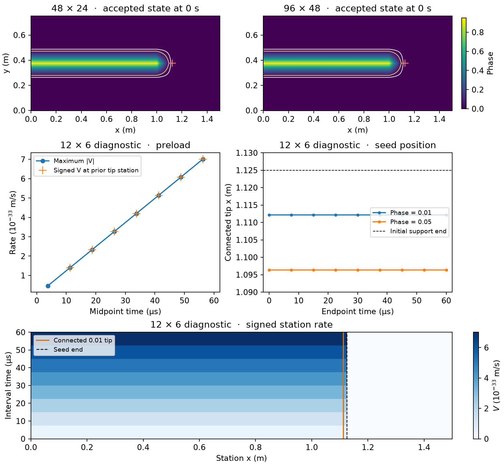

# Example 2 · Uniform-mesh granite pilot

**Neither requested grid accepted its first physical interval.** Both initialized a connected seed ending at x = 1.125 m. At four MPI ranks the signed RSF root stopped the first 7.5 µs step. On two ranks the coarse Newton solve converged, but the stored point histories could not resolve the signed strip rate. The accepted record covers **0 s of preload and 0 s of steady drive** on these grids. Rapid slip at the tip, extension into intact granite, burst arrest and recurrence remain undetermined.

## Matched startups

Executed from pf-rsf at `34d5e9c29cbbef5fbf54222b5f61c6172a64d846`. The archive targets `ee6d59cb7e59`. The existing Release executable identifies itself as `807943f77`, SHA-256 `836f7e773da8487e05dcd26d2b94d86656c5084d5f198a9827e70e7fa6907ce5`. There is no difference under `include/` or `source/` between the executable revision and the checkout. No numerical source edits or external plugins were used. The four benchmark inputs match the supplied ZIP (SHA-256 `fc85c667dc11799bca2737cc13d4b222c7f16f3b50e2fa431802157589b0252e`). Its production PRM is also identical to the previously tracked file.

Both `--validate` calls passed. Four MPI processes, one numerical thread per process, sequential grids. Time zero is an initialization frame. Attempt counts below exclude that frame. Elapsed wall times use the timestamped solver console.

| Measurement | 48 × 24 | 96 × 48 |
|---|---:|---:|
| Cells / total DoFs | 1,152 / 25,852 | 4,608 / 102,388 |
| Strip spacing = cell width (mm) | 31.25 | 15.625 |
| ℓ/h | 2 | 4 |
| Accepted physical steps / aborted attempts / automatic retries | 0 / 1 / 0 | 0 / 1 / 0 |
| Completed residual evaluations printed (Newton indices) | 2 (0, 1) | 0 |
| Launch to ASPECT banner (s) | 1.525 | 1.437 |
| Banner to initial postprocessing (s) | 0.151 | 0.262 |
| Native export at initialization (s) | 0.050 | 0.228 |
| First solve, entry to exception (s) | 76.434 | 3.039 |
| Total wall time including MPI exit (s) | 78.198 | 4.995 |
| Rank-zero initial native-export peak RSS (KiB) | 216,708 | 228,176 |
| Rank-zero solve peak RSS in repeat measurement (KiB) | 774,084 | 819,696 |
| Native CSV bytes / total output directory bytes | 4,909,513 / 7,168,913 | 19,915,540 / 22,174,529 |

The coarse peak is the solver's Linux VmHWM read at its exception in a debugger replay. The reference peak is from rank zero's child resource usage on a fresh ordinary replay. The original MPI aborts interrupted rank-zero accounting in the first startup pair. Native export timing spans the postprocessor call, including collection, formatting and writes. It excludes initialization and solve time. The reference failed during its first stage assembly. The coarse run spent 70.68 s between Newton residuals 0 and 1, including a rank-zero obstacle solve. The two elapsed times measure different amounts of work and do not establish a scaling law.

**Effective parameters.** Comparing every parameter value in the two emitted JSON trees found exactly three differences, the two mesh repetition counts and the output directory. The complete emitted PRMs are in `results/parameters-{48,96}.prm.gz`. The box is 1.5 × 0.75 m. The growing material uses one DGQ2 Bernstein phase field, the midpoint fault phase method, AT1 with ℓ = 0.0625 m, and sixth-order section quadrature. Both meshes are fixed. In both, the initialized taper is 0.125 m long, the normal half-width is 0.125 m and the initial bulk stress and slip are zero. The strip ages are 1 s. Friction takes 70 MPa from the adiabatic pressure, with a = 0.0137, b = 0.0156, Dc = V₀ × 1 s = 1 µm, μ₀ = 0.75 and radiation damping 4.2031734 MPa s/m. G = 26.6667 GPa and η = 3.17 × 10¹⁶ Pa s. Matrix factorization is gathered UMFPACK on rank zero.

The emitted wall function gives relative speed 0.001 m/s at time zero and after 0.025 s, and 0.109 m/s at 0.0125 s. Integrating it yields 0.001375 m relative displacement at the end of preload, of which 0.00135 m comes from the pulse. These are prescribed loads; the runs never observed their transition. The uniform policy uses slip and log-state budgets of 0.1 each. The age-based raw proposal at initialization was 0.1051709181 s (ID 0), reduced to 7.5 µs by the first-step cap. The monotonicity condition uses the half-duration h = Δt/2 and requires ηᵣ ≥ p h b/Dc. The largest admissible full step is 7.69811978 µs. None of the failures was a duration rejection.

## First failed operation

The ordinary solver dispatch calls `GrowingFault::advance_midpoint`. `MidpointSystem::assemble_stage` passes the strip's free rate and mobility to the material-owned `RateStateHistory::solve_strip`. The scalar relation is V + M f(V, θ(h)) = Vfree. The material's point history remains the accepted parent through every assembly. Only a converged and resolved trial can reach the post-accept publication hook.

| Four-rank capture | 48 × 24 | 96 × 48 |
|---|---:|---:|
| Material strip ID / center x (m) | 7 / 0.234375 | 65 / 1.0234375 |
| Free rate (m/s) | 1.1124036969983266e−4 | 4.5020687873187534e−5 |
| Mobility (m/s/Pa) | 8.342827640326656e−7 | 5.024185442245360e−7 |
| Independent stage-aged rate (m/s) | 4.665662585404905e−34 | 3.135527690813650e−34 |
| Independent resistance (Pa) | 133.336531085 | 89.607934243 |
| Production residual tolerance (m/s) | 7.90410366e−19 | 3.19891227e−19 |
| Residuals at adjacent speeds / tolerance | −1.005161, +1.004791 | −1.005716, +1.003035 |

Each column reduces an actual failing FE call to one scalar equation. In regular binary64 arithmetic, `log(speed) - log(2*V0)` is added to a large state term before evaluating asinh. In this cold regime, adjacent speeds can fall on either side of a rounded logarithm jump. The code's monotonically increasing traction then skips the entire allowed residual interval. One hundred Newton/bisection iterations end in the roundoff exception. Solving the same equation at 90-digit precision and evaluating at the rounded root gives residuals of +3.51e−21 and −2.39e−22 m/s, respectively. The certificate itself is achievable with accurate evaluation of the existing law. A focused arithmetic repair can use these two scalar inputs as regressions.

**Coarse checkpoint and other layouts.** The compact four-rank survey saved its accepted time-zero state and restored generation 01 for the first physical solve. It reproduced both residual reports (initial mechanics 4.68189e−8 and projected phase 0.299609, then 1.05864e−13 and 0.0166335) and the same root exception. Fresh one- and three-rank dense surveys also failed the scalar certificate after reporting Newton index 0 (65.760 s and 77.788 s total). No coarse layout in the permitted one-to-four-rank range published a physical endpoint. A fresh two-rank dense survey reached index 2 (mechanics 4.74287e−17, phase KKT 3.46556e−13). The final history check reconstructed **1.03892e−33 m/s** on strip 0 from the stored signed point increments, against a root of **4.66566e−34 m/s**. The difference was 1.23 times the root. It met the absolute inventory-based roundoff budget, 8.10447e−31 m/s, but violated the independent requirement that the reconstruction error be smaller than the signed rate magnitude. This is a second numerical obstacle to publishing a cold-creep trajectory. A two-rank restart from the accepted initial checkpoint reproduced all three residual reports and the same strip, rate, root and budget, aborting after 78.031 s. The two-rank candidate supplies no accepted slip measurement.

**Cost and continuation.** Measured accepted physical progress on either target grid was zero. Wall time per accepted interval and forecast core-hours through preload or 0.35 s therefore cannot be estimated from throughput. The cap alone requires at least 3,334 and 46,667 intervals. For budget arithmetic only, if a future accepted step cost the 76.434 s spent on the first aborted coarse attempt, four ranks would consume 283 and 3,963 rank-hours, respectively. First-step obstacle work, later iterations and controller cutbacks could all change that figure. The present executable aborts within minutes regardless of the overnight allowance.

## What the accepted fields show

The independent check reconstructed all nine FE coefficients per cell, tested the quadratic seed also at nine unisolvent positions, and compared the reconstructed field to 41,472 / 165,888 native quadrature samples. Maximum native error against the prescribed seed was 5.56e−16 / 6.67e−16; native phase and stress in front of the seed were zero. Both meshes place the connected 0.01 and 0.05 contours at x = **1.112175271 m** and **1.096323033 m**. The difference between their initial positions and the support end at x = 1.125 m comes from the taper. The station tables contain 48 / 96 IDs, all unformed at initialization. There is no previous formed tip station, physical midpoint rate or balance ledger on either target grid.

A separate **12 × 6 diagnostic** tested whether the same physical input can pass the executable's root and publication checks on a smaller mesh. It accepted the eight 7.5 µs steps. Its h = 0.125 m gives ℓ/h = 0.5. At the first physical endpoint nine seed strips were marked formed, zero ahead of the initial tip. Every DG phase coefficient then matched initialization through 60 µs. Both contours had zero displacement and no new strip formed in intact material. In the final interval, centered at 56.25 µs, the peak |V| was 7.010612e−33 m/s and the signed rate on the last previously formed station (ID 8, x = 1.0625 m) was +7.010612e−33 m/s. Peak accumulated slip was 2.242e−37 m. The final ledger gave bulk energy 9.63918e−5 J/m, fracture energy 9686.04167 J/m, zero phase work and phase KKT zero. This auxiliary case observed only early preload creep. Its grid and station spacing cannot qualify event-scale front motion on the requested meshes.



**Figure.** Upper panels show the initialized Bernstein phase field on each target grid. White and gold contour levels are 0.01 and 0.05, and the cross marks the support end. Lower panels use the auxiliary 12 × 6 mesh only. Midpoint rates rise to 7.01e−33 m/s while both connected contour positions remain fixed. The first interval lacks a previously formed station. Initial formation flags turn on inside the seed at the end of that interval. The space–time panel assigns each signed rate to its solved interval and strip width.

## Replay from the worktree root

Use a fresh working directory and run the first two commands for ASPECT sequentially even though they exit nonzero. Use the retained zero-stress, preload-pulse inputs at the revision below with this executable. The wrapper runs `--validate` before each launch and sets all numerical thread counts to one.

```sh
B=benchmarks/granite_fault_growth
R=refactoring/phase-field-fault/example2/results
E=build-bp3-fresh/install/bin/aspect-release
W=build-granite-replay
mkdir "$W"
git archive d6c552075:benchmarks/granite_fault_growth -- '*.prm' | tar xf - -C "$W"
python3 "$B/run.py" "$E" "$W/granite_coarse_startup.prm" coarse
python3 "$B/run.py" "$E" "$W/granite_startup.prm" reference
diff -U0 "$W/output-granite-48x24-startup/parameters.prm" "$W/output-granite-fault-startup/parameters.prm"
python3 "$B/run.py" "$E" "$W/survey_parent.prm" survey-parent
python3 "$B/run.py" "$E" "$W/survey_resume.prm" survey-resume
python3 "$B/run.py" "$E" "$W/survey_window.prm" survey-one --ranks 1
printf '%s\n' 'include survey_window.prm' 'set Output directory = output-granite-survey-two' > "$W/survey-two.prm"
python3 "$B/run.py" "$E" "$W/survey-two.prm" survey-two --ranks 2
printf '%s\n' 'include survey-two.prm' 'set Resume computation = true' > "$W/survey-two-resume.prm"
python3 "$B/run.py" "$E" "$W/survey-two-resume.prm" survey-two-resume --ranks 2
printf '%s\n' 'include survey_window.prm' 'set Output directory = output-granite-survey-three' > "$W/survey-three.prm"
python3 "$B/run.py" "$E" "$W/survey-three.prm" survey-three --ranks 3
python3 "$B/run.py" "$E" "$W/diagnostic_12.prm" diagnostic --ranks 1
```

To reproduce the memory or scalar measurements, use a fresh output directory for each attempt. The rank-zero memory repeat for the reference used the ordinary wrapper with the same startup input and an output-directory override. For an x86-64 Linux Release build with symbols, the capture script records the five arguments to the actual signed root, the strip ID, solver VmHWM and the throwing stack. Run this loop from the root with the variables above.

```sh
mkdir "$W/capture"
cp "$W"/granite*.prm "$W/capture"/
(
  export OMP_NUM_THREADS=1 OPENBLAS_NUM_THREADS=1 DEAL_II_NUM_THREADS=1
  exe=$(realpath "$E")
  probe=$(realpath "$B/capture_root.gdb")
  cd "$W/capture"
  for prm in granite_coarse_startup.prm granite_startup.prm; do
    mpiexec -n 4 sh -c 'exec gdb -q -nx -batch -x "$1" --args "$2" "$3" > "$3-r${OMPI_COMM_WORLD_RANK}.log" 2>&1' sh "$probe" "$exe" "$prm"
  done
)
python3 "$B/root_resolution.py" 0.00011124036969983266 8.3428276403266556e-07
python3 "$B/root_resolution.py" 4.5020687873187534e-05 5.0241854422453603e-07
mkdir "$W/measurements"
OPENBLAS_NUM_THREADS=1 python3 "$B/initial_field.py" "$W/output-granite-48x24-startup" 48 "$W/measurements/initial-48.npz"
OPENBLAS_NUM_THREADS=1 python3 "$B/initial_field.py" "$W/output-granite-fault-startup" 96 "$W/measurements/initial-96.npz"
OPENBLAS_NUM_THREADS=1 python3 "$B/diagnostic_history.py" "$W/output-root-12" "$W/measurements"
MPLCONFIGDIR=/tmp/granite-mpl python3 "$B/plot.py" "$W/measurements"
```

The furthest coarse checkpoint from the original compact survey is `build-granite-pilot/output-granite-48x24-survey/restart/01/`. Its metadata reads timestep 1 and 7.5 µs because ASPECT saves the next attempted clock after accepting time zero. The native physical history is still at zero. The archive in the results directory preserves the complete four-rank checkpoint and its selection pointer. The following is the next useful segment for testing a numerical repair, in a fresh directory with the same four-rank layout.

```sh
W=build-granite-next
mkdir "$W"
git archive d6c552075:benchmarks/granite_fault_growth -- '*.prm' | tar xf - -C "$W"
mkdir "$W/output-granite-48x24-survey"
tar -xzf refactoring/phase-field-fault/example2/results/coarse-initial-restart.tar.gz -C "$W/output-granite-48x24-survey"
printf '%s\n' 'include survey_resume.prm' 'subsection Termination criteria' '  set Termination criteria = end time, end step' '  set End step = 8' 'end' > "$W/next.prm"
python3 benchmarks/granite_fault_growth/run.py build-bp3-fresh/install/bin/aspect-release "$W/next.prm" continuation
```

For source review start with `source/material_model/rheology/rate_and_state_friction.cc` (signed-root arithmetic and duration), `source/simulator/solver/midpoint_fault.cc` (native strip assembly and pre-publication rate check), and `source/postprocess/growing_fault_history.cc` (accepted station and point exports). The uniform-mesh arithmetic and native-history checks can both be replayed before changing meshes. AMR is deferred.
