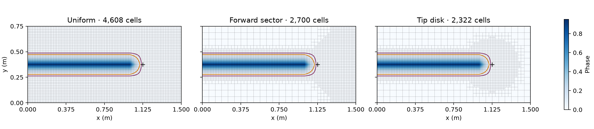
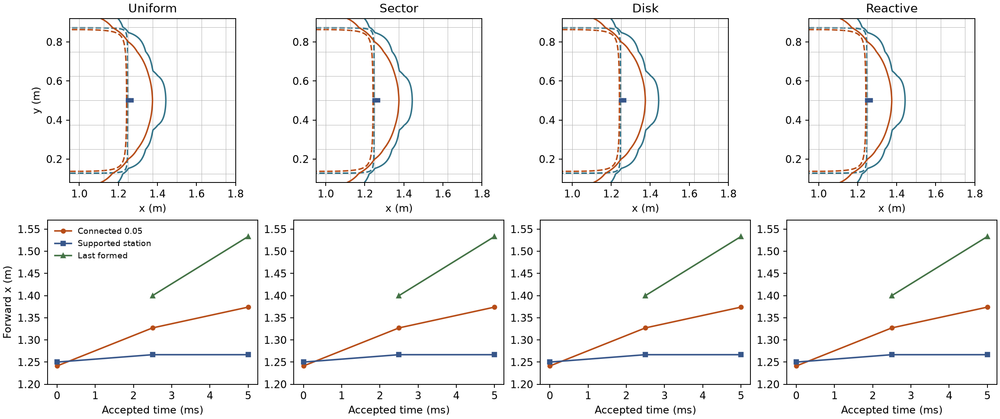

# Example 2 · fault-following refinement

The ordinary growing-fault midpoint calculation supports refinement of a stationary, nonperiodic two-dimensional Cartesian box. Use the uniform granite input unchanged for the historical control. The sector and disk overlays change the mesh policy and specify a physical strip spacing. They use the same 96 stations, AT1 length of 0.0625 m, preload, steady drive, RSF, native quadrature and timestep budgets as the 96 × 48 calculation. Neither production overlay loads a benchmark shared library.

## Baseline and replay identity

Started at `8b6a0e7ff10c3a964241b0c6b3d4039689f2987b` on pf-rsf. The original coarse and uniform-fine pilot records remain in the [uniform granite report](../REPORT.md). Its executable, `build-bp3-fresh/install/bin/aspect-release`, SHA-256 `836f7e773da8487e05dcd26d2b94d86656c5084d5f198a9827e70e7fa6907ce5`, also wrote the independent v2 checkpoint and supplied the fault-free comparison. Granite physical input SHA-256 is `88252c55c3035fef6529b4e3e7f08d66aee061ed76c34c4d0529440748c9f2a6`. All 1,767 emitted parameter values were compared between the three initial meshes. Differences were confined to the X/Y repetition counts, mesh refinement, target strip width and addition of the disk timestep model.

The AMR Release builds used the existing deal.II 9.6 configuration under `build-6b/release`. The final solver SHA-256 is `b726cce858f38fe884fe70d3b06439b8b54efb19ed7e0cae5711590e50de6706`; its compiled-in Git banner predates the local commits. The two-rank uniform physical startup and some earlier operator tests used the pre-anchor binary `afe996fedf60d88c6a45e01bcd508157aaff6dbcd3f1fe3c431ca3b72998f547`. The final marker pairs the time-matched accepted field with the graph and anchors the damage component at the physical seed. The legacy reference installation was never overwritten.

```sh
cmake --build build-6b/release --target aspect -j2
cmake -S benchmarks/growing_fault -B build-granite-amr/plugin -DAspect_DIR="$PWD/build-6b/release"
cmake --build build-granite-amr/plugin -j1
```

The [AMR repair and current replay](amr-review.md) supersedes the historical detector and forced-miss procedure below. The retained results identify the pre-repair executable.

## Reproduce the meshes

Run from the worktree root in fresh destinations. `granite.py` copies the tracked physical input and the overlays together, validates the resulting PRM, launches ordinary ASPECT, and captures per-rank memory and wall time. Omit the termination and postprocessing overrides in that driver to run the published physical horizon. The uniform 48 × 24 pilot and its executable, checkpoint and original logs are identified in the [uniform report](../REPORT.md).

```sh
exe=$PWD/build-6b/release/aspect-release
amr=benchmarks/granite_fault_growth/amr
r=$PWD/build-granite-amr/replay
export OMP_NUM_THREADS=1 OPENBLAS_NUM_THREADS=1 DEAL_II_NUM_THREADS=1 MKL_NUM_THREADS=1
for policy in uniform sector disk; do
  python3 "$amr/granite.py" "$exe" "$policy" "$r/initial-$policy" --steps 0 --ranks 2
  python3 "$amr/sector_check.py" "$r/initial-$policy/output" "$policy"
done
mkdir -p "$r/figures"
python3 "$amr/plot_initial.py" "$r/figures" --uniform "$r/initial-uniform/output" \
  --sector "$r/initial-sector/output" --disk "$r/initial-disk/output"
```

| Two-rank initialization | Cells | Native samples | Finest edge (mm) | Wall / summed CPU (s) | Highest-rank peak (KiB) |
|---|---:|---:|---:|---:|---:|
| Uniform | 4,608 | 165,888 | 15.625 | 4.959 / 4.789 | 328,196 |
| Fixed forward sector | 2,700 | 112,464 | 15.625 | 4.043 / 3.671 | 298,108 |
| Moving disk | 2,322 | 102,240 | 15.625 | 4.659 / 4.019 | 290,044 |

Every required closed cell footprint passed the independent coverage test. The largest native phase discrepancy from the analytic initial field was 6.67e−16. Initialization times include MPI launch and public native output. The measurements used at most four simultaneous local workers, one numerical thread per process. Cost comparisons below give actual CPU as well as elapsed time where other runs shared the machine.



*Initial accepted granite field. Lines show the active cell edges and the physical 0.01 and 0.05 phase contours in metres. The cross marks the prescribed tip. The fixed sector includes the entire box-clipped forward triangle and its 0.125 m margin.*

## First physical granite interval

The first attempted interval was 7.5 µs in all three inputs. On two MPI ranks, uniform, sector and disk all printed the first midpoint residual and then remained in the first linearized obstacle correction through a matched eight-minute wall window. None published the 7.5 µs clock. The first normalized mechanical residuals were 6.57716e−8, 4.66767e−8 and 3.42512e−8, respectively. The projected phase residual was 0.295435 in all three. Stopping these probes is a resource limit and supplies no converged endpoint error. The original four-rank layout on the uniform grid independently reproduced the signed-RSF root certificate exception in 4.843 s, before the first published step. The historical two-rank **48 × 24** native-rate diagnostic is a separate result on the coarser physical partition.

On four ranks the fixed sector and disk both reached the first obstacle correction. Both stopped at their 180 s wall limit, with no second residual or physical endpoint.

| Mesh | Two-rank wall (s) / highest RSS (KiB) | Four-rank wall (s) / highest RSS (KiB) |
|---|---:|---:|
| Uniform | 480.26 / 2,249,400 | 4.84 / 839,764 |
| Sector | 480.40 / 2,078,544 | 180.26 / 1,946,308 |
| Disk | 480.36 / 1,974,236 | 180.26 / 1,847,220 |

Only time zero is an accepted granite comparison clock. There is no granite slip-rate, front-position or cost comparison at 7.5 µs; measuring an aborted or time-limited correction cannot supply a cost per accepted interval.

The [startup measurements](granite-startup-cost.json) keep the solver messages, accepted physical clock list, elapsed wall time and per-rank high water for each run. A missing CPU value means MPI terminated that rank before the timing wrapper could collect final CPU usage. Terminated runs retain their sampled high water where available. The two-rank measurements each used about 0.267 allocated core-hours.

```sh
for policy in uniform sector disk; do
  python3 "$amr/granite.py" "$exe" "$policy" "$r/two-$policy" --steps 1 --ranks 2 --wall-limit 480
done
for policy in uniform sector disk; do
  python3 "$amr/granite.py" "$exe" "$policy" "$r/four-$policy" --steps 1 --ranks 4 --wall-limit 180
done
python3 "$amr/startup_report.py" "$r"/two-* "$r"/four-*
```

The recorded two-rank directories are `build-granite-amr/start-{uniform,sector,disk}`. Their MPI processes were stopped at the deadline and returned 241. The replay option records a wall-limit stop explicitly as 124. Other nonzero exits must be read with the ASPECT diagnostic. The four-rank runs used the replay option directly. All starts used their own initial states; the original pilot records and checkpoints are intact.

## Inputs and call path

* Choose `Mesh refinement / Strategy = growing fault`. Its `Growing fault / Coverage` accepts `forward sector`, `tip disk` (default) or `damage threshold`. The material's `Phase field fault / Target strip width` is in metres. Zero retains the historical uniform partition. A positive value fixes the ordered edges for the entire calculation and supplies the default upper bound on the longest physical cell edge. Set `Mesh refinement / Growing fault / Maximum cell edge` in metres to change bulk resolution independently. Use Q2/Q1, DGQ2 Bernstein, at least four section Gauss points for a native remesh, zero coarsening fraction and enough allowed dyadic levels. In the shipped sector, three initial refinement passes finish before initialization on the final mesh.
* The fixed example needs only the mesh criterion. Add `growing fault refinement` to `Time stepping / List of model names` beside `fault RSF` for the moving run. `MaterialSections` builds owned clipped-cell quadrature from physical strip edges. `MidpointSystem` uses conforming trial and test shapes for its coupled FE/section solve and `FractureRows` integrates the Bernstein traces on each physical interior face piece. The material retains the accepted history while the simulator stages the converged endpoint. [Weak-form checks](advancing.md#hanging-velocity-and-pressure) · [DG subface checks](face-and-energy.md#subface-operator).
* Before the accept signal, the timestep manager consults the mesh criterion. The tip is the last contiguous formed station with a maximum physical phase trace of at least 0.05 on the accepted graph. The next fine region includes the formed band out to two phase lengths. If an underresolved footprint approaches within three lengths, the criterion restores four lengths around the tip. Bending is allowed within this reserve. The direction search and the predictor use the same phase-supported station operation. No slip speed enters the estimate.
* On the current branch the criterion screens the endpoint DGQ2 phase using its Bernstein coefficient hull. Any coarse cell in the seed-connected 0.01 excursion requests coverage, including old damage connected by a new fine-cell bridge. Independent traces must overlap on a positive-length face interval. The seed anchor and material's 0.05 supported tip have distinct roles. The [qualification](amr-review.md) gives the local subdivision limit, startup procedure and rejected-step comparison.
* A miss returns `refine_and_repeat_step` with the attempted duration. The existing manager takes the highest priority reaction and the minimum retry duration proposed by any model. Preventive refinement occurs after publication of a valid endpoint. On a miss, the accept signal and public statistics are skipped, the accepted material and FE vectors transfer, and another nonlinear solve starts only when the requested mesh levels have been reached. No persistent forecast data are required beyond the physical mesh and accepted fault state.
* The material uses the triangulation's distributed cell attachments for native transfer. Unchanged cells carry their records verbatim. Refined cells send a stress reconstruction restricted to the old cell/strip and a phase-weighted reconstruction of recoverable strain and signed/absolute shear. Law-owned section state, physical clock and last work ledger retain their owners. [Transfer derivation, two resolutions, same- and changed-layout restart, v1 and v2](history-transfer.md).

## Scope of the common simulator edit

`Simulator::refine_mesh` already transfers current and previous FE vectors on an advancing mesh. A rejected, remeshed interval also needs the older accepted vector for the next extrapolation. Marking still sees the trial. During FE transfer the current slot is reconstructed from the accepted parent and both accepted time levels are retained. ASPECT's initial and advancing transfers keep their ordinary vector lists. The generic core's existing reaction performs one mesh pass; the optional `RefinementTarget` query allows another pass at the same time with no intervening nonlinear solve. Its progress guard diagnoses an unreachable refinement level. Independent estimators and ordinary step reactions keep their single-pass control flow. These are the upstream simulator changes. The constitutive state, tip definition, constraint condensation and joint phase operator belong to the growing-fault path.

At rest the criterion stores no copy of FE fields or native histories. A request stores the graph and missed physical tiles. Possible coarse damage activates a replicated connectivity search over nonexcluded endpoint patches. On covered meshes the ranks only exchange patches on the incoming line to locate the physical rear. Native transfer uses distributed cell attachments. The existing midpoint factorization still gathers the sparse bordered matrix on rank zero, and the geometric hanging map is replicated on hanging meshes. The fixed-sector reductions in cell and point count do not imply the same reduction in solve time.

## Moving control and scope of the scientific comparison



*Computed 0.01 and 0.05 contours and accepted phase at 5 ms on the four meshes, with their matched time histories. Initially intact rock begins at x = 1.25 m. The phase-supported material station and the continuous phase contour are separate observables.*

See the [four-policy comparison, costs, controlled preventive remesh and restart](advancing.md) and the [independent forecast and diffuse-shoulder control](face-and-energy.md). At 2.5 ms the compact uniform 0.05 contour reached 1.32715 m on the 64-samples-per-edge lattice and the supported material station reached 1.2667 m. In the controlled reserve the physical clearance decreased from 0.5000 to 0.4833 m, across the 0.4950 m trigger. The accepted 2.5 ms endpoint refined 116 to 128 cells with zero newly crossed coarse samples. The restart reproduced the decision and accepted work and fields. The same preventive calculation on two ranks passed the strict keyed comparison at 2.5 and 5 ms. Time spent on active-set factorization and native export is included in the measured policy costs.

The coarse granite probe, fixed-sector and disk qualification, and compact material use different loads or meshes as recorded. Advancing a compact seed into its initially intact cells demonstrates the AMR operation. Identifying a granite burst or arrest requires accepted granite fields under that material's prescribed loading, through acceleration and subsequent deceleration.

## Historical rejection and replay

These commands and measured counts are for the previous revision. Its fixture deliberately left connected initial damage coarse. On the repaired branch that cap is diagnosed during initialization. Use the compact-seed recovery in the [current replay](amr-review.md) for a genuine physical miss.

The fault-driven rejection case deliberately withholds fine coverage during initialization on the oblique 18-strip control. It starts with 32 cells. The 5 ms solve crosses the 0.01 contour at 33 underresolved, seed-connected sample centers. The retry restores the accepted parent and refines to 128 cells. The clean calculation starts independently from the same initial conditions, uses the rejected run only to identify the mesh and duration, and applies the ordinary scheduled refinement before its first physical solve. The comparison keys native values by (CellId,q), FE values by (CellId,component,local), and section state by material ID. The independent interval check recomputes each slip and aging update. The [keyed checks and timing measurements](recovery.json) include byte-level comparisons on each layout. All twelve two-rank physical CSV files for 5 and 10 ms, all six after restart at 10 ms, and all four in the combined-cut first endpoint were byte-identical to their respective controls. Exactly one work record is permitted per accepted physical clock.

From a fresh destination (the run driver creates the child directories):

```sh
amr=benchmarks/granite_fault_growth/amr
exe=$PWD/build-6b/release/aspect-release
r=$PWD/build-granite-amr/replay
export OMP_NUM_THREADS=1 OPENBLAS_NUM_THREADS=1 DEAL_II_NUM_THREADS=1 MKL_NUM_THREADS=1
for n in 1 2; do
  python3 "$amr/recovery.py" "$exe" "$r/miss$n" miss --ranks "$n" --steps "$n"
  python3 "$amr/recovery.py" "$exe" "$r/clean$n" clean --missed "$r/miss$n" --ranks "$n" --steps "$n"
  python3 "$amr/check_recovery.py" "$r/miss$n" "$r/clean$n" --ranks "$n" --steps "$n"
done
python3 "$amr/trajectory.py" "$r/miss1/output" --compare "$r/miss2/output" --steps 1
python3 "$amr/recovery.py" "$exe" "$r/restart2" miss --ranks 2 --steps 2 --restart "$r/miss2/output/restart/02"
python3 "$amr/trajectory.py" "$r/restart2/output" --compare "$r/miss2/output" --strict --steps 2
python3 "$amr/recovery.py" "$exe" "$r/cut" miss --cut
python3 "$amr/recovery.py" "$exe" "$r/half" clean --missed "$r/cut"
python3 "$amr/recovery.py" "$exe" "$r/levels" miss --levels 2
# Negative: ASPECT must stop with the unresolved-target diagnostic.
python3 "$amr/recovery.py" "$exe" "$r/blocked" miss --block-refinement
python3 "$amr/check_recovery.py" "$r/cut" "$r/half" --ranks 1 --cut --mesh-guards "$r/levels" "$r/blocked"
```

* With the independent RSF budget active, the first 5 ms trial both missed the mesh and exceeded the slip budget at strip 16. The sole physical publication was at 0.0011763193301180738 s. The clean comparison passed at that shortened duration. With the ordinary mesh-only reaction the duration stayed 0.005 s.
* Two MPI ranks repeated the missed interval once, then advanced to 10 ms on the unchanged fine mesh. All 19,944 native points, 18 strip records, FE values and the work history passed the existing strict continuation tolerance against the clean run. Starting from checkpoint generation 02 reproduced the 10 ms endpoint.
* The one- versus two-rank 5 ms recovery comparison passed the keyed physical tolerances. Maximum native stress difference was 8.67e−13 Pa, phase 1.59e−15, strip angle 2.66e−9 rad and arclength 4.90e−11 m. The angle and length differ on the tighter, same-layout continuation scale. The separate, independently started 30° loaded-parent direction discrepancy is quantified in the [transfer report](history-transfer.md).
* Beginning with eight cells instead of 32, ten coarse samples crossed in the rejected 5 ms trial. The mesh changed 8 → 32 → 128 before the next nonlinear solve. The accepted clock remained 5 ms. Disallowing all requested levels stopped before any physical work record. The [disconnected-island control](face-and-energy.md) separately rejects a spurious reason to replay.

The Release unit run passed 3,191 assertions in 66 cases, including the 576 Bernstein prolongation assertions. The ordinary growing-fault CTest passed. The two-rank nine-strip test retained signed integrated slip 9.20718145917e−16, 3.94713921111e−5 and 1.69302306477e−4 m² at 5, 10 and 15 ms. Every donor/native comparison used its existing tolerance.

```sh
"$exe" --test
ctest --test-dir build-6b/release -R '^growing_fault$' --output-on-failure
mkdir -p "$r/nine"
cp benchmarks/growing_fault/onecut.prm "$r/nine"
cat > "$r/nine/run.prm" <<'PRM'
include onecut.prm
set Output directory = output
subsection Postprocess
  set List of postprocessors = growing fault history
end
PRM
python3 benchmarks/granite_fault_growth/run.py "$exe" "$r/nine/run.prm" timing --ranks 2
python3 benchmarks/growing_fault/compare.py build-5a-repair/donor-two/output "$r/nine/output"
```


## Source review

1. Start with the physical input and its two overlays under `benchmarks/granite_fault_growth/`. Under `amr/`, `compact.prm` specifies the separate advancing control.
2. Read `source/simulator/solver/midpoint_fault.cc` at `apply_hanging_node_interpolation`, then `source/phase_field/midpoint_fracture.cc` for the physical subface rows. The actual transfer to the strip roots and the work reaction both use the transformed shapes.
3. Read `source/material_model/phase_field_fault/strip_material_history.cc` at `prepare_history_transfer` and `finish_history_transfer` for distributed migration, then `source/mesh_refinement/growing_fault.cc` at `assess_endpoint` and the timestep reaction in `source/simulator/core.cc`.

The shared-core control uses ASPECT's stock time-dependent minimum refinement function, without a fault material or timestep criterion. The old and current executables built 4 → 10 → 40 cells during initialization, then 64 after the first physical step. Through the second physical endpoint their statistics files were byte-identical, SHA-256 `f69c353436301940d12f83b12c3fe93a13823338f9ad5649f2612b2f468fbd80`.

```sh
root=$PWD
for version in old new; do
  dir="$r/stock-$version"; mkdir -p "$dir"
  cp tests/minimum_refinement_function_time_dependent.prm "$dir/base.prm"
  cp refactoring/phase-field-fault/example2/amr/stock-refinement.prm "$dir/run.prm"
  program="$exe"; if test "$version" = old; then program="$root/build-bp3-fresh/install/bin/aspect-release"; fi
  (cd "$dir" && "$program" run.prm >solver.log)
done
cmp "$r/stock-old/output/statistics" "$r/stock-new/output/statistics"
```

## Scientific limits

The compact propagation case uses local h = 0.125 m and ℓ = 0.165 m. Its measured 5 ms rate difference of 0.558% on the threshold mesh is a discretization observation. A mesh- and timestep-converged physical growth velocity, burst time or arrest in granite remains open. On the acute 30° loaded control an independent MPI layout changes one strip's chosen direction before AMR at the original angular tolerance; carrying a single accepted parent to another layout isolates migration from that selection. A positive discrete fracture-energy jump at zero elapsed time must be accounted for when interpreting physical energy across remeshes. The current detector needs a supported incoming seed when coarse damage is possible. Its bounded local subdivision can conservatively join ambiguous pieces within the terminal rectangle. The two energy thresholds covered no additional forward cells in the qualified horizons. Runtime prediction therefore uses geometry alone. Coarsening, deforming meshes and distributed replacement of the gathered obstacle factorization are outside this implementation.


A growing input with a positive coarsening fraction was rejected by the ordinary solver before publication. To replay, include `onecut.prm`, set `Material model / Phase field fault / Target strip width = 0.25`, `Mesh refinement / Time steps between mesh refinement = 1` and `Mesh refinement / Coarsening fraction = 0.1`. The solver diagnosed the required zero coarsening fraction. The separate fault-free control above retains ASPECT's normal coarsening behavior.
