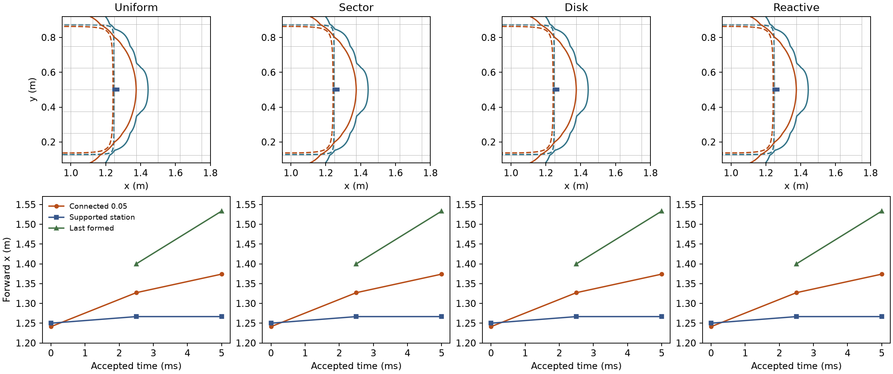

# Adaptive midpoint mechanics and a compact advancing seed

## Hanging velocity and pressure

The midpoint system has one independently assembled bordered Jacobian. Ordinary
ASPECT Stokes constraints do not assemble its Bernstein obstacle or global
section borders. On a hanging mesh, deal.II's closed, geometric Q2/Q1
interpolation supplies the dependent-to-master coefficients P. The midpoint
system evaluates N P on the affected cells for both test and trial shapes.
This gives the residual PᵀR, tangent PᵀJP, both section borders, continuity
and the wall reaction with the trial and test transformations required by
their weak forms. Midinterval wall velocity and p/G pin the independent
masters. After solving, interpolation recovers dependent coefficients. The
uniform path retains its prior arithmetic. The hanging map is replicated
once per assembled midpoint system, only for velocity and pressure. The
matrix and replicated unknowns retain the existing rank-zero UMFPACK layout.

The independently prescribed Q2 velocity on the 17-cell patch has components
a x y + γ y and −a(x²+y²)/2 with a=0.003(1+40t), γ=0.02(1+40t) in SI units.
Its divergence vanishes everywhere, the shear rate is uniform and the linear
pressure slope is −2GBha. A separate scalar RSF solve and integration of the
analytic virtual work give the physical checks below after the ordinary 5 ms
midpoint step.

| Quantity | One rank | Two ranks |
|---|---:|---:|
| Hanging subfaces / across rank boundary | 8 / 0 | 8 / 4 |
| Largest physical velocity error (m/s) | 5.23e−12 | 5.23e−12 |
| Linear pressure error (Pa) | 2.69e−7 | 2.69e−7 |
| Pressure gauge (Pa) | 0 | 0 |
| Largest native stress error (Pa) | 1.85e−7 | 1.85e−7 |
| Signed strip rate error (m/s) | 1.33e−11 | 1.33e−11 |
| Absolute external work error (J/m) | 3.92e−13 | 3.92e−13 |

Predicted wall work was 0.01069726553604 J/m; transfer work agreed within
4.34e−19 J/m. Substituting linear interpolation for one hanging quadratic
velocity changed it by 7.734375e−5 m/s and failed both controls.

```sh
export OMP_NUM_THREADS=1 OPENBLAS_NUM_THREADS=1 DEAL_II_NUM_THREADS=1
exe=$PWD/build-6b/release/aspect-release
root=$PWD/build-granite-amr
for n in 1 2; do
  dest=$root/patch$n
  mkdir "$dest"
  cp benchmarks/granite_fault_growth/amr/hanging_patch.prm benchmarks/growing_fault/growing_seed.prm "$dest"
  (cd "$dest" && mpiexec -n "$n" "$exe" hanging_patch.prm > solver.log)
  python3 benchmarks/granite_fault_growth/amr/check_hanging_patch.py "$dest/output-hanging-patch" --ranks "$n" --check-corruption
done
```

## Steady shear drives phase into initially intact cells

In compact.prm the 2 m × 1 m box contains a horizontal tapered seed at
(1.25,0.5) m and no initial phase on its forward side. A localized horizontal
wall velocity has zero net normal flux. All four policies use exactly the
same initial physical functions, fifteen fixed material strips (target width
0.134 m), ℓ=0.165 m and two 2.5 ms intervals. Cells near the seed have
0.125 m edges. The public granite material and its steady driver remain a
separate experiment.

The complete Bernstein patches in the forward cells vanish at initialization.
At station 9 (1.2666666667,0.5 m), the computed field increases from 0 to
0.2513464084 and 0.2883497524 on the uniform mesh. The station is formed and
passes the 0.05 phase condition. Both connected contours extend into the
initially intact body. On the 64-samples-per-cell lattice the 0.01 extent
moves 1.24707 → 1.35449 → 1.44238 m; the 0.05 extent moves 1.24121 →
1.32715 → 1.37402 m. The sample diagonal is 0.00276 m, and the shift when
halving the sampling density stays below one coarser diagonal. The direction
tracker advances from 1.25 to 1.266667 m and stays there through 5 ms; the
last formed station moves first to 1.4 m and then to 1.533333 m. Formed
length is 1.466667 and 1.600000 m at the two physical clocks. No dynamic slip
burst, arrest or timestep-converged granite front is inferred here.

| Mesh policy | Active cells | Wall / CPU (s) | Peak rank KiB | V at station 9 at 5 ms (m/s) | Physical work defect at 5 ms (J/m) |
|---|---:|---:|---:|---:|---:|
| Uniform | 128 | 28.93 / 19.25 | 311432 | 2.37524854e−4 | 3.67990208e−6 |
| Fixed forward sector | 128 | 61.44 / 21.61 | 313008 | 2.37524854e−4 | 3.67990208e−6 |
| Tip disk | 128 | 62.84 / 21.78 | 314100 | 2.37524854e−4 | 3.67990208e−6 |
| Damage threshold | 116 | 54.33 / 18.24 | 306168 | 2.38851052e−4 | 3.67823820e−6 |

All four accepted both intervals without mesh or timestep replay. Under the
fixed sector and initial 4ℓ disk the small box is uniformly fine. Absolute
wall time also reflects varying laptop load. At shared clocks, the threshold
policy gave the same connected contours to sampling precision and the same
tracked position and formed length. Its signed near-tip rate differed by
1.32620e−6 m/s (0.558%) at 5 ms. This measured discretization effect has no
established production error budget. The physical defect is external work
less energy change and bulk, cohesive and frictional dissipation over the
interval. The uniform midpoint compliance remainder was 3.67989268e−6 J/m
in that interval. The separate adjoint work error was 1.03e−18 J/m.



**Figure.** Accepted mesh at 5 ms; cyan and orange curves show physical
φ=0.01 and φ=0.05 contours at initialization (dashed) and at 5 ms (solid).
The blue marker tracks the physical station crossing the 0.05 condition.
The lower panels distinguish the sampled front, the supported station and
the last formed material ID at the two accepted clocks.

## Forecast from the accepted energy rows

The independent energy-row replay evaluated both 0.70 and 0.90 warnings
before each endpoint was known. Unlike the diffuse-shoulder control,
station 9 and every native point in its forward bulk cell start at zero
phase. At 16 and 32 samples per edge both fractions flag the same six
forward cells. The first interval has six observed crossing cells at both
sampling densities. The second resolves four at 16 and six at 32; both
fractions recover all the observed crossing cells. They add zero cells beyond the disk. Initially the 42 flat
intact forward cells have zero normalized shear drive; directly adjacent
cells with zero phase can still have a nonzero discrete gradient/face
residual from the seeded neighbor. The largest one-sided row score is
4.1353. At 2.5 ms there are 38 flat forward cells; the maximum flat
drive ratio is 0.03818 and the maximum diffuse row score 1.99999.
The warning anticipated contour advance but provided no extra coverage or
saved solves on this trajectory.

```sh
for samples in 16 32; do
  OPENBLAS_NUM_THREADS=1 python3 benchmarks/granite_fault_growth/forecast_energy.py \
    build-granite-amr/physical-uniform/output --samples "$samples"
done
```

## Preventing the next missed step

At initialization a separate control uses ASPECT's maximum refinement
function to retain a right-hand coarse band, with no cap at positive time.
Its nearest footprint initially lies 0.5 m from the seed, above the 0.495 m
(3ℓ) decision threshold. After the first accepted step the supported tip's
clearance drops to 0.4833333333 m. The 2ℓ formed-band margin still clears
the coarse cells. There is one preventive reaction at 2.5 ms and zero newly
crossed coarse samples; two nonlinear solves publish two work entries.
Refining the 116-cell mesh to 128 cells restores the full 4ℓ reserve (all
in-domain cells now fine). The two observer snapshots at precisely 2.5 ms
give the same supported position and phase 0.25134640737639, bit-identical
section and ledger text, unchanged cohesive and fracture energies and a
−3.66012923e−6 J/m bulk-energy projection defect. Physical time, slip, age
and work do not advance during that mesh transfer. The default initial disk
needed no preventive extension on this particular short trajectory; the
supplemental case isolates the 3ℓ trigger using a partially consumed reserve.

Starting with only checkpoint generation 01, the restored solve repeated
the same reaction exactly once at the same 2.5 ms clock. Its native pre- and
post-remesh snapshots and all eight accepted field, native, station and work
CSV files at 2.5 ms and 5 ms were byte-identical to the uninterrupted run.
The independent keyed continuation at the existing 1e−12 tolerance passed.

```sh
root=$PWD/build-granite-amr
exe=$PWD/build-6b/release/aspect-release
bench=benchmarks/granite_fault_growth/amr
record=refactoring/phase-field-fault/example2/amr
export OPENBLAS_NUM_THREADS=1 MPLCONFIGDIR=/tmp/granite-mpl
for mode in disk reactive sector uniform; do
  python3 "$bench/run_advancing.py" "$exe" "$root/physical-$mode" "$mode" --case compact
done
python3 "$bench/compare_advancing.py" "$record" --run-root "$root"
# Regenerate the plot from its archived accepted patches.
python3 "$bench/compare_advancing.py" "$record"
plugin=$root/plugin/libgrowing_fault_checks.release.so
python3 "$bench/run_advancing.py" "$exe" "$root/physical-preventive" preventive --case compact --observer "$plugin"
python3 "$bench/check_prevention.py" "$root/physical-preventive"
python3 "$bench/run_advancing.py" "$exe" "$root/physical-resumed" preventive --case compact --observer "$plugin" \
  --restart "$root/physical-preventive/output/restart/01"
python3 "$bench/check_prevention.py" "$root/physical-resumed"
python3 "$bench/trajectory.py" "$root/physical-resumed/output" --compare "$root/physical-preventive/output" --strict
```


The final two-rank preventive run also advanced the supported tip to x = 1.2666666667 m, accepted at 2.5 ms, and restored the disk from 116 to 128 cells with no connected coarse crossing. Through 5 ms the largest serial/parallel differences were 1.51e−12 Pa in native stress, 1.64e−15 in phase and 1.83e−17 m/s in strip rate. Every angle was identical. All keyed columns passed the strict same-trajectory budget. The run took 23.08 s wall. The [accepted fields, work comparison and two-rank footprint checks](compact-preventive-two.json) include the per-rank costs. Passing only one rank to the checker for the two-rank run is rejected before reading a partial mesh.

```sh
python3 "$bench/run_advancing.py" "$exe" "$root/physical-two" preventive --ranks 2 --case compact --observer "$plugin"
python3 "$bench/check_prevention.py" "$root/physical-two" --ranks 2
python3 "$bench/trajectory.py" "$root/physical-two/output" --compare "$root/physical-preventive/output" --strict --steps 1 2
```
