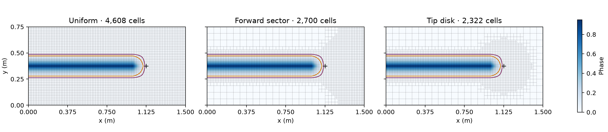
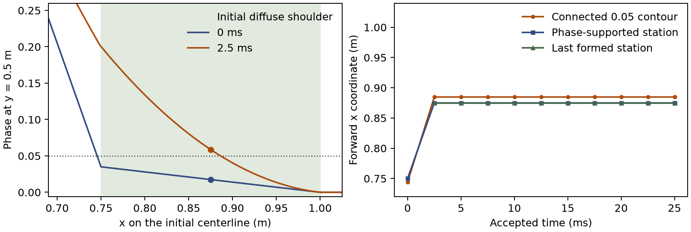

# Interior faces, phase prolongation, initial granite coverage and energy forecast

## Subface operator

The ordinary growing midpoint solve constructs `MidpointSystem`, which constructs
`PhaseField::FractureRows` on each owned cell. The signed residual for an
admissible positive Bernstein test is
`Kf ∫v + H(φ,v) − ∫vY` in J/m, where `Kf=Gc/[(8/3)ℓ]` in Pa.
After dividing by Kf the assembled contributions in FractureRows have units m².
The cell term is `2ℓ² ∫∇v·∇φ`. On an interior physical piece, the symmetric
penalty form is `σ[v][φ] − [v]{2ℓ²∇φ}·n − {2ℓ²∇v}·n[φ]`, integrated in
physical arclength. With `n` from the plus side to the minus side the jump
is the plus trace minus the minus trace. The penalty is `9 P (2ℓ²)/min(h⁺,h⁻)` for Q2 and
the two normal cell widths. The natural exterior flux contributes no face term.

The closest release traversal is ASPECT's advection assembler's subface case.
Its row/column coupling is an advective flux, whereas the midpoint phase variational inequality
needs the four symmetric diffusion blocks in its own joint matrix. The phase
operator uses deal.II FESubfaceValues on each fine piece of a coarse face,
evaluates the neighbor at mapped physical quadrature positions, and adds only
the local test rows. The neighbor evaluates its own rows with the opposite
normal. Same-level faces retain the original rule. The test observer rebuilds
these same production phase rows at the accepted clock; it does not export
the gravitational, mechanical, or rate-state residual.

The independent checker discovers physical interfaces by intersection of
rectangles, visits each piece once, and integrates both tests and both trials
with a 7-point Gauss rule. This test holds the mesh, ℓ, P and time level fixed.
It checks the full matrix, a nonconstant discontinuous phase residual, a
centered difference of the independent residual against the production matrix,
and a globally bilinear field whose sole action is its external normal flux.
Exact polynomial integration gives the scale for the tolerances; changing the
finite-difference step introduces arithmetic cancellation.

| Accepted 5 ms, 17 cells | 1 MPI rank | 2 MPI ranks |
|---|---:|---:|
| Physical hanging pieces | 8 | 8 |
| Hanging pieces on rank boundary | 0 | 4 |
| Largest matrix entry error (m²) | 2.66e-15 | 2.66e-15 |
| Largest mass entry error (m²) | 2.08e-17 | 2.08e-17 |
| Discontinuous residual error (m²) | 1.55e-15 | 1.55e-15 |
| Centered action error (m²), step 1e-4 | 5.06e-12 | 4.16e-12 |
| Continuous flux error (m²) | 1.18e-15 | 1.18e-15 |
| Largest error removing one hanging subface (m²) | 1.73123 | 1.73123 |

An earlier diagonally marked fixture balanced to a uniform mesh and was
rejected for zero hanging pieces. The accepted fixture refines three adjacent
coarse cells. The strip partition resolution is fixed at 0.25 m during initial
mesh construction.

The production Bernstein element inherits deal.II FE_DGQ full-dimensional
prolongation. Its lazily constructed embedding matrices evaluate the actual
element; no special Bernstein transfer matrix is needed. The focused unit test
restricts a nonuniform Q2 field and a later, everywhere larger polynomial
to each of four children. The parent middle coefficient is greater than one.
The 36 off-node quadrature probes per child reproduce the physical parent to
2e-14 and preserve the bounds and positive increment. All 576 assertions passed.
The actual refinement tests complement this element-level check.

Commands from the worktree root, using the same Release build for
the executable and benchmark plugin, with one numerical thread per rank:

```sh
root=$PWD
export DEAL_II_NUM_THREADS=1 OMP_NUM_THREADS=1 OPENBLAS_NUM_THREADS=1 MKL_NUM_THREADS=1
exe="$root/build-6b/release/aspect-release"
d="$root/build-granite-amr"
cmake -S benchmarks/growing_fault -B "$d/plugin" -DAspect_DIR="$root/build-6b/release"
cmake --build "$d/plugin" -j1
"$exe" --test 'Bernstein phase prolongation*'
for n in 1 2; do
  dir="$d/hanging$n"
  mkdir -p "$dir"
  cp benchmarks/growing_fault/{hanging_faces,onecut}.prm "$dir"
  cat > "$dir/run.prm" <<PRM
include hanging_faces.prm
set Additional shared libraries = $d/plugin/libgrowing_fault_checks.release.so
set Output directory = output
PRM
  (cd "$dir" && mpiexec -n "$n" "$exe" run.prm)
  python3 benchmarks/granite_fault_growth/check_fracture_rows.py "$dir/output" --step 1 --ranks "$n"
done
```

## Initial granite meshes



**Figure.** Published FE phase at time zero, evaluated with the nine Bernstein
coefficients on each actual cell. Purple and orange contours are φ = 0.01
and 0.05. The black cross is the physical seed tip at (1.125, 0.375) m. All
three meshes have finest edges 15.625 mm. Uniform, sector and disk have
4,608, 2,700 and 2,322 cells and 165,888, 112,464 and 102,240 native points,
respectively. The independent analytic distance between a closed cell
footprint and the seed band, padded forward triangle or disk gives zero
underresolved overlaps on each mesh. The 96 ordered physical strip centers
coincide. The maximum discrepancy between the analytic seed and native FE
phase is 6.66e-16 on each mesh. All native weights sum to 1.125 m² within
1.5e-12 m².

The uniform field in the figure is the preserved 96 × 48 startup. The
sector and disk are fresh two-rank initializations. Repeating all three
on the same final executable gave identical boxes and all nine phase
coefficients by physical cell, with maximum difference zero in every
case. Fresh matched timings include writing the native history:

| Two ranks, one thread each, time zero | Uniform | Sector | Disk |
|---|---:|---:|---:|
| Wall (s) | 4.959 | 4.043 | 4.659 |
| Allocated core-seconds | 9.917 | 8.085 | 9.318 |
| Summed user + system (s) | 4.789 | 3.671 | 4.019 |
| Largest rank peak RSS (KiB) | 328,196 | 298,108 | 290,044 |

These measure startup through the initial clock. Physical interval costs
are reported separately.

```sh
dest=refactoring/phase-field-fault/example2/amr
export OPENBLAS_NUM_THREADS=1 MPLCONFIGDIR=/tmp/granite-mpl
python3 benchmarks/granite_fault_growth/amr/plot_initial.py "$dest" \
  --uniform build-granite-pilot/output-granite-fault-startup \
  --sector build-granite-amr/sector/output --disk build-granite-amr/disk/output
# Check the final matched runs, keeping the original retained figure in place.
mkdir -p build-granite-amr/audit/final-geometry
python3 benchmarks/granite_fault_growth/amr/plot_initial.py build-granite-amr/audit/final-geometry \
  --uniform build-granite-amr/final-fine/output --sector build-granite-amr/final-sector/output \
  --disk build-granite-amr/final-disk/output
for mode in uniform sector disk; do
  cmp "$dest/granite-$mode.npz" "build-granite-amr/audit/final-geometry/granite-$mode.npz"
done
# Replot directly from the committed, compressed accepted fields.
python3 benchmarks/granite_fault_growth/amr/plot_initial.py "$dest"
```

## Conditional endpoint energy warning

At the decision clock the offline check reads accepted stress, recoverable
cohesive strain, FE phase, signed strip rate, age and angle. In flat intact
cells it compares the maximum native `Y/Kf` with 0.7 or 0.9. Positive-phase
native points use the derivative of the cohesive recoverable energy at the
accepted strain. The intact limit uses resolved shear minus the signed
regularized RSF resistance at the accepted rate and age. Diffuse cells test
one-sided, feasible Bernstein increments: `1 − R_i/(Kf ∫N_i)`, including
the integrated volume gradient, both SIP traces, and native shear drive.
Only cells intersecting the forward half-space are candidates. The phase
integrals and rows use the independent 5B Cartesian quadrature and each
cell's actual dimensions. This offline implementation is for uniform
rectangles with these signed-RSF coefficients, 200 Pa compression and
penalty 10.

The forward tip comes from the accepted formed graph and its incident phase
traces; the disk restores 4ℓ coverage when a cell within 3ℓ is missing.
After the forecast, the next accepted field measures newly seed-connected
φ ≥ 0.05 sample bins with a physical increment above 1e-5. A positive
increase in contour projection alone does not prove extension past the seed.

| Verified two-rank 18-strip interval (ms) | Forward-intersecting cells with a new crossing | Cells flagged, both fractions | Crossings flagged | New fine cells beyond disk |
|---|---:|---:|---:|---:|
| 0–5 | 1 | 9 | 1 | 0 |
| 5–7.5 | 3 | 6 | 3 | 0 |
| 7.5–10 | 3 | 8 | 2 | 0 |

Classifications agree using 16 and 32 sample bins per cell edge. No crossing
cell evades the geometric disk. At 16 bins the furthest connected 0.05 sample
is 64.4, 35.3 and 24.6 mm behind the physical seed at the three
endpoints. None of the new sample bins lies beyond the physical tip in this
control. Flat-cell maxima are 0, 0.01090 and 0.02476. The diffuse-row maxima
are 54.63, 30.51 and 42.50. Using `Y/Kf` throughout would miss the contribution
of gradient and jump terms at the initial diffuse front. This case gives no
evidence of a work or accuracy benefit from adding the energy warning to the
runtime disk rule.

```sh
for n in 16 32; do
  OPENBLAS_NUM_THREADS=1 python3 benchmarks/granite_fault_growth/forecast_energy.py \
    build-direction-c2/strip18/runs/ordinary/half/output --samples "$n"
done
```

## A moving, initially subthreshold diffuse shoulder

The small uniform case has an 8 × 4, 2 × 1 m box, 0.25 m cells and strips,
ℓ = 0.22 m, and horizontal shear at 0.01/s. The prescribed physical seed ends
at x = 0.75 m. Centerline phase there is 0.035. It decreases linearly to zero
at x = 1 m. This incoming part of the diffuse phase tail is entirely below
the 0.05 station tracking threshold.



**Figure.** Left, the accepted physical DG polynomial through the new
material station (dots, x = 0.875 m) crosses 0.05 on the first 2.5 ms
interval. Right, the seed-connected 0.05 contour advances from 0.74414
to 0.88477 m at 64 samples per 0.25 m edge. The phase-supported station
advances from the prescribed tip at 0.75 m to 0.875 m. Its initial phase
is 0.01750 and its new phase is 0.05884477. At time zero no stations
are formed; the reported initial tip is the physical seed. The supported
station and last formed station coincide from 2.5 ms onward on this strip
partition. Halving the sampling to 32 points per edge gives a final contour
of 0.87891 m and the same supported station. The stored polynomials in all
cells x ≥ 1 m have zero Bernstein coefficients at every accepted clock. Thus
this control demonstrates a physical contour and material tip moving into a
previously subthreshold shoulder, without creating damage in initially intact
rock. Newly given strip IDs alone would be insufficient evidence of advance.
The tip remains there through 25 ms while the near-tip slip rate changes.

The ASPECT Release executable wrote ten full 2.5 ms intervals, then a final
roundoff-length interval from 0.024999999999999998 to 0.025 s. The run took
6.13 s wall on one rank with one thread. The matched refinement experiment
on a uniform 16 × 8 mesh with 0.125 m strips stopped at the existing forward
sector angular guard before its first physical publication. The last-step
evidence here qualifies the coarse control and supplies no refinement
convergence claim for its tip position.

The independent energy check uses only the initial field to forecast the
first interval. The intact maximum is zero; the largest normalized one-sided
diffuse score is 1.75978. Fraction 0.70 warns on four forward-intersecting
cells and 0.90 on two. Both anticipate both physical crossing cells. At 64
bins per edge 3,350 new seed-connected bins ahead of the initial tip cross
0.05; at 32 bins there are 838. Every cell selected by either warning is
already in the disk. Neither threshold gains coverage over the disk in this
moving case. At 7.5 ms the finer observer resolves four new individual
bins beyond the tracked station, with no forward movement of the outer
contour or tracked material station. This distinction prevents interpreting
a small broadening of the profile as further tip advance.

```sh
root=$PWD
d="$root/build-granite-amr/replay-shoulder"
mkdir -p "$d"
cp benchmarks/growing_fault/growing_seed.prm benchmarks/granite_fault_growth/amr/shoulder.prm "$d"
export DEAL_II_NUM_THREADS=1 OMP_NUM_THREADS=1 OPENBLAS_NUM_THREADS=1 MKL_NUM_THREADS=1
(cd "$d" && "$root/build-6b/release/aspect-release" shoulder.prm)
for n in 32 64; do
  python3 benchmarks/granite_fault_growth/forecast_energy.py "$d/output-shoulder" --samples "$n"
done
MPLCONFIGDIR=/tmp/granite-mpl python3 benchmarks/granite_fault_growth/amr/plot_shoulder.py \
  refactoring/phase-field-fault/example2/amr --output "$d/output-shoulder"
# Replot solely from the retained profile and history.
MPLCONFIGDIR=/tmp/granite-mpl python3 benchmarks/granite_fault_growth/amr/plot_shoulder.py \
  refactoring/phase-field-fault/example2/amr
```

The measured directory was `build-granite-amr/shoulder/match8/output`. The
overlay resolves to the same physical input values from the public growing
seed. The higher-resolution guard is recorded in
`build-granite-amr/shoulder/match16/solver.log`.

## A detached island on the backward tangent

An additional 3 × 1 m zero-load control has a right interior seed ending
at (2.75, 0.5) m and an independent left phase island centered at (0.25,
0.5) m. The left patch widens during the first 2.5 ms. A full backward ray
from the prescribed seed passes through both patches. The original marker
incorrectly rejected that trial for 16 new coarse 0.01 samples. It refined
and repeated the solve; the repaired marker accepted the first solve on its
existing 30 cells.

The fix anchors the candidate component at an accepted sample on the final
physical phase length (clipped to the box) of the incoming seed. Among
qualifying tiles both on this seed segment and above the accepted and trial
0.01 contours, select the one nearest the station one length behind the tip.
A tie is resolved lexicographically on physical tile coordinates. MPI ranks
build the same component on the gathered dyadic sample lattice. The method
does not identify a connected component before the local incoming seed has
a resolved accepted 0.01 sample.

The independent raster checker evaluated the two physical polynomials at 34
and 66 points per finest edge. These two resolutions put the actual coarse
4 × 4 sample positions at raster bin centers. Every coarse crossing, from
x = 0.5625 to 0.8125 m, lies in the left component and none in the component
containing the physical seed anchor. Seeding the entire backward ray on the
same data returns 16. The first three printed Newton residuals agree across
both builds before the different decision. Both ordinary serial ASPECT runs
completed, with one numerical thread. Full retained outputs are under
`build-granite-amr/anchor-regression/{prior3,current3}`; the two logs'
decision and Newton records are frozen beside this report.

```sh
root=$PWD
d="$root/build-granite-amr/anchor-replay"
mkdir -p "$d"
cp benchmarks/growing_fault/growing_seed.prm benchmarks/granite_fault_growth/amr/detached_island.prm "$d"
export OPENBLAS_NUM_THREADS=1 OMP_NUM_THREADS=1 DEAL_II_NUM_THREADS=1 MKL_NUM_THREADS=1
(cd "$d" && "$root/build-6b/release/aspect-release" detached_island.prm)
for n in 34 66; do
  python3 benchmarks/granite_fault_growth/amr/check_detached_island.py "$d/output" \
    --bins "$n" --old-log refactoring/phase-field-fault/example2/amr/detached-island-before.log.txt
done
```

The pre-anchor Release binary SHA-256 is
`afe996fedf60d88c6a45e01bcd508157aaff6dbcd3f1fe3c431ca3b72998f547`;
the corrected run used
`b726cce858f38fe884fe70d3b06439b8b54efb19ed7e0cae5711590e50de6706`.
