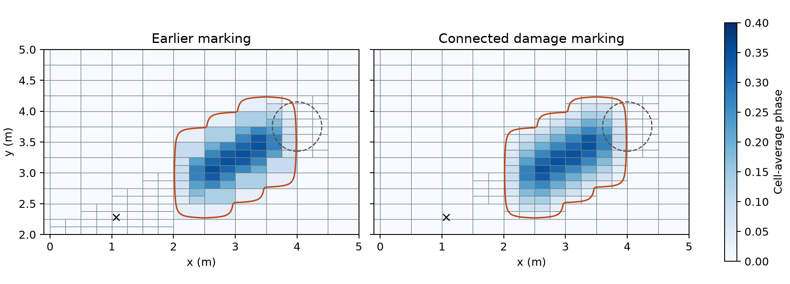

# Reference widths and the initialized material seed

In the zero-load startup, all three tents overlap above 0.01. Their breakpoints lie on root faces. On each cell the prescribed phase is therefore bilinear and attains its supremum at a corner. The independent checker enumerates every cell whose corner supremum exceeds 0.01 by more than 10⁻¹³, including cells well outside the stationary AT1 width. It obtains the physical footprints from the native quadrature areas and first moments using the prescribed rectangular aspect ratio. It checks the phase at every native sample. Coordinates and lengths are in metres.

The first integral of the stress-free 1-D profile gives the half-width as ℓ ∫₀¹ dφ/√α(φ). The crack law returns the factor and the configured surface functional converts it to a dimensional width. AT1 gives 2ℓ, CZM gives πℓ/2 and AT2 has infinite support. The axis-normal band and the padding of the seed-relative forward sector consume this width. The direction-score kernel has an independent mechanical radius. The Gauss check substitutes φ = u² into the width integral. At ℓ = 0.0625 and 0.37 m the AT1 widths are 0.125 and 0.74 m. The CZM widths are 0.09817477042468103 and 0.5811946409141118 m.


| Accepted time zero (two ranks) | Cells | Longest edge intersecting connected phase above 0.01 (m) | Positive centers beyond reference width | Old backward-ray witness (m) | Forward disk witness (m) |
| --- | ---: | ---: | ---: | ---: | ---: |
| Earlier marker, inherited 0.25 m target | 273 | 0.5 | 40 | 0.25 | 0.25 |
| Repaired, inherited 0.25 m target | 288 | 0.25 | 72 | 0.5 | 0.25 |
| Repaired, explicit 0.125 m target | 735 | 0.125 | 280 | 0.5 | 0.125 |

Thirteen of the earlier mesh's 40 off-axis witnesses were underresolved. The repaired counts were zero of 72 and zero of 280.

The changed-geometry domain spans [−1,7] × [2,5] m. Root cells are 0.5 × 0.25 m. At a dip of 26.565051° the projected box span is 19/√5 = 8.4970583145 m. The two repaired starts have byte-identical initial tables of all 34 sections. The checker reconstructed both physical edges of every strip and verified the prescribed age (10 s) and virgin slip. The phase error across the native quadrature points was at most 3.33×10⁻¹⁶ for all three meshes. The checker rejected the earlier mesh for an unresolved region of the actual seed and refinement in a fictitious wake.



*Native quadrature cell-average phase and actual mesh edges at time zero. The orange curve is the independently prescribed 0.01 contour, the dashed circle is the 0.4 m predictive disk and the cross is a probe behind the finite seed. Both panels use the same material input and inherited 0.25 m bulk resolution.*

On one rank the independent AT2 affine energy check measured 2.333333333333334, 0.1562499999999999 and 2.489583333333334 J/m for the local, gradient and total terms. Selecting the growing mesh criterion with the same AT2 field failed on infinite support. Growing-solver startups with AT2 and CZM failed on their named AT1 restriction. No native history was published by the three failed starts. All 18 targeted width assertions passed.

Moving only the seed tip from (4,3.75) to (4,4.9) m leaves all three positive tents on the initialized roots but displaces the incoming line. The marker diagnosed “the incoming seed has no resolved anchor” at zero time and exited with status 1 on one rank. No physical balance row appeared.

The two-rank granite startup reproduced the archived fixed-sector and disk initial meshes. The analytical footprint oracle found zero missing cells on each, with 0.015625 m finest edge and maximum native phase discrepancy 6.66×10⁻¹⁶. The sector had 2,700 cells and 112,464 native points; the disk had 2,322 cells and 102,240 native points. Each pair of native shards, both field shards and the 96-strip table were byte-identical to the corresponding earlier results. These are time-zero comparisons. The physical propagation and restart controls are recorded separately.

## Replay

Run from the worktree root with the candidate installed under the indicated prefix. The final installed executable used for replay has SHA-256 `effadd4cfd941c8d44eca41da6f94afadde1b4f875bd68d79712a886ddff9070`. Each run destination must be fresh. The validation and MPI runner limits each rank to one numerical thread.

```sh
prefix=build-amr-review/install
exe=$prefix/bin/aspect-release
amr=$prefix/benchmarks/granite_fault_growth/amr
dest=build-amr-review/width/final
export OPENBLAS_NUM_THREADS=1 DEAL_II_NUM_THREADS=1 OMP_NUM_THREADS=1
"$exe" --test 'Reference crack profile*'
python3 "$amr/check_startup_geometry.py" "$exe" "$dest/starts"
for policy in sector disk
do
  python3 "$amr/granite.py" "$exe" "$policy" "$dest/granite-$policy" --steps 0 --ranks 2
  python3 "$amr/sector_check.py" "$dest/granite-$policy/output" "$policy"
done
```

For the earlier mesh, we used the same installed executable as the [steady-drive granite control](../steady-drive/README.md), SHA-256 `e299e1da1f59c993268a5f02fce2c28cb80050dcd37873e38f5f8b13adfe9355`. Its build banner records `d6c552075`; the canonical material inputs were added during that build. The mesh criterion is identical in the trees at that revision and at the start of the present repair (`3c1ec279d`). Keep the output separate. The final checker command in this block should fail on the old output.

```sh
old=build-amr-width/old-interior
mkdir -p "$old"
cp benchmarks/granite_fault_growth/amr/interior_seed.prm benchmarks/growing_fault/growing_seed.prm "$old/"
printf 'include interior_seed.prm\nset Output directory = output\n' > "$old/start.prm"
python3 benchmarks/granite_fault_growth/run.py build-fault-inputs/install/bin/aspect-release "$old/start.prm" timing --ranks 2
python3 "$amr/check_interior_seed.py" "$old/output" .25
```

```sh
python3 "$amr/plot_interior_seed.py" "$old/output" "$dest/starts/inherited/output" \
    refactoring/phase-field-fault/example2/amr/interior-seed.png
```

With the retained granite outputs available locally, the bytewise check was

```sh
for policy in sector disk
do
  for name in fields-0000-r0.csv fields-0000-r1.csv points-0000-r0.csv points-0000-r1.csv sections-0000.csv
  do
    cmp "build-granite-amr/final-$policy/output/$name" "$dest/granite-$policy/output/$name"
  done
done
cmp "$dest/starts/inherited/output/sections-0000.csv" "$dest/starts/finer/output/sections-0000.csv"
```

## Uniform prestressed granite regression

The 48 × 24 specimen uses the public steady-drive input with 52,500,004.2031734 Pa native shear stress. A fresh eight-step run compares the unrefined AT1 physical calculation with the retained [steady-drive control](../steady-drive/README.md). Both input files must compare equal. This run uses the same two MPI ranks and one numerical thread per rank as the earlier calculation.

```sh
prefix=build-amr-review/install
exe=$prefix/bin/aspect-release
driver=$prefix/benchmarks/granite_fault_growth
work=build-amr-review/drive
name=granite_prestress_driven_48x24.prm
mkdir -p "$work"
cp "$driver/granite_fault_growth.prm" "$driver/$name" "$work/"
cmp "$work/granite_fault_growth.prm" build-granite-drive/granite_fault_growth.prm
cmp "$work/$name" "build-granite-drive/$name"
python3 "$driver/run.py" "$exe" "$work/$name" timing60 --ranks 2 --wall-limit 1200
d=output-granite-prestressed-driven-48x24
python3 - "build-granite-drive/$d" "$work/$d" <<'PY'
import filecmp
from pathlib import Path
import sys
old, new = map(Path, sys.argv[1:])
files = {p.name for p in old.glob("*.csv")}
assert len(files) == 61 and files == {p.name for p in new.glob("*.csv")}
for name in sorted(files):
    if not filecmp.cmp(old/name, new/name, shallow=False):
        raise ValueError(f"Changed physical output: {name}")
print(f"{len(files)} matching physical CSVs")
PY
```

All **61 CSV files were byte-identical** to the earlier run across time zero and the eight accepted 7.5 µs intervals. The comparison included FE coefficients, native quadrature fields, strip histories, friction pressures and work balances on both ranks. At 60 µs the native area-mean shear had risen by 2,131.72896218 Pa. The fastest strip was ID 19 at 1.0020829094872066×10⁻⁶ m/s and cumulative wall work was 4.72509630611 J/m. The MPI launch completed in 368.879 s on the shared machine, or 45.81 s per physical step from the first step announcement to the last physical output. Peak measured resident memory was 843,736 KiB on rank zero and 374,964 KiB on rank one.
