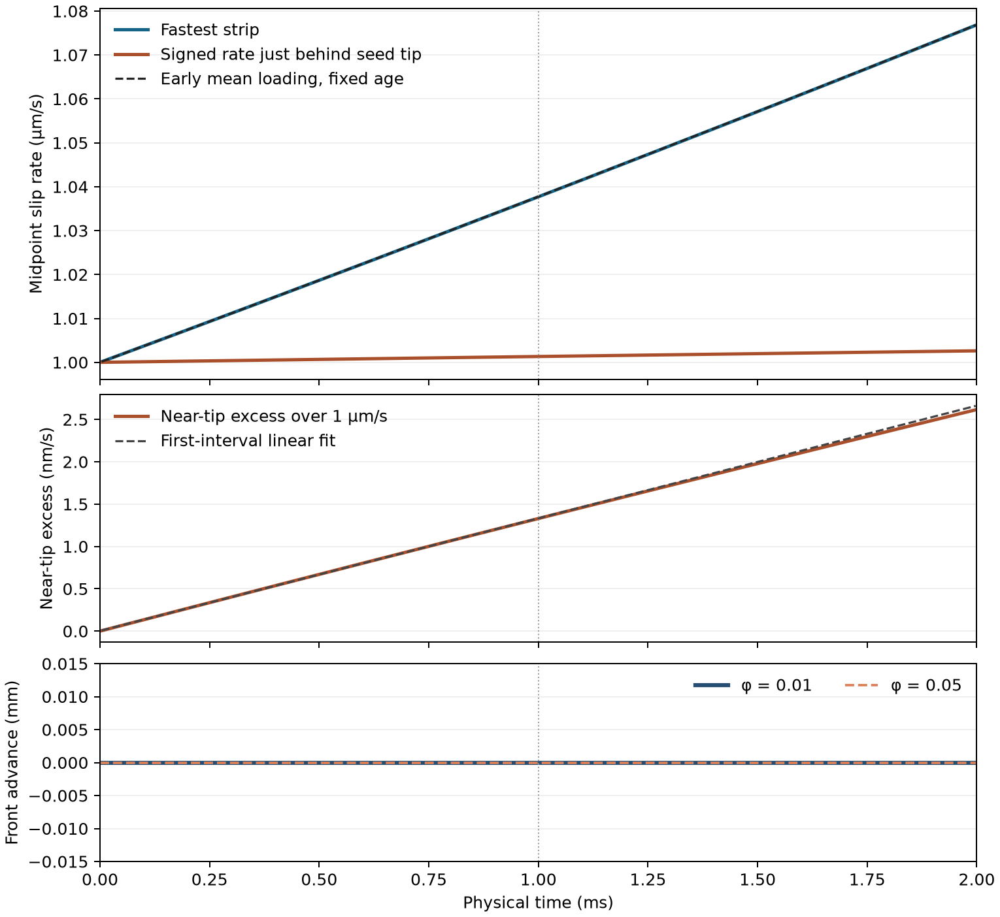

# Continuation of the prestressed granite specimen

The parent is the accepted two-rank 48 × 24 state at 1 ms from step 134.
The additional time in its metadata belongs to the upcoming interval.
The historical checkpoint archive, public input, original CSV and reference
figure remain in the preceding steady-drive record. The source checkout at
the beginning of this experiment was b3ca2603a9f6d0ad81eb74665874946647c249a4.

## Measured response through 2 ms

The 48 × 24 run accepted step 268 at exactly 2 ms and stopped. The near-tip signed rate increased in both intervals. Its duration-weighted midpoint slope fell by 3.22% in the second interval. The peak stayed at ID 19, x = 0.609375 m, 0.515625 m behind the seed end. The fixed near-tip station was ID 35, x = 1.109375 m. Both are on y = 0.375 m. No slip burst, front extension or arrest occurred.

| Measured quantity | 0–1 ms | 1–2 ms |
|---|---:|---:|
| Accepted intervals | 134 | 134 |
| Peak speed (µm/s) | 1.03765493 | 1.07676661 |
| Final signed near-tip rate (µm/s) | +1.00132816 | +1.00261346 |
| Mean signed near-tip rate from accumulated slip (µm/s) | +1.00066852 | +1.00197679 |
| Fitted near-tip acceleration (µm/s²) | 1.32977303 | 1.28695159 |
| Endpoint near-tip slip / Dc | 0.001000669 | 0.002002645 |
| Endpoint maximum slip / Dc | 0.001018732 | 0.002075894 |
| Forward displacement at both contours (m) | ≤2.23e−16 | 0 |
| Maximum absolute phase bound ahead of x = 1.125 m | 0 | 0 |
| Average wall seconds from step start to accepted output | 7.35 | 7.29 |

The last interval rates refer to the solved midpoints at 0.998750 and 1.9973875 ms. The rate secants between the first and last measured midpoints in each interval give 1.329741 and 1.286978 µm/s², independently supporting the slope comparison. Dc = 1 µm. The early mean shear ramp measured over 60 µs was 35.528816 MPa/s. With fixed age, reference speed 1 µm/s and direct-effect scale a × p = 0.0137 × 70 MPa, its predicted rates at the two midpoints were 1.037695 and 1.076805 µm/s. The near-tip response was much smaller.



*The peak rate follows the fixed-age loading trend. The middle panel magnifies the signed near-tip rate above 1 µm/s and extrapolates the first-millisecond fit. The two accepted front-displacement traces coincide at zero to coordinate roundoff.*

The φ = 0.01 and 0.05 contours remained at x = 1.112175270599 and 1.096323033266 m inside the taper. The forward roots agreed with the global Bernstein upper bounds at every clock. The geometric reconstruction used 16 intervals per finest edge (sample diagonal 2.762 mm on this mesh); for these fields the separate global envelope and physical polynomial roots resolve x much more tightly. The formed and phase-tracked mechanical tips both stayed at x = 1.125 m. All 268 sparse phase shards in the second millisecond were byte-identical to their corresponding 1 ms parent shard. The fixed mesh, phase and fracture operator therefore give unchanged discrete fracture energy through that interval. No phase developed in the initially intact rock ahead of the original seed end.

The exact-end replay matched all 297 raw compact files through the superseded launch's last accepted time, 1.739775 ms. It then continued to 2 ms with no retries, using steps from 4.775 to 7.5 µs, and took 979.86 s including startup and checkpointing. Generation 02 and its pointer are in `continuation-2ms.tar.gz`. Its SHA-256 is `f05a055444529c91c7417d61a5e942fdfbdb9b744d52c49653796746fb6c2f76`. The pointer and all generation files matched the live restart directory byte for byte. The metadata schedules step 269 at 2.0075 ms; the last accepted physical state is step 268 at 2 ms.

## Coarse replay

Use the same historical installation as the [1 ms experiment](../steady-drive/README.md).
The executable SHA-256 is e299e1da1f59c993268a5f02fce2c28cb80050dcd37873e38f5f8b13adfe9355.
The archive SHA-256 is ac44a38a0f177cf4e6f68b7b2e4ab4de2d7a15966f7c3be62bf87ced126de215.
The run below used two MPI ranks with one numerical thread each. The launcher records
elapsed time, memory and the effective command. Use a fresh directory.

```sh
R=$PWD
B=$R/benchmarks/granite_fault_growth
A=$R/refactoring/phase-field-fault/example2
E=$R/build-fault-inputs/install/bin/aspect-release
W=$R/build-example2-seed/coarse
mkdir -p "$W/output-granite-driven-continuation"
cp "$B"/granite_fault_growth.prm "$B"/granite_prestress_{driven_48x24,continue_48x24}.prm "$W/"
cp "$A/continued-granite/to25.prm" "$W/"
tar xzf "$A/steady-drive/continuation-1ms.tar.gz" -C "$W/output-granite-driven-continuation"
cmake -S "$B/compact_history" -B "$W/plugin" -DAspect_DIR="$R/build-fault-inputs/install/lib/cmake/Aspect"
cmake --build "$W/plugin" -j1
python3 "$B/run.py" "$E" "$W/to25.prm" timing25 --ranks 2
```

All three compact CSV files at step 135 (1.004775 ms) matched the independent
archived restore byte for byte. The geometry-based contour measurement
reproduced the historical 135 clocks and the original 134 near-tip and peak
rates exactly. Both front locations agreed to 2.23e−16 m.

## Source identity

Before editing the production marker, the four-cell operator selected cell 2
initially and at the first accepted endpoint. Reselecting on that endpoint
chose the detached island in cell 0. The second trial then returned only cell
0. Reusing the original source returned cells 2 and 3. The unmodified
operator and the two competing selections were exercised with one and two
ranks, with 15 assertions passing per rank.

```sh
export OMP_NUM_THREADS=1 OPENBLAS_NUM_THREADS=1 DEAL_II_NUM_THREADS=1
mpiexec -n 1 build-6b/release/aspect-release --test 'Fault damage anchors*' -s
mpiexec -n 2 build-6b/release/aspect-release --test 'Fault damage anchors*' -s
```

The marker takes a DG source from the initialized FE field on the resolved
mesh. Its checkpoint contains the original cell, the signed distance from
the physical anchor in metres, and the unit position in that cell. On
refinement the Cartesian child path determines the same one-sided trace,
including a deterministic lower-child choice at new internal faces. Scheduled
marking and the pre-accept trial inspection consume this same source.
The material's 0.05 trace and mechanical history are independent of this
0.01 refinement criterion. Legacy recovery inspects the restored accepted FE
field and requires a single supported component on the incoming segment.

### Two-interval laptop run

The author shortened the target to 2 ms while the original long launch was
still below that clock. Its last durable generation was still the input
1 ms checkpoint. The accepted output from the interrupted long launch is
retained separately. For the exact endpoint repeat the coarse recipe above
in a new directory with `to2.prm` in place of `to25.prm`. In this run the
separate directory was `build-example2-seed/coarse2` and the timing
directory was `timing`. Both launches use the same benchmark-only observer,
SHA-256 9b8b0395561ef007ce8a8eb2c13d84f07cf14fde7b000eb76633e158bdd0b19e.

The analysis reads the physical lower corner, two edge lengths and nine
Bernstein coefficients from every owned compact patch. Earlier full frames
use the native quadrature area and first moments and are checked against
the native phase. For each threshold the analysis labels excursions inside
each cell and joins neighboring traces only across a shared face interval
of positive length. It finds the forward x root of the polynomial on sampled
transverse slices. A separate Bernstein envelope bounds the forward extent
over all cells, including detached islands. Interior topology and transverse
position remain sampling-dependent for a general turning curve. Mechanical
positions use the contiguous formed stations and the accepted graph, then
the maximum one-sided 0.05 trace at each station. A compact frame with newly
formed stations beyond the seed requires their angles from a full overlapping
replay. Midpoint rates are paired with their solved intervals and slip and
front displacements are reported at the accepted endpoints.

```sh
R=$PWD
B=$R/benchmarks/granite_fault_growth
A=$R/refactoring/phase-field-fault/example2
W=$R/build-example2-seed
D=$A/continued-granite
export OPENBLAS_NUM_THREADS=1 OMP_NUM_THREADS=1
python3 "$B/amr/granite_history.py" \
  "$R/build-granite-drive/output-granite-prestressed-driven-48x24" \
  "$R/build-granite-drive/output-granite-driven-continuation" \
  "$W/coarse2/output-granite-driven-continuation" \
  --ranks 2 --native-replay "$W/legacy-overlap/output-granite-driven-continuation" --csv "$D/two-ms.csv"
python3 "$B/amr/check_granite_overlap.py" "$D/two-ms.csv" "$A/steady-drive/trajectory.csv"
python3 "$B/amr/check_turning_contours.py"
MPLBACKEND=Agg python3 "$B/amr/two_ms.py" "$D/two-ms.csv" "$A/steady-drive/trajectory.csv" "$D"
```

The independent bent-corridor control crosses a hanging face and follows
a taper above the original seed line. It returned x = 12.875 m and
12.375 m at 0.01 and 0.05, respectively, at both eight and sixteen samples
per finest edge. The detached island reached x = 15 m. A graph turning
with slope 0.5 advanced 1 m in x and 1.11803398875 m in arclength.

### Installed seed regression

The manufactured fixture replaces the returned phase just before the normal
pre-accept inspector. This exercises a mesh decision on prescribed fields.
Its physical receiver starts at y = 1.75 m, 1.5 m above the seed line.
The band half-width is 1.2 m, and the disk predictor is off. The first
accepted endpoint adds an island on the incoming segment. Scheduled mesh
refinement bisects the original source cell from 0.125 m to 0.0625 m. The
second trial connects the seed column to the receiver. The old marker
accepted on the 0.25 m receiver. The repaired marker requested a repeat,
refined the receiver to 0.125 m and accepted the retry at the same clock.
Exactly one physical balance was published at each of 2.5 and 5 ms.
The original, gap, island and receiver fields were checked at both clocks.

```sh
W=$PWD/build-example2-seed
EXE=$W/install/bin/aspect-release
P=benchmarks/granite_fault_growth/amr/seed_identity
cmake -S "$P" -B "$W/identity/plugin" -DAspect_DIR="$W/install/lib/cmake/Aspect"
cmake --build "$W/identity/plugin" -j1
PLUGIN=$W/identity/plugin/libseed_identity.release.so
for n in 1 2; do
  dest="$W/identity/qualified-$n"
  python3 "$P/run.py" "$EXE" "$PLUGIN" "$dest" --ranks "$n"
  python3 "$P/run.py" "$EXE" "$PLUGIN" "$dest-resume" --ranks "$n" --restart "$dest/output/restart/02"
  OPENBLAS_NUM_THREADS=1 python3 "$P/check.py" "$dest" --resumed "$dest-resume"
done
```

One and two ranks both reproduced the same sequence of cell widths. A
restart from the first physical endpoint reproduced all native, FE, strip
and energy columns of the corresponding clean 5 ms endpoint within the
established 1e−12 absolute and relative tolerance. The old two-rank writer
was built from b3ca2603a. Build the fixture against its SDK in a separate
directory and pass its executable and DSO to the same driver, followed by
the checker with `--historical`. Restarting that writer’s generation 02 with
the repair deliberately failed before physical publication because the
incoming segment reached two disconnected components. In the old granite
checkpoint it reached one component. The legacy-overlap input resumed
that checkpoint, accepted step 135, and reproduced both sparse phase shards
and the strip table of the original executable byte for byte.

## Prestressed fine-mesh startup within the shortened laptop run

Both fresh runs used two ranks with one thread each. The canonical prestress,
gravity, wall functions, RSF parameters, timestep limits and physical strip
partition came from the same production input. The adaptive input explicitly
sets both target strip width and maximum bulk edge to 0.015625 m. The uniform
input inherits 96 × 48 repetitions. In each case the measured maximum initial
native shear error was zero relative to 52,500,004.2031734 Pa. The 96 physical
strip centres and the 97 interval edges reconstructed from initial lengths
and centres agreed with multiples of 15.625 mm to 1e−14 m. No protected cell
exceeded that edge. The initial phase at native integration points matched
the prescribed taper and transverse profile to 6.67e−16. The effective wall
function prescribes +0.5 mm/s at the top and −0.5 mm/s at the bottom.

| Mesh | Cells | Native points | Longest protected edge (mm) | Last accepted time (µs) | Observed wall (s) | Rank 0 / rank 1 peak RSS (KiB) |
|---|---:|---:|---:|---:|---:|---:|
| Tip disk | 2,322 | 102,240 | 15.625 | 0 | 943.23 | 1,907,176 / 477,440 |
| Uniform | 4,608 | 165,888 | 15.625 | 0 | 480.47 | 2,577,952 / 688,092 |

Both inputs validated, initialized and entered the first physical correction
at 7.5 µs. The iteration-zero mechanical residuals were 3.42504e−8 and
6.57701e−8 respectively, with projected phase residual 0.295435 for both.
The adaptive startup was stopped when the laptop assignment was shortened.
The uniform startup was stopped after the eight-minute measurement window.
Neither solver had returned its first linearized obstacle correction. These
times measure resources up to interruption. A matched physical slip, work or
front-displacement comparison through 60 µs remains open. On the common
initial clock the strip slips and two contour displacements were zero.
The conservative terminal-subdivision join and the independent-layout strip-16
direction difference retain their documented scope.

```sh
W=$PWD/build-example2-seed
B=$PWD/benchmarks/granite_fault_growth
E=$W/install/bin/aspect-release
for mesh in disk uniform; do
  mkdir "$W/$mesh"
  cp "$B"/granite_fault_growth.prm "$B"/granite_prestress_{disk,uniform}_60us.prm "$W/$mesh/"
  python3 "$B/run.py" "$E" "$W/$mesh/granite_prestress_${mesh}_60us.prm" timing --ranks 2
done
OPENBLAS_NUM_THREADS=1 python3 "$B/amr/compare_prestress.py" "$W/disk" "$W/uniform" "$W/analysis/fine" --last-step 0
```

The example recipes above can continue to their specified physical end time
when resources permit. The archive `effective-inputs.tar.gz` contains the
expanded original input and ASPECT's resolved parameters for both startup
meshes and the shortened coarse run. `inputs.sha256` records the executables,
plugins, physical inputs and overlay identities.

For the one-step full native overlap, use a fresh copy of the tracked 1 ms
generation. Build the compact observer against the repaired installation,
then launch `legacy-overlap.prm` there with the two-rank driver. At the
returned 1.004775 ms endpoint the mean shear increment was 35,698.00645 Pa
and the fixed near-tip age was 0.99999932534 s. That interval's near-tip
signed resistance was 52,501,280.8934 Pa. Its prescribed-velocity work was
0.37628636 J/m and its phase work was zero. Discrete fracture energy was
9,686.04166667 J/m. The phase coefficients from all 288 nonzero compact
patches agreed exactly with the full native replay. The other compact
intervals do not directly measure stress, age or wall work.

```sh
W=$PWD/build-example2-seed
B=$PWD/benchmarks/granite_fault_growth
A=$PWD/refactoring/phase-field-fault/example2
L=$W/legacy-overlap
mkdir -p "$L/output-granite-driven-continuation"
cp "$B"/granite_fault_growth.prm "$B"/granite_prestress_{driven_48x24,continue_48x24}.prm "$L/"
cp "$A/continued-granite/legacy-overlap.prm" "$L/"
tar xzf "$A/steady-drive/continuation-1ms.tar.gz" -C "$L/output-granite-driven-continuation"
cmake -S "$B/compact_history" -B "$L/plugin" -DAspect_DIR="$W/install/lib/cmake/Aspect"
cmake --build "$L/plugin" -j1
python3 "$B/run.py" "$W/install/bin/aspect-release" "$L/legacy-overlap.prm" timing --ranks 2
```

## Scoped regressions

The final Release installation passed 3,262 assertions in 75 cases. On
one and two MPI ranks the damage suite passed 53 assertions in eight cases
per rank. This includes the four-cell counterexample, a refinement-face
tie with damage on the opposite side only, and a retry from the original
side. The growing-fault CTest passed. On two ranks the compact AT1 control
rejected one extension into four coarse cells and its two accepted intervals
reproduced all 14 scientific CSV files of the retained uniform fine control
byte for byte. The approaching-reserve control refined and advanced; the
detached-island control retained all 16 coarse crossings outside the
original seed component and accepted at 2.5 ms.

```sh
W=$PWD/build-example2-seed
E=$W/tested/bin/aspect-release
B=$W/tested/benchmarks/granite_fault_growth
P=$B/amr
export OPENBLAS_NUM_THREADS=1 OMP_NUM_THREADS=1 DEAL_II_NUM_THREADS=1
"$E" --test
mpiexec -n 1 "$E" --test 'Fault damage*' -s
mpiexec -n 2 "$E" --test 'Fault damage*' -s
ctest --test-dir build-6b/release -R '^growing_fault$' --output-on-failure
python3 "$P/run_advancing.py" "$E" "$W/regression-miss" miss --case compact --ranks 2
python3 "$P/check_recovery.py" "$W/regression-miss" build-amr-review/uniform --compact --ranks 2 --steps 2
cmake -S "$W/tested/benchmarks/growing_fault" -B "$W/regression-plugin" -DAspect_DIR="$W/tested/lib/cmake/Aspect"
cmake --build "$W/regression-plugin" -j1
python3 "$P/run_advancing.py" "$E" "$W/regression-prevent" preventive --case compact --ranks 2 \
  --observer "$W/regression-plugin/libgrowing_fault_checks.release.so"
python3 "$P/check_prevention.py" "$W/regression-prevent" --ranks 2
mkdir "$W/regression-detached"
cp "$P/detached_island.prm" "$W/tested/benchmarks/growing_fault/growing_seed.prm" "$W/regression-detached/"
python3 "$B/run.py" "$E" "$W/regression-detached/detached_island.prm" timing --ranks 2
python3 "$P/check_detached_island.py" "$W/regression-detached/output" --bins 66
```

To check binary equality of the retained overlapping frames, inventory the
sparse patches across the second millisecond, compare the checkpoint archive
with the saved generation, and extract solver wall time per interval, run
the following from the worktree root after plotting.

```sh
D=refactoring/phase-field-fault/example2/continued-granite
OPENBLAS_NUM_THREADS=1 python3 "$D/check_replays.py" build-example2-seed \
  build-granite-drive/output-granite-driven-continuation "$D"
```
