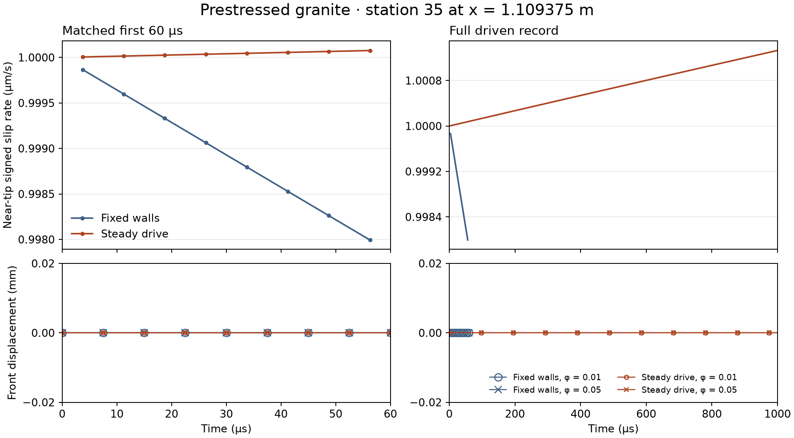

# Starting the walls on the prestressed granite seed

The control and driven experiment use the same 48 × 24 uniform grid and native initial state. The installed Release executable has SHA-256 `e299e1da1f59c993268a5f02fce2c28cb80050dcd37873e38f5f8b13adfe9355`. The starting source is `7c2de392f`. Both calculations used two MPI ranks and one numerical thread per rank. The driven input inherits the affine velocity from the [96 × 48 physical input](../../../../benchmarks/granite_fault_growth/granite_fault_growth.prm). The [48 × 24 driven deck](../../../../benchmarks/granite_fault_growth/granite_prestress_driven_48x24.prm) and [fixed-wall control](../../../../benchmarks/granite_fault_growth/granite_prestress_hold.prm) resolve to the same values in 1,775 of 1,777 parameter entries. Only the output directory and the boundary velocity expression differ.

**The near-tip slip rate rose gradually through 1 ms. Neither contour advanced, no initially intact cell developed phase, and there was no burst or arrest.** The 134 accepted intervals ended with +1.00132816 µm/s immediately behind the seed tip and +1.03765493 µm/s at the fastest station, ID 19 at x = 0.609375 m. The corresponding accumulated slips were 1.00066852 and 1.01873184 nm. The final rates are those of the 998.75 µs midpoint. The last interval shortened from 7.5 to 2.5 µs to meet the requested endpoint.



**Figure.** The top row shows signed midpoint slip rate on strip 35, x = 1.109375 m. The lower row shows the endpoint displacement of the forwardmost seed-connected φ = 0.01 and 0.05 contours from their respective initial positions, in mm. The left column resolves the matched 60 µs and the right follows the driven specimen to 1 ms. The coincident lower curves are measured zero at every acceptance. The fixed-wall record ends at 60 µs. [Numerical series](trajectory.csv).

Both driven rates increased monotonically. Between adjacent midpoints, the logarithmic slope of the fastest rate was 36.990–37.029 s⁻¹. For comparison, the intact elastic loading rate divided by the RSF direct-effect scale is (G U/H)/(a pN) = 37.08 s⁻¹. At station 35 the measured logarithmic slope fell from 1.351 to 1.307 s⁻¹. All later phase adjustment stayed inside the original taper. The end of the furthest changed cell was x = 1.09375 m, the formed count stayed at 36, and every coefficient ahead of x = 1.125 m remained zero. These results cover startup on the coarse grid. The behavior at later loading times and its mesh dependence remain open.

**Measured cost on two ranks.** From step announcement to publication the first eight steps took 24.46 s/step under drive and 37.90 s/step in the retained hold. The complete MPI launches for those windows took 197.81 s and 306.12 s respectively. Steps 9–134 under drive averaged 6.27 s/step, with a median of 6.24 s and a range of 5.92–7.62 s. Across all 134 driven steps the measured accepted intervals sum to 985.23 s. Elapsed time from the first MPI launch to completion at 1 ms was 20 min 22 s, including the interruption and time between launches. The timestamps for steps 26 and 27 use successive rank-zero compact file publications, because the interrupted launcher did not flush those two timing messages. The per-step records identify the measurement used. [Driven wall times](drive-cost.csv) and [hold wall times](hold-cost.csv).

## Matched first eight intervals

The wall data in both exported components of the accepted Q2 velocity agree with the boundary functions to 1e−14 m/s at every wall node. Each driven horizontal wall has uniform horizontal speed, +0.0005 m/s at the top and −0.0005 m/s at the bottom, with zero vertical speed. The sides use the same affine shear. Native time-zero data on both ranks and all 48 strip records are byte-identical. All 41,472 native points start with τxy = 52,500,004.2031734 Pa. The largest time-zero phase error against the analytic seed is 5.55e−16.

The following table gives **hold / drive**. Wall work is cumulative external work per unit out-of-plane thickness. Stress is the native-quadrature area mean of τxy minus the initial value. Rates are signed at the midpoint of each accepted interval, listed against its endpoint. The last station behind the original tip is ID 35 at x = 1.109375 m. The maximum speed in both runs is positive, at ID 19, x = 0.609375 m, at every matched interval.

| End (µs) | Wall work (J/m) | Mean Δτxy (Pa) | Peak speed (µm/s) | Near-tip rate (µm/s) | Near-tip accumulated slip (nm) |
|---:|---:|---:|---:|---:|---:|
| 7.5 | 0 / 0.590627 | −0.200 / 266.466 | 1.000000 / 1.000139 | 0.999866 / 1.000005 | 0.007499 / 0.007500 |
| 15 | 0 / 1.181256 | −0.401 / 532.933 | 0.999999 / 1.000416 | 0.999598 / 1.000015 | 0.014996 / 0.015000 |
| 22.5 | 0 / 1.771889 | −0.601 / 799.398 | 0.999998 / 1.000694 | 0.999331 / 1.000025 | 0.022491 / 0.022500 |
| 30 | 0 / 2.362524 | −0.801 / 1065.865 | 0.999998 / 1.000972 | 0.999063 / 1.000035 | 0.029984 / 0.030001 |
| 37.5 | 0 / 2.953163 | −1.002 / 1332.331 | 0.999997 / 1.001249 | 0.998796 / 1.000046 | 0.037475 / 0.037501 |
| 45 | 0 / 3.543804 | −1.202 / 1598.797 | 0.999996 / 1.001527 | 0.998529 / 1.000056 | 0.044964 / 0.045001 |
| 52.5 | 0 / 4.134449 | −1.402 / 1865.263 | 0.999996 / 1.001805 | 0.998261 / 1.000066 | 0.052451 / 0.052502 |
| 60 | 0 / 4.725096 | −1.603 / 2131.729 | 0.999995 / 1.002083 | 0.997995 / 1.000076 | 0.059936 / 0.060002 |

Imposed relative displacement at 60 µs is 60 nm. With G = 2.6666666667e10 Pa and a 0.75 m wall separation, G Δu/H = 2,133.3333 Pa. The measured driven mean is 1.6044 Pa below that estimate. The initial shear times the wall length and relative displacement gives 4.7250 J/m, consistent with the accumulated reaction work. Subtracting the hold gives 2,133.3316 Pa of wall-driven response. In the initially intact region at x ≥ 1.125 m the mean changes were −0.0281 and +2,133.3052 Pa respectively. The native shear change over the complete grid ranged from −16.5178 to +5.4005 Pa in the hold, and from +2,116.7972 to +2,138.7398 Pa under drive. Maximum accumulated strip slips at 60 µs were 0.0599998 and 0.0600666 nm.

Both initial forward contour positions lie inside the taper, at x = 1.112175270598936 m (φ = 0.01) and 1.096323033266180 m (φ = 0.05). Both displacements were zero in all eight intervals on both runs. Phase adjusted in 12 cells in x ∈ [1.00000, 1.09375] m. The largest increase of an individual Bernstein coefficient was 0.0345634. All coefficients in the contour-bearing column and ahead of the seed retained their initial values. The maximum difference between the two accepted phase coefficient arrays at 60 µs was 7.99e−15. All 36 seed stations were formed after the first solve and all 12 ahead remained unformed.

The [comparison](../../../../benchmarks/granite_fault_growth/compare_drive.py) reconstructs the tensor-product Bernstein polynomial in physical cells and checks it against the exported native phase. It follows each one-sided DG edge trace continuously from the connected seed on the left wall to its first downward crossing at mid-height. A separate upper bound uses the convex combination in the transverse coordinate of the three x-directed Bernstein rows of every patch. Its furthest possible crossing agrees with the connected crossing to 1e−11 m. This checks whether an off-axis contour could invalidate the midline measurement. All-zero coefficients ahead of x = 1.125 m certify zero phase throughout those cells. Strip slip increments independently reproduce signed rate × accepted duration at every station. As a sensitivity check on the analysis alone, multiplying the initialized FE phase by 1.01 moved the two recovered fronts by 63.6466926 and 142.3183313 µm. Both agreed within 2e−16 m with the analytic change in the quadratic taper root. Adding an isolated above-threshold patch at the far right instead triggered the off-axis bound diagnostic.

## Replay from the checkout

Use a fresh destination. The historical fixed-wall output is preserved in the working installation. To reproduce it in a new directory, the optional hold invocation uses the same executable and input. The launcher validates each input before starting MPI and writes the elapsed wall clock beside every solver message.

```sh
R=$PWD
B=$R/benchmarks/granite_fault_growth
E=$R/build-fault-inputs/install/bin/aspect-release
I=$R/build-fault-inputs/install/lib/cmake/Aspect
W=$R/build-granite-drive-replay
A=$R/refactoring/phase-field-fault/example2/steady-drive
H=$R/build-fault-inputs/granite/release-hold/output-granite-prestressed-hold-48x24
HC=$R/build-fault-inputs/granite/release-hold/timing/wall.log
D=$W/output-granite-prestressed-driven-48x24
L=$W/output-granite-driven-continuation
export OPENBLAS_NUM_THREADS=1 OMP_NUM_THREADS=1 DEAL_II_NUM_THREADS=1
mkdir "$W"
cp "$B"/granite_fault_growth.prm "$B"/granite_prestress_{hold,driven_48x24,continue_48x24}.prm "$W"/
cmake -S "$B/compact_history" -B "$W/plugin" -DAspect_DIR="$I"
cmake --build "$W/plugin" -j1

# Optional fresh hold
# python3 "$B/run.py" "$E" "$W/granite_prestress_hold.prm" timing-hold --ranks 2
# H=$W/output-granite-prestressed-hold-48x24
# HC=$W/timing-hold/wall.log

python3 "$B/run.py" "$E" "$W/granite_prestress_driven_48x24.prm" timing60 --ranks 2 --wall-limit 7200
python3 "$B/initial_field.py" "$D" 48 "$W/native0.npz" --shear-prestress 52500004.2031734
python3 "$B/compare_drive.py" "$H" "$D" "$W/matched" --drive-wall-logs "$W/timing60/wall.log" --hold-wall-log "$HC"
mkdir "$L"
cp -a "$D/restart" "$L/"
cat > "$W/overlap.prm" <<'PRM'
include granite_prestress_continue_48x24.prm
subsection Termination criteria
  set Termination criteria = end step
  set End step = 9
end
subsection Postprocess
  set List of postprocessors = phase field fault history, compact granite history
end
PRM
python3 "$B/run.py" "$E" "$W/overlap.prm" timing-overlap --ranks 2 --wall-limit 300
python3 "$B/run.py" "$E" "$W/granite_prestress_continue_48x24.prm" timing-long --ranks 2 --wall-limit 6850
python3 "$B/compare_drive.py" "$H" "$D" "$W/summary" --continuation "$L" \
    --drive-wall-logs "$W/timing60/wall.log" "$W/timing-overlap/wall.log" "$W/timing-long/wall.log" --hold-wall-log "$HC"
MPLCONFIGDIR=/tmp/granite-mpl python3 "$B/plot_drive.py" "$W/summary/trajectory.csv" "$W/summary/rate-and-front.png"
```

The 60 µs run wrote generation 01, whose `resume.z` SHA-256 is `e8fb6907d81c57643af8c827c6a23117dfc673b98d3f7459bd07a7ddbf17bdf6`. Its metadata schedules step 9 at 67.5 µs from the accepted 60 µs parent. The continuation reads only this driven snapshot. Step 9 emits both compact and standard native outputs. All 10,368 phase coefficients (including zeros omitted in the sparse file) and all 48 strip IDs, positions, formed flags, signed speeds and slips matched exactly. The benchmark-only observer subsequently writes the replicated strip table once and sparse phase patches on their owning ranks. At the overlap the compact scientific tables occupied 57,457 bytes, compared with 9,155,637 bytes for the full scientific CSVs. This is a 159-fold reduction per accepted observation at this clock.

### Recovery during the measured run

The first compact launcher exited on signal 15 while attempting step 28. ASPECT had just written the checkpoint after accepting step 27 at 202.5 µs. The rank-local solver log had no nonlinear or constitutive failure, and no MPI worker remained. The saved parent scheduled step 28 at 210 µs. Its `resume.z` SHA-256 was `182f45225a8b4b10aedd43c4a9216f91b85827542cd8fd06973299ec74bd73e0`. A bounded restart accepted steps 28–39 and wrote the 292.5 µs parent. The ordinary continuation then resumed there. The following commands reproduce the two launches from the respective saved parents. The uninterrupted replay above uses the same physical schedule.

```sh
cat > "$W/window39.prm" <<'PRM'
include granite_prestress_continue_48x24.prm
subsection Termination criteria
  set Termination criteria = end time, end step
  set End step = 39
end
PRM
python3 "$B/run.py" "$E" "$W/window39.prm" timing39 --ranks 2 --wall-limit 800
python3 "$B/run.py" "$E" "$W/granite_prestress_continue_48x24.prm" timing-remainder --ranks 2 --wall-limit 6300
python3 "$B/compare_drive.py" "$H" "$D" "$W/summary" --continuation "$L" \
    --drive-wall-logs "$W/timing60/wall.log" "$W/timing-overlap/wall.log" "$W/timing-long/wall.log" \
                      "$W/timing39/wall.log" "$W/timing-remainder/wall.log" --hold-wall-log "$HC"
```

## Saved 1 ms state and plotting from the recorded table

The [checkpoint archive](continuation-1ms.tar.gz) contains the complete final generation and its ASPECT restart pointer. SHA-256 of the archive is `ac44a38a0f177cf4e6f68b7b2e4ab4de2d7a15966f7c3be62bf87ced126de215`. The `resume.z` hash is `2a9bcf50cfed0d6d819d0e8ba04b86f8c1eca9f5fe8cacbf1de98f286a1afd31`. The checkpoint's accepted parent is at exactly 1 ms and its metadata schedules step 135 at 1.004775 ms. In a fresh directory a rebuilt benchmark observer and the installed executable read the extracted archive, then accepted that step on two ranks. Both phase shards were byte-identical to the 1 ms fields, and the largest strip error in Δslip − Δt V was 2.06e−25 m. This additional restore check is separate from the 134-step plotted experiment.

```sh
# After setting R, B, A, E and I as above, use a fresh destination.
P=$R/build-granite-checkpoint-replay
mkdir -p "$P/output-granite-driven-continuation"
cp "$B"/granite_fault_growth.prm "$B"/granite_prestress_{driven_48x24,continue_48x24}.prm "$P"/
cmake -S "$B/compact_history" -B "$P/plugin" -DAspect_DIR="$I"
cmake --build "$P/plugin" -j1
tar xzf "$A/continuation-1ms.tar.gz" -C "$P/output-granite-driven-continuation"
cat > "$P/read_checkpoint.prm" <<'PRM'
include granite_prestress_continue_48x24.prm
set End time = 0.0010075
subsection Termination criteria
  set Termination criteria = end time, end step
  set End step = 135
end
PRM
python3 "$B/run.py" "$E" "$P/read_checkpoint.prm" timing --ranks 2 --wall-limit 180
MPLCONFIGDIR=/tmp/granite-mpl python3 "$B/plot_drive.py" "$A/trajectory.csv" "$P/rate-and-front.png"
```
