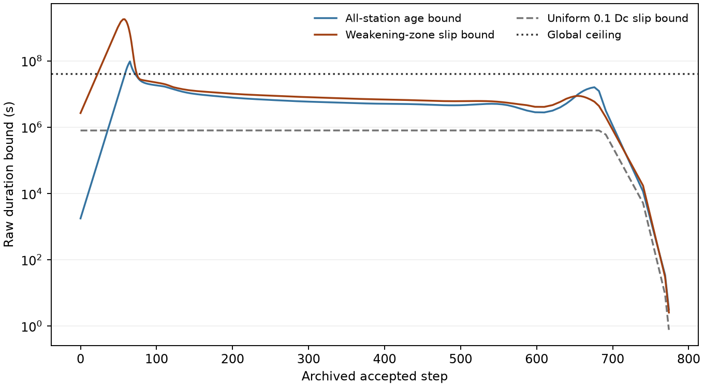
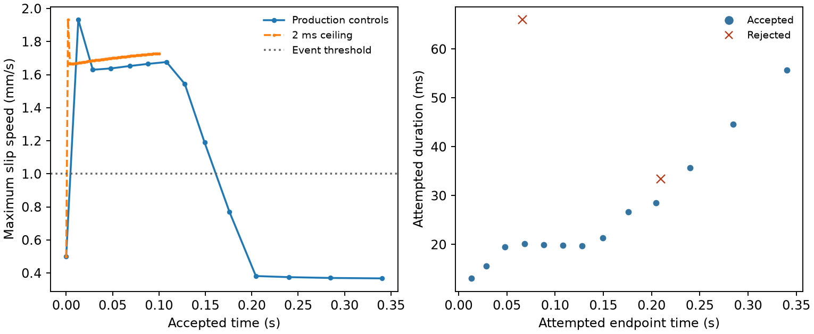

# Fresh historical BP3 first-event qualification

The package starts at physical time zero. The scientific baseline is `ee6d59cb7`. The core and the local BP3 coefficient evaluation are in `3d096dd46`; the per-ID increment diagnostic is in `807943f77`. The tested extension and deployment sources are in `81b3a583f`. The supplied deployment ZIP has SHA-256 `92baeb7cd7da0cc38606fcef4a6406f8485ee5735be4bb785e7e040798d0849a`. It remains intact. The delivered ZIP, merged input, local executable, extension and vertex table are identified in [identity.sha256](identity.sha256). The [deployment README](../../../../benchmarks/bp3_qd_thrust/stampede3/README.md) gives the Intel MPI core build, plugin build, validation and submission commands.

## Physical limits and ownership

ASPECT's timestep manager calls `FaultRSF::execute` after the coupled solve. The material provides the accepted state and the completed rates, or the initial rates at time zero. `FaultResistance::slip_resolution_parameters(id)` returns local a, b and Dc only for participating laws. `BP3Resistance::law_at_station` is shared by vertex timestep selection and quadrature-point friction. The latter still interpolates log age. Accepted ages are stored and evolved in seconds.

The weakening-dependent slip allowance is 0.5 a/b slip distances for b > 0 and a ≤ b. Otherwise slip supplies no limit. Absolute rate handles signed strips. Every evolving age has a log budget of 0.2. For a completed trial the exact exponential aging solution starts from its accepted parent. Excess triggers a repeat at 0.9 times the smaller applicable duration. The next proposal starts from the predicted endpoint and applies 0.99 only to the smallest active fault limit. The manager then applies its other limits. Publication still follows the repeat decision. The historical source at `abbc9b0c` selects the same slip branch in `FaultFriction::compute_time_step`. The existing uniform policy, independent disable settings and safety default of one remain available.

The measured spatial-law control perturbed only the pilot's starting ages to distinguish the two consumers of local friction. Its fastest vertex was ID 88 at 17.8 km, sliding at 1.21782e−8 m/s. ID 70 at 16 km set the slip limit at 4.48123e−9 m/s with a budget of 0.5 Dc. Independent inversion gave 892612.999006027 s before the margin. See [crossover.txt](crossover.txt).

### Frozen donor fields

All 5,776 rates, ages and coordinates entered each of 147 saved frames through onset. Each bound holds the saved velocity fixed. The reported old interval comes from the donor solver log. These are predictions on the old trajectory.

| Donor state | Old accepted interval | Raw age bound | Raw eligible slip bound | Next fault proposal |
|---|---:|---:|---:|---:|
| Step 62, year 10.002 | 40,000,000 s | 2.215 years | 39.36 years | 69,184,722 s |
| Step 226, year 86.78 | 82.8096 days | 82.2911 days | 109.47 days | 81.4682 days |
| Step 774, year 163.893 | 7.27745 s | 3.16215 s | 2.57307 s | 2.54733 s |

The old log contains 13 consecutive 4e7 s steps. Step 226's age limit is at 13.2 km; its old uniform slip bound of 9.24 days comes from 57.725 km. At onset, the archive records 0.00103637749 m/s at 10.85 km. The transition to slip control appears in [frozen.csv](frozen.csv).



**Figure 1.** Minimum physical duration bounds in seconds across all archived fault stations. Removing the deep strengthening slip restriction permits the global ceiling during quiet loading. Near nucleation, the weakening-zone slip bound falls below the age bound.

### Integrated simulator checks

* The cropped historical box used 1,388 cells, 16 material IDs, the historical 3.90625 m support resolution, original table construction, 20 m filter and production clocks and tolerances. The only physical-domain overrides were x ∈ [−62.5,187.5] m, height 125 m and the corresponding short vertex table. Mesh repetitions were 4 × 2, global level 4 and minimum level 0. Startup emitted every accepted profile and bulk frame. The two-rank time-zero shallow rate was approximately 1e−9 m/s, Theta₀ approximately 8,000 s. ID 2 at 19.245 m gave 1773.19155881 s raw and 1755.45964322 s after the margin. Step 1 accepted that duration on the first attempt. Both ranks' runs checkpointed and resumed through step 3. Step 4 restored production output cadence and added no frame. Four physical attempts produced four accepted steps. [Startup attempts](startup.csv) · [independent phase, loading, traction and cut checks](contact-check.txt)
* The full production mesh was measured before DoF allocation. In both layouts it had 552,084 cells, with 319,324 support cells and 2,502 cells in each protected contact. All widths matched 3.90625 m; the measured domain and 7.5e9 m² area matched the input. Extra off-fault refinement produced 565,767 valid cells. Coarsening the band made 341 support cells fail. Separate contact edits made 50 cells fail at the base or surface. The integrated production inventory continues into the solver on valid meshes. Only the separate mesh-only measurement DSO stops early. [Negative controls](mesh-controls.txt)
* At steady strengthening and b=0, the manager returned exactly 40,000,000 s, and the material accumulated 0.04 m (5 Dc) with stationary age. Under changing load the strengthening case rejected a log-age increment of 0.66584 despite unlimited slip. At equality the proposal was 3,960,000 s; shallow weakening gave 2,640,000 s. Disabled-age and disabled-slip controls, signed strip cutback and a state-free law retained the earlier behavior. Requesting local RSF coefficients from the state-free law produced the input diagnostic. The unit suite exercised zero velocity.
* The server trial described in the assignment consumed nine nonlinear iterations at 798,375 s and six more after retry. Its 0.10000002742 slip fraction would scale to 0.0990000271458 at unchanged speed with the margin. A coupled small load increase gave 0.33333342424 against 1/3 without margin (two attempts, one accepted). The margin gave 0.33000009000 (one attempt, one accepted). A stronger pulse exceeded both budgets and retried. The diagnostic Picard case identifies the vetoing vertex and its rates independently of the bulk residual. [Trial logs](gates.txt)
* The synthetic pulse produced 15 physical attempts and 13 accepted steps on both one and two ranks. The rejected first trial targeted 0.066 s. The accepted onset bracket was (0, 0.01306093199] s. The fifth consecutive below-threshold step ended at 0.34041346476 s, after 0.28468684771 s. The sparse profile and native writers emitted one frame each at zero, onset and completion. A clean first step at the smaller duration matched the retried state. A step-3 restart reproduced event clocks, streaks, histories and frame schedule. The independent uniform controls also checked the ASPECT step-count trigger, the time trigger, changing slip maxima and coincident triggers. The log names each requester.
* At the common physical clock 0.1 s, production and 2 ms steps gave peak rates 0.00167606 and 0.00172845 m/s, station-0 slip 0.000168788 and 0.000170441 m, and mechanical shear 5.01732868 Pa in both cases. The tighter onset bracket was (0, 0.002] s. In this homogeneous fixture the two end rates are tied to numerical precision, so the reported peak ID can switch between endpoints. These measurements quantify temporal sensitivity of the small fixture. Full-grid onset and its convergence remain for Stampede3. [One rank](controller-one.txt) · [two ranks](controller-two.txt)
* The original 900 s pilot passed at 0, 400 and 900 s and its three label tables were byte-identical to the prior shipped run. The uniform growing RSF and external dashpot produced eight byte-identical history tables apiece. Reversed strip loading still cut back. All four scoped Release CTests passed. [Pilot](pilot.txt) · [growing controls](growing.txt)



**Figure 2.** Left, accepted maximum rate (mm/s) during a manufactured load pulse with production controls and with a 2 ms ceiling through 0.1 s. Right, physical durations (ms) at their attempted endpoint clocks. Both discarded trials triggered a cutback before publication.

### Remaining numerical comparison

At the production linear tolerance of 1e−9, all startup material profiles passed across MPI layouts. The maximum rate difference was 5.81e−21 m/s, slip 1.98e−17 m and reconstructed shear 5.33e−6 Pa. The strict native checker remains **red** at this tolerance. The first violating physical clock was 1755.459643 s. Near the free surface it compared 0.96680480 and 0.96677136 Pa in pressure (3.34e−5 Pa). Several native stress samples also exceeded their existing mixed absolute/relative tolerance. The largest absolute native pressure difference across all samples was 2.44e−4 Pa, including samples with a larger relative allowance. The previously recorded contact comparison had a pressure difference up to 6.15e−5 Pa. Repeating the new identical box and schedules with only linear tolerance 1e−11 passed the original checker for all quantities. The linear-solve accuracy affects this comparison; no tolerance or reference was changed. [Strict output](mpi-production.txt) · [diagnostic output](mpi-diagnostic.txt)

### Deployment differences and limits

The old and new installed executables parsed their respective merged inputs. [Effective diff](effective-diff.txt) lists every changed or new setting. The new slip and state budgets, the spatial policy and the proposal factor set the experiment. The other two additions enable section convergence logging and expose the former fixed 0.1 m profile interval. All shared physical inputs, ceilings, 25% growth and output cadences otherwise matched. The shipped conversion preserves signed mechanical shear, returns frictional shear at the same accepted IDs and retains both normal compressions. Its radiation correction is ±4.62444 MPa at ±1 m/s. The launcher rejected a fresh start into existing output, a foreign success marker and mismatched run identities.

The local MPI installation uses GCC and deal.II 9.6. The final archive was extracted into an unused directory, its plugin built in that directory against the installed Release SDK, and its actual merged input validated. The server builds against the user's Intel SDK; the core revision, executable and plugin hashes, effective inputs, layout and plugin cache are recorded by the deployment. The bounded local launcher replaced only `ibrun` with a local `mpiexec` adapter, shortened the domain and stopped the last segment after step 4. The full historical box was measured through physical mesh construction only. Production full-grid Stokes steps, Stampede3 runtime, Intel-specific behavior and first-event timing require the server allocation.

## Reproduction

Use fresh destinations for all runs. These shell commands start in the worktree root. The directory variables below are local to the shell. Build flags for the server are in the deployment README. The previously installed baseline SDK is needed only to reproduce the old effective JSON. All local numerical processes used one thread per rank; builds used at most three compiler processes.

```bash
export OMP_NUM_THREADS=1 OPENBLAS_NUM_THREADS=1 MKL_NUM_THREADS=1 DEAL_II_NUM_THREADS=1
F="$PWD/build-bp3-fresh"
B="$PWD/benchmarks/bp3_qd_thrust"
R="$PWD/refactoring/phase-field-fault/results/bp3-fresh-start"
A="$PWD/refactoring/phase-field-fault/results/bp3-first-event"
D="$PWD/../aspect-pf-rsf-particle-free/benchmarks/reconstructed_fault/particle_free/bp3_dg_first_event"
mkdir -p "$F"
cmake -S . -B build-6b/release -DCMAKE_INSTALL_PREFIX="$F/install"
cmake --build build-6b/release --target aspect.exe.release -j3
for c in runtime includes Unspecified; do cmake --install build-6b/release --component "$c"; done
sdk="$F/install/lib/cmake/Aspect"
exe="$F/install/bin/aspect-release"
python3 "$B/stampede3/package.py" "$F/reproduced.zip"
cmp "$F/reproduced.zip" "$R/bp3-stampede3.zip"
unzip -q "$R/bp3-stampede3.zip" -d "$F/delivery"
P="$F/delivery/bp3"
cmake -S "$P/plugins" -B "$P/plugins" -DAspect_DIR="$sdk" -DCMAKE_BUILD_TYPE=Release
cmake --build "$P/plugins" -j2
lib="$P/plugins/libbp3_qd.release.so"
(cd "$P" && ./plugins/aspect-release --validate production.prm && ./plugins/aspect-release --output-json production.prm >new.json)
python3 "$B/make_historical_vertices.py" --verify-shipped "$P/historical-vertices.txt"

cmake -S benchmarks/growing_fault -B "$F/growing" -DAspect_DIR="$sdk"
cmake --build "$F/growing" -j2
for layout in serial:1 parallel:2; do
  label=${layout%:*}
  ranks=${layout#*:}
  python3 "$R/local_launch.py" "$P" "$F/final-$label" --ranks "$ranks"
  python3 "$R/local_launch.py" "$P" "$F/tight-$label" --ranks "$ranks" --linear-tolerance 1e-11
  python3 "$R/controller.py" "$exe" "$lib" "$F/controller-$label" --ranks "$ranks"
done
python3 "$R/discriminators.py" "$exe" "$lib" "$F/growing/libgrowing_fault_checks.release.so" "$F/gates"
python3 "$R/spatial_law.py" "$exe" "$lib" "$F/crossover"
python3 "$P/tools/check_historical.py" "$F/final-parallel/historical-output" --through-step 3
python3 "$A/compare.py" "$F/final-serial/historical-output" "$F/final-parallel/historical-output" --through-step 3  # expected exit 1
python3 "$A/compare.py" "$F/tight-serial/historical-output" "$F/tight-parallel/historical-output" --through-step 3
cat "$F/final-parallel/"{step-1,step-3,production}.log > "$F/segments.log"
python3 "$A/timesteps.py" "$F/final-parallel/historical-output" "$F/segments.log"
python3 "$R/frozen.py" "$D" "$F/frozen.csv" "$F/limits.png"
python3 "$R/plot_pulse.py" "$F/controller-serial" "$F/pulse.png"

cmake -S "$A/mesh-inventory" -B "$F/mesh-plugin" -DAspect_DIR="$sdk"
cmake --build "$F/mesh-plugin" -j1
cat > "$P/mesh-only.prm" <<PRM
include production.prm
set Output directory = measured-mesh
set Additional shared libraries = ./plugins/libbp3_qd.so, $F/mesh-plugin/libmesh_inventory.release.so
PRM
(cd "$P" && mpiexec -n 2 ./plugins/aspect-release mesh-only.prm >mesh-only.log 2>&1)
# The measurement-only DSO exits deliberately before distributing DoFs.
grep 'Mesh inventory complete' "$P/mesh-only.log"
python3 "$R/mesh_controls.py" "$P" "$F/mesh-plugin/libmesh_inventory.release.so" "$F/footprint"

unzip -q refactoring/phase-field-fault/bp3/bp3-stampede3.zip -d "$F/baseline"
old="$F/baseline/bp3"
cmake -S "$old/plugins" -B "$old/plugins" -DAspect_DIR="$PWD/build-historical-first/install/lib/cmake/Aspect"
cmake --build "$old/plugins" -j2
(cd "$old" && ./plugins/aspect-release --output-json production.prm >old.json)
python3 "$R/check_delivery.py" "$old/old.json" "$P/new.json" "$P" "$F/final-parallel/historical-output"

mkdir "$F/science"
cp "$B/"{*.prm,vertices.txt,historical-vertices.txt} "$F/science/"
cp "$lib" "$F/science/"
(cd "$F/science" && "$exe" pilot.prm >pilot.log)
python3 "$B/check_pilot.py" "$F/science/output" --read-vtu
legacy=refactoring/phase-field-fault/results/bp3-revision/small_controls.py
python3 "$legacy" "$exe" "$F/uniform"
python3 "$legacy" "$exe" "$F/strips" --growing-plugin "$F/growing/libgrowing_fault_checks.release.so"
ctest --test-dir build-6b/release -R '^(unit_tests|growing_fault|layered_fault_traction_step|layered_moving_fault)$' --output-on-failure -j1
```
