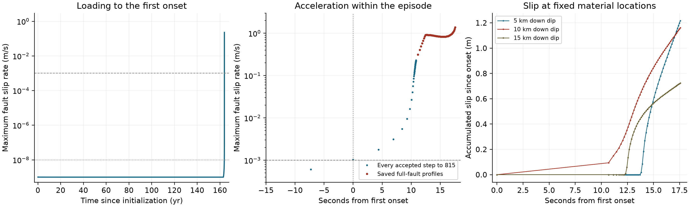

# A restartable 60° BP3 slip-cycle experiment

**First server action:** recover the original 160-rank donor installation and
the completed checkpoint at step **4229**, then replay the eight already
observed accepted steps in a new output directory. The [server runbook](server.md)
identifies the files, native reader, verification commands and launch overlays.
The server log proves a write to slot 03. The local archive contains the log
and profiles, but lacks the distributed checkpoint and the server binaries.
Remote availability and successful deserialization remain to be verified.
The corresponding input starts from zero if the server artifacts must be rebuilt.

The local handoff includes a small input archive with the original parameters,
geometry, archived stdout, two continuation inputs and verification tools.
A separate pinned source archive can rebuild the donor on the server stack.
Verify the archive checksums before unpacking. The local build directory
is outside Git; the server runbook gives the source and staging commands.

```text
build-bp3-preparation/launcher/donor-inputs.tar.gz
build-bp3-preparation/launcher/donor-source-612b75d.tar.gz
build-bp3-preparation/launcher/server-archives.sha256
```

```sh
(cd build-bp3-preparation/launcher && sha256sum -c server-archives.sha256)
```

| Evidence | What it establishes |
| --- | --- |
| [Executable, input, checkpoints and launcher](server.md) | Jobs 3610007, 3613912 and 3616642 used the donor ASPECT 3.1.0-pre route. The last run used the repaired work observer, two 80-rank nodes and one thread per rank. The older 32-rank ICX script belongs to a different experiment. |
| [Accepted history and event definition](history.md) | First upward crossing at 163.893087 yr and 10.85 km down dip. The 202 full-fault profiles include rapid slip at fixed stations. One onset is documented. Recovery, recurrence and the second and third events remain open. |
| [Throughput and allocation estimates](timing.md) | 63.16 wall s/step during warm interseismic loading and 50.22 wall s/step during the sampled rapid slip. Loading to the first onset cost about 14.11 wall h. |
| [Installed branch probes](check_branch.py) | The current mature trace passes the small 60° reference. A surface-reaching checkpoint, thrust sense and spatially varying direct effect have separate discriminating checks below. |



**Figure.** Left, fault-wide maximum speed over 164 years of loading. Middle,
the same speed on a seconds clock about the accepted threshold crossing. Right,
slip since onset at three fixed down-dip distances. By the last profile,
17.560699 s after onset, the fastest station had moved up dip to 0.47 km and
reached 1.37553 m/s. The 5 km station had accumulated 1.21677 m of slip.
The handoff includes the [data, paths and plotting command](history.md).

### Which physical calculation the donor ran

The finite box extends from −60 to 90 km horizontally and from 0 to 50 km
vertically. The prescribed right-dipping thrust runs from (0, 50) km to
(28.8675135, 0) km. Its five anchors define 5,776 ordered material stations
spaced about 10 m apart. The prescribed AT1 phase profile has peak 0.6 and
length 20 m. Phase, mesh, geometry and diagnostic particles stay fixed.
The top is traction-free. The sides and bottom impose the signed plate-loading
velocity from the integral of the diffuse transverse profile. Native logs
give 552,081 cells on ten levels, 19,498,460 system DoFs, 14,906,187 additional
DG stress-history coefficients (27 per cell) and 8,833,296 diagnostic particles.

The homogeneous shear modulus is 32.03812032 GPa and viscosity is
10²⁶ Pa s. The initial rate and plate rate are 10⁻⁹ m/s. Initial shear is
26.546122365 MPa. The native initialization chooses age for each station from
that equilibrium. The direct effect rises from 0.010 to 0.025 between 15 and
18 km down dip (12.99 to 15.59 km vertical depth). The evolution effect is
0.015, reference speed 10⁻⁶ m/s, characteristic slip distance 0.008 m and
radiation damping 4,624,440 Pa s/m. Friction uses a background compression
of 50 MPa with the resolved normal perturbation filtered along the fault
at 20 m. A constant 50 MPa friction input would suppress that feedback.

**Physical interpretation.** The run can answer whether *this finite-box
donor model* produces three recoverable episodes. It solves friction down
to its lower contact at 57.735 km down dip. The SEAS BP3-QD specification
(1 October 2021, §2, Table 1) imposes plate creep beyond 40 km. The donor's
qualification also records a 6.598 kPa spatial change, a failed 1% absolute
endpoint timestep screen and a 49.704 Pa surface-state interpolation
imbalance. Three observed cycles would still need spatial, timestep, domain
and deep-boundary comparisons before making a benchmark accuracy claim.
The full-grid run advanced past the package's original startup test.

### Observe three distinct events

On each accepted interval, record the maximum speed and its location, and
check cumulative slip against endpoint speed times duration at the same fixed
stations. The [catalogue](history_events.py) arms in quiet loading and opens
an event on an upward crossing of 10⁻³ m/s. At least one of seven weakening-zone
stations must accumulate 8 mm of slip above steady plate motion during fast
sliding. Rearm after five or more consecutive accepted observations at or
below 10⁻⁸ m/s spanning at least 8 × 10⁶ s. These proposed slip and recovery
criteria distinguish a second event from renewed acceleration within the first.
They use the existing histories and leave the equations and adaptive controls
unchanged. Stop renewing allocations after the third **recovery**. Save the
third-onset clock separately. The donor's built-in first-event latch never
rearms, even when its termination switch is disabled.

The 160-rank run advanced 119.42 modeled years in 10.53 wall hours during
loading, and just 6.268 modeled **seconds** in 46.04 wall hours during the
first event. The following budgets start at the last logged checkpoint.

| Assumed advances from each onset to recovery | More wall hours to third onset | More wall hours through third recovery | 44 h productive windows through recovery |
| ---: | ---: | ---: | ---: |
| 4,000 | 91.63 | 147.43 | 4 |
| 8,000 | 203.23 | 314.84 | 8 |

These scenarios assume two more loading intervals costing as much as the
first. They credit the 3,455 post-onset advances already saved. Queue time,
rebuild, restore, extra terminal I/O and idle time are additional. Neither
4,000 nor 8,000 is an observed event length or an upper bound. Update the
estimate at the first recovery and again at the second onset.

### Qualification since the preparation baseline

The [mature release check](../mature-release/README.md) exercises the prescribed shear sense and boundary-spanning checkpoint on fresh small-box runs. The original preparation findings below describe the earlier baseline. The donor inputs and launcher remain pinned independently. Spatial weakening/strengthening, matched loading and deep creep, the normal-traction comparison, timestep selection and mesh-scale cost remain open for BP3.

### What was missing at the preparation baseline

At `0293a5994`, the mature material, positive-speed RSF and stationary
phase profile are the relevant branch path. Midpoint crack growth and an
advected material curve solve different problems. Start a future branch
qualification from its own initial state.

1. **Match the signed transfer and the weakening profile.** The donor sets
   its material shear sense to −1 for a right-dipping thrust. It applies that
   factor to the symmetric slip tensor in the weak load and its reverse
   projection. In the branch, `FaultStokesCoupling::slip_stress` uses
   `−2κ sym(χ V t⊗n)`. `FaultStressLoad::execute` contracts its negative
   with the virtual strain. With a positive middle-label rate perturbation,
   the local unconstrained RHS and the reverse section action give
   **+0.589018955762738 and +0.589018955762740 m**. Reversing all vertex IDs
   gives the same values because both frame vectors reverse. Independent Q8
   contraction on the same one-cell measure gives +0.589018955762740 m;
   applying the donor thrust sense gives **−0.589018955762740 m**. This is
   an actual branch assembly and an analytic evaluation of the donor sign.
   The virtual velocity has unit engineering shear rate (1/s). Divide the
   RHS work difference by that shear rate, the effective Maxwell viscosity
   and the centered middle-rate difference (0.002 m/s). Divide the reverse
   middle row by the same viscosity and shear rate. Friction, history and
   background loading are fixed. The built-in branch
   RSF accepts one scalar direct effect; supplying the two donor coefficients
   fails parameter parsing. The material must evaluate the correct spatial
   coefficient and initial state and preserve the thrust sense in both transfers.
2. **Restart the surface-reaching mature trace.** Asking for a checkpoint
   at every step fails the branch's boundary-spanning admission check.
   Passing the same endpoints to the checkpointable fixed-interior mode
   fails its geometric check. Existing interior persistence provides a
   starting point. Restore both contacts, the vertex identities, age, slip,
   rates, normal support, accepted DG stress and accepted timestep control
   from a boundary-spanning checkpoint. Compare uninterrupted, retried and
   restarted runs on a small weakening/strengthening thrust across an
   accelerating interval before requesting the full grid.
3. **Verify loading and the mechanical feedback at matched inputs.** The donor
   uses volume Gauss(6), source Gauss(3), an auxiliary slip-memory field and a
   Helmholtz-filtered normal projection. The branch uses a Q8 section,
   projection to DG for the ordinary Q3 Stokes rule, and resolved pointwise
   normal compression. The alternative adiabatic pressure also has a different
   contract. On a graded reduced box, compare the actual imposed wall
   velocities, signed weak loads, filtered normal tractions, initialization
   balance and histories at VW, transition and VS stations. Compare the
   accepted log-age and slip-based timestep limit, including cutback, against
   the donor. Its limit uses accepted slip rate, caps |Δ log θ| at 0.2 and
   drives the collapse to millisecond timesteps.
4. **Measure cost on the intended mesh.** The donor caches stationary
   geometric searches. The branch's nearest-segment lookup scans the trace,
   and its initial normal integrals loop over cells and station rays. At
   5,775 segments and 552,081 cells, one all-cell Q8 sweep alone entails
   about 204 billion segment tests across ranks. This is an operation count,
   not a branch timing. Measure the reduced mesh first, retaining the same
   ridge resolution, then collect timed loading/event windows, peak node RSS
   and checkpoint I/O on the target layout. A wall-time estimate for the
   branch needs those measurements.

### Reproduce the branch checks

Run from the worktree root with the Assignment D Release installation. The
two test plugins come from that installation. One local MPI rank, one
numerical thread, fresh output. The installed solver SHA-256 was
`d75d72aec4714266631244fbe621fb2a007388c0c85abc5197e6c26517792edc`.
Its version banner retains the configure-time revision `1f0f5b413`.
The executable matches the final readability installation byte for byte.
Assignment D changed examples and their plugin while retaining that core.

```sh
R=refactoring/phase-field-fault/results/bp3-preparation
E=$(mktemp -d)
git show b54bde517:"$R/check_branch.py" > "$E/preparation-check.py"
python3 -B "$E/preparation-check.py" build-assignment-d/install "$E/probes"
cat "$E/probes/reference.log"
python3 -BO "$R/history_test.py"
```

The 32² free 60° control matched its frozen Q8 reference at all 38 labels
and all three clocks (0, 12.5, 25 ms). Maximum rate difference was
1.39 × 10⁻¹⁵ m/s and maximum integral difference 8.53 × 10⁻¹⁴ m. The
three deliberate input changes above each produced their expected diagnostic.
The control demonstrates stationary branch operation at laboratory scale.
The [server](server.md), [profile](history.md) and [timing](timing.md)
records give their own exact commands.

First source files to read in the branch and in donor revision
`612b75d3570d81763407875f3a12c12999b9fa8e`:

```text
source/material_model/phase_field_fault.cc
source/material_model/rheology/rate_and_state_friction.cc
source/reconstructed_fault/stokes_coupling.cc
source/simulator/assemblers/fault_stress.cc
../aspect-pf-rsf-particle-free/benchmarks/reconstructed_fault/bp3_native/server/plugin/geometry.cc
../aspect-pf-rsf-particle-free/benchmarks/reconstructed_fault/bp3_native/server/plugin/bp3_model.h
../aspect-pf-rsf-particle-free/source/simulator/assemblers/reconstructed_fault_stokes.cc
../aspect-pf-rsf-particle-free/source/time_stepping/reconstructed_fault.cc
```

Read the donor paths at that revision with `git -C ../aspect-pf-rsf-particle-free show REV:PATH`.
The donor checkout currently has a different HEAD.
