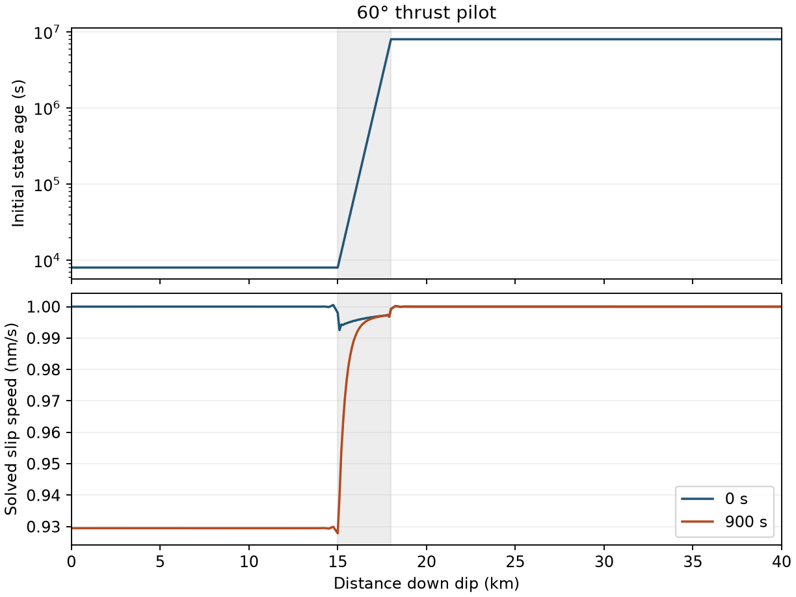

# Branch-native BP3-QD thrust startup and restart

The shared physical input starts at zero slip and perturbation stress. The branch solves the 60° boundary-spanning trace from its own initialized phase and vertex ages. The two run lengths use the same graded mesh, material table, RSF, plate velocities and timestep rule. The production horizon is 1,500 years. The longest measured endpoint is 1,525 s. [Input, physical departures and Stampede3 runbook](../../../../benchmarks/bp3_qd_thrust/README.md)



**Figure.** Initial state age and solved slip speed along 40 km of fault. Shading marks the 15–18 km transition in direct effect. At 900 s the shallow rate is about 0.93 nm/s while the deeper fault continues near the plate speed of 1 nm/s. Each curve uses accepted material labels. No event occurred during the pilot.

| Ordinary calculation | Measured result |
| --- | --- |
| Fresh startup, serial and two ranks | Both accepted 0, 400 and 900 s. 10,722 cells on five levels, 531,424 DoFs and 179 station IDs. ASPECT wall time was 22.1 s on one rank and 15.4 s on two, at one thread per rank including three checkpoints. A serial slot occupies about 17 MiB. |
| Seed, sign and FE loading | Forward RSF with the input label ages at 1 nm/s gives 26,546,122.365133367 Pa within 1.49 × 10⁻⁸ Pa. The solved initial rates range from 0.992531 to 1.000528 nm/s. The largest relative error is 0.746911% at 15.1 km. Linear age interpolation within the transition introduces up to 4.960 kPa of excess resistance at segment midpoints when evaluated at the target rate and 50 MPa. The FE samples at both sides and three basal points match both prescribed velocity components to 2.981 × 10⁻¹⁶ m/s (six-digit point output). |
| Discriminating friction and timestep controls | Replacing the spatial law with ordinary uniform a = 0.010 retained the same initial ages. At the bottom the solved speed fell to 3.162278 × 10⁻¹⁴ m/s and the startup check failed by 99.997%. Raising the first-step ceiling to 10⁷ s selected 799.9999999999942 s, equal to 0.1 of the smallest initial age. |
| Accepted history | At each physical endpoint, each label passed the independent exact aging update and the slip increment V dt. Peak and all 17 compact station records matched the full material profiles. From one rank to two, largest differences across the three clocks were 1.819 × 10⁻¹² s in age, 3.134 × 10⁻²⁰ m in slip and 5.945 × 10⁻²³ m/s in speed. |
| Checkpoint-only replays | On each rank layout, the 400 s parent (slot 02) reproduced all 179 labels exactly at 900 s. Starting production from slot 03 of the serial pilot reproduced all 55 physical statistics entries per frame of the fresh serial production run through 1,525 s, including the new 625 s interval. Production stopped at an accepted endpoint on the ordinary user-request signal and wrote its next checkpoint. |
| Stage provenance | Changing the staged vertex file caused the launcher to fail its digest check before creating output. Regenerating the unmodified file from Eqs. 18, 25 and 26 gave identical bytes. Both shipped parameter files passed ASPECT validation from a new staging directory. |

The source worktree began at `769c50dfc1892ca9c934ce360867153fbbe6993f`. The tests used the existing installed Release solver from the material-unification repairs. Its build-time banner reports `754e62c4d`. Its executable SHA-256 is `bace6a44dbf6522c9d3aed7a6d46fca942ef18b5127b6b1b5af6275cdc182fc7`. The installed SDK configuration SHA-256 is `0fa96fa8ca6907cdd43a1d5a03c1dd5eaac47f992d5ba88e78faab2fb9c646e6`. The standalone Release DSO used by the final handoff pilot has SHA-256 `e636eff6885fa9c01dd7323d4297fd20d639a659c9be141e071eabe7ef8b4674`. The MPI and restart package used the same plugin source (SHA-256 `270212fd84a3e204b0d319e688d93c5b879ee81d12aef656670f8e72ff1f4750`). Its DSO SHA-256 is `50b71732a22a263dca8ca85b60d602ae9df5884feabb714f08a1963667246664`. Every staged input and executable has its own manifest.

```text
build-unification-review/install/bin/aspect-release
build-unification-review/install/lib/cmake/Aspect/AspectConfig.cmake
build-bp3-thrust/handoff/libbp3_qd.release.so
build-bp3-thrust/handoff/vertices.txt
build-bp3-thrust/handoff/inputs.sha256
build-bp3-thrust/handoff/output/statistics
build-bp3-thrust/mpi/inputs.sha256
build-bp3-thrust/restart/output/fault-labels-00002.txt
build-bp3-thrust/continue/output/statistics
```

## Reproduce from the worktree

Use a fresh destination on each replay and keep one numerical thread per rank. Rebuilding the external plugin needs the same compiler and deal.II/MPI environment as the installed executable.

```bash
B=$PWD/benchmarks/bp3_qd_thrust
P=$PWD/build-unification-review/install
D=$PWD/build-bp3-thrust-replay
mkdir "$D"
bash "$B/prepare.sh" "$P" "$D/stage"
for run in serial mpi restart mpi-restart production continue; do cp -a "$D/stage" "$D/$run"; done
BP3_RUN="$D/serial" bash "$D/serial/stampede3.sh" pilot start
BP3_RUN="$D/mpi" BP3_LOCAL_RANKS=2 bash "$D/mpi/stampede3.sh" pilot start

copy_slot () {
  mkdir -p "$D/$2/output/restart"
  cp -a "$D/$1/output/restart/$3" "$D/$2/output/restart/"
  printf '%d' "$((10#$3))" > "$D/$2/output/restart/last_good_checkpoint.txt"
}
copy_slot serial restart 02
copy_slot mpi mpi-restart 02
copy_slot serial continue 03
BP3_RUN="$D/restart" bash "$D/restart/stampede3.sh" pilot resume
BP3_RUN="$D/mpi-restart" BP3_LOCAL_RANKS=2 bash "$D/mpi-restart/stampede3.sh" pilot resume
touch "$D/continue/output/terminate-aspect"
BP3_RUN="$D/continue" bash "$D/continue/stampede3.sh" production resume
```

The clean production launcher was stopped by creating the same marker after the log showed timestep 3 in progress. The deterministic stop below was also run and matched its four clocks.

```bash
export OMP_NUM_THREADS=1 DEAL_II_NUM_THREADS=1 OPENBLAS_NUM_THREADS=1 MKL_NUM_THREADS=1
cat > "$D/production/prefix.prm" <<'PRM'
include production.prm
subsection Termination criteria
  set Termination criteria = end step
  set End step = 3
end
PRM
(cd "$D/production" && "$P/bin/aspect-release" prefix.prm)
python3 -B "$B/check_pilot.py" "$D/serial/output" --mpi-output "$D/mpi/output" \
  --restart-output "$D/restart/output" --production-pair "$D/production/output" "$D/continue/output" \
  --figure "$D/pf-rsf-pilot.png"
python3 -B "$B/check_pilot.py" "$D/mpi/output" --restart-output "$D/mpi-restart/output"
python3 "$D/stage/history.py" "$D/continue/output/statistics" "$D/event-input"
python3 "$D/stage/history_events.py" "$D/event-input"
```

To repeat the two input substitutions in isolation, run the following in a copy of the staging directory.

```bash
cat > uniform.prm <<'PRM'
include pilot.prm
set End time = 0
set Output directory = output-uniform
subsection Material model
  subsection Phase field fault
    set Resistance law = rate and state
  end
end
PRM
"$P/bin/aspect-release" uniform.prm
python3 -B check_pilot.py output-uniform    # expected failure on the initial solved rate

cat > age-limit.prm <<'PRM'
include production.prm
set Output directory = output-age-limit
set Maximum first time step = 1e7
subsection Termination criteria
  set Termination criteria = end step
  set End step = 1
end
PRM
"$P/bin/aspect-release" age-limit.prm
```

The ASPECT examples build also compiled the plugin. The following scoped install placed the DSO, case inputs and the canonical event checker in a separate prefix. Staging from that installed example against the Release SDK passed the pilot checker and reproduced the serial 900 s label file byte for byte.

```bash
E=$PWD/build-bp3-thrust/examples
I=$PWD/build-bp3-thrust/examples-prefix
cmake -S . -B "$E" -DCMAKE_BUILD_TYPE=Release -DDEAL_II_DIR=/opt/dealii/9.6-local \
  -DCMAKE_INSTALL_PREFIX="$I" -DASPECT_INSTALL_EXAMPLES=ON
cmake --build "$E" --target bp3_qd -j2
cmake --install "$E/benchmarks/bp3_qd_thrust" --component examples
cmake -DCMAKE_INSTALL_LOCAL_ONLY=TRUE -DCMAKE_INSTALL_COMPONENT=examples -P "$E/cmake_install.cmake"
R=$PWD/build-bp3-thrust/from-installed
bash "$I/benchmarks/bp3_qd_thrust/prepare.sh" "$P" "$R"
BP3_RUN="$R" bash "$R/stampede3.sh" pilot start
python3 -B "$R/check_pilot.py" "$R/output"
```

The local checks exercise a branch-native start, MPI, checkpoint continuation, plate field, heterogeneous RSF and accepted observations. Stampede3 scaling, an accelerating cutback and recovered events on this mesh remain unmeasured. The older donor's earthquake times and throughput describe its own domain, discretization and trajectory. They cannot establish the time to the third event here.
