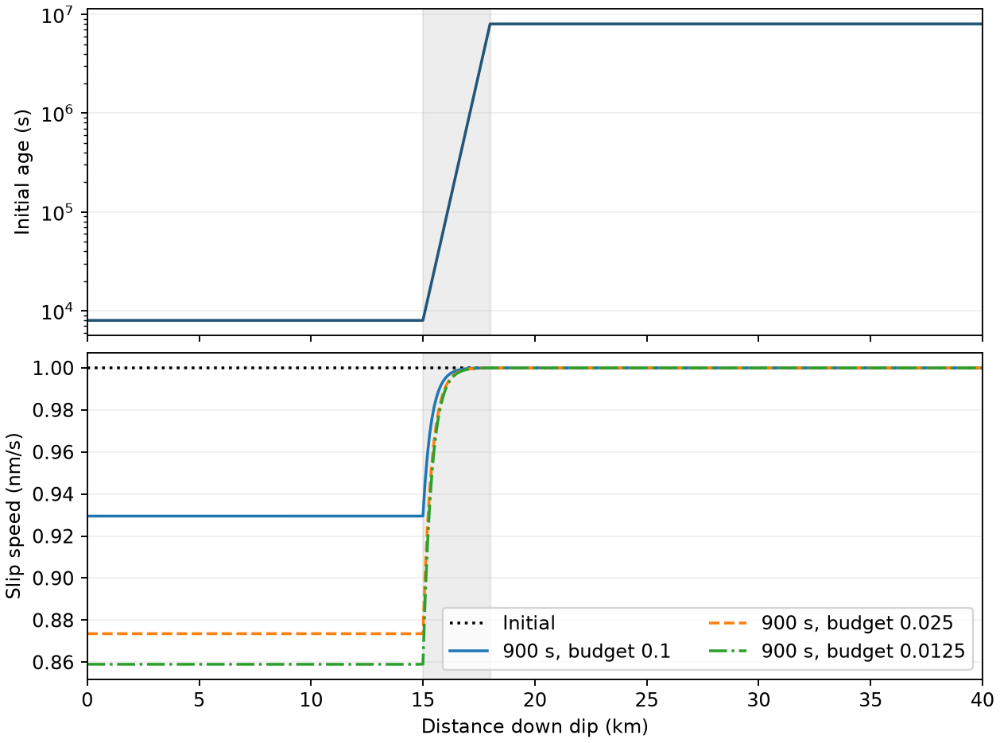

# BP3 package revision

[Standalone package](bp3_qd_thrust.zip) · [Fixed-clock log-age experiment](interpolation.md) · [Original meshes and accepted histories](baseline.zip) · [Final installed executable, SDK, DSO and input hashes](release-inputs.sha256)

The tested starting package was the newer worktree at `36725f1104985f68949266f9b1842273c59251c0`, following `769c50dfc`. The ZIP identified in the brief by digest `5e6e4ba7…` was unavailable locally. The preexisting `bp3-preparation.zip` has a different digest. Both historical worktrees and the original prepared run directories were preserved. Commit `264aedc32` contains the log-age experiment alone. Commit `64ce7782b` contains the production implementation. The final handoff commit adds verification, documentation and the archive.

## What removed the ripple

Only the interpolation used by the benchmark friction response changed in the first comparison. At the 178 segment midpoints, with speed 1 nm/s and compression 50 MPa, the maximum traction error fell from 4,959.587618 Pa to 7.45 × 10⁻⁹ Pa. All 179 nodal histories used the same aging law and all three clocks matched. The initial speed at 15.1 km changed from 0.9925308891 to 0.9999999993 nm/s. At 18.25 km it changed from 1.0001977233 to 0.9999999997 nm/s. The separate records include the full profiles and the midpoint values. [Transition figure and caption](interpolation.md)



**Pilot figure.** The upper panel shows initial state age in seconds. The lower panel shows the initial speed and the 900 s profiles at three timestep budgets in nm/s at material vertices along the 40 km trace. The shaded band is the transition in direct effect. At the surface the 900 s speed at the nominal budgets is 0.92949545 nm/s. This endpoint is sensitive to temporal resolution.

## Timestep, restart and graphical output

| Discriminating calculation | Measured result |
| --- | --- |
| Constant-speed exact aging | Steady sliding imposes no log-age cap. Rest heals at unit rate. Independent forward aging at the inverse time limit produced the requested signed log change for zero, near-zero, healing and decreasing-age rates. All 10 assertions passed. |
| Accelerating mature section, slip gate only | Parent prediction 0.266787 Dc, trial 0.727190 Dc, budget 0.496989 Dc. The 12.5 ms trial repeated at 7.688666103 ms. |
| Same section, age gate only | Parent prediction 0.265356, trial 0.725354, budget 0.495355 in absolute log age. Retry at 7.680475086 ms. Both retries matched a fresh run taking the smaller step. All six physical graphical arrays had zero difference and the rejected endpoint produced no frame. |
| Advected mature trace | All 20 IDs changed position. With unit budgets, all labels, rates, ages, slips and coordinates matched the unselected control at 0, 12.5 and 25 ms. |
| Growing strips | All eight public CSVs through 5 ms were byte-identical with the controller off/on for RSF and for an installed state-free dashpot. The latter ran with both budgets set to 10⁻²⁰. Under reversed loading the trial contained −1.53014 × 10⁻¹³ m/s. A slip budget of 3.82535 × 10⁻¹⁴ requested 2.25 ms. All nine full-duration signed slips and ages matched independent updates, including unformed strips. An independent constitutive failure at 5 ms cut to 2.5 ms and reproduced the clean native files. |
| Moving maximum and alternative graphical clocks | The fastest ID changed from 1 to 2. The largest per-ID slip increment was 0.00231015 m, the change of the scalar maximum 0.00190223 m, and the selected interval 0.00210619 m. The proper trigger emitted the second frame. Coincident time/slip triggers emitted once. A step-triggered frame at 25 ms reset the reference and suppressed an incorrect extra frame at 37.5 ms. |
| Ordinary BP3 pilot | Accepted at 0, 400 and 900 s. Maximum physical-step slip/Dc 0.00006250005718, maximum absolute log-age change 0.05776585197. Both load components passed at five plate samples, maximum absolute error 2.981 × 10⁻¹⁶ m/s. All 17 stations matched their material IDs. |
| Native files | The 0.7 μm pilot interval accumulated across the two small steps. The PVD contains 0 and 900 s. Opened every referenced piece: phase, velocity, pressure and the three accepted deviatoric stresses were finite. The serial PVTU plus VTU sizes were 1,471,364 and 4,347,153 bytes. Disabling graphics reproduced all station histories and public label tables exactly. |
| Split at 400 s | Restored only checkpoint 02 and the already-written time-zero graphical pieces. Same-rank continuation reproduced the 900 s label and all six native fields exactly. Serial-to-two continuation had identical phase and age, maximum slip/rate differences 3.00 × 10⁻²⁰ m / 5.98 × 10⁻²³ m/s, velocity difference 2.78 × 10⁻¹⁷ m/s and pressure/stress differences at most 4.77 × 10⁻⁷ Pa in Float32 output. Both PVDs contained the same two clocks. The pre-revision checkpoint lacking a graphical reference wrote its first frame at 900 s even with a 0.1 m threshold. |
| Production include | Pilot-to-production continuation from 900 s matched all 55 accepted quantities of the independently started production configuration at the four clocks ending at 1,525 s. |
| Timestep sensitivity through startup | Equal budgets 0.1, 0.025, 0.0125 took 2, 5, 10 accepted steps. Maximum observed absolute log changes were 0.057766, 0.022528, 0.011257. The latter two actually rejected 4 and 9 trials. At the common 900 s endpoint the maximum rate difference between 0.1 and 0.025 was 5.59305 × 10⁻¹¹ m/s and between 0.025 and 0.0125 it was 1.45553 × 10⁻¹¹ m/s. The nominal pilot does not establish event-phase accuracy. |

### Mesh and FE identity

All 61,200 raw corner-intersection and center/half-extent decisions agreed. With the stock maximum-refinement function's default coarsening behavior, both layouts produced **10,716** cells. The first difference in the final footprints was two coarse rectangles retained at level zero, at x = 6–8 km next to the surface and x = 12–14 km next to the base. The maximum function sets coarsening flags above its local maximum, including already balanced cells. Disabling only this tagging restored the original four children of each rectangle. This opt-in is under `Mesh refinement / Maximum refinement function`. Existing inputs default to true. The release `initial_global_refinement.prm` retained 1,855 cells and its old statistics byte for byte.

With startup coarsening disabled the 1- and 2-rank meshes each had 610, 170, 352, 686 and 8,904 cells on levels 0 through 4. On each layout the saved p4est mesh bytes matched the original. The ordered physical footprints and phase traces on all 42,888 Q2 output patches agreed across layouts. Finest cells are 125 × 120.2813 m. Both contacts stayed at (0, 34641.016151377546) and (20000, 0) m. The log-age-only original geometry and the revised box produced byte-identical initial station tables on each layout. Across their later clocks the maximum differences were 0 s in age, 1.06 × 10⁻²² m in slip and 2.07 × 10⁻²⁵ m/s in rate.

### Where to read the implementation

1. `source/time_stepping/fault_rsf.cc` reads material-ID rates before publication. `PhaseFieldFault::timestep_rates` exposes the accepted rates and the converged candidate when available. A Picard solve signals completion after its coupled vetoes. The growing solver stages signed midpoint rates and publishes every strip at full duration. Only two short replicated rate vectors are copied when this timestep model runs. The resistance object owns ages and the slip scale. Its exact aging update and its inverse time bound are in `source/material_model/rheology/rate_and_state_friction.cc`.
2. `TimeStepping::Manager::update` asks for the next step and checks the completed trial in `determine_reaction`. It reduces proposals/reactions over MPI. The simulator calls `post_accept_timestep` only if the step advances. At initialization the duration is zero. An incomplete solve has no completed rates for this check. The simulator's nonlinear cutback remains available. The donor's older `abbc9b0c` logarithmic predictor, 0.2 BP3 state budget and separate CFL × (a/b) Dc/V split-stability bound are historical controls.
3. `source/postprocess/fault_slip_output.cc` holds one last-frame slip in metres per persistent mature ID (1,432 payload bytes for 179 labels per rank). The ordinary visualization gate needs both the request **before** constructing the frame and acknowledgment of every native write. An output-variable plugin is called too late. The generic optional interface has these two operations. The native writer still owns PVD/PVTU numbering, time/step triggers and fields. Only the mature observer owns or checkpoints a slip reference.
4. `benchmarks/bp3_qd_thrust/bp3.prm` specifies the physical inputs, standard startup band, both timestep budgets and production graphics. The benchmark DSO now contains only spatial RSF and the station reporter. Compile external plugins against the matching SDK. The domain truncation, diffuse basal loading, free surface and incompressible Maxwell approximation are unchanged.

## Reproduce

Run with one numerical thread per rank. Use separate fresh destinations. The output prefix in the commands below is a worktree-local build directory. The public archive can be extracted and staged anywhere.

```bash
R=$PWD/refactoring/phase-field-fault/results/bp3-revision
D=$PWD/build-bp3-revision
B=$PWD/benchmarks/bp3_qd_thrust
P=$D/release-sdk
export OMP_NUM_THREADS=1 DEAL_II_NUM_THREADS=1 OPENBLAS_NUM_THREADS=1 MKL_NUM_THREADS=1
cmake -S . -B build-6b/release -DCMAKE_INSTALL_PREFIX="$P" -DCMAKE_BUILD_TYPE=Release
cmake --build build-6b/release --target aspect -j2
for component in runtime includes Unspecified; do cmake --install build-6b/release --component "$component"; done
"$P/bin/aspect-release" --test
T=$(mktemp -d)
unzip -q "$R/bp3_qd_thrust.zip" -d "$T"
bash "$T/bp3_qd_thrust/prepare.sh" "$P" "$T/run"
BP3_RUN="$T/run" bash "$T/run/stampede3.sh" pilot start
python3 "$T/run/check_pilot.py" "$T/run/output" --read-vtu
python3 "$T/run/history.py" "$T/run/output/statistics" "$T/catalogue"
python3 "$T/run/history_events.py" "$T/catalogue"
python3 "$R/package.py" "$T/rebuilt.zip"
cmp "$T/rebuilt.zip" "$R/bp3_qd_thrust.zip"
```

The extracted archive completed in 25.3 s on one rank and 15.2 s on two ranks through its own launcher (one numerical thread per rank, including the three checkpoints). At 900 s the accepted serial and two-rank results differed by at most 6.03 × 10⁻²³ m/s in speed across the pilot.

The final standalone pilot used Release revision `64ce7782b`, the staged vertex table and the plugin compiled inside the extraction. It reproduced both serial native frames exactly. The executable digest is `b152e09c9b49ea98eef8b2d0965d3aa4846017cba5a9292335da056551a6e01b`, the standalone DSO digest is `7f847b826fccdb036b18108bb1204cd600ac1a0dd0670722c1e4cfe2b7ed3f85`. The earlier full validation used SDK `build-bp3-revision/install`, executable `eab0f407ba64b1d2bea5ec8b71b8d1f5ce57a42e62f19c78ba407ca9c2b54b18` and DSO `549d8f662dd42680431615edde3b5f95325bbea7587f4f3f158b35d42a914931`. Its banner recorded the interpolation commit and the working production diff. The final SDK was rebuilt from committed solver sources. The complete Release unit suite passed 2,615 assertions in 65 cases.

For the mesh and split checks, first provide the pre-revision evidence described below. Then use a newly staged pilot with the public archive or checkout inputs.

```bash
bash "$B/prepare.sh" "$P" "$D/qualified"
BP3_RUN="$D/qualified" bash "$D/qualified/stampede3.sh" pilot start
python3 "$R/package_runs.py" "$D/qualified" "$D" mpi repartition-fresh
python3 "$R/package_runs.py" "$D/qualified" "$D" split-fresh off production continuation tight tighter legacy default-coarsen
MPLBACKEND=Agg python3 "$R/qualify.py" "$D" --figure "$R/pilot.png"
python3 "$R/small_controls.py" "$P/bin/aspect-release" "$D/mature-controls"
for ex in growing_fault layered_moving_fault; do
  cmake -S "benchmarks/$ex" -B "$D/$ex-sdk" -DAspect_DIR="$P/lib/cmake/Aspect"
  cmake --build "$D/$ex-sdk" -j2
done
python3 "$R/small_controls.py" "$P/bin/aspect-release" "$D/strip-controls" --growing-plugin "$D/growing_fault-sdk/libgrowing_fault_checks.release.so"
python3 "$R/small_controls.py" "$P/bin/aspect-release" "$D/trace-controls" --moving-plugin "$D/layered_moving_fault-sdk/liblayered_moving_fault.release.so"
```

**Historical mesh and history.** The archive `baseline.zip` saves each layout's native initial mesh, three public label files and accepted statistics. Full original checkpoints are retained in `build-bp3-revision/baseline/{serial,two}`. For a new replay, use the original Release installation (`build-unification-review/install`) and build the two historical DSOs from their own source trees. The historical script below reconstructed the old checkpoints, initialization VTUs and log-age-only controls without writing to either historical source revision. Both original meshes and every replayed label value at all three clocks on both layouts matched the saved evidence exactly.

```bash
bash "$R/original_pilots.sh" "$PWD" "$PWD/build-unification-review/install" "$D"
MPLBACKEND=Agg python3 "$R/interpolation.py" "$D/baseline/serial" "$D/log-age/output" "$R"
```

The delivered ZIP SHA-256 is `2a2721a0bd6e62f692e9d542ea6584c42270c4e7a043fb89493d94bac44cb2ff`. It contains the canonical event catalogue. Both staged parameters validated from an otherwise empty extraction. The 900 s catalogue contained zero completed events. The next measurement is the first branch-native acceleration on Stampede3, including throughput, storage and a timestep refinement comparison around rupture. A branch-native near-event checkpoint is not available. No allocation was submitted.
