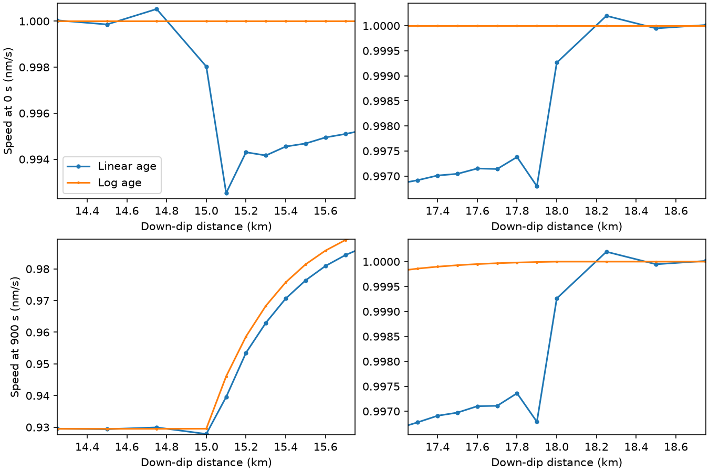

# Transition-zone isolation

The retained 36725f110 serial and two-rank checkpoints and all old label files were copied before editing the benchmark. The new serial pilot changed only the interpolation in BP3Resistance::at_speed. At friction quadrature points it uses exp((1−ξ) ln Θᵢ + ξ ln Θᵢ₊₁). Material ages remain in seconds. Both serial runs used the same installed executable, 179 vertices, identical native checkpoint mesh and 0, 400 and 900 s accepted clocks.

The maximum initial segment-midpoint resistance error at the prescribed 1 nm/s and 50 MPa dropped from 4,959.587618 Pa to 7.45 × 10⁻⁹ Pa. With unchanged ordinary Stokes feedback, the maximum initial speed error dropped from 0.746911% to 0.000166304%. At 15.1 km the initial speed changed from 0.9925308891 to 0.9999999993 nm/s. At 18.25 km the adjacent overshoot changed from 1.0001977233 to 0.9999999997 nm/s. The initial ripple was already removed before changing mesh construction, stepping or output. Physical aging still separates shallow and deep speeds at 900 s.

Each point is an accepted material vertex. The CSVs retain all 537 paired label observations and all 178 midpoint comparisons. Reproduce the figure and tables from the worktree:

~~~bash
R=refactoring/phase-field-fault/results/bp3-revision
MPLBACKEND=Agg python3 "$R/interpolation.py" build-bp3-revision/baseline/serial build-bp3-revision/log-age/output "$R"
~~~
