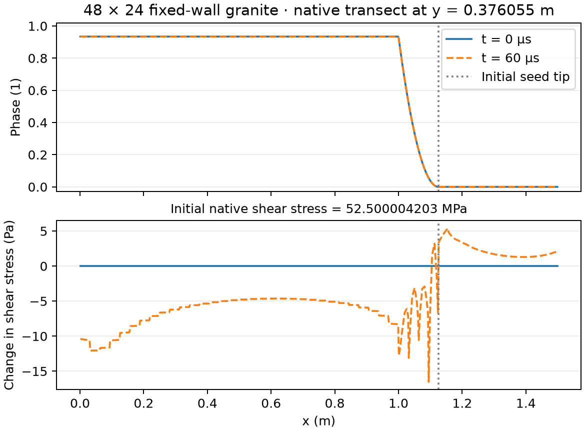

# Granite native-stress initialization and fixed-wall control

The revised production input starts the laboratory specimen at steady relative wall speed 0.001 m/s with a uniform Cartesian deviatoric shear of 52,500,004.2031734 Pa. The coarse hold changes the grid to 48 × 24 and fixes all four walls. Both use the same 70 MPa adiabatic friction pressure, seed, AT1 length, Maxwell material and rate-and-state parameters as the supplied prestress inputs. The historical zero-stress, preload-pulse case is available as `granite_preload_reference.prm`.

```text
benchmarks/granite_fault_growth/granite_fault_growth.prm
benchmarks/granite_fault_growth/granite_prestress_hold.prm
benchmarks/granite_fault_growth/granite_preload_reference.prm
```

In either specimen the fresh initial stress is set here. Use Cartesian components in Pa, with tension-positive normals. Plane strain retains the out-of-plane deviatoric component τzz = −(τxx + τyy). Fresh strips have zero accumulated slip. Their native points start with zero cohesive strain and zero signed and absolute shear history. On restart the accepted native stress comes from the checkpoint.

```text
subsection Material model
  set Model name = phase field fault
  subsection Phase field fault
    set Initial deviatoric stress = 0, 0, 52500004.2031734
  end
end
```

## Measurements

| Installed calculation | Parameter validation | Native initialization | Physical steps |
|---|---|---|---|
| 96 × 48 driven production, canonical and supplied aliases | Both pass | 4,608 cells, 165,888 native points, 96 stations; all five time-zero CSVs identical between spellings | Initial observations stopped at 0 s |
| 48 × 24 fixed-wall control | Passed | 1,152 cells, 41,472 native points, 48 stations | Eight intervals of 7.5 µs, ending at 60 µs |
| 8 × 4 independent tensor and restart | Clean and resume passed | (τxx, τyy, τzz, τxy) = (7, −2, −5, 3) Pa at all 4,968 native points | Two 5 ms intervals. Restoring generation 02 with a different fresh-start tensor reproduced all 10 ms physical CSVs byte for byte |

Both granite grids began with **52,500,004.2031734 Pa** at every native xy stress sample. Both had zero normal stresses, cohesive strain and accumulated shear. The maximum time-zero phase error against the analytic seed was 5.55 × 10⁻¹⁶ on the coarse grid and 6.66 × 10⁻¹⁶ on the production grid. The pre-change executable rejected the supplied prestress input at its undeclared `Initial deviatoric stress` line. The historical 48 × 24 zero-stress output separately passed the original zero-stress check.

Both production initializers and the small tensor/restart case were repeated on the installed executable with SHA-256 `e299e1da1f59c993268a5f02fce2c28cb80050dcd37873e38f5f8b13adfe9355`. The preliminary canonical hold and an independent fully historical-layout hold matched in every one of the 61 physical CSVs plus statistics at all nine clocks. That historical input selected `growing fault`, placed all material coefficients in its old subsection and selected the old observer. It ran on executable `7eb288a1e2da7716dd79be10bac36243ebcaf9bb1b122550c81d07b05d7085d2` in 297.88 s. These two earlier runs printed `-0` for zero initial τzz. The final installed Release completed the same hold in 306.12 s on two MPI ranks, with one numerical thread per rank and peak child RSS of 824,156 and 374,828 KiB. Its statistics and 59 of 61 physical CSVs were byte-identical to the historical-layout run. The remaining two time-zero point tables differ only in the spelling of zero at all 41,472 τzz entries. Every numeric value and identity in all 61 files matched. The final executable restores the historical positive-zero output for an omitted or zero τzz.

The preliminary canonical hold took 276.64 s on two MPI ranks. Rank-zero peak child RSS was 843,520 KiB. The first step took 83.23 s from the opening of its solve through publication. In the last interval the maximum absolute section speed was 9.99995184577 × 10⁻⁷ m/s at ID 19. Fixed-wall work was zero and the frictional work was 4.42937315218 × 10⁻⁴ J/m. At 60 µs all 36 seed strips had formed, all 12 stations ahead of the seed were unformed, and native phase was zero at every sample ahead of x = 1.125 m. The peak accumulated slip was 5.99998459085 × 10⁻¹¹ m.



**Figure.** The first native quadrature row above the seed midline lies at y = 0.376055 m. Its measured phase and shear at time zero and 60 µs are plotted against distance along the box. The shear panel subtracts the measured uniform initial shear to resolve changes of a few Pa. Over the full grid the changes range from −16.5177683 to +5.4004833 Pa. The dotted line marks the initial end of support.

## Reproduction

From the worktree root, select an installed Release with examples. Keep the run directories fresh. Each calculation below uses at most two MPI ranks with one numerical thread per rank.

```sh
P=$PWD/build-fault-inputs/install
E=$P/bin/aspect-release
G=$P/benchmarks/granite_fault_growth
W=$PWD/build-granite-interface-replay
mkdir -p "$W/hold" "$W/current96" "$W/legacy" "$W/legacy-hold" "$W/small"
export DEAL_II_NUM_THREADS=1 OMP_NUM_THREADS=1 OPENBLAS_NUM_THREADS=1
cp "$G/granite_fault_growth.prm" "$G/granite_prestress_hold.prm" "$W/hold/"
cp "$G/granite_fault_growth.prm" "$W/current96/"
unzip -q refactoring/phase-field-fault/example2/granite_prestress.zip -d "$W/legacy"
"$E" --validate "$W/current96/granite_fault_growth.prm"
"$E" --validate "$W/legacy/granite_fault_growth.prm"
python3 "$G/run.py" "$E" "$W/hold/granite_prestress_hold.prm" timing --ranks 2
hold=$W/hold/output-granite-prestressed-hold-48x24
python3 "$G/initial_field.py" "$hold" 48 "$W/init48.npz" --shear-prestress 52500004.2031734
MPLCONFIGDIR=/tmp/granite-mpl python3 "$G/plot_prestress.py" "$hold" "$W/granite-hold.png"
```

The two 96 × 48 observations change only termination and output. The supplied ZIP has SHA-256 `f1f28573ffc4e49a741003389d96dc64c896124180fa78b8c767cc461bcf1e10`. Its production PRM is `e691b6781cea99bf995feb64761911840a24e22b60913bb063cb050ebfee6c57`.

```sh
for f in current96 legacy; do
  cat > "$W/$f/initial.prm" <<'PRM'
include granite_fault_growth.prm
set Output directory = native-initial
subsection Postprocess
  set List of postprocessors = phase field fault history
end
subsection Termination criteria
  set Termination criteria = end step
  set End step = 0
  set Checkpoint on termination = false
end
PRM
  python3 "$G/run.py" "$E" "$W/$f/initial.prm" timing --ranks 2
done
python3 "$G/initial_field.py" "$W/current96/native-initial" 96 "$W/init96.npz" --shear-prestress 52500004.2031734
for file in "$W/current96/native-initial/"*.csv; do
  cmp "$file" "$W/legacy/native-initial/${file##*/}"
done
```

At 96 × 48, 1,776 of the 1,777 resolved entries in the two initialization outputs were identical. The only different value was the old top-level material spelling of the friction pressure selector, which only the archived deck sets. Both effective material sources were `adiabatic pressure`. The complete wall function, its variables, constants, and boundary IDs matched. Substitution of y = 0 and 0.75 m gives −0.0005 and +0.0005 m/s horizontal drive and zero vertical velocity. The 48 × 24 overlay supplies zero for both components on all four walls.

```sh
python3 - "$W/current96/native-initial/parameters.json" "$W/legacy/native-initial/parameters.json" <<'PYCODE'
import json, sys
def values(node, path=()):
    for name, child in node.items():
        key = (*path, name)
        if 'value' in child:
            yield key, child['value']
        else:
            yield from values(child, key)
a, b = (dict(values(json.load(open(p)))) for p in sys.argv[1:])
if a.keys() != b.keys() or {k for k in a if a[k] != b[k]} != {('Material model', 'Friction normal stress')}:
    raise ValueError('The production runs differ outside the recorded compatibility spelling')
if a['Material model', 'Phase field fault', 'Friction normal stress'] != 'adiabatic pressure':
    raise ValueError('The physical pressure source changed')
PYCODE
```

The archived production file uses the public material name and historical strip settings. To replay the fixed walls with the historical material name and *every* material coefficient under the historical subsection, change the two material headings as follows. Both velocity components and all physical values are preserved. This compares every emitted CSV at the same MPI partition, including time zero.

```sh
sed -e 's/^  set Model name             = phase field fault$/  set Model name             = growing fault/' \
    -e 's/^  subsection Phase field fault$/  subsection Growing fault/' \
    "$W/legacy/granite_fault_growth.prm" > "$W/legacy-hold/granite_fault_growth.prm"
cp "$W/legacy/granite_prestress_hold.prm" "$W/legacy-hold/"
python3 "$G/run.py" "$E" "$W/legacy-hold/granite_prestress_hold.prm" timing --ranks 2
old=$W/legacy-hold/output-granite-prestressed-hold-48x24
for file in "$hold"/*.csv; do cmp "$file" "$old/${file##*/}" || exit 1; done
cmp "$hold/statistics" "$old/statistics"
```

A separate 8 × 4 case uses nonzero, unequal normal components and changes the fresh-start input on restart. The native checks use all quadrature points. The continuation comparison keys the final records by cell and quadrature point, FE component and index, or strip ID.

```sh
cp "$P/benchmarks/growing_fault/growing_seed.prm" "$W/small/"
cat > "$W/small/clean.prm" <<'PRM'
include growing_seed.prm
set Output directory = output
set End time = 0.01
subsection Material model
  subsection Phase field fault
    set Initial deviatoric stress = 7, -2, 3
  end
end
subsection Checkpointing
  set Steps between checkpoint = 1
  set Number of checkpoints to keep = 4
end
PRM
cat > "$W/small/resume.prm" <<'PRM'
include clean.prm
set Output directory = resumed
set Resume computation = true
subsection Checkpointing
  set Resume checkpoint = 2
end
subsection Material model
  subsection Phase field fault
    set Initial deviatoric stress = 90, 84, 73
  end
end
PRM
python3 "$G/run.py" "$E" "$W/small/clean.prm" timing --ranks 1
mkdir -p "$W/small/resumed/restart"
cp -a "$W/small/output/restart/02" "$W/small/resumed/restart/"
python3 "$G/run.py" "$E" "$W/small/resume.prm" resume-timing --ranks 1
python3 "$P/benchmarks/growing_fault/compare.py" "$W/small/output" "$W/small/resumed" --continuation 2
awk -F, 'NR>1 {n++; if ($8!=7 || $9!=-2 || $10!=-5 || $11!=3) bad++}
         END {print n, "initial native tensors;", bad+0, "mismatches"; exit (!n || bad)}' \
    "$W/small/output/points-0000-r0.csv"
```
