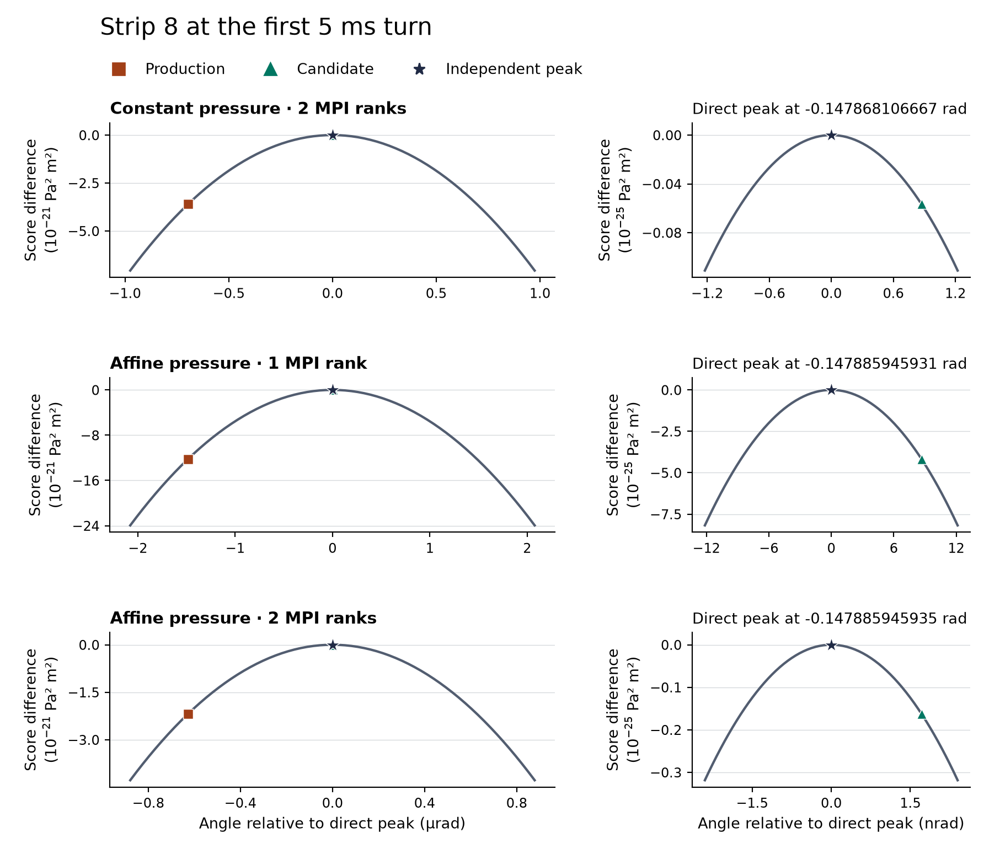

# Strip 8 at its first direction decision

At 5 ms the frozen two-rank nine-strip run turns strip 8 away from zero. Production, the isolated candidate and a direct sum over the native points choose the same peak bracket. The candidate misses the direct peak by **8.73e−10 rad**, compared with **6.96e−7 rad** for production. Even the arclength at the direct peak is outside the frozen donor allowance. The material inputs, laws, production selector, donor frames and comparison budgets are those of the calculation starting at `1d7799291`. The candidate is the archived patch from `46b426a3f`.

## The frozen decision

The 8 × 4 box has a 5 ms first physical interval, a 2.5 ms midpoint increment and 200 Pa prescribed compression. Strip 8 enters the step unformed, with angle zero, zero slip, age 10 s and reference width 0.2480056452854309 m. The two-rank ordinary Release run passed the original donor comparison at 5, 10 and 15 ms. The scratch observer reproduced its accepted FE fields, native point histories, strip tables and balances byte for byte at every available clock.

On midpoint iteration 3 the mechanics and projected phase residuals reached 7.998e−13 and 1.418e−11. At that point both scoring functions saw the same accepted parent, returned displacement, pressure and phase coefficients, strip and disk geometry, point predictors and MPI reductions. The separate runs publishing each policy had identical first-decision inputs, including all 992 cell-local midpoint coefficients. Rank 1 owned all 180 native strip-8 points on the two-rank partition. Both ranks contributed cells to the coupled solve. The keyed midpoint coefficients, all six turn inputs at each native point and all twelve reduced moments also match the historical target’s two-rank debugger capture.

Strip 7 is evaluated first. Its two proposals in bin 5 differ, but both scores are below 4.12e−17 Pa² m² and the update requires a gain above 3.93e−12 Pa² m². Both retain zero. **Strip 8 is the first different angle installed in the plane map.** Both methods turn there, gaining about 8.40e−11 Pa² m² over zero, or 516 times the existing update threshold. The solver reassembles on that map. The next evaluation retains the angle, and the accepted formed plane carries it through 10 and 15 ms.

The first different branch *inside strip 8's search* is golden-section comparison 20. After 19 identical choices, both methods compare −0.14786881604360208 and −0.14786819630033460 rad on the common field. The direct right-minus-left score is **+3.68364306905e−21 Pa² m²**. The candidate returns +3.68374546043e−21 and keeps the upper interval. Production returns −2.03536837007e−20 and keeps the lower interval. This change of sign on identical angles and fields localizes the first different refinement choice to score evaluation.

| Captured field at 5 ms | Selector | Angle (rad) | Angle minus peak (rad) | Direct score minus peak (Pa² m²) | Evaluated score minus direct score at that angle (Pa² m²) |
|---|---|---:|---:|---:|---:|
| Constant, 2 ranks | Production | −0.147868802765 | −6.9610e−7 | −3.605e−21 | −3.365e−19 |
| | Candidate | −0.147868105794 | +8.7264e−10 | −5.665e−27 | −1.863e−21 |
| | Independent peak | −0.147868106667 | 0 | 0 | — |
| Affine, 1 rank | Production | −0.147887429774 | −1.4838e−6 | −1.222e−20 | −1.858e−19 |
| | Candidate | −0.147885937260 | +8.6714e−9 | −4.173e−25 | −1.975e−20 |
| | Independent peak | −0.147885945931 | 0 | 0 | — |
| Affine, 2 ranks | Production | −0.147886573136 | −6.2720e−7 | −2.183e−21 | −1.598e−19 |
| | Candidate | −0.147885944223 | +1.7115e−9 | −1.626e−26 | −7.706e−21 |
| | Independent peak | −0.147885945935 | 0 | 0 | — |

All nine entries select grid bin 52 of 0–128, bracket [−0.159534001940107, −0.134990309333936] rad. On each field the direct scan also finds a lower local peak in bin 124. Scanning 512 intervals and refining both interior maxima preserves the winner. Changing the centered derivative spacing from 1e−7 to 1e−9 rad moves the reference by at most 2.19e−17 rad. A further 1e−11 rad calculation checks the extrapolation. This precision applies to the discrete score on the captured binary64 inputs.



*Each marker is a selected angle scored using a fresh signed friction root and the direct sum on that row's midpoint field. The left column resolves the production error in microradians. The right column magnifies the candidate and direct peak in nanoradians. The plotted ordinate is the difference from the direct maximum in Pa² m². Binary64 evaluation errors are reported separately in the table.*

## What the angle does to accepted arclength

The post-accept history writer reads the accepted angle and uses the strip's original width divided by its cosine. On the frozen two-rank case the measured and recomputed lengths agree within one binary64 ulp. The three physical clocks give the same values.

| Source of angle | Strip-8 length (m) | Difference from donor (m) |
|---|---:|---:|
| Frozen donor | 0.25074191554565439 | 0 |
| Production, accepted | 0.25074191296576476 | −2.57989e−9 |
| Candidate, accepted | 0.25074188693430988 | −2.86113e−8 |
| Direct peak on the frozen target field, calculated | 0.25074188696690238 | −2.85788e−8 |

Production already lies 2.57989e−9 m below the donor. Switching from the production angle to the candidate angle on the same field removes another 2.60315e−8 m. These terms account for the full discrepancy. The candidate is only 3.26e−11 m from the direct-peak arclength. Using the historical donor angle on that same field gives an angle error of −7.65172e−7 rad and a score loss of 4.35544e−21 Pa² m².

The frozen length allowance is 2.50841915546e−8 m. The frozen angle allowance is 1.14786887184e−7 rad, and the candidate is +7.66044807199e−7 rad from the donor. The strict comparator stops first at arclength. Continuing the per-column audit found these two failures for strip 8 at each of 5, 10 and 15 ms. Every other checked quantity passed, including formed flags, signed rate, native stresses and energy increments. The four historical strip-15 findings concern the separate 18-strip timestep case.

## Pressure control and score evaluation

The affine case uses 200 Pa plus 50 Pa/m times physical depth. At the strip-8 station, depth 0.0329950604 m gives 201.6497530187624 Pa on both MPI layouts. The fresh production runs reproduced the archived angles. Their 8.56638e−7 rad difference exceeds 1.14789e−7 rad, and the arclength difference of 3.19991e−8 m exceeds 2.50843e−8 m. The candidate passed the same checker, with differences of 6.96358e−9 rad and 2.60118e−10 m. The direct peaks on the two returned fields differ by just 3.67e−12 rad.

The original affine parent and midpoint coefficients match the new captures. At four of 180 points the new cohesive fraction differs from the archived value by one binary64 ulp (maximum 5.42e−20) on each layout. The archived and current denominator evaluation orders reproduce this difference on identical phase. The reduced moments and production angles match, and the direct peak moves by only −2.82e−24 rad on each layout. The two selectors were also evaluated on identical inputs within each new capture.

For each trial angle β the independent calculation uses the full-strip area sums of F and Fτ to form mobility M and free rate Vfree. Both have the factor 1/(GBh ds), where ds is evaluated at that trial angle, h is the half-step and B is the Maxwell relaxation factor. It brackets the signed root of V + M f(V, θₕ) = Vfree. The age in the resistance law is integrated from the same accepted age over h at trial |V|, with the analytic zero-speed limit. In the seed frame τ = u sin(2β) + v cos(2β). The reported score is the direct ordered sum Σ Jρ(1−F)²(τ−f)², where J is physical point area in m² and ρ is the frozen disk kernel. All 180 points enter the strip transfer and 109 have positive score weight. Each score uses 65-decimal arithmetic and a fresh root. The signed rate and resistance for both selectors at both proposals, zero and +0.23 rad are in `common-angles.csv`.

On the frozen field the reference maximum is 1.08481321057178609e−10 Pa² m². At +0.23 rad it gives 9.51614576909e−15 Pa² m² and resistance 38.1424475776 Pa. Both selectors distinguish this direction from the peak. The independent two-point pressure probe in the original affine checker also passed at zero and +0.23 rad. On the affine fields the native +0.23 rad scores are 7.72835070972e−15 and 7.72835069334e−15 Pa² m². A scratch substitution of the production peak score for its +0.23 rad observation failed the existing update-threshold check.

In cold creep production subtracts the nearly equal disk mean traction and solved resistance. The candidate takes the difference of the disk and full-strip mean predictor components before rotating them, then adds V/M from the signed root. These expressions are algebraically equivalent. The cross-evaluations separate the error in the floating-point score from the actual score lost by choosing a nearby angle. For example, on the frozen field production's score at its own proposal is low by 3.37e−19 Pa² m², while the direct score loss from that proposal is 3.60e−21 Pa² m².

**Recommendation for C2.** Use the candidate as the basis of a separately reviewed selector correction. It is closer in both angle and direct score on every tested field. Author approval is needed to adopt new strip-8 angle and arclength references for the nine-strip case. Retain the historical donor values, their provenance and the current budgets so the change remains measurable. If agreement with that donor trajectory takes precedence, keep production and carry its quantified affine rank discrepancy. These measurements qualify the peak of a discrete, fixed midpoint snapshot.

## Reproduce from the captured data

The compressed turn data include the actual first-call decisions and golden-section comparisons, native samples, midpoint coefficients, accepted geometry and raw strict-check logs. Its SHA-256 is `f4d318fc963213a826d06f274c400a35185480a517a1bba691a588e4a3efc2a3`. The archive records a digest for each source file and stores identical bytes once. The full comparison of the independently written outputs was run before packing. Run these commands from the checkout with mpmath and Matplotlib available. The same plotting command also works directly on the committed CSVs.

```bash
E=$PWD/refactoring/phase-field-fault/results/direction-c1
R=$(mktemp -d)
mkdir -p "$R/turns" "$R/archive" "$R/tables"
tar -xzf "$E/turns.tar.gz" -C "$R/turns"
tar -xzf "$E/../interface-c2/c1-captures.tar.gz" -C "$R/archive"
S=$R/turns
(cd "$S" && sha256sum --check --quiet SHA256SUMS)
python3 -B "$E/../interface-c2/replay.py" "$R/archive/build-interface-c2/cap1/output" "$R/archive/build-interface-c2/cap2/output" > "$R/before.txt"
cmp "$R/before.txt" "$E/../interface-c2/before.txt"
python3 -BO "$E/check_frozen.py" "$S/donor" "$S/ordinary" "$S/frozen-2" "$S/candidate" "$R/tables/frozen-arclength.csv"
python3 -BO "$E/check_golden.py" "$S/frozen-2" "$R/tables/frozen-golden.csv"
python3 -B "$E/peaks.py" "$R/tables" frozen-2="$S/frozen-2" affine-1="$S/affine-1" affine-2="$S/affine-2" \
  --frozen-donor-plane "$S/donor/tip-planes-0001.csv" --archived-affine "$R/archive/build-interface-c2"
for table in "$R"/tables/*.csv; do cmp "$table" "$E/${table##*/}"; done
python3 -B "$E/plot.py" "$R/tables" "$R/strip-8-score.png"
```

## Reproduce through ASPECT

The ordinary executable comes from the Release build qualified immediately before this assignment. The only intervening commit changed project instructions. The observer builder uses this checkout, its matching unity build/compile commands, and the archived candidate patch. It compiles the two scoring bodies and the current search into a scratch executable. Both run on each eligible strip at the same call. By default production supplies the angle to the ordinary reassembly and publication path. The environment switch below applies only to the scratch executable. It lets the candidate supply that angle in a separate ordinary parameter-file run. Use fresh destinations when rerunning.

```bash
W=$PWD
E=$W/refactoring/phase-field-fault/results/direction-c1
D=$W/build-direction-c1
B=$W/build-6b/release
I=$W/build-readability/install
P=$W/build-readability/growth-plugin/libgrowing_fault_checks.release.so
G=$W/benchmarks/growing_fault
MPI=/opt/openmpi/5.0.6/bin/mpirun
export OPENBLAS_NUM_THREADS=1 OMP_NUM_THREADS=1 DEAL_II_NUM_THREADS=1 UCX_LOG_LEVEL=error
mkdir -p "$D"
python3 "$E/capture.py" "$B" "$D/golden"
A=$D/golden/aspect-directions
python3 "$E/affine.py" "$I/bin/aspect-release" "$A" "$P" "$D/affine-final" "$MPI"
python3 "$G/run.py" "$I/bin/aspect-release" "$P" "$D/frozen-ordinary" --principal-only --mpiexec "$MPI"
python3 "$G/run.py" "$A" "$P" "$D/frozen-golden" --principal-only --mpiexec "$MPI"
DIR_C1_PUBLISH_CANDIDATE=1 python3 "$G/run.py" "$A" "$P" "$D/frozen-golden-candidate" --principal-only --ranks 2 --mpiexec "$MPI"
ref=$W/build-5a-repair/donor-two/output
ordinary=$D/frozen-ordinary/principal/output
production=$D/frozen-golden/principal/output
candidate=$D/frozen-golden-candidate/principal/output
python3 -BO "$E/check_frozen.py" "$ref" "$ordinary" "$production" "$candidate" "$D/final-arclength.csv"
python3 -BO "$E/check_golden.py" "$production" "$D/final-golden.csv"
python3 -BO "$G/compare.py" "$ref" "$production"
python3 -BO "$G/compare.py" "$ref" "$candidate"  # expected exit 1 at the 5 ms strip-8 arclength
```

The all-column audit uses the existing nine-strip checker that continues through every clock. Its output includes the rows after the first strict failure.

```bash
PYTHONPATH="$W/refactoring/phase-field-fault/strip8" python3 -B - "$ref" "$production" "$candidate" "$D/endpoint-audit.csv" <<'PY'
import csv, sys
from pathlib import Path
from endpoints import audit
ref, production, candidate, out = map(Path, sys.argv[1:])
with out.open('w') as f:
    w = csv.writer(f, lineterminator='\n')
    w.writerow('layout step column entries failed max_abs max_tolerance_ratio worst_id ref target'.split())
    for name, output in [('production', production), ('candidate', candidate)]:
        audit(ref, output, name, w)
PY
cmp "$D/endpoint-audit.csv" "$E/frozen-endpoints.csv"
```

**Source order.** In the midpoint solver, `freeze_direction_neighborhood` fixes the disk and eligible strips from accepted history. After mechanical and phase convergence, `select_prospective_planes(x)` forms the seed-frame predictors from the returned FE increment and accepted stress, integrates the full-strip and disk moments over native areas, performs the MPI sums, and calls `score_plane`. That function calls the stage-aged strip resistance law during each angle evaluation. If the map changes, `solve_midpoint` assembles again. The final `assemble_stage` returns the converged map and history. The growing material installs them at `post_accept_timestep`. The accepted-history postprocessor calls `MaterialSections::length(k, s.angle)` for the arclength.

```text
source/simulator/solver/midpoint_fault.cc
source/simulator/solver/midpoint_direction.cc
include/aspect/reconstructed_fault/onset_score.h
source/material_model/growing_fault.cc
source/postprocess/growing_fault_history.cc
source/reconstructed_fault/material_sections.cc
```
