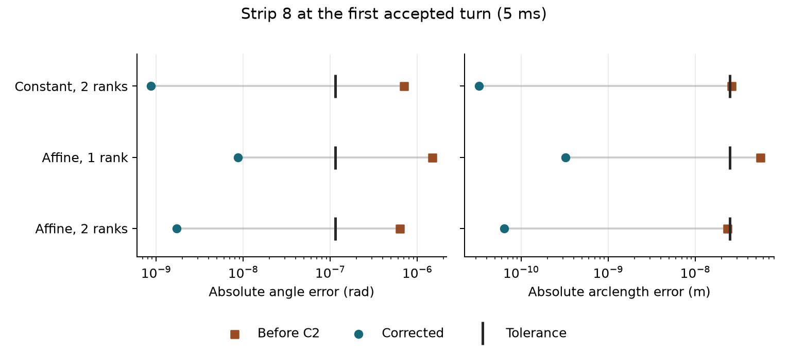

# Accepted strip-8 geometry with the corrected cold-creep score

On the 8 × 4 constant-pressure case, the two-rank ordinary executable chose −0.14786810579423598 rad at 5 ms. Summing over the C1 native points and solving a fresh signed root at each angle puts the peak at −0.147868106666875 rad. The captured undeformed width is 0.2480056452854309 m. Dividing that width by the cosine of the independent peak predicts 0.25074188696690238 m. The production arclength is 0.25074188693430988 m. Strip 8 formed at 5 ms and retained both values at 10 and 15 ms.

| Captured field | Accepted angle (rad) | Angle minus independent peak (rad) | Arclength minus independent prediction (m) |
|---|---:|---:|---:|
| Constant pressure, two ranks | −0.14786810579423598 | +8.7264e−10 | −3.2593e−11 |
| Affine pressure, one rank | −0.14788593725989820 | +8.6714e−9 | −3.2391e−10 |
| Affine pressure, two ranks | −0.14788594422348153 | +1.7115e−9 | −6.3933e−11 |



*Absolute errors at the first accepted turn. Each row uses its own C1 midpoint field and direct peak. The bar marks the original absolute plus relative allowance for that quantity. The old frozen angle and length miss both budgets. The corrected ordinary calculation passes all six comparisons.* The [C1 investigation](../direction-c1/README.md) gives the captured fields, peak-search convergence and direct-score curves. The [18-strip run record](strip18.md) gives the strict comparison using the ordinary executable and a stage-row recorder built from the same corrected sources.

## Production calculation

In the ordinary growth solve, midpoint convergence triggers `MidpointSystem::select_prospective_planes`. It reduces the strip and disk moments, and calls `score_plane` for each trial angle. The material's `friction().solve_strip` supplies signed rate V (m/s) and resistance f (Pa) at the stage age and pressure. The full-strip mobility M relates the two by V + M f = M mean_strip. When M is positive the centered score now uses (mean_disk − mean_strip) + V/M. The first difference is formed componentwise in the seed frame before rotation. This retains the small signed traction difference even when subtracting f from the disk mean would lose it to rounding. With zero mobility there is no mobile strip mean and the original disk mean minus f remains well-defined. The same angle search and gain threshold choose the plane, trigger reassembly and eventually commit the formed angle. No extra native-point traversal or MPI reduction is required.

## Reproduce the ordinary runs

From the worktree root, use fresh output directories. The installations below used the configured Release build and one numerical thread per rank.

```sh
B=$PWD/build-6b/release
D=$PWD/build-direction-c2
I=$D/install
R=$PWD/refactoring/phase-field-fault/results/direction-c2
MPI=/opt/openmpi/5.0.6/bin/mpirun
export OPENBLAS_NUM_THREADS=1 OMP_NUM_THREADS=1 DEAL_II_NUM_THREADS=1 UCX_LOG_LEVEL=error
cmake -S . -B "$B" -DCMAKE_INSTALL_PREFIX="$I" -DASPECT_INSTALL_EXAMPLES=ON
cmake --build "$B" --target aspect -j2
for part in runtime includes examples Unspecified; do
  cmake -DCMAKE_INSTALL_LOCAL_ONLY=ON -DCMAKE_INSTALL_COMPONENT="$part" -P "$B/cmake_install.cmake"
done
G=$I/benchmarks/growing_fault
A=$I/bin/aspect-release
cmake -S "$G" -B "$D/growth-plugin" -DAspect_DIR="$I/lib/cmake/Aspect"
cmake --build "$D/growth-plugin" -j1
P=$D/growth-plugin/libgrowing_fault_checks.release.so
(cd "$B/unit_tests" && "$A" --test)
python3 -B "$G/run.py" "$A" "$P" "$D/nine" --mpiexec "$MPI"
python3 -BO "$G/check_adiabatic_pressure.py" "$A" "$P" "$D/affine-1" profile
python3 -BO "$G/check_adiabatic_pressure.py" "$A" "$P" "$D/affine-2" profile --ranks 2 --mpiexec "$MPI" --serial "$D/affine-1"
python3 -B "$R/check_peak.py" frozen-2 "$D/nine/principal/output" > "$D/peak-frozen-2.csv"
for n in 1 2; do
  python3 -B "$R/check_peak.py" affine-"$n" "$D/affine-$n/affine/output" > "$D/peak-affine-$n.csv"
done
head -n 1 "$D/peak-frozen-2.csv" > "$D/accepted-peaks.csv"
for case in frozen-2 affine-1 affine-2; do
  tail -n +2 "$D/peak-$case.csv" >> "$D/accepted-peaks.csv"
done
cmp "$D/accepted-peaks.csv" "$R/accepted-peaks.csv"
python3 "$R/plot_peaks.py"
python3 -B "$R/check_peak.py" frozen-2 build-direction-c1/frozen-ordinary/principal/output  # expected exit 1
```

The Release suite passed 2,580 assertions in 62 cases. The nine-strip driver matched the clean accepted fields, strip histories and energy ledger after two rejected attempts and after resuming checkpoint generations 01 and 03. The independent peak check rejected the previous executable's frozen trajectory at all three clocks (−6.9610e−7 rad and +2.5999e−8 m). The ordinary affine comparisons passed, with one-/two-rank differences of 6.9636e−9 rad and 2.6012e−10 m. The independent +0.23 rad probe on its prescribed moments measured 125.36387005 Pa and 13.82542975 Pa² m² on both ranks. The native first-turn field has a different set of moments, used in the signed test below.

## Reversal and zero mobility

The installed affine control ran to the first accepted clock, 5 ms, on one rank with one numerical thread. Its reversed input negates both prescribed wall velocity components. All nine signed strip roots satisfy the independently evaluated stage-aged RSF at the measured compression, and all nine force-rate products are positive under both loads. The maximum defects in the two velocity components under reversal were 1.73e−18 and 1.95e−18 m/s. Strip 8 gave

| Load | Rate (m/s) | Resistance (Pa) | Angle (rad) | Angle − independent affine peak (rad) |
|---|---:|---:|---:|---:|
| Forward | 1.3271221148751196e−13 | 52.199544478937447 | −0.1478859372598982 | +8.67144e−9 |
| Reverse | −1.3271221134987047e−13 | −52.199544475800352 | −0.14788594422348153 | +1.70786e−9 |

Sign reversal in the independent, archived C1 first-turn field produced the same direct score and opposite signed root at the reversal's observed angle and at +0.23 rad. At the observed angle the direct score is 8.16046009772e−11 Pa² m², V = −1.3271221135e−13 m/s and resistance = −52.1995444758 Pa. At +0.23 rad they are 7.72835070972e−15 Pa² m², −1.27229082703e−15 m/s and −38.1424477879 Pa. The native-point sum uses the mirrored archived positive first-turn field. The two ordinary accepted outputs come from fresh forward and reverse runs.

    OPENBLAS_NUM_THREADS=1 python3 refactoring/phase-field-fault/results/direction-c2/check_reversal.py build-direction-c2/install/bin/aspect-release build-direction-c2/signed-final
    OPENBLAS_NUM_THREADS=1 python3 refactoring/phase-field-fault/results/direction-c2/check_reversal.py build-readability/install/bin/aspect-release build-direction-c2/signed-old
    (cd build-6b/release/unit_tests && DEAL_II_NUM_THREADS=1 OMP_NUM_THREADS=1 OPENBLAS_NUM_THREADS=1 ../../../build-direction-c2/install/bin/aspect-release --test 'Cold creep resolves*')

The old binary exited 1 at the forward/reverse rate test: strip 8 magnitudes changed by 2.19963799e−7 relative against the 1e−7 budget, with 5 ms angles −0.14788742977350777 and −0.14788595339256003 rad. The corrected binary exited 0. The filtered unit test passed six assertions in one case. It enforces a sign-sensitive two-area cold-creep score and the zero-mobility branch. With the baseline header and rate-only callback adapted to the old resistance return, a small standalone control built from the same test body gave 1.2325951644078309e−32 Pa² m² for either sign, 11.42% low. The corrected score was 1.3914843848197779e−32 Pa² m², equal to the analytic value to binary64 precision. Both gave 1.0000000000000001e−16 Pa² m² at zero mobility. Scratch headers, test bodies, executables and logs live in build-direction-c2/unit-control.

## Frozen nine-strip comparison and rejection tests

The installed reference `benchmarks/growing_fault/nine-strip-geometry.csv` was transcribed from the three accepted candidate frames at `bffffca07` (C1 archive `results/direction-c1/turns.tar.gz` and `frozen-arclength.csv`). Its donor columns retain the original two-rank 8 × 4 `localized-onecut` geometry at full file precision. The checker requires the three exact (step, ID) keys and verifies the corresponding donor clocks and original geometry before applying either new column. All six new doubles and all six donor doubles matched their respective C1 records exactly. The existing absolute and relative tolerances are unchanged.

Installed checker commands (run from this worktree, on the full donor replay and on the original portable final-native-frame archive):

```bash
D=$PWD/build-direction-c2
I=$D/install
G=$I/benchmarks/growing_fault/compare.py
donor=$PWD/build-5a-repair/donor-two/output
archive=$PWD/build-5a-repair/reference/runs/localized-onecut/output
old=$PWD/build-direction-c1/frozen-ordinary/principal/output
new=$D/nine/principal/output
(cd /tmp && python3 -BO "$G" "$donor" "$new")
python3 -BO "$G" "$archive" "$new" --archive
python3 -BO "$G" "$donor" "$new" --check-corruption
python3 -BO "$G" "$donor" "$old" --historical-donor
python3 -BO "$G" "$archive" "$old" --archive --historical-donor
python3 -BO "$G" "$donor" "$old"  # expected exit 1
python3 -BO "$G" "$donor" "$new" --historical-donor  # expected exit 1
```

The installed and source checker and CSV were byte-identical. The canonical full and portable comparisons passed, as did the historical comparison against the pre-C2 ordinary output and the original archive. Under the canonical comparison the old binary fails at 5 ms on arclength by +2.60310e-8 m (allowance 2.50842e-8 m). Testing the corrected binary against the historical donor fails there by −2.86113e-8 m. The fresh canonical accepted geometry exactly equals the isolated C1 candidate at all three clocks.

| Clock (ms) | Corrected angle (rad) | Corrected arclength (m) | Angle minus donor (rad) | Arclength minus donor (m) | Largest other error / allowance | Integrated slip (m²) |
| ---: | ---: | ---: | ---: | ---: | ---: | ---: |
| 5 | −0.14786810579423598 | 0.25074188693430988 | +7.66044807e−7 | −2.86113445e−8 | 0.055073 (strip force) | 9.20718145917e−16 |
| 10 | −0.14786810579423598 | 0.25074188693430988 | +7.66044807e−7 | −2.86113445e−8 | 0.057665 (strip force) | 3.94713921111e−5 |
| 15 | −0.14786810579423598 | 0.25074188693430988 | +7.66044807e−7 | −2.86113445e−8 | 0.157957 (strip force) | 1.69302306477e−4 |

The all-column historical audit uses the original budgets for all 152 rows across four frames (4,968 native points at each clock, nine strips at each physical endpoint). Only strip 8's angle and arclength failed, once each per physical endpoint. For example, the 15 ms slip integral differs from the historical run by +7.22e−17 m². Reproduce the supplemental audit and check its full set of failures with:

```bash
OPENBLAS_NUM_THREADS=1 OMP_NUM_THREADS=1 python3 -B - <<'PY'
import csv, sys
from pathlib import Path
sys.path.insert(0, 'refactoring/phase-field-fault/strip8')
from endpoints import audit
d = Path('build-direction-c2')
p = d/'references/ordinary-all.csv'
p.parent.mkdir(exist_ok=True)
with p.open('w') as f:
    w = csv.writer(f)
    w.writerow('layout step column entries failed max_abs max_tolerance_ratio worst_id ref target'.split())
    audit(Path('build-5a-repair/donor-two/output'), d/'nine/principal/output', 'production-c2', w)
with p.open() as f:
    rows = list(csv.DictReader(f))
bad = [(int(r['step']), r['column'], r['worst_id'], int(r['failed'])) for r in rows if int(r['failed'] or '0')]
assert len(rows) == 152
assert sorted(bad) == sorted((s, col, '(8,)', 1) for s in (1,2,3) for col in ('ds','beta')), bad
PY
```

The installed corruption check perturbed each corrected clock separately. Increasing strip 8's angle by 1.3e−7 rad (allowance 1.14787e−7) and its arclength by 3e−8 m (allowance 2.50842e−8) each failed at the changed clock, column and material ID in all six trials. The original native stress control also failed at its changed point after adding 0.001 Pa to τzz at 5 ms (allowance 1e−6 Pa). Logs and the 152-row CSV are under build-direction-c2/references.

## C2 review closeout

At `3cb478a30`, the continued parameter file ran forward to 5 ms. The checker then failed to unpack the wall expression. The repaired checker reads the two components from ASPECT's forward `parameters.json` and overrides only the expression on the reverse run. The continued and single-line cases gave byte-identical fields, native points, sections, pressure and balance (eight CSVs per direction at initialization and 5 ms). Both components were active. Their maximum forward-plus-reverse defects were 1.73472348e−18 and 1.95156391e−18 m/s. A further run used `X,Y,T` and `shear=0.02` for the wall function. Both parameter dumps preserved them and all 16 CSVs also matched the original case.

The old checker accepted 288 matching NaNs per run in the vertical velocity. The repaired replay rejects the first nonfinite component with its run name. A single reverse infinity and a missing forward component were also rejected. Finite saved outputs pass the full reversal check, including both velocities and signed friction.

For the geometry counterexample, subtracting 3e−8 rad from the corrected strip-8 angle at each physical frame gives −0.147868135794236 rad. The initial width divided by its cosine gives 0.2507418880547902 m. That trajectory passes the original tolerances. The old probe then added 1.3e−7 rad to the measured angle and missed the corruption at 5 ms because its net error was only 1.0e−7 rad. Each repaired probe first requires a passing trajectory, then sets one scratch entry two allowances above its **active reference**. Corrected and historical modes each reject three angle errors of approximately +2.2957e−7 rad and three arclength errors of approximately +5.0168e−8 m, at strip 8 and the intended clock. Both modes also reject the 0.001 Pa native zz stress corruption. Matching unshifted and portable-archive comparisons pass in both modes.

### Reproduce the review controls

The driver runs the installed forward and reverse cases from initial conditions, validates the continued input, compares the accepted CSVs byte for byte, then replays the deliberately damaged copies. It uses one rank and one numerical thread. Each geometry probe uses a copy of the trajectory for its reference mode.

```sh
cmake -DCMAKE_INSTALL_LOCAL_ONLY=ON -DCMAKE_INSTALL_COMPONENT=examples -P build-6b/release/cmake_install.cmake
cmp benchmarks/growing_fault/compare.py build-direction-c2/install/benchmarks/growing_fault/compare.py
sh refactoring/phase-field-fault/results/direction-c2/review_controls.sh \
  build-direction-c2/install build-5a-repair/donor-two/output \
  build-direction-c2/nine/principal/output build-direction-c1/frozen-ordinary/principal/output \
  build-direction-c2-review/closeout
```

For a finite saved forward/reverse pair the checker also runs without launching ASPECT.

```sh
python3 -BO refactoring/phase-field-fault/results/direction-c2/check_reversal.py \
  build-direction-c2/install/bin/aspect-release build-direction-c2/signed-final --replay
```
