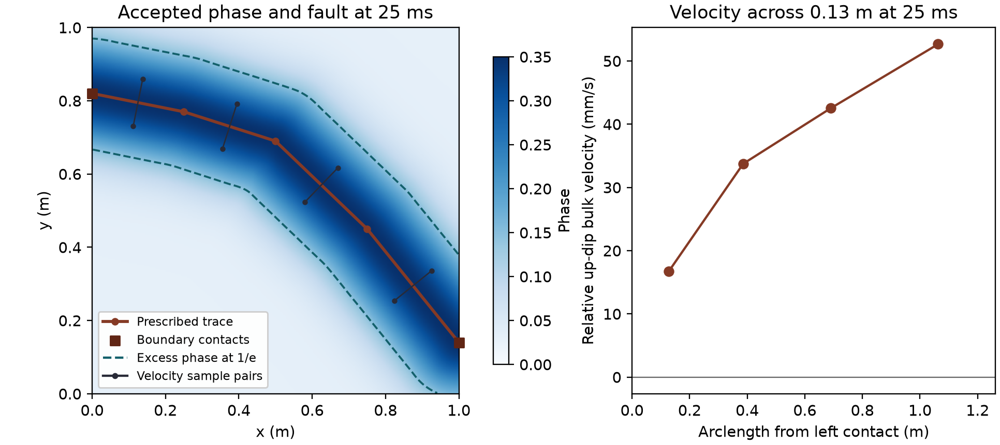

# The phase ridge and slip return on a prescribed curve

The [installed example](../../../../benchmarks/fixed_fault/curved_mature/README.md)
uses one ordered vertex file for both mechanics and the Gaussian phase.
The [original vertical-Gaussian solution](vertical-gaussian.md) remains a
regression with its original parameter file contents, reference tables and
numerical budgets. The mechanical transfer and the Maxwell/RSF update are
the same in both experiments.



**Figure.** Accepted DG phase and up-dip bulk motion at 25 ms. The dashed contour is φ = 0.03 + 0.32/e. Each black cut joins points 0.065 m to either side of a segment midpoint. Their hanging-wall-minus-footwall velocity differences, read in increasing material ID, are **16.711, 33.749, 42.545 and 52.663 mm/s**. The accepted positive RSF speeds are 0.112716–0.169072 m/s. The map uses the same scale for x and y.

## What the measurements establish

- [One edited vertex and the width on both normals](phase-width.md). Lowering ID 2 from 0.69 to 0.57 m moved the DG ridge from 0.688494 to 0.569977 m on the x = 0.50 m cut. Across both sides of all segments, the e-fold distance ranged from 149.961 to 150.159 mm before the edit and from 149.918 to 150.159 mm after it. A separate stale-phase run accepted the moved trace but failed the independent field comparison by 0.159398 in phase. Both geometries gave identical phase on one and two ranks at all 2,304 native Gauss points.
- [Station-by-station slip return](bend-slip.md). With test speed divided out, the native Q8 bulk action totals 1.21084484 m for a 1.26223969 m bent trace. Splitting cells at the support boundaries gives 1.21204363 m. The largest defect is at ID 2, where the support-resolved return is 9.123% low. The straight chord with the same contacts is 0.0168% high in total. This scalar check holds the accepted state fixed. The separate local virtual-work check still exercises both mechanical transfers.
- The independently integrated Q1 normalizations on the public trace are **0.21585734, 0.25395855, 0.25445149, 0.26533404 and 0.15984373 m**. The maximum difference from the accepted values is 1.67 × 10⁻¹⁶ m. The 25 ms rotated-parent shear check gives 6.07 × 10⁻¹⁷ Pa, compared with 8.25 × 10⁻⁴ Pa when the slip-spin sign is reversed.
- The public 12.5 ms checkpoint resumed at 25 ms with exactly the clean serial state at all five IDs and 2,304 native points. The clean/retried frames matched exactly at all three clocks. Restoring the serial checkpoint on two ranks gave the clean two-rank normalizations and coordinates exactly, with maximum differences of 6.94 × 10⁻¹⁷ m/s in speed, 6.11 × 10⁻¹⁶ Pa in stress and 4.50 × 10⁻¹⁸ J/m in virtual work. The displaced straight fit still uses the vertical fixture so fitting and the FE phase remain independent.
- The original vertical fixture keeps its frozen manufactured field in both the three-ID assembly probe and five-ID field export. Its contact and bend cell work actions were −0.00080620588233 and −0.00443265883749 m. The largest difference from independent cell integration was 2.01 × 10⁻¹⁶ m. Passing the *new* public output to the historical work checker fails before mechanics, with a 0.10581 phase difference at interpolation nodes.

The ordinary simulator calls `InitialComposition::Manager::initial_composition` while filling the compositional support points. `FaultPolylineGaussian` evaluates the minimum bounded-segment distance and returns the configured phase contribution there. Mechanics and the initializer each read the same table once at setup through `FaultVertexTable::read`, using ASPECT's rank-zero read and broadcast. The initializer retains one copy of the coordinates per rank (two doubles per ID) and scans the four segments for each phase interpolation point. The phase belongs to ASPECT's FE solution after initialization. The [installed guide](../../../../benchmarks/fixed_fault/curved_mature/README.md) gives the one-setting geometry override and the units of each input.

## Reproduce the runs

The [public curved baseline](public-baseline.md) belongs to revision
`ae676e24095909196f885073b1146babce50292b`. Its three public frames are
distinct from the earlier vertical-Gaussian regression. The default public
driver checks the freshly installed candidate against the frozen reference.
The [baseline repair record](baseline-repair.md) gives the measured cross-build
differences, the single-change controls and the regenerated figure.

Run from the worktree root with the ASPECT Release dependencies configured in
your environment (this machine uses `DEAL_II_DIR=/opt/dealii/9.6-local`).
Give the candidate its own new build and installation. The run directories
are outside both installations. Use one numerical thread per rank. The public input
works with the installed executable alone. The two external observers below
export native fields and measure the two transfer actions.

```sh
W=$PWD
D=$(mktemp -d "$W/build-curved-replay.XXXXXXXX")
B=$D/core
I=$D/install
R=$W/refactoring/phase-field-fault/results/mature-release
C=$I/benchmarks/fixed_fault/curved_mature
E=$(mktemp -d /tmp/aspect-curve-phase.XXXXXXXX)
M=/opt/openmpi/5.0.6/bin/mpirun
export OMP_NUM_THREADS=1 OPENBLAS_NUM_THREADS=1 DEAL_II_NUM_THREADS=1
export MPLBACKEND=Agg MPLCONFIGDIR="$E/mpl" ASPECT_SOURCE_DIR="$I"
cmake -S "$W" -B "$B" -DCMAKE_BUILD_TYPE=Release -DDEAL_II_DIR="${DEAL_II_DIR:-/opt/dealii/9.6-local}" \
  -DCMAKE_INSTALL_PREFIX="$I" -DASPECT_INSTALL_EXAMPLES=ON
cmake --build "$B" --target aspect -j3
cmake -DCMAKE_INSTALL_LOCAL_ONLY=ON -P "$B/cmake_install.cmake"
cmake -S "$I/benchmarks/layered_moving_fault" -B "$D/layered-plugin" -DAspect_DIR="$I/lib/cmake/Aspect"
cmake --build "$D/layered-plugin" -j1
P=$D/layered-plugin/liblayered_moving_fault.release.so
T=$I/benchmarks/fixed_fault/transfer_work
cmake -S "$T" -B "$D/transfer-work-plugin" -DAspect_DIR="$I/lib/cmake/Aspect"
cmake --build "$D/transfer-work-plugin" -j1
cp "$D/transfer-work-plugin/libtransfer_work.release.so" "$T/"
cmake -S "$W/tests" -B "$D/tests" -DAspect_DIR="$I/lib/cmake/Aspect" \
  -DASPECT_BINARY="$I/bin/aspect-release" -DCMAKE_BUILD_TYPE=Release \
  -DASPECT_COMPARE_TEST_RESULTS=ON -DASPECT_RUN_ALL_TESTS=ON
cmake --build "$D/tests" --target fixed_fault -j1
```

Run the public solve and the named regression separately. Each driver's
observed run must reproduce the bare public label tables byte for byte.

```sh
python3 -BO "$R/run_curve.py" "$I" "$P" "$E/curve"
python3 -BO "$R/run_curve.py" "$I" "$P" "$E/vertical" --vertical-gaussian
python3 -BO "$C/check_curve.py" "$E/curve/observed/output" --figure "$E/curve.png"
python3 -BO "$C/check_curve.py" "$E/vertical/observed/output"
python3 -BO "$R/check_local_work.py" "$I" "$E/vertical/observed/output" "$E/work"
python3 -BO "$R/run_phase_width.py" "$I" "$P" "$E/width" --mpiexec "$M"
python3 -BO "$C/check_phase_width.py" "$E/curve/observed/output" \
  "$E/vertical/observed/output" "$E/width" --figure "$E/phase-width.png"
python3 -BO "$R/check_phase_field_roles.py" "$I" "$E/field-roles"
python3 -BO "$R/measure_slip_return.py" "$I" "$P" "$T/libtransfer_work.release.so" "$E/slip"
python3 -BO "$C/check_restart.py" "$I" "$P" "$D/tests/libfixed_fault.release.so" \
  "$E/restart" --mpiexec "$M"
python3 -BO "$C/check_restart.py" "$I" "$P" "$D/tests/libfixed_fault.release.so" \
  "$E/vertical-restart" --mpiexec "$M" --vertical-gaussian
```

For the vertex-table input and constitutive-law regression, build the existing
external test laws against the same installed SDK. The scoped tests use the
source checkout for the release unit test that reads the repository VERSION file.

```sh
cmake -S "$I/benchmarks/growing_fault" -B "$D/law-plugin" -DAspect_DIR="$I/lib/cmake/Aspect"
cmake --build "$D/law-plugin" -j1
python3 -B "$I/benchmarks/growing_fault/check_interface.py" "$I/bin/aspect-release" \
  "$D/law-plugin/libgrowing_fault_checks.release.so" "$E/interface"
ctest --test-dir "$D/tests" --output-on-failure -j1 -R '^(fixed_fault|stationary_fault)$'
(cd "$B/unit_tests" && ASPECT_SOURCE_DIR="$W" "$I/bin/aspect-release" --test)
```

### Replay the historical input against the candidate

The [paired replay](replay_vertical.sh) consumes two completed installations
and writes to a new run directory. It reads the `04aaf6db0` drivers from Git
and uses `curved_mature.prm` with the historical executable and observer.
On the current installation it selects `vertical_gaussian.prm` via
`--vertical-gaussian`. The work probes and plotters also come from their
respective releases. Both decks, inherited inputs and vertex tables must
match the historical source bytes. Keep the layered and transfer-work plugin
build directories alongside each other as above. The driver checks which SDK
configured each plugin and verifies the installed transfer-work library
against its build. It hashes the historical executable, inputs and both
observers before and after running the solver.

```sh
old=$W/build-mature-release
bash "$R/replay_vertical.sh" "$old/install" "$old/layered-plugin/liblayered_moving_fault.release.so" \
  "$I" "$P" "$E/paired-vertical"
```

The [historical replay record](vertical-gaussian.md#replay-the-two-installations)
gives the executable and input identities and results. The keyed comparison
checks all three clocks at 10⁻¹⁵ s absolute and all native fields at
10⁻¹⁰ absolute plus 10⁻⁸ relative. The initialized phase agreed exactly at
every native point on every frame.

The original initialization qualification used `/tmp/aspect-curve-phase.McM7BMnA`. The installed
Release executable reported source `91cd47e39`, SHA-256
`1513bf4c64038f729a628cda639d7a4fd6c26dd4876f724ee4d3a079a5d26eb4`.
Both figures are reproducible from the observed outputs with NumPy, SciPy
and Matplotlib. To replay the wrong-field negative, run the work command
with `"$E/curve/observed/output"` in place of `"$E/vertical/observed/output"`;
it must report “Expected the manufactured vertical Gaussian in both runs.”
