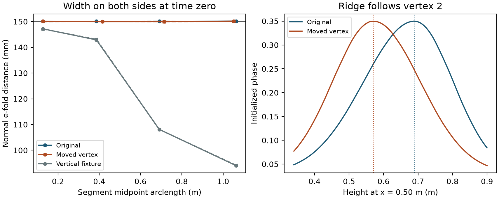

# Normal width of the initialized FE phase

The public input initializes the Gaussian excess above 0.03 using the distance to the closest **finite** edge in the same table as the mechanical trace. A point past either end of a segment can have a vertex as its nearest point. The old vertical-Gaussian input measures distance along the laboratory y axis.

## Reproduction

From the worktree root, use `D` from the [current Release build recipe](README.md#reproduce-the-runs).
It contains the installation with the frozen public reference and its matching
field observer. The public simulation itself needs only the installed ASPECT
executable. The width comparison starts in a new run directory.

```bash
W=$PWD
: "${D:?Use the current build directory from the Release replay}"
I=$D/install
P=$D/layered-plugin/liblayered_moving_fault.release.so
R=$W/refactoring/phase-field-fault/results/mature-release
C=$I/benchmarks/fixed_fault/curved_mature
E=$(mktemp -d /tmp/aspect-phase-width.XXXXXXXX)
export OMP_NUM_THREADS=1 OPENBLAS_NUM_THREADS=1 DEAL_II_NUM_THREADS=1 ASPECT_SOURCE_DIR="$I"
export MPLBACKEND=Agg MPLCONFIGDIR="$E/mpl"

python3 -BO "$R/run_curve.py" "$I" "$P" "$E/curve"
python3 -BO "$R/run_curve.py" "$I" "$P" "$E/vertical" --vertical-gaussian
python3 -BO "$R/run_phase_width.py" "$I" "$P" "$E/width" --group serial
python3 -BO "$R/run_phase_width.py" "$I" "$P" "$E/width" --group mpi \
  --mpiexec /opt/openmpi/5.0.6/bin/mpirun
python3 -BO "$C/check_phase_width.py" "$E/curve/observed/output" "$E/vertical/observed/output" \
  "$E/width" --figure "$E/phase-width.png"
```

The checker uses NumPy, SciPy and Matplotlib. It reads time zero from the ordinary statistics, the accepted material IDs and vertex positions from each owner, and the nine physical Gauss-point phase values on every cell from the observer. It reconstructs each DGQ2 polynomial from those samples. An independent polynomial starts with the finite-segment Gaussian at the nine Cartesian Q2 **support points** on the cell (corners, side midpoints, center) and tensor-interpolates them. This reproduces the field ASPECT should have initialized, including its interpolation error. The native and independent polynomials must agree to an absolute phase tolerance of 2 × 10⁻¹³.

Each measurement line passes through an edge midpoint along its geometric normal. On both sides, all 65 sample positions remain inside the unit box and closest to that edge. We locate the local maximum and bracket the two roots of φ = 0.03 + 0.32/e. The signed ridge offset and the two positive e-fold distances are relative to the mechanical midpoint. On the 16² mesh, the independent interpolants give a maximum normal-width error below 0.2 mm and ridge offset below 0.5 mm over these controls; the physical budgets are 0.3 mm and 0.7 mm respectively. The shallowest and steepest vertical-fixture widths differ by about 53 mm. The independent FE comparison also applies at the bend and contact; for those points we separately test the known nearest vertex and the continuum radial Gaussian.



**Figure.** At time zero the left panel shows the distance from each segment midpoint to the e-fold level on its negative and positive normals (solid circles and dashed crosses respectively). The prescribed physical width is 150 mm on the public and moved curves. In the vertical fixture, the same 150 mm *vertical* scale yields a normal width that decreases towards the steep end. The right panel samples the FE field on the fixed line x = 0.50 m; dotted lines mark the original and edited vertex heights.

## Measured at time zero

Each entry below is the distance on the negative / positive normal in mm. Segment order starts at the left contact. The inclined straight control joins the same contact points with five collinear labels. Original and moved curves differ in exactly one table value, y of material ID 2 at x = 0.50 m.

| Segment | Public curve | Moved vertex | Inclined straight | Old vertical Gaussian |
| --- | ---: | ---: | ---: | ---: |
| 0 | 150.129 / 149.961 | 150.129 / 149.961 | 149.916 / 150.106 | 147.174 / 147.072 |
| 1 | 150.098 / 150.083 | 149.953 / 150.044 | 150.054 / 149.971 | 142.866 / 143.099 |
| 2 | 150.092 / 150.136 | 149.995 / 149.918 | 150.072 / 149.916 | 108.095 / 108.080 |
| 3 | 150.159 / 150.071 | 150.159 / 150.071 | 149.933 / 150.028 | 94.013 / 94.180 |

On the public mesh the maximum normal ridge offset at a midpoint was 0.0523 mm (0.269 mm after the edit). On the fixed vertical line x = 0.50 m the FE maximum moved from y = 0.688493666 to 0.569977203 m, a displacement of −0.118516463 m for the −0.120 m vertex edit. The accepted vertex positions were exactly (0.50, 0.69) and (0.50, 0.57) m. Each fresh solve on two MPI ranks contributed 1,152 owned Gauss samples per rank. At all 2,304 common physical samples the largest one-/two-rank phase difference was zero in both geometries. Maximum independent FE errors were 2.22 × 10⁻¹⁶ (public and straight), 1.67 × 10⁻¹⁶ (moved), and 3.05 × 10⁻¹⁶ (old vertical fixture).

On the public trace, (0.55758419, 0.78664529) m lies in the outer sector of the central bend and (0, 0.9325) m is past the first segment end. Each is 0.1125 m from its nearest vertex. The analytic value is 0.2123305039; the DG values were 0.2122525982 at the bend and 0.2127713742 at the contact cap. After the edit the corresponding outer-sector point (0.44013384, 0.47475142) m had DG phase 0.2118249095. The nearest-vertex rule still applies where mechanics has no admissible normal foot.

A separate negative control kept the moved mechanical table and froze the original finite-segment phase as an ordinary ASPECT function. Its Stokes solve converged and published the correct moved labels. It matched the original FE phase at all native points within 2 × 10⁻¹³, but the moved-table comparison rejected a maximum phase discrepancy of 0.159398075. This check distinguishes a stale phase even when mechanics succeeds.
