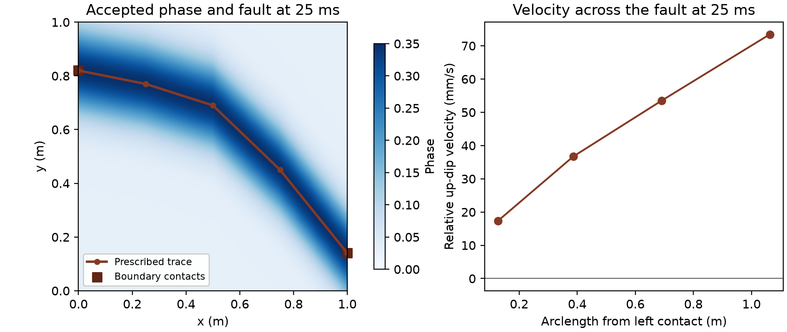

# Historical vertical-Gaussian mature fault fixture

These are the measurements at `04aaf6db0`. The current [public example](README.md) uses finite-segment distance; the retained fixture below prescribes the original vertical profile.

Start at `68f6d1510` on `pf-rsf`, after the four local Assignment D repair
commits. The production commits are `69342d99a` (prescribed segment geometry),
`540c4ff5b` (physical slip sense) and `0af424ddf` (accepted boundary restart).
The follow-up example and verification files run against those production
sources. All writer runs, including the legacy controls, start at time zero
on this branch or its earlier installation. The BP3 donor and distributed
server checkpoints are separate experiments.



**Figure.** The prescribed five-vertex fault crosses a 1 m square box in a
nonuniform static DGQ2 phase band. Squares mark the left and right contacts.
At 25 ms the four points on the right show the hanging-wall velocity relative
to the footwall, projected up dip at each segment midpoint. The velocity
samples lie 0.065 m to either side along the local normal. The measured
relative velocities are 17.384, 36.699, 53.510 and 73.443 mm/s. Persistent
vertex shear drives the motion with stationary prescribed wall components
and zero applied wall traction. The labels carry positive RSF speeds ranging
from 0.112328 to 0.170746 m/s at this clock. The graph shows a difference of
two bulk velocities at finite separation.

## Run the public input

Only the installed ASPECT executable and example data are needed.
The parameter file extends the existing homogeneous mature example.
Edit a coordinate in the table to change the prescribed curve, its
`background_shear_Pa` column to change persistent driving, or
`Mature slip sense` in the parameter file to reverse the physical motion.
These commands were run from a fresh external directory, with launch settings
equivalent to the `public` case in the replay below.

```bash
W=$PWD
D=$W/build-mature-release
I=$D/install
export ASPECT_SOURCE_DIR="$I" OMP_NUM_THREADS=1 OPENBLAS_NUM_THREADS=1 DEAL_II_NUM_THREADS=1
E=$(mktemp -d /tmp/aspect-mature-release.XXXXXXXX)
C=$I/benchmarks/fixed_fault/curved_mature
(cd "$E" && "$I/bin/aspect-release" "$C/vertical_gaussian.prm")
```

The standard label tables give accepted position, age, slip distance and
speed. The named visualization fields give the accepted DG stress in Pa.
The independent verification adds an existing postprocessor to sample
native fields. Adding it reproduced every standard label table byte for byte.

## What each experiment measures

| Check | Measured result |
| --- | --- |
| [Ordered geometry and old controls](geometry-checks.md) | Incoming IDs and unequal lengths survive initialization. The unit probe places a point on the global chord whose correct normal offset from the middle segment is −1/16 m. The public curved fit, crossed trace and repeated vertex produce distinct input errors. The homogeneous and frozen three-label controls retain their original references. |
| In-box normal integrals | The four segment lengths sum to 1.26223969 m. The independent projected integrals at IDs 0–4 are 0.21158940, 0.25189317, 0.22521693, 0.18324906 and 0.11352145 m. Maximum error 1.12×10⁻¹⁶ m. |
| Normal support at the bend and contacts | Each segment admits points whose perpendicular foot lies on it. On the inside of a bend multiple segments may admit a point. The closest wins, with the first ID winning a tie. Outside the end strips or an outer bend a point can have no admitted foot. The bulk samples included 401 with multiple eligible feet and 129 with none. The independent station and slip-weight errors over all 2,304 Q3 points were 2.23×10⁻¹⁶ m and 6.67×10⁻¹⁵ m⁻¹. |
| Resolved, nonuniform curved work | In the three-ID work probe using the same phase and two contacts, the actual unconstrained Stokes action was −0.00080620588233 m in the left contact cell and −0.00443265883749 m in the bend cell. All 256 cell actions agreed with independent local-frame Q8 integration within 2.0×10⁻¹⁶ m. The total Stokes action was −0.387448270023805 m and the reverse production row was −0.387448270023790 m. |
| [Physical sense and solved thrust](sign-checks.md) | Actual Stokes and reverse actions agree with ±0.589018955762740 m on the one-cell right-dipping trace; remapping the ordered properties gives the same answers. At fixed stress every measured compression is invariant. Under thrust loading the solved up-dip difference at 25 ms is +0.0499211 m/s; switching the sense gives −0.0384916 m/s. A shortened **fixed interior** seed exercises the candidate section and projected stress contract separately; the paired velocities there are +0.0445088 and −0.0359863 m/s. |
| Old stress and spin | On the 12.5–25 ms interval, the test reconstructs the old accepted DG tensor, rate and bulk spin at Q8, rotates, then applies Maxwell relaxation. It compares cell-mean shear to the observed Q3 constitutive offset less the independently computed current signed slip stress. The maximum difference was 7.12×10⁻¹⁷ Pa. Changing just the sign of slip in the old spin gives **0.00132274 Pa**. |
| [Publication and continuation](restart-checks.md) | Clean versus retried and serial checkpoint-only continuation match exactly. After restoring a serial writer on two ranks, the 25 ms stress differs from the clean two-rank result by at most 6.39×10⁻¹⁶ Pa. A straight seed whose fit displaces the first contact by 0.1692946363 m resumes exactly. Incompatible sense, positions, persistent shear and law coefficients are diagnosed. Fresh earlier interior RSF and age-free histories continue on the current binary. |

The phase oracle reconstructs a separate polynomial on each physical cell
from its nine native Gauss values. It intersects each normal with the box,
splits it at every Cartesian cell face, uses independent Gauss(16) and
Gauss(24) panel rules and solves the consistent Q1 mass system on the four
unequal edges. It retains the three production along-segment stations. Near
the left contact the normal runs from −0.143666998 to +0.189311382 m and
integrates to 0.210140888975 m. On either side of the middle bend the last
station of segment 1 gives 0.237544478347 m and the first station of segment
2 gives 0.215396560084 m. The tolerance for the projected integral is
2×10⁻¹³ m. On this mesh the active point (0.53125, 0.71875) m has foot
(0.50189946, 0.68817652) m; projecting onto the endpoint chord would give
(0.41035284, 0.54096007) m. Full-ray normalization followed by nearest-foot
admission does not form a partition of unity around a sharp bend.

For the work probe only, keep the two contacts and middle vertex. The two
external perturbations change the middle speed by ±0.001 m/s at zero
physical duration. From the same analytic virtual shear and the same Q8
measure the independent test computes each cell's action using its own
in-box integrals and reconstructed DG phase. The 2×10⁻¹³ m absolute budget
applies to the Stokes cells and the global reverse row. The complete
five-ID public trajectory solves for every rate through the coupled Picard
iteration. [Weak form, sign and physical normalization](sign-checks.md)

## Reproduce from the checkout

Use a configured ASPECT Release build with the matching deal.II dependencies.
The review run used the existing `build-6b/release` core build. To use a
clean tree, substitute a new Release build directory configured for your
installation. Install the executable, headers, configured SDK and examples
directly into the same new prefix. The top-level-only CMake install below
installs the core and example files, then the commands build just the
required verification DSOs using that prefix.

```bash
W=$PWD
B=$W/build-6b/release
D=$W/build-mature-release
I=$D/install
mkdir -p "$D"
cmake -S "$W" -B "$B" -DCMAKE_BUILD_TYPE=Release \
  -DCMAKE_INSTALL_PREFIX="$I" -DASPECT_INSTALL_EXAMPLES=ON
cmake --build "$B" --target aspect -j3
cmake -DCMAKE_INSTALL_LOCAL_ONLY=ON -P "$B/cmake_install.cmake"
export ASPECT_SOURCE_DIR="$I" OMP_NUM_THREADS=1 OPENBLAS_NUM_THREADS=1 DEAL_II_NUM_THREADS=1
E=$(mktemp -d /tmp/aspect-mature-release.XXXXXXXX)
R=$W/refactoring/phase-field-fault/results
L=$I/benchmarks/layered_moving_fault
C=$I/benchmarks/fixed_fault/curved_mature
P=$D/layered-plugin/liblayered_moving_fault.release.so
cmake -S "$L" -B "$D/layered-plugin" -DAspect_DIR="$I/lib/cmake/Aspect"
cmake --build "$D/layered-plugin" -j1
for name in transfer_work phase_ridge; do
  base=$I/benchmarks/fixed_fault/$name
  cmake -S "$base" -B "$D/plugin-$name" -DAspect_DIR="$I/lib/cmake/Aspect"
  cmake --build "$D/plugin-$name" -j1
  cp "$D/plugin-$name/lib$name.release.so" "$base/"
done

python3 -BO "$R/mature-release/run_curve.py" "$I" "$P" "$E/curve" --vertical-gaussian
export MPLBACKEND=Agg MPLCONFIGDIR="$E/mpl"
python3 -BO "$C/check_curve.py" "$E/curve/observed/output" --figure "$E/curve.png"
python3 -BO "$R/mature-release/check_local_work.py" "$I" "$E/curve/observed/output" "$E/curve-work"
python3 -B "$R/bp3-preparation/check_branch.py" "$I" "$E/bp3"
```

The [geometry commands](geometry-checks.md#commands) build the fixed-fault
test plugin, run the focused units and the historical straight controls.
The [checkpoint commands](restart-checks.md#commands) build the external
resistance law and run the curved/fitted one-/two-rank, retry, negative
and legacy matrices. Supply the pre-change Release installation with both
its matching test DSOs to the legacy script. It checks the actual wire
format written on this run. For the ordinary integration tests and full
unit suite:

```bash
ctest --test-dir "$D/tests" -j1 --output-on-failure \
  -R '^(fixed_fault|stationary_fault|layered_moving_fault)$'
(cd "$B/unit_tests" && "$I/bin/aspect-release" --test)
```

The scoped CTests all passed and the full Release unit suite passed 2,605
assertions in 64 test cases. The earlier D review prefix can supply the old
layered writer, but lacks the external dashpot DSO. The complete two-law
replay used the pre-change Assignment D prefix in the linked commands.

The final external replay is in `/tmp/aspect-mature-release.ApY6B8Sb`.
The executable reported production revision `0af424ddf`, SHA-256
`4029757b271ef8c016442877529ef8db70cfaf08e20025e468e5696187ce1de5`.
The measured one-rank public run with per-step checkpoints took 7.26 s
and peaked at 229,788 KiB process RSS while other local checks ran. Its
12.5 ms checkpoint, including the distributed FE data, occupied 417,551
bytes across five files. The extra replicated input geometry costs two
doubles per prescribed vertex. The normal integrals and stress projection
are rebuilt from accepted state and the distributed FE fields. The fixed
mesh and five IDs here establish no full-size BP3 throughput.

To repeat the checkpoint cost measurement on Linux, set the public example's
output to a fresh directory and use one numerical thread as above. The time
includes initialization, two physical steps, checkpoint writes and
visualization. File sizes vary with recorded run metadata and paths.

```bash
cat > "$E/resource.prm" <<EOF
include $C/vertical_gaussian.prm
set Output directory = $E/resources
subsection Checkpointing
  set Steps between checkpoint = 1
  set Number of checkpoints to keep = 4
end
EOF
python3 - "$I/bin/aspect-release" "$E/resource.prm" <<'PYTHON'
from pathlib import Path
import resource, subprocess, sys, time
run = Path(sys.argv[2]).parent
start = time.monotonic()
with (run/'resource.log').open('w') as log:
    subprocess.run(sys.argv[1:], cwd=run, stdout=log, stderr=subprocess.STDOUT, check=True)
print(time.monotonic()-start, 's', resource.getrusage(resource.RUSAGE_CHILDREN).ru_maxrss, 'KiB')
print(sum(f.stat().st_size for f in (run/'resources/restart/02').iterdir()), 'checkpoint bytes')
PYTHON
```
