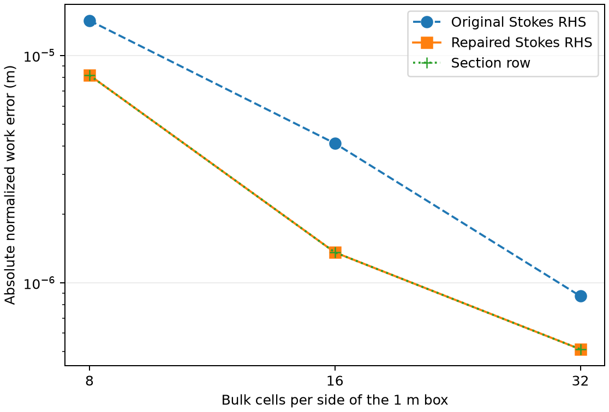

# Readability review on the ASPECT 3.1.0 branch

The scope base is the peeled ASPECT 3.1.0 tag, `0d97d2d33`. The behavior baseline is the local entry commit, `1f0f5b413`, which contains the separate C2 checker repairs. The [coverage ledger](coverage.tsv) lists each of the 315 paths in the release-to-entry diff. It includes test filters, SDK build files and executable analyses under the results directories. The public examples' physical settings and include structure belong to Assignment D.

## Where the branch meets ASPECT

| Release owner | Branch behavior clarified here | Existing caller checked |
| --- | --- | --- |
| Simulator constructor and nonlinear solver schemes | The ordinary material factory takes a model name; the existing public fault model also selects its state and solver from the configured phase method. A private construction helper makes the choice readable. The simulator still combines its Stokes criterion with the fault’s Picard veto before deciding on another assembly. | Fault-off statistics, fixed/moving Picard solves, and growing Newton |
| Simulator signals | Existing branch pre-assembly, post-solve and post-accept contracts now state which iterate they can inspect or publish. | Forced retry compared to clean accepted endpoints |
| Introspection, initial conditions and solver parameters | The local basis predicate describes which FE is constructed; generalized support points are the samples used to initialize Bernstein coefficients. Parameter declaration wrapping preserves text. | Both mixed orderings, independent implicit companion and XML/JSON |
| Checkpoint restoration | Equal DoF counts admit two different bases. The reader distinguishes saved and configured FE names before loading the vector and retains its legacy decision. | Pre-pass and legacy 3-D continuations and mismatches in both directions |

The installer and external SDK configuration were inspected in the release diff and exercised with freshly compiled observers and a third-party-style rheology. The CTest build edit documents the existing dependency list. The diagnostic code compiles into plugins or isolated recorder binaries; the production entry points serve ordinary simulations.

## Reproduce the comparisons

These commands use the retained local Release configuration (GCC 12.4, deal.II 9.6). Run from the checkout root in Bash, and use fresh destinations for simulations. Before editing, the C2 installation supplied the comparison binary. Its SHA-256 is `b37bc5563e748099e8e661d128f21f00fb9d978d7be35a1918894b5752729dfb`. Comparing its source commit `34fd65a86` with the entry commit shows only reference and checker changes. The old executable and its matching SDK plugins remain available for replay.

```bash
W=$PWD
B=$W/build-6b/release
D=$W/build-branch-readability
I=$D/install
OLD=$W/build-direction-c2/install
A=$I/bin/aspect-release
G=$I/benchmarks/growing_fault
R=$W/refactoring/phase-field-fault/results
M=$W/refactoring/phase-field-fault/rate_tangent
MPI=/opt/openmpi/5.0.6/bin/mpirun
export OPENBLAS_NUM_THREADS=1 OMP_NUM_THREADS=1 DEAL_II_NUM_THREADS=1 UCX_LOG_LEVEL=error
mkdir -p "$D"
git merge-base --is-ancestor 0d97d2d33 1f0f5b413
git diff --find-renames --name-status 0d97d2d33 1f0f5b413 > "$D/inventory.tsv"
# Verify the independent physical baseline before regenerating either side.
sha256sum --check <<'SUMS'
b37bc5563e748099e8e661d128f21f00fb9d978d7be35a1918894b5752729dfb  build-direction-c2/install/bin/aspect-release
8cf0787548ed0a73ae83eedef41270a3ee4abdda1fde1541ffea1b0c626d6a19  build-6b/release/benchmarks/explicit_dg_transport/libexplicit_dg_compositions.release.so
c55f91e08bcaa5eaf7a2fd84a627706df7f68203797772c01424703e75b52508  build-readability/layered-plugin/liblayered_moving_fault.release.so
06add10bed6d38a6723e574834aaac8645da292bf347e02e6da3772e80b32f85  build-readability/ridge-plugin/libphase_ridge.release.so
SUMS
cmake -S . -B "$B" -DCMAKE_BUILD_TYPE=Release -DCMAKE_INSTALL_PREFIX="$I" \
  -DASPECT_INSTALL_EXAMPLES=ON -DCMAKE_EXPORT_COMPILE_COMMANDS=ON
cmake --build "$B" --target aspect -j3
for component in includes runtime examples Unspecified; do
  cmake -DCMAKE_INSTALL_LOCAL_ONLY=ON -DCMAKE_INSTALL_COMPONENT="$component" -P "$B/cmake_install.cmake"
done
cmake -DCMAKE_INSTALL_COMPONENT=examples -P "$B/benchmarks/explicit_dg_transport/cmake_install.cmake"
for package in growing_fault/timestep growing_fault fixed_fault/phase_ridge layered_moving_fault \
               fixed_fault/transfer_work explicit_dg_transport growing_fault/parameter_compatibility; do
  cmake -S "$I/benchmarks/$package" -B "$D/plugins/$package" -DAspect_DIR="$I/lib/cmake/Aspect"
  cmake --build "$D/plugins/$package" -j1
  install -m755 "$D/plugins/$package"/lib*.release.so "$I/benchmarks/$package/"
done
```

### Shared simulator, plugins and installed examples

Run the same fault-off case and public parameter exports with both binaries. Physical statistics and parameter help can be compared as files. Timing, binary paths and Git stamps in screen output are specific to each build.

```bash
for variant in before after; do
  prefix=$OLD
  if [[ $variant == after ]]; then prefix=$I; fi
  dest=$D/$variant
  mkdir -p "$dest"
  (cd "$prefix/benchmarks/fixed_fault" && "$prefix/bin/aspect-release" --output-xml mature_trace.prm) > "$dest/interface.xml"
  (cd "$prefix/benchmarks/fixed_fault" && "$prefix/bin/aspect-release" --output-json fixed_fault.prm) > "$dest/interface.json"
  (cd "$dest" && "$prefix/bin/aspect-release" "$W/tests/matrix_nonzeros_1.prm" > fault-off.log 2>&1)
done
for f in interface.xml interface.json output/statistics; do cmp "$D/before/$f" "$D/after/$f"; done

(cd "$B/unit_tests" && "$A" --test)
cmake -S tests -B "$D/tests" -DAspect_DIR="$I/lib/cmake/Aspect" -DASPECT_BINARY="$A" \
  -DASPECT_RUN_ALL_TESTS=ON -DASPECT_COMPARE_TEST_RESULTS=ON
cmake --build "$D/tests" --target fixed_fault stationary_fault dg_stress_transport dg_stress_spin_order \
  explicit_dg_compositions growing_fault layered_moving_fault phase_field_model_without_reporter -j1
ctest --test-dir "$D/tests" --output-on-failure --no-tests=error -j1 \
  -R '^(matrix_nonzeros_1|fixed_fault|stationary_fault|dg_stress_transport|dg_stress_spin_order|explicit_dg_(compositions|phase|phase_statistics|slabs)|growing_fault|layered_fault_traction_step|layered_moving_fault|phase_field_model_without_reporter|postprocess/phase_field_surface_energy_at2)$'

# A stock time-dependent Picard solve uses the separately identified pre-6A writer.
cmake --build "$D/tests" --target postprocess_iterations_iterated_Stokes nonlinear_solver_history -j1
python3 -B refactoring/phase-field-fault/replay_6a.py stock-picard "$A" "$D/tests" "$D/stock-picard" \
  --writer "$W/build-6a/baseline/aspect-release" --writer-plugins "$W/build-6a/baseline"

E=$(mktemp -d /tmp/aspect-pf-readability.XXXXXX)
(cd "$E" && bash "$I/benchmarks/verify_phase_field_fault.sh" "$E/run" "$MPI")
for f in "$W/build-direction-c2/nine/principal/output/"*.csv; do
  cmp "$f" "$E/run/growing/principal/output/$(basename "$f")"
done
```

### Session boundaries, transport and section work

The installed scalar observer and the CTest retry observer must both match the executable. Each runner creates a new directory. The legacy 3-D checkpoint option below deliberately supplies a separate writer built before per-field basis metadata.

```bash
P=$D/phase-plugins
mkdir "$P"
ln -s "$I/benchmarks/explicit_dg_transport/libexplicit_dg_compositions.release.so" "$D/tests/libfixed_fault.release.so" "$P/"
S=$I/benchmarks/explicit_dg_transport
(cd /tmp && python3 -B "$S/check.py" "$A" "$P" "$D/phase-dg2-final" --mpiexec "$MPI")
(cd /tmp && python3 -B "$S/check_3d.py" "$A" "$P" "$D/phase-dg3" \
  "$W/build-4b/final-capture/aspect-review" "$W/build-4b-repair/tests-release" --mpiexec "$MPI")
(cd /tmp && python3 -B "$S/check_compatibility.py" "$A" "$P" "$D/phase-compatibility")
(cd /tmp && python3 -B "$W/benchmarks/fixed_fault/check_transport.py" "$A" "$D/tests" "$D/phase-stress" --mpiexec "$MPI")
F=$I/benchmarks/fixed_fault/transfer_work
(cd /tmp && python3 -BO "$F/run.py" "$A" "$F/libtransfer_work.release.so" "$D/mature/after/work")
```

For the mature tangent recorders, the stationary observation is at Picard iteration 0 of step 2. The moving observation is at iteration 2 of the same step, with a nonempty projection defect. At each observation the recorder writes the completed native point and the reduced Newton bands before the section residual convergence test. The baseline revision also contains its original source-specific recorder, obtainable with `git show 1f0f5b413:refactoring/phase-field-fault/rate_tangent/capture.py` for use with that checkout.

```bash
H=$D/mature/after
ridge=$I/benchmarks/fixed_fault/phase_ridge
layer=$I/benchmarks/layered_moving_fault
mkdir -p "$H"/{capture-static,capture-moving,moving}
(cd "$H/capture-static" && python3 -B "$M/capture.py" "$W" --build "$B")
(cd "$H/capture-moving" && python3 -B "$M/capture.py" "$W" --build "$B" --moving)
for ranks in 1 2; do
  (cd /tmp && python3 -B "$ridge/run.py" "$H/capture-static/aspect-review" \
    "$ridge/libphase_ridge.release.so" "$H/static-$ranks" free 32 --ranks "$ranks")
done
cp "$layer/layered.prm" "$H/moving/input.prm"
printf '\nset Additional shared libraries = %s\nset Output directory = %s\n' \
  "$layer/liblayered_moving_fault.release.so" "$H/moving/output" >> "$H/moving/input.prm"
(cd /tmp && "$H/capture-moving/aspect-review" "$H/moving/input.prm")
python3 -BO "$M/check_row.py" "$H/static-1" "$H/static-2"
python3 -BO "$M/check_moving.py" "$H/moving/output"
```

### Growing fault

The ordinary comparison and the six geometry corruptions use the corrected reference for current outputs and the historical donor for pre-C2 outputs. The same commands test the signed response, both wall components, missing/nonfinite reversal data, and the independent zz-stress corruption.

```bash
donor=$W/build-5a-repair/donor-two/output
history=$W/build-direction-c1/frozen-ordinary/principal/output
new=$E/run/growing/principal/output
archive=$W/build-5a-repair/reference/runs/localized-onecut/output
python3 -BO "$G/compare.py" "$archive" "$new" --archive
python3 -BO "$G/compare.py" "$archive" "$history" --archive --historical-donor
(cd /tmp && sh "$R/direction-c2/review_controls.sh" "$I" "$donor" "$new" "$history" "$D/c2-review")
python3 -B "$R/direction-c2/check_peak.py" frozen-2 "$new"
for ranks in 1 2; do
  extra=()
  if [[ $ranks == 2 ]]; then extra=(--serial "$D/affine-1"); fi
  (cd /tmp && python3 -B "$G/check_adiabatic_pressure.py" "$A" "$G/libgrowing_fault_checks.release.so" \
     "$D/affine-$ranks" profile --ranks "$ranks" --mpiexec "$MPI" "${extra[@]}")
  python3 -B "$R/direction-c2/check_peak.py" "affine-$ranks" "$D/affine-$ranks/affine/output"
done
python3 -B "$R/strip18/capture_rows.py" "$B" "$D/strip18-final/recorder"
(cd /tmp && sh "$R/direction-c2/run_strip18.sh" "$I" "$D/strip18-final/recorder/aspect-rows" \
  "$G/libgrowing_fault_checks.release.so" "$G/timestep/libmidpoint_fields.release.so" \
  "$W/build-5b" "$W/build-5a-repair/reference" "$D/strip18-final/runs")
# Expected exit 1 after all intervals. Compare every report, including the failing rows.
old18=$W/build-direction-c2/strip18/runs
new18=$D/strip18-final/runs
diff -r "$old18/strict" "$new18/strict"
for schedule in parent coarse half; do
  for f in "$old18/ordinary/$schedule/output/"*.csv; do
    name=$(basename "$f")
    cmp "$f" "$new18/ordinary/$schedule/output/$name"
    cmp "$f" "$new18/rows/$schedule/output/$name"
  done
  for f in "$old18/rows/$schedule/output/"rows-*.csv; do
    cmp "$f" "$new18/rows/$schedule/output/$(basename "$f")"
  done
done
```

### Read a checkpoint written before the edits

For moving mechanics, run the old binary with its matching layered observer, stop at 12.5 ms and keep its checkpoint. Run the new executable with its own observer from that checkpoint. Compare the newly published 25 ms fields to a clean full-length run. A rejected 25 ms first attempt, shortened to 12.5 ms, must reproduce all three clean accepted frames. These comparisons measure accepted state.

```bash
old_layer=$OLD/benchmarks/layered_moving_fault
seed=$D/mature/before/seed
mkdir -p "$seed"
cp "$old_layer/layered.prm" "$seed/input.prm"
cat >> "$seed/input.prm" <<PRM
set End time = .0125
set Additional shared libraries = $W/build-readability/layered-plugin/liblayered_moving_fault.release.so
set Output directory = $seed/output
subsection Termination criteria
  set Checkpoint on termination = true
end
PRM
(cd /tmp && "$OLD/bin/aspect-release" "$seed/input.prm")
for mode in clean retry restart; do
  dest=$H/$mode
  mkdir -p "$dest/output"
  cp "$layer/layered.prm" "$dest/input.prm"
  lib=$layer/liblayered_moving_fault.release.so
  if [[ $mode == retry ]]; then
    lib=$lib,$D/tests/libfixed_fault.release.so
    cat >> "$dest/input.prm" <<'PRM'
subsection Time stepping
  set List of model names = function, reject long first fault step
  subsection Function
    set Function expression = if(time==0,.025,.0125)
  end
end
PRM
  elif [[ $mode == restart ]]; then
    cp -a "$seed/output/restart" "$dest/output/"
    echo 'set Resume computation = true' >> "$dest/input.prm"
  fi
  printf '\nset Additional shared libraries = %s\nset Output directory = %s\n' "$lib" "$dest/output" >> "$dest/input.prm"
  (cd /tmp && "$A" "$dest/input.prm" > "$dest/log" 2>&1)
done
grep -c 'Repeating the current time step' "$H/retry/log"  # 1
# The observer writes per-rank bulk samples, label rows, cell work and background fields.
for mode in retry restart moving; do
  for f in "$H/$mode/output"/{material-*,load-*,background-[0-2].csv}; do
    cmp "$f" "$H/clean/output/$(basename "$f")"
  done
done
```

For the 3-D slab, write the two old trajectories before reading with the new binary. The installed runner supplies the two-slab mesh, velocity, phase and signed tracer. Its comparator reads the accepted clock, field identity, FE name and coefficients. The saved scalar observer for the old writer in this worktree is under `build-6b/release/benchmarks/explicit_dg_transport`.

```bash
for mode in write read; do
  prefix=$OLD
  plugins=$B/benchmarks/explicit_dg_transport
  if [[ $mode == read ]]; then prefix=$I; plugins=$P; fi
  (cd /tmp && PYTHONPATH="$prefix/benchmarks/explicit_dg_transport" \
    python3 -B - "$mode" "$prefix" "$plugins" "$D/phase-cross" <<'PY'
from pathlib import Path
from types import SimpleNamespace
import sys
from check import compare, fields, read_output, section, setting
from check_3d import simulate
mode, prefix, plugins, directory = sys.argv[1:]
args = SimpleNamespace(aspect=Path(prefix)/'bin/aspect-release', plugins=Path(plugins),
                       directory=Path(directory), mode='release')
if mode == 'write':
    simulate(args, 'prepass-2e-2', setting('End time', .02)
             + section('Checkpointing', setting('Steps between checkpoint', 1)))
    simulate(args, 'prepass-3e-2', setting('End time', .03))
else:
    new = simulate(args, 'current-restart',
                   fields(SSPRK3_fields='', Compositional_field_methods='field, explicit DG SSPRK3, explicit DG SSPRK3')
                   + setting('End time', .03) + setting('Resume computation', 'true'),
                   checkpoint=args.directory/'prepass-2e-2/output')
    print(compare(read_output(args.directory/'prepass-3e-2/output', 1, 3), new, 0.))
PY
  )
done
```

For growth, resume from the pre-pass two-rank generation 01 with the same observer enabled. This exercises restoration before the first physical solver callback. The nine-strip installed run supplies the same parameter overrides.

```bash
old_nine=$W/build-direction-c2/nine/principal/output
resume=$D/growing-cross-generation01
mkdir -p "$resume/output/restart"
cp -a "$old_nine/restart/01" "$resume/output/restart/"
cp "$E/run/growing/restart-first/input.prm" "$resume/input.prm"
echo "set Output directory = $resume/output" >> "$resume/input.prm"
(cd /tmp && "$MPI" --bind-to core --map-by core -np 2 "$A" "$resume/input.prm")
python3 -B "$G/compare.py" "$old_nine" "$resume/output" --continuation 1 2 3
for f in "$resume/output/"*.csv; do cmp "$f" "$old_nine/$(basename "$f")"; done
```

### Figure from the assembled work



Absolute error of the normalized Stokes and section actions (metres) against an independently split integral, as the number of Cartesian cells per side increases. The middle label is interior to a cell. Both current curves lie on top of the reviewed Q8 curves. The four measurement rows and the regenerated image have the same bytes as the Assignment B records.

```bash
F=$I/benchmarks/fixed_fault/transfer_work
plot=$R/transfer-work
(cd "$E" && python3 -BO "$F/refinement.py" run "$A" "$F/libtransfer_work.release.so" "$E/inclined" repaired)
cmp "$E/inclined/work.csv" "$plot/repaired.csv"
python3 -BO "$F/refinement.py" plot "$plot/original.csv" "$E/inclined/work.csv" "$D/work-error.png"
cmp "$D/work-error.png" "$plot/work-error.png"
```

### External rheology and diagnostic text

```bash
(cd /tmp && python3 -B "$G/check_repairs.py" "$A" "$G/libgrowing_fault_checks.release.so" "$D/growing-friction-final" friction)
(cd /tmp && python3 -B "$G/parameter_compatibility/check.py" "$A" \
  "$G/parameter_compatibility/libfault_parameter_probe.release.so" "$D/parameter-compatibility")
(cd /tmp && python3 -B "$G/check_state_free.py" "$A" "$G/libgrowing_fault_checks.release.so" "$D/state-free")
python3 -B refactoring/phase-field-fault/test_replay_stationary_reference.py
python3 -BO refactoring/phase-field-fault/test_replay_stationary_reference.py
```
